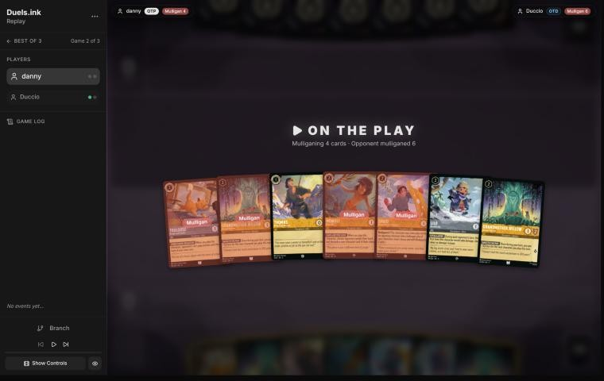
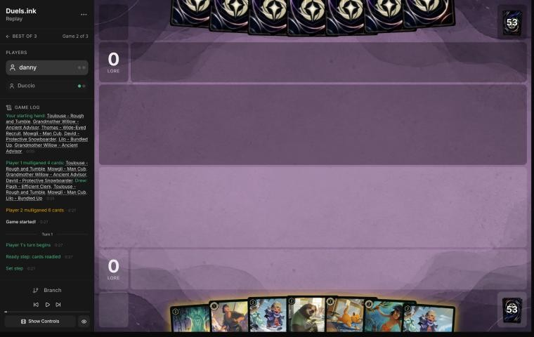
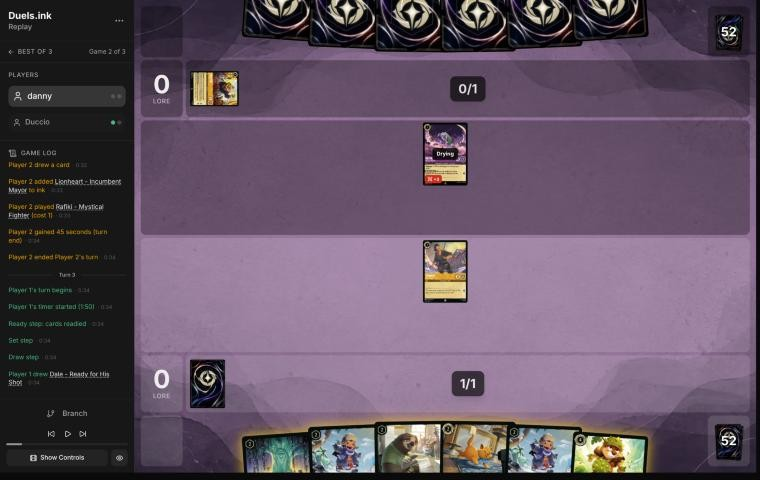
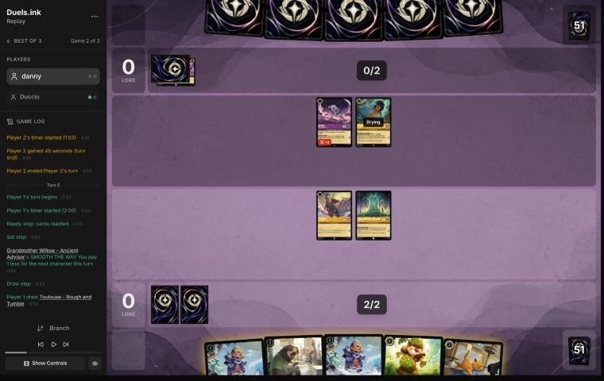
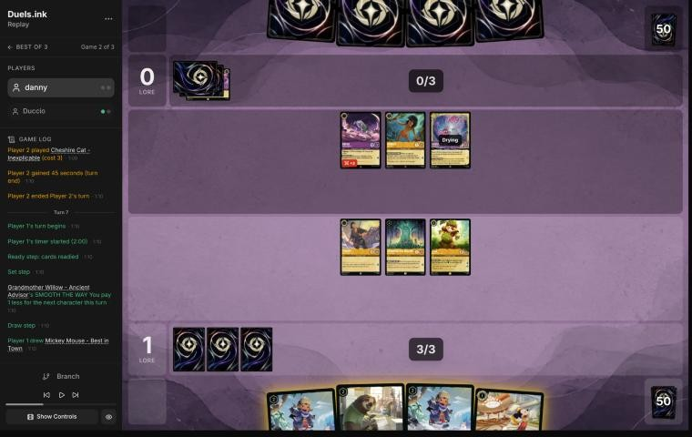
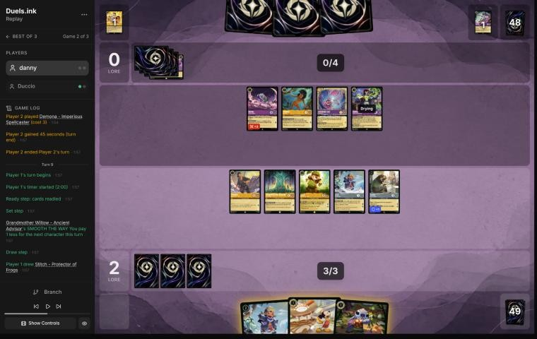
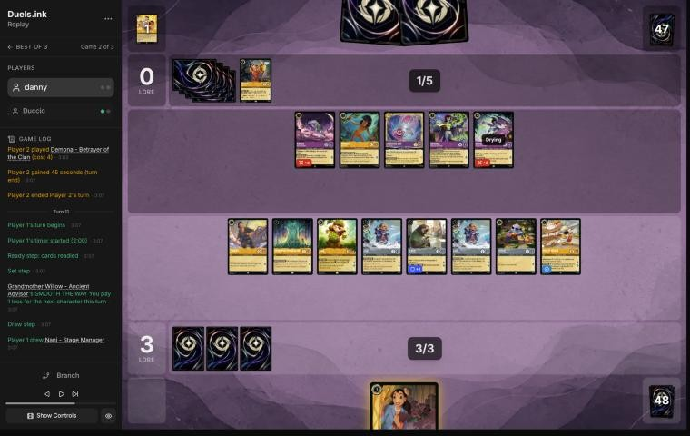

# Review: danny vs Duccio, 11 Nov 2026 (game 2)

| | |
|---|---|
| **Status** | draft (blind pass done, not yet discussed) |
| **Replay** | `01a1cbc6-56dc` (`python3 tools/brief.py 01a1cbc6-56dc --turn N`) · [duels.ink viewer](https://duels.ink/replay/01a1cbc6-56dd-7f63-b907-82bbc78ed918?step=0) |
| **Format** | Core Constructed. Set 14 era: inks revealed before the coin toss |
| **Decks** | You: Amber/Steel Rockstar Aggro, the third version of your Lilo list. Them: Amber/Amethyst Midrange, known from game 1 (Rafiki, Eilonwy, Willow, Isis, two Cheshire Cats, Hades, Demona – Scourge, Gaston) |
| **Play/draw** | You went first |
| **Result** | Won by concession on game turn 12, at 16–0 |
| **Meta data** | snapshot of 12 Nov 2026 (fresh) |
| **Chosen how** | By the user: every game of 11–12 Nov in the export, reviewed blind. You lost game 1 (reviewed separately); the export holds a game 3, so the coach knows this game went to them or you, not which |

## Summary
- **Good plays:** [pre-game](#turn-0) (a deeper mulligan than the coach's, better on the simulator), [1](#turn-1),
  [5](#turn-5) (Dale for 3 with Willow), [11](#turn-11) (eight quests to 16–0).
- **Close calls:** none worth noting.
- **Inaccuracies / mistakes / blunders:**
  - **Inaccuracies, [3](#turn-3) and [7](#turn-7):** free quests left home (Thomas, then Dale under his own SPIKE SUIT).
  - **Mistake, [9](#turn-9):** only Thomas quested at 2–0, leaving 6 lore on a board their challengers couldn't
    profitably attack.

**What decided it:** Dale's SPIKE SUIT and Flash's no-Rush rule made their challengers costly, and your 1- and
2-drops built a board of eight. One full quest turn on turn 11 put you at 16–0, and they conceded after their next
turn.

## The game, turn by turn
Verdicts judge each decision on what you could know at the time, **including archetype knowledge an experienced
player has**. Hindsight is kept to its own section. Severity scale: good play / close call /
inaccuracy / mistake / blunder. Principle IDs and hypotheses (H-n) link to copies
in the Citations section at the end, as they stood when they were cited.

**What you knew before the game:** Duccio's deck from game 1: Amber/Amethyst Midrange. Rafiki (Challenger +3) and
Eilonwy (Support) early; Isis (4, 3 with Willow) exerts one of yours for a challenger; two Cheshire Cats move damage
onto ready characters; Hades – Looking for a Deal; Demona – Scourge (6, 5 with Willow) exerts your board and refills
both hands; Gaston. In game 1, holding characters back didn't save them: Isis, Cheshire and Demona reached them anyway.

### Pre-game

*The board before the decision: [step 0](https://duels.ink/replay/01a1cbc6-56dd-7f63-b907-82bbc78ed918?step=0) in the duels.ink replay viewer.*

**What you did:** on the play, you sent back Toulouse, Mowgli, a Willow and David, kept Willow, Thomas and Lilo –
Bundled Up, and drew Flash, Toulouse, Mowgli and a second Lilo – Bundled Up.

**Verdict: good play.** The coach's candidates were keeping all seven, or sending back a Willow. Your deeper mulligan
beat both on the simulator (`tools/mulligan.py`, 1,500 deals each): 9.1 lore by turn 4, against 7.2 for keeping all
seven and 7.3 for sending back one Willow (ink spent 8.9 against 9.3). Against a Midrange deck whose plan is to grind,
early lore is the priority, and David and Mowgli add little of it ([MULL-3](#cite-mull-3)).

### Turn 1: your turn 1

*The board before the decision: [step 2](https://duels.ink/replay/01a1cbc6-56dd-7f63-b907-82bbc78ed918?step=2) in the duels.ink replay viewer.*

**What you did:** inked Mowgli and played Thomas.

**Verdict: good play.** Thomas is the only 1-drop. Mowgli and Toulouse were the inkable choices, and against a deck
with four The Horseman Strikes! and Besties, Toulouse's lock (no actions on their next turn) is the more useful of
the two later on.

### Turn 3: your turn 2

*The board before the decision: [step 8](https://duels.ink/replay/01a1cbc6-56dd-7f63-b907-82bbc78ed918?step=8) in the duels.ink replay viewer.*

**What you did:** inked Toulouse, played Willow, and didn't quest with Thomas.

**Verdict: inaccuracy (small; confidence: high).** Willow is a good play: her discount makes next turn's 3 ink buy
Dale or two 2-drops. Leaving Thomas home is suboptimal because his quest was free: their only character, Rafiki,
deals 3 while challenging and Thomas has 4 willpower. Nothing else of theirs would be dry next turn. Questing gives a
lore at no risk ([QC-3](#cite-qc-3)).

### Turn 5: your turn 3

*The board before the decision: [step 14](https://duels.ink/replay/01a1cbc6-56dd-7f63-b907-82bbc78ed918?step=14) in the duels.ink replay viewer.*

**What you did:** inked the second Toulouse, played Dale for 3 (Willow's discount), and quested with Thomas (1–0).
Willow stayed home.

**Verdict: good play.** Dale first makes every later quest safer: under SPIKE SUIT, Thomas deals 4 back to anything
that challenges him, so Rafiki (2 willpower) and Mowgli die doing it. Willow's quest (1 lore) would also have dealt 2
back. Keeping her home protects the discount engine against Rafiki's 3, so that's a fair choice
([SEQ-4](#cite-seq-4)).

### Turn 7: your turn 4

*The board before the decision: [step 21](https://duels.ink/replay/01a1cbc6-56dd-7f63-b907-82bbc78ed918?step=21) in the duels.ink replay viewer.*

**What you did:** played Lilo – Bundled Up for 1 (Willow's discount) and Flash for 2, and quested with Thomas (2–0).
Dale and Willow stayed home; Mickey stayed in hand.

**Verdict: inaccuracy (small; confidence: medium).** Two 2-lore characters for 3 ink is right. Keeping Dale home is
suboptimal because his quest (2 lore) was close to free under his own SPIKE SUIT. The only way to kill him was
Mowgli and Cheshire Cat together (1 + 3 = 4), and both die to his 4 back. That 2-for-1 is a trade you'd take.
Rafiki alone deals 3 and dies to the 4 back. Willow staying home is fine: she is the discount, and Rafiki or Cheshire
kills her ([QC-3](#cite-qc-3)).

### Turn 8: their turn

**What happened:** Besties, Assemble! found Demona – Betrayer of the Clan (4, 4/6, Challenger +2), which is now known in
their hand. They played Demona – Imperious Spellcaster, whose IMPETUS gives a Gargoyle Rush and Evasive. **Your Flash
cancels that:** TAKE... YOUR... TIME says all characters lose Rush and can't gain it, so while Flash is in play neither
Demona can challenge the turn it lands.

### Turn 9: your turn 5

*The board before the decision: [step 31](https://duels.ink/replay/01a1cbc6-56dd-7f63-b907-82bbc78ed918?step=31) in the duels.ink replay viewer.*

**What you did:** played Lilo – Bundled Up for 1 (Willow), Stitch and Mickey, and quested with Thomas alone (3–0). Dale,
Willow, the first Bundled Up and Flash stayed home.

**Verdict: mistake (confidence: medium).** Holding four questers back is suboptimal because it gave up 6 lore (Dale 2,
Bundled Up 2, Flash 2) at 2–0 against a board that couldn't punish them. Questing with everyone but Willow is better:
- **Under SPIKE SUIT** every challenge they make costs them the challenger. Rafiki (2 willpower) dies to anything that
  hits back for 2. Demona – Imperious (3) and Cheshire Cat (4) die to Thomas's or Dale's 4. Bundled Up ignores the
  first hit. Mowgli deals 1.
- **Flash stops the Rush** that Demona – Imperious would give Demona – Betrayer, so the known card in their hand can't
  challenge on arrival.
- **The race:** at 9–0 with three more characters entering (Bundled Up 2, Stitch 1, Mickey 2), your board quests for 13
  next turn. Their whole turn would go into trading challengers for questers.
- **What the quest line exposes:** Dale, Thomas, Bundled Up and Flash, to Rafiki 3, Mowgli 1, Cheshire 3 and Demona 4.
  At most two or three of yours die, each taking a challenger with it. Isis (16% now, 23% after their draw) could exert
  one more. Holding back protected only against challenges, the same as in game 1 ([QC-3](#cite-qc-3),
  [POS-1](#cite-pos-1), [TEMPO-1](#cite-tempo-1)).

### Turn 11: your turn 6

*The board before the decision: [step 39](https://duels.ink/replay/01a1cbc6-56dd-7f63-b907-82bbc78ed918?step=39) in the duels.ink replay viewer.*

**What you did:** played Nani for 2 (Willow), took Lilo – Snow Artist with her dig and played her, then quested with all
eight dry characters (16–0).

**Verdict: good play.** With 13 lore of board against a board of five, this sets up the win next turn: you need 4, and
their five characters can't remove enough. The Bundled Ups need two challenges each, and SPIKE SUIT makes every
challenge cost the challenger. Nani and Lilo – Snow Artist are drying, so they can't be challenged, and they quest for
3 next turn on their own. Demona – Scourge (6 of their 7 ink with your Mickey's drop, 23% after their draw) is the one
card that could stop you ([QC-5](#cite-qc-5)).

## Lessons
1. **Flash – Efficient Clerk switches off Rush for everyone** (TAKE... YOUR... TIME). Demona – Imperious Spellcaster's
   IMPETUS can't give their Gargoyles Rush while Flash is in play, so Demona – Betrayer couldn't challenge the turn it
   landed ([turn 8](#turn-8)).
2. **Under your own SPIKE SUIT, a 4-willpower quester is close to free:** whatever challenges Dale, Thomas or Mickey
   takes 4 back ([turns 7](#turn-7), [9](#turn-9)). Leaving them home gives up lore for nothing.
3. **The same lesson as game 1:** the quests you take early are what win the race. Here one full quest turn (turn 11)
   was enough.

## Proposed knowledge-base updates (applied after discussion)
- **Meta** (the Amber/Amethyst pair file's notes, Duccio): game 2 added Demona – Betrayer of the Clan (off-list, 4,
  4/6, Challenger +2, found with Besties, Assemble!), Lionheart – Incumbent Mayor and three Merlin's Shops (inked). They
  conceded on their turn 12 at 0–16.
- **Card note** (Flash – Efficient Clerk, new or added to the Rockstar notes): TAKE... YOUR... TIME turns off Rush on
  both sides, including Rush that IMPETUS IMPROVISUS, Mulan's quest or Sven would give.

## Hindsight
Doesn't change the verdicts above.
- On turn 12 they used Cheshire, Demona – Betrayer and Demona – Imperious to kill Flash, Dale and Mickey, and moved 2
  damage onto a Bundled Up. With your remaining board questing for well over the 4 you needed, they conceded.

## The coach's errors
Found by the coach during the review; the discussion may add more.

| When | Error | How it was caught | How it won't happen again |
|---|---|---|---|
| Turns 9 and 11 | The brief's "what can challenge your characters" listed Demona – Betrayer as challenging the turn it lands (Rush from Demona – Imperious), though your Flash in play says all characters lose Rush and can't gain it | Reading Flash's text against the brief | Proposed: the brief drops every Rush route (keyword, given, or chosen) while a character with "lose Rush and can't gain Rush" is in play on either side, and says so in one line. Test on this game's turn 9 |
| Turn 11 | The same section labelled Demona – Betrayer "(another, Shifted in, seen, in no listed list)", though it has no Shift: the label appears for any landing card that shares a name with a character in play | Reading the brief | Proposed: the "Shifted in" label only when the route is a Shift |

## Open questions
- **Turns 3, 7 and 9:** what were you guarding against by keeping Dale, Thomas and the Bundled Ups home? Under SPIKE
  SUIT their challengers died to the damage back.

## Citations
Copies of the coach's knowledge base cited above, as they stood when they were cited (the private repository's commit and date are given with each). They don't change when the knowledge base does.

**MULL-3**: strategy principle, `kb/strategy/principles.md` at `8f0617e` (2026-11-12), working tree

> - **MULL-3. The right keep depends on the matchup.** Early interaction against aggro; pressure, draw and engines against slow decks. The mulligan is the first expression of your role. In the Set 14 era the opponent's inks are known before the mulligan (RULE-8), so this applies from game 1 of a match. `[MCL ch.12]` · baseline

**QC-3**: strategy principle, `kb/strategy/principles.md` at `8f0617e` (2026-11-12), working tree

> - **QC-3. Questing is favoured when:**
>   - you control the board
>   - your exerted characters can't be punished
>   - the race favours you
>   - removing their characters gains little
>
>   **Challenging is favoured when:**
>   - they have an engine or repeated-value piece
>   - the trade is efficient
>   - you need to slow the game
>   - your deck is stronger late
>
>   `[MCL ch.6]` · baseline

**SEQ-4**: strategy principle, `kb/strategy/principles.md` at `8f0617e` (2026-11-12), working tree

> - **SEQ-4. Sequence across turns.** A slightly weaker play now can set up a much stronger next turn: keep a shift target alive, keep a singer ready, hold removal for a bigger threat. `[MCL ch.5]` · baseline

**POS-1**: strategy principle, `kb/strategy/principles.md` at `8f0617e` (2026-11-12), working tree

> - **POS-1. From ahead, take the safest path to victory.** Don't overextend into sweepers, don't make unnecessary trades, and make the opponent take the risks. Winning by 1 lore counts the same as winning by 10. `[MCL ch.10]` · baseline

**TEMPO-1**: strategy principle, `kb/strategy/principles.md` at `8f0617e` (2026-11-12), working tree

> - **TEMPO-1. Tempo is how much freedom you leave the opponent, not how fast you play.** A play that forces the opponent to spend their turn answering it has stolen part of their turn. *Ask: "If I play this, what does my opponent have to do next?"* `[MCL ch.1]` · baseline

**QC-5**: strategy principle, `kb/strategy/principles.md` at `8f0617e` (2026-11-12), working tree

> - **QC-5. The race changes everything.** At 18–12 up, take the last 2 lore. At 8–16 down, stopping their close-out matters more than your quests. `[MCL ch.6]` · baseline

**amber-amethyst.md, Remember Merida and Midrange: Chee-Hoo and durkules**: knowledge base, `kb/meta/archetypes/amber-amethyst.md` at `8f0617e` (2026-11-12), working tree

> ### Remember Merida and Midrange: Chee-Hoo and durkules; three more of danny's Remember Merida games `[coach, meta study of danny's 5–10 Nov 2026 games not studied before (tools/scan.py), full games, not blind, 4 games]`
> - **danny's Remember Merida, the 5 Nov versions above:** the Cheshire Cat list beat Chee-Hoo 15–13 (`01a1aafd-6b9d`); the
>   Elsa – Snow Queen list (`01a1ad8b-7949`) and the Magica De Spell list (`01a1b076-c839`) lost to Circle of Life (Amber/Emerald
>   notes).
> - **Chee-Hoo, Remember Merida (the mirror):** Raging Storm on game turns 18 and 22, each clearing both boards (six of
>   danny's characters, then four); three Demona – Scourge, three Demona – Imperious, Merlin's Shop twice. danny won by
>   concession at 15–13.
> - **durkules, Midrange, against danny's Rockstar Aggro (`01a1b152-d00d`, danny won 19–6):** game turn 9, Besties, Assemble!
>   found Hades, then Isis Vanderchill (4 {S}) killed Nani, Luisa (Challenger +2) killed Lilo – Snow Artist and Demona –
>   Imperious traded with Pudge: three kills, the only swing turn. Four The Horseman Strikes! seen.
