# Review: danny vs Duccio, 11 Nov 2026 (game 3)

| | |
|---|---|
| **Status** | draft (blind pass done, not yet discussed) |
| **Replay** | `01a1cbca-787d` (`python3 tools/brief.py 01a1cbca-787d --turn N`) · [duels.ink viewer](https://duels.ink/replay/01a1cbca-787e-7341-aab8-3a0a6d17d9cf?step=0) |
| **Format** | Core Constructed. Set 14 era: inks revealed before the coin toss |
| **Decks** | You: Amber/Steel Rockstar Aggro, your Lilo list. Them: Amber/Amethyst Midrange, known from games 1 and 2 ([the coach's notes on their list](#cite-kb-meta-archetypes-amber-amethyst-midrange)) |
| **Play/draw** | They went first |
| **Result** | Lost on lore, 8–20, on game turn 21 |
| **Meta data** | snapshot of 12 Nov 2026 (fresh) |
| **Chosen how** | By the user: every game of 11–12 Nov in the export, reviewed blind. The coach reviewed games 1 (a loss) and 2 (a win) first, so it knows this game decides the match, not which way |

## Summary
- **Good plays:** [pre-game](#turn-0), [2](#turn-2), [6](#turn-6) (questing the Shifted Lilo & Stitch to kill Hamm,
  better than the coach's line), [8](#turn-8), [10](#turn-10) (Nani for Cheshire), [14](#turn-14) (Lilo as next
  turn's Shift base, better than the coach's line), [19](#turn-19) (letting Hades draw).
- **Close calls:** [12](#turn-12) (You Broke My Smolder on a one-card hand).
- **Inaccuracies / mistakes / blunders:**
  - **Inaccuracy, [4](#turn-4):** Willow and no quests at 0–0; David entering exerted as a Bodyguard would have
    let Lilo and Pudge quest for 2.
  - **Inaccuracy, [16](#turn-16), in a lost game:** Mike's FIND A FRIEND gave an opponent holding one card a third
    Demona – Scourge; Lilo & Stitch for the same ink quests for more.
- **Unwinnable from:** [16](#turn-16). After their turn 15 (two Isis, one found with Besties, Assemble!), seven
  characters questing for 9 at 5–5 against your one; no line scores 15 before they reach 20.

**What decided it:** their exert effects. Isis on turn 9, Demona – Scourge on turns 11, 13 and 17 and two more Isis
on turn 15 each exerted what you'd rebuilt for their challengers to kill, while their own board kept growing. Your
play was mostly good, twice better than the coach's plan; the two inaccuracies were small next to that.

## The game, turn by turn
Verdicts judge each decision on what you could know at the time, **including archetype knowledge an experienced
player has**. Hindsight is kept to its own section. Severity scale: good play / close call /
inaccuracy / mistake / blunder. Principle IDs and hypotheses (H-n) link to copies
in the Citations section at the end, as they stood when they were cited.

**What you knew before the game:** Duccio's deck from games 1 and 2: Amber/Amethyst Midrange (the brief puts it at
100%). Their key cards, with the earliest game turn each can come (they're on the play, so their turns are the odd
ones; Grandmother Willow or Hamm – Piggy Bank takes 1 off a character, two Willows 2):
- **Rafiki – Mystical Fighter** (1): Challenger +3, so a 0/2 that challenges for 3. Turn 1.
- **Eilonwy – Princess of Llyr** (1): Support, adding her 2 to a quester. Turn 1.
- **Cheshire Cat – Inexplicable** (3): Boost 2; each boost moves up to 2 damage counters from any character onto one
  of yours, ready or not, so damage from a challenge can be moved onto a quester. Turn 3 with a discount, boosting
  from turn 5.
- **Isis Vanderchill** (4, uninkable): exerts one of yours as she lands, so a challenger can hit it. Turn 5 (3 with
  Willow).
- **Tigger – Bouncing All the Way** (4): returns a character of cost 2 or less to hand. Almost your whole deck costs
  2 or less, so Tigger is a tempo hit on any of them. Turn 5.
- **Demona – Betrayer of the Clan** (4): Challenger +2, a 6-strength challenger; can't ready while they hold 3+
  cards. Turn 5.
- **Hades – Looking for a Deal** (5): you bottom a chosen character or they draw 2. Turn 7 (5 with a discount).
- **Gaston – Superior Archer** (5): banishes a character with 5 strength or more; none of yours has 5 unless pumped.
- **Demona – Scourge of the Wyvern Clan** (6): exerts your whole board, so their challengers can hit everything; then
  both hands refill to 3. Turn 9, or turn 7 with a Willow.
- **Lionheart – Incumbent Mayor** (6): Bodyguard 4/7; +1 lore to two characters as he lands.
- Also: **The Horseman Strikes!** (draw, banish an Evasive: you have none, so it's a cantrip), **Besties,
  Assemble!** (dig 4 for a character), **Merlin's Shop and Smithy** (a location that draws and gains lore), Mowgli,
  Demona – Imperious Spellcaster.

In games 1 and 2, holding characters back didn't protect them: Isis, Cheshire and Demona reach ready characters
anyway, while every unquested turn gave the Rockstar board's lore away. Game 2 was won by a board of cheap
characters questing behind Dale's SPIKE SUIT and Flash's no-Rush rule.

### Pre-game

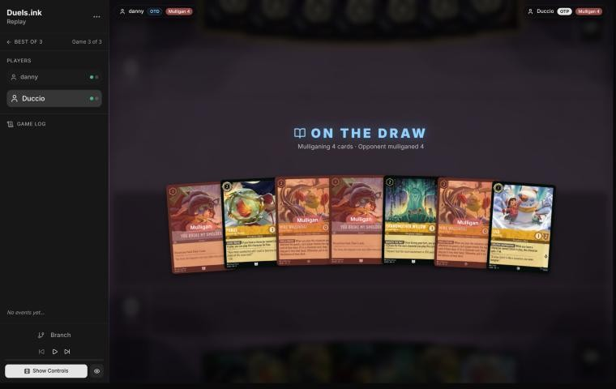
*The board before the decision: [step 0](https://duels.ink/replay/01a1cbca-787e-7341-aab8-3a0a6d17d9cf?step=0) in the duels.ink replay viewer.*

**What you did:** on the draw, you sent back both You Broke My Smolders and both Mike Wazowski – Heroic Climbers,
kept Lilo – Snow Artist, Pudge and Willow, and drew Nani, Lilo & Stitch – Fun-Loving Friends, David and Mowgli.

**Verdict: good play.** The hand had only two inkable cards (Lilo and Pudge), and the four uninkables were the
weakest early (You Broke My Smolder is a late refill; Mike is a 0-strength 2-drop). Your keep was the coach's first
candidate: Lilo on turn 1, then Pudge free (GOOD FRIEND) beside Willow on turn 2, Willow's discount on turn 3. On the
simulator (`tools/mulligan.py`, 1,500 deals each) it scored 8.4 lore by turn 4 against 6.1 for keeping all seven,
9.1 for keeping only Lilo and Pudge and 9.4 for a full mulligan. The simulator doesn't model Pudge coming free, which
is worth a body on turn 2 to the two keeps that hold him, so the gap to those options is smaller than it looks.
Keeping Lilo and Pudge alone is a close alternative; nothing here is worth flagging ([MULL-3](#cite-mull-3)).

### Turn 2: your turn 1

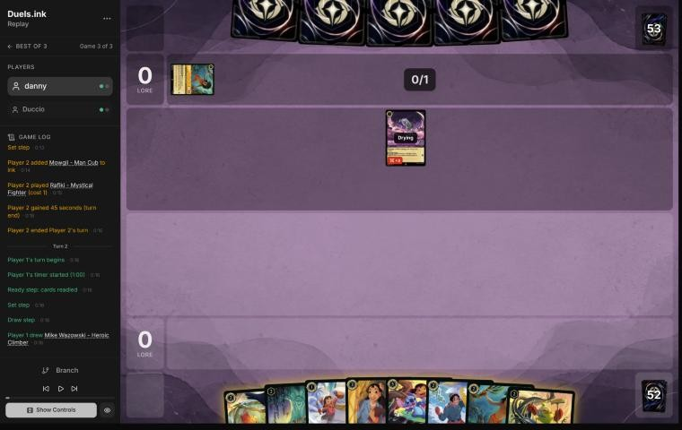
*The board before the decision: [step 5](https://duels.ink/replay/01a1cbca-787e-7341-aab8-3a0a6d17d9cf?step=5) in the duels.ink replay viewer.*

**What you did:** drew Mike Wazowski – Heroic Climber, inked Mowgli, played Lilo – Snow Artist and then Pudge for
free (GOOD FRIEND).

**Verdict: good play.** Lilo then a free Pudge is two bodies for one ink, the reason for the keep. Of the inkables,
Lilo & Stitch (Shift onto Lilo on turn 3), Nani (dig) and David (a Bodyguard that survives Rafiki's 3) all have a
job against this deck; Mowgli's discard hits only non-characters (The Horseman Strikes!, Besties), so it was the
cheapest to ink.

### Turn 4: your turn 2

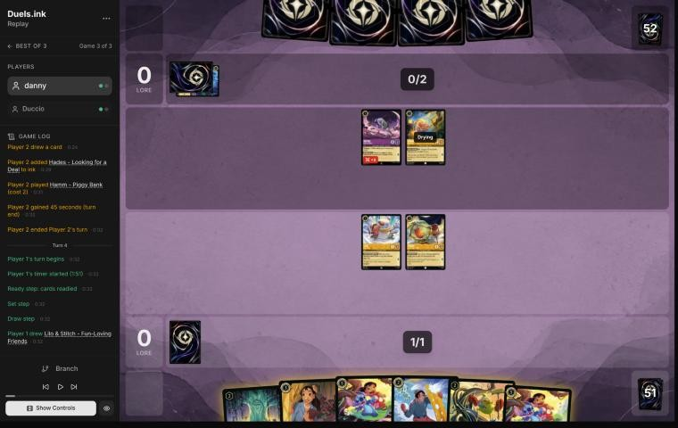
*The board before the decision: [step 12](https://duels.ink/replay/01a1cbca-787e-7341-aab8-3a0a6d17d9cf?step=12) in the duels.ink replay viewer.*

**What you did:** drew a second Lilo & Stitch, inked David, played Willow and didn't quest with Lilo or Pudge.

**Setup.** Their Rafiki (Challenger +3) and Hamm (2 strength) will both be dry next turn: Rafiki kills Lilo or Pudge
and survives the 1 back, and Hamm kills Lilo. With 3 ink and Hamm's LOOSE CHANGE they can cast a 4-drop a turn early:
Isis (exert one of yours, about 32% after their draw) or Tigger (return a character of cost 2 or less, 25%), though
exerting Hamm for the discount stops him challenging. Lilo is next turn's Shift base for Lilo & Stitch, which the
hand holds two of. The candidates: (A) Willow, no quests, your line; (B) David entering exerted as a Bodyguard, then
quest Lilo and Pudge; (C) Willow and quest both.

**Verdict: inaccuracy (small; confidence: medium).** Playing **Willow with no quests** is suboptimal because it
scores nothing and buys little: next turn's plays from this hand (Shift Lilo & Stitch for 3, or Nani for 3) leave
Willow's discount with nothing extra to pay for, so she only starts paying from turn 8. Playing **David exerted and
questing Lilo and Pudge** is better because it scores 2 and makes every challenge go to David first ([RULE-5](#cite-rule-5)). His 4
willpower survives Rafiki alone, so killing him takes both Rafiki and Hamm, who then don't quest: you'd be 2 lore up
on them for a 2-drop, with Lilo and Pudge untouched. Only Demona – Imperious Spellcaster (Rush, about 9%) adds a third
challenger to reach Lilo after David. If they leave David alone, he's a Bodyguard behind your questers for the rest
of the game. Willow then comes on turn 8 beside a discounted Nani, using the same ink. Line C is worse than both:
without a Bodyguard, Rafiki and Hamm kill Lilo and Pudge for free.

[H-6](#cite-h-6) (a ready board can outlast an exert-and-challenge deck) doesn't fit here: it relies on the waiting board drawing
cards, and this one draws none, while Lilo's and Pudge's 1 back can't threaten anything of theirs. Waiting only gives
them a free turn ([TEMPO-1](#cite-tempo-1), [QC-3](#cite-qc-3)).

### Turn 6: your turn 3

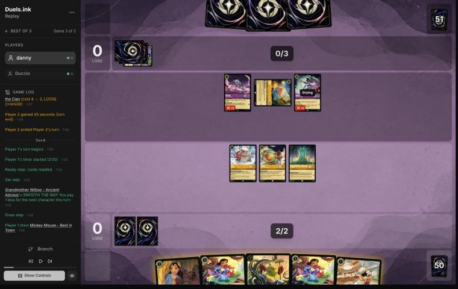
*The board before the decision: [step 19](https://duels.ink/replay/01a1cbca-787e-7341-aab8-3a0a6d17d9cf?step=19) in the duels.ink replay viewer.*

**What you did:** drew Mickey Mouse – Best in Town, Shifted Lilo & Stitch onto Lilo for 2 (Willow), inked the second
Lilo & Stitch, played Mickey, quested Lilo & Stitch for 3 and gave Pudge its Support: Pudge (4 strength) banished
the exerted Hamm and took 2. 3–0.

**Setup.** They have three challengers dry next turn: Rafiki (3 while challenging), Hamm (2) and Demona – Betrayer of
the Clan (6 while challenging, and STONE BY DAY keeps her exerted while they hold 3 or more cards). Demona's 6 less
Resist 1 kills Lilo & Stitch exactly, and Rafiki kills anything of yours with 3 willpower or less. With 4 ink and
Hamm, their 5-drops (Gaston, Hades) come a turn early; Isis (27%) can exert a ready character for Demona. The coach's
first line was to Shift and play Mickey but quest nothing, keeping Lilo & Stitch as a ready wall.

**Verdict: good play.** Your line beats the coach's. While Demona lives, a ready Lilo & Stitch can't quest without
dying to her, so as a wall it only denies them targets: that suits a Midrange deck happy to develop towards Demona –
Scourge and Hades ([ROLE-3](#cite-role-3)). Questing turns the Shift turn into 3 lore and kills Hamm, their discount and a challenger,
before Hamm makes a 5-drop castable on 4 ink. If Demona then takes Lilo & Stitch, she spends their turn doing it,
takes 3 back and is left exerted, likely stuck there by STONE BY DAY, where Nani's 3 strength finishes her next
turn. Pudge was the right target for the Support: his 3 willpower survives Hamm's 2, where Willow's 2 wouldn't
([TRADE-2](#cite-trade-2), [TEMPO-1](#cite-tempo-1)).

### Turn 8: your turn 4

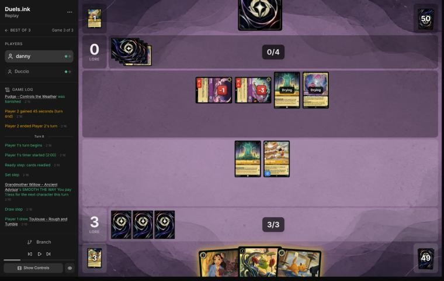
*The board before the decision: [step 33](https://duels.ink/replay/01a1cbca-787e-7341-aab8-3a0a6d17d9cf?step=33) in the duels.ink replay viewer.*

**What you did:** drew Toulouse, played Nani for 2 (Willow) and took Lilo – Bundled Up with THAT'S YOUR CUE, then
inked Toulouse, played Lilo – Bundled Up, quested Mickey (2) and had Willow banish the damaged Rafiki for free. 5–0,
and Mickey's HOT DOG gave each player an ink drop.

**Setup.** Their Demona – Betrayer (3 damage) and Rafiki (1 damage) were exerted, but nothing of yours that was dry
could kill Demona: Nani would be drying, and Willow's 1 only trades Willow for 1 damage. Rafiki, at 1 willpower left
and 0 strength defending, died to Willow for nothing, and he's the challenger that kills your 3-willpower characters.
Mickey had to quest (Adventurous), which hands them an ink drop: 6 ink next turn, so Demona – Scourge of the Wyvern
Clan (15% after their draw) and Gaston are castable. With one card in hand, STONE BY DAY no longer keeps Demona –
Betrayer exerted.

**Verdict: good play.** It's the coach's line, Nani then a 2-drop and Willow into Rafiki, with two improvements:
Nani went first, so the ink choice was made after her dig ([SEQ-1](#cite-seq-1)), and the dig's Lilo – Bundled Up (2 lore, and
EXTRA LAYERS ignores the first damage on their turn) is better than Mike.

### Turn 10: your turn 5

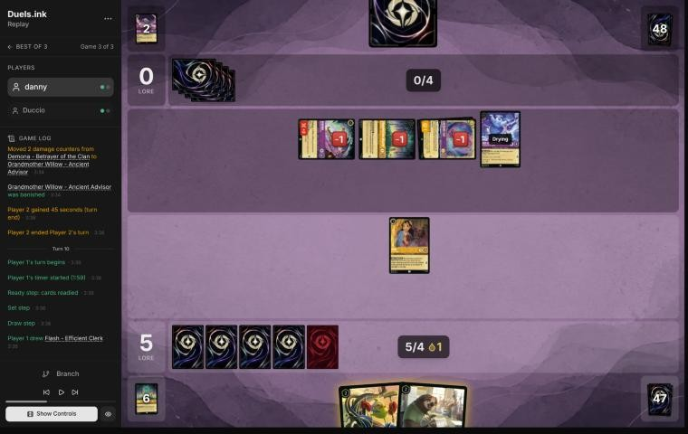
*The board before the decision: [step 52](https://duels.ink/replay/01a1cbca-787e-7341-aab8-3a0a6d17d9cf?step=52) in the duels.ink replay viewer.*

**What you did:** drew Flash, played Mike Wazowski (FIND A FRIEND gave you Mowgli; their reveal, Besties, Assemble!,
went to the bottom), played Flash, and traded Nani for the exerted Cheshire Cat. Mowgli stayed in hand, uninked.

**Setup.** Their turn 9 (Isis exerting Lilo – Bundled Up for two challenges, Demona into Mickey, then Cheshire's
boost moving Demona's damage onto Willow) left you Nani alone, at 5–0, with Flash and Mike in hand and 5 ink (one of
it Mickey's drop). Their four characters quest for 4 a turn. Nani could kill the exerted Willow (1 willpower left)
and survive, or trade with the exerted Cheshire (3 left). Cheshire is the card that makes a ready board unsafe: each
boost moves 2 damage counters onto a ready character, and moving counters isn't damage, so Flash's Resist doesn't
stop it. Willow's discount makes Demona – Scourge castable on their 5 ink next turn (16% after their draw).

**Verdict: good play.** The coach's line. Killing Willow leaves Nani exerted and dead next turn anyway, with Cheshire
still able to kill Flash from a ready position; trading Nani for Cheshire leaves Flash and Mike ready and safe from
everything they've shown except a new exert effect. Mike first was right: his reveal could have found a 1-drop for
the spare ink ([SEQ-1](#cite-seq-1)). Keeping Mowgli rather than inking it is also right: with one card in hand, a 2-drop to play
next turn is worth more than a fifth land ([H-2](#cite-h-2)).

### Turn 12: your turn 6

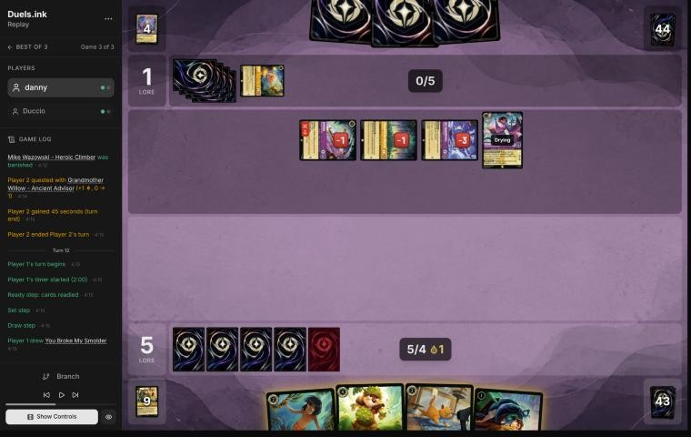
*The board before the decision: [step 63](https://duels.ink/replay/01a1cbca-787e-7341-aab8-3a0a6d17d9cf?step=63) in the duels.ink replay viewer.*

**What you did:** drew You Broke My Smolder, played Dale, inked Toulouse, then cast You Broke My Smolder (discarding
Mowgli) and drew Nani and a Lilo & Stitch. One ink unused.

**Setup.** Their turn 11 was Demona – Scourge for 5 (Willow): it exerted Flash and Mike for Isis and Demona – Betrayer
to kill, and refilled both hands to 3 (yours got Dale and Toulouse). Your board is empty at 5–1; theirs quests for 4 a
turn (Scourge 2, Isis 1, Willow 1). They hold 3 cards, so STONE BY DAY keeps the exerted Betrayer exerted at their
next ready step; Mowgli's discard could take them to 2 and free her, so it isn't the 2-drop to play. Nothing you play
can challenge this turn. The coach's line: Dale and Toulouse, inking Mowgli and keeping You Broke My Smolder for an
emptier hand.

**Verdict: close call.** Your line puts one body fewer on the board now (no Toulouse) but turns Mowgli, the
weakest card here, and the Smolder into two fresh cards a turn early, and found Lilo & Stitch and Nani for next
turn's 7 ink. The coach's line keeps the Smolder until the hand is empty, as [H-1](#cite-h-1) advises for refills, but at a
hand of one weak card the difference is small. Both keep their hand at 3, so Betrayer stays stuck.

### Turn 14: your turn 7

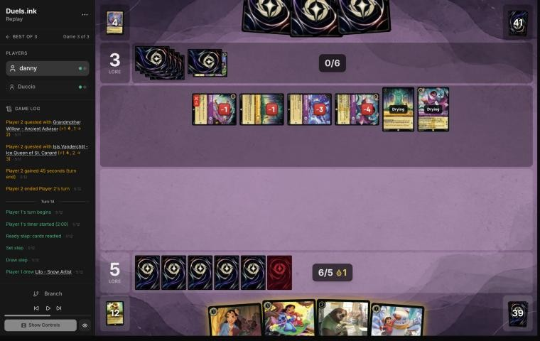
*The board before the decision: [step 74](https://duels.ink/replay/01a1cbca-787e-7341-aab8-3a0a6d17d9cf?step=74) in the duels.ink replay viewer.*

**What you did:** drew Lilo – Snow Artist, played Nani (her dig found Mike Wazowski), Flash, and Lilo with the ink
drop. You didn't ink, keeping Lilo & Stitch and Mike in hand.

**Setup.** Their turn 13 brought a second Willow and a second Demona – Scourge, which exerted Dale for the first
Scourge to kill. You're at 5–3 with an empty board. Their six characters could quest for 8, but they hold 3 cards,
so at their next ready step STONE BY DAY keeps the exerted Betrayer and first Scourge exerted; the second Scourge,
both Willows and Isis are free next turn. Nothing you play this turn can quest or challenge. Their ways to reach a
ready character: another Isis (25% after their draw), a third Scourge (18%), Tigger on a 2-cost or cheaper character
(25%). The coach's line: ink Lilo and hard-cast Lilo & Stitch (5) with Flash (2), keeping Nani.

**Verdict: good play.** Your line beats the coach's. Lilo now is a dry Shift base next turn, so Lilo & Stitch lands
for 3 and quests at once: next turn your board quests for 6 (Lilo & Stitch 3, Flash 2, Nani 1) and Mike comes down,
on exactly the 5 ink you have. The coach's line quests for 5 next turn from two bodies. Three bodies also spread the
risk from a single Isis. Skipping the ink costs nothing: the hand's remaining cards fit the 5 ink you have ([H-2](#cite-h-2)). The
risk is losing Lilo before the Shift (Tigger, or an exert effect and a challenge); then Lilo & Stitch is still
castable for 5.

### Turn 16: your turn 8

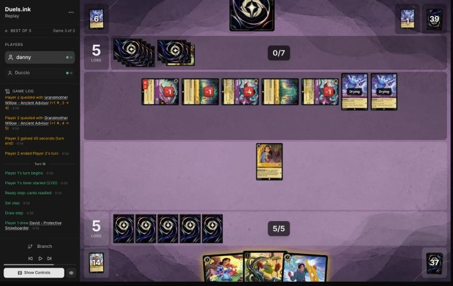
*The board before the decision: [step 96](https://duels.ink/replay/01a1cbca-787e-7341-aab8-3a0a6d17d9cf?step=96) in the duels.ink replay viewer.*

**What you did:** drew David, played Mike Wazowski (FIND A FRIEND gave you Mowgli and them a third Demona – Scourge),
played David ready, and traded Nani for the first Demona – Scourge (2 willpower left). One ink unused; Lilo & Stitch
and Mowgli stayed in hand.

**Setup.** Their turn 15 found two Isis (one through Besties, Assemble!) and killed Flash and Lilo, the Shift base. At
5–5 their seven characters quest for 9 a turn, and with one card in hand STONE BY DAY no longer holds the Demonas
exerted: 20 by game turn 19 (`tools/odds.py clock`). Killing a 2-lore Demona slows them to 7 a turn, which still
takes them to 20 on turn 21 (3 questing turns), and your board can't score 15 by your turn 20 even if none of it
dies: this turn nothing new can quest, and Lilo & Stitch, David and Mike together quest for 5. Their two Isis, the
Betrayer and the second Scourge are four challengers against it.

**The game is unwinnable from here** ([principle 2](#cite-principle-2)): only a long run of their mistakes gets you there, so the
decisions below are judged on keeping those slim chances, not on what lost the game.

**Verdict: inaccuracy (small; confidence: medium).** Nani into the 2-willpower Scourge is right: it takes 2 lore a
turn off their clock for a 1-lore character. Playing **Mike** is suboptimal because FIND A FRIEND is symmetric, and
against an opponent holding one card, a free character for them (here their third Scourge, another exert-all) is
worth more than the one you get. Playing **Lilo & Stitch** for exactly your 5 ink is better: 3 lore a turn instead of
Mike's and David's 2, and its 5 willpower with Resist survives Isis and Scourge (only the Betrayer kills it in one
challenge), without giving them a card.

### Turn 18: your turn 9

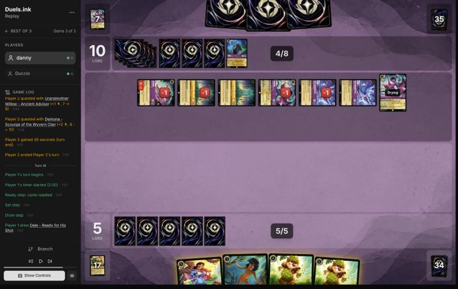
*The board before the decision: [step 112](https://duels.ink/replay/01a1cbca-787e-7341-aab8-3a0a6d17d9cf?step=112) in the duels.ink replay viewer.*

**What you did:** drew a third Dale, played Dale, inked another, and played Mowgli; their hand held no non-character,
so nothing was discarded.

**Setup.** The third Scourge (turn 17) exerted David and Mike for the two Isis to kill. At 10–5 with an empty board,
their characters quest for 9, or 6 while their 3-card hand keeps the exerted Betrayer and second Scourge stuck.

**Verdict: no verdict; the game was lost ([principle 2](#cite-principle-2)).** One note for later games: with their hand at exactly 3,
Mowgli's discard would have taken them to 2 and let both stuck Demonas ready, so against STONE BY DAY Mowgli can
help them. Here the reveal found only characters.

### Turn 19: their turn

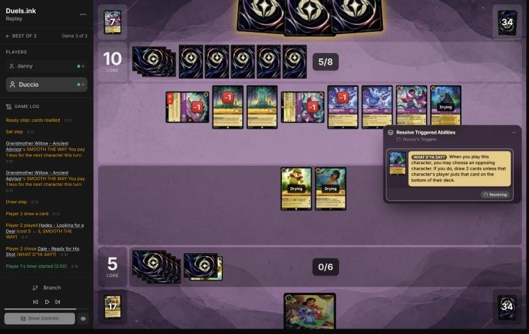
*The board before the decision: [step 118](https://duels.ink/replay/01a1cbca-787e-7341-aab8-3a0a6d17d9cf?step=118) in the duels.ink replay viewer.*

**What happened:** Hades targeted Dale and you let them draw 2 rather than bottom Dale; Lionheart gave both Isis +1
lore, and they quested to 18.

**Verdict: good choice, in a lost game.** Keeping Dale keeps your best quester, and the two cards kept their hand at 3
or more, so STONE BY DAY held the Betrayer and the second Scourge exerted. Two more cards matter little to a deck
already at 16.

### Turn 20: your turn 10

**What you did:** Mike (FIND A FRIEND gave you Lilo – Snow Artist, which you inked), Lilo & Stitch, and quests with
Dale and Mowgli to 8. They needed 2 lore with eight characters; they won on turn 21. No verdict.

## Lessons
1. **A Bodyguard entering exerted makes early quests safe against challengers** ([turn 4](#turn-4)). David's 4
   willpower survives Rafiki alone, so killing him costs them two characters' quests, and Lilo and Pudge score
   meanwhile ([RULE-5](#cite-rule-5)).
2. **A character that can't quest safely has little value kept ready against a deck that wants a long game**
   ([turn 6](#turn-6)). While Demona – Betrayer lived, Lilo & Stitch was going to die whenever it quested; questing it
   on its Shift turn turned it into 3 lore and Hamm's death.
3. **A Shift base played this turn is a dry base next turn** ([turn 14](#turn-14)): the Shift then lands for 3 and
   quests at once.
4. **Against STONE BY DAY, count their hand.** At 3 or more cards at their ready step, their exerted Demonas stay
   exerted. Your cards change that count: Mowgli's discard lowers it, Mike's FIND A FRIEND can raise it (they choose),
   and letting Hades draw raises it ([turns 16](#turn-16), [18](#turn-18), [19](#turn-19)).
5. **Mike's FIND A FRIEND is symmetric:** it's a gift to an opponent short of cards ([turn 16](#turn-16)).

## Proposed knowledge-base updates (applied after discussion)
- **Meta** (the Amber/Amethyst pair file's notes, Duccio, games 1–3): their Midrange list ran at least three Demona –
  Scourge, three Isis, three Hades, three Demona – Imperious, two Willows, two Hamms, two Cheshire Cats, two Besties,
  Assemble!, Demona – Betrayer (off-list), Lionheart, Rafiki, Mowgli, The Horseman Strikes! and Merlin's Shop. Two
  Willows bring Scourge to 4 ink and Isis to 2. Game 3: Scourge on turns 11, 13 and 17, two Isis on turn 15.
- **Card note** (Demona – Scourge, [Facing her](#cite-kb-cards-demona-scourge-of-the-wyvern-clan-facing-her)): the cards of yours that change their
  hand count around STONE BY DAY: Mowgli – Man Cub's discard can take them below 3 and free their Demonas; Mike
  Wazowski's FIND A FRIEND offers them a character (they may decline); Hades – Looking for a Deal's "let them draw"
  keeps them at 3 or more.
- **Strategy:** more evidence for the hypothesis proposed in this match's earlier reviews (against an exert-and-
  challenge deck, a Rockstar board should quest every turn): [turn 4](#turn-4) held back for nothing, and the
  user's own [turn 6](#turn-6) quest was the better line. Its limit, from this game: a quester that dies for nothing
  to a single challenger (Pudge to Rafiki on turn 4) needs a Bodyguard in front of it first.

## Hindsight
Doesn't change the verdicts above.
- Their hands were full of exert effects: three Scourges and three Isis came down in eleven turns, with two Willows
  discounting them. After the turn-9 swing (Isis, two challenges and Cheshire moving damage onto Willow) you never had
  more than three characters at the start of their turn.
- The third Scourge was the one your Mike revealed on turn 16; it cleared David and Mike on turn 17. Without it they
  still reached 20 on turn 21 on the clock.
- Toulouse (inked on turn 12) would have stopped Besties, Assemble! only if played on turn 14, the turn before; it was
  already in your inkwell by then.

## The coach's errors
Found by the coach during the review; the discussion may add more.

| When | Error | How it was caught | How it won't happen again |
|---|---|---|---|
| Turn 6 | The coach's line kept Lilo & Stitch ready as a wall, though Demona – Betrayer meant it could never quest safely; your quest into Hamm was better | Comparing your line with the coach's on the merits | Proposed: in the decision method's [recurring errors](#cite-docs-decision-method-9-the-coach-s-recurring-errors), a line: "Before keeping a quester ready, say what waiting gains: a card, a better challenge next turn, or a wipe dodged. If nothing, and it can't quest safely later either, use it now" |
| Turn 14 | The coach hard-cast Lilo & Stitch and missed that Lilo played now makes a dry Shift base next turn | The same comparison | Proposed: the brief's options list "Shift next turn onto a base you can play now" when the hand holds both a Shift card and its base |

## Open questions
- **[Turn 4](#turn-4):** were Lilo and Pudge held back to protect the Shift base, and was David entering exerted
  considered?
- **[Turn 16](#turn-16):** was Mike played to dig for a Lilo, so that Lilo & Stitch could Shift for 3 next turn? That
  would make him better than the coach credited, at the cost of the card he could give them.
- **[Turn 12](#turn-12):** You Broke My Smolder over keeping it for an empty hand: what decided it?

## Citations
Copies of the coach's knowledge base cited above, as they stood when they were cited (the private repository's commit and date are given with each). They don't change when the knowledge base does.

**amber-amethyst.md, Midrange**: knowledge base, `kb/meta/archetypes/amber-amethyst.md` at `d9b9271` (2026-11-12), working tree

> ### Midrange
> 33% of the pair's games (45,123).
>
> | # | Card | Type | Cost | Tag |
> |---|---|---|---|---|
> | 1 | Eilonwy - Princess of Llyr | character | 1 |  |
> | 4 | Luisa Madrigal - Pushing Through | character | 1 |  |
> | 4 | Rafiki - Mystical Fighter | character | 1 |  |
> | 4 | Grandmother Willow - Ancient Advisor | character | 2 |  |
> | 4 | Hamm - Piggy Bank | character | 2 |  |
> | 4 | Cheshire Cat - Inexplicable | character | 3 |  |
> | 1 | Demona - Imperious Spellcaster | character | 3 | combat |
> | 1 | Dumbo - The Flying Elephant | character | 3 |  |
> | 2 | Agustin Madrigal - Exceptionally Kind | character | 4 |  |
> | 1 | Dumbo - Ninth Wonder of the Universe | character | 4 |  |
> | 4 | Isis Vanderchill - Ice Queen of St. Canard | character | 4 | exert |
> | 2 | Sven - Leaping Reindeer | character | 4 |  |
> | 3 | Tigger - Bouncing All the Way | character | 4 | removal |
> | 4 | Gaston - Superior Archer | character | 5 | removal |
> | 2 | Hades - Looking for a Deal | character | 5 | removal |
> | 2 | Luisa Madrigal - Confident Climber | character | 5 |  |
> | 1 | Ursula - Whisper of Vanessa | character | 5 |  |
> | 4 | Demona - Scourge of the Wyvern Clan | character | 6 | exert-all |
> | 3 | Stitch - Carefree Surfer | character | 7 |  |
> | 2 | Besties, Assemble! | action | 1 |  |
> | 1 | Ohana Means Family | action | 3 |  |
> | 4 | The Horseman Strikes! | action | 3 | removal |
> | 1 | Junior Woodchuck Guidebook | item | 2 |  |
> | 1 | Merlin's Shop and Smithy - Magical Market | location | 2 |  |

**MULL-3**: strategy principle, `kb/strategy/principles.md` at `d9b9271` (2026-11-12), working tree

> - **MULL-3. The right keep depends on the matchup.** Early interaction against aggro; pressure, draw and engines against slow decks. The mulligan is the first expression of your role. In the Set 14 era the opponent's inks are known before the mulligan (RULE-8), so this applies from game 1 of a match. `[MCL ch.12]` · baseline

**RULE-5**: strategy principle, `kb/strategy/principles.md` at `d9b9271` (2026-11-12), working tree

> - **RULE-5. A ready Bodyguard protects nothing** `[CR 8.3]`. Its value is entering play exerted to force challenges onto itself. · baseline

**TEMPO-1**: strategy principle, `kb/strategy/principles.md` at `d9b9271` (2026-11-12), working tree

> - **TEMPO-1. Tempo is how much freedom you leave the opponent, not how fast you play.** A play that forces the opponent to spend their turn answering it has stolen part of their turn. *Ask: "If I play this, what does my opponent have to do next?"* `[MCL ch.1]` · baseline

**QC-3**: strategy principle, `kb/strategy/principles.md` at `d9b9271` (2026-11-12), working tree

> - **QC-3. Questing is favoured when:**
>   - you control the board
>   - your exerted characters can't be punished
>   - the race favours you
>   - removing their characters gains little
>
>   **Challenging is favoured when:**
>   - they have an engine or repeated-value piece
>   - the trade is efficient
>   - you need to slow the game
>   - your deck is stronger late
>
>   `[MCL ch.6]` · baseline

**ROLE-3**: strategy principle, `kb/strategy/principles.md` at `d9b9271` (2026-11-12), working tree

> - **ROLE-3. Don't drift into the opponent's preferred game.** A run of individually good trades can slow an aggro deck into exactly the long game control wanted. Control can over-quest and lose the board. `[MCL ch.8]` · baseline

**TRADE-2**: strategy principle, `kb/strategy/principles.md` at `d9b9271` (2026-11-12), working tree

> - **TRADE-2. The best trade removes theirs and keeps yours.** A survivor keeps generating value and demands more answers. `[MCL ch.7]` · baseline

**SEQ-1**: strategy principle, `kb/strategy/principles.md` at `d9b9271` (2026-11-12), working tree

> - **SEQ-1. Gather information before irreversible decisions.** Draw, look and scry before choosing what to ink. Quest with draw triggers before committing other plays when the order doesn't otherwise matter. `[MCL ch.5]` · baseline

**H-6**: hypothesis, `kb/strategy/hypotheses.md` at `d9b9271` (2026-11-12), working tree

> ### H-6. Against an exert-and-challenge deck, a ready board that keeps drawing can outlast it
> - **Claim:** against decks whose removal is challenges set up by exert effects (Amethyst/Ruby tempo-midrange: Peter
>   Pan's Shadow, Isis, Wasabi's TWIN BLADES), keeping a wide board ready and drawing cards can beat questing into
>   their challengers, until a turn with a decisive attack (Judy Hopps – Lead Detective's Alert and Resist) or removal.
>   The risk is an exert-all (Demona – Scourge of the Wyvern Clan), which turns the waiting board into free kills.
> - **Why:** with nothing exerted, their challengers have no targets, so they must quest into your ready challengers or
>   wait too. Each waiting turn is a card for you (Nick Wilde – Toy Drive Officer's COMMUNITY OUTREACH) rather than
>   lore for them.
> - **Evidence for:** 01a19c0c (MK_ifoughtthelore vs VH INK, game 3; 2026-11-02). From turn 14 to turn 20 they mostly
>   didn't quest, and the waiting board found eight extra cards (six from COMMUNITY OUTREACH, one from Uncovering
>   Clues, one returned by Fangmeyer). On turn 22, Lead Detective's
>   Alert removed both Evasive questers and the board scored 8 (1 to 9 against 10). Won.
> - **Evidence against:** 01a19c00 (game 1). A ready board of five small characters waited, correctly at about 15% for
>   Demona that turn, and Demona – Scourge exerted it all on turn 11; every character died. A waiting board of 1- and
>   2-willpower characters loses everything to an exert-all.
> - **Evidence for, from the player:** 01a16039 (stonks 📈 vs roycelikerolls, game 3; relayed by danny, 2026-11-02).
>   Unintentional Icon and Merida stayed ready on turns 9, 11 and 17 at 1–4 and 3–4. The blind review called it a
>   mistake, since every challenger into them would die. The player's reasons: two cheap characters for Icon is a trade
>   they want, Icon's BESPOKE DESIGN is worth another turn, and a ready board forced them to spend Peter Pan's Shadow and
>   Shere Khan to reach it while their own board didn't quest. Revisited to close calls; won 13–4.
> - **Evidence for, from the player, and a limit:** 01a1a1ee-148c (MK_ifoughtthelore vs George, game 1), turn 21;
>   MK_ifoughtthelore's reasons relayed by danny on 2026-11-04. At 4–12 against Emerald/Steel's ready wall, they kept
>   Nick Wilde – Toy Drive Officer home as the card engine. The coach agreed in discussion: Flash's Resist 1 meant two
>   of their characters could kill it for free. The limit: a Lead Detective, whose 6 back kills every challenger, was
>   still worth questing, since killing her cost them two characters while a second copy kept Alert. So keep ready the
>   characters whose damage back can't kill the attackers.
> - **Status:** open (three games for, one against). Applied at the user's request, 2026-11-02.

**H-2**: hypothesis, `kb/strategy/hypotheses.md` at `d9b9271` (2026-11-12), working tree

> ### H-2. Spare ink isn't automatically wasted when later turns will be short of cards
> - **Claim:** Ink grows by one every turn, but cards don't. Once later turns are likely to have more ink than
>   good cards to spend it on, cards are the scarcer resource. Then playing a low-impact card just to use spare
>   ink (giving up a better card to the inkwell instead) is usually worse than leaving the ink unspent.
> - **Applies when:** you're ahead on board (POS-1) and the extra play has little impact (WIN-2). Also when the
>   backup value of the extra card is low, e.g. a second Shift target when the opponent's removal can't hit the first.
> - **Doesn't apply when:** you're behind and need board presence now, or the cheap card has real impact.
> - **The converse, for the opponent:** extra cards are worth less to an opponent who already has a full hand and is
>   short of ink. When an effect offers "they draw 2 or you lose a body" (Hades – Looking for a Deal), keeping
>   the body is more attractive the more cards they already hold. Discard-payoff decks still get some fuel from
>   extra cards. Evidence: 01a139ad, turn 14. The opponent had 5 cards and 7 ink, and the user kept Isis
>   rather than bottoming her. Discussed 2026-10-26 and judged a close call.
> - **Evidence for:** replay 01a14bf9 (vs Goop), turn 5. The user left 1 ink unspent rather than ink Cheshire to
>   play a second Mulan – Injured Soldier. Coach first called it a close call, then agreed after the user's argument.
> - **Evidence against:** none yet.
> - **Status:** open.

**H-1**: hypothesis, `kb/strategy/hypotheses.md` at `d9b9271` (2026-11-12), working tree

> ### H-1. Time hand-refill effects for when your hand naturally runs out
> - **Claim:** "Draw until you have N" effects (e.g. Demona – Scourge of the Wyvern Clan, refill to 3) are worth
>   most on the turn your hand empties. Playing one card per turn on the play, a 7-card hand empties around
>   turn 6, which is exactly when a 6-cost refill lands. So an inkable refill card is cheap to keep through a
>   mulligan: if the game goes differently, ink it.
> - **Why:**
>   - **Hand count when playing on curve, going first:** 7 cards; ink 1 and play 1 each turn, drawing from turn 2,
>     leaves 1 card after inking on turn 6.
>   - **Cost of keeping it, by simulation:** keeping Demona costs about 0.1 ink spent over turns 1–4, compared with
>     also mulliganing her.
> - **Caveats:**
>   - "Each player" refills, so the opponent also draws if below N. On the draw they hold one more card. The other
>     side of this, for the player facing her, is in `kb/cards/demona-scourge-of-the-wyvern-clan.md`.
>   - Demona's STONE BY DAY means she can't ready while you hold 3+ cards. After refilling to 3, you must be at ≤2
>     by your next Ready step, or she stays exerted (and challengeable) once she has quested or challenged.
>   - She's drying on the turn she's played, so her own exert-all opens the opponent's board to your *other* dry
>     characters only.
>   - Ink drops (Hyperia City) don't expire, so saved drops can bring the refill earlier than the bare count suggests.
>   - **The cap absorbs earlier card draw.** "Draw until 3" always ends at 3, so cards drawn beforehand (e.g. Junior
>     Woodchuck Guidebook) are borrowed from the refill rather than added to it. Pre-drawing buys timing, not
>     cards:
>     - earlier information
>     - a better ink choice
>     - being sure of an inkable card for the refill turn
>
>     Weigh that against what the same ink would otherwise buy, e.g. an earlier body. (User's correction,
>     2026-10-24: the coach had called this a cost of the draw without counting those gains.)
>   - The opponent's refill depends on *their* hand size when you cast it, not on your earlier choices. Check it
>     when deciding whether to cast now.
>   - **It needs your ink to reach 6 on time.** Hands with uninkable cards are short of ink, not cards, so a held
>     6-drop is rarely castable on turn 6.
>     - **01a139ad, pre-game:** an opening seven with two uninkables. Keeping Demona left her castable on turn 6
>       only ~16% of the time in simulation. Mulliganing her for a random card raised "turn 4 uses all ink" from
>       80% to 91%. In ink-short hands, the refill card is the one to send back.
>     - *This caveat is the coach's, from simulation; not yet discussed with the user.*
>   - **Against Amber/Sapphire**, Demona's 5 {S} makes her a target for Gaston – Superior Archer, Judy Hopps –
>     Always Vigilant and World's Greatest Criminal Mind (`kb/meta/archetypes/amber-sapphire.md`).
> - **Evidence for:**
>   - replay 01a14bf9 (vs Goop), 2026-10-24, pre-game: the user's mulligan reasoning.
>   - same game, turn 5: the user kept Cheshire as the bridge play on the way to Demona instead of playing an
>     extra 1-drop.
>   - same game, turn 9: Guidebook played and used before inking, which locked in an inkable card for Demona
>     on turn 11. The alternative, Cheshire plus Boost, had about a 16% chance (8 uninkables in 49 cards) of an
>     uninkable turn-11 draw blocking her.
>   - same game, turn 11 (agreed with the user): a second Cheshire instead of Boost would have developed the
>     board, used the ink better, and **emptied the hand to just Demona**. Her next-turn refill would then draw 3
>     instead of 1. The user's own summary of the lesson: develop the board and spend resources so the
>     refill draws as many cards as possible.
>   - same game, turn 13: with Demona due next turn, the user inked their spare Cheshire though that ink wasn't
>     needed. **Corollary:** when a refill is imminent, spare cards in hand are effectively free ink. The cap
>     replaces them, so inking them costs no cards and leaves Demona as the only card in hand.
>   - **Limit on that corollary** (same game, turn 15, agreed with the user): it's free in card *count* only. The cap
>     replaces the inked card with a *random* card. So it holds for cards no better than a random draw, but not
>     for engines or must-answer threats. Inking Dumbo – Ninth Wonder of the Universe (a draw-and-lore engine the
>     opponent has to answer, TEMPO-1) to top up Demona's refill from 2 to 3 was probably wrong. Better was to
>     cast Demona without inking, keep Dumbo for next turn, and accept 1 ink and 1 refill card less.
> - **Evidence against:** none yet.
> - **Status:** open.

**principle 2**: coaching principle, `CLAUDE.md` at `d9b9271` (2026-11-12), working tree

> 2. **Some games are unwinnable.** Draws and matchups can make a game lost whatever the player does. Say so
>    when it's true, rather than inventing mistakes to explain a loss.

**demona-scourge-of-the-wyvern-clan.md, Facing her**: knowledge base, `kb/cards/demona-scourge-of-the-wyvern-clan.md` at `d9b9271` (2026-11-12), working tree

> ## Facing her `[coach + user, 2026-11-02; the hand-size point is the user's]`
> - **She makes "stay ready" worthless for a turn.** The exert-all doesn't choose, so Ward doesn't stop it (CR 8.15.2).
>   Their challengers then hit any of your characters. In 01a19c00 turn 11 a waiting board of five small characters
>   was exerted, and Wasabi – Called into Battle (TWIN BLADES), Luisa, Pepita and Cheshire Cat killed all five.
> - **Her refill is yours too.** If you hold 2 or fewer cards when she lands, you draw up to 3. So before their 6-ink
>   turn, getting your hand down is worth something:
>   - **Ink spare cards** rather than play them: the refill replaces them, and a wider board is exactly what her
>     exert-all punishes.
>   - **Only cards no better than a random draw.** The refill gives random cards (H-1's limit), so keep engines,
>     removal and must-play threats.
>   - **Weigh it against how likely she is.** Count her copies in their hand and next draw (`tools/odds.py hold`) and
>     whether their ink reaches 6. The caster can also wait until your hand is full.
>   - In 01a19c00 turn 11 the player held 1 card and drew 2 from her refill.
> - **She's a target for strength removal.** Her 5 {S} puts her in range of Gaston – Superior Archer, Judy Hopps –
>   Always Vigilant and World's Greatest Criminal Mind (`kb/meta/archetypes/amber-sapphire.md`, Removal profile).
>   01a19c00 turn 16: Always Vigilant banished her.
> - **STONE BY DAY after the refill:** they often hold 3 cards right after it, so once she has quested or challenged
>   she may stay exerted, and challengeable, into your next turn.
> - **In the mirror, her refill locks the other side's Demonas too** `[coach, blind review of 01a1a692-eb30]`. Their
>   Scourge exerted MK_TurtleBauer's board and drew them up to 3 cards (turn 15), so Betrayer and Imperious couldn't
>   ready at the next Ready step and spent the turn exerted. On turn 17 his own Scourge's refill did the same to theirs.
>   Before their 6-ink turn, a hand of 0–2 cards with exerted Gargoyles in play becomes 3 on the refill: IMPETUS
>   (a discard) on your turn is the way back under 3 (`kb/cards/demona-imperious-spellcaster.md`).

**decision-method.md, 9. The coach's recurring errors**: knowledge base, `docs/decision-method.md` at `d9b9271` (2026-11-12), working tree

> ## 9. The coach's recurring errors
> From `reviews/calibration.md`. Check yourself against these on every turn.
> - **Treating known knowledge as new.** In 01a19bb9 turn 7 the coach missed Support on an opposing character, then
>   called it a new lesson, though the Detectives notes already described it: it had read only the opponent's
>   archetype notes, never searched for the cards in hand, and never searched before writing the lesson. Read both
>   decks' notes, use the brief's knowledge-base notes on the cards in view, and search before calling anything new.
>   Finding it afterwards is a failure to explain and fix (`.claude/skills/analyse-replay/SKILL.md`, after the blind
>   pass).
> - **Missing Support onto their character for strength-threshold removal.** In 01a19bb9 turn 7 and 01a19c08-7f38 turn 9
>   the coach planned to hold Gaston – Superior Archer or Judy Hopps – Always Vigilant for a natural 5-strength target,
>   and the player found the line instead: quest a Supporter, add its {S} to a small opposing character, then banish
>   it. The brief's "STRENGTH REMOVAL IN HAND, AND WHAT YOUR SUPPORT PUTS IN RANGE" lists those targets on every
>   turn you hold such removal; read it before planning (user, 2026-11-02: "that cannot continue to be missed").
> - **Card text misread or not read.** Go Go Tomago given another card's keywords (01a14bf9). Tramp's "choose one"
>   Rush missed (01a14574 turn 19). Read each card from a single-card source, in full.
> - **Missing what becomes possible at their next ink.** Lead Detective hard-cast at 6 (01a14574 turn 15).
> - **Judging exposure from their board as it stands.** In 01a19bbd-79c2 turn 4 the coach said Pluto and Mike Wazowski,
>   both 0 strength, "couldn't have hurt" an exerted Eilonwy. Pluto's GOOD DOG made Dale – Ready for His Shot (a
>   Princess Aggro tell, seen in game 1) castable with their 3 ink, and his SPIKE SUIT let Mike kill her. Check their
>   next turn's combat tricks and cost reducers for every character you'd exert (section 2; caught by the user,
>   2026-11-02).
> - **Missing archetype staples and their combos.** Prince Phillip after Malicious, Mean, and Scary (01a139ad turn 23).
> - **Missing synergies on their side.** Darkwing in play makes Launchpad's draw discard-free (01a14574 turn 5).
> - **Overstating a risk** without checking what the alternative loses in the same branch (01a14574 turn 15).
> - **Not counting what the coach's own line exposes.** In 01a19c0c turn 20 the coach suggested Shifting in Lead
>   Detective so Darkwing could kill a 1-lore Shadow. Darkwing's challenge would have left him exerted for Wasabi, and
>   TWIN BLADES could then kill the Lead Detective just played. The player held her for the 3-lore Ursula instead, and
>   won with her two turns later. Prevention: the brief's ready-damage line, and "Say what Y exposes" (section 5).
> - **Anchoring on the coach's own plan.** The user's line was better on the mulligan and turns 11 and 19 of 01a14574.
> - **Not reading the archetype's key cards before the game.** Circle of Life's text was never read, so its wipe combo (Prince Phillip replayed from the discard) was missed (01a13b88 turn 8).
> - **Counting one card of a job, and only their draw.** On 01a13b88 turn 18 the review gave a 17% chance they could
>   damage the whole board: Malicious, Mean, and Scary in their hand and draw. Don Karnage – Debonair Pirate does the
>   same on play, and their dig (Meilin Lee, Tod, Akood, Strike) let them see several more cards: about 43%. Use the
>   brief's combined line and `odds.py dig` (section 2).
> - **Overvaluing a ramp plan, and Khan Industries, on the draw against midrange.** The stonks 📈 reviews called deep
>   mulligans on the draw wrong because the hands held Priscilla, Dream Come True and Khan Industries (01a15f93,
>   01a16035, 01a16972). The player explained that Priscilla dies to their early board on the draw and that Khan
>   Industries is a closing play there (section 7, and the Big Ramp notes). Against sweeper Control the reverse holds:
>   Khan Industries is lore their Storms can't reach (danny, 2026-11-02).
> - **Ignoring a card known to be in their hand.** Meilin Lee revealed Circle of Life into their hand; the next turn's wipe was near-certain (01a13b88 turn 18).
