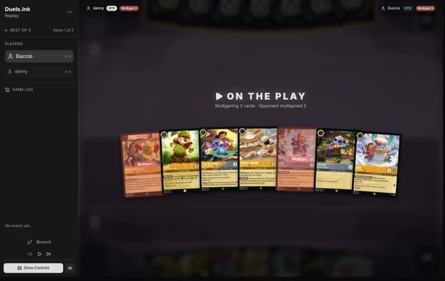
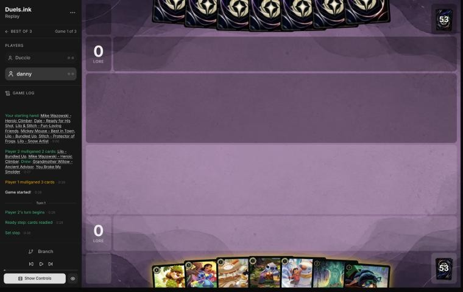
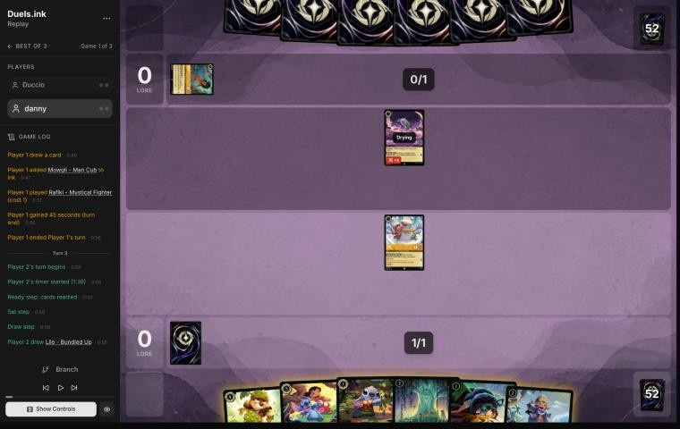
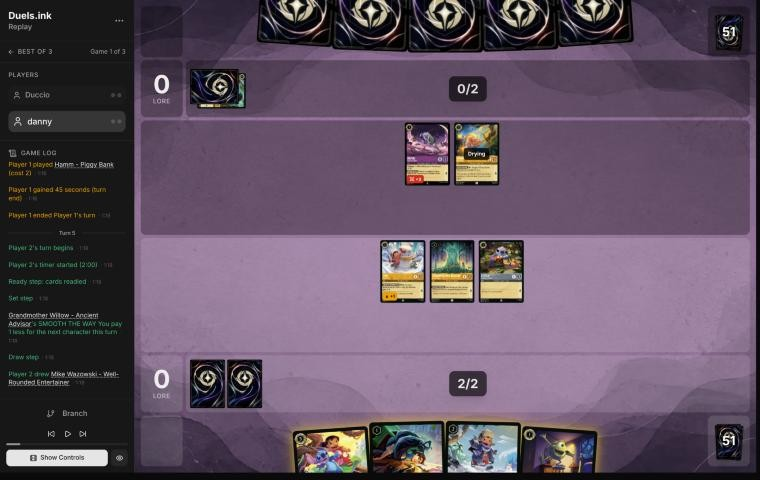
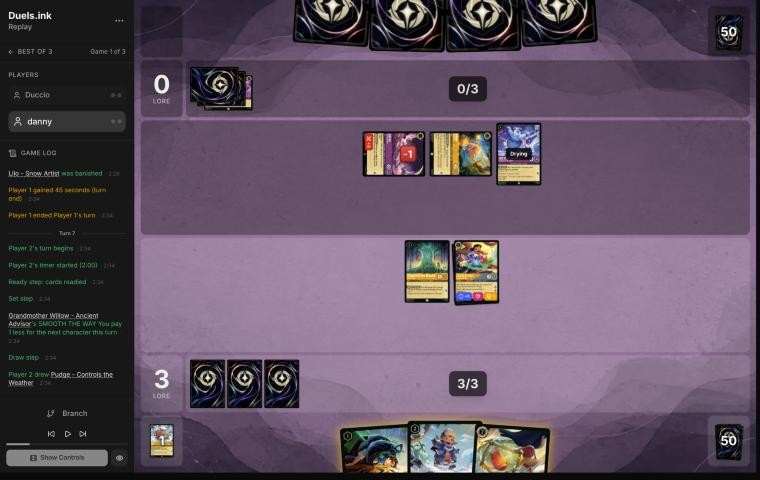
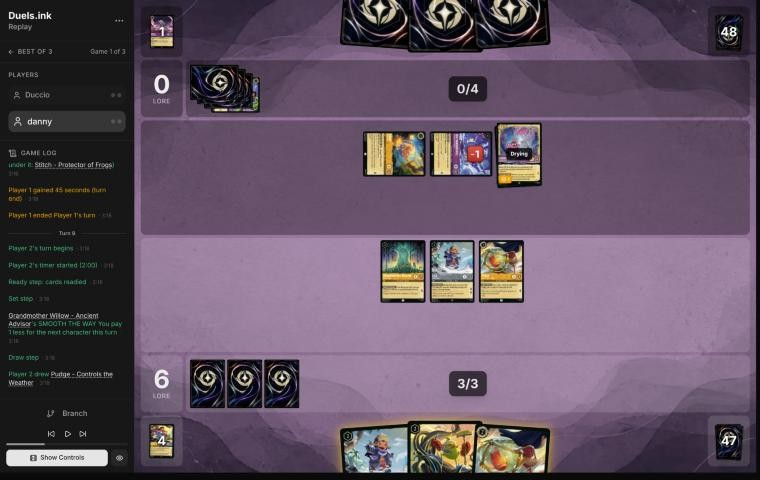
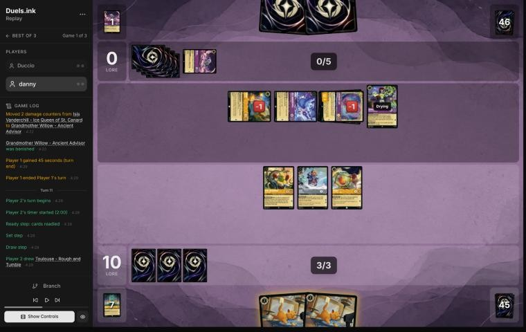
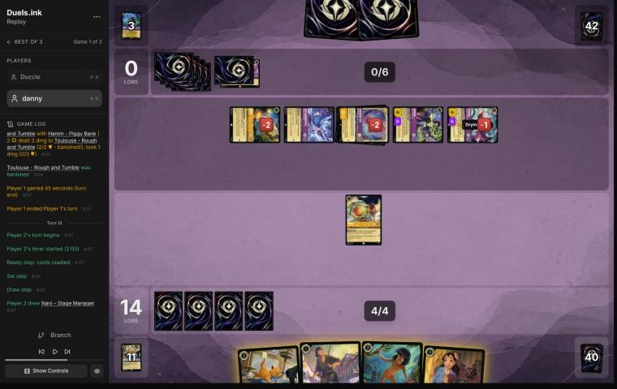
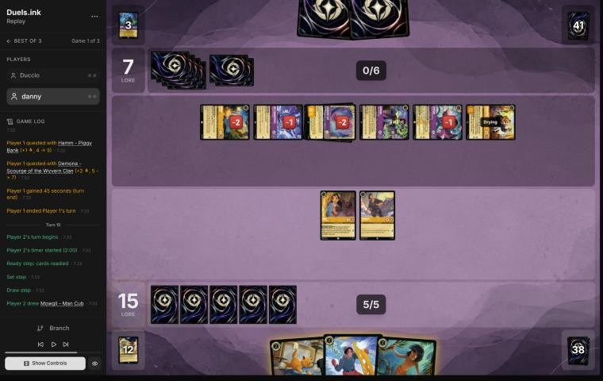

# Review: danny vs Duccio, 11 Nov 2026 (second match, game 1)

| | |
|---|---|
| **Status** | draft (blind pass done, not yet discussed) |
| **Replay** | `01a1cbe6-f3a8` (`python3 tools/brief.py 01a1cbe6-f3a8 --turn N`) · [duels.ink viewer](https://duels.ink/replay/01a1cbe6-f3b4-7629-81bd-132fcd14e362?step=0) |
| **Format** | Core Constructed. Set 14 era: inks revealed before the coin toss |
| **Decks** | You: Amber/Steel Rockstar Aggro, your Lilo list. Them: Amber/Amethyst Midrange, the list you'd just played three games against ([the coach's notes on their list](#cite-kb-meta-archetypes-amber-amethyst-midrange)) |
| **Play/draw** | You went first |
| **Result** | Lost on lore, 18–20, on game turn 18 |
| **Meta data** | snapshot of 12 Nov 2026 (fresh) |
| **Chosen how** | By the user: every game of 11–12 Nov in the export, reviewed blind. The export holds only this game of the match, so the coach doesn't know how the match went |

## Summary
- **Good plays:** [pre-game](#turn-0), [1](#turn-1), [7](#turn-7) (three plays for 2 ink and Rafiki for free),
  [9](#turn-9), [15](#turn-15).
- **Close calls:** [7](#turn-7) (questing Lilo & Stitch into a possible Cheshire, or killing Hamm; revisited),
  [13](#turn-13) (Thomas rather than David).
- **Inaccuracies / mistakes / blunders:**
  - **Inaccuracies, [3](#turn-3) and [5](#turn-5):** Lilo – Snow Artist stayed home when her quest was worth 2;
    Isis and Rafiki killed her on turn 6 anyway.
  - **Inaccuracy, [11](#turn-11):** the second Mike's FIND A FRIEND gave them Lionheart, when a Toulouse did the same
    job for the same ink.
- **Unwinnable from:** [15](#turn-15), very likely: with Lionheart their board quests for 8 a turn, its Bodyguard
  shields everything else, and no line gets you 5 lore before their turn 18 against correct play.

**What decided it:** the same machine as the first match: Isis, Cheshire's boosts and Demona – Scourge exerted or
damaged everything you built, and their challengers cleared it each turn. You led 14–0 on turn 11, but from turn 12
their board out-quested yours, and the race ended 18–20.

## The game, turn by turn
Verdicts judge each decision on what you could know at the time, **including archetype knowledge an experienced
player has**. Hindsight is kept to its own section. Severity scale: good play / close call /
inaccuracy / mistake / blunder. Principle IDs and hypotheses (H-n) link to copies
in the Citations section at the end, as they stood when they were cited.

**What you knew before the game:** this is a rematch: you had just lost a three-game match to Duccio's Amber/Amethyst
Midrange, so the list is known, though the brief's archetype odds (33% Midrange) count only this match. From those
three games, the key cards and the earliest game turn each can come (they're on the draw, so their turns are the even
ones; Grandmother Willow and Hamm – Piggy Bank each take 1 off a character, and they run two Willows):
- **Rafiki – Mystical Fighter** (1): Challenger +3, a 0/2 that challenges for 3. Turn 2.
- **Cheshire Cat – Inexplicable** (3), at least two: each boost (2 ink) moves up to 2 damage counters onto one of
  your characters, ready or not. Turn 4 with a discount.
- **Isis Vanderchill** (4, uninkable), three: exerts one of yours as she lands for a challenger. Turn 6, earlier
  with discounts (two Willows made one cost 2).
- **Demona – Betrayer of the Clan** (4): Challenger +2. **Demona – Scourge of the Wyvern Clan** (6), three: exerts
  your board and refills both hands to 3; with two Willows she costs 4. STONE BY DAY keeps an exerted Demona exerted
  while they hold 3 or more cards.
- **Hades – Looking for a Deal** (5), three: you bottom a character or they draw 2. **Lionheart** (6): Bodyguard,
  +1 lore to two characters. **Gaston – Superior Archer** (5): banishes a character with 5 strength or more.
- **Hamm – Piggy Bank** (2), two: a discount. **Besties, Assemble!** (1), two: digs 4 for a character.
- Also seen: Eilonwy, Mowgli, Demona – Imperious Spellcaster (three), The Horseman Strikes!, Merlin's Shop.

The match before showed what beats you: their exert effects (Isis, Scourge, Cheshire's moves) reach characters you
hold back, so lore taken early is what counts; and Dale's SPIKE SUIT and Flash's no-Rush rule are what make their
challengers pay (game 2, the win).

### Pre-game

*The board before the decision: [step 0](https://duels.ink/replay/01a1cbe6-f3b4-7629-81bd-132fcd14e362?step=0) in the duels.ink replay viewer.*

**What you did:** on the play, you sent back Lilo – Bundled Up and Mike Wazowski – Heroic Climber, kept Lilo – Snow
Artist, Stitch, Mickey, Lilo & Stitch and Dale, and drew Grandmother Willow and You Broke My Smolder.

**Verdict: good play.** The coach's candidates were keeping all seven, sending back Mike, or sending back Mike and
Lilo – Bundled Up; your keep is the last. On the simulator (`tools/mulligan.py`, 1,500 deals each) it scores 12.6 lore
by turn 4, level with sending back only Mike (12.5) and ahead of keeping all seven (11.3). Both uninkables were the
right ones to send: Mike's FIND A FRIEND hands a Midrange deck characters, and the hand already had its 1-drops and
both Shift bases for Lilo & Stitch on turn 3 ([MULL-2](#cite-mull-2)).

### Turn 1: your turn 1

*The board before the decision: [step 3](https://duels.ink/replay/01a1cbe6-f3b4-7629-81bd-132fcd14e362?step=3) in the duels.ink replay viewer.*

**What you did:** inked Mickey and played Lilo – Snow Artist.

**Verdict: good play.** The coach's line too. Mickey is the right ink against this deck: HOT DOG gives them an ink
drop every time he quests, which brings Demona – Scourge a turn closer. Stitch and Lilo are next turns' 1-drops and
Lilo & Stitch's Shift bases, and Lilo gains a lore once Stitch joins her.

### Turn 3: your turn 2

*The board before the decision: [step 9](https://duels.ink/replay/01a1cbe6-f3b4-7629-81bd-132fcd14e362?step=9) in the duels.ink replay viewer.*

**What you did:** drew Lilo – Bundled Up, inked Dale, played Willow and then Stitch for free with her SMOOTH THE WAY,
and didn't quest with Lilo – Snow Artist.

**Setup.** Their Rafiki (Challenger +3) will be dry next turn and kills any exerted 1- or 2-drop of yours; on their
2 ink nothing else can challenge. Lilo – Snow Artist is a Shift base for next turn's Lilo & Stitch; with Stitch in
play she quests for 2. The hand has three inkables (Dale, Lilo & Stitch, Stitch) and three uninkables, so one good
card has to go to ink. The coach's line was to ink Stitch and play Lilo – Bundled Up, keeping Dale.

**Verdict: inaccuracy (small; confidence: medium).** Your line beats the coach's on development: Willow's discount
works on the turn she lands, so Stitch came free and you have three bodies and two Shift bases for 2 ink, at the
cost of inking Dale. The coach's line missed that combination. But leaving Lilo home is suboptimal because with
Stitch in play her quest was worth 2, and Stitch, a dry base next turn, covered the Shift if Rafiki killed her.
Questing Lilo is better: either 2 lore free, or Rafiki trades for a 1-drop, takes 1 back and doesn't quest himself
([QC-3](#cite-qc-3), [TEMPO-1](#cite-tempo-1)). Nothing else of theirs could challenge.

### Turn 5: your turn 3

*The board before the decision: [step 16](https://duels.ink/replay/01a1cbe6-f3b4-7629-81bd-132fcd14e362?step=16) in the duels.ink replay viewer.*

**What you did:** drew Mike Wazowski – Well-Rounded Entertainer, Shifted Lilo & Stitch onto Stitch for 2 (Willow),
quested it for 3, inked Mike, and kept Lilo – Snow Artist and Willow home. One ink unused.

**Setup.** Lilo & Stitch is named Lilo, Stitch and "Lilo & Stitch" ([CR 5.2.6.1](#cite-cr-5-2-6-1)), so Shifting onto Stitch keeps Lilo
– Snow Artist at 2 lore. Their Rafiki (3 while challenging) is dry, and Hamm (2) will be next turn; with 3 ink and
Hamm's discount, Isis (37% after their draw) or Tigger (29%) is castable, though exerting Hamm for the discount stops
him challenging. A quested Lilo & Stitch is safe: Rafiki and Hamm together deal 3 after Resist, against 5 willpower.
Lilo – Snow Artist and Willow die to either challenger.

**Verdict: inaccuracy (small; confidence: medium).** The Shift onto Stitch and the quest are right. Keeping **Lilo –
Snow Artist** home is suboptimal because her quest is worth 2, and staying ready only protects her from Rafiki and
Hamm, who will be there every turn; Isis, Cheshire and Scourge reach her anyway. Questing her is better: 5 lore this
turn, and if they kill her, the challenger gives up its own quest. The case for keeping her is as a dry base for a
second Lilo & Stitch, but that's about a 17% draw over the next three turns (`tools/odds.py`). Willow staying home
for her discount is fine ([QC-3](#cite-qc-3), [TEMPO-1](#cite-tempo-1)).

### Turn 7: your turn 4

*The board before the decision: [step 27](https://duels.ink/replay/01a1cbe6-f3b4-7629-81bd-132fcd14e362?step=27) in the duels.ink replay viewer.*

**What you did:** drew Pudge; played Lilo – Bundled Up for 1 (Willow) and Pudge for free, then You Broke My Smolder
on an empty hand (drawing a second Lilo – Bundled Up and Mike Wazowski – Heroic Climber); Willow banished the damaged
Rafiki for nothing, and Lilo & Stitch quested to 6–0.

**Setup.** Their turn 6 was Isis (via Hamm) exerting Lilo – Snow Artist for Rafiki to kill. Rafiki (1 willpower
left, 0 strength defending) and Hamm are exerted; Isis is drying. Lilo & Stitch counts as a character named Lilo
([CR 5.2.6.1](#cite-cr-5-2-6-1)), so Pudge's GOOD FRIEND makes him free. Their 4 ink plus Hamm reaches a 5-drop next turn (Gaston, Hades)
but not Scourge. A quested Lilo & Stitch survives Isis and Hamm together (3 + 1 after Resist, against 5).

**Verdict: good play, with the quest a close call (revisited).** It's the coach's line: three plays for 2 ink, the
Smolder cast only once the hand was empty so it drew 2 for nothing lost ([H-1](#cite-h-1)), and Rafiki removed for free.

*Revisited, from this turn's brief only:* the setup above missed Cheshire Cat, which the brief lists among their key
cards. With Hamm's discount, Cheshire and one boost cost exactly their 4 ink, and a boost moves 2 damage counters,
which Resist doesn't reduce: Isis challenging the quested Lilo & Stitch (3 after Resist, taking 3 back) and then
moving 2 of Isis's counters onto it is 5, enough. They held a Cheshire about 18–26% of the time (two or three copies,
`tools/odds.py`). The alternative was Lilo & Stitch challenging the exerted Hamm: no lore, but Hamm dies, and without
his discount Cheshire can't be cast and boosted on 4 ink, so Lilo & Stitch survives Isis (1 + 3 damage). Three lore
against a one-in-four or one-in-five risk to your best character, or Hamm's death for no lore, is close.

### Turn 9: your turn 5

*The board before the decision: [step 44](https://duels.ink/replay/01a1cbe6-f3b4-7629-81bd-132fcd14e362?step=44) in the duels.ink replay viewer.*

**What you did:** drew a second Pudge; played Mike Wazowski for 1 (Willow; FIND A FRIEND gave you Toulouse, and their
The Horseman Strikes! went to the bottom), the second Lilo – Bundled Up, and Pudge for free (Lilo – Bundled Up is a
Lilo), then quested Willow, Lilo – Bundled Up and Pudge to 10–0.

**Setup.** Their turn 8: Isis challenged the quested Lilo & Stitch and Cheshire's boost moved 2 of Isis's damage onto
it. Now Hamm and Isis are exerted, Cheshire is drying, and they have 4 ink: with Hamm, Demona – Scourge costs 5 next
turn (29% after their draw). Your 1-strength characters can't profitably challenge Hamm or Isis. Every card in hand
could be played: Mike and Lilo – Bundled Up for 3 with Willow, and Pudge free.

**Verdict: good play.** The coach's line, in a better order: Mike first, so his reveal came before the rest of the ink
was committed ([SEQ-1](#cite-seq-1)). Questing all three is right against this deck: Isis, Cheshire and Scourge reach ready
characters anyway (as Lilo – Snow Artist found on turn 6), Lilo – Bundled Up survives the first challenge, and their
challengers give up their own quests to kill the others. Keeping Toulouse rather than inking it leaves a play for
next turn's 3 ink ([H-2](#cite-h-2)).

### Turn 11: your turn 6

*The board before the decision: [step 63](https://duels.ink/replay/01a1cbe6-f3b4-7629-81bd-132fcd14e362?step=63) in the duels.ink replay viewer.*

**What you did:** drew a third Toulouse; quested Mike (his reveal gave you another Mike and them Rafiki), played the
second Mike (you got a Toulouse, they got Lionheart), inked a Toulouse, played another, and quested Lilo – Bundled Up
and Pudge to 14–0.

**Setup.** Their turn 10 killed Lilo – Bundled Up, Pudge and Willow (two challenges through EXTRA LAYERS, Cheshire's
challenge, and a boost moving Isis's damage onto Willow), and added Demona – Imperious Spellcaster. They hold 2 cards
at 0 lore with 5 ink (6 next turn, Scourge castable with Hamm: 23%). Your 1-strength characters can't kill anything
of theirs without losing Lilo – Bundled Up. You need 10 more lore; their board needs five quest turns.

**Verdict: inaccuracy (small; confidence: medium).** Questing everything is right, Mike included: his reveal is the
price of his lore. Playing the **second Mike** is suboptimal because FIND A FRIEND gave a Midrange deck holding 2 cards
a free card (Lionheart, a Bodyguard that adds lore), when the second Toulouse did the same job for the same 2 ink: a
1-lore body, plus UNBECOMING BEHAVIOR shutting off their actions for a turn. At 14–0 you need bodies on the board, which
your hand already had; they need answers, and every card they're given might be one.

### Turn 13: your turn 7

*The board before the decision: [step 88](https://duels.ink/replay/01a1cbe6-f3b4-7629-81bd-132fcd14e362?step=88) in the duels.ink replay viewer.*

**What you did:** drew Nani, played her (THAT'S YOUR CUE found David), inked Mowgli, played Thomas and quested Pudge
to 15–0. One ink unused; David and Toulouse stayed in hand.

**Setup.** Their turn 12: IMPETUS gave Demona – Scourge Rush, Scourge exerted your board and refilled both hands, and
five challenges killed both Mikes, Lilo – Bundled Up and Toulouse. Pudge survived. Everything of theirs is exerted;
they hold 2 cards (Lionheart known), so STONE BY DAY won't hold the Demonas next turn, and their board quests for 6,
8 with Lionheart's APPROVAL RATING. You need 5 more after Pudge's quest; nothing you play can quest before turn 15.
Pudge (1 strength) can kill the 1-willpower Hamm, but stays exerted either way.

**Verdict: close call.** Pudge's quest is right: 15 lore means a board of five 1-lore characters wins on turn 15.
Nani first, then the ink choice, is the right order ([SEQ-1](#cite-seq-1)). The one thing left on the table: after Nani's dig, David
(2) instead of Thomas (1) used all 5 ink for a better body, a Bodyguard that could enter exerted in front of Pudge.
Small next to what their board does next turn.

### Turn 15: your turn 8

*The board before the decision: [step 104](https://duels.ink/replay/01a1cbe6-f3b4-7629-81bd-132fcd14e362?step=104) in the duels.ink replay viewer.*

**What you did:** drew Mowgli, played Mowgli (their hand held no non-character) and David ready, and quested Nani and
Thomas to 17–7. Toulouse stayed in hand.

**Setup.** Their turn 14: Lionheart entered exerted as a Bodyguard and gave Demona – Imperious and Cheshire +1 lore,
Isis killed Pudge, and they quested to 7. Their board now quests for 8 a turn, so they reach 20 on their turn 18
(`tools/odds.py clock`: two questing turns). They hold 2 cards, so STONE BY DAY doesn't hold their Demonas. The
exerted Lionheart is a Bodyguard, so any challenge of yours must go to its 7 willpower: you can't touch the rest of
their board. You need 5 lore by your turn 17: 2 now from Nani and Thomas, then 3 from what survives their turn. Their
six challengers kill whatever is exerted, and a Cheshire boost kills one ready 2-willpower character, so at most two
of your characters reach turn 17 able to quest, and that's 19 at best.

**The game is very likely lost from here** ([principle 2](#cite-principle-2)): only a misplay on their side (leaving three of your
characters alive, or holding 3 cards at their ready step so STONE BY DAY keeps both Demonas exerted) gets you to 20
first.

**Verdict: good play.** Questing Nani and Thomas takes the 2 that are available, and makes their challengers spend
quests to remove them; Mowgli's look at their hand checks for the exert effects you can't play around anyway. Keeping
Toulouse rather than inking it is right: a 2-drop to play next turn is worth more than a sixth ink.

### Turn 17: your turn 9

**What you did:** after their turn 16 (Cheshire's boost killed Mowgli; Demona – Betrayer, given Rush by IMPETUS, and
Cheshire killed Thomas and Nani; they quested to 14), you played Nani (her dig found Willow), Willow, and quested
David to 18–14. No verdict: their board quests for 8, and nothing you had could stop it.

## Lessons
1. **Grandmother Willow's discount works the turn she lands** ([turn 3](#turn-3)): Willow then a 1-drop costs 2 in
   all.
2. **Lilo & Stitch – Fun-Loving Friends is a Lilo and a Stitch** ([CR 5.2.6.1](#cite-cr-5-2-6-1)): Pudge comes free beside it, Lilo – Snow
   Artist keeps her extra lore, and either name is a Shift base ([turns 5](#turn-5), [7](#turn-7)).
3. **Count Cheshire Cat with their challengers, even before it's in play** ([turns 7](#turn-7) and 8). A boost moves 2
   damage counters, which Resist doesn't reduce, and the damage your character deals back to a challenger can be moved
   onto it. Hamm's discount put Cheshire and a boost at exactly 4 ink.
4. **Quest the cheap characters early against this deck** ([turns 3](#turn-3), [5](#turn-5)): staying ready protects
   them from Rafiki and Hamm only, and Isis found Lilo – Snow Artist on turn 6 anyway.
5. **Don't feed a card-hungry Midrange deck with FIND A FRIEND when another card does the same job**
   ([turn 11](#turn-11)).
6. **An exerted Bodyguard takes all your challenges** ([turn 15](#turn-15)): Lionheart entering exerted shielded the
   rest of their board for the turn.

## Proposed knowledge-base updates (applied after discussion)
- **Meta** (the Amber/Amethyst pair file's notes, Duccio, second match): the same Midrange list. Game 1 showed three
  Rafikis, two Demona – Imperious, Demona – Betrayer (off-list), Lionheart entering exerted as a Bodyguard, Hades
  discarded to IMPETUS, two Merlin's Shops inked. Cheshire's boost killed five of your characters over the game.
- **Card note** (Cheshire Cat, [Timing](#cite-kb-cards-cheshire-cat-inexplicable-timing)): two additions. Moving damage
  counters isn't damage, so Resist doesn't reduce it (Lilo & Stitch, turn 8). And the damage your character deals
  back to a challenger is theirs to move: Isis took 3 from Lilo & Stitch and Cheshire moved 2 of it onto Lilo & Stitch
  to finish it. Count a castable Cheshire plus boost, with discounts, as 2 more damage on any one character.
- **Rules** (the [St. Canard's Finest ruling](#cite-kb-rules-rulings-st-canard-s-finest-is-also-named-darkwing-duck)
  on [CR 5.2.6.1](#cite-cr-5-2-6-1)): add Lilo & Stitch – Fun-Loving Friends as a second example. It is named Lilo and Stitch, so Pudge's
  GOOD FRIEND makes him free and Lilo – Snow Artist's CREATIVE INSPIRATION applies; duels.ink's engine agreed on turn 7.
- **Strategy:** more evidence for the hypothesis proposed in the first match's reviews (a Rockstar board should quest
  every turn against an exert-and-challenge deck): [turns 3](#turn-3) and [5](#turn-5).

## Hindsight
Doesn't change the verdicts above.
- The margin was small. Lilo – Snow Artist's two unquested turns were worth up to 4 lore, and she died on turn 6 to
  Isis and Rafiki without questing at all. Lionheart, found by your Mike on turn 11, gave them 2 lore on turn 14
  (APPROVAL RATING), quested for 2 on turns 16, shielded their board on turn 15. Either alone could have changed an
  18–20 race.
- On turn 8 they did hold Cheshire, and used exactly the Isis-then-boost line the turn-7 setup missed.
- On turn 12 they had the Scourge (23% by the brief), cast with IMPETUS giving it Rush.

## The coach's errors
Found by the coach during the review; the discussion may add more.

| When | Error | How it was caught | How it won't happen again |
|---|---|---|---|
| Pre-game | The brief's archetype odds (33% Midrange) ignored the three games against the same opponent just before | Writing what you knew before the game | Proposed: the brief adds the cards seen in the same opponent's earlier matches that day as archetype evidence, labelled as from an earlier match |
| Turn 3 | The coach's line missed that Willow's discount applies the turn she lands, which made Stitch free beside her | Comparing your line with the coach's | Proposed: the brief's options price each character as it would cost after a discounter in hand is played first ("after Willow: Stitch 0") |
| Turn 7 | The setup called a quested Lilo & Stitch safe from Isis and Hamm, missing Cheshire Cat (in the brief's key cards) cast with Hamm's discount and boosted on 4 ink, which moves Isis's damage onto it past Resist | Their turn 8 | Proposed: the brief's "what can challenge" section adds counter-movers castable next turn (Cheshire with its Boost cost, after cost reducers) to the damage each character can take, noting that Resist doesn't apply |

## Open questions
- **[Turns 3](#turn-3) and [5](#turn-5):** was Lilo – Snow Artist kept home as a Shift base for another Lilo &
  Stitch, or to keep her extra lore going?
- **[Turn 11](#turn-11):** was the second Mike played for the card, knowing FIND A FRIEND helps them too?
- **[Turn 7](#turn-7):** did you weigh Lilo & Stitch killing Hamm instead of questing?

## Citations
Copies of the coach's knowledge base cited above, as they stood when they were cited (the private repository's commit and date are given with each). They don't change when the knowledge base does.

**amber-amethyst.md, Midrange**: knowledge base, `kb/meta/archetypes/amber-amethyst.md` at `410b99f` (2026-11-12), working tree

> ### Midrange
> 33% of the pair's games (45,123).
>
> | # | Card | Type | Cost | Tag |
> |---|---|---|---|---|
> | 1 | Eilonwy - Princess of Llyr | character | 1 |  |
> | 4 | Luisa Madrigal - Pushing Through | character | 1 |  |
> | 4 | Rafiki - Mystical Fighter | character | 1 |  |
> | 4 | Grandmother Willow - Ancient Advisor | character | 2 |  |
> | 4 | Hamm - Piggy Bank | character | 2 |  |
> | 4 | Cheshire Cat - Inexplicable | character | 3 |  |
> | 1 | Demona - Imperious Spellcaster | character | 3 | combat |
> | 1 | Dumbo - The Flying Elephant | character | 3 |  |
> | 2 | Agustin Madrigal - Exceptionally Kind | character | 4 |  |
> | 1 | Dumbo - Ninth Wonder of the Universe | character | 4 |  |
> | 4 | Isis Vanderchill - Ice Queen of St. Canard | character | 4 | exert |
> | 2 | Sven - Leaping Reindeer | character | 4 |  |
> | 3 | Tigger - Bouncing All the Way | character | 4 | removal |
> | 4 | Gaston - Superior Archer | character | 5 | removal |
> | 2 | Hades - Looking for a Deal | character | 5 | removal |
> | 2 | Luisa Madrigal - Confident Climber | character | 5 |  |
> | 1 | Ursula - Whisper of Vanessa | character | 5 |  |
> | 4 | Demona - Scourge of the Wyvern Clan | character | 6 | exert-all |
> | 3 | Stitch - Carefree Surfer | character | 7 |  |
> | 2 | Besties, Assemble! | action | 1 |  |
> | 1 | Ohana Means Family | action | 3 |  |
> | 4 | The Horseman Strikes! | action | 3 | removal |
> | 1 | Junior Woodchuck Guidebook | item | 2 |  |
> | 1 | Merlin's Shop and Smithy - Magical Market | location | 2 |  |

**cheshire-cat-inexplicable.md, Timing**: knowledge base, `kb/cards/cheshire-cat-inexplicable.md` at `410b99f` (2026-11-12), working tree

> ## Timing `[coach + user, 01a18275, 2026-11-02]`
> - **Boost costs ink, not an exert,** so it works the turn he's played, while he's drying. Cheshire for 3 plus Boost
>   for 2 is a 5-ink play that moves damage at once.
> - **The source can be your own character:** moving damage off yours heals it and puts it on theirs.
>   - 01a18275 turn 7: Mickey's 2 damage moved onto Violet Parr (2/1), killing her and healing Mickey.
>   - Turn 9: Cheshire moved his own 2 damage onto Tinker Bell – Giant Fairy, then challenged and traded with her.
> - **Against it:** any damage on your board is a resource for their Cheshire too. On turn 14 their Cheshire moved
>   Arthur's 2 damage (from challenging your Merlin) onto your Demona – Imperious Spellcaster and killed her. Evasive
>   doesn't help: moving damage isn't a challenge.
> - **Midrange Amethyst runs 4** (Amethyst/Steel and Amber/Amethyst lists), so count damaged characters on both sides
>   as a threat while one is in play or likely in hand.

**rulings.md, St. Canard's Finest is also named Darkwing Duck**: knowledge base, `kb/rules/rulings.md` at `410b99f` (2026-11-12), working tree

> ### St. Canard's Finest is also named Darkwing Duck
> - **Situation:** Darkwing Duck & Launchpad – St. Canard's Finest is in play, and The Terror That Flaps in the Night
>   ("3 damage instead if you have a character named Darkwing Duck") or Launchpad – Trusty Sidekick ("discard unless you
>   have a character named Darkwing Duck") checks for a Darkwing.
> - **Ruling:** Finest has the names Darkwing Duck and Launchpad as well as its full name, so Terror deals 3 and
>   Launchpad draws without discarding. A second Finest can also Shift onto the first.
> - **Basis:** CR 5.2.6.1 (a name with "&" has two singular names; an effect looking for a name matches either).
> - **Confidence:** derived from CR; Terror dealt 3 with only Finest in play in 01a16039 turn 17. Not an official ruling.
> - **Added:** 2026-11-02, from the reviews of 01a15f93 and 01a16039 (stonks 📈).

**MULL-2**: strategy principle, `kb/strategy/principles.md` at `410b99f` (2026-11-12), working tree

> - **MULL-2. A smooth curve beats a few powerful cards.** Check that you can spend ink well on turns 1–4, have enough inkable cards, and know what turn 4 looks like. `[MCL ch.12]` · baseline
>   - **Ink spent isn't the goal by itself.** Judge a keep by a nice curve (a play each turn), early lore pressure, and
>     interaction that sets the opponent back, as well as by ink, then weigh card quality and the matchup
>     (user, 2026-11-01). `tools/mulligan.py` reports all of these.

**QC-3**: strategy principle, `kb/strategy/principles.md` at `410b99f` (2026-11-12), working tree

> - **QC-3. Questing is favoured when:**
>   - you control the board
>   - your exerted characters can't be punished
>   - the race favours you
>   - removing their characters gains little
>
>   **Challenging is favoured when:**
>   - they have an engine or repeated-value piece
>   - the trade is efficient
>   - you need to slow the game
>   - your deck is stronger late
>
>   `[MCL ch.6]` · baseline

**TEMPO-1**: strategy principle, `kb/strategy/principles.md` at `410b99f` (2026-11-12), working tree

> - **TEMPO-1. Tempo is how much freedom you leave the opponent, not how fast you play.** A play that forces the opponent to spend their turn answering it has stolen part of their turn. *Ask: "If I play this, what does my opponent have to do next?"* `[MCL ch.1]` · baseline

**SEQ-1**: strategy principle, `kb/strategy/principles.md` at `410b99f` (2026-11-12), working tree

> - **SEQ-1. Gather information before irreversible decisions.** Draw, look and scry before choosing what to ink. Quest with draw triggers before committing other plays when the order doesn't otherwise matter. `[MCL ch.5]` · baseline

**H-1**: hypothesis, `kb/strategy/hypotheses.md` at `410b99f` (2026-11-12), working tree

> ### H-1. Time hand-refill effects for when your hand naturally runs out
> - **Claim:** "Draw until you have N" effects (e.g. Demona – Scourge of the Wyvern Clan, refill to 3) are worth
>   most on the turn your hand empties. Playing one card per turn on the play, a 7-card hand empties around
>   turn 6, which is exactly when a 6-cost refill lands. So an inkable refill card is cheap to keep through a
>   mulligan: if the game goes differently, ink it.
> - **Why:**
>   - **Hand count when playing on curve, going first:** 7 cards; ink 1 and play 1 each turn, drawing from turn 2,
>     leaves 1 card after inking on turn 6.
>   - **Cost of keeping it, by simulation:** keeping Demona costs about 0.1 ink spent over turns 1–4, compared with
>     also mulliganing her.
> - **Caveats:**
>   - "Each player" refills, so the opponent also draws if below N. On the draw they hold one more card. The other
>     side of this, for the player facing her, is in `kb/cards/demona-scourge-of-the-wyvern-clan.md`.
>   - Demona's STONE BY DAY means she can't ready while you hold 3+ cards. After refilling to 3, you must be at ≤2
>     by your next Ready step, or she stays exerted (and challengeable) once she has quested or challenged.
>   - She's drying on the turn she's played, so her own exert-all opens the opponent's board to your *other* dry
>     characters only.
>   - Ink drops (Hyperia City) don't expire, so saved drops can bring the refill earlier than the bare count suggests.
>   - **The cap absorbs earlier card draw.** "Draw until 3" always ends at 3, so cards drawn beforehand (e.g. Junior
>     Woodchuck Guidebook) are borrowed from the refill rather than added to it. Pre-drawing buys timing, not
>     cards:
>     - earlier information
>     - a better ink choice
>     - being sure of an inkable card for the refill turn
>
>     Weigh that against what the same ink would otherwise buy, e.g. an earlier body. (User's correction,
>     2026-10-24: the coach had called this a cost of the draw without counting those gains.)
>   - The opponent's refill depends on *their* hand size when you cast it, not on your earlier choices. Check it
>     when deciding whether to cast now.
>   - **It needs your ink to reach 6 on time.** Hands with uninkable cards are short of ink, not cards, so a held
>     6-drop is rarely castable on turn 6.
>     - **01a139ad, pre-game:** an opening seven with two uninkables. Keeping Demona left her castable on turn 6
>       only ~16% of the time in simulation. Mulliganing her for a random card raised "turn 4 uses all ink" from
>       80% to 91%. In ink-short hands, the refill card is the one to send back.
>     - *This caveat is the coach's, from simulation; not yet discussed with the user.*
>   - **Against Amber/Sapphire**, Demona's 5 {S} makes her a target for Gaston – Superior Archer, Judy Hopps –
>     Always Vigilant and World's Greatest Criminal Mind (`kb/meta/archetypes/amber-sapphire.md`).
> - **Evidence for:**
>   - replay 01a14bf9 (vs Goop), 2026-10-24, pre-game: the user's mulligan reasoning.
>   - same game, turn 5: the user kept Cheshire as the bridge play on the way to Demona instead of playing an
>     extra 1-drop.
>   - same game, turn 9: Guidebook played and used before inking, which locked in an inkable card for Demona
>     on turn 11. The alternative, Cheshire plus Boost, had about a 16% chance (8 uninkables in 49 cards) of an
>     uninkable turn-11 draw blocking her.
>   - same game, turn 11 (agreed with the user): a second Cheshire instead of Boost would have developed the
>     board, used the ink better, and **emptied the hand to just Demona**. Her next-turn refill would then draw 3
>     instead of 1. The user's own summary of the lesson: develop the board and spend resources so the
>     refill draws as many cards as possible.
>   - same game, turn 13: with Demona due next turn, the user inked their spare Cheshire though that ink wasn't
>     needed. **Corollary:** when a refill is imminent, spare cards in hand are effectively free ink. The cap
>     replaces them, so inking them costs no cards and leaves Demona as the only card in hand.
>   - **Limit on that corollary** (same game, turn 15, agreed with the user): it's free in card *count* only. The cap
>     replaces the inked card with a *random* card. So it holds for cards no better than a random draw, but not
>     for engines or must-answer threats. Inking Dumbo – Ninth Wonder of the Universe (a draw-and-lore engine the
>     opponent has to answer, TEMPO-1) to top up Demona's refill from 2 to 3 was probably wrong. Better was to
>     cast Demona without inking, keep Dumbo for next turn, and accept 1 ink and 1 refill card less.
> - **Evidence against:** none yet.
> - **Status:** open.

**H-2**: hypothesis, `kb/strategy/hypotheses.md` at `410b99f` (2026-11-12), working tree

> ### H-2. Spare ink isn't automatically wasted when later turns will be short of cards
> - **Claim:** Ink grows by one every turn, but cards don't. Once later turns are likely to have more ink than
>   good cards to spend it on, cards are the scarcer resource. Then playing a low-impact card just to use spare
>   ink (giving up a better card to the inkwell instead) is usually worse than leaving the ink unspent.
> - **Applies when:** you're ahead on board (POS-1) and the extra play has little impact (WIN-2). Also when the
>   backup value of the extra card is low, e.g. a second Shift target when the opponent's removal can't hit the first.
> - **Doesn't apply when:** you're behind and need board presence now, or the cheap card has real impact.
> - **The converse, for the opponent:** extra cards are worth less to an opponent who already has a full hand and is
>   short of ink. When an effect offers "they draw 2 or you lose a body" (Hades – Looking for a Deal), keeping
>   the body is more attractive the more cards they already hold. Discard-payoff decks still get some fuel from
>   extra cards. Evidence: 01a139ad, turn 14. The opponent had 5 cards and 7 ink, and the user kept Isis
>   rather than bottoming her. Discussed 2026-10-26 and judged a close call.
> - **Evidence for:** replay 01a14bf9 (vs Goop), turn 5. The user left 1 ink unspent rather than ink Cheshire to
>   play a second Mulan – Injured Soldier. Coach first called it a close call, then agreed after the user's argument.
> - **Evidence against:** none yet.
> - **Status:** open.

**principle 2**: coaching principle, `CLAUDE.md` at `410b99f` (2026-11-12), working tree

> 2. **Some games are unwinnable.** Draws and matchups can make a game lost whatever the player does. Say so
>    when it's true, rather than inventing mistakes to explain a loss.

**CR 5.2.6.1**: Comprehensive Rules, `kb/rules/cr/05-cards-and-card-types.md` at `410b99f` (2026-11-12), working tree

> **5.2.6.1.** Some characters have two singular names in addition to their printed name. These characters have an ampersand (&) or something else that’s treated as an ampersand (see 5.2.6.3) between the two names listed on the name line. If an effect looks for a card or character with a specified name, the specified name must exactly match one of the names on the card.
