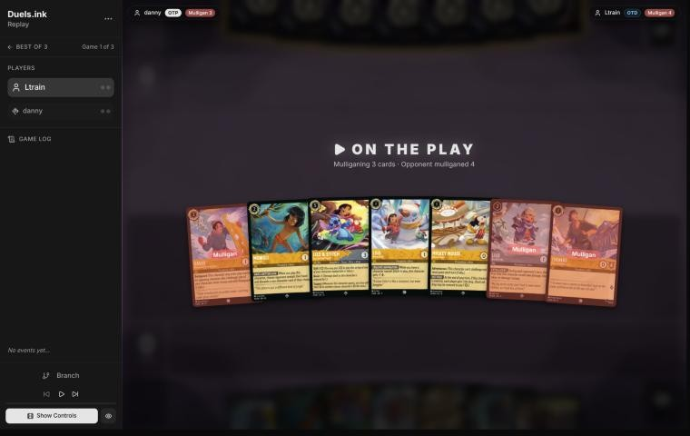
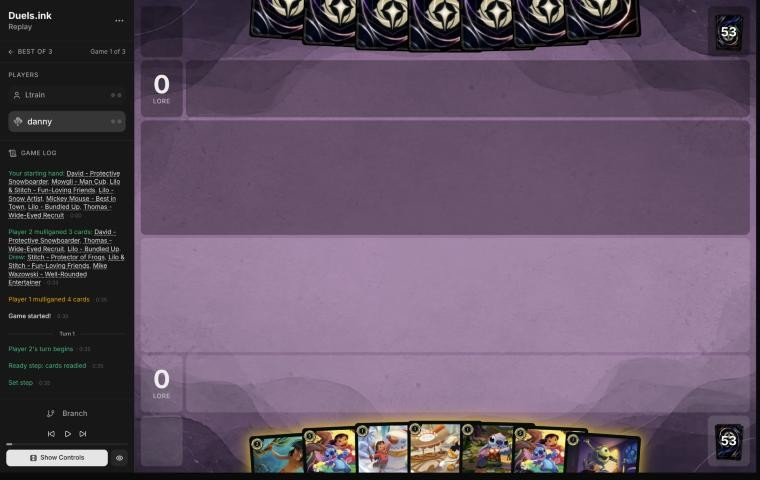
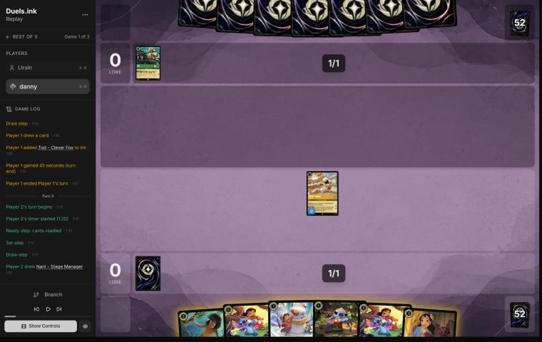
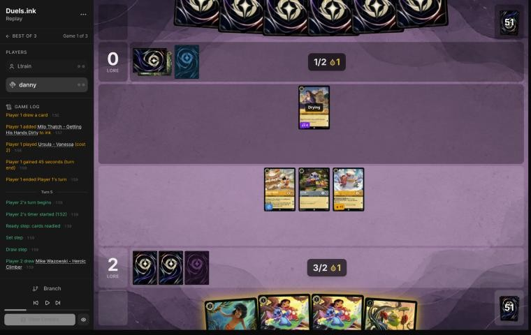
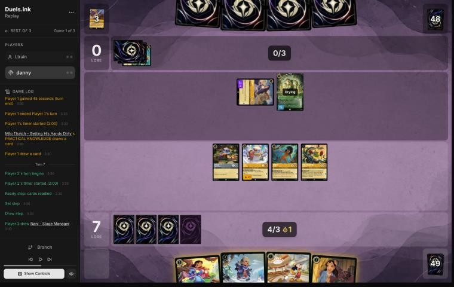
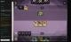

# Review: danny vs Ltrain, 11 Nov 2026 (game 1)

| | |
|---|---|
| **Status** | draft (blind pass done, not yet discussed) |
| **Replay** | `01a1cc04-fe24` (`python3 tools/brief.py 01a1cc04-fe24 --turn N`) · [duels.ink viewer](https://duels.ink/replay/01a1cc04-fe36-7c20-9a6a-ca9b15b74245?step=0) |
| **Format** | Core Constructed. Set 14 era: inks revealed before the coin toss |
| **Decks** | You: Amber/Steel Rockstar Aggro, your Lilo list. Them: Amber/Emerald ([the coach's notes on Circle of Life against your Rockstar Aggro](#cite-kb-meta-archetypes-amber-emerald-circle-of-life-against-danny-s-rockstar-aggro-ten-games)); archetype as it became clear: Circle of Life, from turn 4 (Ursula – Vanessa) |
| **Play/draw** | You went first |
| **Result** | Won by concession on game turn 10, at 17–0 |
| **Meta data** | snapshot of 12 Nov 2026 (fresh) |
| **Chosen how** | By the user: every game of 11–12 Nov in the export, reviewed blind. The export holds a game 2 of this match, so the coach knows the match didn't end here, not how this game went |

## Summary
- **Good plays:** [3](#turn-3), [7](#turn-7) (Lilo & Stitch's Support on Mowgli to kill their free singer, Ursula),
  [9](#turn-9).
- **Close calls:** [1](#turn-1) (Mickey first feeds them ink drops), [7](#turn-7) (Mickey with the drop rather than Lilo
  – Bundled Up after inking first).
- **Inaccuracies / mistakes / blunders:**
  - **Inaccuracy, [pre-game](#turn-0):** a three-card mulligan from a hand that already curved out; the simulator
    preferred keeping all seven.
  - **Inaccuracy, [5](#turn-5):** Mowgli and Mike instead of Shifting Lilo & Stitch: 2 lore less, and a Lilo & Stitch
    inked. Medium confidence, since Mowgli showed you their hand.

**What decided it:** speed. You were 13–0 on turn 7 with their free singer dead, so their Malicious on turn 8 cleared
only Mowgli and Lilo & Stitch, and six characters took you to 17 with 3 needed. Their sweep pieces arrived late (Mike's
reveals bottomed a Malicious, an Akood and Circle of Life), and they conceded.

## The game, turn by turn
Verdicts judge each decision on what you could know at the time, **including archetype knowledge an experienced
player has**. Hindsight is kept to its own section. Severity scale: good play / close call /
inaccuracy / mistake / blunder. Principle IDs and hypotheses (H-n) link to copies
in the Citations section at the end, as they stood when they were cited.

**What you knew before the game:** Amber/Emerald, most likely Circle of Life (62%), else Princess Aggro (22%) or an
unlisted list. Against your Rockstar Aggro, the coach's notes from ten of your games say Circle of Life sweeps between
game turns 7 and 13, after your lead is built, and then out-quests a rebuilt board: the race is won by the lead you
have when the sweep lands. Their key cards, with the earliest game turn (they're on the draw, so their turns are the
even ones):
- **Malicious, Mean, and Scary** (3, song): 1 damage counter on each of your characters. Sung by any character of
  cost 3 or more, so from turn 4 or 6.
- **To Wither a Flower** (4, uninkable song): 2 damage to each damaged character of yours. After Malicious, it kills
  every character with 3 willpower or less. Turn 8 at the earliest for both in one turn, earlier with singers.
- **Don Karnage – Debonair Pirate** (6, uninkable; Shift 4): 1 damage to each of yours, Resist doesn't help. Turn 6
  with a Shift.
- **Prince Phillip – Vanquisher of Foes** (9; Shift 6): banishes every damaged character of yours. Usually replayed
  free by **Circle of Life** (8, Sing Together 8) from the discard.
- **Under the Sea** (off-list; 8, Sing Together 8): every character of yours with 2 strength or less goes to the
  bottom of your deck. Almost your whole deck.
- **Milo Thatch** (7): bounces a character; **Chernabog** (5): shuffles one into your deck.
- Princess Aggro instead: Aurora, Dale – Ready for His Shot, Elinor, Rapunzel – Tower Defender.

### Pre-game

*The board before the decision: [step 0](https://duels.ink/replay/01a1cc04-fe36-7c20-9a6a-ca9b15b74245?step=0) in the duels.ink replay viewer.*

**What you did:** on the play, you sent back David, Thomas and Lilo – Bundled Up, kept Mowgli, Lilo & Stitch, Lilo –
Snow Artist and Mickey, and drew Stitch, a second Lilo & Stitch and Mike Wazowski – Well-Rounded Entertainer.

**Verdict: inaccuracy (small; confidence: medium).** The coach's candidates were keeping all seven, sending back
Mowgli, or sending back Thomas. On the simulator (`tools/mulligan.py`, 1,500 deals each), sending back Mowgli scored
11.5 lore by turn 4 and keeping all seven 11.1; your three-card mulligan scored 10.3. Sending back **Lilo – Bundled
Up, David and Thomas** is suboptimal because the hand already had a full curve: 1-drops for turn 1, Lilo – Bundled Up
(2 lore) for turn 2, and Lilo & Stitch to Shift on turn 3. Against Circle of Life, whose sweep comes on turns 7 to 13,
the lead built before it is what wins ([MULL-3](#cite-mull-3)). Keeping all seven, or sending back only Mowgli (whose discard hits only
non-characters), is better.

### Turn 1: your turn 1

*The board before the decision: [step 3](https://duels.ink/replay/01a1cc04-fe36-7c20-9a6a-ca9b15b74245?step=3) in the duels.ink replay viewer.*

**What you did:** inked Mike Wazowski – Well-Rounded Entertainer and played Mickey.

**Verdict: close call.** Mike is the right ink: a 2/1 body is the weakest card here. Mickey first is the
most lore (2 a turn from turn 3), but every quest gives them an ink drop too, and [the coach's note on Mickey](#cite-kb-cards-mickey-mouse-best-in-town-what-it-means-in-play) warns
that drops bring a sweeper deck's big turns early: here Don Karnage (6) and the singers for To Wither a Flower. Lilo –
Snow Artist or Stitch first, then both bases and the Shift on curve, keeps their ink honest and still builds the lead;
Mickey can come later, when their sweep is already close. The race favours Mickey's lore slightly against a deck
whose sweep comes on turns 7 to 13 anyway, so it's close.

### Turn 3: your turn 2

*The board before the decision: [step 8](https://duels.ink/replay/01a1cc04-fe36-7c20-9a6a-ca9b15b74245?step=8) in the duels.ink replay viewer.*

**What you did:** drew Nani, quested Mickey (2–0; both players got an ink drop), inked Nani and played Stitch and
Lilo – Snow Artist.

**Verdict: good play.** The coach's line: both Shift bases now, so a Lilo & Stitch lands dry on each of the next two
turns, and Lilo quests for 2 beside Stitch. Of the inkables, Nani (a 3-drop with no slot on the next two turns) and
Mowgli were the spare cards; Mowgli's look at a seven-card hand of songs was worth keeping.

### Turn 5: your turn 3

*The board before the decision: [step 16](https://duels.ink/replay/01a1cc04-fe36-7c20-9a6a-ca9b15b74245?step=16) in the duels.ink replay viewer.*

**What you did:** drew Mike Wazowski – Heroic Climber; played Mowgli (you saw their hand; they discarded Strike a
Good Match), quested Mickey, Lilo and Stitch to 7–0, inked a Lilo & Stitch, and played Mike with the ink drop (FIND A
FRIEND gave you Lilo – Bundled Up and sent their Malicious, Mean, and Scary to the bottom).

**Setup.** Their Ursula – Vanessa (Singer 4) can sing Malicious, Mean, and Scary (42% after their draw) or To Wither a
Flower (33%) for free next turn, with 5 ink beside her. Malicious then Wither kills every character of yours with 3
willpower or less; Lilo & Stitch (5 willpower, Resist on the damage) survives it. You had 2 ink and a drop, exactly a
Shift, and both bases were dry. The coach's line: Shift Lilo & Stitch onto Stitch and quest Mickey, Lilo and Lilo &
Stitch for 7 (9–0), ink Mowgli, and Shift the second onto Lilo next turn.

**Verdict: inaccuracy (small; confidence: medium).** Playing **Mowgli and Mike instead of the Shift** is suboptimal
because it scores 2 less this turn and inks one of your two Lilo & Stitches: the two cheap bodies are exactly what
Malicious and Wither kill, while each Lilo & Stitch survives them and quests for 3. Shifting is better: more lore now,
and a board whose best characters outlive the sweep this deck is built around ([QC-5](#cite-qc-5)). The confidence is medium because
Mowgli showed you their hand and the coach can't see what was in it: if it held no sweeper, going wide was safer than
it looks here. Mike's reveal bottoming their Malicious was a bonus no one could plan.

### Turn 7: your turn 4

*The board before the decision: [step 32](https://duels.ink/replay/01a1cc04-fe36-7c20-9a6a-ca9b15b74245?step=32) in the duels.ink replay viewer.*

**What you did:** drew Nani; Shifted Lilo & Stitch onto Stitch, replayed Mickey with the ink drop, quested Lilo &
Stitch and gave Mowgli its Support to banish the exerted Ursula – Vanessa (4 damage; Mowgli took 1), quested Lilo
and Mike (his reveal gave you a second Mike; their Akood went to the bottom) to 13–0, then inked Nani.

**Setup.** Their turn 6: Ursula sang Akood et Emuti, Milo Thatch came down for 5 and bounced Mickey. Ursula (Singer 4)
was exerted, and she's their free singer for Malicious, Mean, and Scary or To Wither a Flower next turn; Milo (5
strength) will kill any small character left exerted, and he can sing too. Their discard holds no characters yet, so
Circle of Life has nothing to replay.

**Verdict: good play.** The coach's line, and the turn's best move: Lilo & Stitch's Support turned Mowgli into a
4-strength challenger to kill their singer, while the quests took you to 13. One small thing: inking Nani first gives
5 ink, enough for Lilo – Bundled Up beside the Shift, rather than Mickey with the drop and 1 ink unused. Both quest for
2, but Mickey's HOT DOG feeds a deck that wants to reach Phillip (9) and Don Karnage (6), and Lilo – Bundled Up ignores
the first damage on their turn (close call).

### Turn 9: your turn 5

*The board before the decision: [step 47](https://duels.ink/replay/01a1cc04-fe36-7c20-9a6a-ca9b15b74245?step=47) in the duels.ink replay viewer.*

**What you did:** drew Willow; quested Mike (his reveal gave you Pudge and them Aurora – Delightful Musician), played
Willow, the second Mike for 1 (you got Mickey; their Circle of Life went to the bottom) and Pudge for free beside Lilo,
then quested Mickey and Lilo to 17–0.

**Setup.** Their turn 8: Malicious, Mean, and Scary put a counter on everything (killing the damaged Mowgli), and
Milo challenged Lilo & Stitch, whose Resist doesn't reduce counters: 1 + 4 killed it. Your Lilo, Mike and Mickey each
carry 1 damage. Milo is exerted with 2 willpower left, but none of yours has the strength to finish him. You need 7:
4 now and 3 next turn. To stop you they need a sweep next turn: with Mickey's drop they have 6 ink, enough for Don
Karnage (12%), which kills only the damaged Lilo; To Wither a Flower (18%) kills only Lilo too. Their Sing Together
total is 7, so Circle of Life can't be sung.

**Verdict: good play.** Every quest taken and the most bodies on the board: next turn six characters can quest for 7
and you need 3, which no card they've shown can stop. Mike's reveals are symmetric (they got Aurora), but here they
also found you Pudge and Mickey and bottomed their Circle of Life; at 17–0 a card for them matters less than bodies
for you.

## Lessons
1. **Kill the free singer first** ([turn 7](#turn-7)): Ursula – Vanessa (Singer 4) sings Malicious or To Wither a
   Flower for nothing. Lilo & Stitch's Support makes any 2-drop a 4-strength challenger.
2. **Lilo & Stitch outlives the sweep this deck is built on** ([turn 5](#turn-5)): Malicious then Wither kills every
   character with 3 willpower or less. It still died on turn 8, to Malicious's counter (Resist doesn't reduce counters)
   plus Milo's 4.
3. **Mickey's ink drops are a cost against Circle of Life** ([turns 1](#turn-1), [7](#turn-7)): they bring Don Karnage
   and Phillip a turn closer ([the coach's Mickey note](#cite-kb-cards-mickey-mouse-best-in-town-what-it-means-in-play)).

## Proposed knowledge-base updates (applied after discussion)
- **Meta** (the Amber/Emerald pair file's notes, Ltrain): Circle of Life with Ursula – Vanessa on turn 4, Milo Thatch
  for 5 through Akood et Emuti on turn 6 (bouncing Mickey), Malicious, Mean, and Scary on turn 8; also Ancestral Guitar
  (off-list), Strike a Good Match, Meilin Lee, Max Goof – Karaoke Star, Aurora – Delightful Musician. Conceded at 0–17
  on turn 10.
- **Card note** (Mickey Mouse – Best in Town): add Circle of Life to the decks his drops speed up (Don Karnage at 6,
  Phillip at 9).

## Hindsight
Doesn't change the verdicts above.
- Mike's three reveals bottomed their Malicious, an Akood et Emuti and Circle of Life, and gave you Lilo – Bundled Up,
  a Mike, Pudge and Mickey. Without them, their turn-10 hand might have held a second sweep.
- They conceded at 0–17 with a turn of drawing still to come; nothing they had shown could stop 3 lore from six
  characters.

## The coach's errors
Found by the coach during the review; the discussion may add more.

| When | Error | How it was caught | How it won't happen again |
|---|---|---|---|

None found.

## Open questions
- **[Pre-game](#turn-0):** why the three-card mulligan from a hand with 1-drops, Lilo – Bundled Up and a Shift on
  turn 3?
- **[Turn 5](#turn-5):** what did Mowgli show you in their hand, and did it decide Mowgli and Mike over the Shift?

## Citations
Copies of the coach's knowledge base cited above, as they stood when they were cited (the private repository's commit and date are given with each). They don't change when the knowledge base does.

**amber-emerald.md, Circle of Life against danny's Rockstar Aggro: ten games**: knowledge base, `kb/meta/archetypes/amber-emerald.md` at `a8c2cf3` (2026-11-12), working tree

> ### Circle of Life against danny's Rockstar Aggro: ten games `[coach, meta study of danny's 6–8 Nov 2026 games (tools/scan.py), full games, not blind, 10 games]`
> `01a1b2f3-aafb` (NotSamm1217), `01a1b528-8d8d` (IDontKnow), `01a1b549-9adb` (Meat Bass), `01a1b55e-eb5e` (WinterLeaf),
> `01a1b5a6-b75e`, `01a1b5ad-60d8` and `01a1b5b1-1f6f` (TeePee, games 1–3), `01a1b720-ce69` (NINOWIS),
> `01a1b85a-1a3a` (Lorelineman), `01a1b867-11ee` (D4C). Seven went danny's way, mostly by concession at 14–18 to 0–2.
> - **Every sweep came after Rockstar Aggro's lead was built:** game turns 7 to 13, at 9–0 to 17–0.
>   - **Under the Sea** (off-list; 8, uninkable, Sing Together 8: all opposing characters with 2 {S} or less go to the
>     bottom of their decks) takes almost the whole Lilo deck: only Flash, Nani and Lilo & Stitch have 3 {S}. Ursula –
>     Vanessa and Alan-a-Dale – Loyal Bard (both Singer 4) sang it on turn 7 of `01a1b2f3-aafb`: five characters gone
>     at 9–0.
>   - **Don Karnage – Debonair Pirate twice:** hard-cast, then replayed free by Circle of Life (Lenny, Tod and Angel
>     singing). That's 2 damage to everything: four kills at 12–0 (`01a1b549-9adb` turn 11).
>   - **Malicious, Mean, and Scary twice, then To Wither a Flower:** six kills at 15–0 (`01a1b720-ce69` turn 10, after
>     Akood made Meilin cost 1 and Meilin found Wither). At 17–0, Max Goof – Rebellious Teen returned Malicious
>     (`01a1b55e-eb5e` turn 10).
> - **What lost the three:** after the sweep their slow board quested 8 to 12 a turn. Max Goof – Karaoke Star quested
>   for 4, Milo for 3, Don Karnage for 2. They went 0 → 8 → 20 at 17–19 (`01a1b5a6-b75e` turns 15–17) and 2 → 11 → 20
>   (`01a1b549-9adb` turns 11–15). Milo's SCHOLAR'S GAMBIT also bounced a rebuilt Bundled Up (`01a1b2f3-aafb` turn 13).
> - **What won the seven:** the lead was big enough that what survived the sweep, or was rebuilt after it, reached
>   20 before their late board did. In three, no turn of theirs killed three or more.
> - **Off-list cards:**
>   - Under the Sea
>   - Lost in the Woods (4, song: your characters get −2 {S} until their next turn)
>   - Timon – Snowball Swiper (3, uninkable: you reveal your hand and discard a non-character card of their choice)
>   - Aladdin – Doing His Part
>   - Ariel – Ethereal Voice
>   - Gaetan Moliere – Clever Burrower (4, Evasive 2/5: draws 2 and discards 2 on each quest)

**mickey-mouse-best-in-town.md, What it means in play**: knowledge base, `kb/cards/mickey-mouse-best-in-town.md` at `a8c2cf3` (2026-11-12), working tree

> ## What it means in play `[coach, from the 27 Oct 2026 meta study]`
> - **The ramp is symmetric:** every turn he quests, the opponent also gets an ink drop. That's worth more to decks with
>   ink-drop payoffs:
>   - **Jousting Match** (Steel action, 3): 2 damage, or **5 if paid with an ink drop**. Mickey supplied an Amethyst/Steel
>     opponent's drops (01a17e37).
>   - Ink-drop decks also run Ink Explosion, Merlin – Profoundly Curious and Marie – Caught in the Act; Shere Khan –
>     Khan Industries CEO makes drops of his own.
>   - An Emerald/Steel opponent spent four of these drops on turn 6 of 01a17ddb.
> - **Adventurous forces him to quest,** so he ends every turn exerted and can be challenged. 0 strength means he trades
>   for nothing; he's often the first challenge target (01a17e9c turn 14, 01a17ddb turn 6).
> - **Against a Steel opponent,** count the drops you're giving them, and what they could pay for with them, before
>   questing with him.
> - **Drops bring Raging Storm early** `[coach, meta study of Savitar's games, 2 Nov 2026]`: Candle Control (Amber/Ruby)
>   cast it on game turn 9, their 5th turn, with 5 ink and 3 drops from both sides' Mickeys (01a19bdb-d8e4). Against an
>   Amber deck, add your Mickey's drops to their ink when you count down to Storm (8).

**MULL-3**: strategy principle, `kb/strategy/principles.md` at `a8c2cf3` (2026-11-12), working tree

> - **MULL-3. The right keep depends on the matchup.** Early interaction against aggro; pressure, draw and engines against slow decks. The mulligan is the first expression of your role. In the Set 14 era the opponent's inks are known before the mulligan (RULE-8), so this applies from game 1 of a match. `[MCL ch.12]` · baseline

**QC-5**: strategy principle, `kb/strategy/principles.md` at `a8c2cf3` (2026-11-12), working tree

> - **QC-5. The race changes everything.** At 18–12 up, take the last 2 lore. At 8–16 down, stopping their close-out matters more than your quests. `[MCL ch.6]` · baseline
