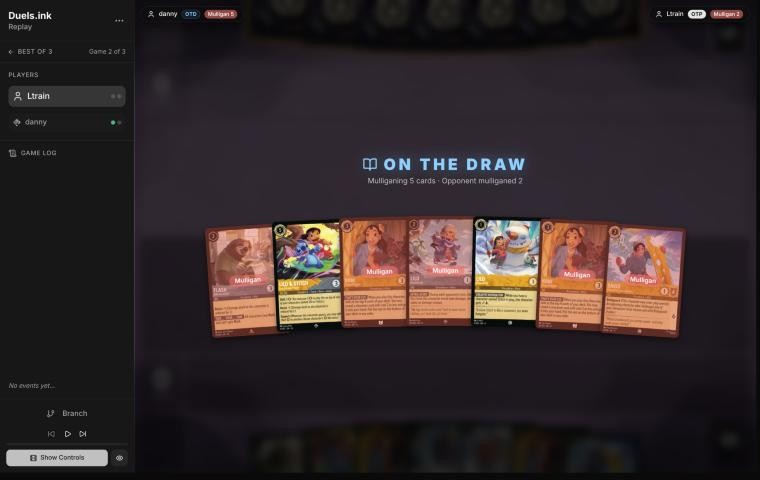
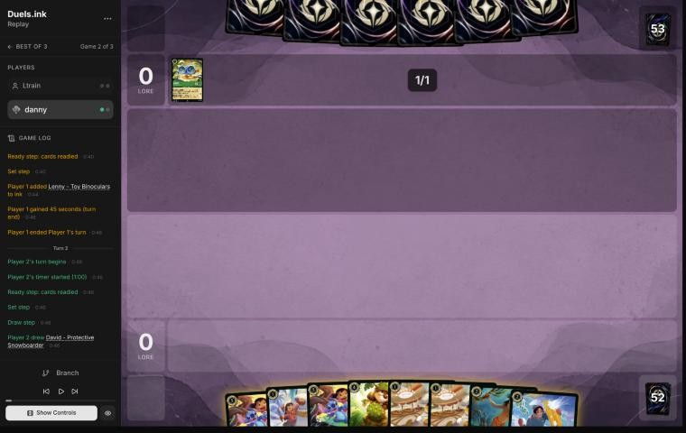
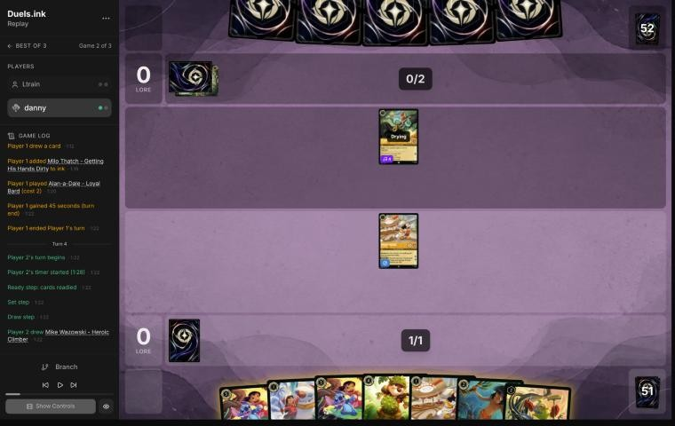
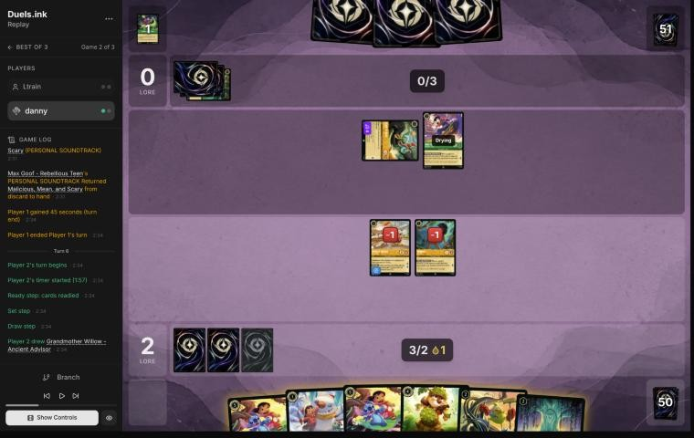
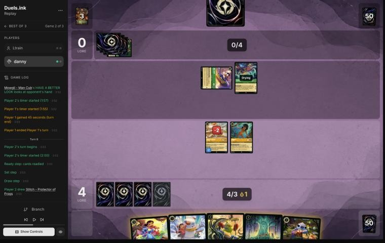
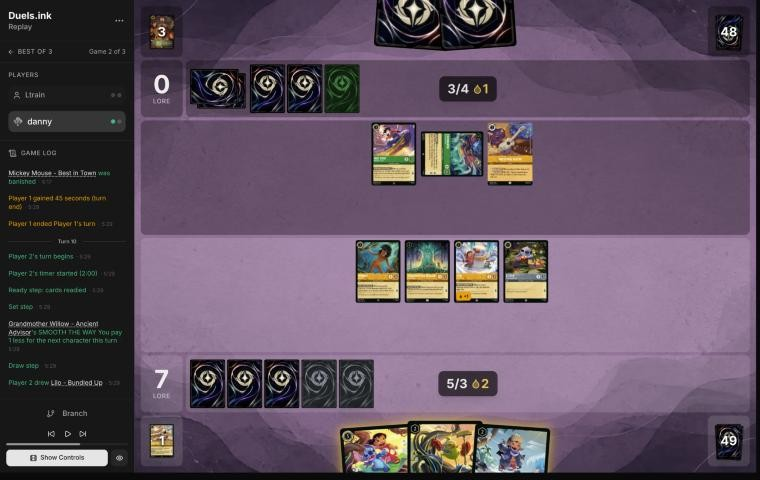
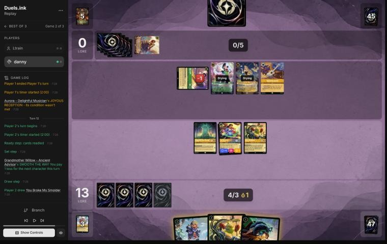

# Review: danny vs Ltrain, 11 Nov 2026 (game 2)

| | |
|---|---|
| **Status** | draft (blind pass done, not yet discussed) |
| **Replay** | `01a1cc0a-a52d` (`python3 tools/brief.py 01a1cc0a-a52d --turn N`) · [duels.ink viewer](https://duels.ink/replay/01a1cc0a-a52d-7318-83e5-400a3753a8fb?step=0) |
| **Format** | Core Constructed. Set 14 era: inks revealed before the coin toss |
| **Decks** | You: Amber/Steel Rockstar Aggro, your Lilo list. Them: Amber/Emerald Circle of Life, known from game 1 ([the coach's notes on Circle of Life against your Rockstar Aggro](#cite-kb-meta-archetypes-amber-emerald-circle-of-life-against-danny-s-rockstar-aggro-ten-games)) |
| **Play/draw** | They went first (they lost game 1) |
| **Result** | Won by concession on game turn 13, at 17–0 (the match 2–0) |
| **Meta data** | snapshot of 12 Nov 2026 (fresh) |
| **Chosen how** | By the user: every game of 11–12 Nov in the export, reviewed blind. The coach reviewed game 1 (a win) first; the export holds no game 3, so the coach suspects this game ended the match, not which way |

## Summary
- **Good plays:** [6](#turn-6) (Dale's SPIKE SUIT let a dying Mowgli kill their singer Alan-a-Dale, breaking the
  Chart Topper and Wither combo), [8](#turn-8), [10](#turn-10) (Support on Mowgli for Chernabog), [12](#turn-12).
- **Close calls:** [2](#turn-2) (Mickey first), [4](#turn-4) (Mowgli's look at their hand and a discarded Wither, or
  Lilo and a second Mickey for tempo).
- **Inaccuracies / mistakes / blunders:**
  - **Inaccuracy, [pre-game](#turn-0):** a five-card mulligan; sending back only the two Nanis scored a lore more by
    turn 4 on the simulator.

**What decided it:** you took their sweep apart piece by piece: Mowgli made them discard To Wither a Flower on turn 4,
SPIKE SUIT killed Alan-a-Dale before his free Malicious could set up the Chart Topper's replayed Wither, and Lilo &
Stitch's Support killed Chernabog. They never put a lore on the board, and conceded at 0–17.

## The game, turn by turn
Verdicts judge each decision on what you could know at the time, **including archetype knowledge an experienced
player has**. Hindsight is kept to its own section. Severity scale: good play / close call /
inaccuracy / mistake / blunder. Principle IDs and hypotheses (H-n) link to copies
in the Citations section at the end, as they stood when they were cited.

**What you knew before the game:** Ltrain's Circle of Life from game 1: Ursula – Vanessa (Singer 4) on turn 4, Milo
Thatch for 5 through Akood et Emuti on turn 6 (bouncing Mickey), Malicious, Mean, and Scary on turn 8, plus Tod,
Meilin Lee, Max Goof – Karaoke Star, Strike a Good Match, Ancestral Guitar and Aurora. You won game 1 by being 13–0
on turn 7. Now they're on the play, so their sweep comes a turn earlier relative to your board. The key cards and
their earliest game turns (they're on the play, so their turns are the odd ones):
- **Ursula – Vanessa** (2, Singer 4): from turn 3 she sings Malicious (3) or To Wither a Flower (4) for free.
- **Malicious, Mean, and Scary** (3): a counter on each of yours; **To Wither a Flower** (4): 2 damage to each
  damaged one. Together they kill everything with 3 willpower or less.
- **Milo Thatch** (7, 5 with Akood): bounces a character; a 5-strength Ward challenger.
- **Don Karnage – Debonair Pirate** (6), **Prince Phillip** (9) and **Circle of Life** (Sing Together 8), the later
  sweeps; Under the Sea (off-list) bottoms everything with 2 strength or less.

### Pre-game

*The board before the decision: [step 0](https://duels.ink/replay/01a1cc0a-a52d-7318-83e5-400a3753a8fb?step=0) in the duels.ink replay viewer.*

**What you did:** on the draw, you sent back both Nanis, Lilo – Bundled Up, Flash and David, kept Lilo – Snow Artist
and Lilo & Stitch, and drew a second Lilo & Stitch, Dale, two Mickeys and Mowgli.

**Verdict: inaccuracy (small; confidence: medium).** The coach's candidates were keeping all seven, sending one Nani,
or sending both. On the simulator (`tools/mulligan.py`, 1,500 deals each), sending both Nanis scored 9.9 lore by turn
4, keeping all seven 9.3, and your five-card mulligan 8.9. Sending back **Lilo – Bundled Up, Flash and David** is
suboptimal because they were the hand's 2-drops: with Lilo – Snow Artist on turn 1 and Lilo & Stitch on turn 3, they
filled turn 2 and turn 4. The two Nanis were the clunky part ([MULL-2](#cite-mull-2)). This is the second deep mulligan in the match;
against a deck that sweeps on turns 7 to 13, the curve you keep is the lead you build.

### Turn 2: your turn 1

*The board before the decision: [step 4](https://duels.ink/replay/01a1cc0a-a52d-7318-83e5-400a3753a8fb?step=4) in the duels.ink replay viewer.*

**What you did:** drew David, inked him and played Mickey.

**Verdict: close call.** As in game 1: Mickey first is the most lore, and Lilo – Snow Artist next turn is still dry in
time for the Shift on your turn 3 (you won't have 3 ink before then), so nothing is lost on the curve. The price is
an ink drop for them each time he quests, which brings Ursula's songs, Milo and Don Karnage a turn closer.

### Turn 4: your turn 2

*The board before the decision: [step 10](https://duels.ink/replay/01a1cc0a-a52d-7318-83e5-400a3753a8fb?step=10) in the duels.ink replay viewer.*

**What you did:** drew Mike Wazowski – Heroic Climber, inked the second Mickey, played Mowgli (they revealed their hand
and discarded To Wither a Flower), and quested Mickey to 2–0.

**Setup.** Their Alan-a-Dale (Singer 4) can sing Malicious, Mean, and Scary (37% after their draw) or To Wither a
Flower (29%) for free next turn, and with Mickey's drop they'll have 4 ink for the other one. Lilo – Snow Artist is
the only Shift base for your two Lilo & Stitches: played now, she's dry for a Shift on turn 6. The coach's line: Lilo
and the second Mickey for 2 lore a turn more, Shift on turn 6.

**Verdict: close call.** The coach's line builds faster: Lilo now keeps the Shift on turn 6 rather than turn 8, and a
second Mickey quests for 2 (though it doubles their ink drops). Your Mowgli bought something real against this deck:
their whole hand, and one of its sweep songs gone, even if it was the one they chose to lose. Against a deck whose
plan is a song sweep, knowing the hand shapes every later turn; against the race, the lost tempo is about 3 lore.

### Turn 6: your turn 3

*The board before the decision: [step 22](https://duels.ink/replay/01a1cc0a-a52d-7318-83e5-400a3753a8fb?step=22) in the duels.ink replay viewer.*

**What you did:** drew Willow, inked a Lilo & Stitch, played Dale (with the drop), and sent the damaged Mowgli into
the exerted Alan-a-Dale: under SPIKE SUIT Mowgli dealt his 2 willpower and killed him, dying himself. Mickey quested
to 4–0.

**Setup.** Their turn 5: Alan-a-Dale sang Malicious, Mean, and Scary (a counter on Mickey and Mowgli), and Max Goof –
Rebellious Teen returned it to their hand. Mowgli showed you the rest of their hand on turn 4: Chernabog and Max
Goof – Chart Topper are known. That's a combo for next turn: Alan sings Malicious again, Chart Topper Shifts onto Max
Goof (4 ink) and quests, and NUMBER ONE HIT plays To Wither a Flower from their discard for free: every character of
yours with 3 willpower or less dies. Alan (2 willpower, exerted) is the free singer that starts it.

**Verdict: good play.** The coach's line, and the turn's key idea: Dale's SPIKE SUIT applies the turn he lands, so a
1-strength Mowgli who was dying to the sweep anyway dealt 2 and killed their singer. Without Alan, Malicious costs them
3 ink beside a 4-ink Shift, more than their 5; and Max Goof singing it instead leaves the Chart Topper on an exerted
base, unable to quest for the Wither. Dale's 4 willpower also survives that sweep.

### Turn 8: your turn 4

*The board before the decision: [step 36](https://duels.ink/replay/01a1cc0a-a52d-7318-83e5-400a3753a8fb?step=36) in the duels.ink replay viewer.*

**What you did:** drew Stitch; played Willow, Lilo – Snow Artist free with her discount and Stitch, and quested Mickey
and Mowgli to 7–0. You kept your ink drop and didn't ink.

**Setup.** Their turn 7: Max Goof sang Malicious (Mickey and Dale damaged), and Chernabog shuffled Dale into your deck;
DARK DANCE let you replay Mowgli from your discard. Now Max Goof – Rebellious Teen is exerted (2 willpower) and the
Chart Topper in their hand can Shift onto him next turn, quest, and replay To Wither a Flower from their discard: 2
damage to each damaged character of yours, so the 2-damage Mickey dies. Nothing of yours that's dry can kill Max Goof
(Mowgli has 1 strength, and a Lilo & Stitch Shifted onto a fresh base can't quest for Support). The Shift is better
next turn, onto a dry base, so it quests at once.

**Verdict: good play.** The coach's line: three bodies for 3 ink, both Shift bases dry for next turn (when Willow makes
the Shift cost 2), and fresh characters that a Wither, which only hits damaged ones, can't touch. Saving the drop and
the inkables keeps the Shift and Mike playable next turn.

### Turn 10: your turn 5

*The board before the decision: [step 45](https://duels.ink/replay/01a1cc0a-a52d-7318-83e5-400a3753a8fb?step=45) in the duels.ink replay viewer.*

**What you did:** drew Lilo – Bundled Up; played Mike for 1 (Willow; you got a second Mike, their Akood went to the
bottom), Shifted Lilo & Stitch onto Stitch, quested it and gave Mowgli its Support to trade with the exerted Chernabog
(4 damage), then quested Lilo and Willow to 13–0.

**Setup.** Their turn 9: Ancestral Guitar drew them a card and Chernabog killed the damaged Mickey. Chernabog (5
strength) is exerted with 4 willpower; Max Goof – Rebellious Teen is ready, still the base for the Chart Topper in
their hand, whose quest replays Malicious or To Wither a Flower from their discard. Lilo & Stitch's Support makes
any character a 4-strength challenger.

**Verdict: good play.** The coach's line in substance: a Mowgli for their best challenger, and 6 lore. The one
difference is where Willow's discount went: on the Shift it leaves 3 ink for Lilo – Bundled Up (2 lore), on Mike it
buys Mike (1 lore and a reveal). Close either way.

### Turn 12: your turn 6

*The board before the decision: [step 62](https://duels.ink/replay/01a1cc0a-a52d-7318-83e5-400a3753a8fb?step=62) in the duels.ink replay viewer.*

**What you did:** drew You Broke My Smolder; played Mike for 1 (Willow; you got a Lilo & Stitch, they got a second
Aurora), played Lilo – Bundled Up, quested Lilo & Stitch and gave the first Mike its Support to kill the damaged Max
Goof – Rebellious Teen, and quested Willow to 17–0.

**Setup.** Their turn 11: Max Goof – Rebellious Teen killed Lilo – Snow Artist, and Max Goof – Karaoke Star and Aurora
came down. They hold only the Chart Topper (plus a draw), which can Shift onto either Max Goof and replay a song from
their discard when it quests. Their Sing Together total is 9, enough for Circle of Life (7% after their draw) to
replay Chernabog. You need 7: questing all three makes 18, and two fresh characters ready next turn cover the rest.

**Verdict: good play.** Questing Mike instead of the Support challenge was 1 more lore (18 rather than 17); killing
the 2-strength Rebellious Teen instead removes a challenger and one of the Chart Topper's two bases. Either way, next
turn Lilo – Bundled Up and the second Mike are ready and their board can only challenge exerted characters, so the 3
you need can't be stopped by anything they've shown.

## Lessons
1. **Dale's SPIKE SUIT works the turn he lands** ([turn 6](#turn-6)): any character deals its willpower in challenges,
   so a 1-strength, 2-willpower Mowgli kills a 2-willpower singer.
2. **Kill the free singers and the bases of their combos first** ([turns 6](#turn-6), [12](#turn-12)): Alan-a-Dale
   (Singer 4) and the Max Goofs (Chart Topper's Shift bases) are what turn their discard into a sweep.
3. **Against Circle of Life, fresh characters dodge To Wither a Flower** ([turn 8](#turn-8)): it hits only damaged
   ones, so a wave of new bodies after a Malicious is safe until the next counter.
4. **The deep mulligans of this match cost lore** ([pre-game](#turn-0), and game 1's): both times the simulator
   preferred keeping more of a hand that already curved.

## Proposed knowledge-base updates (applied after discussion)
- **Meta** (the Amber/Emerald pair file's notes, Ltrain, game 2): Lenny – Toy Binoculars, Alan-a-Dale (turn 3),
  Max Goof – Rebellious Teen returning Malicious, Max Goof – Chart Topper (NUMBER ONE HIT replays a song from the
  discard on quest), Chernabog (turn 7), Aurora – Delightful Musician, Ancestral Guitar. The Chart Topper plan: Malicious
  by a singer, then the Chart Topper quests and replays To Wither a Flower.
- **Card note** (Max Goof – Chart Topper, new or in the pair file): its quest replays a song of cost 4 or less from the
  discard, so a To Wither a Flower or Malicious already used is live again; kill its Max Goof bases.

## Hindsight
Doesn't change the verdicts above.
- They held the Chart Topper from turn 6 to the end and never found a moment to use it: Alan-a-Dale died on turn 6,
  Rebellious Teen on turn 12.

## The coach's errors
Found by the coach during the review; the discussion may add more.

| When | Error | How it was caught | How it won't happen again |
|---|---|---|---|
| Turn 6 | The brief's "known in their hand" left out the Malicious that Max Goof – Rebellious Teen returned from their discard on turn 5, and gave it 6% | Reading their turn 5 | Proposed: the brief adds cards returned from the discard to hand (PERSONAL SOUNDTRACK, MELODIC REFRAIN) to "known in their hand" |

## Open questions
- **[Pre-game](#turn-0):** what made Lilo – Bundled Up, Flash and David worth sending back?
- **[Turn 4](#turn-4):** what did Mowgli show you, and did it shape the later turns?

## Citations
Copies of the coach's knowledge base cited above, as they stood when they were cited (the private repository's commit and date are given with each). They don't change when the knowledge base does.

**amber-emerald.md, Circle of Life against danny's Rockstar Aggro: ten games**: knowledge base, `kb/meta/archetypes/amber-emerald.md` at `a05644e` (2026-11-12), working tree

> ### Circle of Life against danny's Rockstar Aggro: ten games `[coach, meta study of danny's 6–8 Nov 2026 games (tools/scan.py), full games, not blind, 10 games]`
> `01a1b2f3-aafb` (NotSamm1217), `01a1b528-8d8d` (IDontKnow), `01a1b549-9adb` (Meat Bass), `01a1b55e-eb5e` (WinterLeaf),
> `01a1b5a6-b75e`, `01a1b5ad-60d8` and `01a1b5b1-1f6f` (TeePee, games 1–3), `01a1b720-ce69` (NINOWIS),
> `01a1b85a-1a3a` (Lorelineman), `01a1b867-11ee` (D4C). Seven went danny's way, mostly by concession at 14–18 to 0–2.
> - **Every sweep came after Rockstar Aggro's lead was built:** game turns 7 to 13, at 9–0 to 17–0.
>   - **Under the Sea** (off-list; 8, uninkable, Sing Together 8: all opposing characters with 2 {S} or less go to the
>     bottom of their decks) takes almost the whole Lilo deck: only Flash, Nani and Lilo & Stitch have 3 {S}. Ursula –
>     Vanessa and Alan-a-Dale – Loyal Bard (both Singer 4) sang it on turn 7 of `01a1b2f3-aafb`: five characters gone
>     at 9–0.
>   - **Don Karnage – Debonair Pirate twice:** hard-cast, then replayed free by Circle of Life (Lenny, Tod and Angel
>     singing). That's 2 damage to everything: four kills at 12–0 (`01a1b549-9adb` turn 11).
>   - **Malicious, Mean, and Scary twice, then To Wither a Flower:** six kills at 15–0 (`01a1b720-ce69` turn 10, after
>     Akood made Meilin cost 1 and Meilin found Wither). At 17–0, Max Goof – Rebellious Teen returned Malicious
>     (`01a1b55e-eb5e` turn 10).
> - **What lost the three:** after the sweep their slow board quested 8 to 12 a turn. Max Goof – Karaoke Star quested
>   for 4, Milo for 3, Don Karnage for 2. They went 0 → 8 → 20 at 17–19 (`01a1b5a6-b75e` turns 15–17) and 2 → 11 → 20
>   (`01a1b549-9adb` turns 11–15). Milo's SCHOLAR'S GAMBIT also bounced a rebuilt Bundled Up (`01a1b2f3-aafb` turn 13).
> - **What won the seven:** the lead was big enough that what survived the sweep, or was rebuilt after it, reached
>   20 before their late board did. In three, no turn of theirs killed three or more.
> - **Off-list cards:**
>   - Under the Sea
>   - Lost in the Woods (4, song: your characters get −2 {S} until their next turn)
>   - Timon – Snowball Swiper (3, uninkable: you reveal your hand and discard a non-character card of their choice)
>   - Aladdin – Doing His Part
>   - Ariel – Ethereal Voice
>   - Gaetan Moliere – Clever Burrower (4, Evasive 2/5: draws 2 and discards 2 on each quest)

**MULL-2**: strategy principle, `kb/strategy/principles.md` at `a05644e` (2026-11-12), working tree

> - **MULL-2. A smooth curve beats a few powerful cards.** Check that you can spend ink well on turns 1–4, have enough inkable cards, and know what turn 4 looks like. `[MCL ch.12]` · baseline
>   - **Ink spent isn't the goal by itself.** Judge a keep by a nice curve (a play each turn), early lore pressure, and
>     interaction that sets the opponent back, as well as by ink, then weigh card quality and the matchup
>     (user, 2026-11-01). `tools/mulligan.py` reports all of these.
