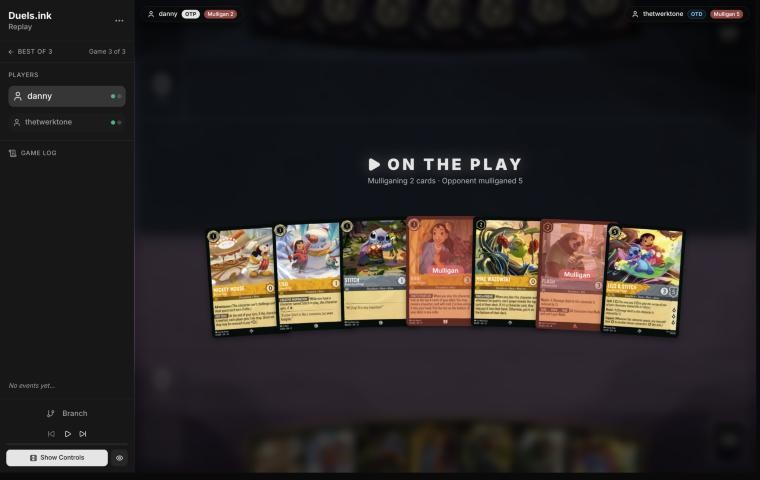
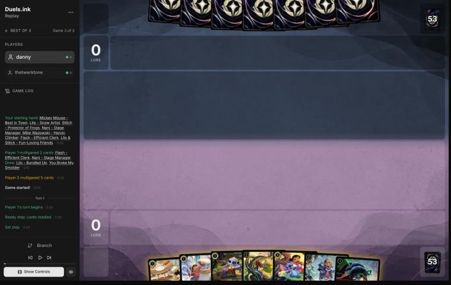
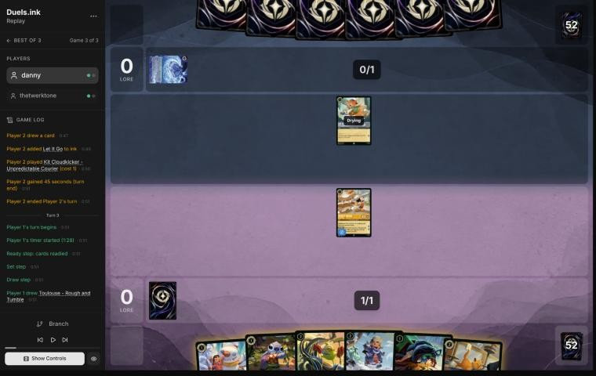
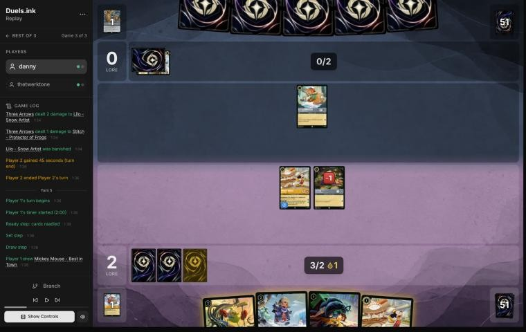
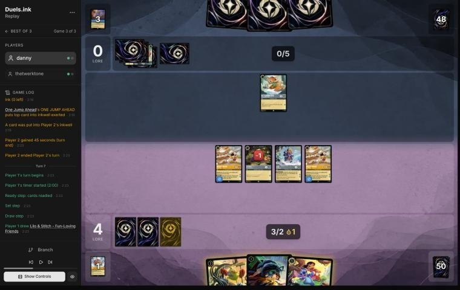
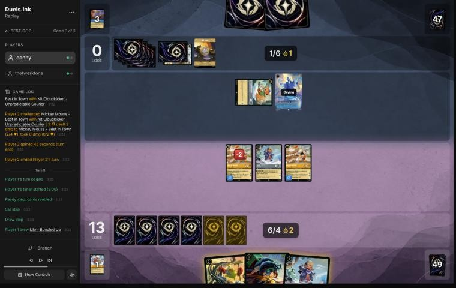
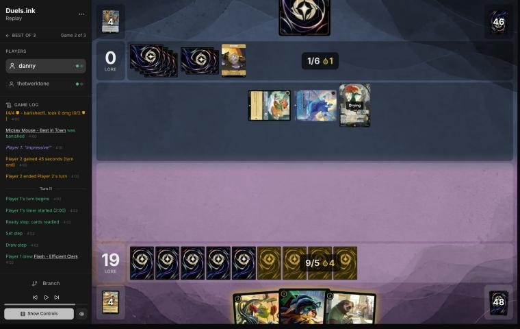

# Review: danny vs thetwerktone, 11 Nov 2026 (game 3)

| | |
|---|---|
| **Status** | draft (blind pass done, not yet discussed) |
| **Replay** | `01a1cc61-9de0` (`python3 tools/brief.py 01a1cc61-9de0 --turn N`) · [duels.ink viewer](https://duels.ink/replay/01a1cc61-9de1-7d81-b00f-d0177d5af46a?step=0) |
| **Format** | Core Constructed (assumed: the replay doesn't say, and every card seen is Core-legal). Set 14 era: inks revealed before the coin toss |
| **Decks** | You: Amber/Steel Rockstar Aggro, your Lilo list. Them: Sapphire/Steel ([the coach's notes on Ariel Songs](#cite-kb-meta-archetypes-sapphire-steel-ariel-songs)); archetype as it became clear: an Ariel Songs variant with Kit Cloudkicker, Hades – Infernal Schemer and Merida – Formidable Archer, from turn 6 |
| **Play/draw** | You went first |
| **Result** | Won by concession on game turn 12, at 19–0 |
| **Meta data** | snapshot of 12 Nov 2026 (fresh) |
| **Chosen how** | By the user: every game of 11–12 Nov in the export, reviewed blind. Games 1 and 2 of this match aren't in the export, so the coach knows only that the match went to a game 3 |

## Summary
- **Good plays:** [3](#turn-3), [5](#turn-5), [7](#turn-7) (a 9-lore turn to 13–0), [9](#turn-9) (19, keeping Mike
  in hand), [11](#turn-11) (four fresh bodies and Toulouse's lock on their actions after they cleared your board).
- **Close calls:** [pre-game](#turn-0) (Flash or Mike), [1](#turn-1) (inking Lilo & Stitch to keep three 1-drops,
  and Mickey's drops for a ramp deck).
- **Inaccuracies / mistakes / blunders:** none.

**What decided it:** speed, then the lock. Two Mickeys and a Lilo & Stitch took you to 13 on turn 7 and 19 on turn 9;
their turn 10 (Let It Go, Merida's Three Arrows) cleared the board one lore short, and Toulouse's UNBECOMING BEHAVIOR
switched off their songs and actions for the turn your four new characters needed to survive. They conceded.

## The game, turn by turn
Verdicts judge each decision on what you could know at the time, **including archetype knowledge an experienced
player has**. Hindsight is kept to its own section. Severity scale: good play / close call /
inaccuracy / mistake / blunder. Principle IDs and hypotheses (H-n) link to copies
in the Citations section at the end, as they stood when they were cited.

**What you knew before the game:** Sapphire/Steel: Big Ramp (38%), an unlisted list (33%), Ariel Songs (17%) or
Ducktectives (12%). You had also played games 1 and 2 against this deck, which the coach can't see, so you knew more
than the brief's odds. The cards that matter to a board of 1- and 2-drops, and their earliest game turns (you're on the
play, so theirs are the even ones):
- **Cheap removal:** The Terror That Flaps in the Night (2: 2 damage, 3 with a Darkwing), Three Arrows (3: 2 damage
  plus 1), Strength of a Raging Fire (3, a song: damage equal to their character count). From turn 2 or 4.
- **Sweepers:** Windstorm (4: 1 damage to each of yours, more to Evasive ones), Tinker Bell – Giant Fairy (6, Shift 4:
  1 damage to each). Most of your characters have 2 or 3 willpower, so one damage softens the board for the next card.
- **He Hurled His Thunderbolt** (4, song: 4 damage), **Let It Go** (5, song: a character into your inkwell).
- **Big Ramp's engine:** Priscilla and Marie make ink; Tiana – Party Hostess, Khan Industries (a location where their
  characters can't be challenged) and Minnie – Urban Visionary come late. Against a ramp deck, the race is won early.

### Pre-game

*The board before the decision: [step 0](https://duels.ink/replay/01a1cc61-9de1-7d81-b00f-d0177d5af46a?step=0) in the duels.ink replay viewer.*

**What you did:** on the play, you sent back Flash and Nani, kept Mickey, Lilo – Snow Artist, Stitch, Mike and Lilo &
Stitch, and drew Lilo – Bundled Up and You Broke My Smolder.

**Verdict: close call.** Your keep beat keeping all seven on the simulator (`tools/mulligan.py`, 1,500 deals each:
11.6 lore by turn 4 against 11.3), and sending back only Nani scored 12.4. The difference is Flash against Mike: Flash
quests for 2, and with Resist his 2 willpower survives a Terror or Three Arrows, while Mike's FIND A FRIEND hands a ramp
deck cards. Small either way; both keeps have the Lilo & Stitch Shift on turn 3.

### Turn 1: your turn 1

*The board before the decision: [step 2](https://duels.ink/replay/01a1cc61-9de1-7d81-b00f-d0177d5af46a?step=2) in the duels.ink replay viewer.*

**What you did:** inked Lilo & Stitch and played Mickey.

**Verdict: close call.** With three uninkables in hand (Mike, Lilo – Bundled Up, the Smolder), one of the four
inkables had to go, and you kept all three 1-drops: Mickey, Lilo and Stitch quest for 5 a turn from turn 3, more than
the coach's line (ink Mickey, play Stitch, Shift Lilo & Stitch on turn 3) scores by turn 4. The coach's line keeps the
card their removal handles worst: Lilo & Stitch's 5 willpower and Resist survive a Terror, Three Arrows or Windstorm,
which kill or soften the 1-drops. And Mickey's ink drop each turn feeds a Big Ramp deck whose late cards (Tiana, Minnie)
it brings closer ([the coach's Mickey note](#cite-kb-cards-mickey-mouse-best-in-town-what-it-means-in-play)).

### Turn 3: your turn 2

*The board before the decision: [step 8](https://duels.ink/replay/01a1cc61-9de1-7d81-b00f-d0177d5af46a?step=8) in the duels.ink replay viewer.*

**What you did:** drew Toulouse, quested Mickey to 2–0, played Lilo – Snow Artist, inked Toulouse and played Stitch.

**Verdict: good play.** The coach's line: two bodies that quest for 3 together (Lilo gets her extra lore beside
Stitch), with the spare inkable inked. Their Kit Cloudkicker (2 strength) can't kill Mickey's 4 willpower.

### Turn 5: your turn 3

*The board before the decision: [step 18](https://duels.ink/replay/01a1cc61-9de1-7d81-b00f-d0177d5af46a?step=18) in the duels.ink replay viewer.*

**What you did:** drew a second Mickey; played Lilo – Bundled Up and the second Mickey (with the drop), and quested
the first Mickey to 4–0. Stitch stayed home; nothing was inked.

**Setup.** Their turn 4: Three Arrows killed Lilo – Snow Artist and put 1 damage on Stitch (2 willpower left). Their
Kit Cloudkicker (2 strength) kills Stitch if he's exerted, and with 4 ink next turn Kit Cloudkicker – Sure Shot (seen
in their inkwell) can Shift onto him and challenge for 4, enough for a Mickey. Your hand's only inkable was the second
Mickey.

**Verdict: good play.** The most lore on the board for the ink: Lilo – Bundled Up (2, and she shrugs off the first
damage on their turn) and a second Mickey (2). Stitch staying home is a close call: his quest is 1 lore against
giving Kit a free kill, and he's your last Shift base for a Lilo & Stitch. The cost is the second Mickey's drop, which
their Kit Sure Shot deck can use.

### Turn 7: your turn 4

*The board before the decision: [step 27](https://duels.ink/replay/01a1cc61-9de1-7d81-b00f-d0177d5af46a?step=27) in the duels.ink replay viewer.*

**What you did:** drew a Lilo & Stitch, Shifted it onto Stitch, and quested everything: both Mickeys, Lilo & Stitch and
Lilo – Bundled Up to 13–0.

**Setup.** Their turn 6 was two One Jump Aheads: 5 ink and an Ariel Songs list (91%), with Tinker Bell – Giant Fairy
(1 damage to each of yours), He Hurled His Thunderbolt (4 damage) and Let It Go in it. With your Mickeys' drops they'll
have 8 ink next turn. Their only character, Kit Cloudkicker, can't kill anything but the damaged Stitch.

**Verdict: good play.** The coach's line. Shifting onto the damaged Stitch rather than Lilo – Bundled Up keeps her 2
lore on the board, and a 9-lore quest turn puts you 7 from winning: next turn the same four characters quest for 9,
so they need to remove three of them in one turn.

### Turn 9: your turn 5

*The board before the decision: [step 41](https://duels.ink/replay/01a1cc61-9de1-7d81-b00f-d0177d5af46a?step=41) in the duels.ink replay viewer.*

**What you did:** drew the second Lilo – Bundled Up, quested both Mickeys and Lilo – Bundled Up to 19–0, and played the
second Lilo – Bundled Up. Mike and the Smolder stayed in hand.

**Setup.** Their turn 8: Hades – Infernal Schemer put your Lilo & Stitch (and the Stitch under it) into your inkwell,
and Kit Cloudkicker put 2 damage on a Mickey. You need 7: 6 now, and 1 next turn from anything still standing. Hades
can sing Let It Go or He Hurled His Thunderbolt for free next turn, and Kit Cloudkicker – Sure Shot can Shift in.

**Verdict: good play.** Every quest taken, and one more body: next turn they must remove all four of your characters
to stop 1 lore, and Lilo – Bundled Up's EXTRA LAYERS makes even a Tinker Bell sweep miss two of them. Keeping Mike in
hand is right too: at 19 his FIND A FRIEND would only hand them a card that might be the answer.

### Turn 11: your turn 6

*The board before the decision: [step 58](https://duels.ink/replay/01a1cc61-9de1-7d81-b00f-d0177d5af46a?step=58) in the duels.ink replay viewer.*

**What you did:** drew Flash; played Mike (you got Toulouse; they got Ariel – Sonic Warrior), Flash and Toulouse, then
You Broke My Smolder on an empty hand (Dale and a Mickey) and Mickey. Four characters, ready.

**Setup.** Their turn 10 cleared your board: Hades sang Let It Go on a Lilo – Bundled Up, Merida – Formidable Archer
returned Three Arrows, and Three Arrows with STEADY AIM's extra 2 per hit killed a Mickey and the other Lilo – Bundled
Up; Kit finished the second Mickey. You're at 19 with nothing in play, so nothing can quest until turn 13: whatever
you play must survive their turn. Their removal is almost all actions and songs (Let It Go, Thunderbolt, Three Arrows,
Strength of a Raging Fire), sung free by Hades and Merida.

**Verdict: good play.** The best answer available: four bodies, so a 1-for-1 removal deck needs four answers, and
Toulouse's UNBECOMING BEHAVIOR stops them playing actions (songs included) until your next turn, which switches off
nearly all of that removal. Mike's card for them was the price of a fourth body and of finding Toulouse; with actions
locked, a character card is the only thing it could give them that matters.

## Lessons
1. **Toulouse locks out a removal deck's answers for a turn** ([turn 11](#turn-11)): UNBECOMING BEHAVIOR stops actions,
   and songs are actions. Against a list whose removal is Let It Go, Thunderbolt and Three Arrows, it's the card to hold
   for the turn your rebuilt board must survive.
2. **Go wide after a sweep** ([turn 11](#turn-11)): one-for-one removal needs one card per body.
3. **At 19, don't feed them cards** ([turn 9](#turn-9)): keeping Mike in hand denied them a free look for an answer.

## Proposed knowledge-base updates (applied after discussion)
- **Meta** (the Sapphire/Steel pair file's notes, thetwerktone, game 3): an Ariel Songs variant not in duels.ink's
  lists: two Kit Cloudkicker – Unpredictable Courier and two Sure Shot, two One Jump Ahead (ramp by song), Hades –
  Infernal Schemer (7: a character into your inkwell; sings Let It Go), Merida – Formidable Archer (returns Three Arrows;
  STEADY AIM adds 2 to each action's damage). Their turn 10 removed four characters.
- **Card note** (Toulouse – Rough and Tumble, in the Rockstar notes): UNBECOMING BEHAVIOR shuts off songs as well as
  other actions, so against song-removal decks it protects a rebuilt board for a turn.

## Hindsight
Doesn't change the verdicts above.
- Mike's reveal gave them Ariel – Sonic Warrior on turn 11; with actions locked they conceded rather than play it.

## The coach's errors
Found by the coach during the review; the discussion may add more.

| When | Error | How it was caught | How it won't happen again |
|---|---|---|---|

None found.

## Open questions
- **[Turn 1](#turn-1):** was inking Lilo & Stitch to keep all three 1-drops a plan from games 1 and 2 (which the coach
  hasn't seen)?
- **[Turn 11](#turn-11):** did you hold Toulouse for the lock, or was it the card Mike found?

## Citations
Copies of the coach's knowledge base cited above, as they stood when they were cited (the private repository's commit and date are given with each). They don't change when the knowledge base does.

**sapphire-steel.md, Ariel Songs**: knowledge base, `kb/meta/archetypes/sapphire-steel.md` at `d41c503` (2026-11-12), working tree

> ### Ariel Songs
> 17% of the pair's games (9,675).
>
> | # | Card | Type | Cost | Tag |
> |---|---|---|---|---|
> | 3 | Judy Hopps - Snowball Patrol | character | 2 |  |
> | 4 | Violet Parr - Force Field Practice | character | 2 |  |
> | 2 | Angel - Experiment 624 | character | 4 | removal |
> | 4 | Cinderella - Dream Come True | character | 4 |  |
> | 2 | Mulan - Created by the Vine | character | 4 | removal |
> | 4 | Merida - Formidable Archer | character | 5 |  |
> | 1 | Moana - Curious Explorer | character | 5 |  |
> | 1 | Mulan - Considerate Diplomat | character | 5 |  |
> | 1 | Pete - Ghost of Christmas Future | character | 5 |  |
> | 2 | Violet Parr - Super Resilient | character | 5 |  |
> | 3 | Ariel - Sonic Warrior | character | 6 |  |
> | 4 | Goliath - Clan Leader | character | 6 |  |
> | 4 | Tinker Bell - Giant Fairy | character | 6 | sweeper |
> | 3 | Cinderella - Unintentional Icon | character | 7 |  |
> | 2 | Minnie Mouse - Urban Visionary | character | 8 |  |
> | 4 | Three Arrows | action | 3 | removal |
> | 2 | Windstorm | action | 4 | sweeper |
> | 4 | One Jump Ahead | song | 2 |  |
> | 3 | Strength of a Raging Fire | song | 3 | removal |
> | 4 | He Hurled His Thunderbolt | song | 4 | removal |
> | 4 | Let It Go | song | 5 | removal |

**mickey-mouse-best-in-town.md, What it means in play**: knowledge base, `kb/cards/mickey-mouse-best-in-town.md` at `d41c503` (2026-11-12), working tree

> ## What it means in play `[coach, from the 27 Oct 2026 meta study]`
> - **The ramp is symmetric:** every turn he quests, the opponent also gets an ink drop. That's worth more to decks with
>   ink-drop payoffs:
>   - **Jousting Match** (Steel action, 3): 2 damage, or **5 if paid with an ink drop**. Mickey supplied an Amethyst/Steel
>     opponent's drops (01a17e37).
>   - Ink-drop decks also run Ink Explosion, Merlin – Profoundly Curious and Marie – Caught in the Act; Shere Khan –
>     Khan Industries CEO makes drops of his own.
>   - An Emerald/Steel opponent spent four of these drops on turn 6 of 01a17ddb.
> - **Adventurous forces him to quest,** so he ends every turn exerted and can be challenged. 0 strength means he trades
>   for nothing; he's often the first challenge target (01a17e9c turn 14, 01a17ddb turn 6).
> - **Against a Steel opponent,** count the drops you're giving them, and what they could pay for with them, before
>   questing with him.
> - **Drops bring Raging Storm early** `[coach, meta study of Savitar's games, 2 Nov 2026]`: Candle Control (Amber/Ruby)
>   cast it on game turn 9, their 5th turn, with 5 ink and 3 drops from both sides' Mickeys (01a19bdb-d8e4). Against an
>   Amber deck, add your Mickey's drops to their ink when you count down to Storm (8).
