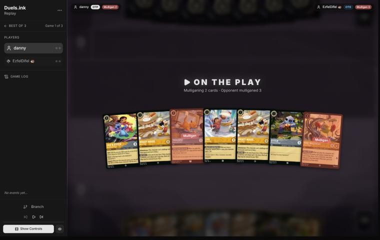
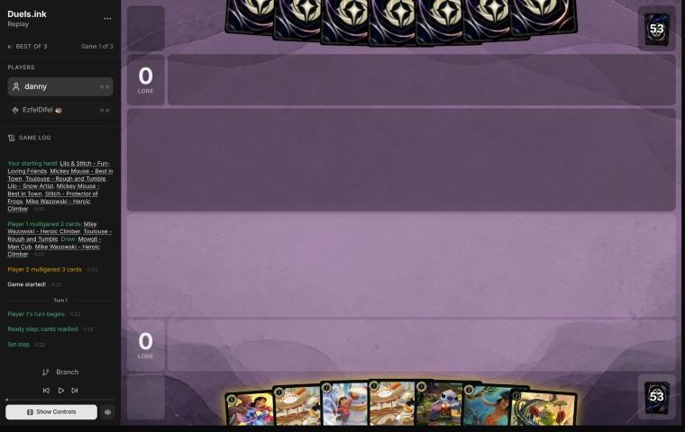
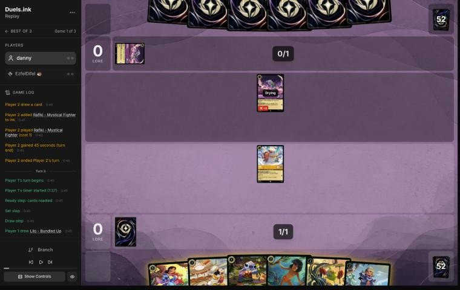
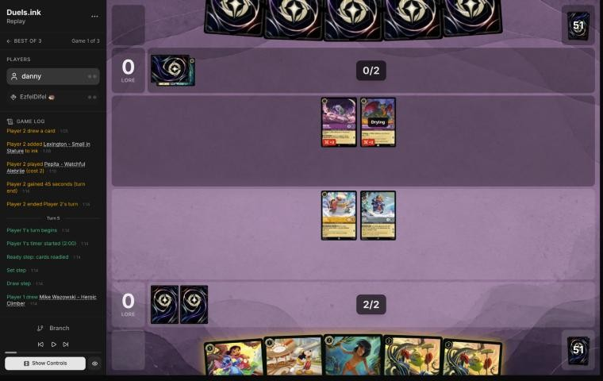
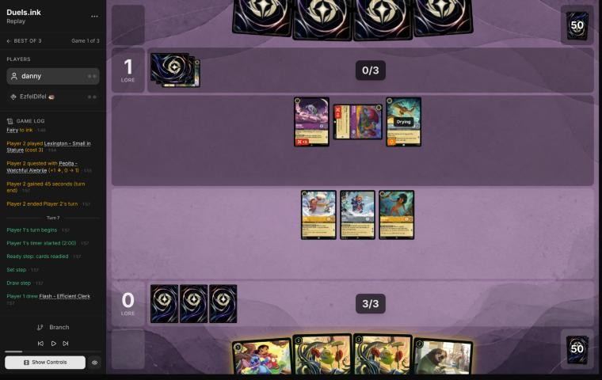
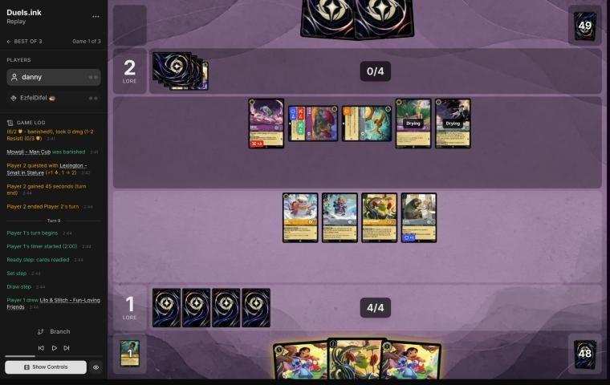
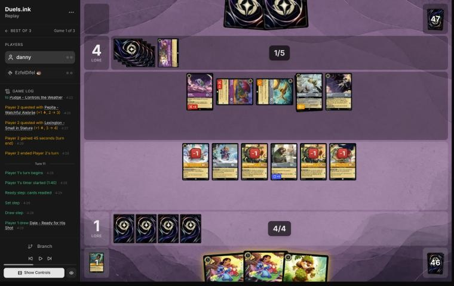
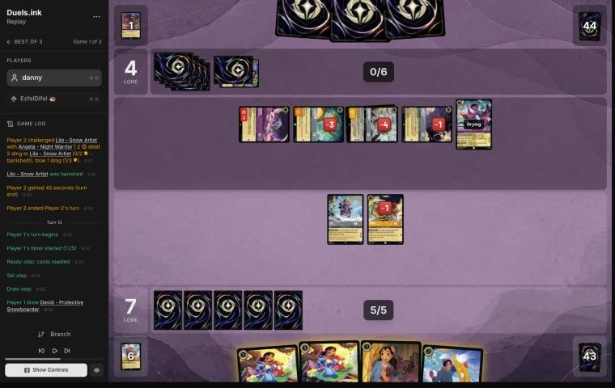
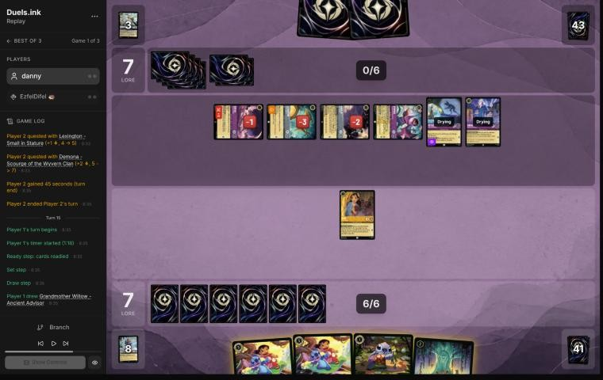
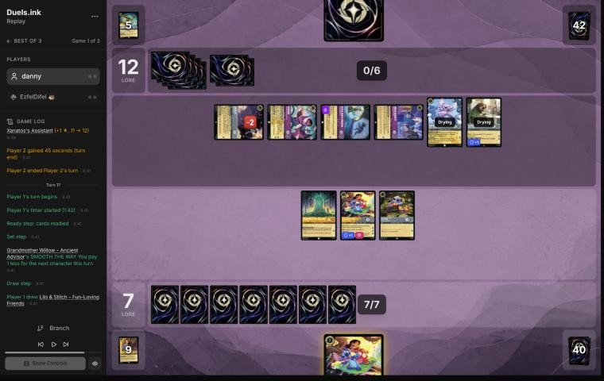

# Review: danny vs EzfelDifel, 11 Nov 2026 (game 1)

| | |
|---|---|
| **Status** | draft (blind pass done, not yet discussed) |
| **Replay** | `01a1ccd4-187e` (`python3 tools/brief.py 01a1ccd4-187e --turn N`) · [duels.ink viewer](https://duels.ink/replay/01a1ccd4-188e-7fbd-8216-6df458e69e15?step=0) |
| **Format** | Core Constructed. Set 14 era: inks revealed before the coin toss |
| **Decks** | You: Amber/Steel Rockstar Aggro, your Lilo list. Them: Amethyst/Steel ([the coach's notes on Midrange](#cite-kb-meta-archetypes-amethyst-steel-midrange-how-it-plays)); archetype as it became clear: Midrange with the Gargoyles (Lexington, Angela, Demona, Goliath), from turn 6 |
| **Play/draw** | You went first |
| **Result** | Lost on lore, 10–20, on game turn 20 |
| **Meta data** | snapshot of 12 Nov 2026 (fresh) |
| **Chosen how** | By the user: every game of 11–12 Nov in the export, reviewed blind. The export holds a game 2 of this match, so the coach knows the match didn't end here, not how this game went |

## Summary
- **Good plays:** [pre-game](#turn-0), [1](#turn-1), [11](#turn-11) (Dale's SPIKE SUIT before the Demona turn you
  knew was coming), [15](#turn-15), [17](#turn-17) (Support onto the other Lilo & Stitch to kill Demona – Scourge).
- **Inaccuracies / mistakes / blunders:**
  - **Inaccuracies, [3](#turn-3) and [7](#turn-7):** Lilo stayed home on turn 3; on turn 7 the Shift waited again (1
    lore when 5 and a Pepita kill were there).
  - **Mistakes, [5](#turn-5), [9](#turn-9) and [13](#turn-13):** turns 5 and 9 scored 0 with Lilo & Stitch in hand and
    two dry Shift bases (and turn 9's Mike gave them Tinker Bell – Giant Fairy); on turn 13 Lilo – Bundled Up sat idle
    while Lexington had 1 willpower left.
- **Unwinnable from:** [19](#turn-19).

**What decided it:** the early turns. From turn 3 to turn 9 you held Lilo & Stitch with dry bases and scored 1 lore
in four turns, while their challengers (Rafiki, Pepita with Angela, Lexington) took your 1- and 2-drops one by one.
Their Demona – Scourge, known from Mowgli's look on turn 5, landed on turn 12 into a board that had never raced. Your
late turns (Dale before the Scourge, Support onto Lilo & Stitch for Demona) were strong, but they came at 1–4 and 7–7
instead of with a lead.

## The game, turn by turn
Verdicts judge each decision on what you could know at the time, **including archetype knowledge an experienced
player has**. Hindsight is kept to its own section. Severity scale: good play / close call /
inaccuracy / mistake / blunder. Principle IDs and hypotheses (H-n) link to copies
in the Citations section at the end, as they stood when they were cited.

**What you knew before the game:** Amethyst/Steel: Midrange (49%) or an unlisted list (48%). Midrange plays like the
Amber/Amethyst decks of the Duccio matches: exert effects to open your characters to its challengers. Their key cards
and the earliest game turn each can come (they're on the draw, so their turns are the even ones):
- **Peter Pan's Shadow** (3, uninkable, Evasive): exerts one of yours as he lands. Turn 6.
- **Angela – Night Warrior** (3): gives one character Challenger +2 and Resist +2 until their next turn. Turn 6.
- **Shere Khan – Khan Industries CEO** (4): one of their characters can challenge **ready** characters this turn.
  Turn 8.
- **Strength of a Raging Fire** (3, song): damage equal to their character count. **Angel – Experiment 624** (4): 2
  damage per discard. **Hades – Looking for a Deal** (5).
- **Demona – Scourge of the Wyvern Clan** (6): exerts your board and refills both hands to 3. Turn 12, earlier with
  ink drops. **Tinker Bell – Giant Fairy** (6): 1 damage to each of yours.
- **Flash – Efficient Clerk**, **Dumbo – Ninth Wonder of the Universe** (Evasive, draws and gains lore).

The lesson of the Duccio matches applies: exert effects reach characters you hold back, so the lore taken early is
what counts. And your Mickeys' ink drops bring Demona – Scourge a turn closer.

### Pre-game

*The board before the decision: [step 0](https://duels.ink/replay/01a1ccd4-188e-7fbd-8216-6df458e69e15?step=0) in the duels.ink replay viewer.*

**What you did:** on the play, you sent back Mike and Toulouse, kept Lilo – Snow Artist, Stitch, both Mickeys and Lilo
& Stitch, and drew Mowgli and another Mike.

**Verdict: good play.** The hand already had three 1-drops and Lilo & Stitch for turn 3; Mike (a symmetric card draw
for a Midrange deck) was the weakest card. On the simulator (`tools/mulligan.py`, 1,500 deals each), sending back Mike
scored 14.4 lore by turn 4 against 13.9 for keeping all seven; sending Toulouse as well changes little.

### Turn 1: your turn 1

*The board before the decision: [step 3](https://duels.ink/replay/01a1ccd4-188e-7fbd-8216-6df458e69e15?step=3) in the duels.ink replay viewer.*

**What you did:** inked a Mickey and played Lilo – Snow Artist.

**Verdict: good play.** Lilo first gives Lilo & Stitch a dry base for turn 3, and with two Mickeys in hand, inking one
keeps a 2-lore 1-drop while not doubling the ink drops a Demona – Scourge deck would get.

### Turn 3: your turn 2

*The board before the decision: [step 9](https://duels.ink/replay/01a1ccd4-188e-7fbd-8216-6df458e69e15?step=9) in the duels.ink replay viewer.*

**What you did:** drew Lilo – Bundled Up, inked Stitch, played Lilo – Bundled Up, and didn't quest with Lilo – Snow
Artist.

**Setup.** Their Rafiki (Challenger +3) is dry next turn and kills any exerted 2- or 3-willpower character, surviving
the damage back. Lilo – Snow Artist is next turn's Shift base for Lilo & Stitch; Stitch or Lilo – Bundled Up played now
would be a second one. The coach's line: ink Mowgli, play Stitch and Mickey, and quest Lilo, worth 2 with Stitch in
play.

**Verdict: inaccuracy (small; confidence: medium).** Playing **Lilo – Bundled Up and keeping Lilo home** is
suboptimal because it scores nothing this turn and puts one body on the board instead of two. Stitch and Mickey are
better: Lilo quests for 2 at once, Mickey quests for 2 from next turn, and if Rafiki trades for Lilo (giving up his own
quest), Stitch is still a dry base for next turn's Shift. Rafiki will be there every turn, so Lilo is never safer to
quest than now, while their exert effects (Peter Pan's Shadow, Demona) are still turns away ([QC-3](#cite-qc-3), [TEMPO-1](#cite-tempo-1)). Inking
Stitch rather than Mowgli also cost Lilo her extra lore.

### Turn 5: your turn 3

*The board before the decision: [step 15](https://duels.ink/replay/01a1ccd4-188e-7fbd-8216-6df458e69e15?step=15) in the duels.ink replay viewer.*

**What you did:** drew a second Mike, played Mowgli (their hand held no non-character, so nothing was discarded),
inked Mickey, and quested nothing. One ink unused; Lilo & Stitch stayed in hand.

**Setup.** Their Rafiki (Challenger +3) is dry, and Pepita (Challenger +2, so 4) will be next turn; together they deal
5 to Lilo & Stitch after Resist, exactly enough, and each alone kills Lilo – Snow Artist. Lilo – Bundled Up ignores the
first damage on their turn. With 3 ink they can add Peter Pan's Shadow (exert one), Angela (+2 to a challenger) or
Strength of a Raging Fire (damage equal to their character count, 2–3). Both Lilos are dry Shift bases. The coach's
line: ink Mowgli, Shift Lilo & Stitch onto Lilo – Snow Artist, and quest it and Lilo – Bundled Up for 5.

**Verdict: mistake (confidence: medium).** Playing **Mowgli and questing nothing** is suboptimal because it scores 0
on the turn your hand had a Shift for exactly your ink, and 2 lore (Lilo – Bundled Up) was safe from any single
challenger. The Shift and both quests are better: 5 lore, and their two challengers can take only one of your
questers between them, giving up both their quests to do it; a Lilo & Stitch they leave alone quests for 3 every turn
after. Even keeping Lilo & Stitch ready after the Shift, Lilo – Bundled Up's quest was free. The confidence is medium
because Mowgli showed you their hand, which the coach can't see ([QC-3](#cite-qc-3), [TEMPO-1](#cite-tempo-1)).

### Turn 7: your turn 4

*The board before the decision: [step 22](https://duels.ink/replay/01a1ccd4-188e-7fbd-8216-6df458e69e15?step=22) in the duels.ink replay viewer.*

**What you did:** drew Flash; played Mike (you got Nani, which you inked; their Strength of a Raging Fire went to the
bottom), played Flash, and quested Mowgli to 1–1. Lilo & Stitch stayed in hand again, and the two Lilos stayed home.

**Setup.** Their turn 6: Lexington – Small in Stature (4/4, Alert, a Gargoyle) and Pepita's quest. Mowgli showed you
their hand on turn 5: Angela – Night Warrior (+2 to a challenger and Resist +2), Demona – Imperious Spellcaster (her
discard gives a Gargoyle Rush) and Demona – Scourge. Pepita is exerted with 3 willpower. A quested Lilo & Stitch dies
to Rafiki and Lexington together (2 + 3 after Resist), more easily with Angela. The coach's line: Shift Lilo & Stitch
onto Lilo – Snow Artist, quest it, and give Mowgli its Support (4 strength) to trade with Pepita; quest Lilo – Bundled
Up. That's 5 lore and their best challenger gone.

**Verdict: inaccuracy (confidence: medium).** Flash was a good find: TAKE... YOUR... TIME switches off the Rush that
Demona – Imperious would give Lexington. But leaving **Lilo & Stitch in hand and both Lilos home** for a second turn
is suboptimal: 1 lore when 5 and a Pepita kill were there. If they answer the quested Lilo & Stitch, it costs them
Angela and two challengers' quests, with Lilo – Bundled Up, Flash and Mike still on your board; if they don't, it
quests for 3 a turn. Their Demona – Scourge, the card that punishes a waiting board, is in their hand and comes on
their 6 ink, about four turns away: the time to score is now ([QC-3](#cite-qc-3), [TEMPO-5](#cite-tempo-5)).

### Turn 9: your turn 5

*The board before the decision: [step 38](https://duels.ink/replay/01a1ccd4-188e-7fbd-8216-6df458e69e15?step=38) in the duels.ink replay viewer.*

**What you did:** drew a second Lilo & Stitch; played the second Mike (you got Pudge; they got Tinker Bell – Giant
Fairy) and Pudge for free, and quested nothing. Two ink unused; both Lilo & Stitches stayed in hand.

**Setup.** Their turn 8: Angela gave Pepita Challenger +2 and Resist +2 (until their next turn), Pepita killed the
exerted Mowgli, and Lexington quested. Pepita (3 willpower, Resist 2 for now) and Lexington (4 willpower) are both
exerted; Rafiki is ready. Their hand: Demona – Imperious (whose Rush your Flash switches off) and Demona – Scourge,
which needs 6 ink, two turns away. You had 4 ink, 5 if you inked one of the two Lilo & Stitches, and two dry Lilos.
The coach's line: ink a Lilo & Stitch, Shift the other onto Lilo – Snow Artist, quest it and give Flash its Support
(6 strength, 4 after Pepita's Resist) to kill Pepita, with Flash surviving her 2 back on Resist; quest Lilo – Bundled
Up and Mike; play the second Mike with the last 2 ink. About 6 lore.

**Verdict: mistake (confidence: medium-high).** A third turn with **no Shift and no quests** is suboptimal: at 1–2,
the race is slipping while Demona – Scourge, which you know they hold, gets closer to the turn it exerts your whole
board. Shifting and questing is better: about 6 lore, Pepita dead for nothing, and whatever they spend killing Lilo &
Stitch (Rafiki and Lexington together) is two quests they don't make. The second Mike also handed them Tinker Bell –
Giant Fairy, which Shifts onto their Curious Fairy next turn for 1 damage to each of your characters ([QC-3](#cite-qc-3), [TEMPO-5](#cite-tempo-5)).

### Turn 11: your turn 6

*The board before the decision: [step 50](https://duels.ink/replay/01a1ccd4-188e-7fbd-8216-6df458e69e15?step=50) in the duels.ink replay viewer.*

**What you did:** drew Dale; quested a Mike (you got Mowgli; they got Goliath – Clan Leader), played Dale, and sent the
other Mike into the exerted Pepita: under SPIKE SUIT he dealt his 4 willpower and killed her. Then you inked Mowgli and
quested Flash, Lilo – Bundled Up and Pudge to 7–4.

**Setup.** Their turn 10: Tinker Bell – Giant Fairy Shifted in and put 1 damage on most of your board, and they quested
to 4. Next turn they have 6 ink for the Demona – Scourge you know they hold: it exerts your whole board for their
challengers (Rafiki, Lexington, Tinker Bell, Angela). So nothing you keep ready this turn stays safe, and every quest
now is free. The coach's line: ink a Lilo & Stitch, Shift the other onto Lilo – Snow Artist, quest it with its Support
on Pudge to kill Lexington, Flash kills Pepita, and quest the rest: about 8 lore.

**Verdict: good play.** Close to the coach's line on lore (6 against about 7), and better against what's coming: Dale
makes every challenge on your exerted board next turn cost them, since your characters deal their willpower back (4
from each Mike and Dale, 3 from Pudge), which is exactly the answer to an exert-and-challenge turn. The Lilo & Stitch
Shift could have joined it with a little more ink; the coach's line leaves Lexington dead but no SPIKE SUIT.

### Turn 13: your turn 7

*The board before the decision: [step 69](https://duels.ink/replay/01a1ccd4-188e-7fbd-8216-6df458e69e15?step=69) in the duels.ink replay viewer.*

**What you did:** drew David; played Nani (her dig found Stitch) and Stitch, inked David, and traded Pudge for the
1-willpower Tinker Bell – Giant Fairy. Lilo – Bundled Up neither quested nor challenged; two ink unused, and both
Lilo & Stitches stayed in hand.

**Setup.** Their turn 12: Demona – Scourge exerted your board, and Tinker Bell (with PUNY PIRATE), Lexington, Rafiki
and Angela killed Dale, both Mikes, Flash and Lilo – Snow Artist; you drew Nani from the refill. Their whole board is
exerted and battered: Tinker Bell and Lexington have 1 willpower left each, Angela 2, Rafiki 2 (0 strength defending).
Goliath – Clan Leader is in their hand. Any of your 1-strength characters kills Tinker Bell or Lexington. The coach's
line: Shift Lilo & Stitch onto Lilo – Bundled Up and send it into Tinker Bell (3 damage kills; it takes 3 and lives),
Pudge into Lexington (a trade), and David with the rest of the ink: their two 4-strength challengers gone.

**Verdict: mistake (confidence: medium-high).** Killing Tinker Bell with Pudge is right. Leaving **Lilo – Bundled Up
idle** is suboptimal because Lexington, a 4-strength Alert challenger with 1 willpower left, was hers to kill, and
she'd otherwise quest for 2; doing neither wastes her turn while Lexington lives to challenge again. Lilo & Stitch, in
hand since turn 1, would have done the Tinker Bell kill and survived it. With their board this damaged, this was the
turn to clear it ([QC-2](#cite-qc-2), [TRADE-2](#cite-trade-2)).

### Turn 15: your turn 8

*The board before the decision: [step 87](https://duels.ink/replay/01a1ccd4-188e-7fbd-8216-6df458e69e15?step=87) in the duels.ink replay viewer.*

**What you did:** drew Willow; played her and Lilo & Stitch for 4, had Nani banish Rafiki for nothing, inked the
second Lilo & Stitch and played Stitch. 7–7.

**Setup.** Their turn 14: Peter Pan's Shadow exerted Lilo – Bundled Up for Rafiki and Angela to kill, Owen Burnett
bounced Stitch, and they quested to 7. Their six characters quest for 7 a turn: 20 on game turn 18 unless you take
some off the board. Rafiki (1 willpower left, 0 strength defending), Angela (1 left) and Lexington (1 left) are
exerted; Nani kills any of them, surviving the first two.

**Verdict: good play.** The most board for the ink, and a free kill of the challenger that has hunted your 1- and
2-drops all game. Angela was the other free kill (Nani survives her 2); Rafiki is the more dangerous of the two.

### Turn 17: your turn 9

*The board before the decision: [step 101](https://duels.ink/replay/01a1ccd4-188e-7fbd-8216-6df458e69e15?step=101) in the duels.ink replay viewer.*

**What you did:** drew a third Lilo & Stitch; Shifted it onto Stitch for 2 (Willow), quested it for 3 and gave its
Support to the other Lilo & Stitch, which (6 strength) banished the exerted Demona – Scourge; Willow traded with the
1-willpower Angela. 10–12.

**Setup.** Their turn 16: Lexington and Nani traded, Angel – Experiment 624 and a Flash came down, and four quests
took them to 12. Their board quested for 8, exactly enough to win next turn, so lore had to come off it.

**Verdict: good play.** The best turn of the game: 3 lore and their two most valuable questers (Demona's 2 and
Angela's 1) gone, so their board quests for 5 next turn instead of 8. Support onto another Lilo & Stitch to reach 6
strength for Demona is the line the coach would have looked for.

### Turn 19: your turn 10

**What you did:** drew David and played him exerted as a Bodyguard, and Lilo & Stitch killed their Flash. 10–16.

**The game was lost here** ([principle 2](#cite-principle-2)): their turn 18 (Goliath – Clan Leader, Owen trading with a Lilo & Stitch,
quests to 16) left Peter Pan's Shadow, Angel and Goliath questing for exactly the 4 they needed, and you needed 10
with one Lilo & Stitch able to quest. No verdict.

## Lessons
1. **Against an exert-and-challenge Midrange deck, holding characters back doesn't save them** ([turns 3](#turn-3),
   [5](#turn-5), [7](#turn-7), [9](#turn-9)): Rafiki, Pepita, Peter Pan's Shadow and Demona reached them anyway, and
   the quests not taken were the race. The same lesson as the two Duccio matches.
2. **Knowing their hand is a reason to race, not to wait** ([turn 7](#turn-7)): a Demona – Scourge in their hand is a
   deadline. Every turn before it lands is a turn to score.
3. **Dale's SPIKE SUIT is the answer to an exert-all turn** ([turn 11](#turn-11)): exerted characters still deal
   their willpower back.
4. **Lilo & Stitch's Support can go to another Lilo & Stitch** ([turn 17](#turn-17)): 6 strength kills a Demona.
5. **Exerted characters with 1 willpower left are free kills for 1-strength characters** ([turn 13](#turn-13)).

## Proposed knowledge-base updates (applied after discussion)
- **Meta** (the Amethyst/Steel pair file's notes, EzfelDifel, game 1): Midrange with a Gargoyle package: Rafiki ×2,
  Pepita, Lexington – Small in Stature ×2 (Alert), Angela – Night Warrior, Demona – Imperious and Scourge, Goliath –
  Clan Leader (off-list), Tinker Bell – Curious Fairy ×2 with Giant Fairy, Peter Pan's Shadow, Owen Burnett (off-list),
  Angel – Experiment 624, Flash, Wildcat (off-list), Merlin's Shop. Demona – Scourge on turn 12.
- **Strategy:** the strongest evidence yet for the hypothesis proposed in the Duccio reviews (a Rockstar board should
  quest every turn against an exert-and-challenge deck): four turns of holding back cost the race here.

## Hindsight
Doesn't change the verdicts above.
- Their board never quested much before turn 14 (4 lore by turn 12); a Rockstar board questing from turn 3 would
  have been well ahead when Demona landed.

## The coach's errors
Found by the coach during the review; the discussion may add more.

| When | Error | How it was caught | How it won't happen again |
|---|---|---|---|

None found.

## Open questions
- **[Turns 5](#turn-5), [7](#turn-7) and [9](#turn-9):** what held Lilo & Stitch back? Was it Rafiki and Pepita
  together being able to kill it, or something in their hand that Mowgli showed you?
- **[Turn 13](#turn-13):** was Lilo – Bundled Up kept back on purpose?

## Citations
Copies of the coach's knowledge base cited above, as they stood when they were cited (the private repository's commit and date are given with each). They don't change when the knowledge base does.

**amethyst-steel.md, Midrange: how it plays**: knowledge base, `kb/meta/archetypes/amethyst-steel.md` at `d009476` (2026-11-12), working tree

> ### Midrange: how it plays `[coach, meta study of the user's 27 Oct 2026 games (tools/scan.py), full games, not blind, 1 game]`
> 01a17dc3.
> - **Merlin – Profoundly Curious:** an ink drop on play, a draw on each quest, 2 lore.
> - **Questers:**
>   - Diablo – Stone Servant (+2 {S} and +1 {L} with a Villain in play; their Villains can't be challenged while he's
>     exerted)
>   - Tinker Bell – Giant Fairy (Shift 4; 1 damage to each opposing character on play; 2 lore)
>   - Maleficent – Exultant Spellcaster
> - **Removal through tricks** (turn 14): Peter Pan's Shadow exerts your character, Cheshire Cat's Boost moves 2 damage onto
>   it, then a challenge finishes it.

**QC-3**: strategy principle, `kb/strategy/principles.md` at `d009476` (2026-11-12), working tree

> - **QC-3. Questing is favoured when:**
>   - you control the board
>   - your exerted characters can't be punished
>   - the race favours you
>   - removing their characters gains little
>
>   **Challenging is favoured when:**
>   - they have an engine or repeated-value piece
>   - the trade is efficient
>   - you need to slow the game
>   - your deck is stronger late
>
>   `[MCL ch.6]` · baseline

**TEMPO-1**: strategy principle, `kb/strategy/principles.md` at `d009476` (2026-11-12), working tree

> - **TEMPO-1. Tempo is how much freedom you leave the opponent, not how fast you play.** A play that forces the opponent to spend their turn answering it has stolen part of their turn. *Ask: "If I play this, what does my opponent have to do next?"* `[MCL ch.1]` · baseline

**TEMPO-5**: strategy principle, `kb/strategy/principles.md` at `d009476` (2026-11-12), working tree

> - **TEMPO-5. Tempo decides when card advantage matters.** Two extra cards are worthless if the opponent gains 6 lore while you draw them. `[MCL ch.1, ch.2]` · baseline

**QC-2**: strategy principle, `kb/strategy/principles.md` at `d009476` (2026-11-12), working tree

> - **QC-2. Challenge the threat, not the character.** Engines, synergy pieces and big questers are worth fighting over. A 1-lore character doing nothing usually isn't. *Ask: "Does this character actually need to be removed?"* `[MCL ch.6, ch.9]` · baseline

**TRADE-2**: strategy principle, `kb/strategy/principles.md` at `d009476` (2026-11-12), working tree

> - **TRADE-2. The best trade removes theirs and keeps yours.** A survivor keeps generating value and demands more answers. `[MCL ch.7]` · baseline

**principle 2**: coaching principle, `CLAUDE.md` at `d009476` (2026-11-12), working tree

> 2. **Some games are unwinnable.** Draws and matchups can make a game lost whatever the player does. Say so
>    when it's true, rather than inventing mistakes to explain a loss.
