# Review: danny vs EzfelDifel, 11 Nov 2026 (game 2)

| | |
|---|---|
| **Status** | draft (blind pass done, not yet discussed) |
| **Replay** | `01a1ccde-6845` (`python3 tools/brief.py 01a1ccde-6845 --turn N`) · [duels.ink viewer](https://duels.ink/replay/01a1ccde-6845-77a6-9275-86708332d08c?step=0) |
| **Format** | Core Constructed. Set 14 era: inks revealed before the coin toss |
| **Decks** | You: Amber/Steel Rockstar Aggro, your Lilo list. Them: Amethyst/Steel ([the coach's notes on Midrange](#cite-kb-meta-archetypes-amethyst-steel-midrange-how-it-plays)); archetype as it became clear: Midrange with the Gargoyles, known from game 1 (Demona – Betrayer of the Clan and Shere Khan new this game) |
| **Play/draw** | You went first |
| **Result** | Lost on lore, 18–20, on game turn 22 |
| **Meta data** | snapshot of 12 Nov 2026 (fresh) |
| **Chosen how** | By the user: every game of 11–12 Nov in the export, reviewed blind. The coach reviewed game 1 (lost 10–20) just before this one, and the export holds no game 3 of this match. So the coach suspects this game was lost too (a match can also end with a player leaving or timing out) and has to guard against outcome bias |

## Summary
- **Good plays:** [13](#turn-13), [17](#turn-17) (Willow kept in hand away from Tinker Bell's PUNY PIRATE).
- **Close calls:** [pre-game](#turn-0) (a four-card mulligan of a playable seven), [11](#turn-11).
- **Inaccuracies / mistakes / blunders:**
  - **Inaccuracies, [3](#turn-3), [5](#turn-5) and [9](#turn-9):** Snow Artist stayed home on turn 3 (2 lore);
    Lilo & Stitch Shifted onto the 2-lore Snow Artist instead of the 1-lore Stitch on turn 5 (2 lore); Lilo & Stitch
    stayed home on turn 9 (3 lore), though Shere Khan and Demona – Scourge could reach it anyway.
  - **Mistake, [7](#turn-7):** no ink and no quest, with Dale in hand: 0 lore when Dale and three quests were there.
- **Unwinnable from:** [19](#turn-19): their board quested for 6 a turn and yours was empty.

**What decided it:** the early turns again. From turn 3 to turn 9 you scored 7 lore in four turns with Lilo & Stitch
out from turn 5, while they spent those turns developing rather than challenging. When Demona – Betrayer, Shere Khan
and Tinker Bell – Giant Fairy started taking your board apart (turns 10–16), the lead you'd built (16–6 on turn 17)
wasn't enough, and you lost by 2.

## The game, turn by turn
Verdicts judge each decision on what you could know at the time, **including archetype knowledge an experienced
player has**. Hindsight is kept to its own section. Severity scale: good play / close call /
inaccuracy / mistake / blunder. Principle IDs and hypotheses (H-n) link to copies
in the Citations section at the end, as they stood when they were cited.

**What you knew before the game:** Amethyst/Steel Midrange (99.9% from game 1's cards), with the Gargoyles. Game 1
showed most of the list; the cards that shape your plan, and the earliest game turn each can come (they're on the
draw again, so their turns are the even ones):
- **Rafiki – Mystical Fighter** (1, Challenger +3) and **Pepita – Watchful Alebrije** (2, Challenger 2): cheap
  challengers that trade up into your 1- and 2-drops. Turns 2 and 4.
- **Lexington – Small in Stature** (3, 4/4, Alert) and **Angela – Night Warrior** (3: Challenger +2 and Resist +2 on
  one character, and her Gargoyles lose STONE BY DAY). **Demona – Imperious Spellcaster** (3): discard a card to give
  a Gargoyle Rush and Evasive. **Owen Burnett** (3): returns a cost-2-or-less card to its owner's hand, such as a
  Shift base. **Peter Pan's Shadow** (3) exerts one of yours. **Strength of a Raging Fire** (3, song). Turn 6.
- **Angel – Experiment 624** (4: 2 damage per discard), **Shere Khan** (4: one challenger may hit ready characters).
  Turn 8. **Tinker Bell – Giant Fairy** can also come on turn 8, Shifted for 4 onto Tinker Bell – Curious Fairy (a
  1-drop), dealing 1 damage to each of your characters.
- **Demona – Scourge of the Wyvern Clan** (6): exerts your board and refills both hands to 3. **Goliath – Clan
  Leader** (6): at the end of each turn the player whose turn it is discards down to 2 or draws up to 2. Turn 12,
  earlier with ink drops.

Game 1's lesson: their challengers took your 1- and 2-drops one at a time while Lilo & Stitch waited, and the lore you
didn't take early never came back. Exert effects (Shadow, Demona) reach characters you hold back anyway.

### Pre-game

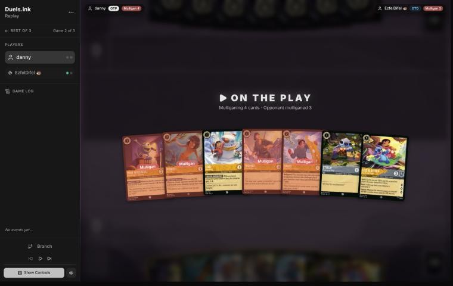
*The board before the decision: [step 0](https://duels.ink/replay/01a1ccde-6845-77a6-9275-86708332d08c?step=0) in the duels.ink replay viewer.*

**What you did:** on the play, you sent back Mike – Well-Rounded Entertainer, Thomas, Mowgli and David, kept Lilo –
Snow Artist, Stitch and Lilo & Stitch, and drew Grandmother Willow, another Lilo – Snow Artist, Toulouse and Dale.

**Verdict: close call.** The seven had four 1-drops, two 2-drops and Lilo & Stitch, and on the simulator
(`tools/mulligan.py`, 1,500 deals each) keeping all seven and your four-card mulligan came out level: 9.2 and 9.1 lore
by turn 4, with the mulligan inking slightly better (8.7 of 10 ink against 7.9). Sending back only Mike scored 8.8,
and only Mike and Thomas 8.2. The cards sent back weren't weak against this deck: David (Bodyguard, 4 willpower)
survives Rafiki's challenge, and Mowgli's look at their hand would have shown whether a Strength of a Raging Fire or
Demona was coming. Keeping all seven was the coach's pick, by a small margin.

### Turn 1: your turn 1

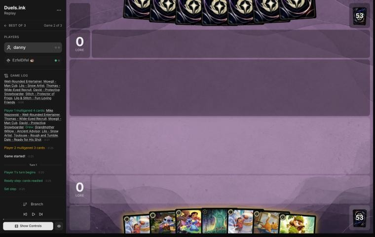
*The board before the decision: [step 2](https://duels.ink/replay/01a1ccde-6845-77a6-9275-86708332d08c?step=2) in the duels.ink replay viewer.*

**What you did:** inked a Lilo – Snow Artist and played the other.

**Verdict: fine.** With Grandmother Willow in hand, turn 2 is Willow plus a free 1-drop, and turn 3 Lilo & Stitch
Shifted for 2. Lilo or Stitch first makes no difference: both quest on turn 3 either way.

### Turn 3: your turn 2

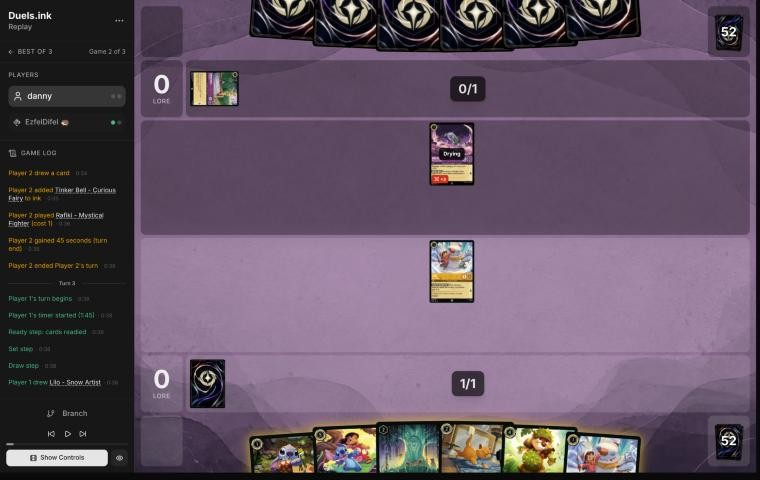
*The board before the decision: [step 8](https://duels.ink/replay/01a1ccde-6845-77a6-9275-86708332d08c?step=8) in the duels.ink replay viewer.*

**What you did:** drew a third Lilo – Snow Artist and inked it, played Grandmother Willow and then Stitch for free
with SMOOTH THE WAY. Lilo stayed home.

**Verdict: inaccuracy.** Willow and the free Stitch were right (and inking the spare Lilo kept Toulouse and Dale).
Leaving Lilo – Snow Artist home is suboptimal because it gave up 2 lore (she gets +1 with Stitch in play) to protect a
1-drop from Rafiki, whose only job is to challenge. Questing with her is better because the trade is good for you: if
Rafiki challenges, it takes Lilo, skips its own quest and is left exerted with 1 willpower, so any of your characters
finishes it on turn 5 while Lilo & Stitch Shifts onto Stitch (2 ink with Willow) and the Lilo in hand replaces her. If
it doesn't challenge, you're 2–1 up with Lilo alive. Only Rafiki can challenge now; each turn you wait adds their
2- and 3-drop challengers (Pepita, Lexington, Angela) to what Lilo faces when she does quest, as in game 1. [ROLE-1](#cite-role-1),
[TRADE-3](#cite-trade-3); confidence moderate.

### Turn 5: your turn 3

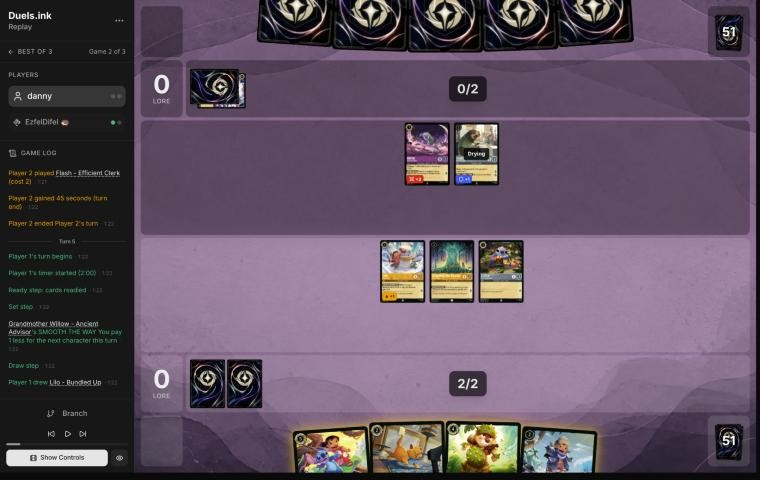
*The board before the decision: [step 15](https://duels.ink/replay/01a1ccde-6845-77a6-9275-86708332d08c?step=15) in the duels.ink replay viewer.*

**What you did:** drew Lilo – Bundled Up, inked Toulouse, Shifted Lilo & Stitch onto Lilo – Snow Artist for 2 (with
Willow) and quested with it for 3. Stitch and Willow stayed home.

**Verdict: inaccuracy.** Lilo & Stitch on turn 5 for 2 ink was right, and so was inking Toulouse over Dale (Dale's
SPIKE SUIT is your best card against their challengers). Shifting onto Lilo – Snow Artist is suboptimal because she was
your 2-lore character: Lilo & Stitch is named Lilo and Stitch ([CR 5.2.6.1](#cite-cr-5-2-6-1)), so Snow Artist keeps her +1 with it in
play, while Stitch only ever quests for 1. Shifting onto Stitch and questing with Lilo & Stitch and Snow Artist is
better because it scores 5 instead of 3. Snow Artist (2 willpower) then dies to Rafiki or Flash, but either one
spends its turn on a 1-drop instead of questing, and is left exerted for Lilo & Stitch to challenge. Stitch's extra
willpower bought nothing: both their challengers hit for 3. Keeping Willow home for next turn's discount was fine.
As on turn 3, you held lore back to protect cheap characters against a deck whose challengers would reach them later
anyway. [QC-3](#cite-qc-3), [TRADE-3](#cite-trade-3); confidence moderate.

### Turn 7: your turn 4

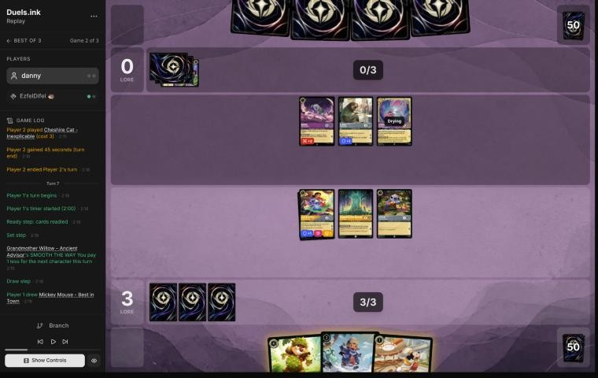
*The board before the decision: [step 31](https://duels.ink/replay/01a1ccde-6845-77a6-9275-86708332d08c?step=31) in the duels.ink replay viewer.*

**What you did:** drew Mickey – Best in Town, didn't ink, played Lilo – Bundled Up for 1 (with Willow) and Mickey for
1, and didn't quest. 3–0.

**Verdict: mistake.** Their board was Rafiki, Flash and Cheshire Cat (all ready, so nothing to challenge), with 9
strength between them for your exerted characters next turn. Not inking and not questing is suboptimal because it
gave up both an ink (Dale and Mickey were inkable) and the turn's lore: Lilo & Stitch, Stitch and Willow quest for 5.
Inking Mickey and playing Dale for 3 with Willow is better, then questing with all three:
- **Dale's SPIKE SUIT turns every challenge into a trade.** Your characters deal their willpower in challenges, so
  Lilo & Stitch hits back for 5 (killing any of the three), Stitch for 3 (Rafiki or Flash) and Willow for 2 (Rafiki).
  To kill Lilo & Stitch they'd need all three challengers and lose all three.
- **What still beats it:** Angela (26% after their draw) gives one challenger Resist +2, and Strength of a Raging
  Fire (33%), sung free by Cheshire, deals one damage per character they have: 3, or 4 if they play a character
  first, which kills Dale. Either costs them their turn's ink, and you'd still have the lore.
- **Mickey has a cost here.** He must quest every turn, and his HOT DOG gives them an ink drop too, bringing Demona –
  Scourge (6) a turn closer, as in game 1. Inking him avoids that.

Lilo – Bundled Up and Mickey are 2-lore bodies, but neither stops a challenge. Dale does. [INK-3](#cite-ink-3), [QC-3](#cite-qc-3), [TRADE-5](#cite-trade-5);
confidence fairly high.

### Turn 9: your turn 5

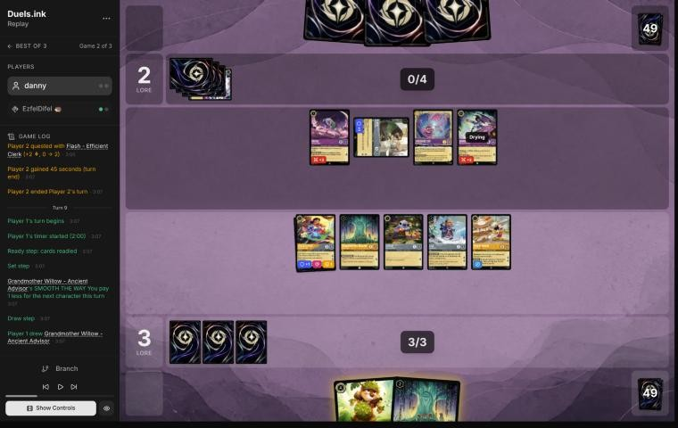
*The board before the decision: [step 38](https://duels.ink/replay/01a1ccde-6845-77a6-9275-86708332d08c?step=38) in the duels.ink replay viewer.*

**What you did:** drew a second Willow; with Dale your only inkable card, you didn't ink and played Dale for 3 with
Willow's discount. Stitch challenged the exerted Flash: under SPIKE SUIT he dealt his 3 willpower (2 after Resist)
and both were banished. Mickey and Lilo – Bundled Up quested (7–2); Lilo & Stitch and Willow stayed home.

**Verdict: inaccuracy (the rest of the turn was good).** Dale for 3 instead of inking him was right, and so was the
trade: Stitch, a 1-lore 1-drop, for Flash, their 2-lore challenger. Leaving Lilo & Stitch home is suboptimal because
it gave up 3 lore without making it safe:
- **What it feared:** Demona – Betrayer of the Clan (Challenger 2, 6 strength) kills it alone.
- **Why home didn't protect it:** Shere Khan (28% after their draw) lets Demona challenge it ready, and Demona –
  Scourge (28%; Mickey's ink drop gave them the 6 ink) exerts it for her.
- **What the trade would have been:** under SPIKE SUIT Lilo & Stitch hits back for its 5 willpower, leaving Demona
  at 1 and exerted. With 3 or more cards in hand her STONE BY DAY keeps her exerted, so any of yours finishes her
  next turn.

Questing with it is better: 10–2 instead of 7–2. If Demona takes it, you trade it for Demona and their turn; if not,
it keeps scoring 3. Without Lilo & Stitch to hit, their Demona hits Mickey instead. [QC-3](#cite-qc-3), [TRADE-1](#cite-trade-1); confidence
moderate.

### Turn 11: your turn 6

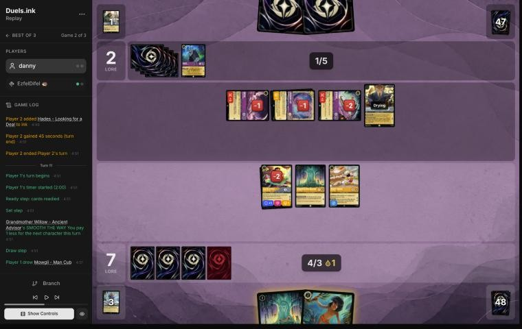
*The board before the decision: [step 63](https://duels.ink/replay/01a1ccde-6845-77a6-9275-86708332d08c?step=63) in the duels.ink replay viewer.*

**What you did:** drew Mowgli, played the second Willow for 1 and then Mowgli for 1 with her discount (they discarded
Merlin's Shop and Smithy from a hand of two). Mickey quested (9–2), Willow killed the damaged Rafiki for free, and
Lilo & Stitch killed Cheshire Cat (taking 2, so it has 1 willpower left).

**Verdict: close call.** Willow then Mowgli for 2 ink in total was neat, and playing Mowgli before any challenge was
right: you saw their hand before committing ([SEQ-1](#cite-seq-1)). The coach's line was different: quest with Lilo & Stitch for 3
and Support Willow (+3 strength) into Demona – Betrayer of the Clan, who had 4 willpower left. That kills their best
challenger, which readies every turn while they hold fewer than 3 cards, for Willow, and makes it 12–2. Your line
kills two characters instead (Rafiki and Cheshire Cat, which can move damage onto your ready characters) and loses
none, but scores 3 less and leaves Demona and Shere Khan to kill two of your exerted characters next turn. Both are
good; neither is clearly better. [TRADE-2](#cite-trade-2), [QC-2](#cite-qc-2).

### Turn 13: your turn 7

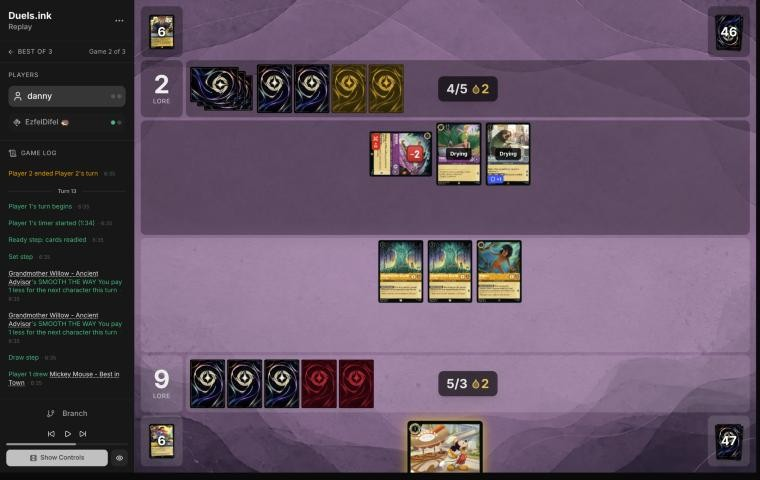
*The board before the decision: [step 75](https://duels.ink/replay/01a1ccde-6845-77a6-9275-86708332d08c?step=75) in the duels.ink replay viewer.*

**What you did:** drew Mickey and played him for free; both Willows and Mowgli quested (12–2).

**Verdict: good.** With an empty hand, Willow's discount had nothing left to discount, so all three 1-lore characters
were worth more questing than waiting: their hand was empty too, and Demona and Flash could only take two of them.
Mickey couldn't be inked usefully (nothing to spend the ink on) and adds 2 lore a turn from next turn.

### Turn 15: your turn 8

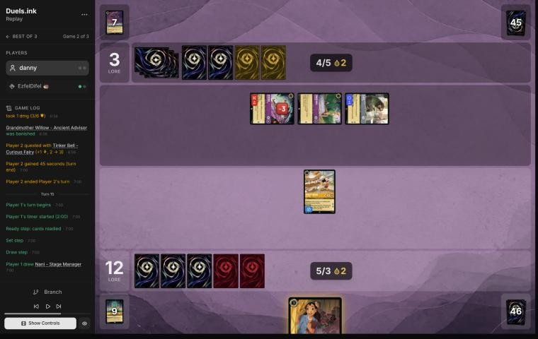
*The board before the decision: [step 86](https://duels.ink/replay/01a1ccde-6845-77a6-9275-86708332d08c?step=86) in the duels.ink replay viewer.*

**What you did:** drew Nani – Stage Manager and played her, took Flash from the top four and played it with the ink
drops, and Mickey quested (14–3).

**Verdict: fine.** Their whole board was exerted, but nothing of yours could challenge (Mickey is Adventurous, Nani
and Flash were new), so developing two bodies and taking Mickey's 2 was the turn.

### Turn 17: your turn 9

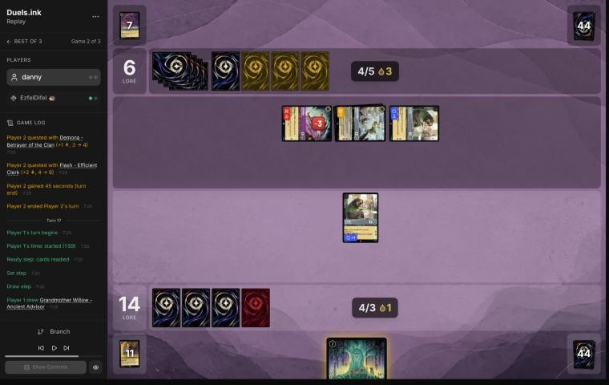
*The board before the decision: [step 99](https://duels.ink/replay/01a1ccde-6845-77a6-9275-86708332d08c?step=99) in the duels.ink replay viewer.*

**What you did:** drew a third Willow, quested with Flash (16–6) and kept Willow in hand.

**Verdict: good play.** Two lines were close: Flash quests for 2, or Flash challenges the damaged Demona (3 willpower
left) and dies with her. You were 14–6 against a board that quests for 5, both hands empty, so the race decided it,
and 16 needs one good draw less than 14. Keeping Willow in hand was the non-obvious part: Tinker Bell – Giant Fairy's
PUNY PIRATE deals 2 damage to any character of yours when it wins a challenge, so a Willow played now would have died
alongside Flash, while next turn she comes down with her discount for whatever you draw. [QC-5](#cite-qc-5), [TRADE-4](#cite-trade-4).

### Turn 19: your turn 10

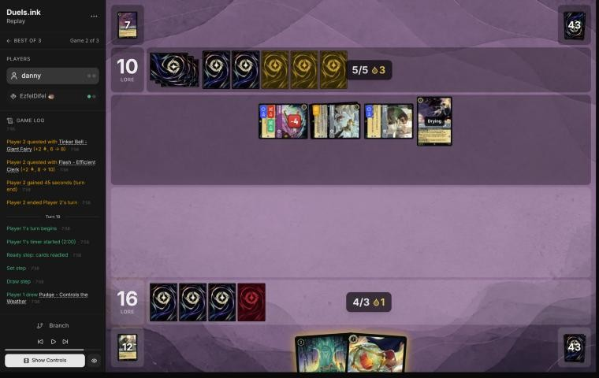
*The board before the decision: [step 108](https://duels.ink/replay/01a1ccde-6845-77a6-9275-86708332d08c?step=108) in the duels.ink replay viewer.*

**What you did:** drew Pudge, played Willow and then Pudge for 1 with her discount. 16–10, your board empty before
this turn.

**Verdict: fine; the game was lost from here.** Their board (Demona, Tinker Bell – Giant Fairy, Flash, Angela) quests
for 6 a turn, which reaches 20 on game turn 22, and your new characters can't be challenged until they quest. You
needed 4 lore by turn 21 from characters played now and one more draw: Willow and Pudge give 2, and the best draw
(Mike – Well-Rounded Entertainer's +1) makes 3. Only a misplay of theirs (challenging instead of questing) leaves you
a turn. Principle 2.

### Turn 21: your turn 11

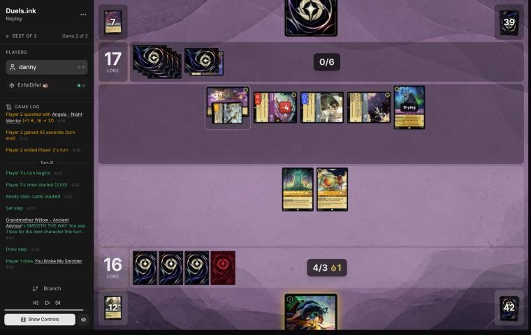
*The board before the decision: [step 122](https://duels.ink/replay/01a1ccde-6845-77a6-9275-86708332d08c?step=122) in the duels.ink replay viewer.*

**What you did:** at 16–17, drew You Broke My Smolder and played it (Mowgli and Thomas), played both, and quested with
Willow and Pudge (18–17).

**Verdict: fine.** No draw could reach 20 this turn (Mike – Well-Rounded Entertainer's +1 would have made 19), and
their board quests for 7, so digging and questing was all there was. On their turn 20 you let Hades draw them 2
rather than send Willow to the bottom: with their lore coming from the board, not their hand, Willow's lore was worth
more than the 2 cards.

## Lessons
1. **The same lesson as game 1 and the Duccio matches** ([turns 3](#turn-3), [5](#turn-5), [7](#turn-7),
   [9](#turn-9)): against an exert-and-challenge Midrange deck, the lore you don't take early is what you lose by.
   Here they didn't even challenge until turn 10; the characters held back would have scored for free.
2. **Shift onto the base that scores least on its own** ([turn 5](#turn-5)): Lilo & Stitch is named Lilo and Stitch,
   so Snow Artist keeps her +1 under it. Shift onto Stitch, and Snow Artist quests for 2.
3. **Dale's SPIKE SUIT is the card against a challenger board** ([turn 7](#turn-7)): every challenge into your board
   becomes a trade. Play it before 2-lore bodies that don't change the challenge maths.
4. **Keep a character in hand when their board punishes the board** ([turn 17](#turn-17)): Tinker Bell – Giant
   Fairy's PUNY PIRATE hits any character of yours once she wins a challenge.
5. **Mickey – Best in Town's ink drops help them too** ([turn 7](#turn-7)): against a deck with a 6-cost Demona –
   Scourge, ink Mickey when another play is there.

## Proposed knowledge-base updates (applied after discussion)
- **Meta** (the Amethyst/Steel pair file's notes, EzfelDifel, game 2): Demona – Betrayer of the Clan (4, Challenger 2,
  4/6, off-list), Cheshire Cat – Inexplicable, Shere Khan (turn 10, Demona challenging a ready Dale), Hades ×2,
  Junior Woodchuck Guidebook ×2, Merlin's Shop ×2, Flash ×2, Angela, Strength of a Raging Fire, Tinker Bell – Giant
  Fairy Shifted onto Curious Fairy on turn 16. They didn't challenge until turn 10: turns 2–8 were all development.
- **Strategy:** more evidence for the hypothesis proposed in the Duccio and game 1 reviews (a Rockstar board should
  quest every turn against an exert-and-challenge deck): four turns of 0–3 lore here, lost by 2.
- **Rules:** a ruling next to [St. Canard's Finest](#cite-kb-rules-rulings-st-canard-s-finest-is-also-named-darkwing-duck): Lilo & Stitch – Fun-Loving Friends is named
  Lilo and Stitch ([CR 5.2.6.1](#cite-cr-5-2-6-1)), so it turns on Snow Artist's CREATIVE INSPIRATION, makes Pudge free, and is a base for
  a second Lilo & Stitch.

## Hindsight
Doesn't change the verdicts above.
- They never played Demona – Scourge this game. The lore given up on turns 3–9 (about 12, on the coach's lines) is far
  more than the 2 you lost by, though their play would have changed with yours.

## The coach's errors
Found by the coach during the review; the discussion may add more.

| When | Error | How it was caught | How it won't happen again |
|---|---|---|---|
| Turns 6–7 | Their undone IMPETUS IMPROVISUS discarded a second Flash, which the undo put back in their hand. The brief counted the Flash as seen but didn't list it under KNOWN IN THEIR HAND, and the coach didn't mention it (no verdict depended on it) | Reading the turn-6 log | Proposed: the brief's known-hand tracker adds a card whose discard was undone, marked "seen in an undone action"; to be checked first whether duels.ink shows undone actions to the other player |

## Open questions
- **[Turns 3](#turn-3), [5](#turn-5) and [9](#turn-9):** what held Snow Artist and Lilo & Stitch back: Rafiki and
  Flash's challenges, or something you expected from their hand?
- **[Turn 5](#turn-5):** was Shifting onto Snow Artist rather than Stitch deliberate (Stitch's 3 willpower against
  Strength of a Raging Fire, say)?
- **[Turn 7](#turn-7):** why no ink: keeping both Dale and Mickey?
- **Turn 6:** did you see their undone discard of a Flash in the game?

## Citations
Copies of the coach's knowledge base cited above, as they stood when they were cited (the private repository's commit and date are given with each). They don't change when the knowledge base does.

**amethyst-steel.md, Midrange: how it plays**: knowledge base, `kb/meta/archetypes/amethyst-steel.md` at `c3e5f6f` (2026-11-12), working tree

> ### Midrange: how it plays `[coach, meta study of the user's 27 Oct 2026 games (tools/scan.py), full games, not blind, 1 game]`
> 01a17dc3.
> - **Merlin – Profoundly Curious:** an ink drop on play, a draw on each quest, 2 lore.
> - **Questers:**
>   - Diablo – Stone Servant (+2 {S} and +1 {L} with a Villain in play; their Villains can't be challenged while he's
>     exerted)
>   - Tinker Bell – Giant Fairy (Shift 4; 1 damage to each opposing character on play; 2 lore)
>   - Maleficent – Exultant Spellcaster
> - **Removal through tricks** (turn 14): Peter Pan's Shadow exerts your character, Cheshire Cat's Boost moves 2 damage onto
>   it, then a challenge finishes it.

**rulings.md, St. Canard's Finest is also named Darkwing Duck**: knowledge base, `kb/rules/rulings.md` at `c3e5f6f` (2026-11-12), working tree

> ### St. Canard's Finest is also named Darkwing Duck
> - **Situation:** Darkwing Duck & Launchpad – St. Canard's Finest is in play, and The Terror That Flaps in the Night
>   ("3 damage instead if you have a character named Darkwing Duck") or Launchpad – Trusty Sidekick ("discard unless you
>   have a character named Darkwing Duck") checks for a Darkwing.
> - **Ruling:** Finest has the names Darkwing Duck and Launchpad as well as its full name, so Terror deals 3 and
>   Launchpad draws without discarding. A second Finest can also Shift onto the first.
> - **Basis:** CR 5.2.6.1 (a name with "&" has two singular names; an effect looking for a name matches either).
> - **Confidence:** derived from CR; Terror dealt 3 with only Finest in play in 01a16039 turn 17. Not an official ruling.
> - **Added:** 2026-11-02, from the reviews of 01a15f93 and 01a16039 (stonks 📈).

**ROLE-1**: strategy principle, `kb/strategy/principles.md` at `c3e5f6f` (2026-11-12), working tree

> - **ROLE-1. The matchup decides your role, not your deck.** In nearly every game one player wants it short (aggressor) and one wants it long (defender). The same list can play either role. *Ask: "Which deck benefits if this game goes long?"* `[MCL ch.8]` · baseline

**TRADE-3**: strategy principle, `kb/strategy/principles.md` at `c3e5f6f` (2026-11-12), working tree

> - **TRADE-3. Losing a character can be right** if it removes something more important. Characters are resources. `[MCL ch.7]` · baseline

**QC-3**: strategy principle, `kb/strategy/principles.md` at `c3e5f6f` (2026-11-12), working tree

> - **QC-3. Questing is favoured when:**
>   - you control the board
>   - your exerted characters can't be punished
>   - the race favours you
>   - removing their characters gains little
>
>   **Challenging is favoured when:**
>   - they have an engine or repeated-value piece
>   - the trade is efficient
>   - you need to slow the game
>   - your deck is stronger late
>
>   `[MCL ch.6]` · baseline

**INK-3**: strategy principle, `kb/strategy/principles.md` at `c3e5f6f` (2026-11-12), working tree

> - **INK-3. Usually ink every turn, but not automatically.** Keeping one more playable card can beat one more ink. Missing ink with an expensive hand can leave you permanently behind. `[MCL ch.4]` · baseline

**TRADE-5**: strategy principle, `kb/strategy/principles.md` at `c3e5f6f` (2026-11-12), working tree

> - **TRADE-5. Trade according to role.** Aggro preserves pressure and often ignores trades. Midrange seeks consistently favourable trades. Control accepts even neutral trades that extend the game. `[MCL ch.7]` · baseline

**TRADE-1**: strategy principle, `kb/strategy/principles.md` at `c3e5f6f` (2026-11-12), working tree

> - **TRADE-1. Judge a trade by ink invested, tempo, value already generated, and the board afterwards**, not by card count. A 2-cost for a 5-cost is a big win even if it's one-for-one. *Ask: "What does the board look like after this challenge?"* `[MCL ch.7]` · baseline

**SEQ-1**: strategy principle, `kb/strategy/principles.md` at `c3e5f6f` (2026-11-12), working tree

> - **SEQ-1. Gather information before irreversible decisions.** Draw, look and scry before choosing what to ink. Quest with draw triggers before committing other plays when the order doesn't otherwise matter. `[MCL ch.5]` · baseline

**TRADE-2**: strategy principle, `kb/strategy/principles.md` at `c3e5f6f` (2026-11-12), working tree

> - **TRADE-2. The best trade removes theirs and keeps yours.** A survivor keeps generating value and demands more answers. `[MCL ch.7]` · baseline

**QC-2**: strategy principle, `kb/strategy/principles.md` at `c3e5f6f` (2026-11-12), working tree

> - **QC-2. Challenge the threat, not the character.** Engines, synergy pieces and big questers are worth fighting over. A 1-lore character doing nothing usually isn't. *Ask: "Does this character actually need to be removed?"* `[MCL ch.6, ch.9]` · baseline

**QC-5**: strategy principle, `kb/strategy/principles.md` at `c3e5f6f` (2026-11-12), working tree

> - **QC-5. The race changes everything.** At 18–12 up, take the last 2 lore. At 8–16 down, stopping their close-out matters more than your quests. `[MCL ch.6]` · baseline

**TRADE-4**: strategy principle, `kb/strategy/principles.md` at `c3e5f6f` (2026-11-12), working tree

> - **TRADE-4. Every challenge has an opportunity cost.** It's a lost quest, and the challenger may be exposed while exerted. Declining a trade is often as strong as taking it. *Ask: "Would simply questing be stronger?"* `[MCL ch.7]` · baseline

**CR 5.2.6.1**: Comprehensive Rules, `kb/rules/cr/05-cards-and-card-types.md` at `c3e5f6f` (2026-11-12), working tree

> **5.2.6.1.** Some characters have two singular names in addition to their printed name. These characters have an ampersand (&) or something else that’s treated as an ampersand (see 5.2.6.3) between the two names listed on the name line. If an effect looks for a card or character with a specified name, the specified name must exactly match one of the names on the card.
