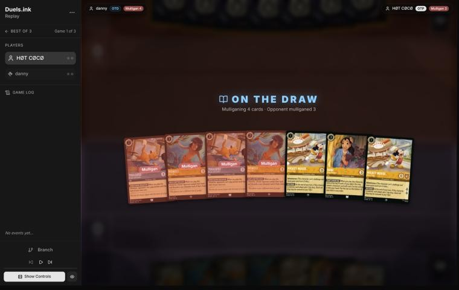
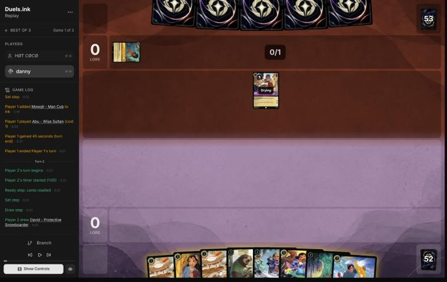
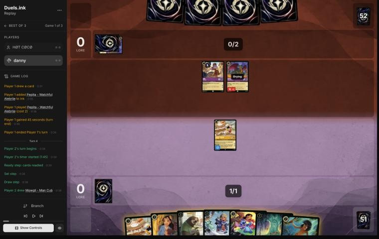
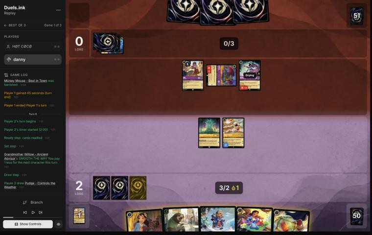
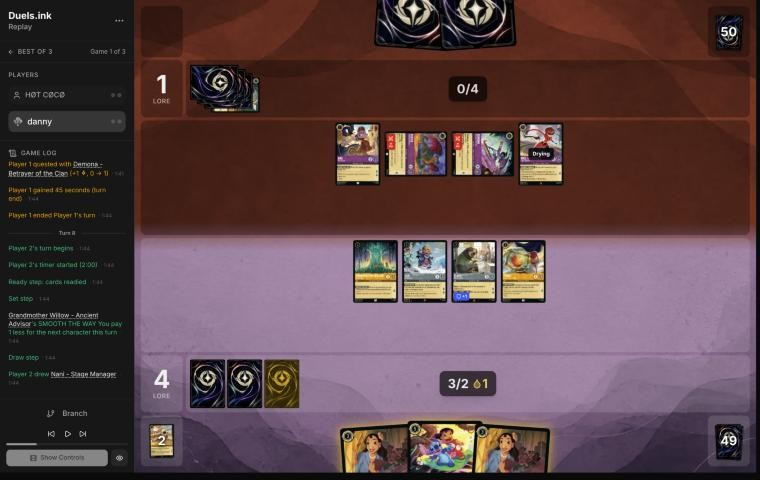
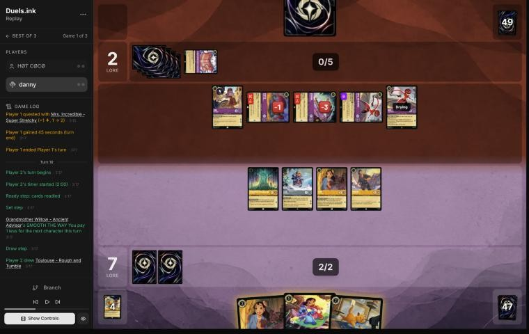
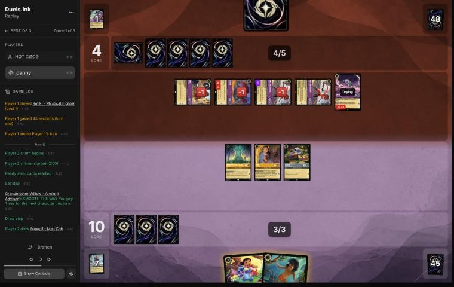
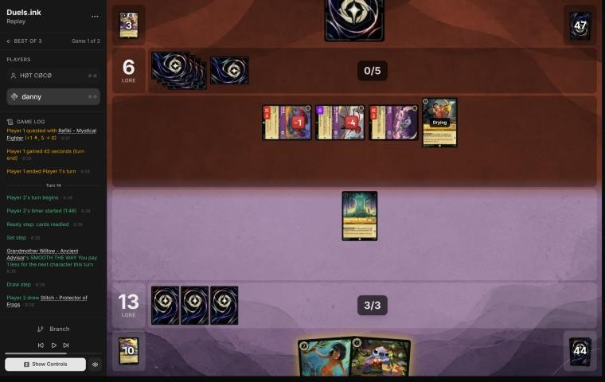
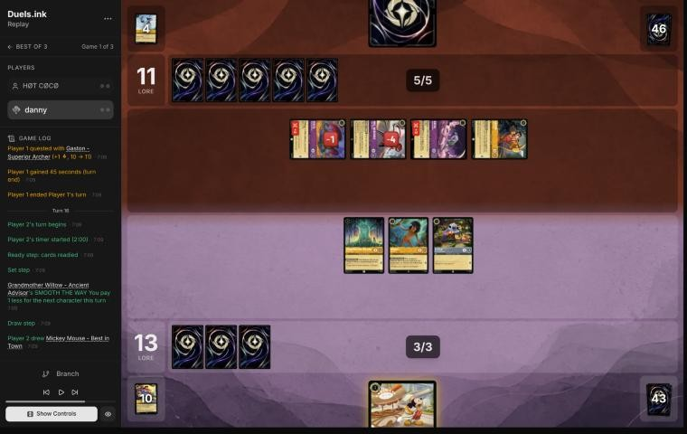
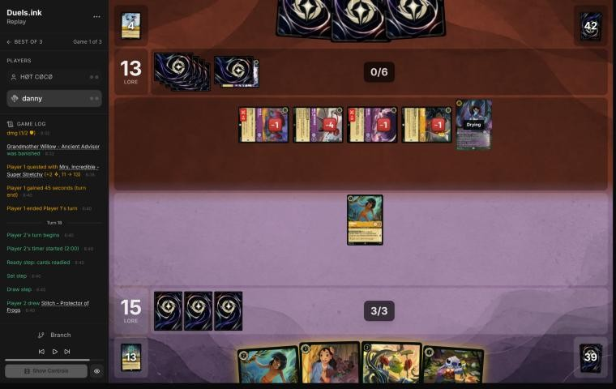

# Review: danny vs HØT CØCØ, 12 Nov 2026 (game 1)

| | |
|---|---|
| **Status** | draft (blind pass done, not yet discussed) |
| **Replay** | `01a1cec3-3345` (`python3 tools/brief.py 01a1cec3-3345 --turn N`) · [duels.ink viewer](https://duels.ink/replay/01a1cec3-335a-7b75-b21d-0da4b2b346e5?step=0) |
| **Format** | Core Constructed. Set 14 era: inks revealed before the coin toss |
| **Decks** | You: Amber/Steel Rockstar Aggro, your Lilo list. Them: Amber/Amethyst ([the coach's notes on this pair](#cite-kb-meta-archetypes-amber-amethyst-remember-merida-against-rockstar-aggro-goldenbeast)); archetype as it became clear: an unlisted challenger list (Pepita ×2, Demona – Betrayer, Mrs. Incredible ×2, Gaston ×2) with Raging Storm, Demona – Scourge and Lionheart, from turn 7 |
| **Play/draw** | They went first |
| **Result** | Lost on lore, 15–21, on game turn 19 |
| **Meta data** | snapshot of 12 Nov 2026 (fresh) |
| **Chosen how** | By the user: every game of 11–12 Nov in the export, reviewed blind. The export holds games 1 and 3 of this match (game 2 is missing), so the coach knows the match went to three games, not how this one went |

## Summary
- **Good plays:** [pre-game](#turn-0) (a four-card mulligan into Lilo & Stitch), [6](#turn-6), [12](#turn-12)
  (Support turns Nani into removal for Mrs. Incredible), [14](#turn-14) (Mowgli held until it could take their
  Raging Storm), [18](#turn-18).
- **Close calls:** [10](#turn-10), [16](#turn-16).
- **Inaccuracies / mistakes / blunders:**
  - **Inaccuracy, [4](#turn-4):** a second Mickey against a likely Raging Storm deck doubled their ink drops.
  - **Mistake, [8](#turn-8):** Lilo & Stitch stayed in hand when its Support could kill Demona – Betrayer, and Flash
    quested instead of killing Pepita for free; no ink for the second turn running.
- **Unwinnable from:** never, quite. On [turn 18](#turn-18) your line left them one answer short of 20, and the
  Lionheart that answered it came off the top of their deck through Mike – Heroic Climber's FIND A FRIEND.

**What decided it:** their challengers. Pepita, Demona – Betrayer, two Mrs. Incredibles and Rafiki took a character
of yours almost every turn, and Lilo & Stitch, whose Support is your best answer to them, waited in hand from turn 6
to turn 12. Their Demona – Scourge on turn 17 cleared what was left, and you still came within a turn.

## The game, turn by turn
Verdicts judge each decision on what you could know at the time, **including archetype knowledge an experienced
player has**. Hindsight is kept to its own section. Severity scale: good play / close call /
inaccuracy / mistake / blunder. Principle IDs and hypotheses (H-n) link to copies
in the Citations section at the end, as they stood when they were cited.

**What you knew before the game:**
- **Their inks:** Amber/Amethyst. duels.ink lists Remember Merida (36% of the pair), Midrange (33%) and Aggro (14%).
  No earlier games against this player.
- **Their key cards, and the earliest each can come** (they're on the play, so their turns are the odd ones):
  - **Remember Merida:** Raging Storm (8; banishes every character) on turn 15, earlier with Mickey's and Merlin's
    ink drops, then Remember Me to rebuild. Merida – Wisp Conjurer, Elsa – Exploring the Unknown and Merlin –
    Profoundly Curious draw cards. Pepita (2, Challenger 2) from turn 3.
  - **Midrange** (Duccio's deck in the 11 Nov matches): Rafiki (1, Challenger +3) from turn 1, Hamm, Isis
    Vanderchill (4; exerts one of yours) from turn 7, Cheshire Cat (3; moves damage), Gaston – Superior Archer (5;
    banishes a character with 5 strength or more).
  - **Both:** Demona – Imperious Spellcaster (3), Tigger – Bouncing All the Way (4; returns a cost-2-or-less
    character, such as a Shift base, to your hand), Hades – Looking for a Deal (5), Demona – Scourge (6; exerts your
    board) from turn 11, The Horseman Strikes! (3; banishes an Evasive character).
- **The race:** against Remember Merida you want to be near 20 before Storm; against Midrange, the Duccio matches
  showed that characters held back die to Isis and Scourge anyway. Either way the plan is lore early, and your Mickeys'
  ink drops bring their 6- and 8-drops closer.

### Pre-game

*The board before the decision: [step 0](https://duels.ink/replay/01a1cec3-335a-7b75-b21d-0da4b2b346e5?step=0) in the duels.ink replay viewer.*

**What you did:** on the draw, you sent back both Mowglis and both Toulouses, kept the two Mickeys and Nani, and drew
Flash, Lilo – Bundled Up, Lilo & Stitch and Grandmother Willow.

**Verdict: good play.** The seven had no Lilo or Stitch for a Shift and four 2-drops that do little against either
list. On the simulator (`tools/mulligan.py`, 1,500 deals each) your four-card mulligan scored best of every option:
13.8 lore by turn 4, against 12.2 for keeping all seven and 12.6 to 13.5 for sending back one to three cards.
[MULL-1](#cite-mull-1), [MULL-2](#cite-mull-2).

### Turn 2: your turn 1

*The board before the decision: [step 6](https://duels.ink/replay/01a1cec3-335a-7b75-b21d-0da4b2b346e5?step=6) in the duels.ink replay viewer.*

**What you did:** drew David, inked him and played Mickey.

**Verdict: fine.** Three of your cards are uninkable (Flash, Lilo – Bundled Up, Willow), so the ink had to come from
David, Nani, the second Mickey or Lilo & Stitch, and David was the least needed. Their Abu – Wise Sultan banishes
himself when he quests: a one-off 2 lore, not a threat.

### Turn 4: your turn 2

*The board before the decision: [step 12](https://duels.ink/replay/01a1cec3-335a-7b75-b21d-0da4b2b346e5?step=12) in the duels.ink replay viewer.*

**What you did:** drew Mowgli and inked him, played Willow and then the second Mickey for free, and quested with the
first Mickey (2–0). Both players got an ink drop.

**Verdict: inaccuracy.** Their two Pepitas made Remember Merida 78% likely, so Raging Storm (8) was the card to count
down to, and the [Mickey card note](#cite-kb-cards-mickey-mouse-best-in-town-what-it-means-in-play) says to add your Mickeys' drops to their ink when you do. Playing the
second Mickey is suboptimal because two Mickeys questing give them 2 drops a turn: banking them, they'd have 7 ink on
turn 7 and 10 on turn 9, so Storm comes around turn 9 instead of turn 15. Lilo – Bundled Up for 2 is better:
- **Turn 6 gets stronger, not weaker:** Lilo & Stitch Shifts onto her for 3 and quests at once (she'll have been in
  play since the start of the turn), so turn 6 scores Mickey's 2 and Lilo & Stitch's 3. On your line Lilo & Stitch can
  land on turn 6 too, but on a Lilo played that turn, so it can't quest until turn 8.
- **She's safe until then:** she can't be challenged while ready, and EXTRA LAYERS stops the first damage on their
  turn anyway (Pepita challenges for 4).
- **One Mickey's drop a turn is the price of his 2 lore; two double it** against the one deck that cashes drops in
  for a board wipe.

Willow and Mickey are still 3 lore a turn, so the gap is small. [THREAT-3](#cite-threat-3), [INK-1](#cite-ink-1); confidence moderate.

### Turn 6: your turn 3

*The board before the decision: [step 22](https://duels.ink/replay/01a1cec3-335a-7b75-b21d-0da4b2b346e5?step=22) in the duels.ink replay viewer.*

**What you did:** drew Pudge, didn't ink, played Lilo – Bundled Up for 1 (Willow), Flash with your last ink and the
drop, and Pudge for free (GOOD FRIEND), then quested with Mickey (4–0). Willow stayed home.

**Verdict: good.** Three bodies for 3 ink, all ready and so safe from Pepita and Demona – Betrayer this turn, and
Lilo – Bundled Up is now a base that Lilo & Stitch can Shift onto and quest from on turn 8. Against a deck that wins
with Raging Storm around turn 11 (their drops included), a wide board that quests for 8 or more from turn 8 is the
race to run. Not inking was a close call: inking Nani gives a permanent extra ink, keeping her keeps a card for after
a wipe. [ROLE-1](#cite-role-1).

### Turn 8: your turn 4

*The board before the decision: [step 32](https://duels.ink/replay/01a1cec3-335a-7b75-b21d-0da4b2b346e5?step=32) in the duels.ink replay viewer.*

**What you did:** drew a second Nani, didn't ink, played Nani for 2 (Willow) and took Thomas, played him with the ink
drop, and quested with Pudge and Flash (7–1). Lilo & Stitch stayed in hand; Willow and Lilo – Bundled Up stayed home.

**Verdict: mistake.** Their Pepita had taken both Mickeys, and their exerted Pepita (3 willpower) and Demona – Betrayer
(6) were there to challenge. Developing Nani and Thomas and questing with Flash is suboptimal because it left both
challengers alive, and their board would take your exerted characters again. Better was to ink the spare Nani,
Shift Lilo & Stitch onto Lilo – Bundled Up for 2 (Willow), and quest with it:
- **Support kills Demona:** its 3 strength on Flash makes 6, exactly Demona's willpower. Flash dies to her 4 back, a
  2-drop for their 4-drop, which is the challenger that kills anything of yours, Lilo & Stitch included (6 against
  its 5 willpower and Resist 1).
- **Or, at the least, Flash kills Pepita for free:** 3 damage into 3 willpower, and Pepita's 2 back is 1 after
  Resist. Flash was going to be exerted either way.
- **What it scores:** Lilo & Stitch's 3 plus Willow and Pudge, 9–1 against your 7–1, with Demona gone. Lilo & Stitch
  is then exposed to Pepita and Mrs. Incredible together (3 + 4 after Resist), but its 3 back kills Pepita.
- **The ink:** no ink on turns 6 and 8 left you on 2, so next turn's Shift and Nani can't both happen.

Keeping Lilo & Stitch in hand to rebuild after a Raging Storm has a case against Remember Merida, but Mrs.
Incredible, Abu and Demona – Betrayer had made their list 90% unlisted, and without your Mickeys' drops Storm was
turn 15 at the earliest. [QC-2](#cite-qc-2), [TRADE-1](#cite-trade-1), [INK-3](#cite-ink-3); confidence moderate.

### Turn 10: your turn 5

*The board before the decision: [step 47](https://duels.ink/replay/01a1cec3-335a-7b75-b21d-0da4b2b346e5?step=47) in the duels.ink replay viewer.*

**What you did:** drew Toulouse and inked him, played the second Nani for 2 (Willow) and took Stitch, played Stitch,
traded the first Nani for the damaged Demona – Betrayer, and quested with Thomas and Lilo – Bundled Up (10–2). Lilo &
Stitch stayed in hand.

**Verdict: close call.** Killing Demona was the priority, and you did it. The coach's line was Lilo & Stitch Shifted
onto Lilo – Bundled Up for 2, questing for 3 and Supporting Thomas (3 strength) into Demona, while Nani killed the
damaged Pepita and survived. That kills both challengers for Thomas rather than Nani, scores 11 instead of 10, and
puts Lilo & Stitch to work a turn earlier, though their two Mrs. Incredibles could then take it together. Your line
keeps Lilo & Stitch safe in hand with two bases ready for it (Lilo – Bundled Up and Stitch), and adds Nani's body and
dig. Pepita surviving is the cost: it has already taken both Mickeys and Pudge. [TRADE-1](#cite-trade-1), [QC-2](#cite-qc-2).

### Turn 12: your turn 6

*The board before the decision: [step 66](https://duels.ink/replay/01a1cec3-335a-7b75-b21d-0da4b2b346e5?step=66) in the duels.ink replay viewer.*

**What you did:** drew Mowgli, Shifted Lilo & Stitch onto Stitch for 2 (Willow) and quested (13–4), and Supported
Nani to 6 strength to kill the Mrs. Incredible that wasn't Evasive; Nani died to its 5 back. Willow stayed home and
Mowgli stayed in hand, uninked.

**Verdict: good play.** Support turned a 3-drop into an answer to their 5-drop, the one character on their board your
others couldn't touch, and Lilo & Stitch scored at once off a base that had been in play since the start of the turn.
The alternative, Nani killing the damaged Pepita and surviving, leaves a 5/6 that kills anything of yours. Keeping
Mowgli rather than inking him was reasonable: his look and discard can take a Raging Storm or Horseman Strikes from a
one-card hand next turn. [TRADE-1](#cite-trade-1), [THREAT-1](#cite-threat-1).

### Turn 14: your turn 7

*The board before the decision: [step 81](https://duels.ink/replay/01a1cec3-335a-7b75-b21d-0da4b2b346e5?step=81) in the duels.ink replay viewer.*

**What you did:** drew Stitch, played Mowgli for 1 (Willow), and they discarded Raging Storm from a one-card hand;
then Stitch. Willow stayed home (13–6).

**Verdict: good play.** Holding Mowgli for a turn when their hand was down to one card paid off: their only card was
the wipe. Willow staying home cost 1 lore, but every one of their four characters could kill her if she quested, and
she makes next turn's character a cheap one. [CARD-2](#cite-card-2).

### Turn 16: your turn 8

*The board before the decision: [step 92](https://duels.ink/replay/01a1cec3-335a-7b75-b21d-0da4b2b346e5?step=92) in the duels.ink replay viewer.*

**What you did:** drew Mickey and played him for free (Willow), quested with Willow and Mowgli (15–11), and took back
Stitch's quest to keep him ready.

**Verdict: close call.** Their board quests for 4 or 5 a turn, so they had to spend challenges on your board or lose
the race. Questing with all three makes 16 and forces three challenges to clear it; keeping Stitch home makes 15 and
needs only two, but leaves Stitch to quest next turn alongside Mickey. Both reach about 18 on turn 18. [QC-5](#cite-qc-5).

### Turn 18: your turn 9

*The board before the decision: [step 109](https://duels.ink/replay/01a1cec3-335a-7b75-b21d-0da4b2b346e5?step=109) in the duels.ink replay viewer.*

**What you did:** at 15–13, after their Demona – Scourge had exerted and cleared most of your board, you played Mike
– Heroic Climber (you took Lilo – Snow Artist, they took Lionheart), killed the damaged Rafiki with Mowgli for free,
inked the second Mowgli, and played Lilo – Snow Artist and Stitch.

**Verdict: good play.** Their five characters quested for exactly 7 next turn (Mrs. Incredible taking +1), which
was 20, and you couldn't score 5 this turn. Killing Rafiki for nothing caps them at 19, and the three new characters
(Lilo – Snow Artist is worth 2 with Stitch) are ready, so they can't be challenged, and quest for 4 next turn. That's
the only line that leaves you a turn. [QC-5](#cite-qc-5), [WIN-1](#cite-win-1).

**Revisited (from this turn's information only):** the verdict counted their board's lore but not what their hand
could add. Lionheart – Incumbent Mayor (6; +1 lore on two characters the turn it lands) is in the Remember Merida lists
in the [pair file's notes](#cite-kb-meta-archetypes-amber-amethyst-remember-merida-against-rockstar-aggro-goldenbeast), and they had 6 ink: a Lionheart in hand, or one taken from Mike's FIND A
FRIEND, wins on the spot. The verdict stands, since Mike's Lilo – Snow Artist was the only way to 5 lore next turn
(without it, Mowgli and Stitch make 3), but Mike's reveal was a real risk and the line was a gamble, not a lock.

## Lessons
1. **Lilo & Stitch's Support is removal** ([turns 8](#turn-8), [10](#turn-10), [12](#turn-12)): +3 strength turns
   Flash, Thomas or Nani into a kill on a 4/6 or 5/6. Against a challenger deck, getting it into play is how you stop
   the challengers, not just how you score.
2. **Count your Mickeys' drops against a Storm deck** ([turn 4](#turn-4)): two of them bring an 8-cost wipe to turn 9.
3. **Ink when the hand has spare inkables** ([turns 6](#turn-6), [8](#turn-8)): 2 ink on turn 8 made the Shift and
   Nani compete.
4. **A small hand is the time for Mowgli** ([turn 14](#turn-14)): one card in hand, and it was Raging Storm.
5. **When their board reaches 20 next turn, count their hand too** ([turn 18](#turn-18)): kill a quester, but a lore
   boost (Lionheart) or a character you hand them with Mike – Heroic Climber can still find the last 1 or 2.

## Proposed knowledge-base updates (applied after discussion)
- **Meta** (the Amber/Amethyst pair file's notes, HØT CØCØ, game 1): an unlisted challenger list: Abu – Wise Sultan
  (off-list), Pepita ×2, Rafiki, Demona – Betrayer of the Clan (off-list), Mrs. Incredible – Super Stretchy ×2
  (off-list), Gaston – Superior Archer ×2, Hades, Junior Woodchuck Guidebook ×2, Demona – Scourge (turn 17), Lionheart
  – Incumbent Mayor, Raging Storm, Mowgli. Raging Storm was in hand by turn 14.
- **Cards:** a note on Mike Wazowski – Heroic Climber: FIND A FRIEND gives the opponent a character too. In the 11–12
  Nov reviews it handed them Demona – Scourge (Duccio game 3), Lionheart (the Duccio rematch), Tinker Bell – Giant
  Fairy (EzfelDifel game 1) and Lionheart again here, the card that won.
- **Strategy:** a hypothesis from the same games: against a deck whose characters win games on arrival (Scourge,
  Lionheart, Giant Fairy), play Mike – Heroic Climber only when the character he finds you is worth more than what
  their top card might be.

## Hindsight
Doesn't change the verdicts above.
- Their hand on turn 14 was Raging Storm alone; Mowgli took it.
- Mike's reveal on turn 18 gave them Lionheart, whose +2 lore made 21. Without it they'd have reached 19 only by
  questing with everything and leaving Mowgli alive, which gives you 20 on turn 20; or killed Mowgli and stayed on 18.

## The coach's errors
Found by the coach during the review; the discussion may add more.

| When | Error | How it was caught | How it won't happen again |
|---|---|---|---|
| Turn 18 | The verdict counted their board's lore for next turn (7, then 6 without Rafiki) but not lore boosts their deck plays: Lionheart's APPROVAL RATING, in the pair file's notes, castable with their 6 ink and reachable through Mike's FIND A FRIEND | Reading turn 19; revisited from turn 18's information | Proposed: the brief's lore clock adds the lore boosts in their likely lists that are castable next turn ("Lionheart: +2"), and when you hold Mike – Heroic Climber it prints the chance their top card is a character and which of those would matter |

## Open questions
- **[Turns 6](#turn-6) and [8](#turn-8):** why no ink: keeping both Nanis and Lilo & Stitch?
- **[Turn 8](#turn-8):** was Lilo & Stitch kept in hand for after a Raging Storm?
- **[Turn 18](#turn-18):** did you weigh Mike giving them a character, or was Lilo – Snow Artist the only way to 5?

## Citations
Copies of the coach's knowledge base cited above, as they stood when they were cited (the private repository's commit and date are given with each). They don't change when the knowledge base does.

**amber-amethyst.md, Remember Merida against Rockstar Aggro: GoldenBeast**: knowledge base, `kb/meta/archetypes/amber-amethyst.md` at `048017b` (2026-11-12), working tree

> ### Remember Merida against Rockstar Aggro: GoldenBeast `[coach, meta study of Savitar's 2 Nov 2026 games (tools/scan.py), full games, not blind, 2 games]`
> 01a19bbd-6ae7 (game 1) and 01a19bc4-57f1 (game 3; game 2 wasn't sent). Savitar won both by concession, at 15–1 and
> 17–0.
> - **Seen:** Merida – Wisp Conjurer ×2 (enters exerted to draw; draws when another character enters exerted), Elsa –
>   Exploring the Unknown ×2, Mowgli – Man Cub ×2 (you reveal your hand and discard a non-character card of your choice),
>   Luisa Madrigal – Pushing Through ×2 and Confident Climber, Demona – Imperious Spellcaster (discard a card: a Gargoyle
>   gains Rush and Evasive), Demona – Scourge of the Wyvern Clan, Hades – Looking for a Deal, Pepita, Lionheart – Incumbent
>   Mayor, Merlin – Profoundly Curious, Merlin's Shop and Smithy, Junior Woodchuck Guidebook, Mickey Mouse – Best in Town,
>   Raging Storm ×3, Remember Me.
> - **Demona – Scourge plus Imperious Spellcaster:** exert your whole board, then give Scourge Rush to challenge at once;
>   three kills on turn 11 of game 1, too late at 15–1.
> - **A slow start against aggro:** no lore until late in both games; four characters on game turn 1 (Lilo and three
>   free Pudges) were never answered.

**mickey-mouse-best-in-town.md, What it means in play**: knowledge base, `kb/cards/mickey-mouse-best-in-town.md` at `048017b` (2026-11-12), working tree

> ## What it means in play `[coach, from the 27 Oct 2026 meta study]`
> - **The ramp is symmetric:** every turn he quests, the opponent also gets an ink drop. That's worth more to decks with
>   ink-drop payoffs:
>   - **Jousting Match** (Steel action, 3): 2 damage, or **5 if paid with an ink drop**. Mickey supplied an Amethyst/Steel
>     opponent's drops (01a17e37).
>   - Ink-drop decks also run Ink Explosion, Merlin – Profoundly Curious and Marie – Caught in the Act; Shere Khan –
>     Khan Industries CEO makes drops of his own.
>   - An Emerald/Steel opponent spent four of these drops on turn 6 of 01a17ddb.
> - **Adventurous forces him to quest,** so he ends every turn exerted and can be challenged. 0 strength means he trades
>   for nothing; he's often the first challenge target (01a17e9c turn 14, 01a17ddb turn 6).
> - **Against a Steel opponent,** count the drops you're giving them, and what they could pay for with them, before
>   questing with him.
> - **Drops bring Raging Storm early** `[coach, meta study of Savitar's games, 2 Nov 2026]`: Candle Control (Amber/Ruby)
>   cast it on game turn 9, their 5th turn, with 5 ink and 3 drops from both sides' Mickeys (01a19bdb-d8e4). Against an
>   Amber deck, add your Mickey's drops to their ink when you count down to Storm (8).

**MULL-1**: strategy principle, `kb/strategy/principles.md` at `048017b` (2026-11-12), working tree

> - **MULL-1. Keep a plan, not the strongest cards.** *Ask: "Which hand gives me the best chance to execute my game plan in this matchup?"* `[MCL ch.12]` · baseline

**MULL-2**: strategy principle, `kb/strategy/principles.md` at `048017b` (2026-11-12), working tree

> - **MULL-2. A smooth curve beats a few powerful cards.** Check that you can spend ink well on turns 1–4, have enough inkable cards, and know what turn 4 looks like. `[MCL ch.12]` · baseline
>   - **Ink spent isn't the goal by itself.** Judge a keep by a nice curve (a play each turn), early lore pressure, and
>     interaction that sets the opponent back, as well as by ink, then weigh card quality and the matchup
>     (user, 2026-11-01). `tools/mulligan.py` reports all of these.

**THREAT-3**: strategy principle, `kb/strategy/principles.md` at `048017b` (2026-11-12), working tree

> - **THREAT-3. The biggest threat may not be on the board yet.** Consider:
>   - the opponent's ink next turn
>   - shift targets already in play
>   - support pieces that enable their next turn
>
>   `[MCL ch.9]` · baseline

**INK-1**: strategy principle, `kb/strategy/principles.md` at `048017b` (2026-11-12), working tree

> - **INK-1. Inking is permanent.** Every inked card is one line of play removed for the rest of the game. *Ask: "Will I regret losing access to this card?"* `[MCL ch.4]` · baseline

**ROLE-1**: strategy principle, `kb/strategy/principles.md` at `048017b` (2026-11-12), working tree

> - **ROLE-1. The matchup decides your role, not your deck.** In nearly every game one player wants it short (aggressor) and one wants it long (defender). The same list can play either role. *Ask: "Which deck benefits if this game goes long?"* `[MCL ch.8]` · baseline

**QC-2**: strategy principle, `kb/strategy/principles.md` at `048017b` (2026-11-12), working tree

> - **QC-2. Challenge the threat, not the character.** Engines, synergy pieces and big questers are worth fighting over. A 1-lore character doing nothing usually isn't. *Ask: "Does this character actually need to be removed?"* `[MCL ch.6, ch.9]` · baseline

**TRADE-1**: strategy principle, `kb/strategy/principles.md` at `048017b` (2026-11-12), working tree

> - **TRADE-1. Judge a trade by ink invested, tempo, value already generated, and the board afterwards**, not by card count. A 2-cost for a 5-cost is a big win even if it's one-for-one. *Ask: "What does the board look like after this challenge?"* `[MCL ch.7]` · baseline

**INK-3**: strategy principle, `kb/strategy/principles.md` at `048017b` (2026-11-12), working tree

> - **INK-3. Usually ink every turn, but not automatically.** Keeping one more playable card can beat one more ink. Missing ink with an expensive hand can leave you permanently behind. `[MCL ch.4]` · baseline

**THREAT-1**: strategy principle, `kb/strategy/principles.md` at `048017b` (2026-11-12), working tree

> - **THREAT-1. Not every threat needs an answer.** *Ask: "What happens if I don't answer this?"* "Very little" means spend resources elsewhere. "I probably lose" means it's the priority. `[MCL ch.9]` · baseline

**CARD-2**: strategy principle, `kb/strategy/principles.md` at `048017b` (2026-11-12), working tree

> - **CARD-2. Virtual card advantage means making the opponent's cards dead without trading for them.** Don't overextend into narrow removal you know or suspect they hold. Ward makes targeted answers useless. `[MCL ch.2]` · baseline

**QC-5**: strategy principle, `kb/strategy/principles.md` at `048017b` (2026-11-12), working tree

> - **QC-5. The race changes everything.** At 18–12 up, take the last 2 lore. At 8–16 down, stopping their close-out matters more than your quests. `[MCL ch.6]` · baseline

**WIN-1**: strategy principle, `kb/strategy/principles.md` at `048017b` (2026-11-12), working tree

> - **WIN-1. Know your current win condition and the opponent's.** Plans change with draws and board. The question is "how do I win from here?", not "what was my deck supposed to do?". Preventing the opponent's win condition is often easier than recovering from it. `[MCL ch.11]` · baseline
