# Review: danny vs HØT CØCØ, 12 Nov 2026 (game 3)

| | |
|---|---|
| **Status** | draft (blind pass done, not yet discussed) |
| **Replay** | `01a1ced3-11cc` (`python3 tools/brief.py 01a1ced3-11cc --turn N`) · [duels.ink viewer](https://duels.ink/replay/01a1ced3-11cd-77b2-a659-3ca03305bcff?step=0) |
| **Format** | Core Constructed. Set 14 era: inks revealed before the coin toss |
| **Decks** | You: Amber/Steel Rockstar Aggro, your Lilo list. Them: Amber/Amethyst ([the coach's notes on this pair](#cite-kb-meta-archetypes-amber-amethyst-remember-merida-against-rockstar-aggro-goldenbeast)); archetype as it became clear: game 1's challenger list, here with Merlin, two Merlin's Shops and Demona – Scourge given Rush by Imperious Spellcaster (Remember Merida, 98%, by turn 18) |
| **Play/draw** | They went first |
| **Result** | Lost on lore, 13–21, on game turn 21 |
| **Meta data** | snapshot of 12 Nov 2026 (fresh) |
| **Chosen how** | By the user: every game of 11–12 Nov in the export, reviewed blind. Game 2 of this match is missing from the export; you lost game 1, and a game 3 means the match was 1–1, so this game decided it. The coach doesn't know how it went |

## Summary
- **Good plays:** [8](#turn-8) (Dale), [16](#turn-16) (7 lore banked the turn before their 8th ink).
- **Close calls:** [pre-game](#turn-0), [2](#turn-2) (inking Toulouse), [10](#turn-10), [12](#turn-12) and
  [14](#turn-14) (waiting with a ready board instead of questing or trading two Nanis for Scourge).
- **Inaccuracies / mistakes / blunders:** none.
- **Unwinnable from:** [20](#turn-20); from [18](#turn-18) only a stumble of theirs would have left you a turn.

**What decided it:** their board. Demona – Scourge came on turn 9 with Rush from Imperious Spellcaster and took Dale,
Nani and Thomas; by turn 14 they had seven characters to your five, and three Cheshire Cats, three Pepitas and two
Rafikis kept trading into your board while Merlin and two Shops drew them cards. Your waiting board held them to one
quest for two turns, and the lore you banked on turn 16 kept it close, but their turn-17 trades left them the bigger
board.

## The game, turn by turn
Verdicts judge each decision on what you could know at the time, **including archetype knowledge an experienced
player has**. Hindsight is kept to its own section. Severity scale: good play / close call /
inaccuracy / mistake / blunder. Principle IDs and hypotheses (H-n) link to copies
in the Citations section at the end, as they stood when they were cited.

**What you knew before the game:** game 1 showed their list: an Amber/Amethyst challenger deck that duels.ink doesn't
list, with Remember Merida's finishers. Their key cards, and the earliest game turn each can come (they're on the play
again, so their turns are the odd ones):
- **Challengers:** Rafiki (1, Challenger +3) and Pepita ×2 (2, Challenger 2) from turns 1 and 3; Demona – Betrayer of
  the Clan (4; Challenger 2, 6 willpower) from turn 7; Mrs. Incredible – Super Stretchy ×2 (5; 5/6, Evasive or +1 lore
  each turn) and Gaston – Superior Archer (5; banishes a character with 5 strength or more) from turn 9.
- **Finishers:** Demona – Scourge (6; exerts your board) and Lionheart – Incumbent Mayor (6; +1 lore on two characters
  the turn it lands, which won game 1) from turn 11; Raging Storm (8) from turn 15, earlier with your Mickeys' drops.
- **Game 1's lessons:** Lilo & Stitch's Support turns your small characters into removal for their 4- and 5-drops;
  your Mickeys' drops bring Storm closer; and Mike – Heroic Climber's FIND A FRIEND can hand them a Lionheart.

### Pre-game

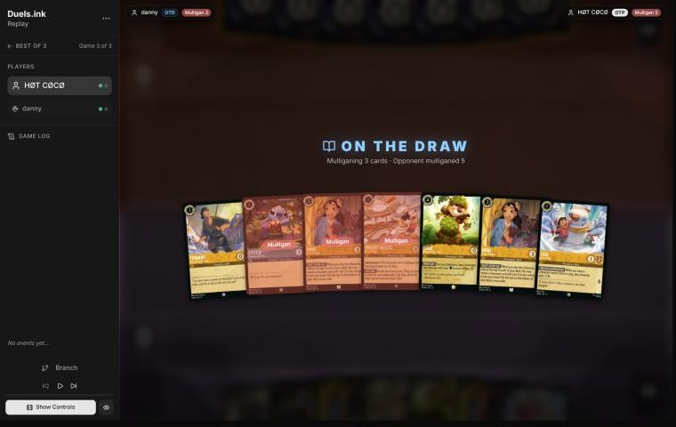
*The board before the decision: [step 0](https://duels.ink/replay/01a1ced3-11cd-77b2-a659-3ca03305bcff?step=0) in the duels.ink replay viewer.*

**What you did:** on the draw, you sent back a Nani, Mickey and Stitch, kept Thomas, Nani, Dale and Lilo – Snow
Artist, and drew David, Toulouse and a second Dale.

**Verdict: close call.** On the simulator (`tools/mulligan.py`, 1,500 deals each) keeping all seven scored best, 11.3
lore by turn 4 against 8.9 for your mulligan, but most of the gap is Mickey's 2 lore a turn, and his drops are what
bring their Raging Storm early. Sending back only Mickey scored 9.1, close to yours. Stitch was the card to keep: he
turns on Lilo – Snow Artist's +1 and is a base for Lilo & Stitch. Keeping Dale, whose SPIKE SUIT punishes a
challenger deck, was right. [MULL-3](#cite-mull-3).

### Turn 2: your turn 1

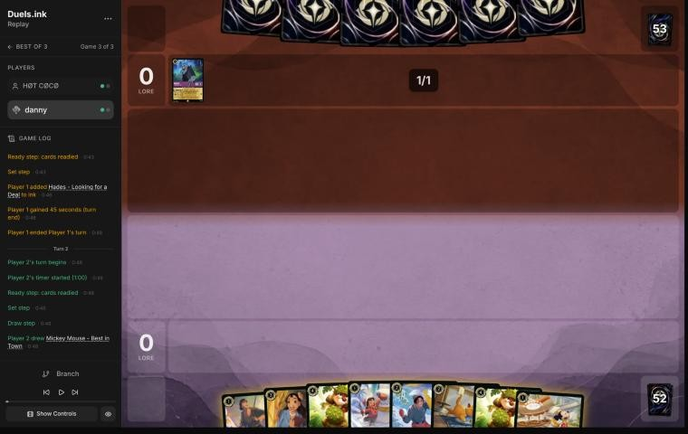
*The board before the decision: [step 4](https://duels.ink/replay/01a1ced3-11cd-77b2-a659-3ca03305bcff?step=4) in the duels.ink replay viewer.*

**What you did:** drew Mickey, inked Toulouse and played Mickey.

**Verdict: close call.** One Mickey is a fair price: 2 lore a turn for one drop a turn to them, as game 1 showed (two
were too many). The ink was the closer question. Toulouse's UNBECOMING BEHAVIOR stops them playing actions for a
turn, which is the one answer in your deck to Raging Storm and The Horseman Strikes!, while the second Dale was a
spare copy of a 4-drop. Inking Dale keeps Toulouse for the turn before their 8th ink. [INK-1](#cite-ink-1), [INK-2](#cite-ink-2).

### Turn 4: your turn 2

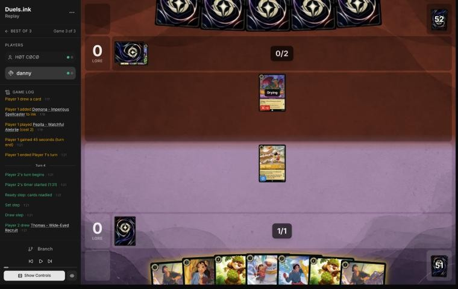
*The board before the decision: [step 10](https://duels.ink/replay/01a1ced3-11cd-77b2-a659-3ca03305bcff?step=10) in the duels.ink replay viewer.*

**What you did:** drew the second Thomas and inked it, quested with Mickey (2–0) and played David exerted.

**Verdict: fine.** Mickey had to quest, and their Pepita (4 when challenging) kills him. David entering exerted makes
him the only legal target (Bodyguard), so Pepita's challenge takes a 1-lore David instead of your 2-lore Mickey. Lilo
– Snow Artist and Thomas instead would be two bodies, but Mickey would be the one to go.

### Turn 6: your turn 3

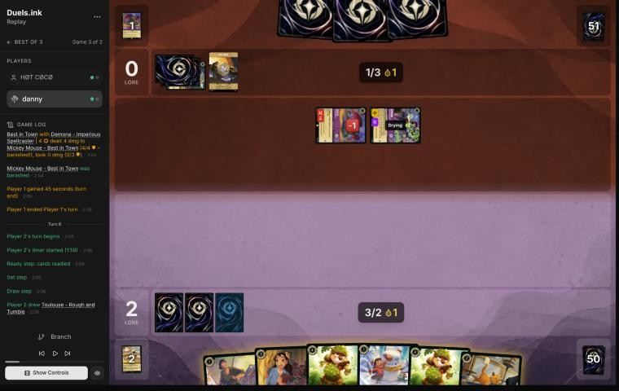
*The board before the decision: [step 23](https://duels.ink/replay/01a1ced3-11cd-77b2-a659-3ca03305bcff?step=23) in the duels.ink replay viewer.*

**What you did:** drew the second Toulouse and inked it, played Nani (taking Mike – Heroic Climber) and Thomas with
the drop. 2–0.

**Verdict: fine.** With your board empty and their two characters exerted, anything you played was safe for a turn,
and Nani plus Thomas gave two bodies and a card. Inking the second Toulouse means neither is left to stop a Raging
Storm; a spare Dale was the ink to give up (see [turn 2](#turn-2)).

### Turn 8: your turn 4

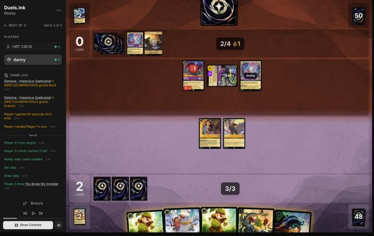
*The board before the decision: [step 37](https://duels.ink/replay/01a1ced3-11cd-77b2-a659-3ca03305bcff?step=37) in the duels.ink replay viewer.*

**What you did:** drew You Broke My Smolder, inked Lilo – Snow Artist, played Dale and quested with Thomas (3–0).
Nani stayed home.

**Verdict: good.** Dale is the card against this board: under SPIKE SUIT Thomas hits back for 4 and Nani for 3, so
Pepita and Demona – Imperious Spellcaster die to either of yours, and Cheshire Cat dies to Thomas. Questing Nani
as well was worth 1 more lore at no real risk (her 3 back kills any of their three), but keeping her ready to
challenge next turn is a reasonable alternative. Leaving Mike – Heroic Climber in hand keeps his FIND A FRIEND from
finding them a Lionheart or a Scourge, as in game 1.

### Turn 10: your turn 5

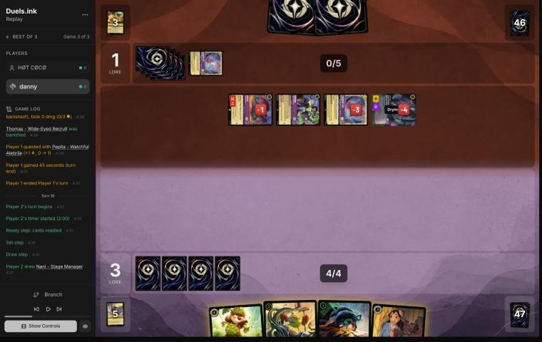
*The board before the decision: [step 51](https://duels.ink/replay/01a1ced3-11cd-77b2-a659-3ca03305bcff?step=51) in the duels.ink replay viewer.*

**What you did:** after their turn-9 Demona – Scourge (with Rush from Imperious Spellcaster) cleared your board, you
drew Nani, played Mike – Heroic Climber (you took Mowgli and inked him; they revealed Demona – Betrayer and sent it
to the bottom), then Nani, taking David. 3–1.

**Verdict: close call.** All four of their characters were exerted and two were badly hurt (Cheshire Cat with 1
willpower left, Scourge with 2), so the turn was about having challengers ready next turn. Your two bodies do that:
Nani kills either, and Mike can too once Dale is down. The coach's alternative was Dale plus You Broke My Smolder (a
fresh two cards for the Mike in hand), which keeps Mike's FIND A FRIEND out of play: it showed them Demona – Betrayer
this time, and they could have kept her. The ink drop their Scourge used on turn 9 came from your Mickey on turn 4,
which is the cost the [turn 2](#turn-2) note describes. [THREAT-3](#cite-threat-3).

### Turn 12: your turn 6

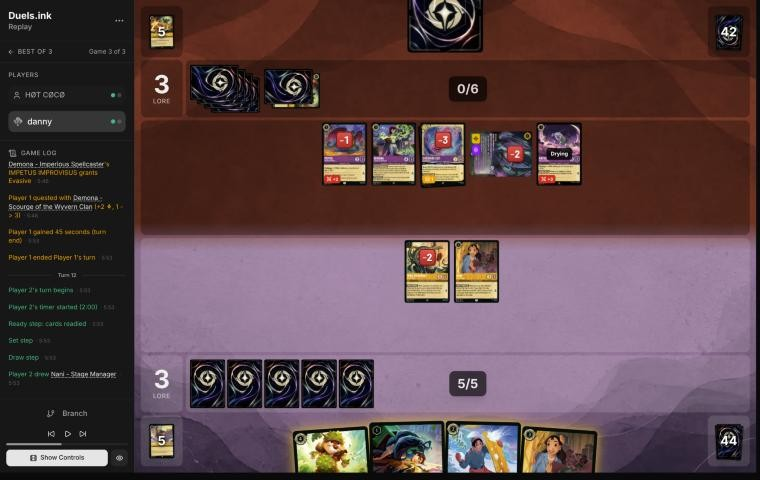
*The board before the decision: [step 73](https://duels.ink/replay/01a1ced3-11cd-77b2-a659-3ca03305bcff?step=73) in the duels.ink replay viewer.*

**What you did:** drew a second Nani and played her (taking Lilo – Bundled Up), played Lilo – Bundled Up, didn't ink,
and didn't quest. 3–3, with Mike, two Nanis and Lilo – Bundled Up all ready.

**Verdict: close call.** Their board (Pepita, Demona – Imperious Spellcaster and Cheshire Cat ready; Scourge exerted
but Evasive; Rafiki new) quests for 6 a turn, and nothing of theirs could be challenged. You chose a ready board:
nothing of yours to challenge, so if they quest, their questers are exerted in front of four ready challengers next
turn, with Dale to come. That is [H-6](#cite-h-6), whose stated risk is an exert-all (a second Scourge, 14% after their draw)
turning the waiting board into free kills. The coach's line was Dale and David, questing with Mike and Nani for 2:
under SPIKE SUIT, Mike hits back for 4 and Nani for 3, so any challenge on them trades (even Scourge, on 4 willpower
left, dies to Mike). It scores 2 more and gets Dale down a turn earlier; yours keeps four characters safe. Both are
reasonable.

### Turn 14: your turn 7

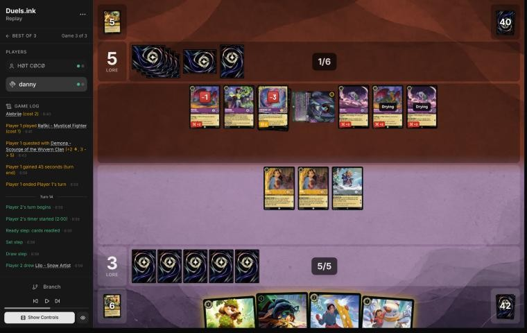
*The board before the decision: [step 87](https://duels.ink/replay/01a1ced3-11cd-77b2-a659-3ca03305bcff?step=87) in the duels.ink replay viewer.*

**What you did:** drew Lilo – Snow Artist and inked her, played Dale and David (ready), and didn't quest or challenge.
3–5, with five characters of yours ready against seven of theirs.

**Verdict: close call.** Only their Scourge was exerted, and your two Nanis together deal exactly its 6: two 3-drops
for their 6-drop, their biggest quester (2 lore) and the character Imperious Spellcaster keeps giving Rush. That was
the coach's line, with Lilo – Bundled Up questing for 2 (EXTRA LAYERS absorbs the first hit). Your line waits again:
with Dale down, every character of yours hits back with its willpower, so if they quest into it you can kill most of
their board next turn. The catch is the clock. Their board quests for 8, so waiting lets them reach 13 before you
strike back, and you're on 3. Neither line looked likely to win the race unless they stumbled. [TRADE-1](#cite-trade-1), [H-6](#cite-h-6).

### Turn 16: your turn 8

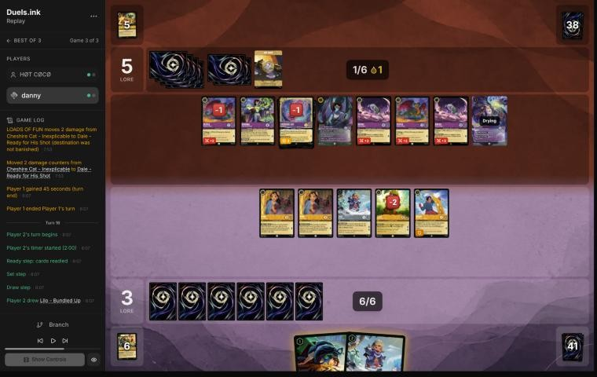
*The board before the decision: [step 99](https://duels.ink/replay/01a1ced3-11cd-77b2-a659-3ca03305bcff?step=99) in the duels.ink replay viewer.*

**What you did:** drew a second Lilo – Bundled Up and played her, then You Broke My Smolder (Willow and Lilo &
Stitch), played Willow, and quested with everything else: both Nanis, the first Lilo – Bundled Up, Dale and David
(10–5). Lilo & Stitch stayed in hand.

**Verdict: good.** They'd reach 8 ink next turn (7 plus a drop), which is Raging Storm, and lore is the one thing a
Storm can't take, so banking 7 now was right. Under SPIKE SUIT every challenge into your exerted characters costs
them the challenger (Dale hits back for 4, David 4, the Nanis 3). The alternative was Lilo & Stitch Shifted onto the
first Lilo – Bundled Up (in play since the start of the turn, so it quests at once) for 3, in place of Willow: 1 more
lore and a 5-willpower body. Keeping it in hand to rebuild after a Storm is the better use of it against this deck.
[CARD-2](#cite-card-2), [QC-5](#cite-qc-5).

### Turn 18: your turn 9

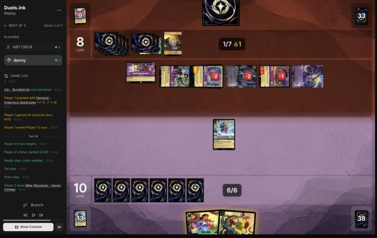
*The board before the decision: [step 126](https://duels.ink/replay/01a1ced3-11cd-77b2-a659-3ca03305bcff?step=126) in the duels.ink replay viewer.*

**What you did:** after their turn 17 traded away most of both boards, you drew Mike – Heroic Climber and played him
(you found a second Lilo & Stitch; their top card was a Guidebook), Shifted Lilo & Stitch onto Lilo – Bundled Up and
quested for 3 (13–8).

**Verdict: fine.** Their five characters were all exerted, but Lilo & Stitch could kill only one (Merlin, Cheshire
Cat, Pepita or Imperious Spellcaster) and nothing else of yours could challenge, so questing was worth more. Their
board quests for 7 plus 1 from the Shop, so they'd reach 16 next turn and 20 the turn after; you needed 7 more in two
turns from Lilo & Stitch and Mike, which only works if they spend characters on challenges.

### Turn 20: your turn 10

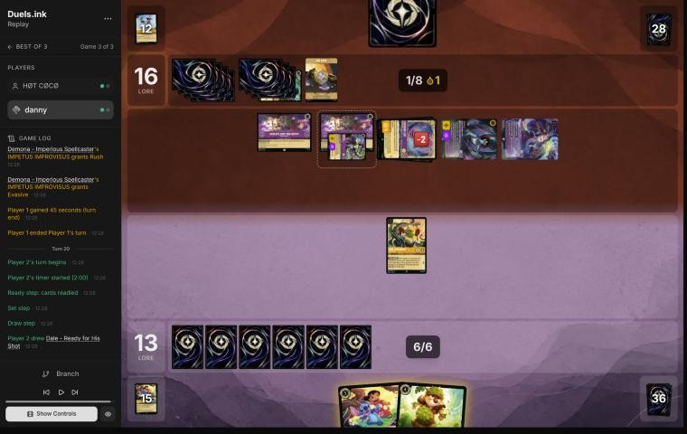
*The board before the decision: [step 153](https://duels.ink/replay/01a1ced3-11cd-77b2-a659-3ca03305bcff?step=153) in the duels.ink replay viewer.*

**What you did:** at 13–16, drew Dale and played him, then Mike challenged Cheshire Cat and, under SPIKE SUIT, dealt
his 4 willpower to kill it.

**Verdict: fine; the game was lost from here.** They needed 4 and had 6 lore of questers left (Imperious Spellcaster,
Scourge, Merlin) plus 2 from moving characters to their two Shops, while you needed 7 with Mike and a new Dale. Killing
Cheshire was the best use of the turn, but no line kept them under 4. Principle 2.

## Lessons
1. **Toulouse is your one answer to Raging Storm** ([turns 2](#turn-2), [6](#turn-6)): his UNBECOMING BEHAVIOR stops
   their actions for a turn. Ink spare copies of other cards first.
2. **Your Mickey's drop counts toward their 6-drops too** ([turn 2](#turn-2), [10](#turn-10)): against a Demona –
   Scourge deck, one drop a turn moves her from turn 11 to turn 9.
3. **A ready board can stall them** ([turns 12](#turn-12), [14](#turn-14)): they didn't quest into it on turns 13 and
   15. But Cheshire Cat's boost moves damage onto ready characters, so the stall costs you a character a turn.
4. **Bank lore before their wipe turn** ([turn 16](#turn-16)): lore is the one thing Raging Storm can't take.
5. **Dale goes first** ([turn 8](#turn-8) and their turn 9): whoever kills Dale first turns off SPIKE SUIT for every
   challenge after, so Scourge with Rush went straight at him.

## Proposed knowledge-base updates (applied after discussion)
- **Meta** (the Amber/Amethyst pair file's notes, HØT CØCØ, game 3; adds to game 1's list): Cheshire Cat –
  Inexplicable ×3, Pepita ×3, Rafiki ×2, Demona – Imperious Spellcaster ×2, Demona – Scourge (turn 9, Rush from
  Imperious Spellcaster, paid with a drop from your Mickey), Demona – Betrayer, Merlin – Profoundly Curious, Merlin's
  Shop and Smithy ×2, Junior Woodchuck Guidebook ×3, The Horseman Strikes! ×3 (discarded to IMPETUS), Raging Storm ×2
  (both discarded to IMPETUS), Peter Pan's Shadow, Mowgli ×2, Gaston, Hades.
- **Strategy:** evidence on [H-6](#cite-h-6) both ways: the ready board held their questers back on turns 13 and 15, while Cheshire
  Cat's boost killed Mike and Willow and damaged Dale without a challenge. Record it on [H-6](#cite-h-6) as a counter: a deck with
  Cheshire Cat can kill a waiting board.
- **Cards:** the Mike – Heroic Climber note proposed in game 1's review: here his reveal showed them Demona – Betrayer
  on turn 10 (they bottomed it).

## Hindsight
Doesn't change the verdicts above.
- Their Scourge on turn 9 was paid with the drop from your Mickey's turn-4 quest; without it she'd have come on turn
  11 at the earliest.
- Both their Raging Storms went to the discard as IMPETUS costs, so the wipe you were playing around never came.

## The coach's errors
Found by the coach during the review; the discussion may add more.

| When | Error | How it was caught | How it won't happen again |
|---|---|---|---|

None found.

## Open questions
- **[Pre-game](#turn-0):** why send back Stitch, Lilo – Snow Artist's partner?
- **[Turns 2](#turn-2) and [6](#turn-6):** was inking both Toulouses a choice against keeping Dale, or was Storm not a
  worry yet?
- **[Turns 12](#turn-12) and [14](#turn-14):** was the waiting board deliberate, and what made you switch to questing
  on turn 16?

## Citations
Copies of the coach's knowledge base cited above, as they stood when they were cited (the private repository's commit and date are given with each). They don't change when the knowledge base does.

**amber-amethyst.md, Remember Merida against Rockstar Aggro: GoldenBeast**: knowledge base, `kb/meta/archetypes/amber-amethyst.md` at `82ed7cb` (2026-11-12), working tree

> ### Remember Merida against Rockstar Aggro: GoldenBeast `[coach, meta study of Savitar's 2 Nov 2026 games (tools/scan.py), full games, not blind, 2 games]`
> 01a19bbd-6ae7 (game 1) and 01a19bc4-57f1 (game 3; game 2 wasn't sent). Savitar won both by concession, at 15–1 and
> 17–0.
> - **Seen:** Merida – Wisp Conjurer ×2 (enters exerted to draw; draws when another character enters exerted), Elsa –
>   Exploring the Unknown ×2, Mowgli – Man Cub ×2 (you reveal your hand and discard a non-character card of your choice),
>   Luisa Madrigal – Pushing Through ×2 and Confident Climber, Demona – Imperious Spellcaster (discard a card: a Gargoyle
>   gains Rush and Evasive), Demona – Scourge of the Wyvern Clan, Hades – Looking for a Deal, Pepita, Lionheart – Incumbent
>   Mayor, Merlin – Profoundly Curious, Merlin's Shop and Smithy, Junior Woodchuck Guidebook, Mickey Mouse – Best in Town,
>   Raging Storm ×3, Remember Me.
> - **Demona – Scourge plus Imperious Spellcaster:** exert your whole board, then give Scourge Rush to challenge at once;
>   three kills on turn 11 of game 1, too late at 15–1.
> - **A slow start against aggro:** no lore until late in both games; four characters on game turn 1 (Lilo and three
>   free Pudges) were never answered.

**MULL-3**: strategy principle, `kb/strategy/principles.md` at `82ed7cb` (2026-11-12), working tree

> - **MULL-3. The right keep depends on the matchup.** Early interaction against aggro; pressure, draw and engines against slow decks. The mulligan is the first expression of your role. In the Set 14 era the opponent's inks are known before the mulligan (RULE-8), so this applies from game 1 of a match. `[MCL ch.12]` · baseline

**INK-1**: strategy principle, `kb/strategy/principles.md` at `82ed7cb` (2026-11-12), working tree

> - **INK-1. Inking is permanent.** Every inked card is one line of play removed for the rest of the game. *Ask: "Will I regret losing access to this card?"* `[MCL ch.4]` · baseline

**INK-2**: strategy principle, `kb/strategy/principles.md` at `82ed7cb` (2026-11-12), working tree

> - **INK-2. Don't automatically ink the most expensive card.** It may be the late-game win condition or the key answer for this matchup. The answer depends on matchup, hand and board. `[MCL ch.4]` · baseline

**THREAT-3**: strategy principle, `kb/strategy/principles.md` at `82ed7cb` (2026-11-12), working tree

> - **THREAT-3. The biggest threat may not be on the board yet.** Consider:
>   - the opponent's ink next turn
>   - shift targets already in play
>   - support pieces that enable their next turn
>
>   `[MCL ch.9]` · baseline

**TRADE-1**: strategy principle, `kb/strategy/principles.md` at `82ed7cb` (2026-11-12), working tree

> - **TRADE-1. Judge a trade by ink invested, tempo, value already generated, and the board afterwards**, not by card count. A 2-cost for a 5-cost is a big win even if it's one-for-one. *Ask: "What does the board look like after this challenge?"* `[MCL ch.7]` · baseline

**CARD-2**: strategy principle, `kb/strategy/principles.md` at `82ed7cb` (2026-11-12), working tree

> - **CARD-2. Virtual card advantage means making the opponent's cards dead without trading for them.** Don't overextend into narrow removal you know or suspect they hold. Ward makes targeted answers useless. `[MCL ch.2]` · baseline

**QC-5**: strategy principle, `kb/strategy/principles.md` at `82ed7cb` (2026-11-12), working tree

> - **QC-5. The race changes everything.** At 18–12 up, take the last 2 lore. At 8–16 down, stopping their close-out matters more than your quests. `[MCL ch.6]` · baseline

**H-6**: hypothesis, `kb/strategy/hypotheses.md` at `82ed7cb` (2026-11-12), working tree

> ### H-6. Against an exert-and-challenge deck, a ready board that keeps drawing can outlast it
> - **Claim:** against decks whose removal is challenges set up by exert effects (Amethyst/Ruby tempo-midrange: Peter
>   Pan's Shadow, Isis, Wasabi's TWIN BLADES), keeping a wide board ready and drawing cards can beat questing into
>   their challengers, until a turn with a decisive attack (Judy Hopps – Lead Detective's Alert and Resist) or removal.
>   The risk is an exert-all (Demona – Scourge of the Wyvern Clan), which turns the waiting board into free kills.
> - **Why:** with nothing exerted, their challengers have no targets, so they must quest into your ready challengers or
>   wait too. Each waiting turn is a card for you (Nick Wilde – Toy Drive Officer's COMMUNITY OUTREACH) rather than
>   lore for them.
> - **Evidence for:** 01a19c0c (MK_ifoughtthelore vs VH INK, game 3; 2026-11-02). From turn 14 to turn 20 they mostly
>   didn't quest, and the waiting board found eight extra cards (six from COMMUNITY OUTREACH, one from Uncovering
>   Clues, one returned by Fangmeyer). On turn 22, Lead Detective's
>   Alert removed both Evasive questers and the board scored 8 (1 to 9 against 10). Won.
> - **Evidence against:** 01a19c00 (game 1). A ready board of five small characters waited, correctly at about 15% for
>   Demona that turn, and Demona – Scourge exerted it all on turn 11; every character died. A waiting board of 1- and
>   2-willpower characters loses everything to an exert-all.
> - **Evidence for, from the player:** 01a16039 (stonks 📈 vs roycelikerolls, game 3; relayed by danny, 2026-11-02).
>   Unintentional Icon and Merida stayed ready on turns 9, 11 and 17 at 1–4 and 3–4. The blind review called it a
>   mistake, since every challenger into them would die. The player's reasons: two cheap characters for Icon is a trade
>   they want, Icon's BESPOKE DESIGN is worth another turn, and a ready board forced them to spend Peter Pan's Shadow and
>   Shere Khan to reach it while their own board didn't quest. Revisited to close calls; won 13–4.
> - **Evidence for, from the player, and a limit:** 01a1a1ee-148c (MK_ifoughtthelore vs George, game 1), turn 21;
>   MK_ifoughtthelore's reasons relayed by danny on 2026-11-04. At 4–12 against Emerald/Steel's ready wall, they kept
>   Nick Wilde – Toy Drive Officer home as the card engine. The coach agreed in discussion: Flash's Resist 1 meant two
>   of their characters could kill it for free. The limit: a Lead Detective, whose 6 back kills every challenger, was
>   still worth questing, since killing her cost them two characters while a second copy kept Alert. So keep ready the
>   characters whose damage back can't kill the attackers.
> - **Status:** open (three games for, one against). Applied at the user's request, 2026-11-02.
