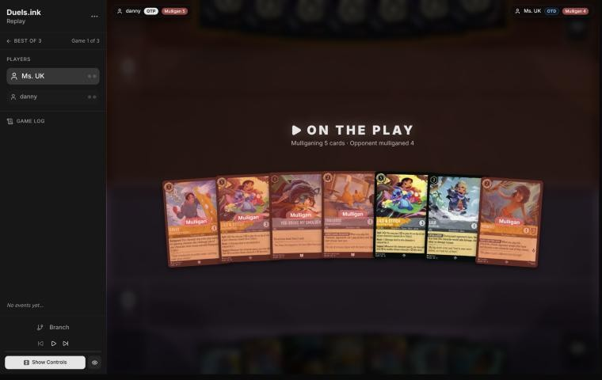
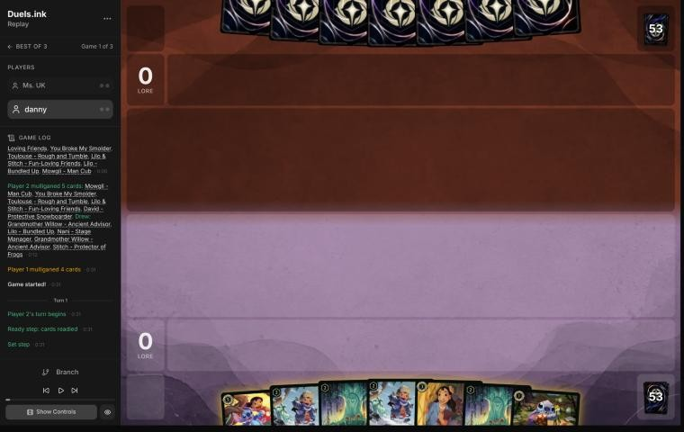
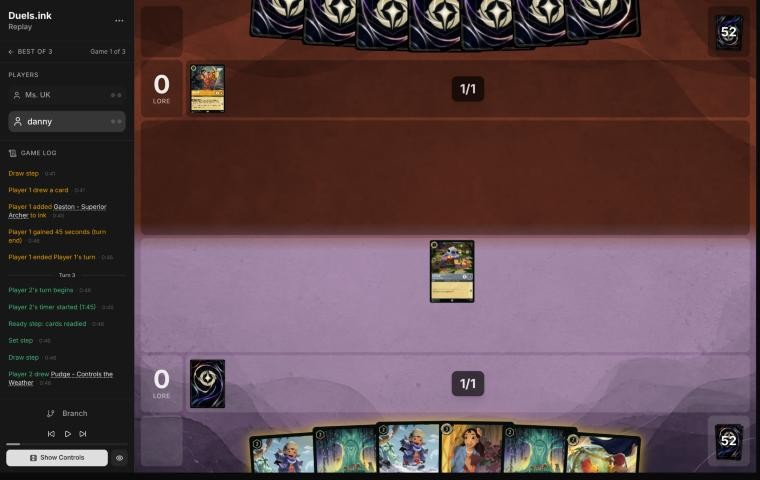
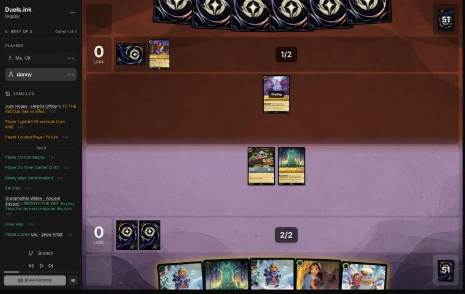
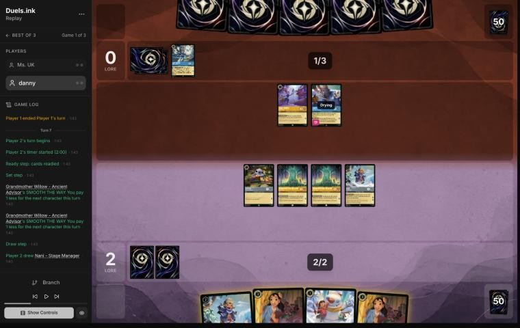
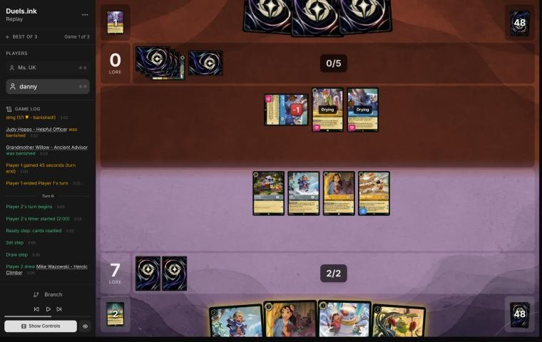
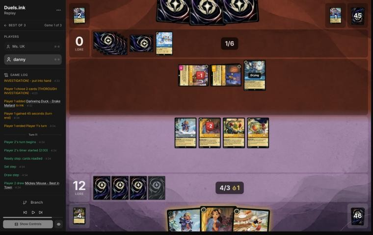

# Review: danny vs Ms. UK, 12 Nov 2026 (game 1)

| | |
|---|---|
| **Status** | draft (blind pass done, not yet discussed) |
| **Replay** | `01a1cedf-0be6` (`python3 tools/brief.py 01a1cedf-0be6 --turn N`) · [duels.ink viewer](https://duels.ink/replay/01a1cedf-0bf6-7a19-8f28-a9a8612def9e?step=0) |
| **Format** | Core Constructed. Set 14 era: inks revealed before the coin toss |
| **Decks** | You: Amber/Steel Rockstar Aggro, your Lilo list. Them: Amber/Sapphire ([the coach's notes on Detectives against Rockstar Aggro](#cite-kb-meta-archetypes-amber-sapphire-detectives-against-rockstar-aggro-ligerien)); archetype as it became clear: Detectives, from turn 4 (Judy – Helpful Officer, Elisa Maza inked) |
| **Play/draw** | You went first |
| **Result** | Won: they conceded at 16–0 on game turn 12 |
| **Meta data** | snapshot of 12 Nov 2026 (fresh) |
| **Chosen how** | By the user: every game of 11–12 Nov in the export, reviewed blind. The export holds games 1 and 2 of this match, so the coach knows there was a game 2, not how this one went |

## Summary
- **Good plays:** [pre-game](#turn-0), [9](#turn-9) and [11](#turn-11) (killing their Support Judy and Nick Wilde
  before they could pump your characters into Gaston range).
- **Inaccuracies / mistakes / blunders:**
  - **Mistake, [3](#turn-3):** Stitch didn't quest into an empty board, and Pudge was inked instead of played for free.
  - **Inaccuracies, [1](#turn-1), [5](#turn-5) and [7](#turn-7):** Lilo & Stitch inked on turn 1; no ink on turns 5
    and 7 with inkable cards in hand, each time a 1-cost character left in hand.
- **Unwinnable from:** never; you were never behind.

**What decided it:** a wide board of 2-lore characters (two Lilo – Bundled Up, Mickey) and the Willows' stacked
discounts outran a slow Detectives start, and killing their Supporters on turns 9 and 11 left their Gaston-style
removal with nothing to aim at. They conceded at 16–0.

## The game, turn by turn
Verdicts judge each decision on what you could know at the time, **including archetype knowledge an experienced
player has**. Hindsight is kept to its own section. Severity scale: good play / close call /
inaccuracy / mistake / blunder. Principle IDs and hypotheses (H-n) link to copies
in the Citations section at the end, as they stood when they were cited.

**What you knew before the game:** Amber/Sapphire: Detectives (50%) or Control (40% and 5%). Their key cards, and
the earliest game turn each can come (you're on the play, so their turns are the even ones):
- **Detectives:** cheap Detectives from turn 2 (Higgins, Judy – Day Camp Instructor with Support, Nick Wilde with
  Support), Judy – On the Case (3), Elisa Maza (4; with another Detective, you reveal your hand and discard a
  non-character of their choice) and Judy – Always Vigilant (4, or Shift 2 onto a Judy; banishes a character with 5
  strength or more if they played another character that turn) from turn 8, earlier through the Shift; Gaston –
  Superior Archer (5; the same banish) from turn 10. **Their trick:** Support onto your characters to lift one to 5
  strength for Gaston or Always Vigilant. Lilo & Stitch (3) is one Judy – Day Camp Support from being a target.
- **Control:** Let It Go (5) and Hades – Infernal Schemer (7) put one character into your inkwell; Spooky Sight (6)
  does it to every character with cost 3 or less; Raging Storm (8) from turn 16.
- **Against your deck:** Savitar's Rockstar list beat both archetypes in early November; Dale's SPIKE SUIT kills
  their small Detectives, and Toulouse's lock is what Control's Storm waits out.

### Pre-game

*The board before the decision: [step 0](https://duels.ink/replay/01a1cedf-0bf6-7a19-8f28-a9a8612def9e?step=0) in the duels.ink replay viewer.*

**What you did:** on the play, you kept Lilo & Stitch and Lilo – Bundled Up, sent back the other five, and drew two
Willows, a second Lilo – Bundled Up, Nani and Stitch.

**Verdict: good play.** The seven had no 1-drop and two Lilo & Stitch with one base. On the simulator
(`tools/mulligan.py`, 1,500 deals each) your five-card mulligan scored best of every option: 9.4 lore by turn 4,
against 4.2 for keeping all seven and 8.9 for sending back everything. Keeping exactly one Shift and its base was the
plan. [MULL-1](#cite-mull-1), [MULL-4](#cite-mull-4).

### Turn 1: your turn 1

*The board before the decision: [step 3](https://duels.ink/replay/01a1cedf-0bf6-7a19-8f28-a9a8612def9e?step=3) in the duels.ink replay viewer.*

**What you did:** inked Lilo & Stitch and played Stitch.

**Verdict: inaccuracy.** Four of your seven cards were uninkable (two Lilo – Bundled Up, two Willows), so one of Lilo
& Stitch, Nani and Stitch had to go in, and Stitch was the turn-1 play. Inking Lilo & Stitch is suboptimal because it
was the card the mulligan kept a base for: Shifted onto Lilo – Bundled Up on turn 3, it quests for 3 a turn, and its
Support kills their small Detectives. Inking Nani is better: she's a 3-drop that quests for 1 and digs one 2-drop,
which your hand already had plenty of. Lilo & Stitch is a target for their Support-then-Gaston trick, but so is
anything worth keeping. [INK-1](#cite-ink-1), [INK-2](#cite-ink-2); confidence moderate.

### Turn 3: your turn 2

*The board before the decision: [step 8](https://duels.ink/replay/01a1cedf-0bf6-7a19-8f28-a9a8612def9e?step=8) in the duels.ink replay viewer.*

**What you did:** drew Pudge and inked him, played Willow, and didn't quest. 0–0, their board empty.

**Verdict: mistake.** Two things went begging:
- **Stitch's quest was free.** Their board was empty, so nothing could challenge him next turn: 1 lore for nothing.
- **Pudge was a free character.** His GOOD FRIEND makes him cost 0 with a Lilo in play. Inking Nani and playing
  Lilo – Bundled Up (2) then Pudge (0) puts two bodies and 3 lore a turn on the board (Lilo – Bundled Up quests for 2)
  where Willow alone gives one body, 1 lore and a discount you couldn't use this turn.

So the better turn was: ink Nani, Lilo – Bundled Up, Pudge for free, quest with Stitch (1–0). Willow comes down next
turn with her discount for a second Lilo. [QC-3](#cite-qc-3), [INK-1](#cite-ink-1); confidence fairly high.

### Turn 5: your turn 3

*The board before the decision: [step 15](https://duels.ink/replay/01a1cedf-0bf6-7a19-8f28-a9a8612def9e?step=15) in the duels.ink replay viewer.*

**What you did:** drew Lilo – Snow Artist, didn't ink, played the second Willow for 1 (the first Willow's discount)
and Lilo – Bundled Up for 1 (the second Willow's), and quested with Stitch and the first Willow (2–0).

**Verdict: inaccuracy.** Chaining the two Willows' discounts was neat, and questing into a board of one Judy – Helpful
Officer (2 strength) was right. Not inking is suboptimal because Nani and Lilo – Snow Artist were both inkable and
you had a third 1-cost play: inking Nani makes 3 ink, so Willow (1), Lilo – Bundled Up (1) and Lilo – Snow Artist (1,
worth 2 with Stitch) all come down. That's 2 more lore a turn from turn 7, and an ink you keep for every later turn.
[INK-3](#cite-ink-3); confidence moderate.

### Turn 7: your turn 4

*The board before the decision: [step 23](https://duels.ink/replay/01a1cedf-0bf6-7a19-8f28-a9a8612def9e?step=23) in the duels.ink replay viewer.*

**What you did:** drew the second Nani, didn't ink, played Nani for 1 (both Willows' discounts stack) and took
Mickey, played Mickey, and quested with Stitch, both Willows and Lilo – Bundled Up (7–0).

**Verdict: inaccuracy (the ink again; the rest was good).** Questing everything was right: their two Judys (2
strength each) could take a Willow or two, and they were the ones behind. The ink was the same point as
[turn 5](#turn-5): the second Nani or Lilo – Snow Artist could go in, and a third ink plays Lilo – Snow Artist as
well (2 lore a turn with Stitch). You're on 2 ink on turn 7 with Lilo – Bundled Up and a Nani still in hand. [INK-3](#cite-ink-3).

### Turn 9: your turn 5

*The board before the decision: [step 39](https://duels.ink/replay/01a1cedf-0bf6-7a19-8f28-a9a8612def9e?step=39) in the duels.ink replay viewer.*

**What you did:** drew Mike – Heroic Climber and played him (you took Pudge; they took Darkwing Duck – Drake
Mallard), played Pudge for free, killed the damaged Judy – Day Camp Instructor with Nani, quested with Stitch, Lilo –
Bundled Up and Mickey (12–0), and inked Lilo – Snow Artist at the end.

**Verdict: good.** Killing a Support Judy before it could pump one of yours into Gaston range is [H-9](#cite-h-9), and Nani
survived it. Two small things: Mike's FIND A FRIEND handed them a character (the pattern of the 11 Nov reviews), and
inking the second Nani instead of Lilo – Snow Artist would have let Lilo come down with the ink left over, worth 2 a
turn with Stitch. At 12–0 neither mattered much. [H-9](#cite-h-9).

### Turn 11: your turn 6

*The board before the decision: [step 59](https://duels.ink/replay/01a1cedf-0bf6-7a19-8f28-a9a8612def9e?step=59) in the duels.ink replay viewer.*

**What you did:** drew Mickey, quested with Mike (they took Elisa Maza off the top), played the second Nani (taking
another Pudge) and Pudge for free, traded the damaged first Nani for Nick Wilde, quested with Lilo – Bundled Up and the
first Pudge (16–0), and played Mickey with the drop.

**Verdict: good play.** Nick Wilde was their only Support left, and Support is what puts your characters in Gaston and
Always Vigilant range; a Nani on 1 willpower was the right price. Three new bodies (Nani, Pudge, Mickey) are ready, so
nothing can challenge them before your next turn, and they quest for 4 of the 4 you need. Mike's quest handed them a
character for the second time (Elisa Maza), the one cost of the turn. [H-9](#cite-h-9), [POS-1](#cite-pos-1).

## Lessons
1. **Ink every turn when the hand has spare inkables** ([turns 5](#turn-5), [7](#turn-7)): on 2 ink on turn 7, each
   skipped ink was a 1-cost character left in hand. The same habit showed in the HØT CØCØ and EzfelDifel games.
2. **Two Willows stack** ([turn 7](#turn-7)): both discounts apply to the next character, so Nani cost 1.
3. **Against Detectives, kill the Supporters first** ([turns 9](#turn-9), [11](#turn-11)): [H-9](#cite-h-9) in practice. Without
   Support, their "banish a character with 5 strength or more" has no targets in your list.
4. **Free lore is free** ([turn 3](#turn-3)): an empty opposing board means a quest risks nothing.

## Proposed knowledge-base updates (applied after discussion)
- **Meta** (the Amber/Sapphire pair file's notes, Ms. UK, game 1): Detectives with Judy – Helpful Officer, Judy – Day
  Camp Instructor ×3, Nick Wilde – Providing Backup, Judy – Always Vigilant, Judy – Uncovering Clues ×2, Elisa Maza ×2,
  Darkwing Duck – Drake Mallard (Ward), Gaston ×2 (both inked). Slow start: no character until turn 4, 0 lore by turn 12.
- **Strategy:** evidence for [H-9](#cite-h-9) (turns 9 and 11): killing both Supporters kept every character of yours out of
  Gaston and Always Vigilant range.
- **Cards:** the Mike – Heroic Climber note proposed in the HØT CØCØ reviews: here FIND A FRIEND gave them Darkwing
  Duck and Elisa Maza.

## Hindsight
Doesn't change the verdicts above.
- Of the two characters Mike's reveals handed them, Darkwing Duck was inked and Elisa Maza never came down before
  they conceded.

## The coach's errors
Found by the coach during the review; the discussion may add more.

| When | Error | How it was caught | How it won't happen again |
|---|---|---|---|

None found.

## Open questions
- **[Turn 1](#turn-1):** why ink Lilo & Stitch rather than Nani?
- **[Turns 5](#turn-5) and [7](#turn-7):** were you keeping Nani and Lilo – Snow Artist for something, or is not
  inking a habit worth breaking?

## Citations
Copies of the coach's knowledge base cited above, as they stood when they were cited (the private repository's commit and date are given with each). They don't change when the knowledge base does.

**amber-sapphire.md, Detectives against Rockstar Aggro: ligerien**: knowledge base, `kb/meta/archetypes/amber-sapphire.md` at `18726c4` (2026-11-12), working tree

> ### Detectives against Rockstar Aggro: ligerien `[coach, meta study of Savitar's 2 Nov 2026 games (tools/scan.py), full games, not blind, 3 games]`
> 01a19c08-a45f, 01a19c0e-1e9e and 01a19c11-9fbf. Savitar (Amber/Steel Rockstar Aggro) won games 1 and 3 and conceded
> game 2 at 5–15.
> - **Seen:** Gaston ×3, Higgins ×3, Judy Hopps – Always Vigilant ×3, Uncovering Clues ×3, Day Camp Instructor ×2, Lead
>   Detective ×2, On the Case ×2, Nick Wilde – Toy Drive Officer ×2, Nick – Providing Backup, Eilonwy ×2, Mowgli – Man
>   Cub ×2, Daisy Duck – Ghost Finder, Elisa Maza.
> - **They used the Support trick on Savitar's Dale** (0 {S}): three Supports put him at 6 for Gaston (01a19c0e-1e9e
>   turn 9), the same trick as `kb/rules/rulings.md` "Support can add strength to an opposing character".
> - **Dale's SPIKE SUIT beat their small characters:** Stitch and Mike Wazowski dealt their 3 and 4 willpower in
>   challenges and killed Daisy, Mowgli and Higgins on turn 8 of game 1.
> - **Mr. Big's ICE OUT** kept their two best challengers home each turn.

**MULL-1**: strategy principle, `kb/strategy/principles.md` at `18726c4` (2026-11-12), working tree

> - **MULL-1. Keep a plan, not the strongest cards.** *Ask: "Which hand gives me the best chance to execute my game plan in this matchup?"* `[MCL ch.12]` · baseline

**MULL-4**: strategy principle, `kb/strategy/principles.md` at `18726c4` (2026-11-12), working tree

> - **MULL-4. Don't chase a perfect hand.** Flexible hands with several lines beat hands that need one specific draw. `[MCL ch.12]` · baseline

**INK-1**: strategy principle, `kb/strategy/principles.md` at `18726c4` (2026-11-12), working tree

> - **INK-1. Inking is permanent.** Every inked card is one line of play removed for the rest of the game. *Ask: "Will I regret losing access to this card?"* `[MCL ch.4]` · baseline

**INK-2**: strategy principle, `kb/strategy/principles.md` at `18726c4` (2026-11-12), working tree

> - **INK-2. Don't automatically ink the most expensive card.** It may be the late-game win condition or the key answer for this matchup. The answer depends on matchup, hand and board. `[MCL ch.4]` · baseline

**QC-3**: strategy principle, `kb/strategy/principles.md` at `18726c4` (2026-11-12), working tree

> - **QC-3. Questing is favoured when:**
>   - you control the board
>   - your exerted characters can't be punished
>   - the race favours you
>   - removing their characters gains little
>
>   **Challenging is favoured when:**
>   - they have an engine or repeated-value piece
>   - the trade is efficient
>   - you need to slow the game
>   - your deck is stronger late
>
>   `[MCL ch.6]` · baseline

**INK-3**: strategy principle, `kb/strategy/principles.md` at `18726c4` (2026-11-12), working tree

> - **INK-3. Usually ink every turn, but not automatically.** Keeping one more playable card can beat one more ink. Missing ink with an expensive hand can leave you permanently behind. `[MCL ch.4]` · baseline

**POS-1**: strategy principle, `kb/strategy/principles.md` at `18726c4` (2026-11-12), working tree

> - **POS-1. From ahead, take the safest path to victory.** Don't overextend into sweepers, don't make unnecessary trades, and make the opponent take the risks. Winning by 1 lore counts the same as winning by 10. `[MCL ch.10]` · baseline

**H-9**: hypothesis, `kb/strategy/hypotheses.md` at `18726c4` (2026-11-12), working tree

> ### H-9. Against Detectives, kill their Supporters before you deploy a threat with 2 or more {S}
> - **Claim:** Detectives' removal (Judy – Always Vigilant's GOT YOU NOW, Gaston – Superior Archer's WATCH THIS!) only
>   hits characters with 5 {S} or more, and they get your characters there with Support on their own quests (CR 8.13.1:
>   Support may choose any other character). One Supporter puts every character with 2+ {S} in range: Nick Wilde –
>   Providing Backup adds 3, Daisy Duck – Paranormal Investigator 4, Judy – Day Camp Instructor, Eilonwy and Nick – Toy
>   Drive Officer 2. Characters with 0–1 {S} (Mickey – Best in Town, Luisa, Rafiki, Mowgli) are out of reach of one push.
>   So the Supporters, not the removal, are the target: kill them on your turn, and add a 2+ {S} threat when none of
>   theirs can quest next turn, or several at once so one removal a turn can't keep up.
> - **Evidence for:** danny's 16 Remember Merida games against Detectives, 27–30 Oct 2026 (studied whole, not blind).
>   About 35 of danny's characters were banished this way (two a game), always after a Support onto them: Cheshire,
>   Merlin, Merida, Hades, Pepita, Demona – Scourge (5 {S} without help).
> - **Status:** open (a pattern across 16 games; no decision tested in discussion yet).
