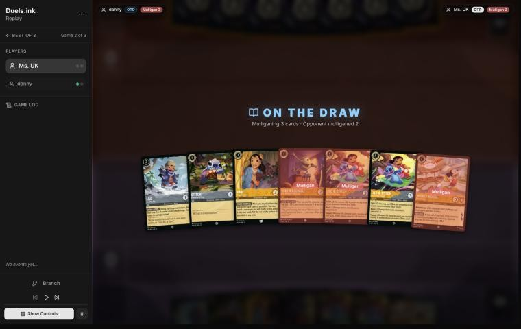
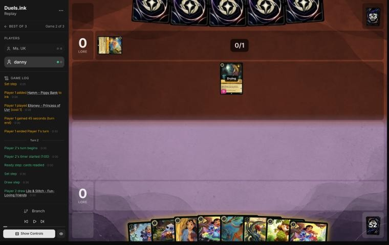
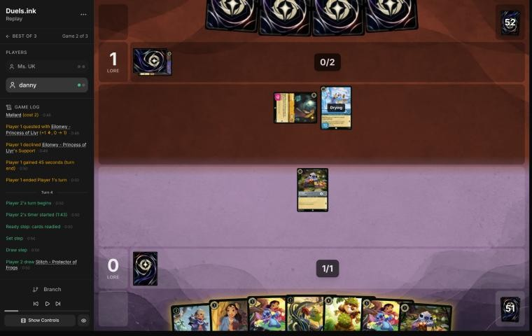
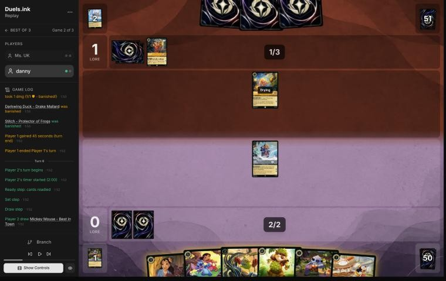
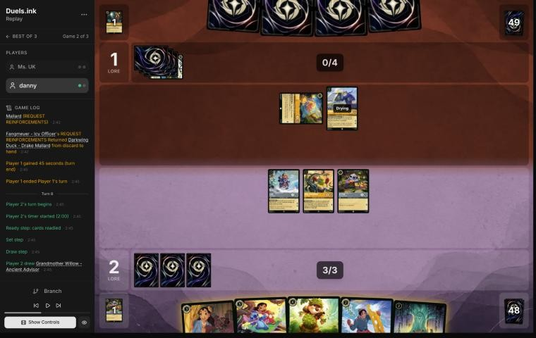
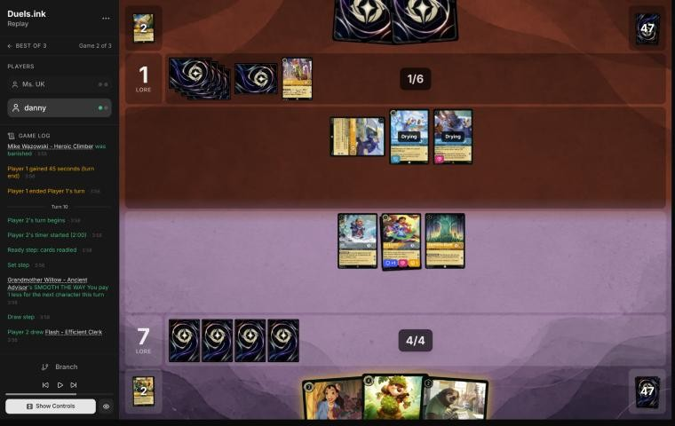
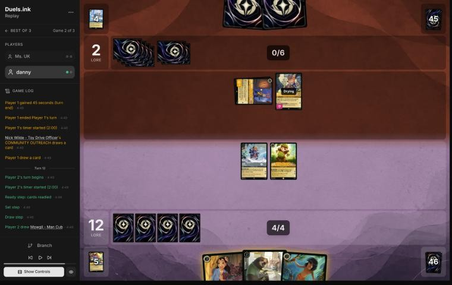

# Review: danny vs Ms. UK, 12 Nov 2026 (game 2)

| | |
|---|---|
| **Status** | draft (blind pass done, not yet discussed) |
| **Replay** | `01a1cee4-b587` (`python3 tools/brief.py 01a1cee4-b587 --turn N`) · [duels.ink viewer](https://duels.ink/replay/01a1cee4-b588-7c7f-968e-caaf3835edb6?step=0) |
| **Format** | Core Constructed. Set 14 era: inks revealed before the coin toss |
| **Decks** | You: Amber/Steel Rockstar Aggro, your Lilo list. Them: Amber/Sapphire ([the coach's notes on Detectives against Rockstar Aggro](#cite-kb-meta-archetypes-amber-sapphire-detectives-against-rockstar-aggro-ligerien)); archetype as it became clear: Detectives, as in game 1, with Hamm, Eilonwy, Fangmeyer and Nick Wilde – Toy Drive Officer added |
| **Play/draw** | They went first |
| **Result** | Won: they conceded at 16–2 on game turn 13 (the match 2–0) |
| **Meta data** | snapshot of 12 Nov 2026 (fresh) |
| **Chosen how** | By the user: every game of 11–12 Nov in the export, reviewed blind. The coach reviewed game 1 (won) just before this one; the export has no game 3, so this game either won the match or was its last (a match can also end with a player leaving) |

## Summary
- **Good plays:** [4](#turn-4) (Stitch kills their Supporter Eilonwy), [8](#turn-8) (Willow, the Shift onto Stitch,
  and Support turning Mike into the answer to Hamm), [12](#turn-12).
- **Inaccuracies / mistakes / blunders:**
  - **Inaccuracies:** [pre-game](#turn-0) (Mickey and a based Lilo & Stitch sent back), [6](#turn-6) (Mike – Heroic
    Climber handed them Judy – Lead Detective; Lilo & Stitch could have Shifted and quested for 3) and [10](#turn-10)
    (no ink, so Flash stayed in hand).
- **Unwinnable from:** never; you led from turn 6.

**What decided it:** Lilo & Stitch's Support. It killed Hamm on turn 8 and Fangmeyer on turn 10, so their board never
grew while yours quested for 4 or 5 a turn, and they conceded at 16–2.

## The game, turn by turn
Verdicts judge each decision on what you could know at the time, **including archetype knowledge an experienced
player has**. Hindsight is kept to its own section. Severity scale: good play / close call /
inaccuracy / mistake / blunder. Principle IDs and hypotheses (H-n) link to copies
in the Citations section at the end, as they stood when they were cited.

**What you knew before the game:** game 1 showed Detectives (100%): Judy – Helpful Officer, Judy – Day Camp
Instructor (Support), Nick Wilde – Providing Backup (Support with another Detective), Judy – Uncovering Clues, Judy –
Always Vigilant, Elisa Maza, Darkwing Duck – Drake Mallard (Ward) and two Gastons. They're on the play, so their turns
are the odd ones: Supporters from turn 3, Judy – Always Vigilant from turn 5 through the Shift (2 onto a Judy), Elisa
Maza from turn 7 and Gaston from turn 9. Their plan is to Support one of your characters up to 5 strength and banish
it with Gaston or Always Vigilant, so their Supporters are the first targets ([H-9](#cite-h-9)). They showed no Raging Storm or
Spooky Sight in game 1, so your Mickeys' drops cost little here.

### Pre-game

*The board before the decision: [step 0](https://duels.ink/replay/01a1cee4-b588-7c7f-968e-caaf3835edb6?step=0) in the duels.ink replay viewer.*

**What you did:** on the draw, you sent back Mike – Well-Rounded Entertainer, a Lilo & Stitch and Mickey, kept Lilo –
Bundled Up, Stitch, Nani and the other Lilo & Stitch, and drew Mowgli, Mike – Heroic Climber and Dale.

**Verdict: inaccuracy.** The seven had two Shift bases (Stitch and Lilo – Bundled Up) for its two Lilo & Stitch, and
Mickey. On the simulator (`tools/mulligan.py`, 1,500 deals each) keeping all seven scored best, 11.3 lore by turn 4,
against 9.4 for your mulligan. Most of that is Mickey, whose drops cost nothing much against a Detectives list with no
wipe, and the second Lilo & Stitch, which had a base. Sending back only Mike – Well-Rounded Entertainer (10.9) was the
closest alternative. [MULL-1](#cite-mull-1), [MULL-3](#cite-mull-3); confidence moderate.

### Turn 2: your turn 1

*The board before the decision: [step 5](https://duels.ink/replay/01a1cee4-b588-7c7f-968e-caaf3835edb6?step=5) in the duels.ink replay viewer.*

**What you did:** drew the second Lilo & Stitch back, inked Mowgli and played Stitch.

**Verdict: fine.** Stitch is a base for turn 4's Shift and the only 1-drop; Mowgli was the least needed of the
inkables, with Dale and both Lilo & Stitch to keep.

### Turn 4: your turn 2

*The board before the decision: [step 13](https://duels.ink/replay/01a1cee4-b588-7c7f-968e-caaf3835edb6?step=13) in the duels.ink replay viewer.*

**What you did:** drew the second Stitch, killed their exerted Eilonwy (a Supporter) with Stitch, inked a Lilo &
Stitch and played Lilo – Bundled Up.

**Verdict: good play.** A free kill on a Supporter is [H-9](#cite-h-9) on turn 4, and Stitch survived with 1 willpower. Lilo –
Bundled Up is the base for next turn's Shift (in play since the start of the turn, so Lilo & Stitch quests at once),
and inking the spare Lilo & Stitch kept Dale and Nani. [H-9](#cite-h-9).

### Turn 6: your turn 3

*The board before the decision: [step 21](https://duels.ink/replay/01a1cee4-b588-7c7f-968e-caaf3835edb6?step=21) in the duels.ink replay viewer.*

**What you did:** drew Mickey, played Mike – Heroic Climber (you took David; they took Judy Hopps – Lead Detective),
inked Mickey, played Stitch and quested with Lilo – Bundled Up (2–1). Lilo & Stitch stayed in hand.

**Verdict: inaccuracy.** Playing Mike is suboptimal because his FIND A FRIEND is symmetric, and a Detectives deck is
nearly all characters, so it hands them a card most of the time. This time it was Lead Detective (6; Shift 4 onto a
Judy; their Detectives get Alert and Resist +2), the card that beat your Rockstar list in an earlier match. Shifting
Lilo & Stitch onto Lilo – Bundled Up for 3 is better. She had been in play since the start of the turn, so it quests
for 3 at once, and it is a 5-willpower body their Hamm can't touch. Stitch for 1 still fits with the third ink.
Lilo & Stitch scores 1 more than your line, gives them nothing, and holds Mike back for when a character for you
matters more than one for them. [VALUE-1](#cite-value-1); confidence moderate.

### Turn 8: your turn 4

*The board before the decision: [step 34](https://duels.ink/replay/01a1cee4-b588-7c7f-968e-caaf3835edb6?step=34) in the duels.ink replay viewer.*

**What you did:** drew Willow and played her, inked David, Shifted Lilo & Stitch onto Stitch for 2 (Willow) and
quested for 3, Supported Mike (+3) into their exerted Hamm, which he killed, and quested with Lilo – Bundled Up (7–1).

**Verdict: good play.** Everything in one turn: Willow's discount paid for the Shift, the Shift went onto the 1-lore
Stitch so Lilo – Bundled Up kept questing for 2, and Support turned Mike into the answer to Hamm, their cost reducer.
5 lore and a kill, with Mike's FIND A FRIEND never triggered (he challenged instead of questing). [TRADE-2](#cite-trade-2), [QC-3](#cite-qc-3).

### Turn 10: your turn 5

*The board before the decision: [step 52](https://duels.ink/replay/01a1cee4-b588-7c7f-968e-caaf3835edb6?step=52) in the duels.ink replay viewer.*

**What you did:** drew Flash, quested with Lilo & Stitch and Supported Willow (+3) into their exerted Fangmeyer, which
she killed and died to; played Dale for 4, quested with Lilo – Bundled Up (12–1), and didn't ink.

**Verdict: inaccuracy (the plan was right; one body was left in hand).** Trading Willow for Fangmeyer, their biggest
quester, while Lilo & Stitch scored was the turn. And Dale had to come after the challenge, since under SPIKE SUIT
Willow would deal her 2 willpower instead of her 4 strength. But Willow's discount died with her, and with no ink
there was nothing left for Flash. Inking Nani and playing Flash first, for 1 with the discount, then the quest and
challenge, then Dale for 4, uses all 5 ink and adds a 2-lore Flash. [INK-3](#cite-ink-3), [SEQ-2](#cite-seq-2); confidence moderate.

### Turn 12: your turn 6

*The board before the decision: [step 67](https://duels.ink/replay/01a1cee4-b588-7c7f-968e-caaf3835edb6?step=67) in the duels.ink replay viewer.*

**What you did:** drew Mowgli, played Nani (taking Pudge) and Pudge for free, and quested with Lilo – Bundled Up and
Dale (16–2). No ink again.

**Verdict: good.** 4 lore and two fresh bodies left you needing 4 next turn from a board that quests for 6, against
two characters of theirs. Inking Mowgli would have paid for Flash too, one more 2-lore body to spread their removal
over, the same point as [turn 10](#turn-10). [QC-5](#cite-qc-5).

## Lessons
1. **Support is your removal against Detectives** ([turns 8](#turn-8), [10](#turn-10)): +3 strength on Mike or Willow
   killed a cost reducer and a 5-drop.
2. **Order Dale and Support carefully** ([turn 10](#turn-10)): under SPIKE SUIT a Supported character deals its
   willpower, not its pumped strength, so challenge before Dale lands, and play the cheap character before Willow
   trades away her discount.
3. **Mike – Heroic Climber against a deck of characters** ([turn 6](#turn-6)): FIND A FRIEND hands them a card most of
   the time; here it was Judy – Lead Detective.
4. **Ink every turn** ([turns 10](#turn-10), [12](#turn-12)): each skipped ink left a 2-lore character in hand.

## Proposed knowledge-base updates (applied after discussion)
- **Meta** (the Amber/Sapphire pair file's notes, Ms. UK, game 2): Eilonwy, Hamm ×2, Darkwing Duck – Drake Mallard ×2
  (the second returned by Fangmeyer), Fangmeyer – Icy Officer (turn 7 with Hamm's discount), Judy – Day Camp
  Instructor, Nick Wilde – Toy Drive Officer ×2, Judy – Always Vigilant ×2, Judy – Lead Detective, Gaston, Nick Wilde –
  Providing Backup. They used Support on their own Darkwing (6 strength) to kill Lilo & Stitch on turn 11.
- **Strategy:** more evidence for [H-9](#cite-h-9) (turn 4's free kill on Eilonwy), and the Mike – Heroic Climber note proposed in
  the HØT CØCØ reviews (turn 6).
- **Cards:** a line on Dale's note: Support adds strength, but under SPIKE SUIT challenges deal willpower, so a
  Supported challenge belongs before Dale is played.

## Hindsight
Doesn't change the verdicts above.
- The Lead Detective that Mike gave them on turn 6 went straight into their inkwell on turn 7.

## The coach's errors
Found by the coach during the review; the discussion may add more.

| When | Error | How it was caught | How it won't happen again |
|---|---|---|---|

None found.

## Open questions
- **[Pre-game](#turn-0):** what made you send back Mickey and the second Lilo & Stitch?
- **[Turn 6](#turn-6):** was Mike played for David, or to keep Lilo & Stitch safe in hand for a turn?

## Citations
Copies of the coach's knowledge base cited above, as they stood when they were cited (the private repository's commit and date are given with each). They don't change when the knowledge base does.

**amber-sapphire.md, Detectives against Rockstar Aggro: ligerien**: knowledge base, `kb/meta/archetypes/amber-sapphire.md` at `442483b` (2026-11-12), working tree

> ### Detectives against Rockstar Aggro: ligerien `[coach, meta study of Savitar's 2 Nov 2026 games (tools/scan.py), full games, not blind, 3 games]`
> 01a19c08-a45f, 01a19c0e-1e9e and 01a19c11-9fbf. Savitar (Amber/Steel Rockstar Aggro) won games 1 and 3 and conceded
> game 2 at 5–15.
> - **Seen:** Gaston ×3, Higgins ×3, Judy Hopps – Always Vigilant ×3, Uncovering Clues ×3, Day Camp Instructor ×2, Lead
>   Detective ×2, On the Case ×2, Nick Wilde – Toy Drive Officer ×2, Nick – Providing Backup, Eilonwy ×2, Mowgli – Man
>   Cub ×2, Daisy Duck – Ghost Finder, Elisa Maza.
> - **They used the Support trick on Savitar's Dale** (0 {S}): three Supports put him at 6 for Gaston (01a19c0e-1e9e
>   turn 9), the same trick as `kb/rules/rulings.md` "Support can add strength to an opposing character".
> - **Dale's SPIKE SUIT beat their small characters:** Stitch and Mike Wazowski dealt their 3 and 4 willpower in
>   challenges and killed Daisy, Mowgli and Higgins on turn 8 of game 1.
> - **Mr. Big's ICE OUT** kept their two best challengers home each turn.

**MULL-1**: strategy principle, `kb/strategy/principles.md` at `442483b` (2026-11-12), working tree

> - **MULL-1. Keep a plan, not the strongest cards.** *Ask: "Which hand gives me the best chance to execute my game plan in this matchup?"* `[MCL ch.12]` · baseline

**MULL-3**: strategy principle, `kb/strategy/principles.md` at `442483b` (2026-11-12), working tree

> - **MULL-3. The right keep depends on the matchup.** Early interaction against aggro; pressure, draw and engines against slow decks. The mulligan is the first expression of your role. In the Set 14 era the opponent's inks are known before the mulligan (RULE-8), so this applies from game 1 of a match. `[MCL ch.12]` · baseline

**VALUE-1**: strategy principle, `kb/strategy/principles.md` at `442483b` (2026-11-12), working tree

> - **VALUE-1. A card's value is what it achieves before it leaves play, not its printed stats.** A 2-drop that quests twice and trades can beat a 7-drop removed on arrival. *Ask: "How much will this accomplish before they deal with it?"* `[MCL ch.3]` · baseline

**TRADE-2**: strategy principle, `kb/strategy/principles.md` at `442483b` (2026-11-12), working tree

> - **TRADE-2. The best trade removes theirs and keeps yours.** A survivor keeps generating value and demands more answers. `[MCL ch.7]` · baseline

**QC-3**: strategy principle, `kb/strategy/principles.md` at `442483b` (2026-11-12), working tree

> - **QC-3. Questing is favoured when:**
>   - you control the board
>   - your exerted characters can't be punished
>   - the race favours you
>   - removing their characters gains little
>
>   **Challenging is favoured when:**
>   - they have an engine or repeated-value piece
>   - the trade is efficient
>   - you need to slow the game
>   - your deck is stronger late
>
>   `[MCL ch.6]` · baseline

**INK-3**: strategy principle, `kb/strategy/principles.md` at `442483b` (2026-11-12), working tree

> - **INK-3. Usually ink every turn, but not automatically.** Keeping one more playable card can beat one more ink. Missing ink with an expensive hand can leave you permanently behind. `[MCL ch.4]` · baseline

**SEQ-2**: strategy principle, `kb/strategy/principles.md` at `442483b` (2026-11-12), working tree

> - **SEQ-2. Plan the whole turn before the first action.**
>   - Who quests? Who challenges?
>   - What if a challenge fails?
>   - What gets inked? What ink is left?
>   - What does this leave the opponent?
>
>   `[MCL ch.5]` · baseline

**QC-5**: strategy principle, `kb/strategy/principles.md` at `442483b` (2026-11-12), working tree

> - **QC-5. The race changes everything.** At 18–12 up, take the last 2 lore. At 8–16 down, stopping their close-out matters more than your quests. `[MCL ch.6]` · baseline

**H-9**: hypothesis, `kb/strategy/hypotheses.md` at `442483b` (2026-11-12), working tree

> ### H-9. Against Detectives, kill their Supporters before you deploy a threat with 2 or more {S}
> - **Claim:** Detectives' removal (Judy – Always Vigilant's GOT YOU NOW, Gaston – Superior Archer's WATCH THIS!) only
>   hits characters with 5 {S} or more, and they get your characters there with Support on their own quests (CR 8.13.1:
>   Support may choose any other character). One Supporter puts every character with 2+ {S} in range: Nick Wilde –
>   Providing Backup adds 3, Daisy Duck – Paranormal Investigator 4, Judy – Day Camp Instructor, Eilonwy and Nick – Toy
>   Drive Officer 2. Characters with 0–1 {S} (Mickey – Best in Town, Luisa, Rafiki, Mowgli) are out of reach of one push.
>   So the Supporters, not the removal, are the target: kill them on your turn, and add a 2+ {S} threat when none of
>   theirs can quest next turn, or several at once so one removal a turn can't keep up.
> - **Evidence for:** danny's 16 Remember Merida games against Detectives, 27–30 Oct 2026 (studied whole, not blind).
>   About 35 of danny's characters were banished this way (two a game), always after a Support onto them: Cheshire,
>   Merlin, Merida, Hades, Pepita, Demona – Scourge (5 {S} without help).
> - **Status:** open (a pattern across 16 games; no decision tested in discussion yet).
