# Review: GreenJayPacker vs Itz_Rj, 17 Nov 2026

| | |
|---|---|
| **Status** | draft (blind pass done, not yet discussed) |
| **Replay** | `01a1ea7f-cc42` (`python3 tools/brief.py 01a1ea7f-cc42 --turn N`) · [duels.ink viewer](https://duels.ink/replay/01a1ea7f-cc52-70ae-bc1a-8f73f98072ba?step=0) |
| **Format** | Core Constructed (stated in the replay). Set 14 era: inks revealed before the coin toss |
| **Decks** | You: Emerald/Ruby Ruby R.E.D. ([the coach's notes on it](#cite-kb-meta-archetypes-emerald-ruby-ruby-r-e-d-against-danny-s-rockstar-aggro-bigshotbob)), with four Stegmutt – Clumsy Dinosaur and no Lyle Tiberius Rourke. Them: Amber/Amethyst ([the coach's notes on this pair](#cite-kb-meta-archetypes-amber-amethyst-remember-merida-danny-s-list)); archetype as it became clear: **Remember Merida** built around Merlin's Shop and Smithy (four of them), 97% from their Merlin on turn 8 |
| **Play/draw** | You went first; they mulliganed 3 |
| **Result** | **Loss**, 13–20: they reached 20 on game turn 24 by moving a fresh Luisa through three Shops |
| **Meta data** | snapshot of 12 Nov 2026 (fresh until 26 Nov) |
| **Chosen how** | Sent by danny, the coach's user, as a replay link on 17 Nov: a game of GreenJayPacker's, reviewed for them. The coach knew nothing of the result; the replay list showed it lasted 24 game turns |

## Summary
- **Good plays:** [pre-game](#turn-0) (the whole combo in hand), [5](#turn-5), [7](#turn-7) (Inner Strength
  kills Rafiki, two mills make Olaf cost 2), [15](#turn-15) (The Leviathan kills Merlin), [23](#turn-23).
- **Close calls:** [15](#turn-15) (Max Goof played into a likely Storm).
- **Inaccuracies / mistakes / blunders:**
  - **Inaccuracies:** [3](#turn-3) (inked Another Tale to Spin rather than cast it), [9](#turn-9) (milled twice with
    Olaf already at 2; the Device stayed in hand), [11](#turn-11) (Olaf challenged Merlin where The Leviathan's
    trigger would have killed him) and [19](#turn-19) (cards over 2 Photo lore in a race).
  - **Mistake, [13](#turn-13):** three ink unused with The Leviathan one ink away: Luisa lived to feed the Shops, and
    3 lore a turn waited two more turns.
- **Unwinnable from:** [21](#turn-21). Three Shops score with any character they play, and no line reached 20 first.

**What decided it:** Merlin's Shop and Smithy. Each Shop gives a lore and a card whenever a character moves there, so
with three and then four Shops any one character was 3–4 lore and 3–4 cards a turn, and Raging Storm (turn 16) left
the Shops standing. Your combo was ready on turn 11 and fully on turn 13, but The Leviathan landed only on turn 15, a
turn before the Storm.

## The game, turn by turn
Verdicts judge each decision on what you could know at the time, **including archetype knowledge an experienced
player has**. Hindsight is kept to its own section. Severity scale: good play / close call /
inaccuracy / mistake / blunder. Principle IDs and hypotheses (H-n) link to copies
in the Citations section at the end, as they stood when they were cited.

**What you knew before the game:** they're Amber/Amethyst: Remember Merida 36%, Midrange 33%, an unlisted list 17%,
Aggro 14%. They're on the draw, so their turn k comes on game turn 2k, with k ink. Their key cards, with the earliest
game turn each can come:
- **Rafiki – Mystical Fighter** (1; Challenger +3): turn 2. **Pepita** (2; Challenger +2) and **Hamm** (2; the next
  character costs 1 less): turn 4. Your characters are few, so these mostly matter against Tod and Max Goof.
- **Cheshire Cat – Inexplicable** (3; Boost 2 moves 2 damage counters): turn 6, boosted the same turn from 5 ink.
- **The Horseman Strikes!** (3): draws and banishes a character with Evasive. Prince Phillip is your only Evasive one.
- **Tigger – Bouncing All the Way** (4): returns a character, item or location of cost 2 or less to its owner's hand,
  so your Rivera Family Photos (cost 1) are exposed from turn 8. **Isis** (4) exerts one character.
- **Gaston – Superior Archer** (5; banishes a character with 5 {S} or more): turn 10, or 8 with Hamm. That covers
  Stegmutt (7), Prince Phillip (6) and The Leviathan (10), but not Olaf (4).
- **Hades – Looking for a Deal** (5): turn 10. **Demona – Scourge** (6; exerts all yours, refills hands to 3): turn
  12, earlier with Grandmother Willow or ink drops.
- **Raging Storm** (8; banishes all characters): turn 16, a turn earlier for each ink drop. Your Another Tale to
  Spin gives them one each time.

Your own deck's plan, from the pair file: Rivera Family Photo and The Torn Corner mill your deck so Olaf – Snowman of
Action costs 1 less per action in your discard (and takes 2 lore from them); Retro Evolution Device then banishes him
to play The Leviathan (10) free, whose IT'S A MACHINE! banishes their characters with total {S} 10 or less if 2 or
more cards went to your discard that turn. Against Rockstar Aggro it came as early as game turn 8. Malicious, Mean,
and Scary plus Prince Phillip (or To Wither a Flower) is the second sweep.

### Pre-game

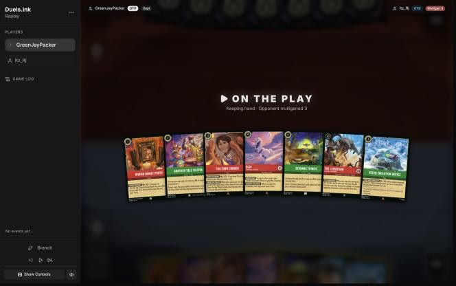
*The board before the decision: [step 0](https://duels.ink/replay/01a1ea7f-cc52-70ae-bc1a-8f73f98072ba?step=0) in the duels.ink replay viewer.*

**What you did:** kept all seven: Rivera Family Photo, Another Tale to Spin, The Torn Corner, Olaf – Snowman of
Action, Strange Things, The Leviathan – Guardian of Atlantis and Retro Evolution Device.

**Verdict: good play.** The whole combo is in hand: Olaf, the Device and The Leviathan, with Photo and The Torn Corner
to fill the discard that makes Olaf cheap. Six of the seven are inkable, so the ink is safe. `tools/mulligan.py`
(1,500 deals) gives the keep 9.45 of 10 ink over turns 1–4 against 8.99 for a full mulligan; its character and
interaction counts favour a mulligan (0.8 characters by turn 4 against 0.4, interaction 92% against 30%), but they
measure a fair deck, and this one wins with the combo, which a mulligan would throw away. Sending back only Strange
Things (9.28 ink, 46% interaction) is a close alternative: it trades a 4-cost song you can't sing early for a random
card, while keeping it adds an action to the discard count once it's cast or milled. [MULL-1](#cite-mull-1);
confidence high.

### Turn 1: your turn 1

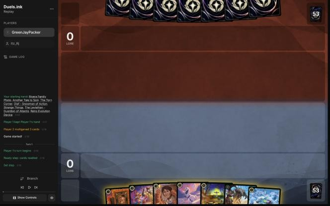
*The board before the decision: [step 3](https://duels.ink/replay/01a1ea7f-cc52-70ae-bc1a-8f73f98072ba?step=3) in the duels.ink replay viewer.*

**What you did:** inked The Torn Corner and played Rivera Family Photo.

**Verdict: fine.** Photo on turn 1 starts the mill a turn early. The ink choice was between The Torn Corner and Strange
Things; Another Tale to Spin, Olaf, the Device and Photo all belong to the plan. The Torn Corner is at its best when
Photo mills it and MEND THE PHOTO plays it free; from hand it's a 3-ink item that draws only once your discard has
10 cards. Strange Things would have been an equally good ink, so this is a choice between two spare cards.

### Turn 3: your turn 2

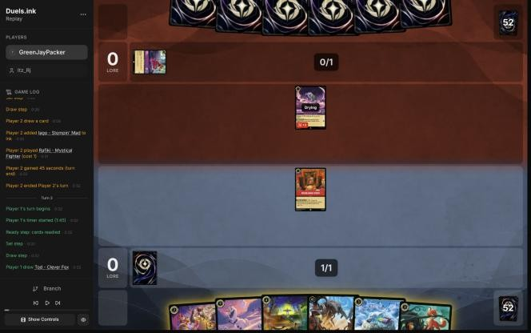
*The board before the decision: [step 9](https://duels.ink/replay/01a1ea7f-cc52-70ae-bc1a-8f73f98072ba?step=9) in the duels.ink replay viewer.*

**Setup.** Their turn 2 showed Rafiki (Challenger +3) and inked Iago – Stompin' Mad (Challenger +5, off-list): Midrange
54% now, an unlisted list 42%. Cheap challengers matter little to a hand whose only early character is Tod. You have
2 ink once you ink. The race is the combo's: Olaf costs 9 minus the actions in your discard, and the Device needs 3
ink to play and 1 to use.

**What you did:** drew Tod, inked Another Tale to Spin and milled 2 with Rivera Family Photo (Strike a Good Match and
The Leviathan). One ink unused.

**Verdict: inaccuracy (small; confidence: medium).** Inking **Another Tale to Spin** is suboptimal because it's the
better of your two spare songs: an action for Olaf's count whichever way it's cast, a card, an ink drop, and free to
sing once Tod is dry. **Inking Strange Things and casting Another Tale** is better, for exactly your 2 ink:
- it puts a certain action in the discard (Photo's 2 cards held about 0.8 on average, with 25 actions in 60 cards),
  and draws a card in place of the one milled;
- its ink drop makes next turn 4 ink: Tod plus Photo's mill, or the Device plus the mill, a turn sooner than 3 ink
  allows. That's the turn the Leviathan line needs;
- Strange Things, the card inked, needs 4 ink or a 4-cost singer, so it's the slower card to keep.

The cost is the drop it gives them: a 3-drop (Cheshire, Imperious Spellcaster, The Horseman Strikes!) on their turn 2.
With no character of yours on the board for their challengers to hit, a turn of their tempo matters less than a turn
of your combo. Milling with Photo and inking Strange Things (keeping the Tale for Tod to sing later) is also better
than the line played, which put the more useful song in the inkwell. [INK-1](#cite-ink-1), [INK-2](#cite-ink-2).

### Turn 5: your turn 3

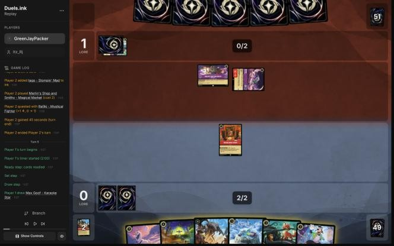
*The board before the decision: [step 17](https://duels.ink/replay/01a1ea7f-cc52-70ae-bc1a-8f73f98072ba?step=17) in the duels.ink replay viewer.*

**Setup.** They have Rafiki, two Iagos inked (Challenger +5, off-list) and Merlin's Shop and Smithy (a card and a lore
when a character moves there). Midrange 52%, unlisted 40%. 3 ink once you ink; your discard holds one action (Strike a
Good Match), so Olaf costs 8. Candidates: Max Goof discarding Strange Things to SWEET REMIX (an action into the discard,
two cards), Tod (two cards, discard one: Strange Things again), or the Device now and the draw next turn.

**What you did:** drew Max Goof; inked Tod, played Max Goof and discarded Strange Things to draw Rivera Family Photo
and Inner Strength.

**Verdict: good play.** Max Goof turns the spare song into Olaf's discount and two cards, and leaves a 3-willpower body
that Rafiki can't kill alone. Tod would have done the same with a choice of discard, but a 2-willpower body; inking him
rather than Max Goof keeps the body that later counts five songs for +3 lore. The Device can wait a turn: it's only
needed on the turn Olaf comes down.

### Turn 7: your turn 4

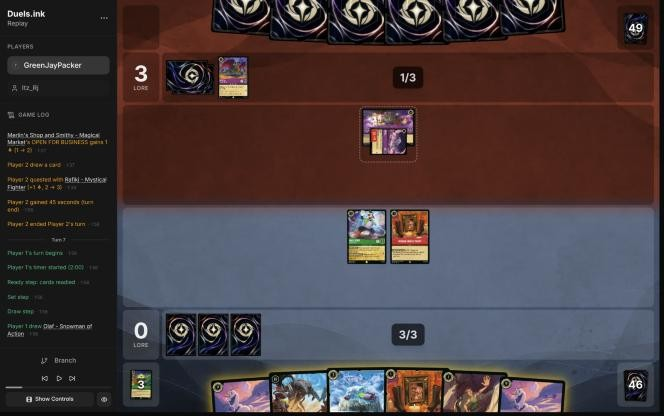
*The board before the decision: [step 26](https://duels.ink/replay/01a1ea7f-cc52-70ae-bc1a-8f73f98072ba?step=26) in the duels.ink replay viewer.*

**Setup.** They're at 3 lore with only Rafiki (exerted at Merlin's Shop and Smithy, which gives them a card and a lore
whenever a character moves there) and 3 ink; Pepita was inked. Archetype: an unlisted list 50%, Remember Merida 37%.
You have 4 ink, a second Olaf, a second Photo and Inner Strength; two actions in your discard make Olaf cost 7. Their
board is too small for The Leviathan's IT'S A MACHINE! to matter yet, so the turn is about Olaf's cost and the
Device. Candidates: the Device and one mill; or Photo, two mills and Inner Strength (more actions in the discard, the
Device next turn).

**What you did:** drew the second Olaf; cast Inner Strength on Max Goof (drawing the second Max Goof), challenged the
exerted Rafiki and banished him; inked the second Max Goof, played the second Photo and milled 2 twice (Inner
Strength, two Improvise and Strike a Good Match).

**Verdict: good play.** Inner Strength did three jobs for 1 ink: an action for Olaf's count, a card, and the strength
that let Max Goof kill Rafiki for nothing, their only character and the one feeding Merlin's Shop a card and a lore a
turn. The two mills put four actions in the discard: Olaf now costs 2. Holding the Device costs nothing: Tigger can't
return it (cost 3), and next turn's 5 ink pays for it, Olaf and its use.

### Turn 9: your turn 5

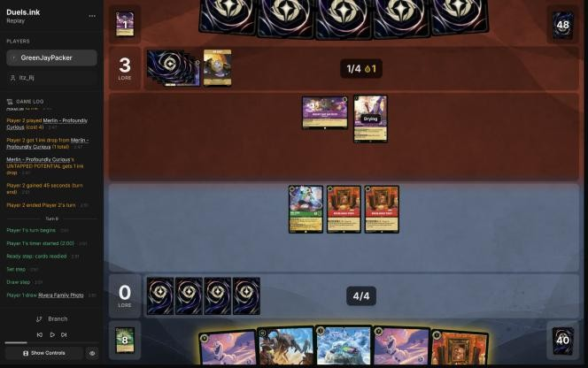
*The board before the decision: [step 39](https://duels.ink/replay/01a1ea7f-cc52-70ae-bc1a-8f73f98072ba?step=39) in the duels.ink replay viewer.*

**Setup.** Their turn 8 added Merlin – Profoundly Curious (an ink drop; draws when he quests): Remember Merida 97% now.
They're at 3 lore with 4 ink and a drop, so next turn has 6: Demona – Scourge (exert all, 49% held after their draws),
Hades (49%), and Raging Storm from game turn 14 (8 ink, sooner with drops). Your discard holds seven actions, so each
Olaf costs 2 (the brief's options list him as unaffordable: they don't count ABOUT TIME). You have 5 ink once you ink
the third Photo. Candidates:
- **Device (3) and Olaf (2):** all 5 ink; Olaf takes 2 lore now, and next turn the Device turns him into The Leviathan
  for 1 ink plus a mill (2 cards to the discard for IT'S A MACHINE!), leaving 4 ink for the second Olaf and Photo lore.
- **Olaf and two mills:** the discard passes 10 cards (Photo's lore mode), but the Device and its use then take 4 of
  next turn's 6 ink.
- Max Goof can quest for 1; exerted, only an Imperious Spellcaster with Rush (4) kills him, and a Scourge would exert
  him anyway.

**What you did:** drew the third Photo and inked it; milled 2 (Prince Phillip, Tod), played Olaf for 2 (their lore 3 → 1),
and milled 2 more (Max Goof, Rivera Family Photo). One ink unused; Max Goof didn't quest; the Device
stayed in hand.

**Verdict: inaccuracy.** Milling twice is suboptimal because Olaf already cost 2: the four cards
held no actions he needed, and one was Prince Phillip, now out of reach. **Playing the Device with Olaf** is better,
for exactly your 5 ink. It sets up next turn's Leviathan for 2 ink (the Device's use and one mill) and leaves 4 for
the second Olaf's drain and Photo's lore, where your line needs 5 of next turn's 6 for the Device, its use and a mill.
Nothing of theirs seen in this pair touches a 3-cost item (Tigger returns cost 2 or less). Questing Max Goof for 1 was
also free in practice. [SEQ-2](#cite-seq-2); confidence medium.

### Turn 11: your turn 6

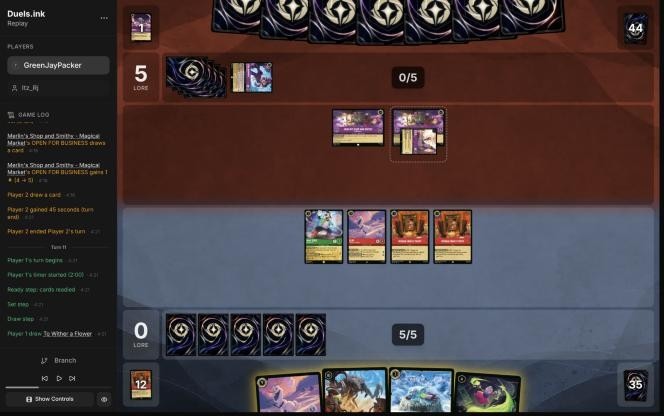
*The board before the decision: [step 52](https://duels.ink/replay/01a1ea7f-cc52-70ae-bc1a-8f73f98072ba?step=52) in the duels.ink replay viewer.*

**Setup.** Their turn 10 was the engine at work: Merlin quested (2 lore and a card) and moved between two Merlin's
Shops (a lore and a card each), +4 lore and +3 cards; they're at 5 with seven cards. Merlin, exerted, is their only
character and must die. You're at 0 with 5 ink, Olaf dry, Max Goof, two Photos (your discard has 12 cards, so HONOR
THE PAST can gain lore), and in hand the second Olaf (cost 2), The Leviathan, the Device and To Wither a Flower.
Remember Merida is 99.8%: Hades (5) and Demona – Scourge (6) are castable next turn; Raging Storm needs 8 ink, game
turn 16 unless they find drops. Nothing else they run removes a 10-willpower character. Candidates, each 5 ink:
- **A. Olaf challenges Merlin; the Device; two Photo lore; Max Goof quests:** +3, Merlin dead, Olaf left exerted on
  2 willpower; The Leviathan, the second Olaf and To Wither stay in hand.
- **B. Olaf and Max Goof quest (+3); the Device turns Olaf into The Leviathan; one mill makes it 3 cards to your
  discard, so IT'S A MACHINE! banishes Merlin:** the same lore, Merlin dead, and a 10/10 3-lore body in Olaf's place.
- **C. Olaf sings To Wither (its 8th action makes the second Olaf cost 1); the second Olaf (their lore 5 → 3); the
  Device turns him into The Leviathan, which banishes Merlin (To Wither and Olaf are the 2 cards):** +1 from Max Goof
  and −2 for them, The Leviathan and an undamaged Olaf on board, but an empty hand.

**What you did:** drew To Wither a Flower; played the Device, challenged Merlin with Olaf (Merlin banished, Olaf took
2), gained 2 lore with the Photos and quested Max Goof: 3–5.

**Verdict: inaccuracy (small; confidence: medium-low).** Challenging with Olaf is suboptimal because The Leviathan's
IT'S A MACHINE! would have killed Merlin for free once the Device was down, and the challenge left Olaf exerted on 2
willpower, where Pepita (2 +2) or any 2-strength challenger kills him next turn. **Line B** is better: the same 3
lore and the same dead Merlin, and the body on the board is a 3-lore Leviathan that only Raging Storm removes, two
turns before Storm can come, in place of a damaged Olaf. Line C trades your hand for a 2-lore drain and a second body.
The case for your line is holding The Leviathan back so a Storm can't take it with the rest; but the Device and a
second Olaf stay behind in line B too, and two more Leviathans are in your deck. [TEMPO-2](#cite-tempo-2) ([POS-1](#cite-pos-1) is the case for holding back).

### Turn 13: your turn 7

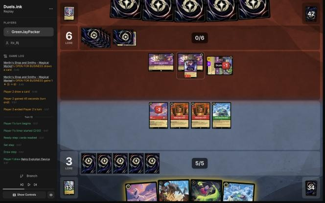
*The board before the decision: [step 69](https://duels.ink/replay/01a1ea7f-cc52-70ae-bc1a-8f73f98072ba?step=69) in the duels.ink replay viewer.*

**Setup.** Their turn 12: Demona – Imperious Spellcaster gave herself Rush and Evasive (discarding Cheshire Cat) and
killed Max Goof; Luisa Madrigal – Pushing Through moved to a Shop (6 lore). Demona is exerted with 1 damage; Luisa
(0/3, Challenger +2) is ready at the Shop and is now the character that feeds both Shops. Your Olaf is ready on 2
willpower. You drew a second Device; with it inked you have 6 ink. In hand: the second Olaf (2), The Leviathan and To
Wither a Flower. Raging Storm needs 8 ink: they'll have 7 next turn and no drops, so the earliest Storm is game turn
16. Hades (let them draw 2 rather than bottom The Leviathan) and Scourge (its exert doesn't let anything they have kill
10 willpower) don't remove The Leviathan. Candidates:
- **A. Olaf quests (+2); the Device turns him into The Leviathan; one mill makes the 2 cards; IT'S A MACHINE!
  banishes Demona and Luisa (4 strength in all); the second Olaf (2; their lore 6 → 4); the other Photo's lore (+1).**
  5 of 6 ink: 6–4, their board empty, The Leviathan and a fresh Olaf on yours, To Wither still in hand.
- **B. Your line, then the Device on the exerted Olaf:** To Wither and Olaf are the 2 cards, so The Leviathan kills
  Luisa. 4 of 6 ink: 5–4, the same boards as A.

**What you did:** inked the second Device; Olaf sang To Wither a Flower (Demona banished); two Photo lore (5); the
second Olaf for 1 (their lore 6 → 4). Three ink unused; The Leviathan stayed in hand.

**Verdict: mistake (confidence: medium-high).** Ending the turn with 3 ink unused is suboptimal because the Device, a
character to banish and two cards in the discard were all there: The Leviathan was 1 ink away. Leaving it in hand
left Luisa alive to move between the Shops for a lore and a card each, left your Olaf exerted on 2 willpower for
Luisa's Challenger +2, and gave up 3 lore a turn from a body nothing but Raging Storm removes, which can't come before
game turn 16. **Line A** is best, 6–4 with their board empty; **line B**, your own turn plus 1 ink, gets nearly all
of it. Holding The Leviathan against Storm doesn't work here: after a Storm the Device needs an Olaf to banish to
reach cost 10, and both of yours were on the board. [TEMPO-1](#cite-tempo-1); [POS-1](#cite-pos-1) doesn't apply when the sweeper can't come yet.

### Turn 15: your turn 8

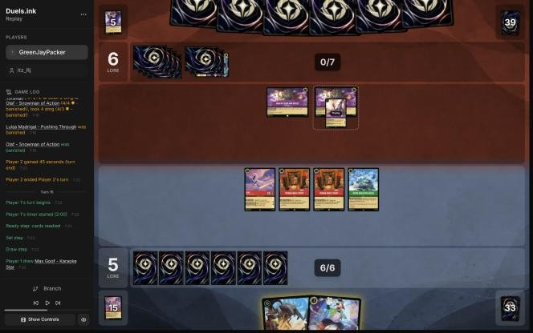
*The board before the decision: [step 83](https://duels.ink/replay/01a1ea7f-cc52-70ae-bc1a-8f73f98072ba?step=83) in the duels.ink replay viewer.*

**Setup.** As expected, Luisa traded with your damaged Olaf on their turn 14, and a second Merlin moved between the
Shops (6 lore, Demona – Scourge inked). Merlin is their only character again. They'll have 8 ink next turn: Raging Storm
45% held now, 65% after their draws. You're at 5 with 6 ink, Olaf ready, the Device and two Photos; in hand The
Leviathan and a Max Goof you just drew. The line: Olaf quests, a mill, the Device turns Olaf into The Leviathan, whose
IT'S A MACHINE! kills Merlin, and the other Photo's lore. That's 3 ink; the question is the other 3 (Max Goof, or keep
him for after a Storm).

**What you did:** quested Olaf (7), milled Another Tale to Spin and Malicious, Mean, and Scary, turned Olaf into The
Leviathan (Merlin banished), gained a lore with the second Photo (8) and played Max Goof without SWEET REMIX (no song
in hand). An earlier attempt at the Device before the mill was undone in the client.

**Verdict: good play.** The mill first makes IT'S A MACHINE! work, and Merlin was the card that had to die: with two
Shops he's 4 lore and 3 cards a turn. Max Goof is a close call. Played now he's a lore a turn if no Storm comes; kept,
he's a body after one. With the Storm around 65%, holding him was slightly better, but the difference is one 3-cost
card. [POS-1](#cite-pos-1).

### Turn 17: your turn 9

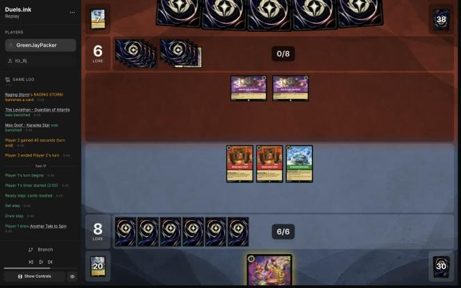
*The board before the decision: [step 104](https://duels.ink/replay/01a1ea7f-cc52-70ae-bc1a-8f73f98072ba?step=104) in the duels.ink replay viewer.*

**Setup.** Raging Storm on their turn 16 took The Leviathan and Max Goof. Both boards are empty; you lead 8–6 with
two Photos (lore mode), the Device and 6 ink, and drew Another Tale to Spin, your only card. They have 8 ink, five
cards and two Shops waiting for a character.

**What you did:** cast Another Tale to Spin (a drop each; you drew Prince Phillip) and gained 2 lore with the Photos
(10). Phillip stayed in hand, uninked.

**Verdict: fine.** With an empty hand, the card is worth more than the drop it gives them, and the Photos' 2 lore cost
2 ink. Keeping Phillip rather than inking him is right: he's 9 ink to cast, but the Device can turn any character of
cost 8 or more into a Leviathan, or Phillip himself comes after a Malicious. The 3 ink left had nothing to pay for.

### Turn 19: your turn 10

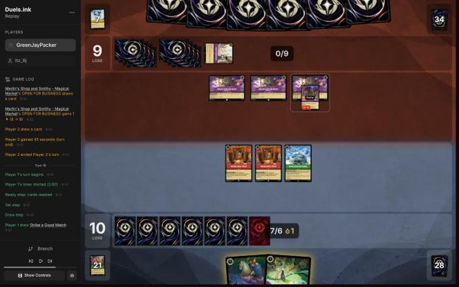
*The board before the decision: [step 117](https://duels.ink/replay/01a1ea7f-cc52-70ae-bc1a-8f73f98072ba?step=117) in the duels.ink replay viewer.*

**Setup.** Their turn 18 played Pepita and a third Merlin's Shop, and moved Pepita through all three: +3 lore and +3
cards (9). That engine is now their clock: Pepita's three moves and a quest are about 4 lore a turn, 20 by game turn
24. You lead 10–9 with no characters, 7 ink (6 and a drop) plus one more if you ink, two Photos (a lore each for 1
ink), the Device, Prince Phillip and Strike a Good Match. You need 10 more lore in three turns, and a way to stop
Pepita: the Device needs a character of yours, Phillip needs her damaged.

**What you did:** cast Strike a Good Match (drew Phillip and Improvise, discarded the other Phillip), Improvise on
Pepita for its card (The Torn Corner), played The Torn Corner and used FOND MEMORIES with the drop (Tod), then inked
Tod. No Photo lore; the ink from Tod went unused.

**Verdict: inaccuracy (confidence: medium).** Spending all the ink on cards is suboptimal because the race is now
lore against a 4-a-turn engine: the Photos' 2 lore for 2 ink are 20% of what you still need. **Strike, Improvise, both
Photos' lore and The Torn Corner played without its draw** is better: 8 ink with a card inked first, the same cards
seen except Tod, and 12–9 instead of 10–9. Tod, the card FOND MEMORIES found, went into the inkwell anyway. At the
least, the ink from Tod could have paid for one Photo's lore. [TEMPO-5](#cite-tempo-5).

### Turn 21: your turn 11

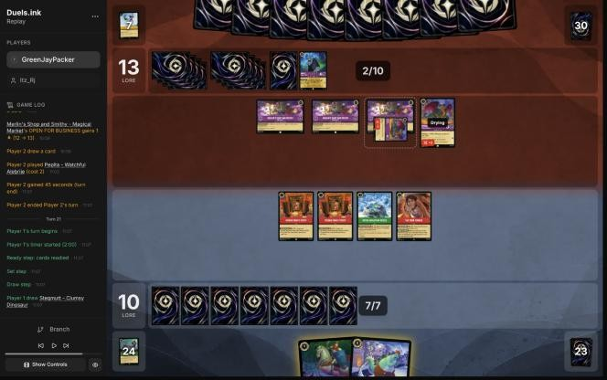
*The board before the decision: [step 132](https://duels.ink/replay/01a1ea7f-cc52-70ae-bc1a-8f73f98072ba?step=132) in the duels.ink replay viewer.*

**Setup.** Their turn 20: Pepita quested and moved through the three Shops (+4, 13 lore), and a second Pepita came
down. With two characters and three Shops they score about 5 a turn: 18 after their turn 22, 20 on turn 24, and any
character they play can still make the three moves. You're at 12 at most after this turn, with 8 ink, Prince Phillip
(9) and Stegmutt (8, 1 less per item in your discard: one Photo there, so 7). Nothing in reach scores 8 on your turn
23: Stegmutt or Phillip played now can't quest until then, Phillip's SWIFT AND SURE needs damaged targets, and the
Device has no character of yours to turn into a Leviathan (both are in the discard).

**The game is unwinnable from here** ([principle 2](#cite-principle-2)): no line reaches 20 by your turn 23, and their Shops score with
any character they play, so killing the Pepitas doesn't stop the clock.

**What you did:** drew Stegmutt; drew To Wither a Flower with The Torn Corner, inked Stegmutt and gained 2 lore with
the Photos (12).

**Verdict: fine.** Two lore now and a card was as much as the turn offered; Stegmutt on the board would have been 2
lore on turn 23 instead, the same.

### Turn 23: your turn 12

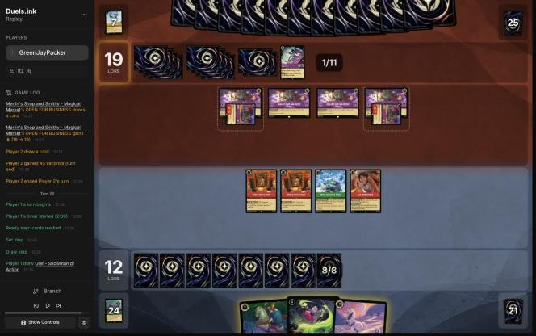
*The board before the decision: [step 148](https://duels.ink/replay/01a1ea7f-cc52-70ae-bc1a-8f73f98072ba?step=148) in the duels.ink replay viewer.*

**Setup.** Their turn 22 quested both Pepitas and moved one through three Shops, then played a fourth Shop and moved
again: 19 lore. Any character they play next turn and move once wins. You're at 12.

**What you did:** drew Olaf and played him free (their lore 19 → 17); drew The Leviathan with The Torn Corner; milled 2
(Malicious, Mean, and Scary and Tod); the Device turned Olaf into The Leviathan, whose IT'S A MACHINE! banished both
Pepitas; one Photo lore (13).

**Verdict: good play, in a lost game.** It's the most the turn allowed: 2 lore off their total and their board
cleared, so they need a new character and three moves to win. With ten cards in hand and four Shops they almost
certainly have one. *(The coach read this turn's log before writing its plan; see the coach's errors.)*

## Lessons
1. **Against Merlin's Shop and Smithy, the characters are the engine and the Shops are permanent.** Each Shop gives a
   lore and a card per move, once a turn each, and a character can move the turn it's played. A sweeper (theirs or
   your Leviathan) resets the characters, not the Shops. Kill the movers as they come, and challenge the Shops
   themselves with big bodies (6 willpower: The Leviathan or Stegmutt kills one per challenge)
   ([Merlin's Shop note](#cite-kb-cards-merlins-shop-and-smithy-magical-market-in-play)).
2. **When the Device, a character to banish and two cards to the discard are all there, land The Leviathan** unless a
   sweeper can come before it quests. Count the sweeper's ink: on [turn 13](#turn-13) Raging Storm was a turn away.
3. **Count what a mill is for** ([turn 9](#turn-9)). Once Olaf costs 2, more actions in the discard don't make him
   much cheaper; the ink is better spent setting up the Device.
4. **In a race, Photo's lore beats a card** ([turn 19](#turn-19)): 2 lore for 2 ink is a fifth of what's left to win.

## Proposed knowledge-base updates (applied after discussion)
- **Meta** (the Amber/Amethyst pair file's notes, Itz_Rj): Remember Merida built around four Merlin's Shop and
  Smithy, two Merlin – Profoundly Curious, four Pepita, two Iago – Stompin' Mad (off-list, inked), Luisa Madrigal –
  Pushing Through ×2 and Confident Climber, three Cheshire Cats, Demona – Imperious Spellcaster, Scourge and Betrayer,
  Hades, Rafiki, Raging Storm (turn 16) and Creative Inspiration (off-list, inked). They won by moving characters
  through the Shops: +4 a turn from turn 10, the last 3 lore from a Luisa played that turn.
- **Card note** (Merlin's Shop and Smithy): three or four Shops make one character 3–4 lore and cards a turn; a
  character can move the turn it's played; sweepers leave the Shops, so the engine restarts with the next character.
- **Meta** (the Emerald/Ruby pair file's notes, GreenJayPacker's Ruby R.E.D.): Stegmutt ×4, Strange Things ×3, The
  Torn Corner ×4, no Lyle Tiberius Rourke or Dangerous Plan. The Device turns Olaf, Phillip (9) or Stegmutt (8) into
  The Leviathan; the banished character is one of IT'S A MACHINE!'s two cards, so one mill or one song makes the other.
- **Strategy:** a hypothesis from [turn 13](#turn-13): with Ruby R.E.D., land The Leviathan as soon as the Device line
  is ready, unless a sweeper can come before it quests. One game; needs more.

## Hindsight
Doesn't change the verdicts above.
- Raging Storm came on game turn 16, the earliest the setup on turn 13 gave it. A Leviathan landed on turn 13 would
  have quested once (3 lore) and killed Luisa before it, and the Olaf Luisa traded with would have been The Leviathan
  instead.
- The fourth Shop came on turn 22 and the winning moves on turn 24 used three of them with a Luisa played that turn.
- Whether line A on turn 13 wins is unclear: you'd have been well ahead before the Storm, against an engine that
  restarts with any character.

## The coach's errors
Found by the coach during the review; the discussion may add more.

| When | Error | How it was caught | How it won't happen again |
|---|---|---|---|
| Turn 23 | Read the turn's log before writing a plan for it. The game was already judged unwinnable on turn 21, and the turn's verdict is the most the turn allowed, but the order broke the blind procedure | Writing the turn's section | Proposed: brief.py refuses the what-happened half of one of your turns until that turn's --plan brief has run (a marker per game and turn) |
| Turns 9–21 | The brief's options listed Olaf as "not affordable" and Stegmutt at full cost, ignoring ABOUT TIME and WAKE OF DESTRUCTION; it also lists no Device lines. The coach priced them by hand | Comparing the options with the discard | Proposed: the options apply discounts counted from your discard and list what the Device can turn each of your characters into |

## Open questions
- **[Turn 13](#turn-13):** why did The Leviathan stay in hand with 3 ink spare: to keep it from a Storm, or to wait for a
  bigger board to banish?
- **[Turn 9](#turn-9):** what were the two mills for, with Olaf already at 2?
- **[Turn 19](#turn-19):** were the cards a dig for Olaf or a Leviathan, rather than Photo lore?
- **[Turn 3](#turn-3):** was Another Tale inked to keep the drop from them?

## Citations
Copies of the coach's knowledge base cited above, as they stood when they were cited (the private repository's commit and date are given with each). They don't change when the knowledge base does.

**emerald-ruby.md, Ruby R.E.D. against danny's Rockstar Aggro: BigShotBob**: knowledge base, `kb/meta/archetypes/emerald-ruby.md` at `f175739` (2026-11-17), working tree

> ### Ruby R.E.D. against danny's Rockstar Aggro: BigShotBob `[coach, meta study of danny's 5–10 Nov 2026 games not studied before (tools/scan.py), full games, not blind, 2 games]`
> - **Game 1** (`01a1b1eb-f331`): danny won 17–0 by concession on game turn 9. Land of the Dead – Marigold Bridge off-list.
> - **Game 3** (`01a1b1f8-4ed8`, danny lost 16–19): **the Leviathan came on game turn 8, their 4th turn**, earlier than the
>   turn 9 noted above. Olaf for 1 (9 → 1 with ABOUT TIME) took 2 lore, Retro Evolution Device turned him into The
>   Leviathan (10 → 0), and IT'S A MACHINE! banished all seven of danny's characters at 15–0. Turn 12: Malicious, then the
>   device turned the Leviathan into Prince Phillip (four kills), and +12 lore that turn; Lyle Tiberius Rourke's DIRTY
>   TRICKS took 1 lore at each of their ends of turn.

**amber-amethyst.md, Remember Merida: danny's list**: knowledge base, `kb/meta/archetypes/amber-amethyst.md` at `f175739` (2026-11-17), working tree

> ### Remember Merida: danny's list `[coach, meta study of danny's 28 Oct – 2 Nov 2026 games (tools/scan.py), full games, not blind, 49 games]`
> All 49 games from `01a18285-3511` to `01a19d4c-6771` (only `01a18275-7c33` of that run was blind-reviewed).
> - **The list (31 games from 29 Oct):** Mickey – Best in Town ×4, Rafiki ×3, Luisa – Pushing Through ×2, Hamm ×4,
>   Pepita ×4, Junior Woodchuck Guidebook ×4, Merlin's Shop and Smithy ×3, Cheshire Cat – Inexplicable ×4, Demona –
>   Imperious Spellcaster ×4, Dumbo – The Flying Elephant ×2, The Horseman Strikes! ×4, Merida – Wisp Conjurer ×4,
>   Merlin – Profoundly Curious ×4, Hades – Looking for a Deal ×4, Demona – Scourge ×4, Remember Me ×3, Raging Storm ×3.
>   On 28 Oct (13 games) it ran Mowgli ×3, a 4th Shop and a 3rd Luisa instead of Hamm and the 3rd Rafiki; five games of
>   28–29 Oct ran Tigger – Bouncing All the Way ×2 instead of Dumbo. Unlike duels.ink's average Remember Merida (above):
>   no Elsa or Gaston, but the full Demona pair (4 + 4) and four Cheshires.
> - **Raging Storm is the reset:** cast in at least 19 of the 49 games (28 casts that removed 3+ of their characters), from game
>   turn 9 (`01a18d5a-0080`, the turn after their wipe), usually turns 11–15. Mickey's ink drops bring it a turn early.
> - **Then Remember Me rebuilds:** sung by two characters (Sing Together 6), it replays 4–7 characters from the discard
>   (`01a182f9-576e` turn 19, `01a18391-038f` 22, `01a18442-9f20` 23, `01a188d0-21d2` 18, `01a18956-64ba` 23,
>   `01a18971-a6ee` 24, `01a18c4b-b91b` 22).
> - **The rebuild is a Storm target:** twice the opponent's Raging Storm swept it the next turn (`01a182f9-576e` turn 20,
>   Kyla's Detectives, 5 characters; `01a18c4b-b91b` turn 25, the mirror, 9). Against a list with Storm and 8 ink in
>   reach, count what the rebuild must do this turn against what a Storm would cost. A pattern to watch, not a rule.
>   - **Contested** (danny, 2026-11-06): being swept isn't the whole cost. With Merida drawing for each character
>     replayed, the draws stay after the sweep, and the sweep spends their answer and most of their turn on characters
>     that came from the discard. The counts back this when Merida draws: see H-11 in the strategy hypotheses.
> - **Demona – Scourge, often with Imperious Spellcaster:** Scourge exerts their board for your challengers, and
>   Demona – Imperious Spellcaster's IMPETUS IMPROVISUS (discard a card) gives a Gargoyle Rush and Evasive to challenge at once: 2–4 kills a turn (`01a18382-dabd` turn 17,
>   `01a18433-41ba` 18, `01a188e0-8396` 7, `01a18d68-3b5a` 16, `01a19d4c-6771` 15 and 25). Hamm's LOOSE CHANGE makes
>   Imperious cost 2.
> - **Cheap challengers clear small boards:** Cheshire plus Luisa or Pepita killed two characters a turn against Rockstar
>   Aggro (`01a18bd1-43a6` turn 13, `01a18be9-bd5b` turn 10) and Big Ramp (`01a18d6f-7150` turn 11).
> - **Shop moves close games:** two Shops and two moves for the last 2 lore (`01a18456-be9a` turn 29), a Shop played
>   and moved to on the Storm turn (`01a18c4b-b91b` turn 28).
> - **What swept danny's board,** with the earliest game turn seen (their removal is in each pair file's notes):
>   Spooky Sight (Amber/Sapphire Control, turn 7: five characters of cost 3 or less into the inkwell); Don Karnage –
>   Debonair Pirate's LASTING IMPRESSION plus To Wither a Flower or Malicious, Mean, and Scary (Retro Device, Circle of
>   Life, an Emerald/Ruby list: turn 7); Strength of a Raging Fire sung twice (Emerald/Steel Midrange, Lilo & Stitch
>   Songs: turn 8); Merida – Formidable Archer with Three Arrows or Windstorm (Big Ramp: turn 10); The Leviathan played
>   free through Retro Evolution Device (Emerald/Ruby Unnamed #1: turn 9); Raging Storm (Control, the mirror, one
>   Detectives list: turn 8); Judy – Always Vigilant's GOT YOU NOW one character at a time (Detectives). Most of the
>   list costs 3 or less, so the cheap sweeps take most of the board.

**merlins-shop-and-smithy-magical-market.md, In play**: knowledge base, `kb/cards/merlins-shop-and-smithy-magical-market.md` at `f175739` (2026-11-17), working tree

> ## In play `[coach + user, 01a18275, 2026-11-02]`
> - **It's a lore engine despite 0 {L}:** 1 lore and a card a turn for 2 ink, and a second Shop doubles it. A
>   character that moves there can still quest. In 01a18275 the opponent scored 6 of their 20 lore this way,
>   including the winning point. The brief's lore clock counts it as "plus up to N a turn from moving characters".
> - **Arthur – Merlin's Assistant moves to a location for free when played** and gets an ink drop, so with Arthur the
>   first move costs nothing.
> - **Locations can be challenged at any time and don't hit back** (CR 4.6.8, RULE-3). Their Cheshire destroyed your
>   Shop in two challenges (turns 10 and 12). Weigh destroying theirs against the lore and cards it will make, the
>   same way as a quester.

**MULL-1**: strategy principle, `kb/strategy/principles.md` at `f175739` (2026-11-17), working tree

> - **MULL-1. Keep a plan, not the strongest cards.** *Ask: "Which hand gives me the best chance to execute my game plan in this matchup?"* `[MCL ch.12]` · baseline

**INK-1**: strategy principle, `kb/strategy/principles.md` at `f175739` (2026-11-17), working tree

> - **INK-1. Inking is permanent.** Every inked card is one line of play removed for the rest of the game. *Ask: "Will I regret losing access to this card?"* `[MCL ch.4]` · baseline

**INK-2**: strategy principle, `kb/strategy/principles.md` at `f175739` (2026-11-17), working tree

> - **INK-2. Don't automatically ink the most expensive card.** It may be the late-game win condition or the key answer for this matchup. The answer depends on matchup, hand and board. `[MCL ch.4]` · baseline

**SEQ-2**: strategy principle, `kb/strategy/principles.md` at `f175739` (2026-11-17), working tree

> - **SEQ-2. Plan the whole turn before the first action.**
>   - Who quests? Who challenges?
>   - What if a challenge fails?
>   - What gets inked? What ink is left?
>   - What does this leave the opponent?
>
>   `[MCL ch.5]` · baseline

**TEMPO-2**: strategy principle, `kb/strategy/principles.md` at `f175739` (2026-11-17), working tree

> - **TEMPO-2. Answering an expensive threat with a cheap card is a tempo swing**, and more so if the answer was sung for no ink. Other examples: playing Shift threats before the opponent can answer them, and ramping into several threats in one turn. `[MCL ch.1, ch.7]` · baseline

**POS-1**: strategy principle, `kb/strategy/principles.md` at `f175739` (2026-11-17), working tree

> - **POS-1. From ahead, take the safest path to victory.** Don't overextend into sweepers, don't make unnecessary trades, and make the opponent take the risks. Winning by 1 lore counts the same as winning by 10. `[MCL ch.10]` · baseline

**TEMPO-1**: strategy principle, `kb/strategy/principles.md` at `f175739` (2026-11-17), working tree

> - **TEMPO-1. Tempo is how much freedom you leave the opponent, not how fast you play.** A play that forces the opponent to spend their turn answering it has stolen part of their turn. *Ask: "If I play this, what does my opponent have to do next?"* `[MCL ch.1]` · baseline

**TEMPO-5**: strategy principle, `kb/strategy/principles.md` at `f175739` (2026-11-17), working tree

> - **TEMPO-5. Tempo decides when card advantage matters.** Two extra cards are worthless if the opponent gains 6 lore while you draw them. `[MCL ch.1, ch.2]` · baseline

**principle 2**: coaching principle, `CLAUDE.md` at `f175739` (2026-11-17), working tree

> 2. **Some games are unwinnable.** Draws and matchups can make a game lost whatever the player does. Say so
>    when it's true, rather than inventing mistakes to explain a loss.
