# Review: GreenJayPacker vs sterlinghorton, 17 Nov 2026

| | |
|---|---|
| **Status** | final (discussed 18 Nov 2026: the player's answers to the open questions, relayed by danny) |
| **Replay** | `01a1eaf6-93a9` (`python3 tools/brief.py 01a1eaf6-93a9 --turn N`) · [duels.ink viewer](https://duels.ink/replay/01a1eaf6-93b6-7dbc-82be-9691dfc9e862?step=0) |
| **Format** | Core Constructed (stated in the replay). Set 14 era: inks revealed before the coin toss |
| **Decks** | You: Emerald/Ruby Ruby R.E.D. ([the coach's notes on it](#cite-kb-meta-archetypes-emerald-ruby-ruby-r-e-d-against-danny-s-rockstar-aggro-bigshotbob)), the same list as in your game against Itz_Rj earlier that day. Them: Amber/Sapphire ([the coach's notes on this pair](#cite-kb-meta-archetypes-amber-sapphire-detectives-how-it-plays)); archetype as it became clear: **Detectives**, 99% from their first two cards (Higgins, Nick Wilde inked) |
| **Play/draw** | They went first (you were on the draw); they mulliganed 4 |
| **Result** | **Loss**, 18–20: they quested to 20 on game turn 23 |
| **Meta data** | snapshot of 12 Nov 2026 (fresh until 26 Nov) |
| **Chosen how** | Sent by danny, the coach's user, as a replay link on 17 Nov: a game of GreenJayPacker's, reviewed for them. The coach knew nothing of the result. It reviewed GreenJayPacker's game against Itz_Rj just before this one |

## Summary
- **Good plays:** [pre-game](#turn-0) (sent back the three slow cards to dig for the engine), [10](#turn-10) (Max
  Goof quested for 4, better than the coach's line), [12](#turn-12) (the full combo: their board of four gone),
  [14](#turn-14), [16](#turn-16) (the second Tod and The Leviathan kept for the Olaf out; revisited in
  discussion), [18](#turn-18) (dug first, found Olaf, combo again).
- **Inaccuracies / mistakes / blunders:**
  - **Mistakes, [6](#turn-6) and [8](#turn-8):** the Device stayed in hand while Elisa Maza, known in their hand,
    could take it.
  - **Inaccuracies:** [4](#turn-4) (Another Tale's ink drop could bring Elisa a turn early) and [20](#turn-20)
    (Malicious spent for no kill, when the last out needed it).
- **Unwinnable from:** [22](#turn-22): no character, and they needed 4 of their 6 lore.

**What decided it:** Detectives' answers to The Leviathan. The combo landed twice, on turns 12 and 18, each time
banishing four characters, and each Leviathan died on their next turn: to Gaston (found with Besties, Assemble!) and to
Judy Hopps – Always Vigilant, whose 5-strength threshold its 10 {S} can't escape. Max Goof's 4-lore quests kept you in
the race, and it ended 18–20.

## The game, turn by turn
Verdicts judge each decision on what you could know at the time, **including archetype knowledge an experienced
player has**. Hindsight is kept to its own section. Severity scale: good play / close call /
inaccuracy / mistake / blunder. Principle IDs and hypotheses (H-n) link to copies
in the Citations section at the end, as they stood when they were cited.

**What you knew before the game:** they're Amber/Sapphire: Detectives 50%, Control 40%, Control #2 5%, an unlisted
list 6%. They go first, so their turn k comes on game turn 2k − 1 with k ink. Their key cards against your plan, with
the earliest game turn each can come:
- **Judy Hopps – On the Case** (3; with another Detective in play, puts a chosen item into its owner's inkwell):
  turn 5. It takes a Retro Evolution Device or a Photo.
- **Elisa Maza – Hardworking Detective** (4; with another Detective, reveals your hand and discards a non-character
  card of their choice): turn 7. The Device and your songs are what it would take.
- **Gaston – Superior Archer** (5) and **Judy Hopps – Always Vigilant** (4, Shift 2; if they played another character
  this turn): banish a character with 5 {S} or more: turn 9 (Always Vigilant from turn 7). That's The Leviathan (10),
  Stegmutt (7) and Prince Phillip (6), not Olaf (4). Detectives' Supporters can lift a smaller character into range.
- **Control:** Let It Go (5) and Hades – Infernal Schemer (7) put a character into your inkwell; Spooky Sight (6)
  inks every character of cost 3 or less (Tod, Max Goof); Raging Storm (8) from game turn 15.

Your own deck's plan, from the pair file and your game against Itz_Rj: Photos and The Torn Corner fill the discard,
Olaf costs 1 less per action there and takes 2 lore, and Retro Evolution Device turns Olaf (9), Phillip (9) or
Stegmutt (8) into The Leviathan (10), whose IT'S A MACHINE! banishes their characters with total {S} 10 or less when 2
cards went to your discard that turn. Against Detectives the Leviathan's 10 {S} is a Gaston target, so the turn it
lands matters.

### Pre-game

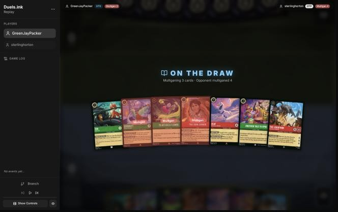
*The board before the decision: [step 0](https://duels.ink/replay/01a1eaf6-93b6-7dbc-82be-9691dfc9e862?step=0) in the duels.ink replay viewer.*

**What you did:** kept Tod, Olaf, Another Tale to Spin and The Leviathan; sent back The Torn Corner, To Wither a
Flower and Stegmutt (drew Strike a Good Match, Max Goof and another Another Tale to Spin).

**Verdict: good play.** The hand had two combo pieces (Olaf, The Leviathan) and none of the engine: no Photo, no
Device. The three sent back are the slowest cards in it: The Torn Corner draws only from a 10-card discard and is free
only when a Photo mills it, To Wither needs damaged targets, and Stegmutt wants items in the discard. Sending them
back raises the chance of a Device by game turn 10 from about 34% to 47%, and of a Device or a Photo from 57% to 73%
(`tools/odds.py hold`, before Tod's and Another Tale's draws), and keeps three inkable cards plus the two diggers.
`tools/mulligan.py` (1,500 deals) gives this keep 9.34 of 10 ink over turns 1–4 against 9.23 for keeping all seven.
[MULL-1](#cite-mull-1); confidence medium-high.

### Turn 2: your turn 1

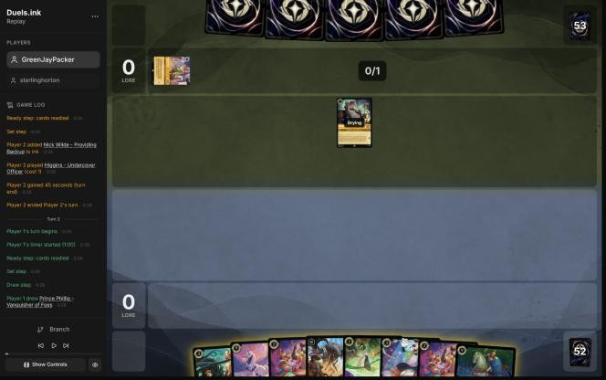
*The board before the decision: [step 6](https://duels.ink/replay/01a1eaf6-93b6-7dbc-82be-9691dfc9e862?step=6) in the duels.ink replay viewer.*

**Setup.** Their turn 1: Higgins, with Nick Wilde – Providing Backup inked. Detectives 99%. You have no 1-drop; the
turn is the ink.

**What you did:** drew Prince Phillip and inked him.

**Verdict: fine.** Phillip is 9 ink to cast, his SWIFT AND SURE wants a Malicious you don't hold, and his 6 {S} is in
Gaston's and Always Vigilant's range; the Device can turn Olaf into him later, but it can turn Olaf into The
Leviathan too, which you already hold. The rest of the hand is draw (Tod, Max Goof, Strike, two Another Tales) or
combo (Olaf, The Leviathan). [INK-2](#cite-ink-2).

### Turn 4: your turn 2

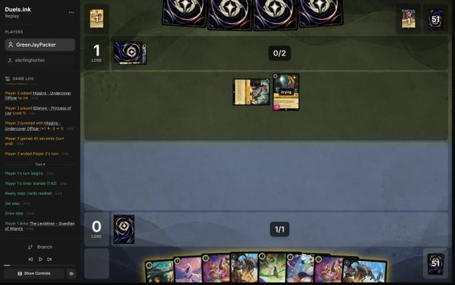
*The board before the decision: [step 15](https://duels.ink/replay/01a1eaf6-93b6-7dbc-82be-9691dfc9e862?step=15) in the duels.ink replay viewer.*

**Setup.** Their turn 3: Besties, Assemble! found **Elisa Maza – Hardworking Detective**, now known in their hand,
and Eilonwy came down beside Higgins. Elisa costs 4; with Higgins in play, FOLLOW THE TRAIL reveals your hand and
discards a non-character card of their choice. They have 2 ink, so 3 next turn and Elisa on game turn 7, unless
something gives them an ink drop. You have 2 ink once you ink, and two copies of the cards you'd cast: Another Tale
to Spin (a card and an ink drop for each player) or Strike a Good Match (two cards, discard one). The engine pieces
you're digging for, a Device or a Photo, are non-character cards: what Elisa takes.

**What you did:** drew the second Leviathan; inked Tod and cast Another Tale to Spin (both players got a drop; you
drew Retro Evolution Device).

**Verdict: inaccuracy (small; confidence: medium-low).** Casting **Another Tale to Spin** is suboptimal because its
drop gives them 4 ink next turn, so Elisa Maza, known in their hand, comes on game turn 5 and sees your hand before you
have the ink to play what you draw. **Inking a Tale and casting Strike a Good Match** is better, for the same 2 ink:
a card more seen (two, discard one, and the discard can be the spare Tale for Olaf's count), and no drop for them, so
Elisa can't come before game turn 7, after your turn 6 has 3 ink to put a Device in play out of her reach. The Tale's
own drop for you is worth less than a turn of safety for the combo. Inking Tod rather than the second Tale is fine:
both are spare. [THREAT-1](#cite-threat-1); [TEMPO-1](#cite-tempo-1).

**In discussion (18 Nov 2026):** you call it a straight misplay, made while still learning the cards. The verdict
stands.

### Turn 6: your turn 3

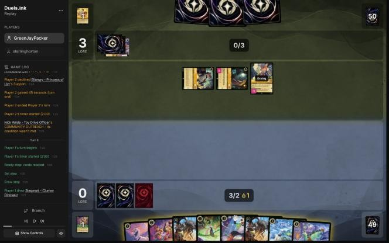
*The board before the decision: [step 24](https://duels.ink/replay/01a1eaf6-93b6-7dbc-82be-9691dfc9e862?step=24) in the duels.ink replay viewer.*

**Setup.** They used the drop for Nick Wilde – Toy Drive Officer (Support; draws if they play two characters in a
turn). Elisa Maza is still known in their hand, and next turn they have 4 ink with Higgins and Nick in play: her
FOLLOW THE TRAIL is close to certain, and it takes the non-character card of their choice from your hand. You drew
Retro Evolution Device last turn, the one engine piece you hold, and you have 4 ink once you ink (3 and the drop).
Candidates:
- **The Device (3)**, so FOLLOW THE TRAIL can only take a song (which then counts for Olaf). Judy Hopps – On the Case
  could still ink it from play (22% after their draw).
- **Max Goof (3), discarding a song** for two cards: a body and card advantage, but the Device stays in hand.
- Strike and Another Tale (4): three cards, two actions for Olaf, a drop for them again, the Device still in hand.

**What you did:** drew Stegmutt and inked him; played Max Goof, discarded Another Tale to Spin and drew Strike a Good
Match and Malicious, Mean, and Scary. One ink unused; the Device stayed in hand.

**Verdict: mistake (confidence: medium).** Keeping the Device in hand is suboptimal because Elisa Maza was known in
their hand and castable next turn with a Detective in play, and the Device is the card she'd most want to take: one of
four, and the only way to turn Olaf into The Leviathan. **Playing the Device** (3 of your 4 ink, inking Stegmutt as you
did) is better: it's out of FOLLOW THE TRAIL's reach, and whatever song she takes goes to your discard and makes Olaf
cheaper. Max Goof's cards can wait a turn; the Device can't. [THREAT-1](#cite-threat-1); the recurring error "ignoring a card known to be
in their hand" ([the decision method's recurring errors](#cite-docs-decision-method-9-the-coach-s-recurring-errors)).

**In discussion (18 Nov 2026):** you didn't know Elisa Maza could take the Device from your hand, and see it as a
weigh-up: in play Judy Hopps – On the Case can take it, in hand Elisa can. The setup above weighed exactly that. On
the Case was about 22% held after their draw; Elisa was known in their hand, with a Detective in play to trigger her.
On those odds play is the safer place, so the verdict stands.

### Turn 8: your turn 4

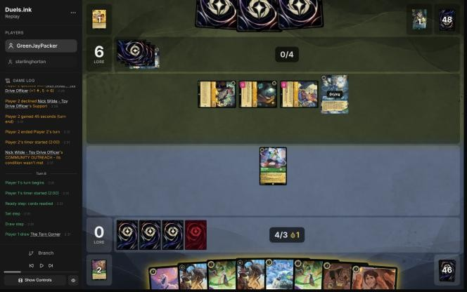
*The board before the decision: [step 39](https://duels.ink/replay/01a1eaf6-93b6-7dbc-82be-9691dfc9e862?step=39) in the duels.ink replay viewer.*

**Setup.** Elisa didn't come on their turn 7: Judy Hopps – Uncovering Clues found **Judy Hopps – Lead Detective**,
now known in their hand with Elisa (Lead Detective Shifts onto Uncovering Clues for 4; their Detectives then get Alert
and Resist +2 on their turn). They're at 6 with four questers, 20 by game turn 15 at this rate. You're at 0 with 5 ink
once you ink, Max Goof dry (he can sing a song of cost 3 or less free), and in hand Olaf (7, two actions in your
discard), two Leviathans, two Strikes, the Device, Malicious, Mean, and Scary and The Torn Corner. Your way back is
The Leviathan: IT'S A MACHINE! kills their whole board today (total {S} 9). It needs the Device in play, Olaf cheap,
and two cards to your discard on the turn. Elisa still threatens whatever non-character you hold. Candidates:
- **A. The Device (3) and a Strike (2); Max sings Malicious:** the Device out of Elisa's reach, Eilonwy (1 willpower,
  a Supporter) dead, the rest damaged, two more actions for Olaf (cost 5). Next turn Max sings the other Strike (two
  cards to the discard), Olaf for about 4, and the Device makes The Leviathan: 5 of 6 ink.
- **B. Draw: Strike, then the second Max Goof discarding a song:** four cards seen, the Device still in hand.

**What you did:** drew The Torn Corner and inked one; cast Strike (drew Max Goof and Stegmutt, discarded Stegmutt),
played the second Max Goof for 3 (2 ink and the drop), discarded the other Strike and drew Strange Things and another
Torn Corner. The first Max Goof neither quested nor sang; the Device and Malicious stayed in hand.

**Verdict: mistake (confidence: medium).** Leaving the Device in hand a second time is suboptimal for the reason given
on [turn 6](#turn-6): Elisa Maza is still known in their hand, with a Detective in play to trigger her. **Line A** is
better: 5 ink (Torn Corner inked; Device 3 + Strike 2), with Malicious free from the Max Goof that sat idle. It kills
Eilonwy, damages the rest, protects the Device, and sets up next turn's Leviathan, which kills their whole board while
you're 6 lore behind. Your line found Strange Things (two of their characters can't quest for a turn) and put four
actions in your discard (Olaf costs 5), which line A matches. [TEMPO-2](#cite-tempo-2); [THREAT-1](#cite-threat-1).

**In discussion (18 Nov 2026):** as on [turn 6](#turn-6): Elisa was still known in their hand. The verdict stands.

### Turn 10: your turn 5

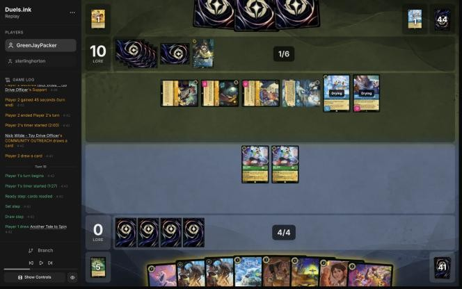
*The board before the decision: [step 61](https://duels.ink/replay/01a1eaf6-93b6-7dbc-82be-9691dfc9e862?step=61) in the duels.ink replay viewer.*

**Setup.** Their turn 9: Uncovering Clues found Darkwing Duck – Drake Mallard (4/1, Ward), Day Camp Instructor came
down, Lead Detective went into their inkwell, and four quests made it 10–0. Six characters quest for 6 a turn: 16
after their next turn and 20 on game turn 13. Elisa is still known in their hand. You have 5 ink once you ink, two dry
Max Goofs (each sings a song of cost 3 or less free), the Device, Olaf (5: four actions in your discard), two
Leviathans, Malicious, Strange Things, The Torn Corner and Another Tale (drawn). The board must go within two turns.
The coach's line: Max sings Malicious (Eilonwy and Darkwing, on 1 willpower, die; Ward doesn't stop it, since nothing
is chosen), the other Max sings Another Tale (its drop makes 6 ink), then Olaf for 3 and the Device: their lore 10 → 8,
and next turn the Device turns Olaf into The Leviathan.

**What you did:** drew Another Tale to Spin; Max Goof sang Malicious (Eilonwy and Darkwing banished, the rest
damaged); inked The Torn Corner, cast Another Tale for 2 (a drop each; drew Strike), played the Device and quested the
other Max Goof for 4.

**Verdict: good play.** Your line beats the coach's. With Malicious and three Tales and two Strikes there, your discard
held six songs, so BRAND-NEW PLAYLIST gave Max Goof +3 lore: a quest for 4, which the coach's plan missed (its line
exerted both Max Goofs to sing). Four lore now against Olaf's 2 off their total, and Olaf stays in hand, out of reach
of a Support-and-Gaston play, with the Device in play out of Elisa's. Next turn has 6 ink and a drop: Olaf (3), the
Device (1) and a Strike (2) to put the two cards in your discard, so The Leviathan arrives with IT'S A MACHINE! live.

### Turn 12: your turn 6

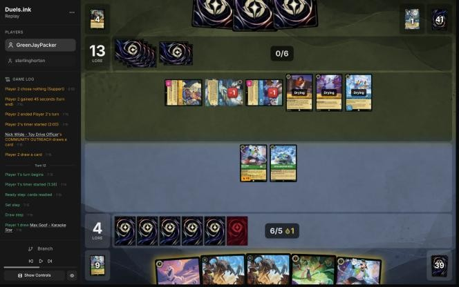
*The board before the decision: [step 84](https://duels.ink/replay/01a1eaf6-93b6-7dbc-82be-9691dfc9e862?step=84) in the duels.ink replay viewer.*

**Setup.** Elisa came on their turn 11 and took Strange Things; Higgins, pumped by Nick's Support, traded with the Max
Goof that had quested; a second Darkwing (Ward) and Judy Hopps – Helpful Officer came down. They're at 13 with six
characters (16 {S}), 20 on game turn 15. Darkwing's Ward keeps him from being chosen, so IT'S A MACHINE! can take 10
{S} of the other five (12). You're at 4 with 7 ink (6 and a drop), the Device in play, Max Goof (+3 lore, a quest for
4) and in hand Olaf (2), two Leviathans, Strike and the third Max Goof you drew. The line: Max Goof from hand
discarding Strike to SWEET REMIX (a card to your discard), Olaf (2 off their lore), the Device turns him into The
Leviathan (the second card), IT'S A MACHINE! on four characters worth 10, and the other Max quests: 6 of your 7 ink.

**What you did:** drew Max Goof; played him, discarded Strike, drew Improvise and Prince Phillip; Olaf for 1 (13 → 11);
the Device turned Olaf into The Leviathan, which banished Uncovering Clues, Day Camp Instructor, Nick Wilde and Elisa
(10 {S}); Max Goof quested for 4 (8–11); inked Phillip and cast Improvise on The Leviathan for its card (Inner
Strength).

**Verdict: good play.** The whole combo on the turn it could first come, in the right order: SWEET REMIX's discard
before Olaf made him cost 1 and counted toward IT'S A MACHINE!, and the four characters chosen were the ones that
matter most (both Supporters that would put The Leviathan in Gaston's range, Uncovering Clues' dig, and Elisa).
Improvise with the spare ink is a card for nothing. What's left of theirs: Darkwing (Ward) and Helpful Officer.

### Turn 14: your turn 7

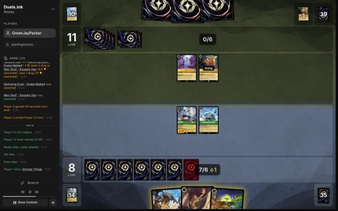
*The board before the decision: [step 105](https://duels.ink/replay/01a1eaf6-93b6-7dbc-82be-9691dfc9e862?step=105) in the duels.ink replay viewer.*

**Setup.** Gaston, found with Besties, Assemble!, banished The Leviathan on their turn 13, and the second Darkwing
traded with the Max Goof that had quested. They're at 11 with Helpful Officer and a drying Gaston (1 lore each); you're
at 8 with a Max Goof that quests for 4, the Device, 7 ink (6 and a drop), and in hand The Leviathan, Inner Strength and
Strange Things. Nothing of yours can turn into The Leviathan now (the Device needs a character of cost 8 or more).
The race: your Max Goof scores 4 a turn, and their next turn has Gaston (3 {S}) to challenge him if he quests.

**What you did:** drew Strange Things; Inner Strength (drew Malicious), Strange Things on Gaston and Helpful Officer
(drew another Max Goof), quested Max Goof for 4 (12–11), inked Malicious and played the new Max Goof.

**Verdict: good play.** Strange Things takes both their quests (2 lore) and draws; the quest is 4 lore now, which
Gaston can only answer by challenging instead of questing. The second Max Goof, a 4-lore quester from next turn, is
worth more than Malicious, which would have killed only Helpful Officer (1 lore, which can't quest this turn anyway).
You're at 12 with a 4-lore quester ready and safe, 20 within two turns if one Max Goof survives each of theirs.

### Turn 16: your turn 8

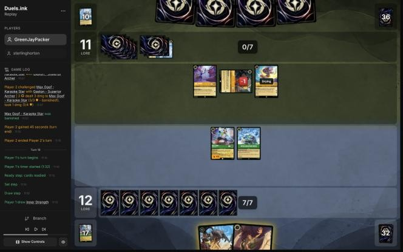
*The board before the decision: [step 119](https://duels.ink/replay/01a1eaf6-93b6-7dbc-82be-9691dfc9e862?step=119) in the duels.ink replay viewer.*

**Setup.** Their turn 15: Stitch – Carefree Surfer (4/8, drew 2), and Gaston killed the Max Goof that had quested.
Strange Things held them at 11. You're at 12 with the second Max Goof ready (a quest for 4), the Device, 7 ink, and in
hand The Leviathan and Inner Strength. 16 after this turn, then 4 more: Max Goof again, if he survives Gaston (3) and
Stitch (4), or other questers. Every body you add is lore and a target they must spend a challenge on.

**What you did:** Inner Strength (drew Tod); Tod (drew Inner Strength and Stegmutt, discarded Stegmutt); Inner Strength
(drew a second Tod); quested Max Goof (16–11). No ink this turn; 2 ink unused, and the second Tod (3) stayed in hand.

**Verdict (revisited 18 Nov 2026): good play (confidence: medium-high).** The first verdict, an inaccuracy, preferred
inking Stegmutt so the second Tod could come down this turn, which meant the first Tod discarding The Leviathan
(discarding the Inner Strength instead loses the draw that found the second Tod). It called The Leviathan dead without
a character of cost 8 or more to banish, and missed that Olaf is one: three were left in your 32 cards, each costing 0
with this many actions in the discard, and the Device was already in play. So The Leviathan in hand was the payoff of
your best out, Olaf into The Leviathan with IT'S A MACHINE! (the brief's needs check: three Olafs, 18% from the draws
alone by your turn 20, before any dig).

Your answer in discussion, keeping the second Tod to dig for Olaf next turn, keeps that out whole. Playing Tod now or
next turn sees the same number of cards by your turn 18; all the first verdict's line gained was a 1-lore body a turn
sooner, for the out's payoff.

### Turn 18: your turn 9

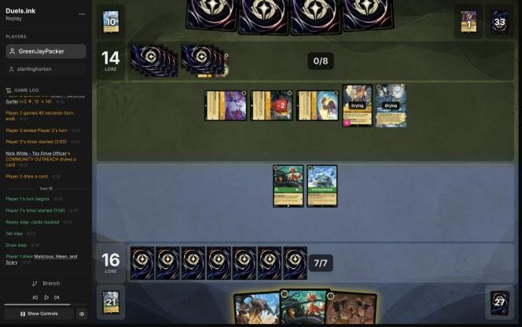
*The board before the decision: [step 136](https://duels.ink/replay/01a1eaf6-93b6-7dbc-82be-9691dfc9e862?step=136) in the duels.ink replay viewer.*

**Setup.** Gaston killed the Max Goof on their turn 17, a second Nick Wilde and Uncovering Clues came down (Elisa found
and known in their hand), and they quested to 14. Their five characters quest for 6: **they win next turn** unless you
reach 20 now (you're at 16, with one Tod to quest) or take at least 1 lore off their board. You have 7 ink (8 if you
ink), the Device, Tod in play, and in hand The Leviathan, a second Tod and Malicious. Two ways through:
- **The combo, if an Olaf turns up:** with this many actions in your discard he costs 0, and the Device then turns him
  into The Leviathan with IT'S A MACHINE! live (Olaf and anything else discarded are the two cards). The second Tod digs
  two cards; with the draw that's about a 31% chance of an Olaf among three (`tools/odds.py hold 27 3 3`).
- **If not, deny their win:** Malicious kills Helpful Officer (1 willpower) and leaves Gaston on 1, which Tod can then
  challenge and kill: their board quests for 4, short of 20.

So: the second Tod first, to see the cards before choosing.

**What you did:** drew Malicious; played the second Tod (drew Olaf and To Wither a Flower, discarded To Wither); Olaf
for 0 (14 → 12); the Device turned him into The Leviathan, which banished Uncovering Clues, Nick Wilde, Gaston and
Helpful Officer (10 {S}); Tod quested (17–12).

**Verdict: good play.** The dig came first, so the choice was made with the most information, and it found the out.
Olaf's 2 lore and IT'S A MACHINE! left them with Stitch alone, 8 lore short. You're at 17 with The Leviathan (3 lore
next turn) and two Tods: 20 next turn unless they remove The Leviathan (Judy Hopps – Always Vigilant or another Gaston:
its 10 {S} is in range) and both Tods.

### Turn 20: your turn 10

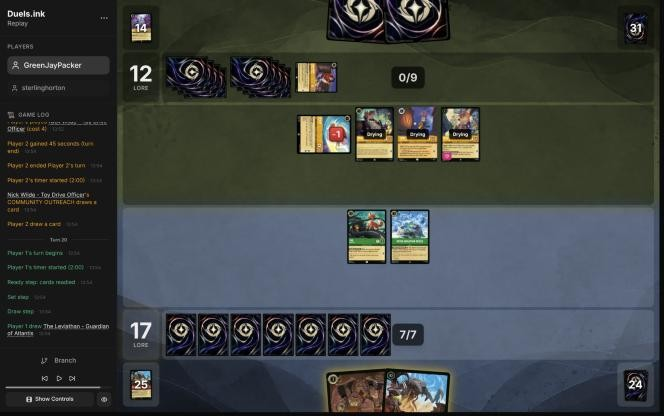
*The board before the decision: [step 154](https://duels.ink/replay/01a1eaf6-93b6-7dbc-82be-9691dfc9e862?step=154) in the duels.ink replay viewer.*

**Setup.** Their turn 19: Stitch killed the exerted Tod, and Judy Hopps – Always Vigilant (with Higgins played first)
banished The Leviathan; Nick Wilde came down again. They're at 12 with four characters questing for 5: 17 next turn,
20 on game turn 23. You're at 17 with one Tod (1 lore a turn), the Device, 7 ink, Malicious and a fourth Leviathan.
Tod's two quests make 19 by your turn 22, one short, so you need to slow them by a turn. The out is the combo again:
an Olaf (two left in your 24 cards) on turn 22, cast for 0, drains 2 and becomes The Leviathan, and IT'S A MACHINE!
can take 10 of their 12 {S} if a second card goes to your discard that turn. Malicious is that second card: with no
character of theirs on 1 willpower, it kills nothing now.

**What you did:** drew The Leviathan; quested Tod (18–12) and cast Malicious (their four characters damaged, none
killed).

**Verdict: inaccuracy (small; confidence: medium).** Casting **Malicious** now is suboptimal because it kills nothing
and spends the card your only out needs: on turn 22, an Olaf from the draw plus Malicious cast that turn would make
IT'S A MACHINE! live. **Questing Tod and holding Malicious** is better. The out is slim either way (an Olaf in the next
draw is about 8%, `tools/odds.py hold 24 2 1`, before any dig), which is why the cost is small.

**In discussion (18 Nov 2026):** Malicious was cast in the hope of setting up Phillip later. Phillip wasn't in hand,
and Malicious was the second card the Olaf out needed, so the verdict stands.

### Turn 22: your turn 11

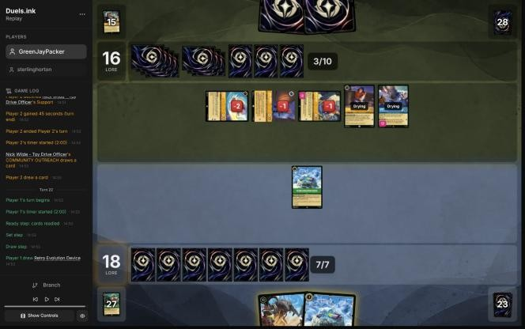
*The board before the decision: [step 166](https://duels.ink/replay/01a1eaf6-93b6-7dbc-82be-9691dfc9e862?step=166) in the duels.ink replay viewer.*

**Setup.** Higgins traded with Tod on their turn 21, Elisa and Day Camp Instructor came down, and they quested to 16.
Their five characters quest for 6. You're at 18 with no character, the Device in play and in hand The Leviathan and
the second Device you just drew. Nothing in reach scores 2 or stops 6 lore: no character to quest, sing or turn into
The Leviathan.

**The game is unwinnable from here** ([principle 2](#cite-principle-2)).

**What you did:** inked the second Device.

**Verdict: fine.** There was nothing else to do.

## Lessons
1. **Against Detectives, put the Device in play as soon as Elisa Maza is known in their hand** ([turns 6](#turn-6),
   [8](#turn-8)). FOLLOW THE TRAIL takes a non-character card of their choice, and the Device is the one card the combo
   can't do without. A song she takes instead goes to your discard and makes Olaf cheaper.
2. **Max Goof – Karaoke Star is a lore engine in this deck** ([turn 10](#turn-10)). Ruby R.E.D. casts and discards
   songs all game; with five in the discard, BRAND-NEW PLAYLIST makes each Max Goof a 4-lore quester. Count your songs
   before choosing whether he sings or quests.
3. **Against Detectives, The Leviathan is a wipe, not a quester** ([turns 12](#turn-12), [18](#turn-18)). Gaston –
   Superior Archer and Judy Hopps – Always Vigilant banish anything with 5 {S} or more, and both answered it the next
   turn. Plan the race's lore from Max Goof, Tods and Olaf's drains.
4. **Dig before you choose, and keep the card the out needs** ([turns 18](#turn-18), [20](#turn-20)).

## Proposed knowledge-base updates (applied after discussion)
- **Meta** (the Amber/Sapphire pair file's notes, sterlinghorton): Detectives with Higgins ×3, Eilonwy, Nick Wilde –
  Providing Backup ×2 (inked), Nick Wilde – Toy Drive Officer ×3, Judy Hopps – Uncovering Clues ×3, Elisa Maza ×3,
  Darkwing Duck – Drake Mallard ×3, Day Camp Instructor ×2, Helpful Officer, Always Vigilant, Lead Detective (inked),
  Gaston, Stitch – Carefree Surfer (off-list), Besties, Assemble! ×2 and The Horseman Strikes! (inked). Uncovering
  Clues and Besties kept finding Detectives and Gaston; both Leviathans died the turn after they landed.
- **Meta** (the Emerald/Ruby pair file's notes, GreenJayPacker's Ruby R.E.D.): Max Goof – Karaoke Star's BRAND-NEW
  PLAYLIST turns on at five songs in the discard, which this deck reaches by mid-game (turn 10 here): a 4-lore quester
  that is often the deck's best lore. Against Detectives, play the Device before Elisa Maza can see it, and expect
  The Leviathan to die to Gaston or Always Vigilant the turn after it lands.

## Hindsight
Doesn't change the verdicts above.
- Elisa didn't come on game turn 7 (they played Uncovering Clues instead). She came on turn 11, after the Device was in
  play, and took Strange Things.
- The game was lost by 2 lore. The flagged lines on turns 16 and 20 were each worth about a lore or a card.

## The coach's errors
Found by the coach during the review; the discussion may add more.

| When | Error | How it was caught | How it won't happen again |
|---|---|---|---|
| Turn 10 | The coach's line had both Max Goofs sing, missing that BRAND-NEW PLAYLIST (in the card text the brief printed) made the dry one's quest worth 4 once Malicious went to the discard | Comparing your line with the coach's | Done in e3a80e0 (17 Nov 2026, with the user's agreement): the brief's options show a character's conditional lore with the count it needs ("quest for 1; +3 with 5 songs in your discard: you have 4, so one song cast first makes it 4") |
| Turns 2–22 | The brief's new LORE BOOSTS line listed Core-legal cards outside their lists (Pocahontas, Promising Lead and others) every turn, most of them noise in a game nowhere near 20 | Reading the briefs | Done in e3a80e0 (17 Nov 2026, with the user's agreement): list boosts outside their lists only when one could decide the race next turn (their lore plus their board's quests within a boost of 20) |
| Turn 16 | The verdict's line discarded The Leviathan as dead ("can't come back without a character of cost 8 or more"), missing Olaf: three in the deck, each costing 0, with the Device in play. It was the payoff of the best out | The player's answer in discussion (18 Nov 2026): the second Tod was kept to dig for Olaf | Done in 8dffb6e (19 Nov 2026, with the user's agreement): the brief's DEVICE LINES list, for each payoff in hand with no base in play, the bases left in your deck, what they cost now and the chance of one by the deadline; and the decision method's recurring errors add "a combo piece written off while its partner can still be drawn" |

## Open questions
All answered by the player in discussion, relayed by danny (18 Nov 2026).
- **[Turns 6](#turn-6) and [8](#turn-8):** you didn't know Elisa could take the Device, and weighed On the Case
  against her. The verdicts stand: Elisa was known in their hand, On the Case about 22%.
- **[Turn 16](#turn-16):** the second Tod was kept to dig for Olaf, your out. That kept The Leviathan, which the
  coach's line would have discarded: revisited to a good play.
- **[Turn 20](#turn-20):** Malicious was a hope of setting up Phillip. The verdict stands.
- **[Turn 4](#turn-4):** a misplay, while learning the cards. The verdict stands.

## Citations
Copies of the coach's knowledge base cited above, as they stood when they were cited (the private repository's commit and date are given with each). They don't change when the knowledge base does.

**emerald-ruby.md, Ruby R.E.D. against danny's Rockstar Aggro: BigShotBob**: knowledge base, `kb/meta/archetypes/emerald-ruby.md` at `7bfafe6` (2026-11-17), working tree

> ### Ruby R.E.D. against danny's Rockstar Aggro: BigShotBob `[coach, meta study of danny's 5–10 Nov 2026 games not studied before (tools/scan.py), full games, not blind, 2 games]`
> - **Game 1** (`01a1b1eb-f331`): danny won 17–0 by concession on game turn 9. Land of the Dead – Marigold Bridge off-list.
> - **Game 3** (`01a1b1f8-4ed8`, danny lost 16–19): **the Leviathan came on game turn 8, their 4th turn**, earlier than the
>   turn 9 noted above. Olaf for 1 (9 → 1 with ABOUT TIME) took 2 lore, Retro Evolution Device turned him into The
>   Leviathan (10 → 0), and IT'S A MACHINE! banished all seven of danny's characters at 15–0. Turn 12: Malicious, then the
>   device turned the Leviathan into Prince Phillip (four kills), and +12 lore that turn; Lyle Tiberius Rourke's DIRTY
>   TRICKS took 1 lore at each of their ends of turn.

**amber-sapphire.md, Detectives: how it plays**: knowledge base, `kb/meta/archetypes/amber-sapphire.md` at `7bfafe6` (2026-11-17), working tree

> ### Detectives: how it plays `[coach, meta study of the user's 27 Oct 2026 games (tools/scan.py), full games, not blind, 8 games]`
> Games: 01a17e45, 01a17e54, 01a17e5d (Sallinhos, best-of-three); 01a17e64, 01a17e75, 01a17e80 (DuckyRv, best-of-three);
> 01a17e9c; 01a17ef8. Card text verified with `tools/cards.py`.
>
> **The plan:** go wide with cheap Detectives, quest wide, and remove your best characters with "banish chosen character
> with 5 {S} or more", **after pumping them with Support**.
>
> - **The key trick: Support onto your characters.** Support adds "their {S} to another chosen character's {S} this turn",
>   and they choose yours. Then Gaston – Superior Archer or a Judy Hopps – Always Vigilant banishes it.
>   - *Examples:* 01a17e54 turn 21 (+2 on Hades, then Gaston); 01a17e5d turn 12 (+2 on Cheshire, then Judy – Always
>     Vigilant); 01a17e45 turn 23 (two Judy – Always Vigilant Shifts in one turn, banishing Cheshire and Merida, both
>     pumped first).
>   - **Support stacks:** a supported character supports with its new {S}. In 01a17e45 turn 15, Judy – Day Camp gave
>     Nick Wilde +2, then Nick gave +4. Treat **any** character of yours as in range once they have Support questers and
>     their removal available.
> - **Pieces:**
>   - **Cheap Detectives:**
>     - Higgins (1)
>     - Judy – Helpful Officer (1; removes 2 damage)
>     - Nick Wilde – Providing Backup (2; Support while they have another Detective)
>     - Judy – Day Camp Instructor (2, uninkable; Support; tops a card into ink if they played another character this turn)
>     - Daisy Duck – Ghost Finder (2, Support)
>     - Eilonwy (1, Support; not a Detective)
>   - **Nick Wilde – Toy Drive Officer** (4, uninkable; Support; draws at the end of a turn they played 2+ characters).
>   - **Removal:**
>     - **Judy Hopps – Always Vigilant** (4, Shift 2 onto any Judy; GOT YOU NOW needs another character played that turn)
>     - **Gaston – Superior Archer** (5)
>     - The Horseman Strikes!
>   - **Fangmeyer – Icy Officer** (5, uninkable, 2 lore): returns a Detective from their discard, usually Judy – Always
>     Vigilant, so the removal repeats.
>   - **Hand disruption:** Elisa Maza (4; with another Detective in play, you reveal your hand and they pick a non-character
>     card to discard) and Mowgli – Man Cub (2; you discard a non-character card). They took Raging Storm and Remember Me.
>   - **Card flow:** Judy – Uncovering Clues (4; searches the top 3 for a Detective on play and on quest).
>   - **Late game:** Judy – Lead Detective (6, Shift 4; Alert and Resist +2 for Detectives on their turn).
> - **Big turns,** from about their 6th turn: wide quests for +5 to +7 (01a17e45 turn 15: five questers; 01a17e9c turn
>   18: +7 after Lead Detective). Removal turns took 3 or 4 characters by mixing banishes with pumped challengers
>   (01a17e45 turn 23, 01a17e5d turn 12, 01a17e80 turn 26). Your locations were challenged down by two Detectives at once.
> - **What to watch for:**
>   - **Count their Support total against your characters' {S}.** Judys in play are Shift 2 targets for Always Vigilant,
>     and Gaston arrives at 5 ink.
>   - **Expect the removal to repeat** while Fangmeyer can return it.
>   - **Play your actions and songs (sweepers especially) early, before Elisa Maza lands.** She needs another Detective in
>     play first. A wide board of small characters is exactly what sweepers punish.

**decision-method.md, 9. The coach's recurring errors**: knowledge base, `docs/decision-method.md` at `7bfafe6` (2026-11-17), working tree

> ## 9. The coach's recurring errors
> From `reviews/calibration.md`. Check yourself against these on every turn.
> - **Treating known knowledge as new.** In 01a19bb9 turn 7 the coach missed Support on an opposing character, then
>   called it a new lesson, though the Detectives notes already described it: it had read only the opponent's
>   archetype notes, never searched for the cards in hand, and never searched before writing the lesson. Read both
>   decks' notes, use the brief's knowledge-base notes on the cards in view, and search before calling anything new.
>   Finding it afterwards is a failure to explain and fix (`.claude/skills/analyse-replay/SKILL.md`, after the blind
>   pass).
> - **Missing Support onto their character for strength-threshold removal.** In 01a19bb9 turn 7 and 01a19c08-7f38 turn 9
>   the coach planned to hold Gaston – Superior Archer or Judy Hopps – Always Vigilant for a natural 5-strength target,
>   and the player found the line instead: quest a Supporter, add its {S} to a small opposing character, then banish
>   it. The brief's "STRENGTH REMOVAL IN HAND, AND WHAT YOUR SUPPORT PUTS IN RANGE" lists those targets on every
>   turn you hold such removal; read it before planning (user, 2026-11-02: "that cannot continue to be missed").
> - **Card text misread or not read.** Go Go Tomago given another card's keywords (01a14bf9). Tramp's "choose one"
>   Rush missed (01a14574 turn 19). Read each card from a single-card source, in full.
> - **Missing what becomes possible at their next ink.** Lead Detective hard-cast at 6 (01a14574 turn 15).
> - **Judging exposure from their board as it stands.** In 01a19bbd-79c2 turn 4 the coach said Pluto and Mike Wazowski,
>   both 0 strength, "couldn't have hurt" an exerted Eilonwy. Pluto's GOOD DOG made Dale – Ready for His Shot (a
>   Princess Aggro tell, seen in game 1) castable with their 3 ink, and his SPIKE SUIT let Mike kill her. Check their
>   next turn's combat tricks and cost reducers for every character you'd exert (section 2; caught by the user,
>   2026-11-02).
> - **Missing archetype staples and their combos.** Prince Phillip after Malicious, Mean, and Scary (01a139ad turn 23).
> - **Missing synergies on their side.** Darkwing in play makes Launchpad's draw discard-free (01a14574 turn 5).
> - **Overstating a risk** without checking what the alternative loses in the same branch (01a14574 turn 15).
> - **Not counting what the coach's own line exposes.** In 01a19c0c turn 20 the coach suggested Shifting in Lead
>   Detective so Darkwing could kill a 1-lore Shadow. Darkwing's challenge would have left him exerted for Wasabi, and
>   TWIN BLADES could then kill the Lead Detective just played. The player held her for the 3-lore Ursula instead, and
>   won with her two turns later. Prevention: the brief's ready-damage line, and "Say what Y exposes" (section 5).
> - **Anchoring on the coach's own plan.** The user's line was better on the mulligan and turns 11 and 19 of 01a14574.
> - **Not reading the archetype's key cards before the game.** Circle of Life's text was never read, so its wipe combo (Prince Phillip replayed from the discard) was missed (01a13b88 turn 8).
> - **Counting one card of a job, and only their draw.** On 01a13b88 turn 18 the review gave a 17% chance they could
>   damage the whole board: Malicious, Mean, and Scary in their hand and draw. Don Karnage – Debonair Pirate does the
>   same on play, and their dig (Meilin Lee, Tod, Akood, Strike) let them see several more cards: about 43%. Use the
>   brief's combined line and `odds.py dig` (section 2).
> - **Overvaluing a ramp plan, and Khan Industries, on the draw against midrange.** The stonks 📈 reviews called deep
>   mulligans on the draw wrong because the hands held Priscilla, Dream Come True and Khan Industries (01a15f93,
>   01a16035, 01a16972). The player explained that Priscilla dies to their early board on the draw and that Khan
>   Industries is a closing play there (section 7, and the Big Ramp notes). Against sweeper Control the reverse holds:
>   Khan Industries is lore their Storms can't reach (danny, 2026-11-02).
> - **Ignoring a card known to be in their hand.** Meilin Lee revealed Circle of Life into their hand; the next turn's wipe was near-certain (01a13b88 turn 18).
> - **Keeping a quester ready for nothing.** Before keeping a character ready, say what waiting gains: a card, a better
>   challenge next turn, or a wipe dodged. If nothing, and it can't quest safely later either, use it now. In 01a1cbca-787d
>   turn 6 the coach's line kept Lilo & Stitch ready as a wall, though Demona – Betrayer meant it could never quest
>   safely; the player's quest into Hamm was better (H-12).
> - **Leaving a ready combo in hand.** When every piece of a line is there (the Device, a character to banish, the ink),
>   the brief's DEVICE LINES and SHIFT NEXT TURN say so; a reason to hold it (a sweeper that can come before it pays off)
>   has to be named, with the ink at which it comes. In 01a1ea7f-cc42 turn 13 The Leviathan stayed in hand with 3 ink spare
>   while Raging Storm couldn't come before game turn 16.

**MULL-1**: strategy principle, `kb/strategy/principles.md` at `7bfafe6` (2026-11-17), working tree

> - **MULL-1. Keep a plan, not the strongest cards.** *Ask: "Which hand gives me the best chance to execute my game plan in this matchup?"* `[MCL ch.12]` · baseline

**INK-2**: strategy principle, `kb/strategy/principles.md` at `7bfafe6` (2026-11-17), working tree

> - **INK-2. Don't automatically ink the most expensive card.** It may be the late-game win condition or the key answer for this matchup. The answer depends on matchup, hand and board. `[MCL ch.4]` · baseline

**THREAT-1**: strategy principle, `kb/strategy/principles.md` at `7bfafe6` (2026-11-17), working tree

> - **THREAT-1. Not every threat needs an answer.** *Ask: "What happens if I don't answer this?"* "Very little" means spend resources elsewhere. "I probably lose" means it's the priority. `[MCL ch.9]` · baseline

**TEMPO-1**: strategy principle, `kb/strategy/principles.md` at `7bfafe6` (2026-11-17), working tree

> - **TEMPO-1. Tempo is how much freedom you leave the opponent, not how fast you play.** A play that forces the opponent to spend their turn answering it has stolen part of their turn. *Ask: "If I play this, what does my opponent have to do next?"* `[MCL ch.1]` · baseline

**TEMPO-2**: strategy principle, `kb/strategy/principles.md` at `7bfafe6` (2026-11-17), working tree

> - **TEMPO-2. Answering an expensive threat with a cheap card is a tempo swing**, and more so if the answer was sung for no ink. Other examples: playing Shift threats before the opponent can answer them, and ramping into several threats in one turn. `[MCL ch.1, ch.7]` · baseline

**INK-3**: strategy principle, `kb/strategy/principles.md` at `7bfafe6` (2026-11-17), working tree

> - **INK-3. Usually ink every turn, but not automatically.** Keeping one more playable card can beat one more ink. Missing ink with an expensive hand can leave you permanently behind. `[MCL ch.4]` · baseline

**principle 2**: coaching principle, `CLAUDE.md` at `7bfafe6` (2026-11-17), working tree

> 2. **Some games are unwinnable.** Draws and matchups can make a game lost whatever the player does. Say so
>    when it's true, rather than inventing mistakes to explain a loss.
