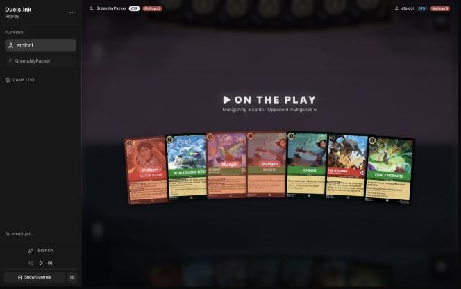
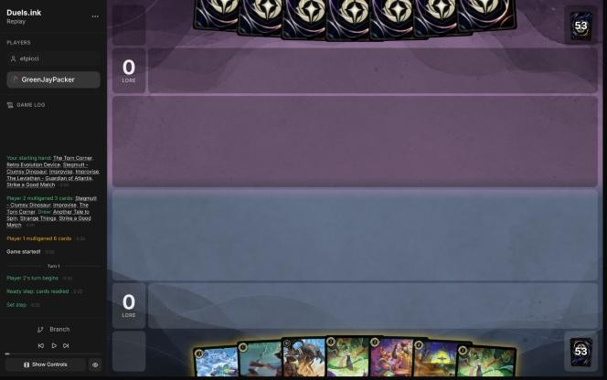
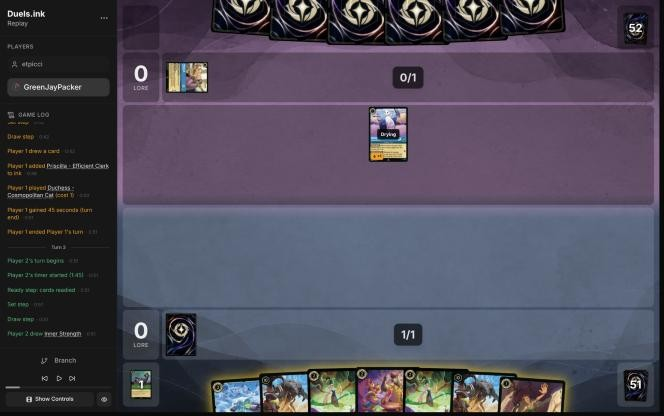
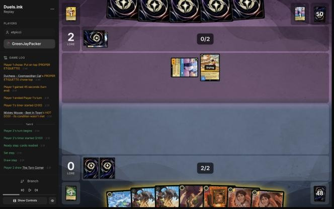
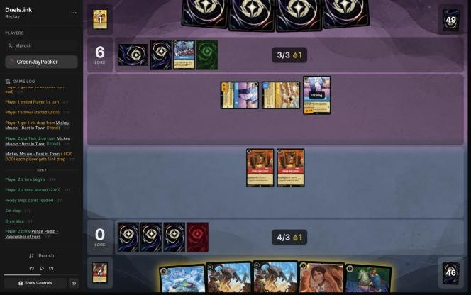
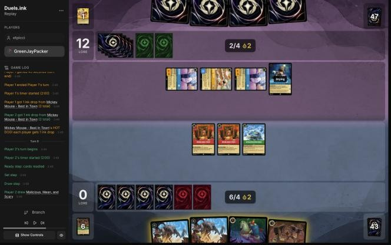
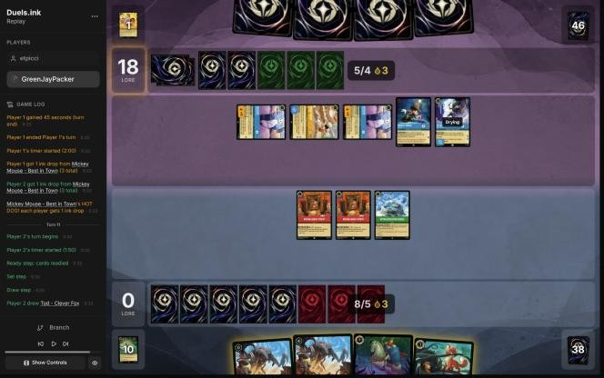

# Review: GreenJayPacker vs etpicci, 17 Nov 2026

| | |
|---|---|
| **Status** | draft (blind pass done, not yet discussed) |
| **Replay** | `01a1eb05-70c1` (`python3 tools/brief.py 01a1eb05-70c1 --turn N`) · [duels.ink viewer](https://duels.ink/replay/01a1eb05-70f2-74bd-9685-1314d7248e98?step=0) |
| **Format** | Core Constructed (stated in the replay). Set 14 era: inks revealed before the coin toss |
| **Decks** | You: Emerald/Ruby Ruby R.E.D. ([the coach's notes on it](#cite-kb-meta-archetypes-emerald-ruby-ruby-r-e-d-against-danny-s-rockstar-aggro-bigshotbob)), the same list as in your games against Itz_Rj and sterlinghorton that day. Them: Amber/Sapphire ([the coach's notes on this pair](#cite-kb-meta-archetypes-amber-sapphire-detectives-how-it-plays)); archetype as it became clear: an **unlisted** Amber/Sapphire list (97% by game turn 9): Duchess – Cosmopolitan Cat, Mickey Mouse – Best in Town and Detective, Splatter Phoenix |
| **Play/draw** | You went first; they mulliganed 6 |
| **Result** | **Loss**, 0–20: they quested to 20 on game turn 12 |
| **Meta data** | snapshot of 12 Nov 2026 (fresh until 26 Nov) |
| **Chosen how** | Sent by danny, the coach's user, as a replay link on 17 Nov with one other game: GreenJayPacker's, reviewed for them. The coach knew nothing of the result. It reviewed GreenJayPacker's games against Itz_Rj and sterlinghorton just before this one |

## Summary
- **Good plays:** [pre-game](#turn-0), [1](#turn-1), [3](#turn-3).
- **Close calls:** [7](#turn-7) (one Photo's mill left unused).
- **Inaccuracies / mistakes / blunders:** none.
- **Unwinnable from:** [9](#turn-9): their board quested for 7 a turn at 12–0, and no Olaf had turned up to make The
  Leviathan.

**What decided it:** their speed against a hand that never found Olaf. Two Duchesses and Mickey Mouse – Best in Town
quested for 6 a turn from game turn 6 and 9 by turn 10, so the combo had to land by turn 9, and the deck showed one Olaf
in that time, milled by a Photo.

## The game, turn by turn
Verdicts judge each decision on what you could know at the time, **including archetype knowledge an experienced
player has**. Hindsight is kept to its own section. Severity scale: good play / close call /
inaccuracy / mistake / blunder. Principle IDs and hypotheses (H-n) link to copies
in the Citations section at the end, as they stood when they were cited.

**What you knew before the game:** they're Amber/Sapphire: Detectives 50%, Control 40%, Control #2 5%, an unlisted
list 6%. You go first, so their turn k comes on game turn 2k with k ink. Their key cards against your plan, with the
earliest game turn each can come (the same cards as in your game against sterlinghorton, a turn later):
- **Judy Hopps – On the Case** (3; with another Detective in play, puts a chosen item into its owner's inkwell): game
  turn 6. It takes a Retro Evolution Device or a Photo from play.
- **Elisa Maza – Hardworking Detective** (4; with another Detective, takes a non-character card of their choice from
  your hand): turn 8.
- **Gaston – Superior Archer** (5) and **Judy Hopps – Always Vigilant** (4): banish a character with 5 {S} or more from
  turn 8–10: The Leviathan, Stegmutt and Phillip, not Olaf.
- **Control:** Let It Go (5) and Hades – Infernal Schemer (7) ink a character; Spooky Sight (6) inks every character of
  cost 3 or less; Raging Storm (8) from game turn 16.

Your plan is the deck's: fill the discard so Olaf is cheap, and turn him into The Leviathan with the Device, IT'S A
MACHINE! live. Against sterlinghorton's Detectives earlier that day, each Leviathan died to Gaston or Always Vigilant
the turn after it landed, and Max Goof's 4-lore quests (five songs in the discard) carried the race.

### Pre-game

*The board before the decision: [step 0](https://duels.ink/replay/01a1eb05-70f2-74bd-9685-1314d7248e98?step=0) in the duels.ink replay viewer.*

**What you did:** sent back Stegmutt, one Improvise and The Torn Corner; kept Retro Evolution Device, The Leviathan,
Improvise and Strike a Good Match (drew Another Tale to Spin, Strange Things and a second Strike).

**Verdict: good play.** The hand held the Device and The Leviathan but no Olaf or Photo, the cards that make the combo
go. The three sent back are the slowest: Stegmutt is 8 ink with no items in your discard, The Torn Corner draws only
from a 10-card discard, and a second Improvise is the weakest cantrip. The four kept are the two combo pieces and the
two cards that dig. `tools/mulligan.py` (1,500 deals) gives keeping all seven 9.03 of 10 ink over turns 1–4, keeping
five 8.11; the ink matters less than finding an Olaf or a Photo (`tools/odds.py hold`: about 65% among the next six
cards for the seven kept, 74% among the next eight with three replaced). [MULL-1](#cite-mull-1); confidence medium.

### Turn 1: your turn 1

*The board before the decision: [step 3](https://duels.ink/replay/01a1eb05-70f2-74bd-9685-1314d7248e98?step=3) in the duels.ink replay viewer.*

**What you did:** inked Strange Things and cast Improvise for its card (The Leviathan).

**Verdict: good play.** On the play there's no draw, so a 1-ink cantrip is a free look for Olaf or a Photo, and an
action in the discard for Olaf's count. Strange Things is the right ink: 4 ink to cast, and the slowest of the songs
kept.

### Turn 3: your turn 2

*The board before the decision: [step 9](https://duels.ink/replay/01a1eb05-70f2-74bd-9685-1314d7248e98?step=9) in the duels.ink replay viewer.*

**Setup.** Their turn 2: Duchess – Cosmopolitan Cat, with Priscilla – Efficient Clerk inked; both are in no listed
list, so an unlisted Amber/Sapphire list is 52%. You have 2 ink once you ink, and in hand the Device, two Leviathans,
two Strikes, Another Tale and Inner Strength: digging for Olaf or a Photo is the turn.

**What you did:** drew Inner Strength; inked a Strike and cast the other (drew Rivera Family Photo and The Torn
Corner, discarded Another Tale to Spin).

**Verdict: good play.** Strike sees two cards for 2 ink and puts two actions in the discard, and it found the Photo.
Discarding Another Tale rather than the second Leviathan is a close choice: the Tale would have been one more cast
action later, but its ink drop helps a deck that ramps (Priscilla), and two Leviathans give two combo turns.

### Turn 5: your turn 3

*The board before the decision: [step 21](https://duels.ink/replay/01a1eb05-70f2-74bd-9685-1314d7248e98?step=21) in the duels.ink replay viewer.*

**Setup.** Their turn 4: Mickey Mouse – Best in Town (2 lore a turn; his HOT DOG gives each player an ink drop when he
ends their turn exerted) and Besties, Assemble! finding a second Duchess. Splatter Phoenix was inked. They're at 2 with
4 lore a turn on the board: 20 by game turn 14 at this rate. The list is unlisted (59%), closest to Control #1. You
have 3 ink once you ink, the Device, two Leviathans, Inner Strength, a Photo and two Torn Corners.

**What you did:** drew a Torn Corner and inked one; Inner Strength (drew a second Photo) and both Photos.

**Verdict: fine.** Two Photos now make two mills a turn from next turn, and the second Torn Corner stays in the deck
to be milled and played free while a Photo is in play. A mill this turn instead of the second Photo would have started
the discard a turn sooner; the difference is small.

### Turn 7: your turn 4

*The board before the decision: [step 33](https://duels.ink/replay/01a1eb05-70f2-74bd-9685-1314d7248e98?step=33) in the duels.ink replay viewer.*

**Setup.** Their turn 6: they quested Duchess and Mickey (6) and played the second Duchess; Sudden Scare (inks one of
your characters) went into their inkwell. Their board now quests for 6 a turn: 12, 18, then 20 on game turn 12. Your
answer is The Leviathan (their three characters have 2 {S} in all), and the missing piece is an Olaf to turn into it
(Phillip, drawn now, costs 9). You have 5 ink once you ink (4 and a drop).

**What you did:** drew Prince Phillip; inked a Torn Corner, played the Device and milled 2 with one Photo (Phillip and
Malicious). One ink unused.

**Verdict: close call.** The Device now leaves next turn free for Olaf the moment one is drawn. The second Photo's mill
(the spare ink) would have added two more cards to the discard: more actions for Olaf's count and a chance at a free
Torn Corner, against the risk of milling an Olaf you need in hand. Either is reasonable.

### Turn 9: your turn 5

*The board before the decision: [step 46](https://duels.ink/replay/01a1eb05-70f2-74bd-9685-1314d7248e98?step=46) in the duels.ink replay viewer.*

**Setup.** Their turn 8: Mickey Mouse – Detective came down (inking their top card), and three quests made 12. Their
four characters quest for 7: 19 next turn, 20 the turn after, sooner with a lore boost. You're at 0 with no character,
6 ink (4 and two drops, and no card to ink but Phillip and the Malicious you drew), the Device and two Photos in play,
and in hand two Leviathans, Prince Phillip (9) and Malicious. Their whole board has 3 {S}, so The Leviathan would wipe
it, but there's no Olaf to turn into it, and Phillip after Malicious (12 ink) is out of reach.

**The game is unwinnable from here** ([principle 2](#cite-principle-2)): the only out is an Olaf drawn on game turn 11 (three left in 39
cards, one draw), and even a wipe then leaves them at 19 against your 0, with a rebuild to make 1 more lore.

**What you did:** drew Malicious; milled 2 with each Photo (Stegmutt, Olaf, a Device, Strike) and inked Malicious.

**Verdict: fine, in a lost game.** The mills fill the discard (ten cards: Photo's lore and The Torn Corner's draw are
live), and inking Malicious brings Phillip closer. Casting it instead would set up a Phillip you can't afford in time.

### Turn 11: your turn 6

*The board before the decision: [step 59](https://duels.ink/replay/01a1eb05-70f2-74bd-9685-1314d7248e98?step=59) in the duels.ink replay viewer.*

**Setup.** They're at 18 with five characters questing for 9, Splatter Phoenix (Ward) among them. The one line that
reaches their next turn: Tod's two cards find an Olaf (three left in 38 cards), Olaf for 3 takes them to 16, and the
Device turns him into The Leviathan, banishing everything but the Warded Phoenix, whose 2 lore leaves them at 18.
Phillip for 9 has no damaged target, and Phillip then the Device is 10 ink, one more than you have.

**What you did:** drew Tod; played him (drew Max Goof and a Leviathan, discarded a Leviathan), played Max Goof and
inked Phillip.

**Verdict: fine, in a lost game.** Tod first was the only dig; it found no Olaf.

## Lessons
1. **Against a fast lore board, the combo has a deadline: count it at the mulligan.** Here their board quested for 6 a
   turn from game turn 6, so The Leviathan had to land by turn 9. A keep that needs two more pieces (Olaf and fuel)
   is a gamble against such a start; the hand kept was the best available, and it missed.
2. **In the last turns of the hunt, only draws find Olaf.** A Photo's mill can put him in the discard ([turn 9](#turn-9)),
   where he's lost; mills fill the discard, draws find the piece.

## Proposed knowledge-base updates (applied after discussion)
- **Meta** (the Amber/Sapphire pair file's notes, etpicci): an unlisted fast list: Duchess – Cosmopolitan Cat ×2
  (2 lore while they have the highest-cost character, even at cost 1), Mickey Mouse – Best in Town, Mickey Mouse –
  Detective, Splatter Phoenix – Rejected Artist ×2 (Ward), Besties, Assemble!, with Priscilla – Efficient Clerk and
  Sudden Scare inked. 6 lore a turn from game turn 6, 9 from turn 10: 20–0 on turn 12. Splatter Phoenix's Ward keeps it
  out of IT'S A MACHINE!'s reach.

## Hindsight
Doesn't change the verdicts above.
- The one Olaf seen before game turn 11 was milled by a Photo on turn 9.

## The coach's errors
Found by the coach during the review; the discussion may add more.

| When | Error | How it was caught | How it won't happen again |
|---|---|---|---|

None found.

## Open questions
- **[Turn 9](#turn-9):** was Malicious inked for a Phillip later, or was the game already called?
- **[Turn 3](#turn-3):** Another Tale or the second Leviathan to Strike's discard: which did you weigh?

## Citations
Copies of the coach's knowledge base cited above, as they stood when they were cited (the private repository's commit and date are given with each). They don't change when the knowledge base does.

**emerald-ruby.md, Ruby R.E.D. against danny's Rockstar Aggro: BigShotBob**: knowledge base, `kb/meta/archetypes/emerald-ruby.md` at `595bb0d` (2026-11-17), working tree

> ### Ruby R.E.D. against danny's Rockstar Aggro: BigShotBob `[coach, meta study of danny's 5–10 Nov 2026 games not studied before (tools/scan.py), full games, not blind, 2 games]`
> - **Game 1** (`01a1b1eb-f331`): danny won 17–0 by concession on game turn 9. Land of the Dead – Marigold Bridge off-list.
> - **Game 3** (`01a1b1f8-4ed8`, danny lost 16–19): **the Leviathan came on game turn 8, their 4th turn**, earlier than the
>   turn 9 noted above. Olaf for 1 (9 → 1 with ABOUT TIME) took 2 lore, Retro Evolution Device turned him into The
>   Leviathan (10 → 0), and IT'S A MACHINE! banished all seven of danny's characters at 15–0. Turn 12: Malicious, then the
>   device turned the Leviathan into Prince Phillip (four kills), and +12 lore that turn; Lyle Tiberius Rourke's DIRTY
>   TRICKS took 1 lore at each of their ends of turn.

**amber-sapphire.md, Detectives: how it plays**: knowledge base, `kb/meta/archetypes/amber-sapphire.md` at `595bb0d` (2026-11-17), working tree

> ### Detectives: how it plays `[coach, meta study of the user's 27 Oct 2026 games (tools/scan.py), full games, not blind, 8 games]`
> Games: 01a17e45, 01a17e54, 01a17e5d (Sallinhos, best-of-three); 01a17e64, 01a17e75, 01a17e80 (DuckyRv, best-of-three);
> 01a17e9c; 01a17ef8. Card text verified with `tools/cards.py`.
>
> **The plan:** go wide with cheap Detectives, quest wide, and remove your best characters with "banish chosen character
> with 5 {S} or more", **after pumping them with Support**.
>
> - **The key trick: Support onto your characters.** Support adds "their {S} to another chosen character's {S} this turn",
>   and they choose yours. Then Gaston – Superior Archer or a Judy Hopps – Always Vigilant banishes it.
>   - *Examples:* 01a17e54 turn 21 (+2 on Hades, then Gaston); 01a17e5d turn 12 (+2 on Cheshire, then Judy – Always
>     Vigilant); 01a17e45 turn 23 (two Judy – Always Vigilant Shifts in one turn, banishing Cheshire and Merida, both
>     pumped first).
>   - **Support stacks:** a supported character supports with its new {S}. In 01a17e45 turn 15, Judy – Day Camp gave
>     Nick Wilde +2, then Nick gave +4. Treat **any** character of yours as in range once they have Support questers and
>     their removal available.
> - **Pieces:**
>   - **Cheap Detectives:**
>     - Higgins (1)
>     - Judy – Helpful Officer (1; removes 2 damage)
>     - Nick Wilde – Providing Backup (2; Support while they have another Detective)
>     - Judy – Day Camp Instructor (2, uninkable; Support; tops a card into ink if they played another character this turn)
>     - Daisy Duck – Ghost Finder (2, Support)
>     - Eilonwy (1, Support; not a Detective)
>   - **Nick Wilde – Toy Drive Officer** (4, uninkable; Support; draws at the end of a turn they played 2+ characters).
>   - **Removal:**
>     - **Judy Hopps – Always Vigilant** (4, Shift 2 onto any Judy; GOT YOU NOW needs another character played that turn)
>     - **Gaston – Superior Archer** (5)
>     - The Horseman Strikes!
>   - **Fangmeyer – Icy Officer** (5, uninkable, 2 lore): returns a Detective from their discard, usually Judy – Always
>     Vigilant, so the removal repeats.
>   - **Hand disruption:** Elisa Maza (4; with another Detective in play, you reveal your hand and they pick a non-character
>     card to discard) and Mowgli – Man Cub (2; you discard a non-character card). They took Raging Storm and Remember Me.
>   - **Card flow:** Judy – Uncovering Clues (4; searches the top 3 for a Detective on play and on quest).
>   - **Late game:** Judy – Lead Detective (6, Shift 4; Alert and Resist +2 for Detectives on their turn).
> - **Big turns,** from about their 6th turn: wide quests for +5 to +7 (01a17e45 turn 15: five questers; 01a17e9c turn
>   18: +7 after Lead Detective). Removal turns took 3 or 4 characters by mixing banishes with pumped challengers
>   (01a17e45 turn 23, 01a17e5d turn 12, 01a17e80 turn 26). Your locations were challenged down by two Detectives at once.
> - **What to watch for:**
>   - **Count their Support total against your characters' {S}.** Judys in play are Shift 2 targets for Always Vigilant,
>     and Gaston arrives at 5 ink.
>   - **Expect the removal to repeat** while Fangmeyer can return it.
>   - **Play your actions and songs (sweepers especially) early, before Elisa Maza lands.** She needs another Detective in
>     play first. A wide board of small characters is exactly what sweepers punish.

**MULL-1**: strategy principle, `kb/strategy/principles.md` at `595bb0d` (2026-11-17), working tree

> - **MULL-1. Keep a plan, not the strongest cards.** *Ask: "Which hand gives me the best chance to execute my game plan in this matchup?"* `[MCL ch.12]` · baseline

**principle 2**: coaching principle, `CLAUDE.md` at `595bb0d` (2026-11-17), working tree

> 2. **Some games are unwinnable.** Draws and matchups can make a game lost whatever the player does. Say so
>    when it's true, rather than inventing mistakes to explain a loss.
