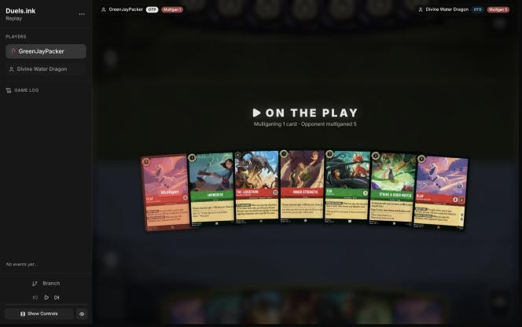
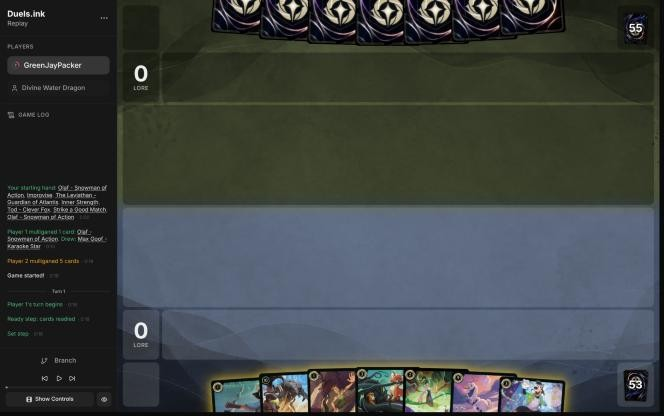
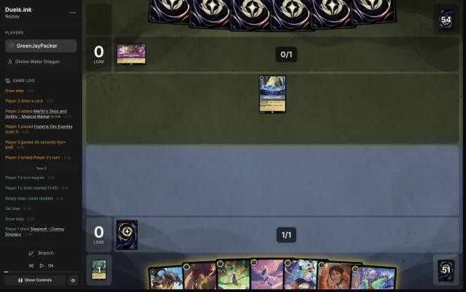
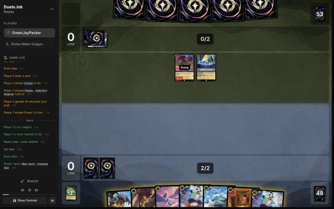
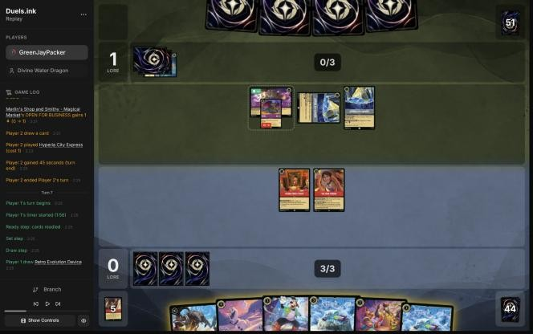
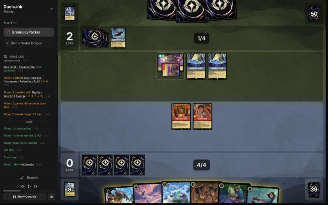
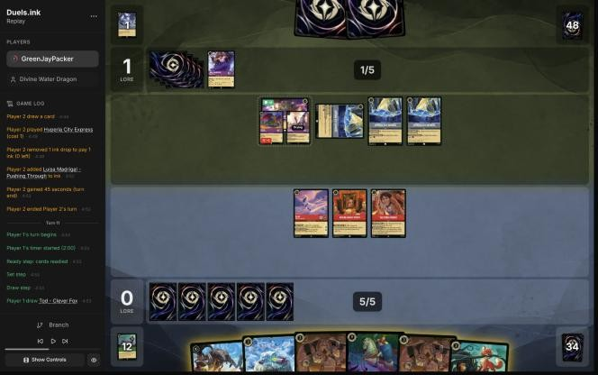
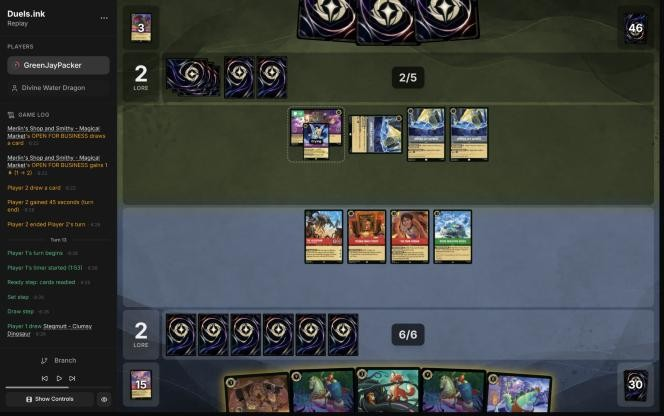
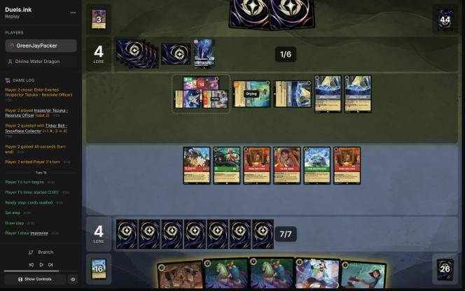
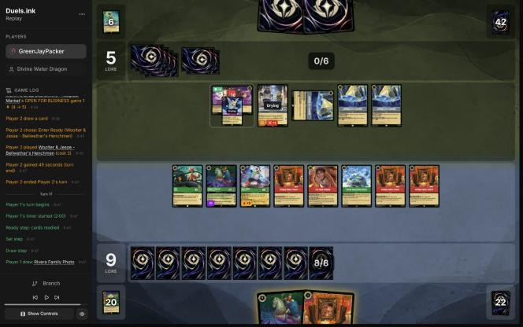

# Review: GreenJayPacker vs Divine Water Dragon, 17 Nov 2026

| | |
|---|---|
| **Status** | discussed 18 Nov 2026 (the player's answers to the open questions, relayed by danny); one question waits for danny |
| **Replay** | `01a1eb0c-446c` (`python3 tools/brief.py 01a1eb0c-446c --turn N`) · [duels.ink viewer](https://duels.ink/replay/01a1eb0c-4487-7b81-a42b-b4212a665c3a?step=0) |
| **Format** | Core Constructed (stated in the replay). Set 14 era: inks revealed before the coin toss |
| **Decks** | You: Emerald/Ruby Ruby R.E.D. ([the coach's notes on it](#cite-kb-meta-archetypes-emerald-ruby-ruby-r-e-d-against-danny-s-rockstar-aggro-bigshotbob)), the list from your games against Itz_Rj, sterlinghorton and etpicci that day. Them: Amethyst/Steel ([the coach's notes on this pair](#cite-kb-meta-archetypes-amethyst-steel-a-merlin-and-shop-variant-unlisted)); archetype as it became clear: an **unlisted** Amethyst/Steel list (99% by game turn 15): Merlin's Shop and Smithy moved into by three Hyperia City Expresses, Smash, Bodyguards (Woolter & Jesse, Inspector Tezuka, The Headless Horseman), Tinker Bell – Snowflake Collector |
| **Play/draw** | You went first (your choice); you sent back one card, they mulliganed five |
| **Result** | **Win**, 20–5 on game turn 17 |
| **Meta data** | snapshot of 12 Nov 2026 (fresh until 26 Nov) |
| **Chosen how** | Sent by danny, the coach's user, as a replay link on 17 Nov with one other game: GreenJayPacker's, reviewed for them. The coach knew nothing of the result. It reviewed GreenJayPacker's games against Itz_Rj, sterlinghorton and etpicci just before this one |

## Summary
- **Good plays:** [3](#turn-3), [5](#turn-5), [11](#turn-11) (the combo, Olaf's quest first), [15](#turn-15) (Tod
  sang Malicious, The Leviathan quested, then became Phillip and wiped their board), [17](#turn-17).
- **Close calls:** [pre-game](#turn-0) (one Olaf sent back), [13](#turn-13) (The Leviathan challenged the
  Shop, 10 damage to its 12 {W}, to finish it next turn: revisited in discussion from a mistake).
- **Inaccuracies / mistakes / blunders:**
  - **Mistake, [9](#turn-9):** Olaf played a turn before the Device could turn him into anything, and left in play
    through their turn.
  - **Inaccuracy, [7](#turn-7):** Max Goof before the Device made the turn-9 combo depend on him surviving.

**What decided it:** two board wipes their deck of cheap bodies couldn't answer. The Leviathan banished Pepita and Merlin
on turn 11, and on turn 15 it quested and became Phillip, whose SWIFT AND SURE took their three new characters after
Malicious. Max Goof (4 lore with seven songs in the discard) and four Photos then made 11 lore on turn 17. The flagged
turns cost time and lore, not the game: their deck had little to punish them with.

## The game, turn by turn
Verdicts judge each decision on what you could know at the time, **including archetype knowledge an experienced
player has**. Hindsight is kept to its own section. Severity scale: good play / close call /
inaccuracy / mistake / blunder. Principle IDs and hypotheses (H-n) link to copies
in the Citations section at the end, as they stood when they were cited.

**What you knew before the game:** they're Amethyst/Steel: Midrange 49%, an unlisted list 48%, PS Inkbonk 3%. You go
first, so their turn k comes on game turn 2k with k ink. Their key cards against your plan, with the earliest game turn
each can come:
- **Peter Pan's Shadow – Elusive Prankster** (3; exerts a chosen opposing character) and **Strength of a Raging Fire**
  (3, a song: damage equal to the characters they have in play, sung free by a cost-3 character): game turn 6. With
  four characters in play, Strength kills Olaf (4 {W}).
- **Shere Khan – Khan Industries CEO** (4; NEW INCENTIVE lets a character challenge ready characters), **Angel –
  Experiment 624** (4; GOOD AIM: discard a card for 2 damage), **Dumbo – Ninth Wonder** (4; Evasive, {E} and 1 ink: a
  card and a lore) and **Tinker Bell – Giant Fairy** (Shift 4 onto Curious Fairy; 1 damage to each of yours): turn 8.
- **Hades – Looking for a Deal** (5; you bottom a character of yours they choose, or they draw 2): turn 10. Against The
  Leviathan it's your choice: lose it, or give them two cards.
- **Demona – Scourge of the Wyvern Clan** (6; exerts all your characters, then refills hands to 3): turn 12.
- **Flash – Efficient Clerk** (2): no Rush for anyone, which doesn't touch your plan.

Their board is cheap bodies (1–3 cost, 1–3 {S}), so IT'S A MACHINE!'s total of 10 {S} kills three or four of them, and
Malicious, Mean, and Scary with To Wither a Flower kills the small ones (the pair's notes: three or four kills on game
turn 7, twice, against danny's own Amethyst/Steel list). The Leviathan's 10 {W} is out of reach of Strength and of any
single challenger; Hades is their clean answer, and Demona then a group of challengers the slow one.

Your plan is the deck's: fill the discard so Olaf is cheap, and turn him into The Leviathan with Retro Evolution Device
(TURN INTO DINOSAUR: {E}, 1 ink and banish your character: play one costing up to 2 more for free), with IT'S A
MACHINE! live (2 cards put into your discard that turn; the banished Olaf is one).

### Pre-game

*The board before the decision: [step 0](https://duels.ink/replay/01a1eb0c-4487-7b81-a42b-b4212a665c3a?step=0) in the duels.ink replay viewer.*

**Your hand:** Olaf – Snowman of Action ×2, The Leviathan, Tod – Clever Fox, Strike a Good Match, Improvise, Inner
Strength.

**Setup:** two of the combo's three pieces (Olaf and The Leviathan), and four cheap cards that dig and fill the discard.
The missing piece is a Device (four in 53 cards). The candidates:
- **Keep all seven.** By your turn 4 (game turn 7) you see about nine more cards (three draws, and the cantrips: Improvise,
  Inner Strength, Strike's two and Tod's two): `tools/odds.py hold` gives 54% for a Device among them.
- **Send one Olaf back:** one more look (58%), but it costs the second Olaf, a backup starter that drains 2 lore on its
  own and is ink.
- **Send The Leviathan back:** no. It's uninkable, which usually makes a card the first to go, but here it's the
  payoff.

`tools/mulligan.py` (1,500 deals, ink only, blind to the combo): keeping all seven 9.00 of 10 ink over turns 1–4, sending
one Olaf back 9.62, sending The Leviathan back 8.53. The pick: **keep all seven**; the second Olaf's 4-point gain in
Device odds isn't worth the backup.

**What you did:** sent back one Olaf (drew Max Goof – Karaoke Star). They mulliganed five.

**Verdict: close call.** Your line is as good as the coach's. A random card from this deck (a Photo, a Torn Corner, a
Device, Max Goof) is on average worth more early than a second 9-cost Olaf, and it's one more look for the Device. The
second Olaf's case is as a backup for when Hades bottoms or removal kills the first. Neither is clearly better.
[MULL-1](#cite-mull-1); confidence medium.

### Turn 1: your turn 1

*The board before the decision: [step 3](https://duels.ink/replay/01a1eb0c-4487-7b81-a42b-b4212a665c3a?step=3) in the duels.ink replay viewer.*

**Setup.** On the play, no draw. In hand: Olaf, The Leviathan, Tod, Max Goof, Strike, Improvise and Inner Strength. One
ink and a 1-ink cantrip is the turn: a free look for the Device and an action in the discard for Olaf's count. Which
card to ink: Olaf and The Leviathan are combo pieces, and Max Goof is the deck's lore engine once five songs are in the
discard. The coach's pick: ink one cantrip and cast the other, keeping Tod and Max Goof for game turns 5 and 7.

**What you did:** inked Tod and cast Improvise (drew The Torn Corner).

**Verdict: fine.** Inking Tod rather than Inner Strength gives up a 3-ink "draw 2, discard 1" for a 1-ink "draw 1" that
is also an action for Olaf. Both are dig, and the cheaper one fits the next turns' ink better. A close choice either
way.

### Turn 3: your turn 2

*The board before the decision: [step 9](https://duels.ink/replay/01a1eb0c-4487-7b81-a42b-b4212a665c3a?step=9) in the duels.ink replay viewer.*

**Setup.** Their turn 2: Merlin's Shop and Smithy inked, Hyperia City Express played (an item that moves a character to
a location for free). The Express is in no listed list, so an unlisted list is 70%; the pair's notes have Merlin and
Shop variants (InkModeOn, Mauix) that gain lore and cards from moves to the Shop. You have 2 ink once you ink. Strike (2)
sees two cards and puts two in the discard (a song, which counts for Max Goof, and an action, which counts for Olaf);
Inner Strength leaves an ink unused. Keeping Strike for Max Goof's SWEET REMIX would give two cards on turn 5 but waste
an ink now. The coach's pick: ink Stegmutt (an 8-cost Device base that's slow without items in the discard) and cast
Strike.

**What you did:** drew Stegmutt; inked it and cast Strike (drew Retro Evolution Device and Rivera Family Photo,
discarded The Torn Corner).

**Verdict: good play.** The coach's line, and it found the Device. Discarding The Torn Corner keeps both new pieces, and
an item in the discard makes Stegmutt a card cheaper.

### Turn 5: your turn 3

*The board before the decision: [step 16](https://duels.ink/replay/01a1eb0c-4487-7b81-a42b-b4212a665c3a?step=16) in the duels.ink replay viewer.*

**Setup.** Their turn 4: Pepita – Watchful Alebrije (2/3, Challenger +2), with Smash (3 damage to a character) inked;
Smash is in no listed list either, so an unlisted list is 78%. You have 3 ink once you ink, and all three combo pieces:
Olaf, the Device and The Leviathan. The combo turn needs Olaf (9 less one per action in your discard: 7 now), 1 ink for
the Device, and a second card into your discard that turn (the banished Olaf is the first). So the race is to get
actions into the discard. The candidates:
- **The Photo, its mill, and Inner Strength** (3 ink): the engine starts now, and three or more cards go to the discard.
  The Device comes next turn with a fourth ink.
- **The Device** (3): it's in play a turn earlier, but the Photo mills one turn less before the combo turn.
- **Max Goof** (3): a 1-lore body, but with no song in hand SWEET REMIX draws nothing.

The coach's pick is the first: on game turn 9 (5 ink), the Photo's mill (1), Olaf at 3 or less (six actions in the
discard) and the Device (1) make the combo, and the Photo's extra mill gets there sooner. Ink the second Max Goof.

**What you did:** drew a second Max Goof and inked it; played Max Goof and took it back; then cast Inner Strength (drew
Another Tale to Spin), played the Photo and milled The Torn Corner and Inner Strength, and The Torn Corner's MEND THE
PHOTO played it free.

**Verdict: good play.** The coach's line, and the undo was right: Max Goof with no song to discard was the weakest of the
three. The discard now holds three actions (Olaf costs 6) and an engine is in play.

### Turn 7: your turn 4

*The board before the decision: [step 36](https://duels.ink/replay/01a1eb0c-4487-7b81-a42b-b4212a665c3a?step=36) in the duels.ink replay viewer.*

**Setup.** Their turn 6: the Shop played and a second Express; the Express moved Pepita to the Shop (a card and 1 lore:
1–0), and The Headless Horseman – Relentless Spirit (4, 4/4, Bodyguard) was inked. Their clock is slow: 1 a turn from
Pepita's quest or a Shop move. Their answers to come: Smash (3 damage; one inked), Strength, Shere Khan's NEW INCENTIVE
(a character challenges a ready one) from game turn 8, Hades from turn 10. You have 4 ink once you ink, and the discard
holds four actions (Olaf costs 5). The question is how to make the combo certain on game turn 9 (5 ink):
- **The Device and the Photo's mill** (4): Olaf then costs 9 less the actions in the discard (at most 5, less whatever
  the mill finds), and next turn the Photo's mill (1) puts two cards into the discard, Olaf costs at most 3 if the two
  mills find two actions (`tools/odds.py hold`: 62%), and the Device fires (1). If they don't, Another Tale (2, with
  its ink drop paying 1) adds an action.
- **Max Goof** (3), discarding Another Tale to draw 2: two cards and a body, but the Device then costs 3 of next turn's 5
  ink.

The coach's pick is the Device and the mill; ink the second Device (it stays in play after use, so a second copy adds
nothing).

**What you did:** drew the second Device and inked it; milled two To Wither a Flowers with the Photo (six actions in the
discard: Olaf costs 3); then played Max Goof, discarding Another Tale (drew Malicious, Mean, and Scary and Prince
Phillip – Vanquisher of Foes).

**Verdict: inaccuracy.** After the mill, the Device was the stronger play. Playing **Max Goof** is suboptimal because it
leaves the Device to cost 3 next turn, so with 5 ink Olaf (2) and the Device's 1 don't fit unless Max Goof can sing a
free song (Strike, Another Tale or Malicious: `tools/odds.py hold` gives 57% to find one among his two draws and next
turn's) and survives their turn (Smash, or Shere Khan with Pepita, kills him). Playing **the Device** is better because
the combo is then certain on game turn 9: Olaf (3), the Device (1) and the Photo's mill (1), with Max Goof and the Tale
still in hand. Max Goof's two cards and his body are real gains, so it's an inaccuracy, not a mistake. As it fell, his
draws found Malicious, which keeps the turn-9 combo alive if he lives. [SEQ-4](#cite-seq-4), [WIN-2](#cite-win-2); confidence medium.

**In discussion (18 Nov 2026):** you chose Max Goof's draw over the Device because, not knowing their deck, the Device
in play looked exposed to item removal, and Max Goof singing next turn would make the mill unnecessary. **You've asked
danny whether he agrees.** The coach's view, for him to weigh: the free song was counted in the verdict (57% to find
one, with Max Goof needing to survive Smash or Shere Khan with Pepita). On item removal, duels.ink's Amethyst/Steel
lists run none. Steel's Core-legal cards that banish an item are Benja – Guardian of the Dragon Gem, Mulan – Created
by the Vine, Donald Duck – Along for the Ride and Pluto – Steel Champion (lorcana-api, which covers Sets 9–13, not Set
14); of those, only Pluto has turned up in an Amethyst/Steel list the coach has seen (one removal-heavy variant). So
the Device was safer in play than Max Goof, and the verdict stands until danny answers.

### Turn 9: your turn 5

*The board before the decision: [step 48](https://duels.ink/replay/01a1eb0c-4487-7b81-a42b-b4212a665c3a?step=48) in the duels.ink replay viewer.*

**Setup.** Their turn 8: a second Smash killed Max Goof, a second Headless Horseman was inked, and Pepita quested (2–0).
Their board is Pepita alone, at the Shop, and they hold three cards. You drew Improvise; in hand are Olaf (costs 2: seven
actions in the discard), the Device, The Leviathan, Prince Phillip, Malicious and Improvise, and you have 5 ink once
you ink. **The combo doesn't fit this turn:** the Device (3), Olaf (2) and the Device's 1 make 6. So this turn sets up
game turn 11 (6 ink). Their answers on turn 10 (5 ink), if Olaf is in play: Peter Pan's Shadow (exert him) or Shere Khan
(challenge him ready) with Pepita's 4 {S} while challenging kills him; Smash with Strength kills him; Hades makes you
bottom him or give them two cards. The candidates:
- **The Device, the Photo's mill and The Torn Corner's draw** (5; the mill takes the discard past ten), Olaf kept in hand.
  Next turn: Malicious cast (3), Olaf (1 or less), the Device (1), with ink to spare: Phillip after Malicious banishes
  every damaged character, or The Leviathan banishes up to 10 {S}. Nothing of yours is in play for them to answer.
- **Olaf now** (2; they lose 2 lore) with the Photo, The Torn Corner and Improvise: next turn Olaf can sing Malicious
  for free, then the Device (3 and 1) turns him into Phillip. But Olaf, the base, sits in play through their turn.

The coach's pick is the first. Ink Improvise (Olaf is already cheap enough) to keep both Malicious and Phillip.

**What you did:** played Olaf (they lost 2 lore: 2–0 became 0–0); milled two Another Tale to Spins with the Photo,
drew The Torn Corner with The Torn Corner and inked it; cast Improvise on Olaf (drew a second Malicious).

**Verdict: mistake.** Playing **Olaf** this turn is suboptimal because it puts the combo's base in play a turn early,
where Peter Pan's Shadow or Shere Khan with Pepita, Smash with Strength, or Hades can take him, and the Device still
has to come down next turn; losing Olaf leaves no cheap base (the other three Olafs are in the deck, and Phillip costs
9 on his own). Playing **the Device** with the Photo and The Torn Corner is better because next turn's combo is then
certain (Malicious, Olaf and the Device's 1 make 5 of your 6 ink) and nothing of yours is exposed. The 2 lore Olaf takes
is the same either way: they'll have at least 2 by turn 11. [SEQ-4](#cite-seq-4); confidence medium-high.

**In discussion (18 Nov 2026):** the idea was Olaf's lore drain; knowing the deck better now, you'd play the Device
first. The verdict stands.

### Turn 11: your turn 6

*The board before the decision: [step 65](https://duels.ink/replay/01a1eb0c-4487-7b81-a42b-b4212a665c3a?step=65) in the duels.ink replay viewer.*

**Setup.** Their turn 10: Merlin – Profoundly Curious (2/3/2; an ink drop on play, a card each quest), moved to the Shop
(a card and 1 lore: 1–0); a third Express; Luisa Madrigal inked. Olaf survived. Their board: Pepita and Merlin, 4 {S}
in all; they hold two cards. You drew Tod; you have 6 ink once you ink, Olaf is dry, and the Device, The Leviathan,
Phillip and two Malicious are in hand. The combo fits with room to spare. The choices:
- **Olaf quests first** (2 lore), then the Device banishes him, exerted: the quest is free.
- **The second card into the discard:** the Photo's mill (1) rather than Olaf singing Malicious, which would cost his
  quest. With 4 {S} on their board, IT'S A MACHINE! takes both; Malicious and Phillip aren't needed.
- **The Leviathan, not Phillip:** it's uninkable and needs a base, while Phillip can be inked or cast for 9 later. And
  10 {W} is out of reach of Smash and any challenge they can make.

The coach's line: ink a Malicious; the Device (3), Olaf quests, the Photo's mill (1), the Device (1) makes Olaf The
Leviathan, banishing Pepita and Merlin; The Torn Corner draws with the last ink.

**What you did:** drew Tod; played the Device; quested with Olaf (2–1); milled Malicious and Improvise with the Photo;
turned Olaf into The Leviathan, which banished Merlin and Pepita; inked a Malicious and drew Prince Phillip with The
Torn Corner.

**Verdict: good play.** The coach's line, quest included. Their board is empty, you lead 2–1, and The Leviathan quests
for 3 from next turn. Their outs are Hades (bottom it, or you give them two cards) and rebuilding faster than it quests.

### Turn 13: your turn 7

*The board before the decision: [step 84](https://duels.ink/replay/01a1eb0c-4487-7b81-a42b-b4212a665c3a?step=84) in the duels.ink replay viewer.*

**Setup.** Their turn 12: Tinker Bell – Snowflake Collector (3/3/1; Evasive while they hold four or more cards, +3 {L}
at seven or more), moved to the Shop (a card and 1 lore: 2–2). They hold three cards. You drew Stegmutt; you have 7 ink
once you ink, and The Leviathan is dry. Nothing of theirs can hurt The Leviathan: Tinker Bell has 3 {S}, Smash deals 3,
and Hades (5) is their one clean answer (bottom it, or give them two cards). The Shop has 12 {W} (6, and 2 from each of
three Expresses), so The Leviathan's 10 doesn't banish it. The candidates:
- **The Leviathan quests (3), Tod (3), the Photo's lore (1) and The Torn Corner (1):** 6–2, two cards, and Stegmutt
  next turn.
- **The Leviathan quests and Stegmutt (7 of 8 less one item in the discard):** 5–2 and a second big quester, but no
  cards.

The coach's pick is the first; ink the second Phillip or Stegmutt.

**What you did:** drew Stegmutt and inked it; played Tod (drew Rivera Family Photo and Retro Evolution Device, discarded
the Device); played the second Photo; **challenged Merlin's Shop and Smithy with The Leviathan** (10 damage; it has 12
{W} and survived); gained 1 lore with each Photo (4–2) and drew Max Goof with The Torn Corner.

**Verdict (revisited 18 Nov 2026): close call (confidence: medium).** The first verdict, a mistake, valued the Shop at
a card and a lore only on turns they move a new character there, and counted finishing it as another 3 lore. Your
answer in discussion, that you meant to finish it next turn and that a second Shop lets one character move between the
two each turn, made the coach weigh what it left out:

- **The Shop was their engine:** a card and a lore on three of their four turns since it landed (Pepita, Merlin,
  Tinker Bell), and [the knowledge base already said](#cite-kb-cards-merlins-shop-and-smithy-magical-market-in-play)
  that a second Shop doubles it. One Shop had been inked, and their list's count was unknown.
- **With three Expresses one challenge can't banish it** (12 {W} against 10). Damage stays, so a kill takes two turns
  whenever it's made, and the finish needs only 2 damage: The Leviathan again, or Tod with an Improvise or Inner
  Strength.
- **Against that, the race was yours:** 2–2 with The Leviathan questing for 3 and nothing of theirs able to touch it,
  so each quest given up is a turn longer for them to find Hades (24% after their draw).

Killing the Shop costs about 4 to 6 lore over two turns and takes a card and a lore a turn from them, more with a
second Shop. With the lead you had, the two lines come out about level. [QC-1](#cite-qc-1), [TRADE-4](#cite-trade-4).

### Turn 15: your turn 8

*The board before the decision: [step 105](https://duels.ink/replay/01a1eb0c-4487-7b81-a42b-b4212a665c3a?step=105) in the duels.ink replay viewer.*

**Setup.** Their turn 14: Woolter & Jesse (4/4, Bodyguard, Challenger +2) and Inspector Tezuka (2/3, Bodyguard) both
entered exerted; Woolter & Jesse moved to the Shop (a card and 1 lore); Hades was inked; Tinker Bell quested (4–4). They
hold two cards. You drew Improvise; you have 8 ink once you ink. Max Goof is now a 4-lore quester: seven songs are in
your discard. **The threat:** next turn their three characters together deal 3 + 6 + 2 = 11 to an exerted Leviathan
(each dies to its 10 back), or Strength, sung free by Tinker Bell or Woolter & Jesse, deals 3 and two of them finish it.
The two lines:
- **The wipe:** Tod sings Malicious (1 damage on each of their characters); The Leviathan quests first, then the Device
  turns it into Phillip, whose SWIFT AND SURE banishes all three. Then Max Goof and the Photos' lore: about 9–4, with
  Phillip (Evasive, so nothing of theirs can challenge it), Max Goof and Tod against an empty board. 19 or so after next
  turn, the win on game turn 19.
- **The race:** everything quests (The Leviathan, Tod, two Photos: 10–4) and Max Goof comes down. If nothing is answered,
  next turn makes exactly 20 (3 + 1 + 4 + 2). But they'll answer: trading their board for The Leviathan, or Strength on
  Max Goof, puts the win back to game turn 19 with less certainty.

The coach's pick is the wipe: you're ahead, their board is their only way back into the race, and the wipe costs nothing
since The Leviathan quests before it becomes Phillip ([POS-1](#cite-pos-1)).

**What you did:** Tod sang Malicious; The Leviathan quested (7–4) and the Device turned it into Prince Phillip, which
banished Tinker Bell, Woolter & Jesse and Inspector Tezuka; cast Improvise (drew Strange Things); played Max Goof,
discarding Strange Things (drew Tod and a third Photo); gained 1 lore with each Photo (9–4); inked Tod and played the
third Photo.

**Verdict: good play.** The coach's line, and better funded: Tod singing Malicious for free left the ink for Max Goof,
whose SWEET REMIX found the third Photo. Their board is gone, and Phillip, Max Goof (4 lore) and three Photos quest for
up to 10 next turn. [POS-1](#cite-pos-1); confidence high.

### Turn 17: your turn 9

*The board before the decision: [step 129](https://duels.ink/replay/01a1eb0c-4487-7b81-a42b-b4212a665c3a?step=129) in the duels.ink replay viewer.*

**Setup.** Their turn 16: a second Tinker Bell (to the Shop: a card and 1 lore, 9–5) and a second Woolter & Jesse,
entered ready. You have 9 ink once you ink. Phillip (3), Max Goof (4) and Tod (1) quest for 8, and three Photos give 3
more for 3 ink: 9 + 11 = 20. **It's lethal this turn,** so nothing else matters.

**What you did:** drew a fourth Photo and played it; gained 1 lore with all four Photos (13); quested with Max Goof (17)
and Phillip: 20–5, the win.

**Verdict: good play.** The fourth Photo made Tod's quest unnecessary. The win, on game turn 17.

## Lessons
1. **Put the Device in play before its base** ([turns 7](#turn-7), [9](#turn-9)). It's an item, which this deck's
   opponents rarely touch; Olaf is a character, which Smash, Shere Khan's challengers and Hades all reach. With the
   Device already in play, the combo turn needs only Olaf's cost, 1 ink and a second card into the discard, and nothing
   of yours waits in play to be answered.
2. **A Shop one challenge can't banish takes two, and that can be worth it** ([turn 13](#turn-13), revisited).
   Damage stays on a location, so anything with the 2 left can finish it next turn. Weigh the challenges' lost lore
   against what the Shop makes them each turn: a card and a lore, twice that with a second Shop. Count its {W}
   first: each Hyperia City Express adds 2.
3. **The Leviathan can quest before the Device turns it into Phillip** ([turn 15](#turn-15)). The Device banishes an
   exerted character, so a quest, then Malicious and Phillip, takes the lore and the wipe in one turn.

## Proposed knowledge-base updates (applied after discussion)
- **Meta** (the Amethyst/Steel pair file's notes, Divine Water Dragon): a Shop list with Merlin's Shop and Smithy ×2,
  Hyperia City Express ×3 (each moves a character to the Shop for free: a card and 1 lore, once a turn), Merlin –
  Profoundly Curious, Pepita, Smash ×2 (both inked or cast on Max Goof), Bodyguards (Woolter & Jesse ×2, Inspector Tezuka,
  The Headless Horseman ×2 inked), Tinker Bell – Snowflake Collector ×2, Luisa Madrigal and Hades (inked). Its cheap
  bodies fell to The Leviathan's IT'S A MACHINE! and to Malicious with Phillip. Three Expresses give the Shop 12 {W}.
- **Meta** (the Emerald/Ruby pair file's notes, GreenJayPacker's Ruby R.E.D.): the Device goes down before Olaf; The
  Leviathan quests before the Device makes it Phillip; Max Goof sings nothing but quests for 4 once five songs are in
  the discard (seven by game turn 15 here).

## Hindsight
Doesn't change the verdicts above.
- **[Turn 7](#turn-7):** they did hold Smash and killed Max Goof with it, so with the Device played the combo would have
  come on turn 9; it came on turn 11.
- **[Turn 9](#turn-9):** they had no answer for Olaf on turn 10 (they played Merlin), so the risk didn't land.
- **[Turn 13](#turn-13):** the Shop was never finished; it gave them a card and a lore twice more. The 3 lore didn't
  decide the game: you won 20–5.

## The coach's errors
Found by the coach during the review; the discussion may add more.

| When | Error | How it was caught | How it won't happen again |
|---|---|---|---|
| Turn 17 | The coach tried to cut the turn's brief with sed | The hook (`.claude/hooks/guard_brief.py`) refused the command | None needed: the hook did its job, and the brief was read whole |
| Turn 13 | The verdict valued the Shop at the lore of new characters' moves and counted its finish as another 3 lore. It left out the Shop's cards, the knowledge base's note that a second Shop doubles it, that three Expresses made a two-turn kill the only kill, and that Tod with a pump could finish it | The player's answer in discussion (18 Nov 2026): the plan was to finish it next turn, before a second Shop let one character move between them | Proposed: when a challenge on a location doesn't banish it, the brief prints what the location makes them each turn (lore and cards, and with a second copy) and what you have that can finish it next turn. The card note's "challenge a Shop only when the challenge banishes it" is revised (applied) |

## Open questions
Answered by the player in discussion, relayed by danny (18 Nov 2026); one is put to danny.
- **[Turn 7](#turn-7), for danny:** is Max Goof's draw better than the Device in play here, given the Device's
  exposure to item removal against an unknown deck and Max Goof's free song next turn? The coach's view is in the
  turn's section: the verdict stands for now.
- **[Turn 9](#turn-9):** Olaf was for the lore drain; you'd now play the Device first. The verdict stands.
- **[Turn 13](#turn-13):** you saw the 12 {W} and planned to finish the Shop next turn, against a second Shop.
  Revisited to a close call.

## Citations
Copies of the coach's knowledge base cited above, as they stood when they were cited (the private repository's commit and date are given with each). They don't change when the knowledge base does.

**emerald-ruby.md, Ruby R.E.D. against danny's Rockstar Aggro: BigShotBob**: knowledge base, `kb/meta/archetypes/emerald-ruby.md` at `bf37933` (2026-11-17), working tree

> ### Ruby R.E.D. against danny's Rockstar Aggro: BigShotBob `[coach, meta study of danny's 5–10 Nov 2026 games not studied before (tools/scan.py), full games, not blind, 2 games]`
> - **Game 1** (`01a1b1eb-f331`): danny won 17–0 by concession on game turn 9. Land of the Dead – Marigold Bridge off-list.
> - **Game 3** (`01a1b1f8-4ed8`, danny lost 16–19): **the Leviathan came on game turn 8, their 4th turn**, earlier than the
>   turn 9 noted above. Olaf for 1 (9 → 1 with ABOUT TIME) took 2 lore, Retro Evolution Device turned him into The
>   Leviathan (10 → 0), and IT'S A MACHINE! banished all seven of danny's characters at 15–0. Turn 12: Malicious, then the
>   device turned the Leviathan into Prince Phillip (four kills), and +12 lore that turn; Lyle Tiberius Rourke's DIRTY
>   TRICKS took 1 lore at each of their ends of turn.

**amethyst-steel.md, A Merlin and Shop variant (unlisted)**: knowledge base, `kb/meta/archetypes/amethyst-steel.md` at `bf37933` (2026-11-17), working tree

> ### A Merlin and Shop variant (unlisted) `[coach + user, 01a18275 vs InkModeOn, 2026-10-28, blind review]`
> `output/reviews/2026-10-28_01a18275_vs-inkmodeon-g2.md`. The classifier swung between Midrange and "unlisted" all game:
> Midrange's core plus cards no listed list runs.
> - **Card and lore engines:**
>   - Merlin – Profoundly Curious, three seen: an ink drop on play, a draw on each quest
>   - Merlin's Shop and Smithy ×2 (1 lore and a card each time a character moves there; `kb/cards/merlins-shop-and-smithy-magical-market.md`)
>   - Arthur – Merlin's Assistant (3, 3/3/1): moves to a location for free on play and gets an ink drop
> - **Heroes:** the Violet Parrs (At Wits' End, 1-cost 2/1 with Alert; Force Field Practice, 2-cost 3/2 Resist 1;
>   Super Resilient, 4/4/2 Resist 1, Shift 3), Tinker Bell – Curious Fairy → Giant Fairy (Shift 4).
> - **Others:** Cheshire Cat (moves damage; `kb/cards/cheshire-cat-inexplicable.md`), Dr. Hamsterviel – Evil Observer
>   (3/4/1, Alert), Pepita, Strength of a Raging Fire, Angel – Experiment 624 and Demona – Scourge (both inked).
> - **How it played:** removal by Cheshire's damage moves, Strength and challenges (including your Shop, twice);
>   steady lore from Merlins and Shop moves. Shop moves gave 6 of their 20 lore, including the winning point.
> - **Alert on Violet Parr and Hamsterviel** gets past Evasive, so Dumbo – The Flying Elephant's AERIAL DUO protects
>   less while either is in play.

**SEQ-4**: strategy principle, `kb/strategy/principles.md` at `bf37933` (2026-11-17), working tree

> - **SEQ-4. Sequence across turns.** A slightly weaker play now can set up a much stronger next turn: keep a shift target alive, keep a singer ready, hold removal for a bigger threat. `[MCL ch.5]` · baseline

**WIN-2**: strategy principle, `kb/strategy/principles.md` at `bf37933` (2026-11-17), working tree

> - **WIN-2. Don't chase small advantages that don't move the win condition.** An extra card, an extra lore or a favourable trade can still be the wrong play if it doesn't serve the path to victory. `[MCL ch.11]` · baseline

**QC-1**: strategy principle, `kb/strategy/principles.md` at `bf37933` (2026-11-17), working tree

> - **QC-1. Lore is the only win condition.** Board control is only worth what it does to the lore race. `[MCL ch.6]` · baseline

**TRADE-4**: strategy principle, `kb/strategy/principles.md` at `bf37933` (2026-11-17), working tree

> - **TRADE-4. Every challenge has an opportunity cost.** It's a lost quest, and the challenger may be exposed while exerted. Declining a trade is often as strong as taking it. *Ask: "Would simply questing be stronger?"* `[MCL ch.7]` · baseline

**POS-1**: strategy principle, `kb/strategy/principles.md` at `bf37933` (2026-11-17), working tree

> - **POS-1. From ahead, take the safest path to victory.** Don't overextend into sweepers, don't make unnecessary trades, and make the opponent take the risks. Winning by 1 lore counts the same as winning by 10. `[MCL ch.10]` · baseline

**MULL-1**: strategy principle, `kb/strategy/principles.md` at `bf37933` (2026-11-17), working tree

> - **MULL-1. Keep a plan, not the strongest cards.** *Ask: "Which hand gives me the best chance to execute my game plan in this matchup?"* `[MCL ch.12]` · baseline

**merlins-shop-and-smithy-magical-market.md, In play**: knowledge base, `kb/cards/merlins-shop-and-smithy-magical-market.md` at `9552031` (2026-11-18), working tree

> ## In play `[coach + user, 01a18275, 2026-11-02]`
> - **It's a lore engine despite 0 {L}:** 1 lore and a card a turn for 2 ink, and a second Shop doubles it. A
>   character that moves there can still quest. In 01a18275 the opponent scored 6 of their 20 lore this way,
>   including the winning point. The brief's lore clock counts it as "plus up to N a turn from moving characters".
> - **Arthur – Merlin's Assistant moves to a location for free when played** and gets an ink drop, so with Arthur the
>   first move costs nothing.
> - **Locations can be challenged at any time and don't hit back** (CR 4.6.8, RULE-3). Their Cheshire destroyed your
>   Shop in two challenges (turns 10 and 12). Weigh destroying theirs against the lore and cards it will make, the
>   same way as a quester.
