# Review: GreenJayPacker vs Claudia, 17 Nov 2026

| | |
|---|---|
| **Status** | draft (blind pass done, not yet discussed) |
| **Replay** | `01a1eb2e-39fc` (`python3 tools/brief.py 01a1eb2e-39fc --turn N`) · [duels.ink viewer](https://duels.ink/replay/01a1eb2e-3a0d-7e5c-b20b-63b4227b07f6?step=0) |
| **Format** | Core Constructed (stated in the replay). Set 14 era: inks revealed before the coin toss |
| **Decks** | You: Emerald/Ruby Ruby R.E.D. ([the coach's notes on it](#cite-kb-meta-archetypes-emerald-ruby-ruby-r-e-d-against-danny-s-rockstar-aggro-bigshotbob)), a different list from your earlier games that day: White Rabbit ×4 and Roller Bob ×3 in, Stegmutt and To Wither a Flower out, three Photos. Them: Ruby/Steel ([the coach's notes on this pair](#cite-kb-meta-archetypes-ruby-steel-incredibles-how-it-plays)); archetype as it became clear: an **unlisted** locations list (100% from game turn 5): Khan Stadium, Zootopia – Police Headquarters ×2, Khan Industries, Raya – Determined Explorer, Fergus ×2, Inspector Tezuka, Roxanne, Arthur – Merlin's Assistant ×2, Carl Fredricksen ×2, Ink Explosion, Touch the Sky |
| **Play/draw** | You went first; you sent back four cards, they kept seven |
| **Result** | **Win**, 20–12 on game turn 19 |
| **Meta data** | snapshot of 12 Nov 2026 (fresh until 26 Nov) |
| **Chosen how** | Sent by danny, the coach's user, as a replay link on 17 Nov: GreenJayPacker's, reviewed for them. The coach knew nothing of the result. It reviewed four of GreenJayPacker's games that day before this one |

## Summary
- **Good plays:** [3](#turn-3), [7](#turn-7) (Malicious on Raya, half their lore a turn), [15](#turn-15) (two Olafs'
  drain, and The Leviathan on Khan Industries).
- **Close calls:** [pre-game](#turn-0) (four cards sent back to dig for Olaf and the Device).
- **Inaccuracies / mistakes / blunders:**
  - **Mistake, [11](#turn-11):** Max Goof traded with Tezuka at the Stadium, where it had 4 {S}. Roller Bob with Rush
    on the Stadium first (locations don't hit back) would have let Max Goof kill Tezuka and live.
  - **Mistake, [13](#turn-13):** Roller Bob traded with Fergus when the Photo's mill would have met IT'S A MACHINE!'s
    condition; the ink saved would have played the second Olaf, 2 more lore off them.

**What decided it:** their locations were the clock: 4 lore a turn in their Set step by game turn 12, which no wipe
touches. From turn 13 your characters banished them (Olaf the Stadium and Zootopia, The Leviathan Khan Industries) at
no cost, three Olafs took 6 lore off them, and once their board and hand were empty, The Leviathan, two Olafs, Max Goof
(4 with five songs in the discard) and the Photo made exactly 20 on turn 19.

## The game, turn by turn
Verdicts judge each decision on what you could know at the time, **including archetype knowledge an experienced
player has**. Hindsight is kept to its own section. Severity scale: good play / close call /
inaccuracy / mistake / blunder. Principle IDs and hypotheses (H-n) link to copies
in the Citations section at the end, as they stood when they were cited.

**What you knew before the game:** they're Ruby/Steel, a pair duels.ink mostly doesn't group: an unlisted list 84%,
Incredibles 12%, Unnamed #1 4%. You go first, so their turn k comes on game turn 2k with k ink. Their key cards
against your plan, with the earliest game turn each can come:
- **Medallion Weights** (2, an item: {E} and 2 ink for +2 {S}) and **Tramp – Quick on His Feet** (2; exerts a
  character with 1 {S} or less, or gains Rush): game turn 4.
- **Wildcat – Unconventional Mechanic** (3; banishes a chosen item on play): game turn 6. **It takes the Retro
  Evolution Device or a Photo,** so the Device is safest played on the turn it's used.
- **Strength of a Raging Fire** (3, a song: damage equal to the characters they have, sung free by a cost-3
  character): game turn 6.
- **Mulan – Martial Arts Master** (4; +2 {S} on play, Rush for a character when she quests) and **Shere Khan – Khan
  Industries CEO** (4; a character challenges ready ones): game turn 8. **Windstorm** (4, a sweeper; Unnamed #1 only).
- **The Incredibles' bodies:** Dash Parr and Mr. Incredible at 1, Violet Parr at 2, their bigger forms at 5.

Their board will be wide and cheap, which IT'S A MACHINE! (10 {S} in all) and Malicious with Phillip (every damaged
character) punish. Your plan is the deck's: fill the discard so Olaf is cheap, and turn him into The Leviathan, or into
Phillip after Malicious, with the Device.

### Pre-game

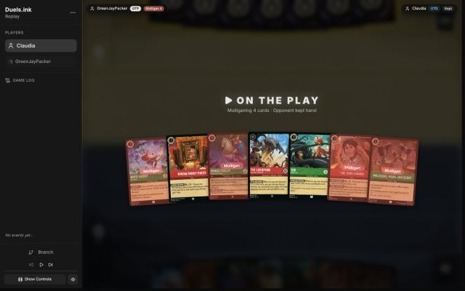
*The board before the decision: [step 0](https://duels.ink/replay/01a1eb2e-3a0d-7e5c-b20b-63b4227b07f6?step=0) in the duels.ink replay viewer.*

**Your hand:** White Rabbit – Late Again, Rivera Family Photo, Prince Phillip, The Leviathan, Tod, The Torn Corner,
Malicious, Mean, and Scary.

**Setup.** Two payoffs (The Leviathan; Phillip with Malicious) and no Olaf or Device, the pieces that make either go.
The Photo and Tod are the engine and the dig, White Rabbit the curve. The Torn Corner draws only from a 10-card
discard. Finding both Olaf and a Device by game turn 9 is unlikely either way (`tools/odds.py both`): 14% with the
seven kept (about six more cards seen), 23% with two sent back (eight). The candidates:
- **Keep all seven:** both payoffs, but the fewest looks for the missing pieces.
- **Send back The Leviathan and The Torn Corner:** Phillip with Malicious is still a payoff, with no cap on the {S} it
  kills, and Phillip is ink if it's not needed. Two more looks.
- **Send back Phillip and The Torn Corner:** keeps the main payoff, but it's uninkable.

`tools/mulligan.py` (1,500 deals, ink only, blind to the combo) gives 9.37 of 10 ink over turns 1–4 for keeping all
seven, 9.59 for sending back The Leviathan and The Torn Corner, and 8.89 for sending back Phillip and The Torn Corner.
The coach's pick: **send back The Leviathan and The Torn Corner.**

**What you did:** kept the Photo, The Leviathan and Tod; sent back White Rabbit, Phillip, Malicious and The Torn
Corner (drew White Rabbit, Strike a Good Match, Another Tale to Spin and Inner Strength). They kept seven.

**Verdict: close call.** Your line digs harder: four new cards make both Olaf and a Device by game turn 9 32% likely
(`tools/odds.py both`, ten cards seen), against 23% for the coach's. It costs early ink (8.30 of 10 over turns 1–4 in
`tools/mulligan.py`, against 9.59) and Malicious, which is Phillip's partner and an action for Olaf. In a deck whose
plan is the combo, the extra looks are a fair price, and what came back (White Rabbit, two songs and a cantrip) is the
kind of card that was sent. [MULL-1](#cite-mull-1); confidence medium.

### Turn 1: your turn 1

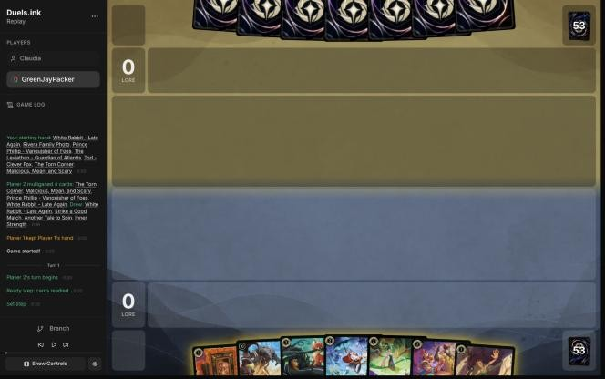
*The board before the decision: [step 3](https://duels.ink/replay/01a1eb2e-3a0d-7e5c-b20b-63b4227b07f6?step=3) in the duels.ink replay viewer.*

**Setup.** On the play, no draw; one ink. The Photo (1) or Inner Strength (1). The Photo now can mill on turn 3 with
Inner Strength cast beside it; Inner Strength now and the Photo with its mill on turn 3 come to the same place by the
end of turn 3, and the cantrip shows a card first. Ink a card the plan doesn't need early: Another Tale gives them an
ink drop too, White Rabbit is a small body.

**What you did:** inked White Rabbit and cast Inner Strength (drew Max Goof – Karaoke Star).

**Verdict: fine.** Both orders reach the same board on turn 3, and the cantrip first sees a card before the ink and
the turn-3 plays are chosen.

### Turn 3: your turn 2

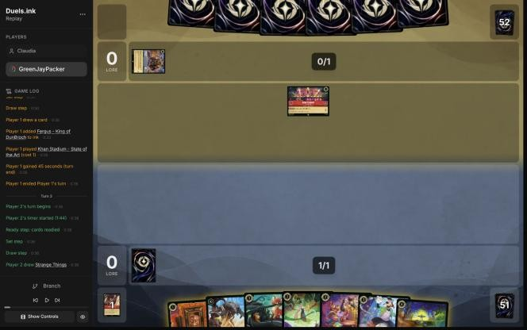
*The board before the decision: [step 9](https://duels.ink/replay/01a1eb2e-3a0d-7e5c-b20b-63b4227b07f6?step=9) in the duels.ink replay viewer.*

**Setup.** Their turn 2: Khan Stadium – State of the Art (a location: 1 lore in their Set step, +2 {S} for characters
there), with Fergus – King of DunBroch inked. Neither is in a listed list: an unlisted list is 99%. You drew Strange
Things; 2 ink once you ink. The Photo and its mill (2) start the engine; Strike (2) digs two cards deeper now. The
Photo compounds: it mills every turn from now on. Ink Strange Things, which needs a cost-4 singer or 4 ink.

**What you did:** drew Strange Things and inked it; played the Photo and milled Prince Phillip and The Torn Corner,
which MEND THE PHOTO played free.

**Verdict: good play.** The coach's line, and the mill brought a free Torn Corner.

### Turn 5: your turn 3

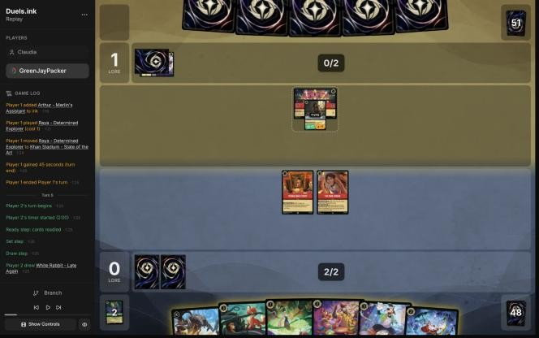
*The board before the decision: [step 19](https://duels.ink/replay/01a1eb2e-3a0d-7e5c-b20b-63b4227b07f6?step=19) in the duels.ink replay viewer.*

**Setup.** Their turn 4: Raya – Determined Explorer (1, 2/1; +1 {L} per location they have), moved to Khan Stadium
(+2 {S} there), and Arthur – Merlin's Assistant inked. A locations list: the Stadium's 1 lore in their Set step and
Raya's 2 make 3 a turn, 20 by game turn 18 if nothing changes. You drew a second White Rabbit; 3 ink once you ink. Still
missing Olaf and the Device. The candidates, all digging:
- **Max Goof** (3), discarding Another Tale: two cards, a 3-{W} body, and a song in the discard (Max Goof's count, and
  an action for Olaf); Another Tale never gives them its ink drop.
- **Tod** (3): two cards, discard one.
- **The Photo's mill and Strike** (1 and 2): two cards seen and four put into the discard.

The coach leans to Max Goof (the song discarded counts twice), with Tod close behind.

**What you did:** inked White Rabbit; played Tod (drew White Rabbit and Retro Evolution Device, discarded White
Rabbit).

**Verdict: fine.** Tod and Max Goof dig the same two cards; Max Goof's discard would have counted for more, Tod's kept
both songs in hand. It found the Device.

### Turn 7: your turn 4

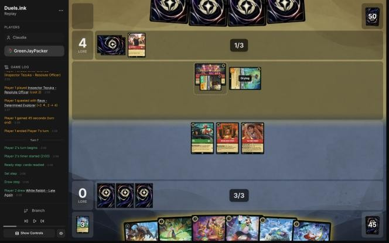
*The board before the decision: [step 28](https://duels.ink/replay/01a1eb2e-3a0d-7e5c-b20b-63b4227b07f6?step=28) in the duels.ink replay viewer.*

**Setup.** Their turn 6: Inspector Tezuka (2/3, Bodyguard) entered exerted, Mr. Incredible – Bob Parr was inked, and
Raya quested for 2 (4–0). Their board makes 4 a turn (Raya 2, Tezuka 1, the Stadium 1): 20 by game turn 14. You found
the Device last turn but no Olaf yet (four in 45 cards). Wildcat would banish a Device put in play early, and without
Olaf it does nothing, so it waits. You have 4 ink once you ink. Tod can't usefully challenge: Tezuka's Bodyguard draws
the challenge, and Tod dies to it. The coach's line is to dig hardest: Tod sings Strike for free, Max Goof (3)
discards Another Tale for two more, and the Photo mills with the last ink.

**What you did:** drew a third White Rabbit; Tod sang Strike (drew Strike and Malicious, discarded Another Tale);
**cast Malicious, which banished Raya** (1 {W}) and put 1 damage on Tezuka; inked White Rabbit; milled Max Goof and
Improvise with the Photo.

**Verdict: good play.** Once Strike found Malicious, it beat the coach's line: Raya was 2 of their 4 lore a turn, and
her 1 {W} fell to the counter. Their clock drops to 2 a turn, the discard gains a song and an action, and the dig can
wait a turn. [QC-2](#cite-qc-2); confidence high.

### Turn 9: your turn 5

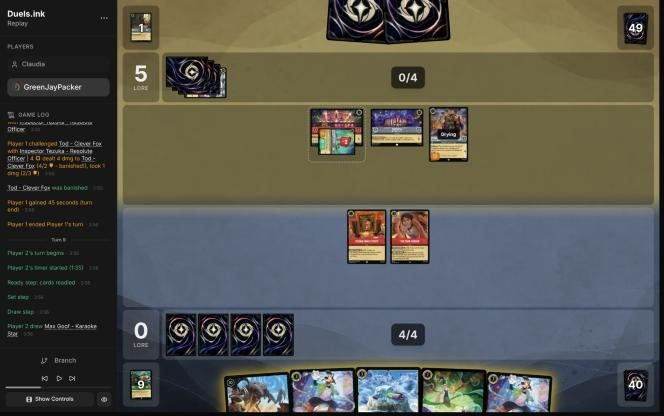
*The board before the decision: [step 44](https://duels.ink/replay/01a1eb2e-3a0d-7e5c-b20b-63b4227b07f6?step=44) in the duels.ink replay viewer.*

**Setup.** Their turn 8: Zootopia – Police Headquarters (a second location: 1 lore in their Set step), a second Fergus
(3/2, Bodyguard), and Tezuka moved to the Stadium (4 {S} there) and challenged Tod, who was exerted from singing: Tod
died. They're at 5 and make 4 a turn (the two locations, Tezuka and Fergus): 20 by game turn 16. You drew a second
Max Goof; 5 ink once you ink; still no Olaf (four in 40 cards). Five actions are in your discard (Olaf would cost 4)
and three songs (Max Goof needs five for +3 {L}). The coach's line: Max Goof discarding Strike (two cards, four songs),
the Photo's mill (1, which can find the fifth song) and The Torn Corner (1, the discard then has ten). Ink the second
Max Goof: the Device and Strike are both needed.

**What you did:** drew the second Max Goof; played Max Goof, discarding Strike (drew Strange Things and Roller Bob –
Sid's Toy); drew Tod with The Torn Corner and inked him; gained 1 lore with the Photo (1–5).

**Verdict: fine.** The coach's line but for the Photo: its lore point now against a mill that might find the fifth
song (and might mill an Olaf). Close either way.

### Turn 11: your turn 6

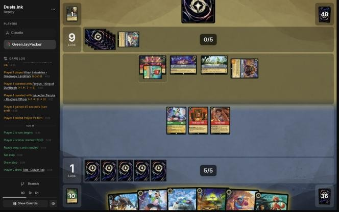
*The board before the decision: [step 57](https://duels.ink/replay/01a1eb2e-3a0d-7e5c-b20b-63b4227b07f6?step=57) in the duels.ink replay viewer.*

**Setup.** Their turn 10: Khan Industries – Greenway Landmark (a third location, 2 {L}; characters there can't be
challenged), with Putting It All Together inked; Fergus and Tezuka quested (9–1). **Their locations alone now make 4 a
turn** (the Stadium 1, Zootopia 1, Khan Industries 2) in their Set step, which no wipe touches: 13 on game turn 12, 17
on 14, 21 on 16. With Fergus and Tezuka questing too, they reach 20 on game turn 14. Both are exerted now. Tezuka has
2 damage (1 {W} left) and 4 {S} at the Stadium; Fergus is 3/2; both have Bodyguard. You drew a second Tod; 6 ink once
you ink; no Olaf yet. Four songs are in your discard: one more (Strange Things discarded to SWEET REMIX) makes each Max
Goof a 4-lore quester. The resources that matter:
- **Locations deal no damage back, and any of them can be challenged** ([CR 4.6.8](#cite-cr-4-6-8)). Roller Bob (4/3) gets Rush if you
  put two characters from your discard on the bottom of your deck (you have four), and his 4 {S} banishes the Stadium
  (4 {W}): their lore drops to 3 a turn, and Tezuka loses the Stadium's +2 {S}.
- **Then Max Goof can kill Tezuka and live:** 1 damage finishes Tezuka, and Tezuka's 2 {S} doesn't kill Max Goof's 3
  {W}. While the Stadium stands, the same challenge trades Max Goof for Tezuka.
- **Max Goof #2** (3), discarding Strange Things: two cards, five songs in the discard.

The coach's line: Roller Bob with Rush banishes the Stadium; Max Goof kills Tezuka and survives; Max Goof #2 discards
Strange Things. 6 ink. Their clock drops to 3 a turn plus Fergus, and both Max Goofs quest for 4 from next turn.

**What you did:** drew a second Tod; **challenged Tezuka with Max Goof while it was at the Stadium (both were
banished)**; played the second Max Goof, discarding Strange Things (drew Prince Phillip and Olaf); played Olaf for 2
(seven actions in the discard: 9–7 became 7–1); inked Tod; gained 1 lore with the Photo (7–2).

**Verdict: mistake.** Challenging **Tezuka at the Stadium** is suboptimal because its 4 {S} there killed a Max Goof
that one more song (in your hand) was about to make a 4-lore quester, and the Stadium kept giving them a lore a turn.
**Roller Bob with Rush on the Stadium first** is better: it banishes the location for nothing back, Tezuka then has 2
{S}, and Max Goof kills it and lives. Their clock drops a lore a turn for good and you keep two 4-lore questers. The
rest of the turn was right: once SWEET REMIX found Olaf, playing him for 2 took 2 lore now and leaves the Device and
The Leviathan for next turn. [RULE-3](#cite-rule-3), [QC-2](#cite-qc-2), [SEQ-3](#cite-seq-3); confidence medium.

### Turn 13: your turn 7

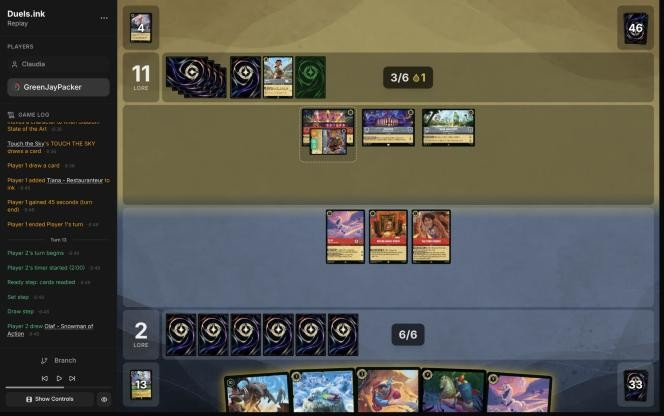
*The board before the decision: [step 73](https://duels.ink/replay/01a1eb2e-3a0d-7e5c-b20b-63b4227b07f6?step=73) in the duels.ink replay viewer.*

**Setup.** Their turn 12: Ink Explosion (4 damage) killed your second Max Goof; Fergus sang Touch the Sky to move to
the Stadium (5 {S} there) and draw. They're at 11 with an empty hand; their three locations give 4 in each Set step, so
they reach 15 on game turn 14 (16 with Fergus) and 20 on 16. You drew a second Olaf; 7 ink once you ink. Olaf in play is
dry; another costs 2 (seven actions in the discard) and drains 2. **The combo fits:** the Device (3) and its 1 turn Olaf
into The Leviathan, whose IT'S A MACHINE! needs a second card into your discard this turn: **the Photo's mill (1)
gives two.** The Leviathan then banishes Fergus (5 {S}). That leaves 2 ink for the second Olaf: 11–2 becomes 9–2.
First, Olaf can quest (2 lore) or banish a 4-{W} location (a lore a turn off their clock, nothing back). The coach's
line: Olaf banishes the Stadium; the Photo mills; the Device makes Olaf The Leviathan, which banishes Fergus; the
second Olaf drains 2. 7 ink, and their board is three locations short one and no characters.

**What you did:** drew a second Olaf; played the Device; Olaf banished Khan Stadium; turned Olaf into The Leviathan, but
IT'S A MACHINE!'s condition wasn't met (only Olaf had gone to the discard) and you took it back; played Roller Bob with
Rush (putting two Max Goofs on the bottom of your deck), and he and Fergus traded; inked Phillip; turned Olaf into The
Leviathan with nothing left to banish.

**Verdict: mistake.** Spending **Roller Bob** on Fergus is suboptimal because the Photo's mill (1 ink) before the
Device would have met IT'S A MACHINE!'s condition: The Leviathan would have banished Fergus for free, and the 3 ink
Roller Bob cost would have paid for the second Olaf. **The Photo's mill first** is better: the same board for them, 2
lore fewer (9, not 11), and Olaf and Roller Bob still yours. Banishing the Stadium with Olaf was right: their locations
are the clock now. [SEQ-2](#cite-seq-2); confidence high.

### Turn 15: your turn 8

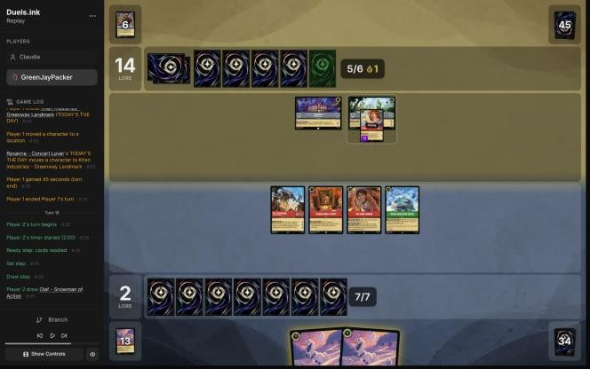
*The board before the decision: [step 93](https://duels.ink/replay/01a1eb2e-3a0d-7e5c-b20b-63b4227b07f6?step=93) in the duels.ink replay viewer.*

**Setup.** Their turn 14: the two locations gave 3 (14–2); Roxanne – Concert Lover (3/2/1) moved to Khan Industries,
where she can't be challenged. Their hand is empty. Left alone they make 3 in each Set step plus Roxanne: 18 on game
turn 16 and past 20 on 18. You drew your second Olaf, so two are in hand, each costing 2 and draining 2; you have 7 ink
and nothing else to ink. The Leviathan is dry: it can quest (3) or banish Khan Industries (8 {W}; 2 of their 3 a turn,
and Roxanne's protection). The lines:
- **Both Olafs** (4): 14–2 becomes 10–2, and two 2-lore questers join The Leviathan.
- **The Leviathan banishes Khan Industries:** their clock drops to Zootopia's 1 and Roxanne, for the rest of the game.
  Questing instead gives 3 now but leaves them 2 a turn more.
- **The Photo's lore and The Torn Corner** (1 each) with the ink left.

The coach's pick: both Olafs, The Leviathan on Khan Industries, the Photo and The Torn Corner.

**What you did:** played both Olafs (14–2 became 10–2); The Leviathan banished Khan Industries; drew Roller Bob with The
Torn Corner; gained 1 lore with the Photo (10–3).

**Verdict: good play.** The coach's line. Khan Industries was two-thirds of their lore a turn; with it gone they make
1 a turn plus whatever quests, and your board of The Leviathan, two Olafs and the Photo makes 8. [RULE-3](#cite-rule-3), [QC-3](#cite-qc-3);
confidence high.

### Turn 17: your turn 9

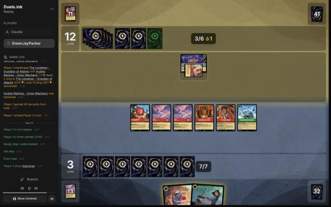
*The board before the decision: [step 110](https://duels.ink/replay/01a1eb2e-3a0d-7e5c-b20b-63b4227b07f6?step=110) in the duels.ink replay viewer.*

**Setup.** Their turn 16: Zootopia's lore (11), Dangerous Plan, Audrey Ramirez (Rush) moved to Zootopia to draw, then
died challenging The Leviathan (2 damage on it); Roxanne moved to Zootopia and quested (12–3). Their board is Roxanne
(exerted) and Zootopia (1 {L}); their hand is empty. You drew Improvise; Roller Bob is in hand; 7 ink. Your board
quests for 8 with the Photo: 11 now, 19 on game turn 19, one short. The lines:
- **Everything quests, Roller Bob comes down** (3) and the Photo gives 1: 11 now, and Roller Bob's quest makes exactly
  20 on game turn 19, if nothing of yours dies. Roxanne and Zootopia stay: about 1–2 a turn for them.
- **Clear their board:** Roller Bob with Rush trades with Roxanne, an Olaf banishes Zootopia (4 {W}, nothing back).
  They have no lore source left at 12, but you're at 8 and the win moves to game turn 21 unless a draw adds lore.

The coach's pick was the first, by a turn; both win comfortably, since they're 8 short with no board and no hand.

**What you did:** played Roller Bob with Rush (putting Roller Bob and Olaf from your discard on the bottom); **he and
Roxanne traded**; Olaf banished Zootopia; cast Improvise (drew Max Goof) and played Max Goof without a song to discard;
The Leviathan and the other Olaf quested (12–8).

**Verdict: fine.** Your line leaves them nothing: no character, no location, no hand, at 12. And it found the turn back:
with five songs in your discard Max Goof quests for 4, so The Leviathan, two Olafs, Max Goof and the Photo make 12 next
turn, exactly 20. Choosing Max Goof over the Photo's lore and The Torn Corner with the last 3 ink was right.

### Turn 19: your turn 10

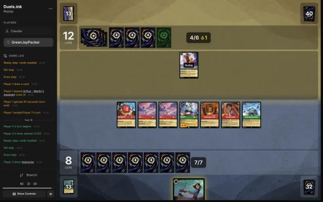
*The board before the decision: [step 125](https://duels.ink/replay/01a1eb2e-3a0d-7e5c-b20b-63b4227b07f6?step=125) in the duels.ink replay viewer.*

**Setup.** Their turn 18: Arthur – Merlin's Assistant, nothing else; they're at 12 with no hand. You quest for 11 (Max
Goof 4, The Leviathan 3, two Olafs 2 each) and the Photo gives 1: 8 + 12 = 20. **It's lethal.**

**What you did:** quested with all four and gained 1 lore with the Photo: 20–12, the win.

**Verdict: good play.** The win, on game turn 19.

## Lessons
1. **Against a locations deck, the locations are the clock** ([turns 11](#turn-11), [13](#turn-13),
   [15](#turn-15)). Their lore comes in the Set step, where no wipe reaches it, and characters can banish a location at
   any time for nothing back ([RULE-3](#cite-rule-3)). A 4-{W} location falls to one Olaf or Roller Bob; Khan Industries (8) to The
   Leviathan.
2. **A location's bonus is part of the challenge maths** ([turn 11](#turn-11)). Khan Stadium's +2 {S} made Tezuka kill
   the Max Goof that challenged it; banishing the Stadium first took that away.
3. **IT'S A MACHINE! needs two cards into your discard that turn; the Photo's mill gives two for 1 ink**
   ([turn 13](#turn-13)). Mill before the Device, so the Olaf it banishes is the second card, not the only one.

## Proposed knowledge-base updates (applied after discussion)
- **Meta** (the Ruby/Steel pair file's notes, Claudia): an unlisted locations list: Khan Stadium – State of the Art,
  Zootopia – Police Headquarters ×2, Khan Industries – Greenway Landmark, Raya – Determined Explorer (+1 {L} a
  location), Fergus – King of DunBroch ×2 and Inspector Tezuka (Bodyguards), Roxanne – Concert Lover, Arthur – Merlin's
  Assistant ×2, Carl Fredricksen – On the Move ×2, Audrey Ramirez, Tiana – Restauranteur, Mr. Incredible – Bob Parr; Ink
  Explosion, Touch the Sky, Dangerous Plan, Putting It All Together. Three locations made 4 lore a turn by game turn 12.
  Characters banished them for nothing back: Olaf (4 {S}) the 4-{W} ones, The Leviathan Khan Industries.
- **Meta** (the Emerald/Ruby pair file's notes, GreenJayPacker's second Ruby R.E.D. list): White Rabbit ×4, Roller Bob
  ×3 and three Photos in place of Stegmutt and To Wither a Flower. Roller Bob's Rush (two characters from the discard
  to the bottom) banishes a 4-{W} location on the turn he lands. The Photo's mill is the cheapest second card for IT'S A
  MACHINE!.

## Hindsight
Doesn't change the verdicts above.
- **[Turn 11](#turn-11):** they had Ink Explosion and killed the second Max Goof next turn, so the coach's line would
  have lost one of its two 4-lore questers anyway.
- **[Turn 13](#turn-13):** the win came on game turn 19 with them at 12; the 2 lore the second Olaf would have taken
  didn't decide it.

## The coach's errors
Found by the coach during the review; the discussion may add more.

| When | Error | How it was caught | How it won't happen again |
|---|---|---|---|
| Turns 13 and 15 | The coach counted the turn's draw twice: the `--plan` brief's hand already includes it, and the `--happened` brief's "You drew" line was read as one more card. Turn 15's first verdict faulted you for not playing a third Olaf that didn't exist | Turn 17's hand (two cards, no Olaf) didn't match | Proposed: the `--plan` brief labels the hand "after this turn's draw" and names the card drawn; the `--happened` brief marks the draw "already in the hand the plan showed" |

## Open questions
- **[Turn 11](#turn-11):** did you consider Roller Bob with Rush on the Stadium before Max Goof's challenge?
- **[Turn 13](#turn-13):** when IT'S A MACHINE! failed, was the Photo's mill considered, or did Roller Bob look
  cheaper?
- **[Pre-game](#turn-0):** what made you keep The Leviathan over Phillip and Malicious?

## Citations
Copies of the coach's knowledge base cited above, as they stood when they were cited (the private repository's commit and date are given with each). They don't change when the knowledge base does.

**emerald-ruby.md, Ruby R.E.D. against danny's Rockstar Aggro: BigShotBob**: knowledge base, `kb/meta/archetypes/emerald-ruby.md` at `4e51312` (2026-11-17), working tree

> ### Ruby R.E.D. against danny's Rockstar Aggro: BigShotBob `[coach, meta study of danny's 5–10 Nov 2026 games not studied before (tools/scan.py), full games, not blind, 2 games]`
> - **Game 1** (`01a1b1eb-f331`): danny won 17–0 by concession on game turn 9. Land of the Dead – Marigold Bridge off-list.
> - **Game 3** (`01a1b1f8-4ed8`, danny lost 16–19): **the Leviathan came on game turn 8, their 4th turn**, earlier than the
>   turn 9 noted above. Olaf for 1 (9 → 1 with ABOUT TIME) took 2 lore, Retro Evolution Device turned him into The
>   Leviathan (10 → 0), and IT'S A MACHINE! banished all seven of danny's characters at 15–0. Turn 12: Malicious, then the
>   device turned the Leviathan into Prince Phillip (four kills), and +12 lore that turn; Lyle Tiberius Rourke's DIRTY
>   TRICKS took 1 lore at each of their ends of turn.

**ruby-steel.md, Incredibles: how it plays**: knowledge base, `kb/meta/archetypes/ruby-steel.md` at `4e51312` (2026-11-17), working tree

> ### Incredibles: how it plays `[coach, meta study of the user's 27 Oct 2026 games (tools/scan.py), full games, not blind, 1 game]`
> 01a17df5.
> - **Pieces:**
>   - Wasabi ×3 (TWIN BLADES: a second target takes damage equal to his {S})
>   - **Shere Khan – Khan Industries CEO** (NEW INCENTIVE: a chosen character can challenge **ready** characters this turn;
>     an ink drop when another of theirs banishes in a challenge)
>   - Mulan – Martial Arts Master, Arthur – Jousting Knight, Scrooge (Boost), Lexington, Medallion Weights
> - **Big turns:**
>   - **Turn 19:** Shere Khan let Wasabi challenge a ready character, and TWIN BLADES killed a second. Then a location.
>   - **Turn 23:** Wasabi and TWIN BLADES plus challenges took four characters.
> - **Watch for:** staying ready doesn't protect your characters on a Shere Khan turn.

**MULL-1**: strategy principle, `kb/strategy/principles.md` at `4e51312` (2026-11-17), working tree

> - **MULL-1. Keep a plan, not the strongest cards.** *Ask: "Which hand gives me the best chance to execute my game plan in this matchup?"* `[MCL ch.12]` · baseline

**QC-2**: strategy principle, `kb/strategy/principles.md` at `4e51312` (2026-11-17), working tree

> - **QC-2. Challenge the threat, not the character.** Engines, synergy pieces and big questers are worth fighting over. A 1-lore character doing nothing usually isn't. *Ask: "Does this character actually need to be removed?"* `[MCL ch.6, ch.9]` · baseline

**RULE-3**: strategy principle, `kb/strategy/principles.md` at `4e51312` (2026-11-17), working tree

> - **RULE-3. Locations can be challenged at any time and don't hit back** `[CR 4.6.8]`. They pay lore at your Set step `[CR 3.2.2.2]`, so a location that survives one opponent turn has usually already paid something. · baseline

**SEQ-3**: strategy principle, `kb/strategy/principles.md` at `4e51312` (2026-11-17), working tree

> - **SEQ-3. Order challenges so earlier ones inform later ones.** Lead with the challenge that might make the next unnecessary, or that preserves both characters. `[MCL ch.5]` · baseline

**SEQ-2**: strategy principle, `kb/strategy/principles.md` at `4e51312` (2026-11-17), working tree

> - **SEQ-2. Plan the whole turn before the first action.**
>   - Who quests? Who challenges?
>   - What if a challenge fails?
>   - What gets inked? What ink is left?
>   - What does this leave the opponent?
>
>   `[MCL ch.5]` · baseline

**QC-3**: strategy principle, `kb/strategy/principles.md` at `4e51312` (2026-11-17), working tree

> - **QC-3. Questing is favoured when:**
>   - you control the board
>   - your exerted characters can't be punished
>   - the race favours you
>   - removing their characters gains little
>
>   **Challenging is favoured when:**
>   - they have an engine or repeated-value piece
>   - the trade is efficient
>   - you need to slow the game
>   - your deck is stronger late
>
>   `[MCL ch.6]` · baseline

**CR 4.6.8**: Comprehensive Rules, `kb/rules/cr/04-turn-actions.md` at `4e51312` (2026-11-17), working tree

> **4.6.8.** Characters can challenge locations. This follows all of the normal rules and processes of challenging with the following exceptions.
