# Review: GreenJayPacker vs Nick, 18 Nov 2026

| | |
|---|---|
| **Status** | draft (blind pass done, not yet discussed) |
| **Replay** | `01a1ee49-5204` (`python3 tools/brief.py 01a1ee49-5204 --turn N`) · [duels.ink viewer](https://duels.ink/replay/01a1ee49-5208-7b0b-a56b-406fd340894a?step=0) |
| **Format** | Core Constructed (stated in the replay). Set 14 era: inks revealed before the coin toss |
| **Decks** | You: Emerald/Ruby Ruby R.E.D. ([the coach's notes on it](#cite-kb-meta-archetypes-emerald-ruby-ruby-r-e-d-greenjaypacker-s-lists)), the second list from 17 Nov: White Rabbit ×4, Roller Bob ×3, three Photos, no Stegmutt or To Wither a Flower. Them: Amber/Sapphire ([the coach's notes on this pair](#cite-kb-meta-archetypes-amber-sapphire-detectives-how-it-plays)); archetype as it became clear: **Detectives**, 99% from their first turn (Higgins; Judy Hopps – Helpful Officer inked), with Belle – Snowfield Strategist and Hamm – Piggy Bank off-list |
| **Play/draw** | They went first; both sent back three cards |
| **Result** | **Loss**, 8–20: they quested to 20 on game turn 19 |
| **Meta data** | snapshot of 12 Nov 2026 (fresh until 26 Nov) |
| **Chosen how** | Sent by danny, the coach's user, as a replay link on 18 Nov: GreenJayPacker's, reviewed for them. The coach knew nothing of the result. It reviewed five of GreenJayPacker's games from 17 Nov before this one |

## Summary
- **Good plays:** [3](#turn-3) (the right card to Mowgli), [12](#turn-12) (Olaf into The Leviathan: five
  characters banished, Tod traded with the sixth), [16](#turn-16) (Roller Bob's Rush on a 2-lore Fangmeyer).
- **Close calls:** [pre-game](#turn-0), [6](#turn-6) (Max Goof's dig before the Device).
- **Inaccuracies / mistakes / blunders:**
  - **Mistake, [8](#turn-8):** Tod before the Device. With the Device still to play, the next turn's 5 ink couldn't
    fit the line, so The Leviathan came on game turn 12, not 10.
  - **Mistake, [14](#turn-14):** Strange Things inked with four ink spare. Cast, it stops two questers, draws, and as
    the fifth song makes Max Goof a 4-lore quester: about a 7-lore swing.
- **Unwinnable from:** [18](#turn-18): six characters quested for 7 and they needed 3; nothing in hand could stop it.

**What decided it:** Detectives' answers and their width. The combo landed on turn 12 and banished five characters
(Tod traded with the sixth), but Gaston killed The Leviathan the next turn, as in sterlinghorton's game. Two Fangmeyers
brought Nick and On the Case back, and On the Case took the Device on turn 17. The two flagged turns each gave up
about a turn: The Leviathan two turns later than it could have come, and 7 lore on turn 14.

## The game, turn by turn
Verdicts judge each decision on what you could know at the time, **including archetype knowledge an experienced
player has**. Hindsight is kept to its own section. Severity scale: good play / close call /
inaccuracy / mistake / blunder. Principle IDs and hypotheses (H-n) link to copies
in the Citations section at the end, as they stood when they were cited.

**What you knew before the game:** they're Amber/Sapphire: Detectives 50%, Control #1 40%, an unlisted list 6%,
Control #2 5%. They go first, so their turn k comes on game turn 2k−1 with k ink, and yours on game turn 2k. The pair
file's notes from your 17 Nov games: against Detectives The Leviathan is a wipe, not a quester, and both of
sterlinghorton's died the turn after they landed. Their key cards against your plan, with the earliest game turn each
can come (Judy Hopps – Day Camp Instructor's LEND A PAW can ramp them a turn):
- **Elisa Maza – Hardworking Detective** (4; Detectives): with another Detective in play, you reveal your hand and
  they discard a non-character card, so the Device in hand. Game turn 7, or 5 with Day Camp's ramp.
- **Judy Hopps – On the Case** (3; Detectives ×4): with another Detective in play, puts a chosen item into its
  player's inkwell, so the Device in play. Game turn 5.
- **Judy Hopps – Always Vigilant** (4, Shift 2 onto a Judy) and **Gaston – Superior Archer** (5): banish a character
  with 5 {S} or more (Always Vigilant only if they played another character that turn). The Leviathan (10) and
  Phillip (6) are in range; Olaf (4) and Roller Bob (4) aren't, unless Support pumps them. Game turns 5 and 9.
- **The Horseman Strikes!** (3): banishes a character with Evasive, so Phillip. Game turn 5.
- **Control #1:** Hades – Infernal Schemer (7, game turn 13) puts The Leviathan into your inkwell; Spooky Sight
  (6, game turn 11) inks every character costing 3 or less (Max Goof, Tod, Roller Bob, White Rabbit); Raging Storm
  (8, game turn 15); Belle – Snowfield Strategist inks each of their banished characters, so a wipe also ramps them.

### Pre-game

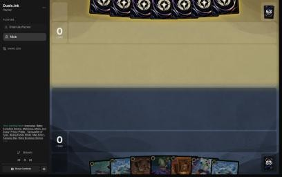
*The board before the decision: [step 1](https://duels.ink/replay/01a1ee49-5208-7b0b-a56b-406fd340894a?step=1) in the duels.ink replay viewer.*

**Setup.** On the draw. The hand has the Device twice, the Photo, Improvise, Max Goof, Malicious and Prince Phillip,
but no Olaf and no Leviathan: the combo needs both, or another 8+ cost character for the Device to banish. Phillip
costs 9 to cast, so he's not a Device base early. The mulligan tool (`tools/mulligan.py --plan`, 1,500 deals) has
keeping five (Photo, Improvise, Device, Malicious, Max Goof) at 9.55 ink of 10 spent on turns 1–4, keeping four
(without Improvise) at 9.41, keeping all seven at 9.28. It doesn't model the combo; what matters is finding Olaf and
The Leviathan, which more cards sent back helps. The coach's pick: keep Photo, Improvise, one Device, Malicious and
Max Goof; send back Phillip and the second Device. Malicious is the song Max Goof's SWEET REMIX turns into two cards,
an action for Olaf's discount, and against Detectives' wide board it sets up Phillip.

**What you did:** kept Photo, Improvise, the Device and Max Goof; sent back the second Device, Phillip and Malicious.
Drew The Leviathan, a Device and Malicious.

**Verdict: close call.** Sending Malicious back digs one card deeper for Olaf and The Leviathan; keeping it gives Max
Goof a song to turn into two cards. Both are reasonable, and the draws don't change it.

### Turn 2: your turn 1

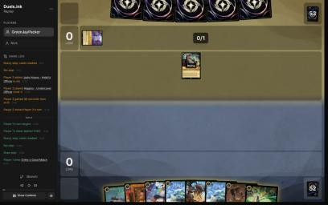
*The board before the decision: [step 6](https://duels.ink/replay/01a1ee49-5208-7b0b-a56b-406fd340894a?step=6) in the duels.ink replay viewer.*

**Setup.** Their turn 1 inked Judy Hopps – Helpful Officer and played Higgins: Detectives 99%. You drew Strike a Good
Match; 1 ink once you ink. The 1-cost plays are the Photo and Improvise (on any character, Higgins included, for its
card). Items can be used the turn they come in, so either order spends turn 2's ink the same way (the other one-drop
and a mill, or Strike). The ink: the second Device is the spare piece, but against On the Case ×4 and Elisa ×3 it's
also insurance; Improvise or Max Goof are the other candidates.

**What you did:** inked the second Device; Improvise on Higgins drew Another Tale to Spin.

**Verdict: fine.** Improvise first sees a card before turn 2's choices and puts an action in the discard for Olaf;
the Photo's mill loses nothing by waiting a turn. Inking the spare Device is a fair price; keeping it as insurance
against Detectives' item removal was the alternative.

### Turn 3: their turn

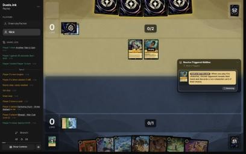
*The board before the decision: [step 12](https://duels.ink/replay/01a1ee49-5208-7b0b-a56b-406fd340894a?step=12) in the duels.ink replay viewer.*

**What happened:** they inked Darkwing Duck – Drake Mallard (4 {S}, Ward, a Detective) and played Mowgli – Man Cub:
you revealed your hand and chose a non-character card to discard. Higgins quested (1).

**What you did:** discarded Another Tale to Spin, from Photo, the Device, Malicious, Strike and the Tale.

**Verdict: good play.** The Tale was the least of them: Strike digs two cards to its one, Malicious is the wipe's
half, and the Photo and the Device are the engine. In the discard it still counts as an action for Olaf and a song
for Max Goof's playlist. They've now seen The Leviathan and the Device in your hand.

### Turn 4: your turn 2

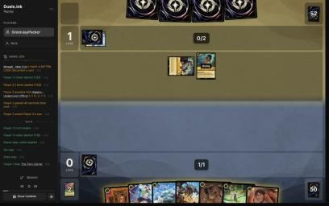
*The board before the decision: [step 15](https://duels.ink/replay/01a1ee49-5208-7b0b-a56b-406fd340894a?step=15) in the duels.ink replay viewer.*

**Setup.** You drew The Torn Corner, the natural ink: it's free when a Photo mills it, and in hand it costs 3 and
draws only once the discard holds 10. 2 ink. The combo is missing Olaf (4 left in 50 cards; he costs 7 with two
actions in the discard). Candidates: **the Photo and a mill** (the engine in play a turn sooner; 2 cards to the
discard, about 0.8 of them actions on average) or **Strike a Good Match** (two cards seen, for Olaf; two actions to
the discard for certain). The Device should be in play before Elisa can take it from hand (game turn 7, their 4 ink).

**What you did:** inked The Torn Corner; cast Strike (drew Strange Things and Max Goof, discarded Strange Things).

**Verdict: fine.** Strike digs toward Olaf and makes him cost 5; the Photo would have started the engine a turn
sooner. Either is reasonable on 2 ink.

### Turn 5: their turn

**What happened:** they inked Gaston – Superior Archer and quested with Higgins and Mowgli (3 lore). Their 3 ink went
unused.

### Turn 6: your turn 3

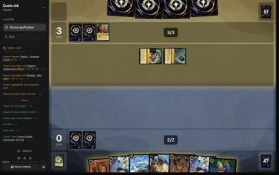
*The board before the decision: [step 23](https://duels.ink/replay/01a1ee49-5208-7b0b-a56b-406fd340894a?step=23) in the duels.ink replay viewer.*

**Setup.** You drew Prince Phillip. 3 ink once you ink; the Device is your only copy left in hand (two in the deck),
and they saw it with Mowgli. Next turn they have 4 ink: **Elisa Maza** takes it from your hand, **Judy Hopps – On the
Case** from play (both need another Detective in play: Higgins is). They hold Elisa about 25% of the time after
their draw (33% with Besties and Uncovering Clues digging), On the Case about 32% (`tools/odds.py`). Their unused 3
ink last turn fits a hand of 4-drops like Elisa, and also a player holding On the Case until the Device lands. Olaf
costs 5 (four actions in the discard) and isn't in hand. Candidates:
- **Max Goof, discarding Malicious for two cards:** digs toward Olaf a turn sooner, Olaf to 4, a 1-lore quester; the
  Device stays in hand.
- **The Device:** out of Elisa's reach; Max Goof and the Photo next turn (4 ink).

**What you did:** inked the second Max Goof; played Max Goof, discarded Malicious, drew Tod and Prince Phillip.

**Verdict: close call.** The two risks to the Device are about the same size, so the dig a turn sooner tips it to
your line. Had Elisa been known in their hand, the Device would have had to go down first (the pair file's notes from
sterlinghorton's game). Inking Max Goof rather than a Phillip keeps both Phillips, which need Malicious or the
Device to matter.

### Turn 7: their turn

**What happened:** they inked Judy Hopps – On the Case (one of the item removers gone) and played Nick Wilde – Toy
Drive Officer (Support 2). Higgins and Mowgli quested (5 lore).

### Turn 8: your turn 4

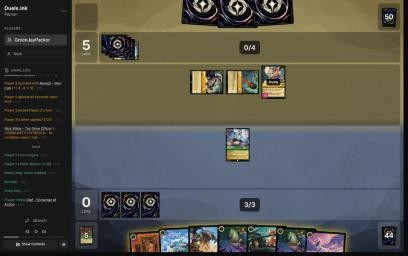
*The board before the decision: [step 33](https://duels.ink/replay/01a1ee49-5208-7b0b-a56b-406fd340894a?step=33) in the duels.ink replay viewer.*

**Setup.** You drew Olaf: with five actions in the discard he costs 4. 4 ink once you ink. Their board: Higgins (2
{S}), Mowgli (1), Nick Wilde (2, Support); 5 lore and 3 a turn, 20 by game turn 17 if nothing changes, and
Detectives grow wide. Next turn they have 5 ink: Gaston (21% held after their draw) or Always Vigilant can banish a
character with 5 {S} or more, and Nick's Support can push Olaf (4) there ([H-9](#cite-h-9)). The Device line needs Olaf in play, the
Device, its use (1) and a second card into the discard: about 10 ink, so two turns. What each line leaves for game
turn 10 (5 ink):
- **A. The Device and the Photo now** (4 of 4, inking a Phillip). Next turn: the Photo mills 2 (both cards count for
  IT'S A MACHINE!); if it finds an action (67%; 81% counting the draw, `tools/odds.py`), Olaf costs 3, so mill 1 +
  Olaf 3 + the Device's use 1 = 5: **The Leviathan on game turn 10**, wiping a board of 5 strength (10 allowed), and
  Olaf's drain. If it misses, Olaf for 4 and the mill (drain 2), The Leviathan on turn 12. Your hand would be all
  characters, so Elisa finds nothing to take; On the Case (about 21% held) can take the Device from play.
- **B. Olaf now** (drain 2, 5 → 3). Next turn the Device (3) and its use (1) leave 1 ink and no second card unless
  the draw is a 1-cost action: The Leviathan on turn 12, and Olaf in play exposed to Nick's Support plus Gaston; the
  Device in hand exposed to Elisa.
- **C. Tod and the Photo:** two cards seen, but the Device still in hand; next turn's 5 ink can't play the Device and
  Olaf together, so The Leviathan comes on turn 12 at the earliest.

**What you did:** played Tod (drew The Torn Corner and the second Device, discarded a Phillip), inked The Torn
Corner, played the Photo. Max Goof didn't quest.

**Verdict: mistake (confidence: medium).** Playing **Tod** before the Device is suboptimal because it spends the turn
on cards while the combo's pieces were already in hand: with the Device still to play, next turn's 5 ink can't fit the
Device, Olaf and its use, so The Leviathan waits until game turn 12. By then Detectives have had two more turns to
quest and to go wide, possibly past the 10 strength IT'S A MACHINE! can banish. **The Device and the Photo** are
better, for exactly your 4 ink: The Leviathan comes on game turn 10 about two times in three, before Gaston's 5 ink,
with Olaf's 2-lore drain, and Elisa has nothing to take. Tod's second Device is insurance, but it doesn't buy back
the turn. [SEQ-4](#cite-seq-4), [TEMPO-1](#cite-tempo-1), [H-14](#cite-h-14). Not questing Max Goof was right: exerted, he dies to
Higgins and Mowgli together.

### Turn 9: their turn

**What happened:** Judy Hopps – On the Case put your Photo into your inkwell. They inked a second Gaston, played Judy
Hopps – Day Camp Instructor (its LEND A PAW ramped them to 6 ink), quested with three (8 lore) and Nick's Support went
onto Higgins. Nick drew at the end of the turn.

### Turn 10: your turn 5

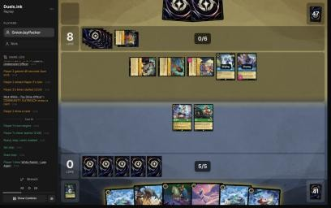
*The board before the decision: [step 50](https://duels.ink/replay/01a1ee49-5208-7b0b-a56b-406fd340894a?step=50) in the duels.ink replay viewer.*

**Setup.** You drew White Rabbit. 6 ink once you ink. They're at 8 lore with five characters questing for 5 a turn
(20 by game turn 15) and 11 strength in all, one more than IT'S A MACHINE! can take. Olaf costs 4; the Device, Olaf
and its use are 8 ink, so The Leviathan can't land this turn. For next turn (7 ink) the line needs the Device in play
and a second card into the discard besides Olaf. Ways to get that card: a second Device banishing Tod (1 ink), a
1-cost action, or one of your characters dying in a challenge (Tod into an exerted Higgins). Candidates:
- **Both Devices now** (6 of 6): next turn Olaf (4), one Device banishes Tod (1), the other Olaf (1) → The Leviathan
  with its wipe and Olaf's drain, 6 of 7 ink, with no need for a target to challenge.
- **One Device and White Rabbit** (5 of 6): next turn Olaf (4), Tod challenges an exerted character and dies, the
  Device banishes Olaf (1). Same result if they leave a character exerted, which questing does; White Rabbit (Evasive)
  quests meanwhile. The spare Device goes to ink.
- **Olaf and White Rabbit:** the drain now, but next turn the Device (3) and its use (1) leave no second card unless
  the draw brings one, and Olaf sits in play where Nick's Support can push him to Gaston's 5.

Keeping Olaf in hand is right either way: your hand is then all characters, so Elisa finds nothing.

**What you did:** inked a Device; played the other and White Rabbit. Nobody quested (exerted, Max Goof and Tod die to
their challengers).

**Verdict: fine.** Your line and both-Devices line set up the same turn. Yours adds a quester and an ink. Both
Devices in play would have kept a spare against On the Case (two left in their deck) and needed nothing from their
board.

### Turn 11: their turn

**What happened:** they played Belle – Snowfield Strategist (each of their banished characters can go to their
inkwell) and quested with four (12 lore), Day Camp's Support onto Higgins. Nick stayed ready.

### Turn 12: your turn 6

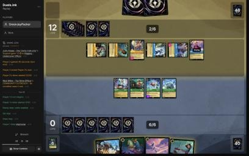
*The board before the decision: [step 62](https://duels.ink/replay/01a1ee49-5208-7b0b-a56b-406fd340894a?step=62) in the duels.ink replay viewer.*

**Setup.** You drew Improvise. They're at 12 with six characters questing for 7 a turn: 20 on game turn 15, so this
turn must wipe. Their board's strength is 13, three more than IT'S A MACHINE! can take; On the Case (4 {S}) is the one
to leave out of it, and it's exerted. Improvise (an action) makes Olaf cost 3 and is one of the two cards the
discard needs; Olaf banished by the Device is the other. Belle's WINTER STOCKPILE will ink their banished characters,
so expect a big ink jump. The line: Improvise on a character of yours; Olaf (3; 12 → 10); the Device turns him into
The Leviathan, which banishes all but On the Case (9 strength); then a character with Improvise's +1 trades with On
the Case (White Rabbit reaches 3 {S} with one Improvise, Tod needs two). 5 or 6 of 7 ink. With their board empty,
Max Goof and White Rabbit quest safely.

**What you did:** Improvise on Tod (drew a second Improvise); Olaf for 3 (12 → 10); the Device turned Olaf into The
Leviathan, which banished Higgins, Mowgli, Belle, Day Camp and Nick (Belle inked four of them). The second Improvise
on Tod made him 3 {S}, and he traded with On the Case. Max Goof and White Rabbit quested (2–10). No ink this turn.

**Verdict: good play.** The whole board gone, 2 lore off them and 2 on, The Leviathan in play. Trading Tod rather
than White Rabbit kept the Evasive quester, better than the coach's line. Phillip stayed in hand rather than going
to ink, where the seventh ink had nothing to pay for.

### Turn 13: their turn

**What happened:** Gaston – Superior Archer banished The Leviathan, as the pair file's notes expected. Fangmeyer –
Icy Officer returned Nick Wilde – Toy Drive Officer to their hand (known now). No quests: 10 lore, 10 ink.

### Turn 14: your turn 7

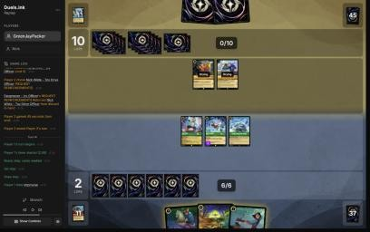
*The board before the decision: [step 87](https://duels.ink/replay/01a1ee49-5208-7b0b-a56b-406fd340894a?step=87) in the duels.ink replay viewer.*

**Setup.** You drew Improvise. 2–10. Their board: Gaston (3 {S}, 1 lore) and Fangmeyer (4 {S}, 2 lore), both
drying; Nick comes next. You have 7 ink once you ink, Max Goof, White Rabbit and the Device in play, and Phillip,
Strange Things and Improvise in hand. **The needs check:** they need 10, at 3 a turn now and more as they rebuild;
what you hold doesn't reach 18 in time. The outs are in the deck: Olaf costs 2 now (seven actions in the discard) and
the Device is in play, so any Olaf with a second card for the discard is The Leviathan again (Olaf and The Leviathan,
3 copies each in 37); and Max Goof quests for 4 once a fifth song is in the discard: there are four. So dig, and use
the song. Candidates, each with all 7 ink:
- **Improvise (draw), Strange Things on Gaston and Fangmeyer** (neither quests next turn: 3 lore saved; a card
  drawn; the fifth song), **Max Goof quests for 4, White Rabbit for 1.** 7 lore; the ink left plays what Improvise
  draws. Max Goof, exerted, will likely die to one of them, but he's worth 4 now and they spend the challenge.
- **Improvise, and keep Strange Things:** Max Goof stays at 1 lore, and they quest freely.

**What you did:** Improvise on Max Goof (drew White Rabbit); played the second White Rabbit; inked Strange Things;
White Rabbit quested (3–10). Max Goof didn't quest. Four ink unused.

**Verdict: mistake (confidence: medium-high).** Inking **Strange Things** with four ink spare is suboptimal because the
song was castable and did three jobs: it stops 3 of their lore, draws a card toward Olaf, and as the fifth song it
makes Max Goof a 4-lore quester for the rest of the game. **Casting it** (Improvise 1 + White Rabbit 2 + Strange
Things 4 = 7, inking Phillip) is better: 7–10 instead of 3–10, with their next turn's quests cut to Nick's. Phillip
was the card to ink: at 9 ink and with Gaston able to banish him, he's the slowest card in hand. [TEMPO-3](#cite-tempo-3),
[TEMPO-1](#cite-tempo-1).

### Turn 15: their turn

**What happened:** they played Nick Wilde and a second Fangmeyer (returning On the Case to their hand: known now),
and quested with the first Fangmeyer and Gaston (13). Nick drew at the end of the turn.

### Turn 16: your turn 8

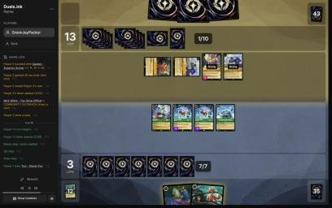
*The board before the decision: [step 100](https://duels.ink/replay/01a1ee49-5208-7b0b-a56b-406fd340894a?step=100) in the duels.ink replay viewer.*

**Setup.** You drew Tod. 3–13, and their board quests for 6 a turn: 19 after their next turn, 20 on game turn 19.
**The needs check:** you can't reach 20 first (at most about 7 a turn), so the game turns on stopping them on game
turn 18. The out is Olaf (he costs 1 now: eight actions in the discard) with The Leviathan through the Device:
Olaf's drain plus IT'S A MACHINE! on up to 10 strength of their board. Olaf and The Leviathan are 3 copies each in
35; you see Tod's two cards now and one draw before turn 18. So dig, and cut their lore where you can, since every
lore they don't gain makes the turn-18 wipe enough. Their exerted Gaston and Fangmeyer can be challenged, but your
characters have 1–2 {S} against 4 willpower.

**What you did:** Tod (drew Max Goof and Roller Bob – Sid's Toy, discarded Phillip); Roller Bob put Olaf and The
Leviathan from your discard on the bottom of your deck for Rush and traded with the exerted Fangmeyer (2 lore a turn);
both White Rabbits quested (5–13). No ink this turn.

**Verdict: good play.** Roller Bob's Rush turned a 3-drop into a kill on a 2-lore character: their next quests are
4, not 6, so they reach 17 rather than 19, and an Olaf with The Leviathan on turn 18 (drain 2, a 10-strength wipe)
would hold them short of 20. The characters sent to the bottom don't matter: this list has nothing that reads the
discard's characters. Not inking (Phillip could have been inked before Tod and Max Goof discarded) cost a point of
ink you didn't need this turn.

### Turn 17: their turn

**What happened:** The Horseman Strikes! banished a White Rabbit (Evasive) and drew; Darkwing Duck and Judy Hopps –
On the Case came down, and On the Case put the Device into your inkwell. They quested with three (17), and Judy Hopps
– Day Camp Instructor ramped them again.

### Turn 18: your turn 9

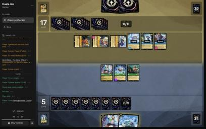
*The board before the decision: [step 124](https://duels.ink/replay/01a1ee49-5208-7b0b-a56b-406fd340894a?step=124) in the duels.ink replay viewer.*

**Setup.** You drew the last Device. 5–17. Six characters quest for 7 next turn and they need 3. Nothing you hold stops
that: the Device needs a character costing 8 or more to reach The Leviathan, and with no song in hand Max Goof's
SWEET REMIX draws nothing, so there's no dig this turn. **Unwinnable from here** ([principle 2](#cite-principle-2)): no line keeps them
below 20 on game turn 19, and no card can be drawn before then.

**What you did:** played the Device and Max Goof (no song to discard); quested with Max Goof, White Rabbit and Tod
(8–17).

**Verdict: fine, in a lost game.**

## Lessons
1. **Count the combo turn's ink before spending this turn's** ([turn 8](#turn-8)). The Leviathan turn needs Olaf, the
   Device's use (1) and a second card for the discard. If the Device is still in hand, that turn costs 3 more, which
   on 5 ink pushes it back a whole turn. Put the Device in play the turn before.
2. **A song in this deck is worth three cards** ([turn 14](#turn-14)). Strange Things cast stops two questers, draws,
   and, as the fifth song in the discard, makes Max Goof a 4-lore quester for the rest of the game ([the notes on
   your deck](#cite-kb-meta-archetypes-emerald-ruby-ruby-r-e-d-greenjaypacker-s-lists)). Don't ink a
   castable song with ink to spare; ink the card that can't be cast soon (Phillip at 9).
3. **IT'S A MACHINE! counts any card put into your discard** ([turns 10](#turn-10), [12](#turn-12)). An action cast,
   a mill, and also one of your characters dying in a challenge all count: a small character trading with an exerted
   one is the second card when nothing else is.
4. **Against Detectives, The Leviathan is a wipe, then gone** ([turns 12](#turn-12), [13](#turn-13)). Gaston or
   Always Vigilant banished it the next turn here as in sterlinghorton's game ([the pair file's notes](#cite-kb-meta-archetypes-amber-sapphire-detectives-against-greenjaypacker-s-ruby-r-e-d-sterlinghorton)), and
   Fangmeyer returns what the wipe took. Plan the lore race around Olaf's drains, Max Goof and the Evasive White Rabbits.

## Proposed knowledge-base updates (applied after discussion)
- **Meta** (the Amber/Sapphire pair file's notes, Nick): Detectives with Higgins, Judy Hopps – Helpful Officer
  (inked), Mowgli – Man Cub, Darkwing Duck – Drake Mallard ×2, Gaston ×3 (two inked), Judy Hopps – On the Case ×2,
  Nick Wilde – Toy Drive Officer, Judy Hopps – Day Camp Instructor ×2, Fangmeyer ×2, The Horseman Strikes!, Judy
  Hopps – Lead Detective (inked), and off-list Belle – Snowfield Strategist and Hamm – Piggy Bank. Mowgli on turn 3
  showed them the Device and The Leviathan; On the Case took the Photo (turn 9) and the Device (turn 17); Belle inked
  four of the five characters The Leviathan banished (6 → 10 ink); Gaston killed The Leviathan the next turn; the two
  Fangmeyers returned Nick and On the Case.
- **Meta** (the Emerald/Ruby pair file's notes, GreenJayPacker's Ruby R.E.D.): IT'S A MACHINE!'s second card can be
  one of your characters dying in a challenge. Max Goof's playlist counts songs cast or discarded, so inking a song
  delays it.
- **Strategy:** [H-14](#cite-h-14), evidence for from [turn 8](#turn-8): the line could have been ready on turn 10 and came on
  turn 12, by which time their board had grown past 10 strength.

## Hindsight
Doesn't change the verdicts above.
- On the Case came on turn 9 and took the Photo. Under the coach's turn-8 line it would have taken the Device instead,
  and with the second Device still in the deck, The Leviathan would have waited longer than it did. The risk the
  setup put at about 21% is the one that happened.
- On turn 15 Max Goof, ready, wasn't challenged; under the coach's turn-14 line he'd have been exerted after his
  4-lore quest.
- They won by exactly 20 on turn 19. The 7 lore of the turn-14 line, or The Leviathan on turn 10, would each have put
  the race much closer.

## The coach's errors
Found by the coach during the review; the discussion may add more.

| When | Error | How it was caught | How it won't happen again |
|---|---|---|---|
| Turn 4 | Piped the brief through sed to shorten it | The guard hook refused the command | Nothing new: the hook is the prevention, and it worked |

## Open questions
- **[Turn 8](#turn-8):** Tod before the Device: was it to dig for a second Device against On the Case, or to see more
  cards before committing?
- **[Turn 14](#turn-14):** why ink Strange Things rather than cast it? Was Max Goof's song count in mind?
- **[Turn 6](#turn-6):** Max Goof before the Device: was Elisa the worry, or the dig?

## Citations
Copies of the coach's knowledge base cited above, as they stood when they were cited (the private repository's commit and date are given with each). They don't change when the knowledge base does.

**emerald-ruby.md, Ruby R.E.D.: GreenJayPacker's lists**: knowledge base, `kb/meta/archetypes/emerald-ruby.md` at `94c9b52` (2026-11-18), working tree

> ### Ruby R.E.D.: GreenJayPacker's lists, 17 Nov 2026 `[coach, blind reviews of 01a1ea7f-cc42, 01a1eaf6-93a9, 01a1eb05-70c1, 01a1eb0c-446c and 01a1eb2e-39fc; 2 wins, 3 losses]`
> - **Lists:** the first (four games) ran Stegmutt ×4, Strange Things ×3, The Torn Corner ×4 and To Wither a Flower ×2,
>   with no Lyle Tiberius Rourke or Dangerous Plan. The second (01a1eb2e-39fc) swapped Stegmutt and To Wither a Flower
>   for White Rabbit ×4 and Roller Bob – Sid's Toy ×3, with three Photos.
> - **The Device line:** the Device turns Olaf, Phillip (9) or Stegmutt (8) into The Leviathan. The banished character is
>   one of IT'S A MACHINE!'s two cards, so one mill or one song makes the other; the Photo's mill (1 ink, 2 cards) is the
>   cheapest. Mill before the Device (01a1eb2e-39fc turn 13).
> - **The Device before Olaf** (01a1eb0c-446c turns 7 and 9): an item most decks can't touch, while Olaf waiting in play
>   meets Smash, Shere Khan's challengers or Hades. Against Detectives, Elisa Maza takes the Device from hand, so play it
>   before she can come (01a1eaf6-93a9 turns 6 and 8); Judy Hopps – On the Case and Wildcat – Unconventional Mechanic
>   take it from play.
> - **Quest before the Device banishes:** it takes exerted characters, so Olaf or The Leviathan quests first, and The
>   Leviathan can later become Phillip after Malicious (01a1eb0c-446c turns 11 and 15).
> - **Max Goof – Karaoke Star is a lore engine:** with five songs in the discard, BRAND-NEW PLAYLIST makes him a 4-lore
>   quester, often the deck's best lore (turn 10 of 01a1eaf6-93a9; seven songs by turn 15 of 01a1eb0c-446c). The song
>   SWEET REMIX discards counts. Smash and Ink Explosion killed him in two games.
> - **Roller Bob:** Rush for two characters from the discard to the bottom; his 4 {S} banishes a 4-{W} location the
>   turn he lands, for nothing back (01a1eb2e-39fc turn 11).
> - **By matchup:** against Detectives The Leviathan is a wipe, not a quester (H-14's counter-case); against a fast lore
>   board (01a1eb05-70c1) the combo has to land by about game turn 9; against locations, banish them with characters.

**amber-sapphire.md, Detectives: how it plays**: knowledge base, `kb/meta/archetypes/amber-sapphire.md` at `94c9b52` (2026-11-18), working tree

> ### Detectives: how it plays `[coach, meta study of the user's 27 Oct 2026 games (tools/scan.py), full games, not blind, 8 games]`
> Games: 01a17e45, 01a17e54, 01a17e5d (Sallinhos, best-of-three); 01a17e64, 01a17e75, 01a17e80 (DuckyRv, best-of-three);
> 01a17e9c; 01a17ef8. Card text verified with `tools/cards.py`.
>
> **The plan:** go wide with cheap Detectives, quest wide, and remove your best characters with "banish chosen character
> with 5 {S} or more", **after pumping them with Support**.
>
> - **The key trick: Support onto your characters.** Support adds "their {S} to another chosen character's {S} this turn",
>   and they choose yours. Then Gaston – Superior Archer or a Judy Hopps – Always Vigilant banishes it.
>   - *Examples:* 01a17e54 turn 21 (+2 on Hades, then Gaston); 01a17e5d turn 12 (+2 on Cheshire, then Judy – Always
>     Vigilant); 01a17e45 turn 23 (two Judy – Always Vigilant Shifts in one turn, banishing Cheshire and Merida, both
>     pumped first).
>   - **Support stacks:** a supported character supports with its new {S}. In 01a17e45 turn 15, Judy – Day Camp gave
>     Nick Wilde +2, then Nick gave +4. Treat **any** character of yours as in range once they have Support questers and
>     their removal available.
> - **Pieces:**
>   - **Cheap Detectives:**
>     - Higgins (1)
>     - Judy – Helpful Officer (1; removes 2 damage)
>     - Nick Wilde – Providing Backup (2; Support while they have another Detective)
>     - Judy – Day Camp Instructor (2, uninkable; Support; tops a card into ink if they played another character this turn)
>     - Daisy Duck – Ghost Finder (2, Support)
>     - Eilonwy (1, Support; not a Detective)
>   - **Nick Wilde – Toy Drive Officer** (4, uninkable; Support; draws at the end of a turn they played 2+ characters).
>   - **Removal:**
>     - **Judy Hopps – Always Vigilant** (4, Shift 2 onto any Judy; GOT YOU NOW needs another character played that turn)
>     - **Gaston – Superior Archer** (5)
>     - The Horseman Strikes!
>   - **Fangmeyer – Icy Officer** (5, uninkable, 2 lore): returns a Detective from their discard, usually Judy – Always
>     Vigilant, so the removal repeats.
>   - **Hand disruption:** Elisa Maza (4; with another Detective in play, you reveal your hand and they pick a non-character
>     card to discard) and Mowgli – Man Cub (2; you discard a non-character card). They took Raging Storm and Remember Me.
>   - **Card flow:** Judy – Uncovering Clues (4; searches the top 3 for a Detective on play and on quest).
>   - **Late game:** Judy – Lead Detective (6, Shift 4; Alert and Resist +2 for Detectives on their turn).
> - **Big turns,** from about their 6th turn: wide quests for +5 to +7 (01a17e45 turn 15: five questers; 01a17e9c turn
>   18: +7 after Lead Detective). Removal turns took 3 or 4 characters by mixing banishes with pumped challengers
>   (01a17e45 turn 23, 01a17e5d turn 12, 01a17e80 turn 26). Your locations were challenged down by two Detectives at once.
> - **What to watch for:**
>   - **Count their Support total against your characters' {S}.** Judys in play are Shift 2 targets for Always Vigilant,
>     and Gaston arrives at 5 ink.
>   - **Expect the removal to repeat** while Fangmeyer can return it.
>   - **Play your actions and songs (sweepers especially) early, before Elisa Maza lands.** She needs another Detective in
>     play first. A wide board of small characters is exactly what sweepers punish.

**amber-sapphire.md, Detectives against GreenJayPacker's Ruby R.E.D.: sterlinghorton**: knowledge base, `kb/meta/archetypes/amber-sapphire.md` at `94c9b52` (2026-11-18), working tree

> ### Detectives against GreenJayPacker's Ruby R.E.D.: sterlinghorton `[coach, blind review of 01a1eaf6-93a9, 17 Nov 2026]`
> - **The list:** Higgins ×3, Eilonwy, Nick Wilde – Providing Backup ×2 (inked), Nick Wilde – Toy Drive Officer ×3,
>   Judy Hopps – Uncovering Clues ×3, Elisa Maza – Hardworking Detective ×3, Darkwing Duck – Drake Mallard ×3, Day Camp
>   Instructor ×2, Helpful Officer, Judy Hopps – Always Vigilant, Lead Detective (inked), Gaston – Superior Archer,
>   Stitch – Carefree Surfer (off-list), Besties, Assemble! ×2 and The Horseman Strikes! (inked).
> - **How it played (they won 20–18 on game turn 23):** Uncovering Clues and Besties kept finding Detectives and Gaston.
>   Both Leviathans (turns 12 and 18) banished four characters and died the turn after they landed: to Gaston (found
>   with Besties) and to Always Vigilant, whose 5-strength threshold The Leviathan can't escape. Elisa Maza's FOLLOW THE
>   TRAIL can take the Retro Evolution Device from hand.

**SEQ-4**: strategy principle, `kb/strategy/principles.md` at `94c9b52` (2026-11-18), working tree

> - **SEQ-4. Sequence across turns.** A slightly weaker play now can set up a much stronger next turn: keep a shift target alive, keep a singer ready, hold removal for a bigger threat. `[MCL ch.5]` · baseline

**TEMPO-1**: strategy principle, `kb/strategy/principles.md` at `94c9b52` (2026-11-18), working tree

> - **TEMPO-1. Tempo is how much freedom you leave the opponent, not how fast you play.** A play that forces the opponent to spend their turn answering it has stolen part of their turn. *Ask: "If I play this, what does my opponent have to do next?"* `[MCL ch.1]` · baseline

**TEMPO-3**: strategy principle, `kb/strategy/principles.md` at `94c9b52` (2026-11-18), working tree

> - **TEMPO-3. Songs let one turn do two things** (interact and develop). But the singer is exerted: it gives up a quest or challenge and becomes challengeable `[CR 4.6.4.2]`. Sing when that turn beats every alternative, not because you can. `[MCL ch.1]` · baseline

**H-9**: hypothesis, `kb/strategy/hypotheses.md` at `94c9b52` (2026-11-18), working tree

> ### H-9. Against Detectives, kill their Supporters before you deploy a threat with 2 or more {S}
> - **Claim:** Detectives' removal (Judy – Always Vigilant's GOT YOU NOW, Gaston – Superior Archer's WATCH THIS!) only
>   hits characters with 5 {S} or more, and they get your characters there with Support on their own quests (CR 8.13.1:
>   Support may choose any other character). One Supporter puts every character with 2+ {S} in range: Nick Wilde –
>   Providing Backup adds 3, Daisy Duck – Paranormal Investigator 4, Judy – Day Camp Instructor, Eilonwy and Nick – Toy
>   Drive Officer 2. Characters with 0–1 {S} (Mickey – Best in Town, Luisa, Rafiki, Mowgli) are out of reach of one push.
>   So the Supporters, not the removal, are the target: kill them on your turn, and add a 2+ {S} threat when none of
>   theirs can quest next turn, or several at once so one removal a turn can't keep up.
> - **Evidence for:** danny's 16 Remember Merida games against Detectives, 27–30 Oct 2026 (studied whole, not blind).
>   About 35 of danny's characters were banished this way (two a game), always after a Support onto them: Cheshire,
>   Merlin, Merida, Hades, Pepita, Demona – Scourge (5 {S} without help).
> - **Evidence for, decision by decision** (blind reviews of danny's Rockstar Aggro, not yet discussed): 01a1cedf-0be6
>   (Ms. UK, game 1), turns 9 and 11: killing both Supporters kept every character of danny's out of Gaston and Always
>   Vigilant range. 01a1cee4-b587 (game 2), turn 4: Stitch's free kill on Eilonwy, a Supporter.
> - **Status:** open (a pattern across 16 games; no decision tested in discussion yet).

**H-14**: hypothesis, `kb/strategy/hypotheses.md` at `94c9b52` (2026-11-18), working tree

> ### H-14. With Ruby R.E.D., land The Leviathan as soon as the Device line is ready, unless a sweeper can come before it quests
> - **Claim** (coach, 2026-11-17): once the Device, a character to banish and a second card for the discard are all
>   available, play The Leviathan that turn rather than develop or dig further. The exception is a sweeper they can cast
>   before The Leviathan quests (Raging Storm at 8 ink).
> - **Why:** each turn waited is a turn their board scores and grows, and The Leviathan's 3 lore a turn starts only
>   once it lands.
> - **Evidence for:** 01a1ea7f-cc42 turn 13 (GreenJayPacker vs Itz_Rj): 3 ink unused with The Leviathan one ink away;
>   Luisa lived to feed the Shops, and the combo came on turn 15, a turn before Raging Storm. Related, on getting the
>   line ready sooner: 01a1eb0c-446c turns 7 and 9 (the Device before Olaf).
> - **Evidence against:** none yet. Against Detectives (01a1eaf6-93a9) The Leviathan died the turn after it landed, both
>   times, but each landing still banished four characters.
> - **Status:** open (one game).

**principle 2**: coaching principle, `CLAUDE.md` at `94c9b52` (2026-11-18), working tree

> 2. **Some games are unwinnable.** Draws and matchups can make a game lost whatever the player does. Say so
>    when it's true, rather than inventing mistakes to explain a loss.
