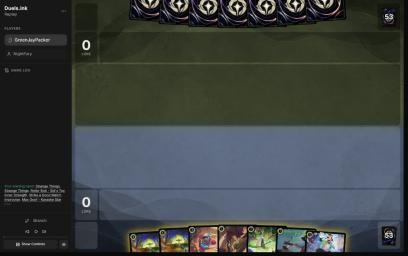
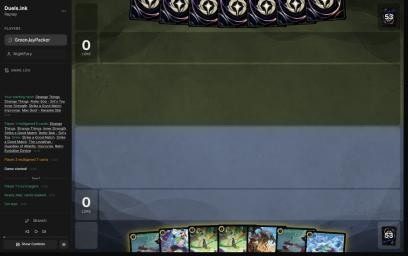
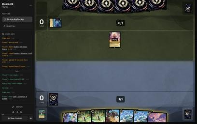
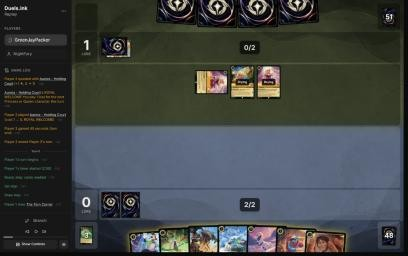
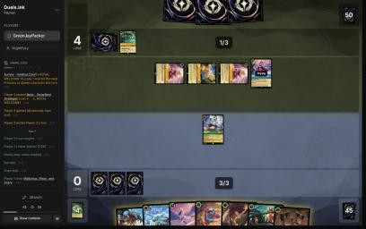
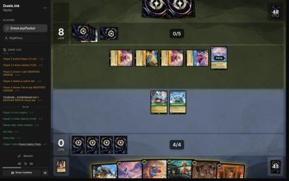
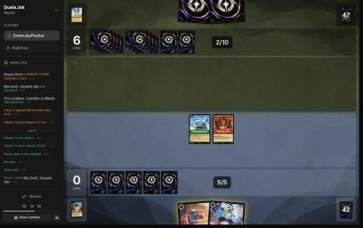
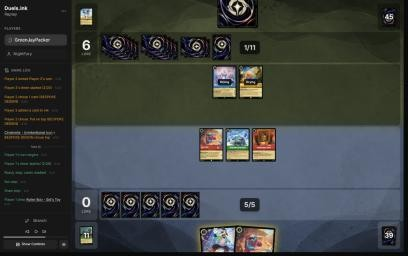
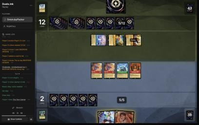
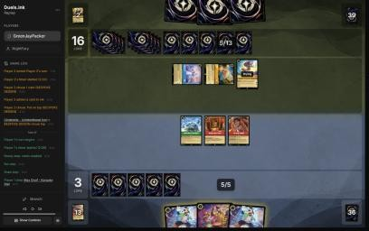

# Review: GreenJayPacker vs NightFury, 18 Nov 2026

| | |
|---|---|
| **Status** | final (discussed 18 Nov 2026: the player's answers to the open questions, relayed by danny) |
| **Replay** | `01a1ee51-e2dc` (`python3 tools/brief.py 01a1ee51-e2dc --turn N`) · [duels.ink viewer](https://duels.ink/replay/01a1ee51-e2df-70ae-acb2-3540024b9315?step=0) |
| **Format** | Core Constructed (stated in the replay). Set 14 era: inks revealed before the coin toss |
| **Decks** | You: Emerald/Ruby Ruby R.E.D. ([the coach's notes on it](#cite-kb-meta-archetypes-emerald-ruby-ruby-r-e-d-greenjaypacker-s-lists)), the same list as against Nick. Them: Amber/Sapphire ([the coach's notes on this pair](#cite-kb-meta-archetypes-amber-sapphire-control-daman)); archetype as it became clear: **Control #1**, 92% from game turn 4 (two Auroras, Hamm, Mickey Mouse – Best in Town inked), with Sulley – Strategic Scarer and Bagheera – Cautious Explorer off-list |
| **Play/draw** | You went first and sent back five cards; they sent back all seven |
| **Result** | **Loss**, 4–20: they quested to 20 on game turn 18 |
| **Meta data** | snapshot of 12 Nov 2026 (fresh until 26 Nov) |
| **Chosen how** | Sent by danny, the coach's user, as a replay link on 18 Nov: GreenJayPacker's, reviewed for them. The coach knew nothing of the result. It reviewed GreenJayPacker's game against Nick, played just before, first |

## Summary
- **Good plays:** [3](#turn-3), [7](#turn-7) (the Device down, Max Goof kept ready to sing), [9](#turn-9) (The
  Leviathan on game turn 9: all five of their characters banished, 2 lore drained), [15](#turn-15) (a card dug, and two
  Roller Bobs into Lionheart's Bodyguard).
- **Close calls:** [pre-game](#turn-0) (five cards sent back).
- **Inaccuracies / mistakes / blunders:**
  - **Inaccuracy, [11](#turn-11):** Roller Bob rather than Max Goof, once the mill had put a fifth song in the
    discard: 1 lore a turn instead of 4, with the race just restarted.
  - **Inaccuracy, [13](#turn-13):** a second Roller Bob rather than Max Goof. The one kept in hand had Rush
    next turn, so Max Goof now cost nothing in the kill on Cinderella (revisited in discussion from a close call).
  - **Mistake, [17](#turn-17):** Max Goof's SWEET REMIX spent the ink Strange Things needed, leaving one out (Olaf with
    The Leviathan, about 4%) where a cheaper dig kept two (about 12%).

**What decided it:** Belle's ink. The Leviathan banished their whole board on game turn 9, but Belle – Snowfield
Strategist put all five banished characters into their inkwell, and with 10 ink they cast Raging Storm the next turn.
Both boards started again at 0–6, and their ramp (Cinderella – Unintentional Icon, twice) and Lionheart's lore boost
outran a hand of Max Goofs and Roller Bobs.

## The game, turn by turn
Verdicts judge each decision on what you could know at the time, **including archetype knowledge an experienced
player has**. Hindsight is kept to its own section. Severity scale: good play / close call /
inaccuracy / mistake / blunder. Principle IDs and hypotheses (H-n) link to copies
in the Citations section at the end, as they stood when they were cited.

**What you knew before the game:** they're Amber/Sapphire: Detectives 50%, Control #1 40%, an unlisted list 6%,
Control #2 5%. You go first, so your turn k comes on game turn 2k−1 with k ink, and theirs on game turn 2k. The
pair file's notes from your earlier games: against Detectives The Leviathan is a wipe, then gone (Gaston or Always
Vigilant the next turn, in both games so far); Mowgli and Elisa Maza take a non-character card from your hand, On the
Case an item from play. Their key cards against your plan, with the earliest game turn each can come:
- **Mowgli – Man Cub** (2) and **Elisa Maza** (4, with another Detective in play): a non-character card from your
  hand, the Device first. Game turns 4 and 8 (6 with Day Camp's ramp).
- **Judy Hopps – On the Case** (3): an item in play into your inkwell. Game turn 6.
- **Gaston – Superior Archer** (5) and **Judy Hopps – Always Vigilant** (4, Shift 2): banish a character with 5 {S}
  or more, so The Leviathan and Phillip; Support pushes smaller ones there. Game turns 10 and 6.
- **The Horseman Strikes!** (3): banishes an Evasive character (White Rabbit, Phillip). Game turn 6.
- **Control #1:** Hades – Infernal Schemer (7, game turn 14) inks The Leviathan; Spooky Sight (6, game turn 12) inks
  everything costing 3 or less; Raging Storm (8, game turn 16); Belle inks their banished characters.

### Pre-game

*The board before the decision: [step 1](https://duels.ink/replay/01a1ee51-e2df-70ae-acb2-3540024b9315?step=1) in the duels.ink replay viewer.*

**Setup.** On the play. The hand: Strange Things ×2, Roller Bob, Inner Strength, Strike a Good Match, Improvise and
Max Goof. No Olaf, Device, Leviathan or Photo: the combo is all still to find (15 of the 53 other cards). The cheap
actions are both dig and Olaf's discount: each cast puts an action in the discard. Strange Things costs 4 and is
best as Max Goof's SWEET REMIX food (a song to discard for two cards). The mulligan tool (`tools/mulligan.py --plan`,
1,500 deals; it doesn't model the combo) has keeping all seven at 9.81 ink of 10 on turns 1–4, keeping five (Inner
Strength, Improvise, Strike, Max Goof, one Strange Things) at 9.31, keeping four at 9.01, sending all back at 8.91.
The coach's pick: keep those five; send back the second Strange Things and Roller Bob.

**What you did:** kept Improvise and Max Goof; sent back five (both Strange Things, Inner Strength, Strike and
Roller Bob). Drew two Strikes, The Leviathan, Improvise and the Device. They sent back all seven.

**Verdict: close call.** Five fresh cards dig hardest for the combo, which this hand lacked entirely ([H-5](#cite-h-5)). Inner
Strength and Strike were worth keeping, though: each is a cheap dig of its own and an action for Olaf's discount, and
without a song Max Goof's SWEET REMIX draws nothing. Both are reasonable.

**In discussion (18 Nov 2026):** you sent them back to try to find the ramp you wanted, knowing it's close since the
cheap digs also make Olaf cheaper. The verdict (close call) stands.

### Turn 1: your turn 1

*The board before the decision: [step 3](https://duels.ink/replay/01a1ee51-e2df-70ae-acb2-3540024b9315?step=3) in the duels.ink replay viewer.*

**Setup.** On the play, no draw. 1 ink: Improvise is the only play, and with no character in play it still draws
(its +1 {S} has nothing to choose and does nothing; [CR 1.7.7](#cite-cr-1-7-7)). The ink: the second Improvise, or one of two Strikes.

**What you did:** inked one Improvise and cast the other, drawing a second Device.

**Verdict: fine.** A card seen and an action in the discard for 1 ink; both Strikes stay for Max Goof and digging.

### Turn 2: their turn

**What happened:** they inked Sulley – Strategic Scarer (off-list) and played Aurora – Holding Court: Control #1 71%.

### Turn 3: your turn 2

*The board before the decision: [step 9](https://duels.ink/replay/01a1ee51-e2df-70ae-acb2-3540024b9315?step=9) in the duels.ink replay viewer.*

**Setup.** You drew Olaf: the hand now holds every piece (Olaf, two Devices, The Leviathan, Max Goof, two Strikes).
Olaf costs 8 with one action in the discard, so the next turns are about actions into the discard and the Device into
play. Against Control the dangers are Hades – Infernal Schemer (7 ink, game turn 14 on their curve) inking The
Leviathan, Raging Storm (8) and Spooky Sight (6). 2 ink once you ink; the spare Device is the ink. Strike now digs and
puts two actions in the discard if it discards one.

**What you did:** inked a Device; Strike drew Roller Bob and a third Strike, and discarded a Strike (Olaf to 6).

**Verdict: good play.** Two actions in the discard for 2 ink, and the second Strike kept for Max Goof's SWEET REMIX.

### Turn 4: their turn

**What happened:** they inked Mickey Mouse – Best in Town, played Hamm – Piggy Bank, quested with Aurora and played a
second Aurora for free (ROYAL WELCOME). Control #1 92%.

### Turn 5: your turn 3

*The board before the decision: [step 18](https://duels.ink/replay/01a1ee51-e2df-70ae-acb2-3540024b9315?step=18) in the duels.ink replay viewer.*

**Setup.** You drew The Torn Corner, the natural ink. 3 ink. Olaf costs 6 (three actions in the discard). Their board
(two Auroras, Hamm) quests for 3 a turn: 20 by game turn 18, and Control's sweepers come later (Spooky Sight at 6,
Hades at 7, Raging Storm at 8, sooner with Hamm and ink drops). The Leviathan needs the Device in play, Olaf cheap
enough, its use and a second card, which on these ink totals means about game turn 9. Candidates:
- **Max Goof, discarding the Strike:** two cards now and Olaf to 5; the Device next turn with a spare ink.
- **The Device now:** Max Goof next turn. The same ink by turn 9, with the dig a turn later.

**What you did:** inked The Torn Corner; Max Goof discarded the Strike and drew Inner Strength and Tod.

**Verdict: fine.** Against Control, nothing they've shown takes an item, so the Device can wait a turn, and the
dig found an action for Olaf (Inner Strength) a turn sooner.

### Turn 6: their turn

**What happened:** they inked Bagheera – Cautious Explorer (off-list), quested with both Auroras and Hamm (4), and
played Belle – Snowfield Strategist for 2 with two ROYAL WELCOMEs.

### Turn 7: your turn 4

*The board before the decision: [step 29](https://duels.ink/replay/01a1ee51-e2df-70ae-acb2-3540024b9315?step=29) in the duels.ink replay viewer.*

**Setup.** You drew Malicious. 4 ink once you ink. Olaf costs 5 (four actions). Their board (two Auroras, Hamm, Belle)
quests for 5 a turn: 20 by game turn 14. The Leviathan can land next turn (5 ink) if the Device is in play now: next
turn Max Goof sings Malicious for free (an action, and a card into the discard), Olaf costs 3, and the Device's use
is 1, so 4 of 5 ink, with Olaf's drain and IT'S A MACHINE! on a board of 6 strength. That needs Max Goof ready next
turn, so he doesn't quest or sing now: exerted, Aurora and Hamm kill him. This turn: the Device (3) and Inner
Strength (1, a card first, before choosing the ink).

**What you did:** Inner Strength on Max Goof (drew White Rabbit), inked White Rabbit, played the Device. Max Goof
stayed ready.

**Verdict: good play.** The coach's line exactly: drawing before inking, the Device down, and Max Goof kept ready to
sing next turn. Belle will ink whatever The Leviathan banishes, which can't be avoided.

### Turn 8: their turn

**What happened:** they inked Stitch – Carefree Surfer, quested with an Aurora and Belle (8), and played Cinderella –
Unintentional Icon for 4 (7 less ROYAL WELCOME and LOOSE CHANGE). Its BESPOKE DESIGN inked a card at the end of the
turn.

### Turn 9: your turn 5

*The board before the decision: [step 50](https://duels.ink/replay/01a1ee51-e2df-70ae-acb2-3540024b9315?step=50) in the duels.ink replay viewer.*

**Setup.** You drew the Photo. 5 ink once you ink. They're at 8 with a board questing for 8 next turn (20 by game
turn 12), and Cinderella ramps them every turn. Their board's strength is exactly 10 (Auroras 1 and 1, Hamm 2, Belle
2, Cinderella 4), all of it in IT'S A MACHINE!'s reach. The line set up last turn: Max Goof sings Malicious (free;
Olaf to 3, and a card into the discard), Olaf (3; 8 → 6), the Device's use (1) turns him into The Leviathan, which
banishes all five. 4 of 5 ink; the fifth plays the Photo. Belle will ink the five banished cards: they'll have about
11 ink next turn, enough for Hades – Infernal Schemer (23% held) or Raging Storm (23%). Leaving Belle out of the
wipe doesn't help, since she'd ink the other four.

**What you did:** exactly that: Malicious sung, Olaf for 3, The Leviathan banished all five (Belle inked them), Tod
inked, the Photo played. 0–6.

**Verdict: good play.** Their whole board gone on game turn 9, with 2 lore drained.

### Turn 10: their turn

**What happened:** Raging Storm, with the ink Belle gave them: The Leviathan and Max Goof banished. Both boards empty;
they're at 6 with 2 cards in hand and 10 ink.

### Turn 11: your turn 6

*The board before the decision: [step 67](https://duels.ink/replay/01a1ee51-e2df-70ae-acb2-3540024b9315?step=67) in the duels.ink replay viewer.*

**Setup.** You drew a second Max Goof. 0–6, both boards empty; your hand is Roller Bob and Max Goof, with the Device
and the Photo in play. 6 ink (nothing worth inking). Olaf costs 3 (six actions in the discard), and four songs are
there: one more and Max Goof quests for 4. **The needs check:** they have no board, so the race starts over; your
outs are a 4-lore Max Goof, the Photo's lore once the discard holds 10 (it holds 9), and any Olaf drawn, which with
the Device in play and a mill is The Leviathan again for about 3 ink. Their answers: Hades – Infernal Schemer (one
character into your inkwell), three more Raging Storms and Spooky Sight, from 2 cards in hand. The Photo's mill first
(1 ink) shows what the discard gets before choosing the 3-drop.

**What you did:** milled Strange Things and Improvise (the fifth song; Olaf to 1), then played Roller Bob without Rush.
Max Goof stayed in hand; 2 ink unused.

**Verdict: inaccuracy (confidence: medium).** Once the mill made five songs, playing **Roller Bob** rather than Max Goof
is suboptimal because Max Goof now quests for 4 a turn against Roller Bob's 1, and the race had just restarted from
0–6. **Max Goof** is better, for the same 4 of 6 ink. Holding him back against another Raging Storm has a point
([POS-1](#cite-pos-1) for a player ahead), but you were behind ([POS-2](#cite-pos-2)), and from 2 cards in hand Control rarely spends a Storm on one
3-drop; Hades would take whichever character you played.

**In discussion (18 Nov 2026):** Max Goof was held for his draw, without noticing that five songs in the discard made
him a 4-lore quester; you call it a mistake. The verdict stands.

### Turn 12: their turn

**What happened:** they replayed Cinderella – Unintentional Icon (3 lore, inks a card every turn) and a second Hamm.
One card left in their hand, 11 ink.

### Turn 13: your turn 7

*The board before the decision: [step 79](https://duels.ink/replay/01a1ee51-e2df-70ae-acb2-3540024b9315?step=79) in the duels.ink replay viewer.*

**Setup.** You drew the third Roller Bob. 0–6. Their board: Cinderella (4 {S}, 6 willpower, 3 lore) and Hamm, both
drying; 4 lore a turn, 20 on game turn 20. Cinderella is the engine to kill ([H-8](#cite-h-8)): when she quests or challenges she's
exerted on your turn. One Roller Bob (4 {S}) doesn't kill her; two do (8), or one after she has taken 4 challenging
the other. 5 ink; the discard holds 12, so the Photo's lore mode is on (+1 for 1 ink). Candidates:
- **Max Goof (4 lore a turn from next turn), the Photo's lore, Roller Bob quests;** the second Roller Bob kept in
  hand, whose Rush finishes Cinderella if she challenged the first. An unhurt Cinderella survives Roller Bob and Max
  Goof together (5).
- **The second Roller Bob, the Photo's lore, the first quests;** Max Goof kept. Next turn the two Roller Bobs kill an
  exerted Cinderella whether or not she's damaged; Max Goof comes after, out of reach of a sweeper meanwhile.

**What you did:** the second Roller Bob (no Rush), the Photo's lore, the first Roller Bob quested (2–6). Max Goof
stayed in hand; 1 ink unused.

**Verdict (revisited 18 Nov 2026): inaccuracy (small; confidence: medium).** The first verdict, a close call, said
your line kills Cinderella next turn in more cases. It doesn't: the coach credited the Roller Bob kept in hand with
Rush only if she had challenged the first, and missed what you point out in discussion. Three characters are in your
discard, so TIME TO MOVE gives him Rush next turn whatever she does: the first Roller Bob and a Rushing second make 8
against her 6 {W}, or the Rushing one alone finishes her after she has taken 4 challenging. Playing **the second
Roller Bob** now is suboptimal because Max Goof then comes a turn later for no gain in the kill. **Max Goof now, the
second Roller Bob kept** is better: his 4 lore a turn starts next turn. Its costs are small. A Raging Storm (13% held
after their draw) would take two of your characters either way, and leaves a Roller Bob in hand only on this line;
Rush puts two characters from the discard on the bottom, which can turn off the Photo's lore mode for a turn (11 cards
there).

### Turn 14: their turn

**What happened:** Lionheart – Incumbent Mayor came in exerted (Bodyguard: your challengers must pick him while he's
exerted) and gave Cinderella and Hamm +1 lore; they quested for 6 (12).

### Turn 15: your turn 8

*The board before the decision: [step 94](https://duels.ink/replay/01a1ee51-e2df-70ae-acb2-3540024b9315?step=94) in the duels.ink replay viewer.*

**Setup.** You drew The Torn Corner. 2–12; their board (Cinderella 3, Lionheart 2, Hamm 1) quests for 6: 18 next turn,
20 on game turn 18. **The needs check:** no lore line reaches 20 first, so the game turns on slowing them and finding
The Leviathan (Olaf costs 1 now; the Device is in play), three copies of each in 38 cards. Lionheart's Bodyguard
means any challenge must go to him: the two Roller Bobs together (8) kill him (7 willpower) and die. That cuts their
next quest to 4 (16, so 20 needs turn 18 and more), removes the Bodyguard so Cinderella can be challenged when she's
exerted, and puts two characters in your discard. The Torn Corner draws once the discard holds 10 (it holds 12): 3 to
play and 1 to use, a card toward the outs. 5 ink.

**What you did:** The Torn Corner and its draw (Another Tale to Spin), the Photo's lore (3–12), and both Roller Bobs
into Lionheart, who died. Max Goof stayed in hand, now with a song for his SWEET REMIX.

**Verdict: good play.** Digging and slowing the clock was the turn's job, and it kept Max Goof plus a song to draw two
more next turn.

### Turn 16: their turn

**What happened:** Cinderella and Hamm quested (16), and Stitch – Carefree Surfer came down and drew 2.

### Turn 17: your turn 9

*The board before the decision: [step 109](https://duels.ink/replay/01a1ee51-e2df-70ae-acb2-3540024b9315?step=109) in the duels.ink replay viewer.*

**Setup.** You drew the second Max Goof. 3–16. Their board quests for exactly what they need next turn: Cinderella 3,
Hamm 1, Stitch 2. **The needs check:** nothing you hold stops that, so this turn must find an out and be able to play
it. The outs: **Strange Things** (2 in 36) on Cinderella and Stitch, which leaves them Hamm's 1; or **Olaf and The
Leviathan together** (Olaf costs 0, the Device's use 1, and IT'S A MACHINE! takes all three: 10 strength). Olaf
alone doesn't do it: his drain makes 14, and they quest for 6. Strange Things costs 4, so the dig has to leave 4 ink.
5 ink, 6 if you ink:
- **Dig cheaply: ink a Max Goof; The Torn Corner's draw (1); Another Tale to Spin (2, and its ink drop gives 1 back).**
  Two cards seen with 4 ink left: Strange Things is castable, or Olaf with The Leviathan. About 12% (`tools/odds.py`).
- **Max Goof's SWEET REMIX (3, discarding the Tale) and The Torn Corner's draw (1).** Three cards seen, but only 2 or
  3 ink left, so Strange Things can't be cast: only Olaf with The Leviathan wins. About 4%.

**What you did:** Max Goof discarded the Tale and drew another Tale and Olaf; Olaf for 0 (16 → 14); The Torn Corner
drew a Device, which you inked; the Photo's lore (4–14).

**Verdict: mistake (confidence: medium).** Digging with **Max Goof's SWEET REMIX** is suboptimal because it spends the
ink Strange Things needs, so of the outs only Olaf with The Leviathan was left. **The Torn Corner and Another Tale**,
with a Max Goof inked, see one card fewer but keep both outs live: about three times the chance of surviving the
turn. In a game this far behind, the line is judged by its outs, and their ink ([POS-2](#cite-pos-2)).

**In discussion (18 Nov 2026):** you weren't thinking of Strange Things as an out or a delay, still learning the deck.
The verdict stands.

## Lessons
1. **Against Belle – Snowfield Strategist, IT'S A MACHINE! ramps them** ([turns 9](#turn-9), [10](#turn-10)). Each
   banished character can go to their inkwell, and Belle sees the others' banishes even when she's banished with
   them ([the ruling](#cite-kb-rules-rulings-whenever-one-of-your-characters-is-banished-sees-its-own-source)), so a five-character wipe is five ink: Raging Storm at 8 came the very next turn. The wipe was still right;
   plan the next turns for a Storm, with threats in hand rather than on the board.
2. **Once five songs are in the discard, Max Goof is your best 3-drop** ([turn 11](#turn-11)). He quests for 4 a
   turn ([the notes on your deck](#cite-kb-meta-archetypes-emerald-ruby-ruby-r-e-d-greenjaypacker-s-lists)); when behind, put him down first.
3. **When the board can't stop their next quest, dig for the out you can still afford** ([turn 17](#turn-17)). Name
   the out (Strange Things), its cost (4), and pick the dig that leaves that ink, even if it sees fewer cards.
4. **Bodyguard redirects every challenge while the Bodyguard is exerted** ([turn 15](#turn-15)): two 4-strength
   characters kill Lionheart (7), which also opens the way to the ramp engine behind him.

## Proposed knowledge-base updates (applied after discussion)
- **Meta** (the Amber/Sapphire pair file's notes, NightFury): Control #1 with Aurora – Holding Court ×2, Hamm – Piggy
  Bank ×2, Mickey Mouse – Best in Town (inked), Belle – Snowfield Strategist, Cinderella – Unintentional Icon ×2,
  Stitch – Carefree Surfer ×2 (one inked), Lionheart – Incumbent Mayor and Raging Storm; off-list, Sulley – Strategic
  Scarer and Bagheera – Cautious Explorer (both inked). ROYAL WELCOME and LOOSE CHANGE put Belle down for 2 on game
  turn 6 and Cinderella for 4 on turn 8. Belle inked all five characters The Leviathan banished on turn 9 (5 → 10
  ink), and Raging Storm followed on turn 10. Lionheart came in exerted as a Bodyguard and boosted two questers.
- **Meta** (the Emerald/Ruby pair file's notes, GreenJayPacker's Ruby R.E.D.): against Control with Belle in play, a
  wipe gives them the ink for Raging Storm or Hades the next turn; Strange Things is the out against a lethal board,
  and costs 4 to cast unless a 4-cost character is dry to sing it.
- **Strategy:** [H-14](#cite-h-14)'s exception (a sweeper before The Leviathan quests) should count the ink the wipe itself gives
  them through Belle: [turn 9](#turn-9) here, where 5 ink became 10.

## Hindsight
Doesn't change the verdicts above.
- They held Raging Storm on turn 10 and cast it at once with Belle's ink.
- The top of your deck on turn 17 was Another Tale, Olaf and a Device: no Strange Things or Leviathan, so the
  cheaper dig would have found Another Tale and Olaf and lost too.
- Max Goof never quested for 4: the first died to the Storm before his fifth song, and the others stayed in hand
  until the last turn.

## The coach's errors
Found by the coach during the review; the discussion may add more.

| When | Error | How it was caught | How it won't happen again |
|---|---|---|---|
| Turn 1 | Ran two briefs in one command | The guard hook refused it | Nothing new: the hook is the prevention, and it worked |
| Turn 13 | The comparison credited the held Roller Bob's Rush only if Cinderella had challenged the first, and missed that it lets him join a two-character kill next turn whatever she does | The player's answer in discussion (18 Nov 2026) | Proposed: on your turns the brief's options say, for each card in hand that can give itself Rush (Roller Bob's TIME TO MOVE), whether it can next turn (characters in your discard), so a line that holds it counts its challenge |

## Open questions
All answered by the player in discussion, relayed by danny (18 Nov 2026).
- **[Turns 11](#turn-11) and [13](#turn-13):** turn 11's Max Goof was held for his draw, missing his 4 lore (the
  verdict stands). On turn 13 you were setting up two characters for Cinderella but forgot the held Roller Bob's Rush:
  Max Goof was better. Revisited from a close call to an inaccuracy.
- **[Turn 17](#turn-17):** Strange Things wasn't seen as an out. The verdict stands.
- **[Pre-game](#turn-0):** to find the ramp you wanted; close, since cheap digs also make Olaf cheaper. The verdict
  stands.

## Citations
Copies of the coach's knowledge base cited above, as they stood when they were cited (the private repository's commit and date are given with each). They don't change when the knowledge base does.

**emerald-ruby.md, Ruby R.E.D.: GreenJayPacker's lists**: knowledge base, `kb/meta/archetypes/emerald-ruby.md` at `4b9c408` (2026-11-18), working tree

> ### Ruby R.E.D.: GreenJayPacker's lists, 17 Nov 2026 `[coach, blind reviews of 01a1ea7f-cc42, 01a1eaf6-93a9, 01a1eb05-70c1, 01a1eb0c-446c and 01a1eb2e-39fc; 2 wins, 3 losses]`
> - **Lists:** the first (four games) ran Stegmutt ×4, Strange Things ×3, The Torn Corner ×4 and To Wither a Flower ×2,
>   with no Lyle Tiberius Rourke or Dangerous Plan. The second (01a1eb2e-39fc) swapped Stegmutt and To Wither a Flower
>   for White Rabbit ×4 and Roller Bob – Sid's Toy ×3, with three Photos.
> - **The Device line:** the Device turns Olaf, Phillip (9) or Stegmutt (8) into The Leviathan. The banished character is
>   one of IT'S A MACHINE!'s two cards, so one mill or one song makes the other; the Photo's mill (1 ink, 2 cards) is the
>   cheapest. Mill before the Device (01a1eb2e-39fc turn 13).
> - **The Device before Olaf** (01a1eb0c-446c turns 7 and 9): an item most decks can't touch, while Olaf waiting in play
>   meets Smash, Shere Khan's challengers or Hades. Against Detectives, Elisa Maza takes the Device from hand, so play it
>   before she can come (01a1eaf6-93a9 turns 6 and 8); Judy Hopps – On the Case and Wildcat – Unconventional Mechanic
>   take it from play.
> - **Quest before the Device banishes:** it takes exerted characters, so Olaf or The Leviathan quests first, and The
>   Leviathan can later become Phillip after Malicious (01a1eb0c-446c turns 11 and 15).
> - **Max Goof – Karaoke Star is a lore engine:** with five songs in the discard, BRAND-NEW PLAYLIST makes him a 4-lore
>   quester, often the deck's best lore (turn 10 of 01a1eaf6-93a9; seven songs by turn 15 of 01a1eb0c-446c). The song
>   SWEET REMIX discards counts. Smash and Ink Explosion killed him in two games.
> - **Roller Bob:** Rush for two characters from the discard to the bottom; his 4 {S} banishes a 4-{W} location the
>   turn he lands, for nothing back (01a1eb2e-39fc turn 11).
> - **By matchup:** against Detectives The Leviathan is a wipe, not a quester (H-14's counter-case); against a fast lore
>   board (01a1eb05-70c1) the combo has to land by about game turn 9; against locations, banish them with characters.

**amber-sapphire.md, Control: daman**: knowledge base, `kb/meta/archetypes/amber-sapphire.md` at `4b9c408` (2026-11-18), working tree

> ### Control: daman `[coach, blind reviews of 01a19d7a, 01a19d83 and 01a19d89 (danny vs daman, 2026-11-02), discussed with danny]`
> - **Cards no listed Control list runs:** Lionheart – Incumbent Mayor (Bodyguard), Scuttle – Birdbrained (Ward), Hades –
>   Meticulous Schemer (Ward, 3 lore), Cinderella – Homespun Dressmaker, Priscilla, Hamm – Piggy Bank, Inkrunner, their
>   own Minnie, and three Unintentional Icons and four Stitches in a game.
> - **Ramp:** Mickey – Best in Town on turn 1 and two Dream Come Trues reached 12 ink by game turn 13 (01a19d83). Hamm's
>   LOOSE CHANGE put Dream Come True down for 3 on turn 6 (01a19d89).
> - **The Icon:** Shifted onto Dream Come True on their 4th turn, it challenged Priscilla at once (01a19d83 turn 7).
> - **Sweepers:** Spooky Sight on turn 11 or 15 (every character costing 3 or less to the inkwell); Raging Storm on turns
>   12, 13 and 23, after questing their own board first.
> - **Belle – Snowfield Strategist** inked each of their banished characters; Belle, Hades and Dream Come True challenged
>   Khan Industries down over turns 17–21 of game 1; their Minnie destroyed it on turn 18 of game 3.
> - **Hades – Infernal Schemer ×3** in game 3; Ohana Means Family on a damaged Stitch drew 4 (01a19d83).

**POS-1**: strategy principle, `kb/strategy/principles.md` at `4b9c408` (2026-11-18), working tree

> - **POS-1. From ahead, take the safest path to victory.** Don't overextend into sweepers, don't make unnecessary trades, and make the opponent take the risks. Winning by 1 lore counts the same as winning by 10. `[MCL ch.10]` · baseline

**POS-2**: strategy principle, `kb/strategy/principles.md` at `4b9c408` (2026-11-18), working tree

> - **POS-2. From behind, play to your outs and accept calculated risk.** Safe efficient play from a losing position loses slowly. A line with a 30% chance beats a line with 0%. *Ask: "What has to happen for me to win, and which play makes it most likely?"* `[MCL ch.10]` · baseline

**H-5**: hypothesis, `kb/strategy/hypotheses.md` at `4b9c408` (2026-11-18), working tree

> ### H-5. A hand that can't make an opening curve can be worth a deep mulligan, even with a decent core
> - **Claim:** if the opening seven can't spend its ink on turns 1–4 (no early character, or no 1-drop with
>   uninkables and clumped 4-drops), a deep or full mulligan for an opening curve can beat keeping a reasonable core
>   (e.g. two 3-drops and card draw).
> - **Why:** mulligan replacements come from the cards *not* in your hand (CR 2.2.2, draw before shuffling). A seven
>   holding none of your cheap characters leaves all of them in the redraw pool, so the new cards are richer in
>   exactly what the hand lacks. Keeping part of the hand also keeps its cards' share of the next draws away from
>   the cheap ones.
> - **Evidence for:** 01a14574 (vs Shinobana, game 2), pre-game. Seven of Demona – Scourge, Cheshire ×2, Ursula,
>   Mulan – Elite Archer ×2 and Guidebook, on the play against Ducktectives. Simulated over 20,000 deals:
>   - same ink spent on turns 1–4: 9.31 (full mulligan) vs 9.25 (keep Demona, Cheshire ×2, Guidebook)
>   - character by turn 2: 97% vs 79%
>   - characters in play by turn 3: 2.9 vs 2.0
>
>   The user's reasoning: "no characters until turn 3, so I'm doing the full mulligan to try to have an opening curve."
> - **Evidence for:** 01a13b88 (vs Vhalarus, Amber/Emerald Circle of Life), pre-game, on the draw. Seven of Martial
>   Arts Master, Jebidiah, Isis, Luisa – Confident Climber, Dumbo, Shadow and Demona – Imperious Spellcaster: no 1-drop,
>   two uninkables, three 4-drops. The user kept only Jebidiah. Simulated (the five unknown Set 14 cards modelled as
>   1-cost or 3-cost characters):
>   - ink spent on turns 1–4: 9.63 / 9.55 vs 9.24 / 9.15 for keeping 7
>   - characters by turn 4: 4.9 / 4.4 vs 3.8 / 3.6
>
>   The user confirmed the same reasoning (an opening curve), 2026-11-01.
> - **Caveat: the goal isn't maximum ink spend** (user, 2026-11-01). Compare options on curve (a play each turn),
>   early lore pressure, interaction that sets the opponent back, and ink use, then weigh card quality and the
>   matchup. `python3 tools/mulligan.py <replay> --plan --keep "…"` reports the first four for any replay (the original
>   sims were ad hoc scripts, since lost; the tool reproduces their numbers). It can't judge card quality or engines.
>   With the replay card cache (2026-11-01), the user's Set 14 cards have data, so no costs are guessed for these two
>   games:
>   - **01a14574:** the full mulligan led on every measure. Against keeping Demona, Cheshire ×2 and Guidebook: ink
>     9.27 vs 9.18, play turns 3.65 vs 3.37 of 4, lore by turn 4 3.9 vs 2.4, interaction 60% vs 45%.
>   - **01a13b88:** the mulligan made (keep Jebidiah) led on curve and early lore against keeping the engines (Martial
>     Arts Master, Jebidiah, Dumbo, Shadow, Demona – Imperious Spellcaster): play turns 3.70 vs 3.39, lore by turn 4 3.7
>     vs 2.3. The engines option led on interaction (100% vs 90%) and kept Dumbo.
> - **Evidence against:** an independent blind review of 01a13b88 by a fresh coach session (2026-11-01) argued that
>   this hand had a turn-2 play and engines (Dumbo, Martial Arts Master).
>   - **Sending back only Isis and Luisa – Confident Climber** spends 9.29 ink on turns 1–4 (vs 9.51 for the full
>     mulligan, `mulligan.py`) and keeps the engines.
>   - **Against a likely slow sweeper deck** (Circle of Life, 60%), card quality matters more than early bodies
>     (MULL-3), and most of the extra bodies are 0-strength 1-drops.
>   - **So the broadened claim may be too broad.** It fits hands with no early play (01a14574) better than hands with
>     a turn-2 play and engines. The user agreed to grade 01a13b88's mulligan a close call (2026-11-01).
> - **Evidence, a close call:** 01a19bbd-79c2 (MK_ifoughtthelore vs xBWx, game 2, a match the user sent; 2026-11-02),
>   pre-game, on the draw against Princess Aggro. A seven with no 1-drop and three uninkables: Day Camp Instructor,
>   Fangmeyer, Nick Wilde – Toy Drive Officer, Always Vigilant ×2, The Horseman Strikes! ×2. They kept only Day Camp
>   Instructor. `mulligan.py` (1,500 deals) against also keeping Always Vigilant and one Horseman: ink on turns 1–4
>   9.48 vs 9.58, play turns 3.78 vs 3.66 of 4, lore by turn 4 6.0 vs 5.2, characters 4.9 vs 4.3, interaction 80% vs
>   100%. The deep mulligan led on early board and lore, the partial one on interaction: graded a close call.
> - **Evidence, a close call:** 01a19c0c (MK_ifoughtthelore vs VH INK, game 3, a match the user sent; 2026-11-02),
>   pre-game, on the draw against Amethyst/Ruby tempo-midrange. Kept Eilonwy, Helpful Officer and The Horseman
>   Strikes!; sent back Fangmeyer, Elisa Maza, Judy Hopps – Lead Detective and Gaston – Superior Archer.
>   `mulligan.py` (1,500 deals) against also keeping Lead Detective and Gaston (keep 5): lore by turn 4 7.5 vs 6.9,
>   characters 5.2 vs 4.6, ink on turns 1–4 9.67 vs 9.79. The deep mulligan led on early board but sent back the
>   matchup's best answers, which the sim can't weigh: graded a close call.
> - **Evidence for, from the player (stonks 📈, relayed by danny, 2026-11-02):** three deep mulligans on the draw with
>   Big Ramp, which the blind reviews had graded down for sending back a ramp plan (Priscilla, Dream Come True, Khan
>   Industries): 01a15f93 (kept only Terror), 01a16035 (kept one Crime Fighter), 01a16972 (kept Marie). The player's
>   reason: on the draw the hand must interact early, Priscilla dies for free to their 1- to 3-drops before she quests,
>   and Khan Industries and Goliath come later. The sim already favoured the deep mulligan in 01a15f93; in 01a16035 its
>   edge for the keep rested on Priscilla surviving. Revisited to good, close call and close call
>   (`kb/meta/archetypes/sapphire-steel.md`, the player's rules).
> - **Status:** open. Supported for hands with no early character (01a14574), and on the draw when the hand's plan
>   can't survive the opponent's early board (01a15f93, 01a16035). For hands with an early play and engines, test the
>   partial mulligans first; there it's a close call (01a13b88).

**H-8**: hypothesis, `kb/strategy/hypotheses.md` at `4b9c408` (2026-11-18), working tree

> ### H-8. Trade cheap characters for the opponent's ramp engine at the first chance
> - **Claim:** against a ramp-control deck, kill their ramp engine (Cinderella – Unintentional Icon) as soon as it's
>   exposed, even at the cost of several cheap characters: those characters are what their sweepers take anyway, and
>   the engine is their lore and their ink.
> - **Evidence for:** 01a19d83 (danny vs daman, game 2), turns 8 and 10. Marie and two Launchpads could kill an exerted
>   Icon (6 willpower) both turns; left alive, she took them from 4 to 11 and ramped them into Raging Storm on turn 13.
>   danny agreed in discussion (2026-11-02): "I should've banished it while I had the chance."
> - **Evidence for, the step before:** 01a1a67f-5b3b (MK_TurtleBauer vs DiamondSamurai), turn 7. Isis could exert
>   Cinderella – Dream Come True (the Icon's Shift base and their ramp) for Pepita to kill at no loss; the play killed
>   only Aurora, and the Icon was Shifted onto her next turn. Graded a mistake in the blind review, not yet discussed.
> - **Related:** stonks 📈's rule from the other side (H-6, 01a16039): keep your own Icon ready rather than offer that
>   trade.
> - **Status:** open (one game).

**H-14**: hypothesis, `kb/strategy/hypotheses.md` at `4b9c408` (2026-11-18), working tree

> ### H-14. With Ruby R.E.D., land The Leviathan as soon as the Device line is ready, unless a sweeper can come before it quests
> - **Claim** (coach, 2026-11-17): once the Device, a character to banish and a second card for the discard are all
>   available, play The Leviathan that turn rather than develop or dig further. The exception is a sweeper they can cast
>   before The Leviathan quests (Raging Storm at 8 ink).
> - **Why:** each turn waited is a turn their board scores and grows, and The Leviathan's 3 lore a turn starts only
>   once it lands.
> - **Evidence for:** 01a1ea7f-cc42 turn 13 (GreenJayPacker vs Itz_Rj): 3 ink unused with The Leviathan one ink away;
>   Luisa lived to feed the Shops, and the combo came on turn 15, a turn before Raging Storm. Related, on getting the
>   line ready sooner: 01a1eb0c-446c turns 7 and 9 (the Device before Olaf).
> - **Evidence against:** none yet. Against Detectives (01a1eaf6-93a9) The Leviathan died the turn after it landed, both
>   times, but each landing still banished four characters.
> - **Status:** open (one game).

**CR 1.7.7**: Comprehensive Rules, `kb/rules/cr/01-concepts.md` at `4b9c408` (2026-11-18), working tree

> **1.7.7.** If an illegal choice was made as part of resolving an effect, the player undoes all operations back to the point that they made the original choice, where a new choice can be made. If no legal choices exist, then the effect resolves with no effect. If there are other effects to resolve that don’t involve the choice, then the player does as much as they can in resolving all effects.

**rulings.md, "Whenever one of your characters is banished" sees its own source**: knowledge base, `kb/rules/rulings.md` at `4b9c408` (2026-11-18), working tree

> ### "Whenever one of your characters is banished" sees its own source; bagged triggers outlive their source
> - **Situation:** Mulan – Elite Archer (shifted, 5 {S}) challenged an exerted Isabela Madrigal while the opponent had
>   Belle – Snowfield Strategist in play. Belle's WINTER STOCKPILE: "Whenever one of your characters is banished, you
>   may put that card from your discard into your inkwell facedown and exerted." TRIPLE SHOT then dealt 5 to Belle.
> - **Ruling:**
>   1. Isabela is banished at the game state check after challenge damage, while Belle is in play, so WINTER
>      STOCKPILE triggers.
>   2. The active player's TRIPLE SHOT resolves first and banishes Belle.
>   3. Belle's ability sees her own banishing, because she's one of "your characters", and triggers again.
>   4. Both triggers resolve even though Belle has left play.
>
>   The opponent ramps +2. Killing both can't avoid the ramp: Belle was ready, so she could only be hit by
>   TRIPLE SHOT, which needs a challenge, and that challenge's banish of Isabela comes first.
> - **Basis:** CR 7.4.3 (cards leaving play see themselves and others leaving), 7.7.4.2 (active player resolves
>   first), 4.6.6.3 (game state check after challenge damage). Triggers resolving after their source leaves play:
>   CR 4.6 Example B (Cheshire Cat – Not All There).
> - **Confidence:** derived from CR and confirmed by duels.ink's engine (replay 01a14bf9, frames 32–35). Not an
>   official ruling.
> - **Added:** 2026-10-24, from the walkthrough of 01a14bf9 (vs Goop), turn 7.
