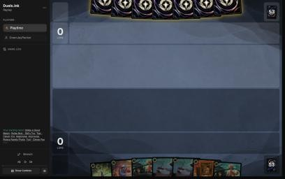
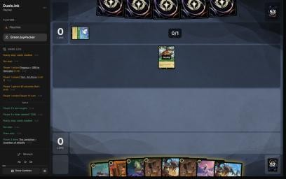
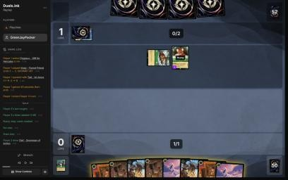
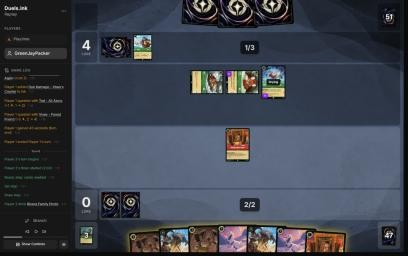
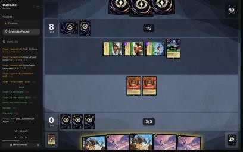
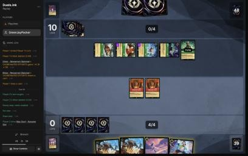
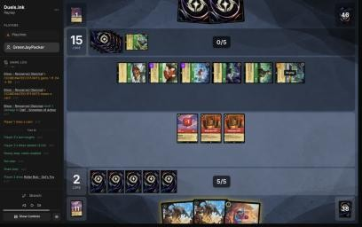

# Review: GreenJayPacker vs Playtime, 18 Nov 2026

| | |
|---|---|
| **Status** | draft (blind pass done, not yet discussed) |
| **Replay** | `01a1ee5b-9309` (`python3 tools/brief.py 01a1ee5b-9309 --turn N`) · [duels.ink viewer](https://duels.ink/replay/01a1ee5b-930e-78d5-aaee-fad6dfbfa628?step=0) |
| **Format** | Core Constructed (stated in the replay). Set 14 era: inks revealed before the coin toss |
| **Decks** | You: Emerald/Ruby Ruby R.E.D. ([the coach's notes on it](#cite-kb-meta-archetypes-emerald-ruby-ruby-r-e-d-greenjaypacker-s-lists)), the same list as your other games that day. Them: Emerald/Steel ([the coach's notes on this pair](#cite-kb-meta-archetypes-emerald-steel-midrange-how-it-plays)); archetype as it became clear: **Midrange #1** (98% from game turn 1): Tod – All Alone, Vixey, White Rabbit, Ursula – Deceiver, Elinor, Broadway, Strength of a Raging Fire |
| **Play/draw** | They went first (their choice) and sent back four cards; you sent back five |
| **Result** | **Loss**, 4–20 on game turn 13 |
| **Meta data** | snapshot of 12 Nov 2026 (fresh until 26 Nov) |
| **Chosen how** | Sent by danny, the coach's user, as a replay link on 18 Nov: GreenJayPacker's, reviewed for them. The coach knew nothing of the result. It reviewed four of GreenJayPacker's games that day first (this one was played between the games against NightFury and Chris Callahan) |

## Summary
- **Good plays:** [8](#turn-8) (Olaf for 3 and a mill: the drain, a body and the next Olaf at 2).
- **Close calls:** [pre-game](#turn-0) (five cards sent back for fresh ones rather than keeping the hand's digs).
- **Inaccuracies / mistakes / blunders:** none.
- **Unwinnable from [12](#turn-12):** without the Device nothing you held could keep them under 20 on game turn 13.

**What decided it:** the Device never came. None of the four turned up in the 27 cards the game showed you (the
mulligan's 12, then 15 drawn or milled): about a 1-in-10 miss. Without it, Ruby R.E.D. has Olaf's drains and little
else, and their Midrange quested for 4 a turn by turn 5 and 6 or more from turn 9. Strength of a Raging Fire, sung for
free, killed the first Olaf on turn 9.

## The game, turn by turn
Verdicts judge each decision on what you could know at the time, **including archetype knowledge an experienced
player has**. Hindsight is kept to its own section. Severity scale: good play / close call /
inaccuracy / mistake / blunder. Principle IDs and hypotheses (H-n) link to copies
in the Citations section at the end, as they stood when they were cited.

**What you knew before the game:** they're Emerald/Steel: Midrange #1 86%, an unlisted list 10%, Midrange #2 4%. They
go first, so their turn k comes on game turn 2k−1 and yours on game turn 2k. Midrange plays cheap Evasive questers and
2-lore bodies, with locks and fighting tricks ([the pair file's notes](#cite-kb-meta-archetypes-emerald-steel-midrange-how-it-plays)). Their key cards against
your plan, with the earliest game turn each can come:
- **Toulouse – Rough and Tumble** (2): you can't play actions, songs included, until their next turn. Game turn 3.
- **Strength of a Raging Fire** (3, a song): damage equal to their character count, enough for Olaf on a board of 4.
  Game turn 5, or free with a 3-cost singer.
- **Angel – Experiment 624** (4): discard a card to deal 2 damage, once a turn; **Elinor – Renowned Diplomat** (4)
  pings 1 and draws at the end of a turn with three exerted characters. Game turn 7.
- **Angela – Night Warrior** (3): Challenger +2 and Resist +2 on a character until their next turn.
- No Raging Storm or Hades in this pair: their answers to The Leviathan are few. IT'S A MACHINE! takes up to 10
  strength of a board of 1- to 4-strength characters.

### Pre-game

*The board before the decision: [step 1](https://duels.ink/replay/01a1ee5b-930e-78d5-aaee-fad6dfbfa628?step=1) in the duels.ink replay viewer.*

**Setup.** On the draw. The hand: Strike, Roller Bob, two Tods, two Improvises and the Photo. No Olaf, Device or
Leviathan, but almost every card digs: two Tods (two cards each), Strike (two), two Improvises (one each). The
mulligan tool (`tools/mulligan.py`, 800 deals; it doesn't model the combo) has keeping all seven at 9.71 ink of 10 on
turns 1–4, keeping six (without Roller Bob) at 9.63, keeping two (Improvise and the Photo) at 9.48. The coach's pick:
keep six, sending back Roller Bob; the digs find the combo pieces and put actions in the discard for Olaf.

**What you did:** kept an Improvise and the Photo; sent back five (the other Improvise, both Tods, Roller Bob and
Strike). Drew Prince Phillip, two Malicious, The Leviathan and Olaf.

**Verdict: close call.** Five fresh cards dig hardest for the missing pieces; the hand's own digs reach them a card
at a time but cost ink each turn. Either is reasonable.

### Turn 1: their turn

**What happened:** they inked Pegasus – Gift for Hercules and played Tod – All Alone (2/2). Midrange #1 98%.

### Turn 2: your turn 1

*The board before the decision: [step 6](https://duels.ink/replay/01a1ee5b-930e-78d5-aaee-fad6dfbfa628?step=6) in the duels.ink replay viewer.*

**Setup.** You drew a second Leviathan. The hand has Olaf and two Leviathans; the Device (4 in 52) is missing. 1 ink:
Improvise digs toward it, the Photo starts the mill. Phillip, a 9-cost the Device can't reach without Olaf, is the
natural ink.

**What you did:** inked Phillip; Improvise drew a second Photo.

**Verdict: fine.** A card toward the Device and an action for Olaf; the Photo loses nothing by waiting a turn.

### Turn 3: their turn

**What happened:** they inked a second Pegasus and played Vixey – Forest Friend (1/3, Evasive, 2 lore) for 2 with Tod
in play; Tod quested (1).

### Turn 4: your turn 2

*The board before the decision: [step 14](https://duels.ink/replay/01a1ee5b-930e-78d5-aaee-fad6dfbfa628?step=14) in the duels.ink replay viewer.*

**Setup.** You drew a second Olaf (8 with one action in the discard). The hand has two Olafs and two Leviathans but
no Device and no dig. 2 ink: the Photo and a mill puts two cards in the discard (actions make Olaf cheaper); the risk
is milling a Device (4 in 50). The ink: the second Photo or a Malicious.

**What you did:** inked a Photo; played the other and milled White Rabbit and Improvise (Olaf to 7).

**Verdict: fine.** The engine started and an action found; nothing in hand digs, so the mill is the turn's best use.

### Turn 5: their turn

**What happened:** they played White Rabbit, inked Don Karnage, and Tod and Vixey quested (4).

### Turn 6: your turn 3

*The board before the decision: [step 24](https://duels.ink/replay/01a1ee5b-930e-78d5-aaee-fad6dfbfa628?step=24) in the duels.ink replay viewer.*

**Setup.** You drew the third Photo. 0–4; their three characters quest for 4 a turn (20 by game turn 13). **The needs
check:** you hold two Olafs and two Leviathans but no Device (4 in 47) and no dig, so the turns to come are Olaf's
drains and bodies while the draws look for the Device. Olaf costs 7 (two actions). 3 ink once you ink. Candidates:
- **Malicious cast:** an action (Olaf 6) and 1 damage to each of theirs, which kills nothing (2, 3 and 2 willpower).
- **The second Photo and two mills:** four cards into the discard, about 1.6 of them actions on average, so Olaf
  probably 5 next turn, sometimes 4. Each mill can also bin a Device.

**What you did:** inked a Malicious; played the Photo; two mills (Strange Things, Strike, Strike and The Leviathan;
Olaf to 4).

**Verdict: fine.** The mills were the quickest way to an Olaf for next turn's 4 ink, at the cost of risking a Device.
With no dig in hand, that's a fair trade.

### Turn 7: their turn

**What happened:** Ursula – Deceiver made you discard Malicious (a song of their choice); three characters quested
(8).

### Turn 8: your turn 4

*The board before the decision: [step 37](https://duels.ink/replay/01a1ee5b-930e-78d5-aaee-fad6dfbfa628?step=37) in the duels.ink replay viewer.*

**Setup.** You drew the third Olaf; Ursula's discard made him cost 3 (six actions). 0–8, and their board quests for 5
(20 by game turn 13). Still no Device (4 in 42) and no dig. 4 ink once you ink a spare Olaf: Olaf (3, 2 lore off them)
and a mill (1) for the next Olaf's discount and the Photos' 10-card lore.

**What you did:** inked an Olaf; Olaf for 3 (8 → 6); a mill (Another Tale and White Rabbit; Olaf to 2).

**Verdict: good play.** The drain, a 2-lore body that's safe while ready, and the next Olaf cheaper, for all 4 ink.

### Turn 9: their turn

**What happened:** they inked Angela – Night Warrior and played Elinor – Renowned Diplomat; Vixey sang Strength of
a Raging Fire for free (5 characters, 5 damage) and banished Olaf. Three characters quested (9), and Elinor's
COORDINATED EFFORTS gave 1 more and a card (10).

### Turn 10: your turn 5

*The board before the decision: [step 50](https://duels.ink/replay/01a1ee5b-930e-78d5-aaee-fad6dfbfa628?step=50) in the duels.ink replay viewer.*

**Setup.** You drew Max Goof – Karaoke Star. 0–10. Their board (Tod, Vixey, White Rabbit, Ursula, Elinor) quests
for 6, and Elinor adds 1 at the end of each of their turns with three exerted: 20 on game turn 13. Your hand: two
Leviathans (uninkable), Olaf (2: seven actions in the discard) and Max Goof (five songs in the discard, so a 4-lore
quester). 5 ink if you ink Olaf or Max Goof, the only inkable cards.

**The needs check.** The lore race can't be won: you have 0 and one more turn before theirs on game turn 13. What wins
is a wipe on turn 12, and that needs the Device (4 in 39, one draw: 10%; Max Goof's dig needs a song in hand, and
there is none). The Device line on turn 12 needs **Olaf on the board** (9 printed, so the Device plays The Leviathan
from him), and 5 ink: the Device (3), its activation (1) and a Photo mill (1) for the second card into the discard.
IT'S A MACHINE! then takes their whole board (9 strength). The thinner outs: the last Olaf (3%), a second drain plus
the first Olaf challenging Elinor, which holds them to about 18 on turn 13; Strange Things (2, 5%) to stop two
questers.

Their answers to Olaf on turn 11: Strength of a Raging Fire again (12% held, 17% after their draw; 5 damage), or
Angel (2) with Elinor's ping (1), which falls short of his 4 willpower. Ready, he can't be challenged.

Candidates:
- **Olaf (2; 10 → 8), the Photos for lore (+2), ink Max Goof:** the drain now and Olaf in place for the Device.
- **The same, keeping Max Goof:** 4 ink covers it exactly; Max Goof stays for a turn-12 ink or a 4-lore body after a
  wipe. Inking him now leaves 1 ink unused this turn, and turn 12 has 5 ink either way when the Device is the draw.
- **Max Goof (3) and the Photos, ink Olaf:** a 4-lore quester from turn 12, but no drain and no Device target. It
  loses the only line that wins.

The Photos' lore beats their mill: the discard already has seven actions and five songs, and milling doesn't change
the chance the next draw is the Device.

**What you did:** Olaf for 2 (10 → 8); both Photos for 1 lore each (0 → 2); inked Max Goof.

**Verdict: fine.** The drain and Olaf on the board for the Device line. Inking Max Goof or keeping him comes out
about level.

### Turn 11: their turn

**What happened:** they inked The Queen – Devious Disguise and played Broadway – Sturdy and Strong (4/6, Bodyguard)
exerted. All five others quested (14); Elinor pinged Olaf for 1, gained 1 (15) and drew.

### Turn 12: your turn 6

*The board before the decision: [step 67](https://duels.ink/replay/01a1ee5b-930e-78d5-aaee-fad6dfbfa628?step=67) in the duels.ink replay viewer.*

**Setup.** You drew Roller Bob – Sid's Toy, not the Device. 2–15. Their six characters quest for 8 (Broadway 2, Vixey
2, the rest 1 each), and Elinor adds 1 at the end of their turn: they need 5, and **reach 20 on game turn 13 before
your next draw.** In hand: two Leviathans (10, unaffordable on 5 ink) and Roller Bob (3; TIME TO MOVE gives him Rush
for two characters from the discard). On the board: Olaf (4/4, 1 damage) and the two Photos. No dig in hand or in play.

**The needs check: nothing you hold stops them.** To keep them under 20 you'd have to cut their questing to 4 or less.
Broadway's Bodyguard (exerted, 4/6) takes the first challenge; Olaf and a Rushing Roller Bob together kill only him,
and both die doing it (4 damage back each). That leaves Tod, Vixey, White Rabbit, Ursula and Elinor: 6 lore and
Elinor's 1, so 22. Even Broadway and Elinor both gone would leave exactly 5. **The game is lost from here**
([principle 2](#cite-principle-2)), short of a mistake by them.

The best you can do is make 20 as hard as possible: kill Broadway (their biggest quester), take the Photos' 2 lore.

**What you did:** Roller Bob with Rush (White Rabbit and Olaf from the discard to the bottom) challenged Broadway
(4 damage, Bob banished); Olaf finished Broadway and was banished too; both Photos for lore (2 → 4).

**Verdict: fine.** Nothing could stop them reaching 20; the line took their biggest quester.

### Turn 13: their turn

**What happened:** Tod, Vixey, White Rabbit and Ursula quested: 20. They won.

## Lessons
1. **Against Emerald/Steel Midrange on the draw, the combo has to land by about game turn 12** ([turn 10](#turn-10)).
   Cheap Evasive questers, Elinor's extra lore and Broadway took them from 4 lore a turn on turn 5 to 9 on turn 13.
   Olaf's drains buy about a turn each.
2. **Olaf dies to a free Strength of a Raging Fire once they have four characters** ([turn 9](#turn-9)). Vixey,
   Elinor and Broadway all sing it. Count the drain as Olaf's value; staying in play as the Device's base is a bonus.
3. **The Photos' lore mode is free value once Olaf is cheap** ([turn 10](#turn-10)). Milling doesn't change the
   chance that the next draw is the Device; it only helps when the discard still needs actions, songs or 10 cards.

## Proposed knowledge-base updates (applied after discussion)
- **Meta** (the Emerald/Steel pair file's notes, Playtime): Midrange #1 on the play. Tod – All Alone turn 1, Vixey
  for 2 with Tod on turn 3, White Rabbit, Ursula – Deceiver (took Malicious), Elinor on turn 9 with Vixey singing
  Strength of a Raging Fire for free on Olaf, Broadway exerted on turn 11. Inked: Pegasus ×2, Don Karnage, Angela, The
  Queen. Lore: 4 a turn from turn 5, 6 and Elinor's 1 from turn 9; with Broadway (turn 11), 8 and Elinor's 1 by turn 13, when they reached 20.
- **Meta** (the Emerald/Ruby pair file's notes, GreenJayPacker's Ruby R.E.D.): against Emerald/Steel Midrange on the
  draw, the deadline for the combo is about game turn 12; Olaf dies to their free Raging Fire at four characters, and
  Broadway's 4 strength takes their board past what IT'S A MACHINE! banishes in one go.

## Hindsight
Doesn't change the verdicts above.
- No Device in 27 cards: a 60% chance of one in the mulligan's 12 cards and 75% in the next 15, so both misses
  together came about 1 time in 10 (`tools/odds.py hold`).
- A Device on turn 12 wouldn't have taken all six of their characters (13 strength): Broadway, Elinor, Tod and Vixey
  (10) would have left White Rabbit and Ursula, with them at 15 and The Leviathan in play.

## The coach's errors
None found by the coach during the review; the discussion may add some.

| When | Error | How it was caught | How it won't happen again |
|---|---|---|---|

## Open questions
- **[Pre-game](#turn-0):** what made you send five back rather than keep the Tods and Strike to dig?
- **[Turn 10](#turn-10):** was Max Goof inked for the extra ink on turn 12, or to keep him from a discard?

## Citations
Copies of the coach's knowledge base cited above, as they stood when they were cited (the private repository's commit and date are given with each). They don't change when the knowledge base does.

**emerald-steel.md, Midrange: how it plays**: knowledge base, `kb/meta/archetypes/emerald-steel.md` at `1afc04f` (2026-11-18), working tree

> ### Midrange: how it plays `[coach, meta study of the user's 27 Oct 2026 games (tools/scan.py), full games, not blind, 3 games]`
> Games: 01a17ddb, 01a17ead, 01a17f0e.
> - **Cheap Evasive questers:** White Rabbit (2), Vixey (3, or 2 with a Tod in play; 2 lore), and Mushu – Stealthy Dragon
>   (3; draws when you hold more cards).
> - **2-lore bodies:** Flash – Efficient Clerk (Resist 1; all characters lose Rush and can't gain it) and Broadway.
> - **The Queen – Devious Disguise:** +2 {L} while you lead, so she quests for 3. Her draw on play gives you 2 lore.
> - **Locks:**
>   - Toulouse – Rough and Tumble: when played, **you can't play actions (songs included) until their next turn**
>   - Ursula – Deceiver: you discard a song of their choice
> - **Fighting:** Angela – Night Warrior gives a character Challenger +2 and Resist +2. Strength of a Raging Fire deals
>   damage equal to their character count (4 in 01a17f0e turn 13).
> - **Big turns:** steady +6 quest turns (01a17ead turn 12: The Queen for 3 plus three 1s; 01a17f0e turn 13 after
>   Strength of a Raging Fire).
> - **They also used the ink drops your Mickey – Best in Town gives each player:** four on turn 6 of 01a17ddb
>   (`kb/cards/mickey-mouse-best-in-town.md`).

**emerald-ruby.md, Ruby R.E.D.: GreenJayPacker's lists**: knowledge base, `kb/meta/archetypes/emerald-ruby.md` at `1afc04f` (2026-11-18), working tree

> ### Ruby R.E.D.: GreenJayPacker's lists, 17 Nov 2026 `[coach, blind reviews of 01a1ea7f-cc42, 01a1eaf6-93a9, 01a1eb05-70c1, 01a1eb0c-446c and 01a1eb2e-39fc; 2 wins, 3 losses]`
> - **Lists:** the first (four games) ran Stegmutt ×4, Strange Things ×3, The Torn Corner ×4 and To Wither a Flower ×2,
>   with no Lyle Tiberius Rourke or Dangerous Plan. The second (01a1eb2e-39fc) swapped Stegmutt and To Wither a Flower
>   for White Rabbit ×4 and Roller Bob – Sid's Toy ×3, with three Photos.
> - **The Device line:** the Device turns Olaf, Phillip (9) or Stegmutt (8) into The Leviathan. The banished character is
>   one of IT'S A MACHINE!'s two cards, so one mill or one song makes the other; the Photo's mill (1 ink, 2 cards) is the
>   cheapest. Mill before the Device (01a1eb2e-39fc turn 13).
> - **The Device before Olaf** (01a1eb0c-446c turns 7 and 9): an item most decks can't touch, while Olaf waiting in play
>   meets Smash, Shere Khan's challengers or Hades. Against Detectives, Elisa Maza takes the Device from hand, so play it
>   before she can come (01a1eaf6-93a9 turns 6 and 8); Judy Hopps – On the Case and Wildcat – Unconventional Mechanic
>   take it from play.
> - **Quest before the Device banishes:** it takes exerted characters, so Olaf or The Leviathan quests first, and The
>   Leviathan can later become Phillip after Malicious (01a1eb0c-446c turns 11 and 15).
> - **Max Goof – Karaoke Star is a lore engine:** with five songs in the discard, BRAND-NEW PLAYLIST makes him a 4-lore
>   quester, often the deck's best lore (turn 10 of 01a1eaf6-93a9; seven songs by turn 15 of 01a1eb0c-446c). The song
>   SWEET REMIX discards counts. Smash and Ink Explosion killed him in two games.
> - **Roller Bob:** Rush for two characters from the discard to the bottom; his 4 {S} banishes a 4-{W} location the
>   turn he lands, for nothing back (01a1eb2e-39fc turn 11).
> - **By matchup:** against Detectives The Leviathan is a wipe, not a quester (H-14's counter-case); against a fast lore
>   board (01a1eb05-70c1) the combo has to land by about game turn 9; against locations, banish them with characters.

**principle 2**: coaching principle, `CLAUDE.md` at `1afc04f` (2026-11-18), working tree

> 2. **Some games are unwinnable.** Draws and matchups can make a game lost whatever the player does. Say so
>    when it's true, rather than inventing mistakes to explain a loss.
