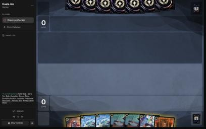
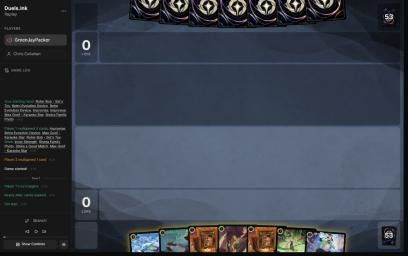
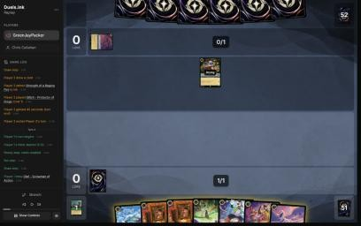
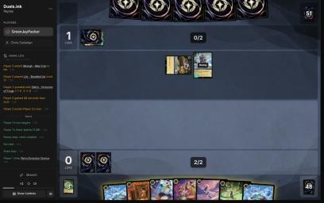
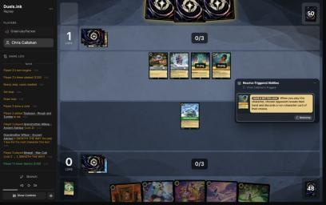
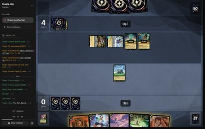
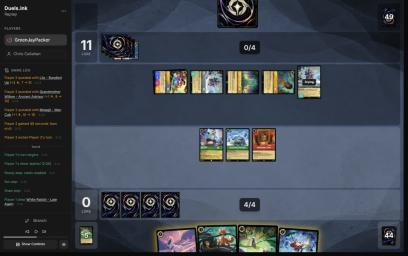
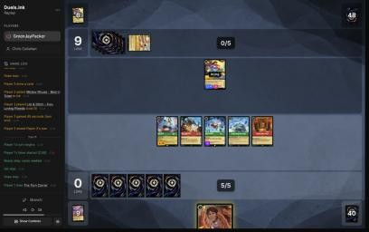
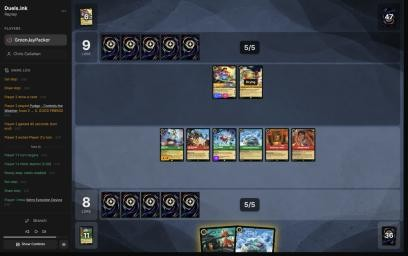
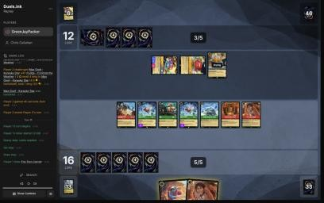

# Review: GreenJayPacker vs Chris Callahan, 18 Nov 2026

| | |
|---|---|
| **Status** | final (discussed 18 Nov 2026: the player's answers to the open questions, relayed by danny) |
| **Replay** | `01a1ee60-9d32` (`python3 tools/brief.py 01a1ee60-9d32 --turn N`) · [duels.ink viewer](https://duels.ink/replay/01a1ee60-9d36-7df2-84a2-1788d1e71312?step=0) |
| **Format** | Core Constructed (stated in the replay). Set 14 era: inks revealed before the coin toss |
| **Decks** | You: Emerald/Ruby Ruby R.E.D. ([the coach's notes on it](#cite-kb-meta-archetypes-emerald-ruby-ruby-r-e-d-greenjaypacker-s-lists)), the same list as your other games that day. Them: Amber/Steel ([the coach's notes on this pair](#cite-kb-meta-archetypes-amber-steel-rockstar-aggro-savitar-s-lilo-list)); archetype as it became clear: **Rockstar Aggro**, 87% from game turn 4 (Stitch – Protector of Frogs, Lilo – Bundled Up), with Mowgli – Man Cub and Lilo – Rock Star off-list |
| **Play/draw** | You went first and sent back four cards; they sent back one |
| **Result** | **Win**, 20–12 on game turn 15 |
| **Meta data** | snapshot of 12 Nov 2026 (fresh until 26 Nov) |
| **Chosen how** | Sent by danny, the coach's user, as a replay link on 18 Nov: GreenJayPacker's, reviewed for them. The coach knew nothing of the result. It reviewed GreenJayPacker's two games before this one that day first |

## Summary
- **Good plays:** [3](#turn-3), [6](#turn-6) (the right card to Mowgli), [7](#turn-7) (Max Goof a turn early,
  so Strike could be sung for free on the combo turn: better than the coach's line), [9](#turn-9) (the free dig, the
  cantrip it found, Olaf's drain and The Leviathan banishing all five, the turn before they'd have won),
  [11](#turn-11), [15](#turn-15).
- **Close calls:** [pre-game](#turn-0) (four cards sent back).
- **Inaccuracies / mistakes / blunders:** none.

**What decided it:** game turn 9. Rockstar Aggro was at 11 with a board questing for 9, so their next turn won.
Olaf's drain alone kept them short, and the dig (Strike sung by Max Goof, then the Inner Strength it found) turned up
The Leviathan, which banished all five of their characters (7 strength in all). With no hand and no board, they never
caught up with Max Goof's 4 a turn and The Leviathan's 3.

## The game, turn by turn
Verdicts judge each decision on what you could know at the time, **including archetype knowledge an experienced
player has**. Hindsight is kept to its own section. Severity scale: good play / close call /
inaccuracy / mistake / blunder. Principle IDs and hypotheses (H-n) link to copies
in the Citations section at the end, as they stood when they were cited.

**What you knew before the game:** they're Amber/Steel: Lilo & Stitch Songs 41%, Rockstar Aggro 37%, an unlisted list
23%. You go first, so your turn k comes on game turn 2k−1. Both lists are fast: Rockstar Aggro goes wide with 1- and
2-cost characters (Pudge free with a Lilo, Grandmother Willow and Mickey's ink drops for two plays a turn) and has
quest turns of +5 to +10 by game turn 8 ([the pair file's notes](#cite-kb-meta-archetypes-amber-steel-rockstar-aggro-savitar-s-lilo-list)). Against a fast lore board the
combo has to land by about game turn 9 (the notes on your deck, from etpicci's game). Their key cards against your
plan, with the earliest game turn each can come:
- **Toulouse – Rough and Tumble** (2, Rockstar): you can't play actions, songs included, until their next turn. That
  turns off Malicious, Strike, Improvise and the Tale for a turn. Game turn 4.
- **Flash – Efficient Clerk** (2): no character can have Rush, so no Roller Bob challenges the turn he lands.
- **Strength of a Raging Fire** (3, a song): damage equal to their character count, enough for Olaf on a wide board.
  **World's Greatest Criminal Mind** (3, a song) banishes a character with 5 {S} or more: The Leviathan. Both from game
  turn 6, or sung for free by a 3-cost character.
- **Dale – Ready for His Shot** (4): their characters deal damage with their willpower in challenges. Game turn 8.
- **Lilo – Bundled Up** (2): the first damage on each of your turns is prevented, so Malicious doesn't touch her.
- For you: IT'S A MACHINE! can banish up to 10 strength, which on a board of 1- and 2-strength characters is most of
  it, and it banishes without damage.

### Pre-game

*The board before the decision: [step 1](https://duels.ink/replay/01a1ee60-9d36-7df2-84a2-1788d1e71312?step=1) in the duels.ink replay viewer.*

**Setup.** On the play. The hand: Roller Bob, two Devices, two Improvises, Max Goof and the Photo. No Olaf and no
Leviathan. The mulligan tool (`tools/mulligan.py --plan`, 1,000 deals; it doesn't model the combo) has keeping all
seven at 9.39 ink of 10, keeping six (all but the second Device) at 9.20, keeping five (without Max Goof) at 8.87.
Max Goof has no song to discard. The coach's pick: keep six, sending back the second Device; Roller Bob's 4 {S}
trades with their early questers.

**What you did:** kept the Device, an Improvise and the Photo; sent back four (the other Device and Improvise, Max Goof
and Roller Bob). Drew Inner Strength, a second Photo, Strike and Max Goof.

**Verdict: close call.** Four fresh cards dig for Olaf and The Leviathan, which a fast deck gives you until about game
turn 9 to land. Roller Bob was worth keeping against 1- and 2-drops, but either is reasonable.

### Turn 1: your turn 1

*The board before the decision: [step 3](https://duels.ink/replay/01a1ee60-9d36-7df2-84a2-1788d1e71312?step=3) in the duels.ink replay viewer.*

**Setup.** 1 ink. The plays: a Photo (two in hand) or a cantrip (Improvise or Inner Strength). Either spends turn 2's
2 ink the same way afterwards.

**What you did:** inked Inner Strength (after undoing a Photo ink) and cast Improvise, drawing Another Tale to Spin.

**Verdict: fine.** A card seen and an action in the discard; both Photos kept.

### Turn 2: their turn

**What happened:** they inked Strength of a Raging Fire and played Stitch – Protector of Frogs (1/3).

### Turn 3: your turn 2

*The board before the decision: [step 11](https://duels.ink/replay/01a1ee60-9d36-7df2-84a2-1788d1e71312?step=11) in the duels.ink replay viewer.*

**Setup.** You drew Olaf (8 with one action in the discard). 2 ink once you ink; the second Photo is the spare.
Strike digs two and puts two cards in the discard; the Tale draws one but gives an aggro deck an ink drop.

**What you did:** inked a Photo; Strike drew Strange Things and a second Strike, and discarded a Strange Things
(Olaf to 6).

**Verdict: good play.** The cheapest dig, two actions in the discard, and the second Strike kept for Max Goof.

### Turn 4: their turn

**What happened:** they inked Mowgli – Man Cub (off-list here; it takes a non-character card from your hand when
played), played Lilo – Bundled Up, and Stitch quested (1). Rockstar Aggro 87%.

### Turn 5: your turn 3

*The board before the decision: [step 19](https://duels.ink/replay/01a1ee60-9d36-7df2-84a2-1788d1e71312?step=19) in the duels.ink replay viewer.*

**Setup.** You drew the second Device. 3 ink once you ink (the spare Device). Olaf costs 6; The Leviathan isn't in
hand yet (4 in 48). Their board quests for 3 a turn and Rockstar Aggro grows fast, so the combo wants to land by about
game turn 9. Candidates:
- **Max Goof, discarding a song:** two cards toward The Leviathan now and Olaf to 5; the Device next turn.
- **The Device now:** out of reach of a second Mowgli; Max Goof's dig a turn later.

**What you did:** inked a Device and played the other.

**Verdict: fine.** Against a deck that showed Mowgli, the Device in play is safe from the hand attack, and the next
turn still fits Max Goof and the Photo. Max Goof first would have dug a turn sooner; it's close.

**In discussion (18 Nov 2026):** yes: with no item removal known in their deck, you didn't want to risk the Device
being discarded from hand. You asked danny to confirm there's none; from the coach's knowledge base, duels.ink's
Amber/Steel lists run no item removal. Steel's Core-legal cards that banish an item are Benja – Guardian of the Dragon
Gem, Mulan – Created by the Vine, Donald Duck – Along for the Ride and Pluto – Steel Champion (lorcana-api, which
covers Sets 9–13, not Set 14); none is in those lists. Mowgli, which they had shown, takes cards from hand. The
verdict (fine) stands.

### Turn 6: their turn

*The board before the decision: [step 25](https://duels.ink/replay/01a1ee60-9d36-7df2-84a2-1788d1e71312?step=25) in the duels.ink replay viewer.*

**What happened:** they inked Toulouse – Rough and Tumble, played Grandmother Willow and then Mowgli for 1, and
questing took them to 4.

**What you did (Mowgli's discard):** discarded Another Tale to Spin, from the Photo, Strike and the Tale.

**Verdict: good play.** Strike is the better dig, the Photo the engine, and the Tale still counts for Olaf in the
discard. The Device, played last turn, was out of Mowgli's reach.

### Turn 7: your turn 4

*The board before the decision: [step 29](https://duels.ink/replay/01a1ee60-9d36-7df2-84a2-1788d1e71312?step=29) in the duels.ink replay viewer.*

**Setup.** You drew The Torn Corner, the ink. 0–4; their four characters quest for 5 a turn (20 by game turn 14).
Olaf costs 5, the Device is in play, and The Leviathan is still to find (4 in 47). 4 ink. For The Leviathan next turn
(5 ink) you need Olaf cheap enough, the Device's use (1) and a second card for the discard. Candidates:
- **Strike, the Photo and a mill:** two cards seen and up to four into the discard now (Olaf to 2–3); next turn Olaf,
  the use and a mill fit 5 ink.
- **Max Goof (discarding Strike) and the Photo:** two cards seen and a body. Next turn Max Goof, dry, can sing a
  second Strike for free: two more cards seen and two into the discard, so Olaf, the use and the song fit 5 ink too.
  A Toulouse on their turn would stop the song.

**What you did:** inked The Torn Corner; Max Goof discarded Strike and drew Tod and a second Strike; played the Photo.

**Verdict: good play.** Better than the coach's line: Max Goof on the board turns next turn's Strike into a free dig,
so by the combo turn you've seen five cards for The Leviathan rather than three, for the same ink.

**In discussion (18 Nov 2026):** the plan was the cards: early on, more cards in hand meant a better chance of finding
what was missing (The Leviathan, or Malicious with Phillip). The free Strike next turn came with the line. The verdict
judges the play, so it stands.

### Turn 8: their turn

**What happened:** Lilo & Stitch – Fun-Loving Friends Shifted onto Stitch for 2 (Willow's discount), Lilo – Rock Star
was inked, a second Lilo – Bundled Up came down, and four characters quested for 7, with Fun-Loving Friends' Support
onto Willow (11).

### Turn 9: your turn 5

*The board before the decision: [step 45](https://duels.ink/replay/01a1ee60-9d36-7df2-84a2-1788d1e71312?step=45) in the duels.ink replay viewer.*

**Setup.** You drew White Rabbit. 0–11, and their five characters quest for 9: **20 next turn** unless this turn
changes it. **The needs check:** what you hold does change it. Olaf (4, less after more actions) drains 2, so their 9
lore next turn makes 18, not 20. The Leviathan isn't in hand, but their board's strength is 7 (Fun-Loving Friends 3,
four 1s), all in IT'S A MACHINE!'s reach, and the dig is Max Goof singing Strike for free (two cards, two into the
discard) plus any cantrip it finds. Tod (3) digs two more but leaves no ink for Olaf, so Olaf comes first in every
line. 5 ink once you ink: Olaf (2–3 after Strike) and the Device's use (1) leave room for a 1-cost cantrip.

**What you did:** Max Goof sang Strike (drew Malicious and Inner Strength, discarded Malicious); Inner Strength drew
The Leviathan; Olaf for 1 (11 → 9); the Device turned Olaf into The Leviathan, which banished all five. Tod inked,
White Rabbit played. 0–9, their board empty.

**Verdict: good play.** The free dig first, the cantrip it found, then the drain and the wipe: the most cards seen
for the ink, and the one line that both saved the turn and won the board.

### Turn 10: their turn

**What happened:** with an empty hand after the wipe, they inked Mickey Mouse – Best in Town and played a second Lilo &
Stitch – Fun-Loving Friends. No quests (9).

### Turn 11: your turn 6

*The board before the decision: [step 61](https://duels.ink/replay/01a1ee60-9d36-7df2-84a2-1788d1e71312?step=61) in the duels.ink replay viewer.*

**Setup.** You drew The Torn Corner. 0–9. Your board quests for 8 (Max Goof 4 with six songs in the discard, The
Leviathan 3, White Rabbit 1); theirs is one drying Fun-Loving Friends and no hand. From ahead the safest line wins
([POS-1](#cite-pos-1)): quest everything. Max Goof exerted can be challenged by Fun-Loving Friends (3), which costs them its 3-lore
quest. The Torn Corner draws once the discard holds 10 (it holds 9): the Photo's mill first makes it 11. 5 ink: the
Corner (3), the mill (1) and the draw (1).

**What you did:** The Torn Corner, the Photo's mill (Max Goof and Strange Things), the Corner's draw (Tod), and all
three quested (8–9).

**Verdict: good play.** Every ink used, a card drawn, 8 lore.

### Turn 12: their turn

**What happened:** Pudge – Controls the Weather came down for free (a Lilo in play). Fun-Loving Friends neither
quested nor challenged Max Goof.

### Turn 13: your turn 7

*The board before the decision: [step 71](https://duels.ink/replay/01a1ee60-9d36-7df2-84a2-1788d1e71312?step=71) in the duels.ink replay viewer.*

**Setup.** You drew the third Device. 8–9. Your board quests for 8 (16), and next turn's quest wins unless they
remove most of it; they have no hand and 5 ink. Nothing of theirs is exerted, so there's nothing to challenge. The
ink: Tod's dig, a second White Rabbit, the Photo's lore or The Torn Corner's draw.

**What you did:** Tod (discarded the Device, drew White Rabbit and Roller Bob), White Rabbit, and all three quested
(16–9).

**Verdict: fine.** The Photo's lore would have made 17 instead; either way next turn's quest is 10 against a board
that can't remove much of it.

### Turn 14: their turn

**What happened:** Toulouse – Rough and Tumble locked your actions for a turn; Fun-Loving Friends quested (12) and its
Support let Pudge kill Max Goof.

### Turn 15: your turn 8

*The board before the decision: [step 84](https://duels.ink/replay/01a1ee60-9d36-7df2-84a2-1788d1e71312?step=84) in the duels.ink replay viewer.*

**Setup.** You drew The Torn Corner. 16–12: The Leviathan and a White Rabbit quest for 4.

**What you did:** The Leviathan and a White Rabbit quested: 20.

**Verdict: good play.** The win, with nothing left to chance.

## Lessons
1. **A singer in play makes the next song free** ([turn 7](#turn-7)). Max Goof played a turn before the combo turn
   could sing Strike on it: two more cards seen and two into the discard for no ink, which is what found The
   Leviathan.
2. **When they're one quest from 20, count what the drain alone does** ([turn 9](#turn-9)). Olaf's 2 kept them short
   whatever the dig found, so Olaf came first in every line and the dig was spent around him.
3. **Against Rockstar Aggro, IT'S A MACHINE! takes the whole board** ([turn 9](#turn-9)). Its 1- and 2-strength
   characters fit many to the 10, and it banishes, so Lilo – Bundled Up's EXTRA LAYERS doesn't save her. Their hand
   is usually empty by then, so a wipe ends the race.
4. **Against a deck with Mowgli – Man Cub, the Device is safer in play** ([turns 5](#turn-5), [6](#turn-6)): his
   discard only reaches your hand.

## Proposed knowledge-base updates (applied after discussion)
- **Meta** (the Amber/Steel pair file's notes, Chris Callahan): Rockstar Aggro with Stitch – Protector of Frogs, Lilo –
  Bundled Up ×2, Grandmother Willow, Mowgli – Man Cub ×2 (off-list; one inked), Toulouse ×2 (one inked), Lilo & Stitch
  – Fun-Loving Friends ×2, Lilo – Rock Star (off-list, inked), Pudge, Mickey – Best in Town (inked) and Strength of a
  Raging Fire (inked). Fun-Loving Friends Shifted for 2 with Willow's discount on game turn 8, 11 lore by then; The
  Leviathan's wipe on turn 9 left them with no hand and no board. Fun-Loving's Support let Pudge kill Max Goof on turn
  14.
- **Meta** (the Emerald/Ruby pair file's notes, GreenJayPacker's Ruby R.E.D.): against Rockstar Aggro the combo landed
  on game turn 9, the turn before they'd have won; Max Goof in play beforehand made the combo turn's Strike free.
- **Strategy:** [H-14](#cite-h-14), evidence for from [turn 9](#turn-9): landing The Leviathan the turn the line was ready won a
  race that was a turn from lost.

## Hindsight
Doesn't change the verdicts above.
- Mowgli came on turn 6 and took Another Tale to Spin; the Device was already in play.
- Toulouse came only on turn 14, after the game was decided, so the free Strike on turn 9 was never at risk.

## The coach's errors
Found by the coach during the review; the discussion may add more.

| When | Error | How it was caught | How it won't happen again |
|---|---|---|---|
| Turn 7 | The coach's line (Strike now, the Photo and a mill) saw fewer cards by the combo turn than yours, because it missed that Max Goof in play makes next turn's song free | Comparing your line with the coach's | Proposed: the brief's options mark a song in hand that a character in play (or one you can play this turn) could sing for free next turn |

## Open questions
All answered by the player in discussion, relayed by danny (18 Nov 2026).
- **[Turn 7](#turn-7):** Max Goof was for the cards; the free Strike came with it. The verdict stands.
- **[Turn 5](#turn-5):** yes, the Device went down to keep it from a discard, with no item removal known in their
  deck. None is in duels.ink's Amber/Steel lists (the turn's section). The verdict stands.

## Citations
Copies of the coach's knowledge base cited above, as they stood when they were cited (the private repository's commit and date are given with each). They don't change when the knowledge base does.

**emerald-ruby.md, Ruby R.E.D.: GreenJayPacker's lists**: knowledge base, `kb/meta/archetypes/emerald-ruby.md` at `949945e` (2026-11-18), working tree

> ### Ruby R.E.D.: GreenJayPacker's lists, 17 Nov 2026 `[coach, blind reviews of 01a1ea7f-cc42, 01a1eaf6-93a9, 01a1eb05-70c1, 01a1eb0c-446c and 01a1eb2e-39fc; 2 wins, 3 losses]`
> - **Lists:** the first (four games) ran Stegmutt ×4, Strange Things ×3, The Torn Corner ×4 and To Wither a Flower ×2,
>   with no Lyle Tiberius Rourke or Dangerous Plan. The second (01a1eb2e-39fc) swapped Stegmutt and To Wither a Flower
>   for White Rabbit ×4 and Roller Bob – Sid's Toy ×3, with three Photos.
> - **The Device line:** the Device turns Olaf, Phillip (9) or Stegmutt (8) into The Leviathan. The banished character is
>   one of IT'S A MACHINE!'s two cards, so one mill or one song makes the other; the Photo's mill (1 ink, 2 cards) is the
>   cheapest. Mill before the Device (01a1eb2e-39fc turn 13).
> - **The Device before Olaf** (01a1eb0c-446c turns 7 and 9): an item most decks can't touch, while Olaf waiting in play
>   meets Smash, Shere Khan's challengers or Hades. Against Detectives, Elisa Maza takes the Device from hand, so play it
>   before she can come (01a1eaf6-93a9 turns 6 and 8); Judy Hopps – On the Case and Wildcat – Unconventional Mechanic
>   take it from play.
> - **Quest before the Device banishes:** it takes exerted characters, so Olaf or The Leviathan quests first, and The
>   Leviathan can later become Phillip after Malicious (01a1eb0c-446c turns 11 and 15).
> - **Max Goof – Karaoke Star is a lore engine:** with five songs in the discard, BRAND-NEW PLAYLIST makes him a 4-lore
>   quester, often the deck's best lore (turn 10 of 01a1eaf6-93a9; seven songs by turn 15 of 01a1eb0c-446c). The song
>   SWEET REMIX discards counts. Smash and Ink Explosion killed him in two games.
> - **Roller Bob:** Rush for two characters from the discard to the bottom; his 4 {S} banishes a 4-{W} location the
>   turn he lands, for nothing back (01a1eb2e-39fc turn 11).
> - **By matchup:** against Detectives The Leviathan is a wipe, not a quester (H-14's counter-case); against a fast lore
>   board (01a1eb05-70c1) the combo has to land by about game turn 9; against locations, banish them with characters.

**amber-steel.md, Rockstar Aggro: Savitar's Lilo list**: knowledge base, `kb/meta/archetypes/amber-steel.md` at `949945e` (2026-11-18), working tree

> ### Rockstar Aggro: Savitar's Lilo list `[coach, meta study of 15 of Savitar's games, 2 Nov 2026 (tools/scan.py), full games, not blind]`
> Studied: 01a19bbd-6ae7 and 01a19bc4-57f1 (GoldenBeast), 01a19bd8-ada2 and 01a19bdb-d8e4 (iKnowZer0), 01a19c02-ae0e,
> 01a19c06-3be1, 01a19cc1-7b0e and 01a19cc5-5243 (Kariminal), 01a19c08-a45f, 01a19c0e-1e9e and 01a19c11-9fbf
> (ligerien), 01a19cbb-e8f7 and 01a19cbe-8319 (Pandagheist), 01a19da0-735c and 01a19dad-a6c9 (DJJAZZYJIMMY). The same
> 60 in every game:
> - **1-drops:** Lilo – Snow Artist ×4 (1/2/1; +1 {L} with a Stitch in play), Stitch – Protector of Frogs ×4 (1/3/1),
>   Mickey Mouse – Best in Town ×4 (0/4/2, Adventurous; HOT DOG gives each player an ink drop).
> - **2-drops:** Grandmother Willow ×4 (uninkable; SMOOTH THE WAY: next character 1 less each turn), Lilo – Bundled Up
>   ×4 (uninkable, 1/2/2; EXTRA LAYERS: the first damage on each opponent's turn is prevented), Pudge – Controls the
>   Weather ×4 (1/3/1; **free with a Lilo in play**), David – Protective Snowboarder ×4 (1/4/1, Bodyguard), Mike Wazowski
>   – Heroic Climber ×4 (uninkable, 0/4/1; FIND A FRIEND on play and each quest: **each player** may keep a character off
>   the top), Flash – Efficient Clerk ×3 (uninkable, 3/2/2, Resist 1; no character can have Rush), Toulouse – Rough and
>   Tumble ×4 (opponents can't play actions, songs included, until your next turn), Mr. Big – Distribution Magnate ×3
>   (0/2/1; ICE OUT: if all your ink is exerted at the end of your turn, a chosen opposing character can't challenge
>   until your next turn).
> - **Higher:** Nani – Stage Manager ×4 (3; finds a 2-cost-or-less character in the top 4), Strength of a Raging Fire ×4
>   (3; damage equal to your character count), Dale – Ready for His Shot ×4 (4, 0/4/2; SPIKE SUIT: in challenges your
>   characters deal damage with their {W}), Lilo & Stitch – Fun-Loving Friends ×4 (Shift 3 onto a Lilo or Stitch;
>   3/5/3, Resist 1, Support), Lilo – Rock Star ×2 (Shift 4 onto a Lilo; each quest replays a 2-cost-or-less character
>   from the discard).
> - **Not in duels.ink's average list:** David, Flash, Mr. Big and Lilo – Rock Star; no Angel, Berlioz or Stitch – Rock
>   Star.
>
> **How it wins:**
> - **A wide board on turn 1:** Lilo – Snow Artist then three free Pudges made four characters on game turn 1 of
>   01a19bc4-57f1. Grandmother Willow's discount and Mickey's drops keep two plays a turn coming.
> - **Quest turns of +5 to +10** once five to seven 1-lore characters are out (01a19bdb-d8e4 turn 8: +10, with Lilo &
>   Stitch Shifted on for 2).
> - **Dale turns high-willpower bodies into removal:** Stitch (3 {W}) and Mike Wazowski (4 {W}) killed three of
>   ligerien's characters in one turn (01a19c08-a45f turn 8).
> - **Locks:** Mr. Big's ICE OUT on their best challenger each turn (two Mr. Bigs, two targets), Toulouse against a
>   song deck on the turn it matters, Flash against Rush.
>
> **What beat it in the study:**
> - **Board damage:** most of the deck has 2 or 3 willpower. Circle of Life's Malicious, Mean, and Scary plus To Wither
>   a Flower killed five characters on turn 7 of 01a19cc5-5243; Don Karnage – Debonair Pirate's 1 damage plus Malicious
>   killed both Mr. Bigs (01a19c02-ae0e turn 6). Emerald/Steel's Don Karnage and Elinor pings did the same slowly.
> - **Raging Storm,** from game turn 9 with ink drops: Mickeys on both sides gave iKnowZer0 three drops for it
>   (01a19bdb-d8e4 turn 9, seven of Savitar's characters at 17–7).
> - **The Headless Horseman – Terror of Sleepy Hollow** (Amber/Ruby singers): banishes a character with 2 {S} or less
>   on play, which is almost every character in this deck.
> - **Savitar conceded early** when a sweeper deck's engine was online: game turn 6 against Chernabog (01a19cc1-7b0e),
>   turn 11 against Milo Thatch (01a19c06-3be1).
>
> **Playing it:**
> - **Grandmother Willow's SMOOTH THE WAY works on the turn she lands:** Willow then a 1-drop costs 2 in all, a 2-drop
>   3 `[coach, from the blind review of 01a19bca-cf89 turn 4, where the coach's plan missed it]`.
> - **Lilo – Rock Star's I'LL COUNT YOU IN plays the character ready,** and ready characters can't be challenged: a
>   replayed Mr. Big or Pudge is lore next turn that only an action can stop `[coach, from the blind review of
>   01a19bf9-b9ff turn 9, where the player's line beat the coach's]`.
> - **David – Protective Snowboarder enters exerted to shield Dale:** as a Bodyguard he must be challenged first, and
>   under SPIKE SUIT he deals 4 back, so their challengers trade into him before they can reach Dale `[coach, from the
>   blind review of 01a19bfe-7db6 turn 8, where the player's line beat the coach's]`.
> - **Lilo & Stitch – Fun-Loving Friends is named Stitch,** so every Lilo – Snow Artist quests for 2 while it's in
>   play, and spare Stitches become ink `[coach, 01a19bca-cf89 turn 6]`.
> - Against Malicious decks (Amber/Emerald Circle of Life, Emerald/Steel Don Karnage), more bodies don't mean more lore
>   once a 1-damage effect is live: count how many survive 1 damage (Stitch, Pudge, David, Mike, Mickey, Dale, Lilo &
>   Stitch) and how many survive 3 (Malicious + To Wither a Flower).
> - Mickey's and Mike's symmetric effects feed the opponent too: count their drops toward Raging Storm (8) and the
>   characters Mike's reveal gives them (`kb/cards/mickey-mouse-best-in-town.md`).
> - **Lilo & Stitch's Support makes a 0-strength character a challenger:** quest her first, give +3 {S} to a ready Mr.
>   Big, Mike or Dale (with Dale's SPIKE SUIT a character deals its {W} instead), and challenge an exerted 2- or
>   3-willpower character: their ramp pieces (Aurora, Hamm, Dream Come True) or a singer `[coach, from the blind review
>   of 01a19c3f-185a turn 5, where the player's line beat the coach's]`.
> - **Flash – Efficient Clerk's TAKE... YOUR... TIME stops every Rush,** printed or given: all characters lose Rush and
>   can't gain it, on both sides. That covers Demona – Imperious Spellcaster's IMPETUS IMPROVISUS, Mulan's quest and
>   Sven, so with Flash in play a Shift or a fresh character of theirs can't challenge the turn it lands `[coach, from
>   the blind review of 01a1cbc6-56dc]`.
> - **Keep Toulouse in hand against Storm decks,** even as the only inkable card: against Candle Control, Mickey's
>   drops brought Raging Storm on game turn 11 while both Toulouses Savitar had drawn were in the inkwell
>   `[coach, 01a19ccd-3f04 turns 2, 8 and 11]`.
> - **Dale's SPIKE SUIT works whichever side challenges:** with Dale in play, Mike, Mickey and David (4 willpower) deal 4
>   to any challenger, which kills Reckless Liquidator, Jebidiah or Roller Bob `[coach, 01a19ccd-3f04 turn 6]`.
> - **Shift Lilo & Stitch in as soon as a dry Lilo or Stitch is there:** she quests for 3 at once, and Willow's
>   discount applies to the Shift (2 ink). Held in hand she does nothing `[coach, 01a19ccd-3f04 turn 6 and 01a19d99-ea68
>   turns 5 and 7, where she was inked or held]`.
> - **Mulligans in Savitar's reviewed games** (12 games, 2 Nov 2026): six keeps were flagged, five of them keeping Mr.
>   Big, David or Willow and sending back Flash, Bundled Up, Toulouse or Strength. `tools/mulligan.py` preferred the
>   2-lore cards and the cheap answers each time, by 0.7 to 1.8 lore by turn 4.
> - **After a Storm, rebuild with characters that stay ready through their turn** (Lilo then Lilo – Rock Star Shifted
>   on, Mr. Big, Lilo & Stitch): no challenge can reach them before they quest, so only an action or Hades – Infernal
>   Schemer stops them. Against Amber/Sapphire Control, count Hades (4 in the average list) with Storm and Let It Go
>   `[coach, 01a19c3b-62c9 turns 12–17: both rebuilt characters were taken by Hades]`.
> - Toulouse is the only way to stop a song turn before it happens: play him the turn before their singers can reach a
>   sweeper song.

**POS-1**: strategy principle, `kb/strategy/principles.md` at `949945e` (2026-11-18), working tree

> - **POS-1. From ahead, take the safest path to victory.** Don't overextend into sweepers, don't make unnecessary trades, and make the opponent take the risks. Winning by 1 lore counts the same as winning by 10. `[MCL ch.10]` · baseline

**H-14**: hypothesis, `kb/strategy/hypotheses.md` at `949945e` (2026-11-18), working tree

> ### H-14. With Ruby R.E.D., land The Leviathan as soon as the Device line is ready, unless a sweeper can come before it quests
> - **Claim** (coach, 2026-11-17): once the Device, a character to banish and a second card for the discard are all
>   available, play The Leviathan that turn rather than develop or dig further. The exception is a sweeper they can cast
>   before The Leviathan quests (Raging Storm at 8 ink).
> - **Why:** each turn waited is a turn their board scores and grows, and The Leviathan's 3 lore a turn starts only
>   once it lands.
> - **Evidence for:** 01a1ea7f-cc42 turn 13 (GreenJayPacker vs Itz_Rj): 3 ink unused with The Leviathan one ink away;
>   Luisa lived to feed the Shops, and the combo came on turn 15, a turn before Raging Storm. Related, on getting the
>   line ready sooner: 01a1eb0c-446c turns 7 and 9 (the Device before Olaf).
> - **Evidence against:** none yet. Against Detectives (01a1eaf6-93a9) The Leviathan died the turn after it landed, both
>   times, but each landing still banished four characters.
> - **Status:** open (one game).
