# Review: GreenJayPacker vs Shafiq Ali, 18 Nov 2026

| | |
|---|---|
| **Status** | final (discussed 18 Nov 2026: the player's answers to the open questions, relayed by danny) |
| **Replay** | `01a1ee67-75dc` (`python3 tools/brief.py 01a1ee67-75dc --turn N`) · [duels.ink viewer](https://duels.ink/replay/01a1ee67-75e1-7340-a2f3-8b913f147bd5?step=0) |
| **Format** | Core Constructed (stated in the replay). Set 14 era: inks revealed before the coin toss |
| **Decks** | You: Emerald/Ruby Ruby R.E.D. ([the coach's notes on it](#cite-kb-meta-archetypes-emerald-ruby-ruby-r-e-d-greenjaypacker-s-lists)), the same list as your other games that day. Them: Ruby/Steel ([the coach's notes on this pair](#cite-kb-meta-archetypes-ruby-steel-an-unlisted-locations-list-against-greenjaypacker-s-ruby-r-e-d-claudia)); archetype as it became clear: an **unlisted** list (99% from game turn 2): Tinker Bell, Jebidiah, Diablo, Look What You've Done ×2, Peg, Scar, Shere Khan – Menacing Predator, Pepita, Be King Undisputed |
| **Play/draw** | You went first and sent back three cards; they sent back four |
| **Result** | **Win**, 20–5 on game turn 21 |
| **Meta data** | snapshot of 12 Nov 2026 (fresh until 26 Nov) |
| **Chosen how** | Sent by danny, the coach's user, as a replay link on 18 Nov: GreenJayPacker's, reviewed for them. The coach knew nothing of the result. It reviewed GreenJayPacker's three games before this one that day first |

## Summary
- **Good plays:** [3](#turn-3), [7](#turn-7) (Malicious killed their only quester), [9](#turn-9),
  [11](#turn-11) (five cards seen, and Roller Bob's Rush killed a free singer), [13](#turn-13) (the remix found Olaf
  and the combo landed the same turn, banishing Scar), [15](#turn-15) (The Leviathan quested, then became Phillip,
  whose SWIFT AND SURE banished Tinker Bell: better than the coach's line), [19](#turn-19) (White Rabbit's trade made
  the second card, and The Leviathan wiped their board: better than the coach's line), [21](#turn-21).
- **Close calls:** [17](#turn-17) (Olaf kept in hand).
- **Inaccuracies / mistakes / blunders:**
  - **Mistake, [pre-game](#turn-0):** The Leviathan sent back with the Device kept: the chance of both pieces by game
    turn 9 fell from about 54% to about 32%. Strike found it again on turn 3.
  - **Inaccuracy, [5](#turn-5):** Malicious discarded to Tod, when Tod could have sung it for free next turn to kill
    Tinker Bell.

**What decided it:** the Device, three times. Olaf became The Leviathan on turn 13 (Scar banished), The Leviathan
became Phillip on turn 15 after questing (Tinker Bell banished), and Olaf became The Leviathan again on turn 19 with
White Rabbit's trade as the second card (their board banished). Their deck killed small characters (Look What You've
Done, Shere Khan's challenges) but had few answers to the 6- and 10-strength ones.

## The game, turn by turn
Verdicts judge each decision on what you could know at the time, **including archetype knowledge an experienced
player has**. Hindsight is kept to its own section. Severity scale: good play / close call /
inaccuracy / mistake / blunder. Principle IDs and hypotheses (H-n) link to copies
in the Citations section at the end, as they stood when they were cited.

**What you knew before the game:** they're Ruby/Steel, a pair duels.ink mostly doesn't group: an unlisted list 84%,
Incredibles 12%, Unnamed #1 4%. Claudia's Ruby/Steel locations list beat neither your combo nor your characters the
day before ([the pair file's notes](#cite-kb-meta-archetypes-ruby-steel-an-unlisted-locations-list-against-greenjaypacker-s-ruby-r-e-d-claudia)). You go first. Their key cards against your plan, with the
earliest game turn each can come:
- **Wildcat – Unconventional Mechanic** (3): banishes a chosen item when played, so the Device in play. Game turn 6.
- **Shere Khan – Khan Industries CEO** (4): a character of theirs can challenge ready characters that turn, so
  keeping Olaf or Max Goof ready doesn't protect them. **Mulan – Martial Arts Master** (4) gives Rush and +2 {S}.
  Game turn 8.
- **Strength of a Raging Fire** (3, a song): damage equal to their character count.
- **Medallion Weights** (2): +2 {S} for a challenge, and a card.

### Pre-game

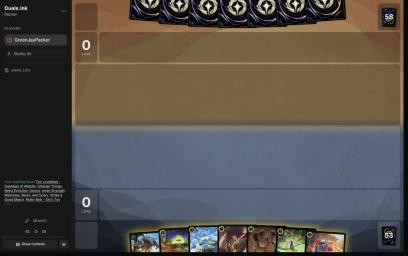
*The board before the decision: [step 1](https://duels.ink/replay/01a1ee67-75e1-7340-a2f3-8b913f147bd5?step=1) in the duels.ink replay viewer.*

**Setup.** On the play. The hand: The Leviathan, the Device, Strange Things, Inner Strength, Malicious, Strike and
Roller Bob. Two of the three combo pieces; Olaf is missing (4 in the deck). The mulligan tool (`tools/mulligan.py
--plan`, 1,000 deals; it doesn't model the combo) has keeping all seven at 9.37 ink of 10, keeping six (all but
Strange Things) at 9.20, keeping five (also without Roller Bob) at 8.87. With The Leviathan kept, the combo needs only
an Olaf: about 54% to have seen one in the 9 cards to game turn 9 (`tools/odds.py`). Sent back, it needs an Olaf and
a Leviathan: about 32% in 10 cards. The coach's pick: keep six, sending back Strange Things.

**What you did:** kept the Device, Inner Strength, Strike and Roller Bob; sent back Strange Things, The Leviathan and
Malicious. Drew Improvise, White Rabbit and Tod. They sent back four.

**Verdict: mistake (confidence: medium).** Sending back **The Leviathan** is suboptimal because it's half of the combo
the deck wins with, and having it in hand turns every Olaf you draw into the wipe. Without it, the chance of both
pieces by game turn 9 falls from about 54% to about 32%. **Keeping it** (and Malicious, a song for Max Goof and an
action for Olaf) is better; uninkable costs one ink choice, which a seven-card hand of 1- to 4-drops can spare.
[MULL-1](#cite-mull-1).

**In discussion (18 Nov 2026):** you expected a locations deck, as Claudia's Ruby/Steel list the day before, so you
aimed for a start with more characters rather than The Leviathan's wipe, and allow that planning for the wipe may
still have been better. The knowledge base had one Ruby/Steel locations list, Claudia's, while the pair's known
archetypes (Incredibles, Unnamed #1) are character decks and most of its games are ungrouped. And against locations
The Leviathan is still a 10/10 quester for 3 that any Olaf becomes. The verdict stands.

### Turn 1: your turn 1

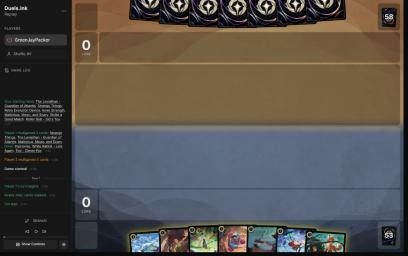
*The board before the decision: [step 3](https://duels.ink/replay/01a1ee67-75e1-7340-a2f3-8b913f147bd5?step=3) in the duels.ink replay viewer.*

**Setup.** 1 ink: a cantrip (Inner Strength or Improvise), with nothing in play to target (it still draws).

**What you did:** inked Improvise; Inner Strength drew Strange Things.

**Verdict: fine.**

### Turn 2: their turn

**What happened:** they inked Diablo – Stone Servant and played Tinker Bell – Fancy Footwork (3/1). An unlisted
Ruby/Steel list, 99%.

### Turn 3: your turn 2

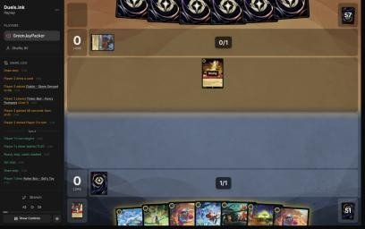
*The board before the decision: [step 9](https://duels.ink/replay/01a1ee67-75e1-7340-a2f3-8b913f147bd5?step=9) in the duels.ink replay viewer.*

**Setup.** You drew a second Roller Bob. 2 ink: Strike (two cards toward Olaf and The Leviathan, two actions into the
discard) or White Rabbit (an Evasive quester).

**What you did:** inked Strange Things; Strike drew The Leviathan and another Strike, and discarded a Strike.

**Verdict: good play.** The dig found the piece sent back at the mulligan, and Olaf is down to 6.

### Turn 4: their turn

**What happened:** they inked Look What You've Done (2 damage to a character; replayable when discarded), quested
with Tinker Bell (1) and played Jebidiah Farnsworth – Cookie (3/3, Evasive, Reckless: it must challenge each turn if
it can).

### Turn 5: your turn 3

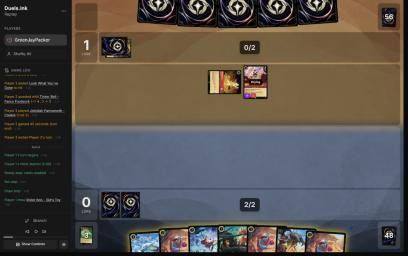
*The board before the decision: [step 17](https://duels.ink/replay/01a1ee67-75e1-7340-a2f3-8b913f147bd5?step=17) in the duels.ink replay viewer.*

**Setup.** You drew the third Roller Bob. 3 ink once you ink. Olaf (not yet found, 4 in 48) costs 6. The Device is
safer in hand for now: Wildcat banishes items in play. Tod digs two toward Olaf. Jebidiah must challenge each turn if
it can, so a character you leave exerted will be challenged; ready ones are safe.

**What you did:** inked White Rabbit; Tod drew Malicious and a second Device, and discarded Malicious (Olaf to 5).

**Verdict: inaccuracy (small; confidence: medium).** Discarding **Malicious** is suboptimal because next turn Tod,
dry, could sing it for free: 1 damage to each of theirs kills Tinker Bell (1 willpower) and still puts an action in
the discard for Olaf. **Discarding the third Roller Bob** (or the second Device) is better: it keeps that free kill,
and a Roller Bob in the discard is a step toward another one's Rush. Tod first, with the Device kept in hand, was
right.

### Turn 6: their turn

**What happened:** Look What You've Done killed Tod (2 damage); Tinker Bell quested (2). They inked a second Diablo.

### Turn 7: your turn 4

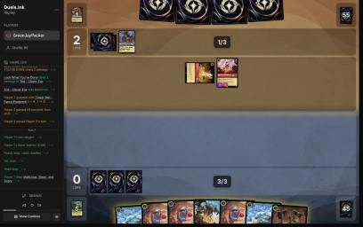
*The board before the decision: [step 26](https://duels.ink/replay/01a1ee67-75e1-7340-a2f3-8b913f147bd5?step=26) in the duels.ink replay viewer.*

**Setup.** You drew another Malicious. 0–2. 4 ink once you ink (a spare Roller Bob). Their board: Tinker Bell (3/1,
exerted; their only quester) and Jebidiah (3/3, Evasive, can't quest). Malicious cast kills Tinker Bell, damages
Jebidiah, and makes Olaf cost 4. The Device and a Roller Bob are the alternatives; the Device stays safer in hand from
Wildcat until the turn before it's needed.

**What you did:** inked a Roller Bob; cast Malicious (Tinker Bell banished, Jebidiah damaged).

**Verdict: good play.** Their lore stopped at 2, for a card that also counts for Olaf.

### Turn 8: their turn

**What happened:** they inked Land of the Dead – Marigold Bridge and played Peg – Late-Night Vocalist (Singer 4).

### Turn 9: your turn 5

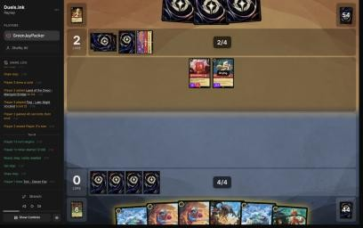
*The board before the decision: [step 32](https://duels.ink/replay/01a1ee67-75e1-7340-a2f3-8b913f147bd5?step=32) in the duels.ink replay viewer.*

**Setup.** You drew Tod. 0–2; the game is slow, and Olaf (4 with five actions) is still to find. 5 ink, not enough
for both the Device and Tod. Tod digs now; the Device must be in play the turn before the combo, and the earliest
combo turn needs Olaf in hand first.

**What you did:** Tod (drew Another Tale and White Rabbit, discarded the Tale: Olaf to 3), then inked a Device and
played White Rabbit. All 5 ink used.

**Verdict: good play.** Cards seen before the ink was chosen, and a spare Device made the ink.

### Turn 10: their turn

**What happened:** Tinker Bell – Temperamental Fairy Shifted onto a new Tinker Bell and exerted Tod, and Peg
challenged and killed him.

### Turn 11: your turn 6

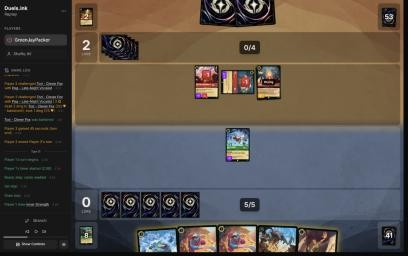
*The board before the decision: [step 42](https://duels.ink/replay/01a1ee67-75e1-7340-a2f3-8b913f147bd5?step=42) in the duels.ink replay viewer.*

**Setup.** You drew Inner Strength. 0–2. Their board: Jebidiah (3/3, damaged, Reckless), Peg (exerted, damaged; a
free singer for Strength of a Raging Fire) and Tinker Bell – Temperamental Fairy (5/3, drying). Two Tods in the
discard give a Roller Bob Rush, and Peg, exerted with 2 willpower left, is in his reach. Olaf (3) is still to find:
Inner Strength digs one card for 1 ink. 6 ink once you ink.

**What you did:** Inner Strength (drew Tod); Tod (drew a second Leviathan and Another Tale, discarded a Leviathan);
White Rabbit sang the Tale (an ink drop each; drew Max Goof); inked a Roller Bob; the other Roller Bob, paid with the
drop, put Tod and the spare Leviathan on the bottom for Rush and killed Peg.

**Verdict: good play.** Five cards seen and a free-singer killed, with every ink and the drop used. The spare
Leviathan was the right card to discard and to send to the bottom, with one still in hand.

### Turn 12: their turn

**What happened:** Scar – Finally King came down (Allies +1 {S}; a card engine), Jebidiah traded with Roller Bob,
and Tinker Bell quested (3).

### Turn 13: your turn 7

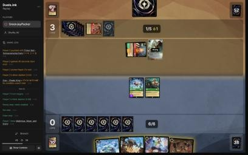
*The board before the decision: [step 59](https://duels.ink/replay/01a1ee67-75e1-7340-a2f3-8b913f147bd5?step=59) in the duels.ink replay viewer.*

**Setup.** You drew Malicious. 0–3. Olaf costs 1 (eight actions in the discard) but isn't in hand; The Leviathan and
the Device are. 7 ink once you ink. Max Goof's SWEET REMIX (3, discarding Malicious) digs two and puts a card in the
discard; the Device (3) leaves 1 for its use, and Olaf costs 0 once Malicious is in the discard. So if the remix finds
Olaf, the whole combo fits this turn. Their board: Scar (5 {S}, drying) and Tinker Bell (6 {S} with Scar, exerted):
11 strength, one more than IT'S A MACHINE! takes, so it's one of them.

**What you did:** Max Goof discarded Malicious and drew Olaf and Strange Things; the Device; Strange Things inked;
Olaf for 0 (3 → 1); the Device turned Olaf into The Leviathan, which banished Scar. White Rabbit and Tod quested
(2–1).

**Verdict: good play.** The dig first, then the combo the turn it was possible. Scar was the right one to banish:
2 lore a turn, the card engine and Tinker Bell's +1. Tod quested into Tinker Bell's reach, a 1-lore character for a
lore.

**In discussion (18 Nov 2026):** you point out that Scar's BE GRATEFUL (Allies +1 {S}) kept IT'S A MACHINE! to Scar
alone, and that against a Scar deck Malicious with Phillip, which has no strength cap, may be the better plan, or the
difference too small to matter. Worth knowing: with Scar in play every Ally counts 1 more toward the 10, and here it
made 11. Phillip's line takes every character Malicious damages, but needs Phillip in hand and Malicious cast (3 ink,
or free from a dry 3-cost); here Malicious was the card SWEET REMIX discarded to find Olaf. Banishing Scar, the engine
and the buff, was right for this turn. Added to the knowledge base.

### Turn 14: their turn

**What happened:** Shere Khan – Menacing Predator (a lore whenever one of theirs challenges) came down, and Tinker Bell
challenged Tod (2).

### Turn 15: your turn 8

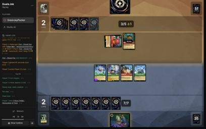
*The board before the decision: [step 76](https://duels.ink/replay/01a1ee67-75e1-7340-a2f3-8b913f147bd5?step=76) in the duels.ink replay viewer.*

**Setup.** You drew Prince Phillip. 2–2. Your board: The Leviathan, Max Goof (4 lore) and White Rabbit; theirs:
Tinker Bell (exerted, 1 damage; a free singer for Strength of a Raging Fire) and Shere Khan (drying). The obvious
line: The Leviathan challenges Tinker Bell (10 kills her; it survives her 5) while Max Goof and White Rabbit quest (7).
The Device offers more: The Leviathan (cost 10) can become Phillip (9), whose SWIFT AND SURE banishes damaged
opposing characters, and Tinker Bell is damaged.

**What you did:** The Leviathan quested (5), then the Device turned it into Phillip, which banished Tinker Bell; Max
Goof and White Rabbit quested (10–2).

**Verdict: good play.** Better than the coach's line: The Leviathan's quest and the kill both, 3 more lore, and
Phillip (6/6, Evasive) in its place. Questing before the Device banishes is in the notes on your deck, and this used
it with Phillip.

### Turn 16: their turn

**What happened:** Shere Khan challenged and killed Max Goof (and gained a lore: 3), and Pepita – Imelda's Right Hand
came down.

### Turn 17: your turn 9

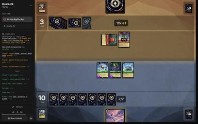
*The board before the decision: [step 86](https://duels.ink/replay/01a1ee67-75e1-7340-a2f3-8b913f147bd5?step=86) in the duels.ink replay viewer.*

**Setup.** You drew Olaf, who costs 0 (nine actions in the discard). 10–3. Phillip (3) and White Rabbit (1), both
Evasive, quest safely. Olaf now drains 2 and quests for 2 from next turn: with him, next turn's quests make exactly
20 (game turn 19); without him, 18, and the win waits until turn 21. They need 17 more, so either way they can't
catch up from here; Olaf in hand keeps a Device base out of reach of removal.

**What you did:** White Rabbit and Phillip quested (14–3); Olaf stayed in hand.

**Verdict: close call.** Olaf for 0 would have won a turn sooner and drained 2; keeping him back costs them nothing
they can use. Either is a win from here.

**In discussion (18 Nov 2026):** yes, Olaf was kept in hand as a Device base, out of reach of removal. The verdict
(close call) stands.

### Turn 18: their turn

**What happened:** a second Jebidiah came down; Shere Khan and Pepita quested (5).

### Turn 19: your turn 10

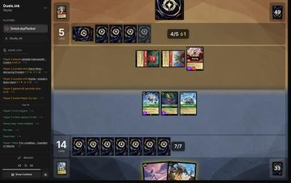
*The board before the decision: [step 93](https://duels.ink/replay/01a1ee67-75e1-7340-a2f3-8b913f147bd5?step=93) in the duels.ink replay viewer.*

**Setup.** You drew The Leviathan. 14–5. Olaf costs 0 and drains 2; Phillip and White Rabbit quest for 4 (18). Their
board (Shere Khan, Pepita, Jebidiah) has exactly 10 strength, all in IT'S A MACHINE!'s reach, but the Device turning
Olaf into The Leviathan puts only Olaf into the discard, one card short. The coach's line: Olaf's drain and the
quests, 18–3, and the win next turn.

**What you did:** Olaf for 0 (5 → 3); White Rabbit traded with the exerted Shere Khan (the second card for the
discard); the Device turned Olaf into The Leviathan, which banished Jebidiah and Pepita; Phillip quested (17–3, their
board empty).

**Verdict: good play.** Better than the coach's line: the losing challenge supplied IT'S A MACHINE!'s second card, so
their whole board went for 1 lore of yours.

### Turn 20: their turn

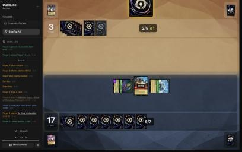
*The board before the decision: [step 108](https://duels.ink/replay/01a1ee67-75e1-7340-a2f3-8b913f147bd5?step=108) in the duels.ink replay viewer.*

**What happened:** Be King Undisputed: you banish one of your characters.

**What you did:** banished The Leviathan, keeping Phillip.

**Verdict: fine.** Both quest for 3. Phillip's Evasive keeps him out of most challengers' reach, and as a 9-cost he's
still a Device base for The Leviathan or Olaf.

### Turn 21: your turn 11

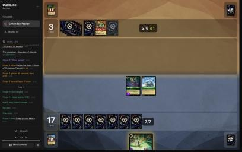
*The board before the decision: [step 111](https://duels.ink/replay/01a1ee67-75e1-7340-a2f3-8b913f147bd5?step=111) in the duels.ink replay viewer.*

**What you did:** Phillip quested: 20.

**Verdict: good play.** The win.

## Lessons
1. **Keep The Leviathan when you keep the Device** ([pre-game](#turn-0)). With both in hand, any Olaf you draw is the
   wipe; send one back and you need two pieces again. Uninkable costs one ink choice, which a hand of 1- to 4-drops
   can spare.
2. **The Device chains** ([turn 15](#turn-15)). The Leviathan (10) can quest and then become Phillip (9), whose SWIFT
   AND SURE banishes every damaged opposing character; Phillip (9) can later become Olaf or The Leviathan.
3. **A losing challenge is IT'S A MACHINE!'s second card** ([turn 19](#turn-19)). A small character trading with an
   exerted one puts a card in your discard, which is what the wipe needs when nothing else does.
4. **A song in hand plus a dry 3-cost is a free spell next turn** ([turn 5](#turn-5)). Before discarding a song to
   Tod or Max Goof, check what a singer in play could do with it.

## Proposed knowledge-base updates (applied after discussion)
- **Meta** (the Ruby/Steel pair file's notes, Shafiq Ali): an unlisted list with Tinker Bell – Fancy Footwork ×2 and
  Temperamental Fairy (Shift; HARMLESS DIVERSION exerts a 2-strength character), Jebidiah ×2 (Reckless), Diablo –
  Stone Servant ×2 (inked), Look What You've Done ×2, Peg – Late-Night Vocalist (Singer 4), Scar – Finally King, Shere
  Khan – Menacing Predator, Pepita – Imelda's Right Hand, Willie the Giant (inked), Be King Undisputed (you banish one
  of yours), Land of the Dead – Marigold Bridge and The Torn Corner (inked). Small characters died to Look What You've
  Done and challenges; the 6- and 10-strength ones mostly didn't.
- **Meta** (the Emerald/Ruby pair file's notes, GreenJayPacker's Ruby R.E.D.): the Device chains The Leviathan into
  Phillip after a quest, and a small character's losing challenge is the second card for IT'S A MACHINE!.

## Hindsight
Doesn't change the verdicts above.
- Tod died to Look What You've Done on turn 6, so the turn-5 line with Tod singing Malicious wouldn't have happened;
  the other Malicious killed Tinker Bell on turn 7 anyway.
- Strike found The Leviathan again on turn 3, the turn after it was sent back.

## The coach's errors
Found by the coach during the review; the discussion may add more.

| When | Error | How it was caught | How it won't happen again |
|---|---|---|---|
| Turns 15 and 19 | The coach's lines missed the Device chain (The Leviathan into Phillip) and a losing challenge as IT'S A MACHINE!'s second card, the second the lesson of the coach's own review of the game before | Comparing your lines with the coach's | Done in 8dffb6e (19 Nov 2026, with the user's agreement): the brief's DEVICE LINES list this turn's sources of a second card for the discard (castable actions, a mill, a song a dry character can sing, a challenge one of your characters loses) and each chain the Device opens (a character in play into one costing up to 2 more) |
| Turn 21 | Read the last turn's log with `--draft-ok`, skipping its `--plan` brief, on a turn whose only line was a 3-lore quest from 17 | Writing the turn's section | Done in 8dffb6e (19 Nov 2026, with the user's agreement): brief.py refuses `--draft-ok` while the game's review still has its RESULT placeholder (the blind pass isn't over) |

## Open questions
All answered by the player in discussion, relayed by danny (18 Nov 2026).
- **[Pre-game](#turn-0):** you expected locations (as Claudia's list) and wanted characters early. The verdict stands.
- **[Turn 17](#turn-17):** yes, Olaf was kept from removal as a base. The verdict stands.
- **[Turn 13](#turn-13)** (the player's own point): Scar's +1 to Allies shrinks what IT'S A MACHINE! takes. Added to
  the knowledge base.

## Citations
Copies of the coach's knowledge base cited above, as they stood when they were cited (the private repository's commit and date are given with each). They don't change when the knowledge base does.

**emerald-ruby.md, Ruby R.E.D.: GreenJayPacker's lists**: knowledge base, `kb/meta/archetypes/emerald-ruby.md` at `62ce89e` (2026-11-18), working tree

> ### Ruby R.E.D.: GreenJayPacker's lists, 17 Nov 2026 `[coach, blind reviews of 01a1ea7f-cc42, 01a1eaf6-93a9, 01a1eb05-70c1, 01a1eb0c-446c and 01a1eb2e-39fc; 2 wins, 3 losses]`
> - **Lists:** the first (four games) ran Stegmutt ×4, Strange Things ×3, The Torn Corner ×4 and To Wither a Flower ×2,
>   with no Lyle Tiberius Rourke or Dangerous Plan. The second (01a1eb2e-39fc) swapped Stegmutt and To Wither a Flower
>   for White Rabbit ×4 and Roller Bob – Sid's Toy ×3, with three Photos.
> - **The Device line:** the Device turns Olaf, Phillip (9) or Stegmutt (8) into The Leviathan. The banished character is
>   one of IT'S A MACHINE!'s two cards, so one mill or one song makes the other; the Photo's mill (1 ink, 2 cards) is the
>   cheapest. Mill before the Device (01a1eb2e-39fc turn 13).
> - **The Device before Olaf** (01a1eb0c-446c turns 7 and 9): an item most decks can't touch, while Olaf waiting in play
>   meets Smash, Shere Khan's challengers or Hades. Against Detectives, Elisa Maza takes the Device from hand, so play it
>   before she can come (01a1eaf6-93a9 turns 6 and 8); Judy Hopps – On the Case and Wildcat – Unconventional Mechanic
>   take it from play.
> - **Quest before the Device banishes:** it takes exerted characters, so Olaf or The Leviathan quests first, and The
>   Leviathan can later become Phillip after Malicious (01a1eb0c-446c turns 11 and 15).
> - **Max Goof – Karaoke Star is a lore engine:** with five songs in the discard, BRAND-NEW PLAYLIST makes him a 4-lore
>   quester, often the deck's best lore (turn 10 of 01a1eaf6-93a9; seven songs by turn 15 of 01a1eb0c-446c). The song
>   SWEET REMIX discards counts. Smash and Ink Explosion killed him in two games.
> - **Roller Bob:** Rush for two characters from the discard to the bottom; his 4 {S} banishes a 4-{W} location the
>   turn he lands, for nothing back (01a1eb2e-39fc turn 11).
> - **By matchup:** against Detectives The Leviathan is a wipe, not a quester (H-14's counter-case); against a fast lore
>   board (01a1eb05-70c1) the combo has to land by about game turn 9; against locations, banish them with characters.

**ruby-steel.md, An unlisted locations list against GreenJayPacker's Ruby R.E.D.: Claudia**: knowledge base, `kb/meta/archetypes/ruby-steel.md` at `62ce89e` (2026-11-18), working tree

> ### An unlisted locations list against GreenJayPacker's Ruby R.E.D.: Claudia `[coach, blind review of 01a1eb2e-39fc, 17 Nov 2026]`
> - **The list:** Khan Stadium – State of the Art (+2 {S} for characters there), Zootopia – Police Headquarters ×2, Khan
>   Industries – Greenway Landmark (2 {L}; characters there can't be challenged), Raya – Determined Explorer (+1 {L} per
>   location), Fergus – King of DunBroch ×2 and Inspector Tezuka (Bodyguards), Roxanne – Concert Lover, Arthur – Merlin's
>   Assistant ×2, Carl Fredricksen – On the Move ×2, Audrey Ramirez, Tiana – Restauranteur, Mr. Incredible – Bob Parr;
>   Ink Explosion, Touch the Sky, Dangerous Plan, Putting It All Together.
> - **How it played (GreenJayPacker won 20–12 on game turn 19):** three locations made 4 lore a turn in their Set step
>   by game turn 12, which no wipe touches. Characters banished them for nothing back (RULE-3): Olaf (4 {S}) the 4-{W}
>   ones, The Leviathan Khan Industries (8). Khan Stadium's +2 {S} made Tezuka kill the Max Goof that challenged it.

**MULL-1**: strategy principle, `kb/strategy/principles.md` at `62ce89e` (2026-11-18), working tree

> - **MULL-1. Keep a plan, not the strongest cards.** *Ask: "Which hand gives me the best chance to execute my game plan in this matchup?"* `[MCL ch.12]` · baseline
