# Review: GreenJayPacker vs WrathOfKhan, game 1, 18 Nov 2026

| | |
|---|---|
| **Status** | draft (blind pass done, not yet discussed) |
| **Replay** | `01a1ef50-0454` (`python3 tools/brief.py 01a1ef50-0454 --turn N`) · [duels.ink viewer](https://duels.ink/replay/01a1ef50-0462-7c86-87b7-635dc67152fb?step=0) |
| **Format** | Core Constructed (stated in the replay). Set 14 era: inks revealed before the coin toss |
| **Decks** | You: Emerald/Ruby Ruby R.E.D. ([the coach's notes on it](#cite-kb-meta-archetypes-emerald-ruby-ruby-r-e-d-greenjaypacker-s-games-of-18-nov-2026)), the list with White Rabbit and Roller Bob. Them: Amber/Sapphire ([the coach's notes on this pair](#cite-kb-meta-archetypes-amber-sapphire-detectives-against-greenjaypacker-s-ruby-r-e-d-nick)); archetype as it became clear: **Detectives**, 97% from game turn 6 (Always Vigilant and Gaston inked, Nick Wilde – Toy Drive Officer played), with Mickey Mouse – Expedition Leader and Grandmother Willow off-list |
| **Play/draw** | They went first |
| **Result** | **Loss**, 6–20: they quested to 20 on game turn 21 |
| **Meta data** | snapshot of 12 Nov 2026 (fresh until 26 Nov) |
| **Chosen how** | Sent by danny, the coach's user, as replay links on 19 Nov: GreenJayPacker's, reviewed for them. Games 1 and 2 of a match; the coach knew nothing of either result. While downloading the replay, the coach saw the viewer's intro screen, which shows each player's mulligan count (you 4, them 3), before writing its own mulligan candidates |

## Summary
Links go to the turn sections below (`[13](#turn-13)`).
- **Good plays:** [4](#turn-4) (inking the Photo and discarding the Tale to Strike), [10](#turn-10) (four cards dug
  and Olaf down to 1 in hand), [12](#turn-12) (Roller Bob and Tod trades, the Photo's lore), [16](#turn-16) (the Tale
  into Strange Things, 3 of their 7 lore held back) and [18](#turn-18) (Olaf's challenge before the Device's banish:
  five of theirs gone).
- **Close calls:** [pre-game](#turn-0) (Max Goof sent back where the coach would keep him), [6](#turn-6) (Malicious
  kept over Strike for Max to sing).
- **Inaccuracies:** [8](#turn-8) (the first Max sang Another Tale and died to Elisa Maza; held, he'd have quested for
  4 the next turn), [14](#turn-14) (the first Olaf left idle).
- **Unwinnable from:** [18](#turn-18). The Device came that turn, and the wipe it made left them two characters, 14
  lore, seven cards in hand and 12 ink, against your 6 lore.

**What decided it:** the Device didn't come until game turn 18, after more than 30 of your cards: about a 1 in 20
chance. Until then Detectives grew past what IT'S A MACHINE! takes (their board had 11 {S} or more from game turn 9),
Elisa Maza killed both Max Goofs, and Day Camp Instructor's ramp kept their ink ahead.

## The game, turn by turn
Verdicts judge each decision on what you could know at the time, **including archetype knowledge an experienced
player has**. Hindsight is kept to its own section. Severity scale: good play / close call /
inaccuracy / mistake / blunder. Principle IDs and hypotheses (H-n) link to copies
in the Citations section at the end, as they stood when they were cited.

**What you knew before the game:** they're Amber/Sapphire: Detectives 50%, Control #1 40%, an unlisted list 6%,
Control #2 5%. They go first, so their turn k comes on game turn 2k−1 with k ink, and yours on game turn 2k. The pair
file's notes from your three earlier games against it: against Detectives The Leviathan is a wipe, then gone (Gaston
or Always Vigilant the next turn); On the Case took the Photo and the Device from play against Nick, and Belle inked
four of the five characters The Leviathan banished; against NightFury's Control, Belle inked all five and Raging Storm
came the next turn. Their key cards against your plan, with the earliest game turn each can come:
- **Mowgli – Man Cub** (2): reveals your hand, and you discard a non-character card of your choice. Game turn 3.
- **Elisa Maza – Hardworking Detective** (4, with another Detective in play): reveals your hand and discards the
  non-character card of their choice, the Device first. Game turn 7 (5 with Day Camp Instructor's LEND A PAW ramp).
- **Judy Hopps – On the Case** (3, with another Detective in play): an item in play into your inkwell. Game turn 5.
- **Judy Hopps – Always Vigilant** (4, or Shift 2 onto a Judy, if they played another character that turn) and
  **Gaston – Superior Archer** (5): banish a character with 5 {S} or more, so The Leviathan and Phillip. Game turns 5
  and 9.
- **The Horseman Strikes!** (3): banishes an Evasive character (Phillip, White Rabbit). Game turn 5.
- **Control:** Belle – Snowfield Strategist (4, game turn 7) inks each of their characters that is banished; Let It Go
  (5, free from a 5-cost singer) and Hades – Infernal Schemer (7, game turn 13) put one character into your inkwell;
  Spooky Sight (6, game turn 11) inks every character costing 3 or less; Raging Storm (8) banishes all, on game turn
  15, sooner with ink drops. Each Another Tale to Spin you cast gives them one.

### Pre-game

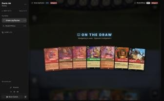
*The opening hand: [step 0](https://duels.ink/replay/01a1ef50-0462-7c86-87b7-635dc67152fb?step=0) in the duels.ink replay viewer.* The intro marks the four cards you sent back.

**Setup.** On the draw. The hand: Roller Bob, Prince Phillip, Another Tale to Spin ×2, Max Goof, Rivera Family Photo
and The Leviathan. One payoff (The Leviathan), its second card (the Photo's mill) and three digs (both Tales, and Max
Goof's SWEET REMIX discarding a Tale for two cards), but neither the Device nor an Olaf: 8 of the 53 other cards.
Phillip is a second payoff that also needs Malicious; here he's an ink. The combo pieces' odds (`tools/odds.py both`,
a Device and an Olaf among the cards seen) rise about 4–5 points a card: 18% in 7 cards, 27% in 9, 37% in 11. The
mulligan tool (`tools/mulligan.py --plan`, 1,000 deals; it doesn't model the combo) has every option within 0.7 ink
of 10 on turns 1–4 and a play on every turn. Candidates:
- **Keep all seven:** the fewest looks (about 7 by game turn 8, with the Tales and Max Goof).
- **Send back Phillip and Roller Bob (keep five):** two more looks (about 9 by game turn 8); loses the early body
  and the second payoff. Keeps the Tales: two cheap digs, songs for SWEET REMIX and the playlist, and actions for
  Olaf's discount.
- **Send back the Tales too (keep the Photo, Max Goof and The Leviathan):** four fresh cards. About as many looks as
  keeping five (the Tales were two of them), but they come free on turn 0, and the Tales' ink drop goes to the
  opponent too, which brings Raging Storm and Gaston a turn closer. Max Goof then needs a song drawn (13 in the deck).

The coach's pick: keep five, or send back four; the two are close, and both beat keeping seven for a deck that has to
find two pieces.

**What you did:** kept Another Tale, the Photo and The Leviathan; sent back four (Phillip, the other Tale, Max Goof
and Roller Bob). Drew Max Goof, Malicious, a second Photo and Olaf. They sent back three.

**Verdict: close call.** Four fresh cards, as in the coach's second candidate, which kept Max Goof where you kept a
Tale. The tool has the two level (9.24 and 9.16 ink of 10, a play on almost every turn). Max Goof is the stronger
card, a two-card dig and later a 4-lore quester, but his dig needs a song in hand, and the Tale is one: a 2-cost dig
for turn 2. Both are reasonable ([MULL-1](#cite-mull-1), [MULL-4](#cite-mull-4)).

### Turn 1: their turn

**What happened:** they inked Mickey Mouse – Expedition Leader (off-list) and cast Besties, Assemble!, which found
Hamm – Piggy Bank. Besties and Hamm are Control #1 cards: 85% now, Detectives 9%. Against Control the threats move
from the hand attack and On the Case to Raging Storm (28% held) and Hades (28%), and Belle inks whatever The
Leviathan banishes.

### Turn 2: your turn 1

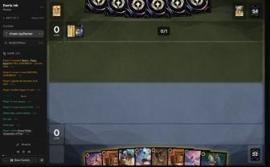
*The board before the decision: [step 8](https://duels.ink/replay/01a1ef50-0462-7c86-87b7-635dc67152fb?step=8) in the duels.ink replay viewer.*

**Setup.** You drew Prince Phillip. Eight cards: Another Tale, two Photos, The Leviathan, Max Goof, Malicious, Olaf
and Phillip. One ink this turn: a Photo is the only play. The ink: Phillip is the spare payoff (he needs Malicious,
Olaf and a Device too, and The Leviathan is in hand), so he's the card whose loss costs least ([INK-2](#cite-ink-2));
Olaf, Malicious (an action for Olaf, a song for Max Goof) and the Tale all have jobs, and the second Photo is a
second mill. The line: ink Phillip, play a Photo.

**What you did:** inked Phillip and played a Photo.

**Verdict: good play**, the coach's line.

### Turn 4: your turn 2

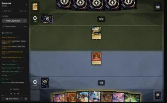
*The board before the decision: [step 14](https://duels.ink/replay/01a1ef50-0462-7c86-87b7-635dc67152fb?step=14) in the duels.ink replay viewer.*

**Setup.** You drew Strike a Good Match. Their turn 3 inked Judy Hopps – Always Vigilant, a Detective, and played
Hamm – Piggy Bank: Detectives 58% now, Control #1 31%. Hamm's LOOSE CHANGE makes their next 4-drop cost 3 (Elisa
Maza needs another Detective in play to take a card from your hand; Belle). You have 2 ink once you ink. The combo
still needs the Device (4 of the 51 cards left); Olaf, The Leviathan and the Photo are here. Candidates:
- **Strike a Good Match (2):** the best dig per ink, two cards, and two cards into the discard (Strike itself, an
  action for Olaf, and the one you discard).
- **Another Tale (2), then the second Photo with its ink drop:** one card, a Photo down. The drop goes to them too:
  with Hamm that's a 5-cost character next turn (Gaston, 26% held).
- **The second Photo and a mill (1 + 1):** two cards into the discard, none drawn.

The coach's pick: Strike. The ink: Another Tale, whose drop helps them as much as you, or Malicious (Phillip is
inked, so it's an action and a song now); a song stays in hand for Max Goof's SWEET REMIX next turn.

**What you did:** inked the second Photo, cast Strike (drew Inner Strength and another Strike) and discarded Another
Tale.

**Verdict: good play**, slightly better than the coach's: inking the Photo and discarding the Tale puts the Tale in
the discard, where it's an action for Olaf and a song for Max Goof's playlist, instead of in the inkwell. The second
Photo was the spare card.

### Turn 6: your turn 3

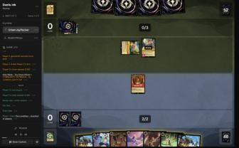
*The board before the decision: [step 22](https://duels.ink/replay/01a1ef50-0462-7c86-87b7-635dc67152fb?step=22) in the duels.ink replay viewer.*

**Setup.** You drew the second Leviathan. Their turn 5 inked Gaston and played Nick Wilde – Toy Drive Officer
(Support) with Hamm's discount: Detectives 97%. Next turn they have 4 ink and Hamm's −1 on a character, and Nick is
a Detective in play, so Elisa Maza (3 with Hamm) can take a non-character card of their choice from your hand, and On
the Case (26% held, 31% after their draw) can ink the Photo; Gaston or Fangmeyer can come too. You have 3 ink once you
ink, Olaf costs 7 (two actions in the discard), and the Device is still missing (4 of 48). Candidates:
- **Max Goof (3), discarding a song to SWEET REMIX:** two cards, a song for the playlist and an action for Olaf. Max
  is then dry next turn to sing Strike for free (the brief's "free NEXT TURN" line), which leaves next turn's 4 ink
  for the Device. That's 4 cards seen by the end of next turn, with the Device castable.
- **Strike (2) and Inner Strength (1):** three cards now and three actions into the discard (Olaf 5). But next turn
  Max Goof takes 3 of its 4 ink, so a Device found waits another turn.
- **Strike and a mill (2 + 1):** two cards drawn, two milled.

The coach's pick: Max Goof. Max costs 3, so the ink comes before his draw: ink Inner Strength, discard Malicious to
SWEET REMIX (Phillip is in the inkwell, so it's only an action and a song now), and keep Strike for Max next turn.
Elisa can take Strike from your hand, but she takes something whatever you keep.

**What you did:** inked Inner Strength and played Max Goof, discarding Strike to SWEET REMIX (drew a second Max Goof
and The Torn Corner).

**Verdict: good play**, the coach's line, with one close call inside it: you discarded Strike and kept Malicious.
Max can sing either for free next turn. Strike would be a two-card dig toward the Device; Malicious pings each of
their characters for 1, which kills nothing on their board now (3 and 4 willpower) and sets up a Phillip only if you
draw one (2 left). Keeping Strike was slightly better, but it's small.

### Turn 8: your turn 4

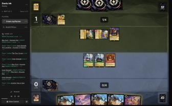
*The board before the decision: [step 40](https://duels.ink/replay/01a1ef50-0462-7c86-87b7-635dc67152fb?step=40) in the duels.ink replay viewer.*

**Setup.** You drew The Torn Corner. Their turn 7 played Elisa Maza with Hamm's discount; she took the first Torn
Corner from your hand. Detectives 99%. 1–0 to them; their board quests for 3 (20 on game turn 21 at this rate). Next
turn they have 5 ink and Hamm: Gaston (21% after their draw; nothing of yours has 5 {S} yet), Fangmeyer, Lead
Detective (5 with Hamm), On the Case (27%) for the Photo. You have 4 ink once you ink; Olaf costs 6 (three actions);
the Device is still missing (4 of 45). Max Goof is dry: exerted (to quest or sing), he dies to Elisa's 3 {S}.
Candidates:
- **The Photo's mill (1), then the second Max Goof (3) discarding Malicious:** two cards drawn, two milled, the
  fourth song in the discard (a fifth among the milled cards turns on the first Max's playlist). The first Max stays
  ready, out of Elisa's reach: he's worth more as next turns' 4-lore quester than as 1 lore now.
- **The first Max sings Malicious (free) and the second Max comes down:** a point of damage on each of theirs, which
  kills nothing, and leaves the second Max no song to discard, so no draw.
- **The Torn Corner (3) and the mill:** a draw engine that needs 10 cards in the discard (you'd have 6).

The coach's pick: the first. Ink The Torn Corner: the second copy is the card you need least before the discard
reaches 10, and Olaf, Malicious and Max are all in the line.

**What you did:** played the second Max Goof before inking, discarding Malicious (drew Inner Strength and a third
Leviathan); inked The Torn Corner; cast Inner Strength on the first Max (drew Another Tale); and the first Max sang
Another Tale (drew Tod; an ink drop each). No mill.

**Verdict: inaccuracy (confidence: medium).** Most of the turn was better than the coach's line: playing Max before
inking let you choose the ink after his draw ([SEQ-1](#cite-seq-1)), and Inner Strength saw a card more than the mill.
The Tale was the slip. With it the discard holds five songs, so both Maxes are 4-lore questers from next turn
([the notes on your deck](#cite-kb-meta-archetypes-emerald-ruby-ruby-r-e-d-greenjaypacker-s-lists-17-nov-2026)), but
singing left the first Max exerted for Elisa Maza, whose 3 {S} kills him (3 {W}) for 1 damage back; Nick's Support
can add 2 more.

Singing Another Tale with the first Max is suboptimal because it trades his next quest (4 lore, and the turns after)
for 2 ink: the Tale costs 2 next turn if you hold it, and it draws its card either way, a turn apart. Holding it is
better because both Maxes would quest next turn, 8 lore, with the Tale cast first (2 ink, back to 1 with its drop)
to turn the playlist on, and Olaf still affordable (3 after the Tale). The cost of waiting is small: a Device drawn
off the Tale now couldn't have been played this turn (no ink left), and holding it keeps their drop off next turn's
ink too. The held line leaves nothing exerted this turn; the Maxes become exposed next turn once they quest, as in
both lines ([RULE-1](#cite-rule-1), [VALUE-1](#cite-value-1)).

### Turn 9: their turn

**What happened:** Elisa Maza challenged the exerted Max Goof and banished him, taking 1. They played a second Nick
Wilde (Hamm's discount) and Judy Hopps – Day Camp Instructor, whose LEND A PAW ramped them, and Nick's COMMUNITY
OUTREACH drew them a card. Detectives 100%.

### Turn 10: your turn 5

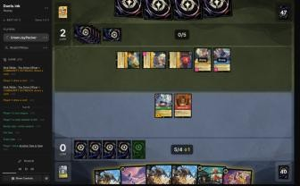
*The board before the decision: [step 51](https://duels.ink/replay/01a1ef50-0462-7c86-87b7-635dc67152fb?step=51) in the duels.ink replay viewer.*

**Setup.** You drew Another Tale. 0–2. Their five characters quest for 5 (20 on game turn 17 at this rate); your
Max quests for 4 (game turn 18). Their board's strength is 11, one more than IT'S A MACHINE! takes, so a wipe now
would leave one 2-{S} character. You have 6 ink (5 and the drop) once you ink; Olaf costs 3; the Device is still
missing (4 of 40, 28% by your turn 16 without digging). Next turn they have 6 ink and Hamm: On the Case (35% after
their draw) inks an item of yours; Always Vigilant or Lead Detective can Shift onto Day Camp and challenge at once.
The pieces:
- **Olaf now is the right base for this matchup.** Ready, he's out of their challengers' reach, and Gaston and Always
  Vigilant need 5 {S} (he has 4). Then the turn the Device comes costs 5 (the Device 3, its use 1, the Photo's mill 1),
  which next turn's 6 ink covers. Held, that turn costs 8. His drain also takes them from 2 to 0. The notes' "the
  Device before Olaf" was written against Amethyst/Steel's Smash; here On the Case takes a Device from play.
- **Tod (3) first:** two cards before the ink choice ([SEQ-1](#cite-seq-1)); discard one of the three Leviathans.
- **Max quests for 4:** exerted, Elisa (3 {S}, 3 {W} left) or a Shifted Judy kills him. He's lore only by questing,
  and next turn's wipe is the plan.

The coach's pick: Tod with the ink on hand (5), then ink, then Olaf (3 of 6 in all), and Max quests. Another Tale
waits (or is inked, if Tod finds nothing better to ink).

**What you did:** Tod first (discarded a Leviathan; drew Phillip and the third Photo); inked the Photo; cast Another
Tale (drew Improvise; a drop each) and Improvise with the drop (drew Roller Bob); Max quested (4–2). Olaf stayed in
hand, now costing 1, with one ink drop left.

**Verdict: good play**, better than the coach's. The coach spent 3 on Olaf to make the Device a 5-ink turn; your line
saw four cards instead of two, and the two actions you cast took Olaf from 3 to 1, so next turn's Device line costs
the same 6 or less with Olaf still in hand: the Device 3, Olaf 1 (0 after another action), its use 1 and the mill 1,
of next turn's 7. Olaf's drain is worth the same 2 next turn (they'll have more than 2), and in hand he's out of
reach of everything. The cost was their ink drop from the Tale.

### Turn 11: their turn

**What happened:** Belle – Snowfield Strategist and a second Day Camp Instructor (ramping again); Elisa Maza killed
the second Max Goof, and four characters quested (6–4).

### Turn 12: your turn 6

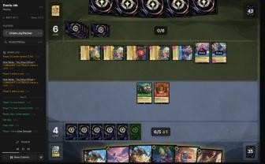
*The board before the decision: [step 72](https://duels.ink/replay/01a1ef50-0462-7c86-87b7-635dc67152fb?step=72) in the duels.ink replay viewer.*

**Setup.** You drew Inner Strength. 4–6. Their seven characters quest for 8: 14 next turn and 20 on game turn 15, so
this turn and next must take lore off them. The Device still hasn't come (4 of 35: Inner Strength and next turn's
draw give about a 1 in 5 chance of it by next turn), and The Leviathan costs 10 to cast. You have 7 ink with an
ink. Belle inks each of their characters that is banished. What's on hand:
- **Olaf (1):** their 6 → 4, and he's in play, ready and out of reach, as next turn's Device base (quest, then
  banish him).
- **Roller Bob (3) with Rush** (three characters in your discard; two go to the bottom): his 4 {S} kills an exerted
  Nick, Hamm or Day Camp and survives on 1 {W}; into Elisa (3 {S}) he trades.
- **Tod with Inner Strength (+1, 2 {S}):** Elisa has 2 {W} left, so Tod kills her and dies. Tod (1 lore) for their
  killer is a good trade ([TRADE-1](#cite-trade-1)), and Inner Strength draws a card first.
- **The Photo's mill (1).**

All of it fits: Inner Strength 1 + Olaf 1 + Roller Bob 3 + the mill 1 = 6 of your 7. The coach's line: Inner
Strength on Tod first (its draw comes before the ink choice), Tod into Elisa, then ink (Phillip, with no Malicious in
hand to make him a wipe), Olaf, Roller Bob into a Nick, and the mill. Their next turn: 4 lore and five characters
questing for 6 (10), so they reach 20 on game turn 17, not 15: two more turns for the Device. If Inner Strength finds
the Device: the Device 3, Olaf 1 and its use 1 put The Leviathan in, and IT'S A MACHINE! takes 10 {S} of theirs
(Tod's death and the banished Olaf are its two cards).

**What you did:** Inner Strength on Tod (drew the second Olaf); Olaf for 0 (6 → 4); Roller Bob with Rush (both Max
Goofs to the bottom) killed a Nick and survived; Tod with +1 traded with a Day Camp Instructor, which Belle inked;
the Photo's lore mode (5–4). No ink this turn.

**Verdict: good play**, the coach's line with three differences:
- **The Photo's lore mode, not a mill:** better than the coach's plan. The discard already held 12 cards, so the
  lore mode was on, and with Olaf at 0 a mill had nothing left to cheapen.
- **Tod into Day Camp, not Elisa:** a close call. Both quest for 1; Elisa is their only 3-{S} challenger, but this
  turn left nothing of yours for her (Roller Bob, exerted on 1 {W}, dies to anything), and damaged she's a target
  for a Phillip later.
- **No ink:** a close call too ([INK-3](#cite-ink-3)). Next turn's Device line costs 5 (the Device 3, its use 1 on
  the Olaf in play, the mill 1), within the 6 you keep; Phillip and the second Olaf were the only inkable cards, and
  both are pieces.

### Turn 13: their turn

**What happened:** Elisa Maza challenged the exerted Roller Bob and both died (his 4 {S} against her 2 {W} left).
Fangmeyer returned Elisa from the discard and she came back with Hamm's discount; with only characters in your hand,
her FOLLOW THE TRAIL took nothing. Two quests: 7–5.

### Turn 14: your turn 7

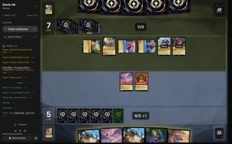
*The board before the decision: [step 98](https://duels.ink/replay/01a1ef50-0462-7c86-87b7-635dc67152fb?step=98) in the duels.ink replay viewer.*

**Setup.** You drew the third Roller Bob. 5–7. Their six characters quest for 8: 15 next turn, 20 on game turn 17. The
Device still isn't here (4 of 35: 11% next draw), The Leviathan costs 10 and Phillip 9 of your 7. The needs check:
nothing in hand wins; the Device has to come by your turn 16 or 18 and the board has to be small enough then. Until
then every lore of theirs stopped is a turn bought. What's on hand (7 ink with an ink):
- **The second Olaf (0):** their 7 → 5.
- **The first Olaf challenges Belle** (exerted, 3 {W}): kills her (−2 lore a turn, and her WINTER STOCKPILE goes),
  and survives on 2 {W}.
- **Roller Bob (3) with Rush** (three characters in the discard): kills Hamm or a Day Camp and survives.
- **The Photo's lore (1).**

Their next turn: 5 lore and four characters questing for 5 (10), and Fangmeyer (4 {S}) and Elisa can kill the two
damaged challengers. The coach's line: all four, 4 of your 7 ink; ink Phillip, who can't be cast before game turn 18
and needs Malicious. Bob into Hamm or Day Camp is a close call (Hamm's discount against Day Camp's Support).

**What you did:** Roller Bob with Rush killed Belle (who inked herself) and survived; inked Phillip; the Photo's lore
(6–7). The first Olaf stayed ready and the second stayed in hand.

**Verdict: inaccuracy (confidence: low).** Roller Bob into Belle was the best single kill, the coach's Olaf target.
Holding the second Olaf costs nothing: his drain is the same 2 whenever he's cast, and in hand nothing of theirs can
touch him. The idle first Olaf is the small edge given up.

Leaving the first Olaf ready is suboptimal because waiting gained nothing: against Fangmeyer and Elisa he can never
quest or challenge safely, and the second Olaf (0) is already next turn's Device base. Challenging Hamm or Day Camp
with him is better because it kills a second 1-lore character (he survives on 2 {W}), so their board quests for 5,
not 6, every turn from now: 12 next turn instead of 13, and a turn later to 20 if the Device comes. It leaves him
exerted and damaged for Fangmeyer or Elisa, which only costs a body that couldn't safely act anyway
([THREAT-1](#cite-threat-1); [the decision method's "keeping a quester ready for nothing"](#cite-docs-decision-method-9-the-coach-s-recurring-errors)).

### Turn 15: their turn

**What happened:** Judy Hopps – On the Case inked your Photo. A third Nick Wilde came down; Day Camp's Support gave
Hamm +2 to trade with the damaged Roller Bob; four quests took them to 12.

### Turn 16: your turn 8

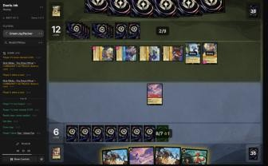
*The board before the decision: [step 122](https://duels.ink/replay/01a1ef50-0462-7c86-87b7-635dc67152fb?step=122) in the duels.ink replay viewer.*

**Setup.** You drew Tod. 6–12. Their six characters quest for 7: 19 next turn, and one lore boost (none in their
lists, but Core-legal) makes it 20. You have 9 ink with an ink; The Leviathan costs 10, so it needs the Device, still
missing (4 of 36). The needs check: only the wipe wins, and it has to come this turn or next. The line:
- **Tod first (3):** two cards, about a 1 in 5 chance of the Device. If it comes, everything is here: the Device (3),
  the first Olaf quests (2 lore) and the Device turns him into The Leviathan (use 1; Tod 3 + 3 + 1 = 7 of 9).
  IT'S A MACHINE! has its two cards in the banished Olaf and the card Tod discards, and takes 10 {S} of theirs
  (Fangmeyer 4, On the Case 4 and a Nick 2, say). Then the second Olaf drains 2.
- **If not:** the second Olaf drains (12 → 10), and the first Olaf trades with Fangmeyer (4 {S} each; their 2-lore
  quester and best challenger). Their board then quests for 5: 15 next turn, so 20 no sooner than game turn 19.
  Ink whichever card Tod's draw makes spare.

**What you did:** Tod (discarded a Leviathan; drew Malicious and Another Tale); the first Olaf sang the Tale (drew
Strange Things; a drop each); Strange Things (4) stopped Fangmeyer and a Nick from questing (drew a second
Malicious); inked a Malicious; the second Olaf drained (12 → 10).

**Verdict: good play**, better than the coach's. It saw four cards instead of two in the search for the Device, and
Strange Things held back 3 of their 7 lore, where the coach's trade into Fangmeyer took 2: they reach 14 next turn,
not 15. The singing Olaf is exposed (On the Case or Fangmeyer kills him), but the coach's line lost him in the trade.

### Turn 17: their turn

**What happened:** a second Elisa Maza took a Malicious from your hand; a third Day Camp Instructor ramped; four
quests took them to 14, and Fangmeyer traded with the exerted Olaf.

### Turn 18: your turn 9

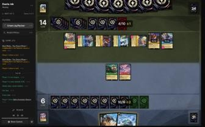
*The board before the decision: [step 145](https://duels.ink/replay/01a1ef50-0462-7c86-87b7-635dc67152fb?step=145) in the duels.ink replay viewer.*

**Setup.** You drew the Device, at last. 6–14. Their seven characters quest for 7, so they win next turn unless their
questing drops to 5 or less. You have 11 ink with an ink: the Device line costs 4, and The Leviathan can also be cast
outright for 10. Their board has 18 {S}; IT'S A MACHINE! takes 10 of it, at most four of their 2-{S} characters. Two
lines:
- **The Device:** Olaf quests (8–14), the Device turns him into The Leviathan, and Tod's losing challenge is the
  second card. Four characters go; three are left questing for 3 (17 next turn).
- **The Leviathan cast for 10:** Olaf trades with On the Case (4 {S} each) and Tod loses a challenge: the two cards.
  IT'S A MACHINE! then takes four of the other six, so five go and two are left questing for 2 (16 next turn). Olaf
  doesn't quest (6–14), and the Device stays in hand with nothing to turn into.

The second line leaves them a lore a turn fewer. Neither wins: they have seven cards in hand and 12 ink to rebuild,
and Gaston or Always Vigilant (5 {S} or more) kills The Leviathan, while you need 14 more lore from The Leviathan's
3 a turn, with one Leviathan, one Phillip and one Malicious left in 31 cards. Their game turn 21 comes with at least
16 lore and new characters dry by then. **From here the game is unwinnable** ([principle 2](#cite-principle-2)).

**What you did:** the Device (3); Olaf challenged Elisa Maza and killed her, surviving on 1 {W}; Tod lost a challenge
to a Day Camp (the first card; a try at the Device before it had undone, since their banished Elisa goes to their
discard, not yours); the Device turned Olaf into The Leviathan (the second card), which banished two Day Camps, the
other Elisa and a Nick (9 {S}). Their board: a Nick and On the Case.

**Verdict: unwinnable, and a good play inside it.** Better than both of the coach's lines: Olaf's challenge took a
fifth character, as the hard cast would, and the Device still made The Leviathan free, 7 ink to spare. The coach's
Device line had Olaf quest before the banish; a challenge he survives works the same way, and here was worth more.

### Turn 19: their turn

**What happened:** Gaston banished The Leviathan; Grandmother Willow's discount brought Fangmeyer, who returned a
Nick Wilde. Two quests: 16–6.

### Turn 20: your turn 10

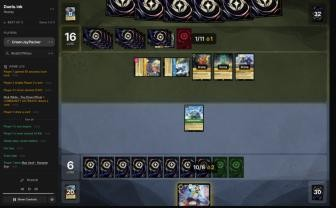
*The board before the decision: [step 169](https://duels.ink/replay/01a1ef50-0462-7c86-87b7-635dc67152fb?step=169) in the duels.ink replay viewer.*

**Setup.** You drew Max Goof. 6–16; their five characters quest for 6 next turn. Your hand is Max Goof alone, with
no song to discard for SWEET REMIX's draw. Unwinnable, as from turn 18.

**What you did:** played Max Goof.

**Verdict: unwinnable.**

## Lessons
1. **Against Detectives an exerted Max Goof is a dead Max Goof:** Elisa Maza's 3 {S} kills him for 1 damage back. Use
   him for a song only when the song is worth more than his next quest, 4 lore once the playlist is on
   ([8](#turn-8)).
2. **Olaf in hand at 1 or 0 is as good as Olaf in play for the Device line,** and safer: Elisa Maza takes only
   non-characters. Hold him while the actions you cast keep cheapening him ([10](#turn-10)).
3. **Use the base before the Device banishes it:** quest, or challenge something it survives. On [18](#turn-18)
   Olaf's challenge took a fifth character for nothing.
4. **Strange Things buys a turn against a wide board:** two characters' quests, here 3 of their 7 lore
   ([16](#turn-16)).

## Proposed knowledge-base updates
The two meta notes were applied on 19 Nov 2026, before the review of game 2, so that review could use them.
- **Strategy:** none new. [H-14](#cite-h-14) gets no evidence either way: the Device line was ready only on game turn 18, too late.
- **Meta (Amber/Sapphire pair file, below the end marker):** a section "Detectives against GreenJayPacker's Ruby
  R.E.D.: WrathOfKhan": the list (Hamm – Piggy Bank, Mickey Mouse – Expedition Leader inked, Nick Wilde – Toy Drive
  Officer ×3, Day Camp Instructor ×3, Elisa Maza ×2, Fangmeyer ×2, Gaston ×2, Always Vigilant ×2 inked, On the Case,
  Belle, Grandmother Willow, Higgins, The Horseman Strikes!, Besties, Assemble!), and how it played: Hamm's LOOSE
  CHANGE and Day Camp's LEND A PAW kept them a turn ahead on ink; Elisa killed an exerted character every turn (both
  Max Goofs, Roller Bob), and Fangmeyer brought her back; On the Case inked the Photo; Gaston killed The Leviathan the
  turn after it landed, as against sterlinghorton and Nick.
- **Meta (the Emerald/Ruby notes on your deck):** refine "Quest before the Device banishes" to "use the base first:
  quest, or a challenge it survives (01a1ef50-0454 turn 18)"; and, against Detectives, "an exerted Max Goof dies to
  Elisa Maza (01a1ef50-0454 turns 9 and 11)".

## Hindsight
Doesn't change the verdicts above.
- **The Device:** the first one was about your 34th card; the chance of none in your first 32 cards is about 4%
  (`tools/odds.py seen`). With it on game turn 10 or 12, the Olaf line was ready at once, before their board had grown
  much past IT'S A MACHINE!'s 10 {S}.
- **Max Goof:** both died to Elisa's challenges, the first after singing on turn 8 and the second after questing on
  turn 10. Held on turn 8, the first would have been exposed by his quest on turn 10 instead; the held line gains at
  least the 4 lore of that quest.
- **The mulligan:** the Max Goof you sent back came back as the first card drawn.

## The coach's errors
Found by the coach during the review; the discussion may add more.

| When | Error | How it was caught | How it won't happen again |
|---|---|---|---|
| Pre-game | While downloading the replay, the coach saw the viewer's intro screen, with each player's mulligan count, before writing its own candidates | Noticed at once; said so in "Chosen how" | Done in b90649e (19 Nov 2026, with the user's agreement): the coach's replay-viewer notes say to find the download menu with `find`, not a screenshot, so nothing of the game shows before the blind pass |
| Turn 12 | The coach's plan used the Photo for a mill when its lore mode was on (12 cards in the discard) and Olaf already cost 0, so the mill gained nothing | Comparing your line with the coach's | Done in b90649e (19 Nov 2026, with the user's agreement): the brief's MILL line says when the discard already meets a threshold ("the Photo's lore mode is on: 1 lore for the same ink") and when no discount or lore bonus is still short |
| Turn 18 | The coach's Device line had Olaf quest before the banish and missed a challenge he survives, which you found: a fifth character banished | Comparing your line with the coach's | Done in b90649e (19 Nov 2026, with the user's agreement): the brief's DEVICE LINES say "use the character first: quest, or a challenge it survives", and the Emerald/Ruby note is refined (above) |

## Open questions
- **Pre-game:** why send Max Goof back and keep Another Tale?
- **Turn 8:** was singing Another Tale with the first Max worth leaving him exerted for Elisa?
- **Turn 12:** why no ink that turn: were Phillip and the second Olaf both worth keeping?
- **Turn 14:** why leave the first Olaf ready rather than kill a Day Camp or Hamm with him?

## Citations
Copies of the coach's knowledge base cited above, as they stood when they were cited (the private repository's commit and date are given with each). They don't change when the knowledge base does.

<!-- Filled in by `python3 tools/cite.py <this file>`: every principle ID, H-n, "principle N" and CR rule above
becomes a link to an entry here. Add a file or one of its sections with `--file PATH --section TEXT`, and link to
the anchor it prints. Never link into the private repository. -->

**H-14**: hypothesis, `kb/strategy/hypotheses.md` at `8c7acc8` (2026-11-19), working tree

> ### H-14. With Ruby R.E.D., land The Leviathan as soon as the Device line is ready, unless a sweeper can come before it quests
> - **Claim** (coach, 2026-11-17): once the Device, a character to banish and a second card for the discard are all
>   available, play The Leviathan that turn rather than develop or dig further. The exception is a sweeper they can cast
>   before The Leviathan quests (Raging Storm at 8 ink).
> - **Why:** each turn waited is a turn their board scores and grows, and The Leviathan's 3 lore a turn starts only
>   once it lands.
> - **Evidence for:** 01a1ea7f-cc42 turn 13 (GreenJayPacker vs Itz_Rj): 3 ink unused with The Leviathan one ink away;
>   Luisa lived to feed the Shops, and the combo came on turn 15, a turn before Raging Storm. Related, on getting the
>   line ready sooner: 01a1eb0c-446c turns 7 and 9 (the Device before Olaf). 01a1ee49-5204 turn 8 (vs Nick): Tod before
>   the Device pushed the line from game turn 10 to 12, by when Detectives had gone past the 10 strength IT'S A MACHINE!
>   takes. 01a1ee60-9d32 turn 9 (vs Chris Callahan): landed the turn it was ready, the turn before Rockstar Aggro would
>   have won.
> - **The exception counts the ink the wipe gives them:** Belle – Snowfield Strategist inks each character The Leviathan
>   banishes, so a five-character wipe is five ink. On 01a1ee51-e2dc turn 9 (vs NightFury) that took Control from 5 to
>   10 ink, and Raging Storm came the next turn. The wipe was still right there; plan the next turns for the Storm.
> - **Evidence against:** none yet. Against Detectives (01a1eaf6-93a9) The Leviathan died the turn after it landed, both
>   times, but each landing still banished four characters.
> - **Status:** open (three games for; the exception refined by a fourth).

**principle 2**: coaching principle, `CLAUDE.md` at `8c7acc8` (2026-11-19), working tree

> 2. **Some games are unwinnable.** Draws and matchups can make a game lost whatever the player does. Say so
>    when it's true, rather than inventing mistakes to explain a loss.

**emerald-ruby.md, Ruby R.E.D.: GreenJayPacker's games of 18 Nov 2026**: knowledge base, `kb/meta/archetypes/emerald-ruby.md` at `8c7acc8` (2026-11-19), working tree

> ### Ruby R.E.D.: GreenJayPacker's games of 18 Nov 2026 `[coach, blind reviews of 01a1ee49-5204, 01a1ee51-e2dc, 01a1ee60-9d32, 01a1ee67-75dc and 01a1ee5b-9309; 2 wins, 3 losses; with the discussion of 01a1ea7f-cc42]`
> - **The same list in all four:** the second list above (White Rabbit ×4, Roller Bob ×3, three Photos).
> - **IT'S A MACHINE!'s second card:** any card put into your discard counts, including one of your characters dying in
>   a challenge. White Rabbit trading with an exerted Shere Khan made the second card on 01a1ee67-75dc turn 19, and the
>   wipe took their whole board.
> - **The Device chains:** The Leviathan (10) can quest and then become Phillip (9), whose SWIFT AND SURE banishes every
>   damaged opposing character (01a1ee67-75dc turn 15). Phillip (9) can later become Olaf or The Leviathan.
> - **Count the combo turn's ink:** Olaf, the Device's use (1) and the second card. With the Device still in hand that
>   turn costs 3 more, a whole turn on 5 ink (01a1ee49-5204 turn 8). Keep The Leviathan with the Device at the
>   mulligan: with both in hand any Olaf completes it (01a1ee67-75dc pre-game: about 54% against 32% by game turn 9).
> - **Songs:** Max Goof's playlist counts songs cast or discarded, so inking a castable song with ink spare delays it
>   (01a1ee49-5204 turn 14). A dry 2- or 3-cost character in play makes next turn's Strike or Malicious free: Max Goof
>   played the turn before the combo turned Strike into a free dig on it (01a1ee60-9d32 turn 7). Strange Things is the
>   out against a lethal board; it costs 4, so dig with the ink that leaves (01a1ee51-e2dc turn 17).
> - **Mills:** judge a mill by what it can find, not what it found: an action makes every Olaf cheaper, a song moves Max
>   Goof toward 4 lore, and ten cards turn on the Photos' lore (01a1ea7f-cc42 turn 9, revisited).
> - **By matchup:** against Detectives and Control, The Leviathan is a wipe and then gone (Gaston, Raging Storm), and
>   Belle inks what it banishes. Against Rockstar Aggro the wipe takes most of a 1-strength board, and a deck with
>   Mowgli makes the Device safer in play. Against Emerald/Steel Midrange on the draw the combo has to land by about game
>   turn 12: Olaf dies to their free Strength of a Raging Fire once they have four characters, and Broadway takes their
>   board past what IT'S A MACHINE! banishes at once (01a1ee5b-9309).

**emerald-ruby.md, Ruby R.E.D.: GreenJayPacker's lists, 17 Nov 2026**: knowledge base, `kb/meta/archetypes/emerald-ruby.md` at `8c7acc8` (2026-11-19), working tree

> ### Ruby R.E.D.: GreenJayPacker's lists, 17 Nov 2026 `[coach, blind reviews of 01a1ea7f-cc42, 01a1eaf6-93a9, 01a1eb05-70c1, 01a1eb0c-446c and 01a1eb2e-39fc; 2 wins, 3 losses]`
> - **Lists:** the first (four games) ran Stegmutt ×4, Strange Things ×3, The Torn Corner ×4 and To Wither a Flower ×2,
>   with no Lyle Tiberius Rourke or Dangerous Plan. The second (01a1eb2e-39fc) swapped Stegmutt and To Wither a Flower
>   for White Rabbit ×4 and Roller Bob – Sid's Toy ×3, with three Photos.
> - **The Device line:** the Device turns Olaf, Phillip (9) or Stegmutt (8) into The Leviathan. The banished character is
>   one of IT'S A MACHINE!'s two cards, so one mill or one song makes the other; the Photo's mill (1 ink, 2 cards) is the
>   cheapest. Mill before the Device (01a1eb2e-39fc turn 13).
> - **The Device before Olaf** (01a1eb0c-446c turns 7 and 9): an item most decks can't touch, while Olaf waiting in play
>   meets Smash, Shere Khan's challengers or Hades. Against Detectives, Elisa Maza takes the Device from hand, so play it
>   before she can come (01a1eaf6-93a9 turns 6 and 8); Judy Hopps – On the Case and Wildcat – Unconventional Mechanic
>   take it from play.
> - **Quest before the Device banishes:** it takes exerted characters, so Olaf or The Leviathan quests first, and The
>   Leviathan can later become Phillip after Malicious (01a1eb0c-446c turns 11 and 15).
> - **Max Goof – Karaoke Star is a lore engine:** with five songs in the discard, BRAND-NEW PLAYLIST makes him a 4-lore
>   quester, often the deck's best lore (turn 10 of 01a1eaf6-93a9; seven songs by turn 15 of 01a1eb0c-446c). The song
>   SWEET REMIX discards counts. Smash and Ink Explosion killed him in two games.
> - **Roller Bob:** Rush for two characters from the discard to the bottom; his 4 {S} banishes a 4-{W} location the
>   turn he lands, for nothing back (01a1eb2e-39fc turn 11).
> - **By matchup:** against Detectives The Leviathan is a wipe, not a quester (H-14's counter-case); against a fast lore
>   board (01a1eb05-70c1) the combo has to land by about game turn 9; against locations, banish them with characters.

**amber-sapphire.md, Detectives against GreenJayPacker's Ruby R.E.D.: Nick**: knowledge base, `kb/meta/archetypes/amber-sapphire.md` at `8c7acc8` (2026-11-19), working tree

> ### Detectives against GreenJayPacker's Ruby R.E.D.: Nick `[coach, blind review of 01a1ee49-5204, 18 Nov 2026]`
> - **The list:** Higgins, Judy Hopps – Helpful Officer (inked), Mowgli – Man Cub, Darkwing Duck – Drake Mallard ×2,
>   Gaston ×3 (two inked), Judy Hopps – On the Case ×2, Nick Wilde – Toy Drive Officer, Judy Hopps – Day Camp
>   Instructor ×2, Fangmeyer ×2, The Horseman Strikes!, Judy Hopps – Lead Detective (inked), and off-list Belle –
>   Snowfield Strategist and Hamm – Piggy Bank.
> - **How it played (they won 20–8 on game turn 19):** Mowgli on turn 3 showed them the Device and The Leviathan in
>   hand; On the Case took the Photo (turn 9) and the Device (turn 17). The Leviathan banished five on turn 12, Belle
>   inked four of them (6 → 10 ink), and Gaston killed The Leviathan the next turn. Two Fangmeyers returned Nick and On
>   the Case.

**decision-method.md, 9. The coach's recurring errors**: knowledge base, `docs/decision-method.md` at `8c7acc8` (2026-11-19), working tree

> ## 9. The coach's recurring errors
> From `reviews/calibration.md`. Check yourself against these on every turn.
> - **Treating known knowledge as new.** In 01a19bb9 turn 7 the coach missed Support on an opposing character, then
>   called it a new lesson, though the Detectives notes already described it: it had read only the opponent's
>   archetype notes, never searched for the cards in hand, and never searched before writing the lesson. Read both
>   decks' notes, use the brief's knowledge-base notes on the cards in view, and search before calling anything new.
>   Finding it afterwards is a failure to explain and fix (`.claude/skills/analyse-replay/SKILL.md`, after the blind
>   pass).
> - **Missing Support onto their character for strength-threshold removal.** In 01a19bb9 turn 7 and 01a19c08-7f38 turn 9
>   the coach planned to hold Gaston – Superior Archer or Judy Hopps – Always Vigilant for a natural 5-strength target,
>   and the player found the line instead: quest a Supporter, add its {S} to a small opposing character, then banish
>   it. The brief's "STRENGTH REMOVAL IN HAND, AND WHAT YOUR SUPPORT PUTS IN RANGE" lists those targets on every
>   turn you hold such removal; read it before planning (user, 2026-11-02: "that cannot continue to be missed").
> - **Card text misread or not read.** Go Go Tomago given another card's keywords (01a14bf9). Tramp's "choose one"
>   Rush missed (01a14574 turn 19). Read each card from a single-card source, in full.
> - **Missing what becomes possible at their next ink.** Lead Detective hard-cast at 6 (01a14574 turn 15).
> - **Judging exposure from their board as it stands.** In 01a19bbd-79c2 turn 4 the coach said Pluto and Mike Wazowski,
>   both 0 strength, "couldn't have hurt" an exerted Eilonwy. Pluto's GOOD DOG made Dale – Ready for His Shot (a
>   Princess Aggro tell, seen in game 1) castable with their 3 ink, and his SPIKE SUIT let Mike kill her. Check their
>   next turn's combat tricks and cost reducers for every character you'd exert (section 2; caught by the user,
>   2026-11-02).
> - **Missing archetype staples and their combos.** Prince Phillip after Malicious, Mean, and Scary (01a139ad turn 23).
> - **Missing synergies on their side.** Darkwing in play makes Launchpad's draw discard-free (01a14574 turn 5).
> - **Overstating a risk** without checking what the alternative loses in the same branch (01a14574 turn 15).
> - **Not counting what the coach's own line exposes.** In 01a19c0c turn 20 the coach suggested Shifting in Lead
>   Detective so Darkwing could kill a 1-lore Shadow. Darkwing's challenge would have left him exerted for Wasabi, and
>   TWIN BLADES could then kill the Lead Detective just played. The player held her for the 3-lore Ursula instead, and
>   won with her two turns later. Prevention: the brief's ready-damage line, and "Say what Y exposes" (section 5).
> - **Anchoring on the coach's own plan.** The user's line was better on the mulligan and turns 11 and 19 of 01a14574.
> - **Not reading the archetype's key cards before the game.** Circle of Life's text was never read, so its wipe combo (Prince Phillip replayed from the discard) was missed (01a13b88 turn 8).
> - **Counting one card of a job, and only their draw.** On 01a13b88 turn 18 the review gave a 17% chance they could
>   damage the whole board: Malicious, Mean, and Scary in their hand and draw. Don Karnage – Debonair Pirate does the
>   same on play, and their dig (Meilin Lee, Tod, Akood, Strike) let them see several more cards: about 43%. Use the
>   brief's combined line and `odds.py dig` (section 2).
> - **Overvaluing a ramp plan, and Khan Industries, on the draw against midrange.** The stonks 📈 reviews called deep
>   mulligans on the draw wrong because the hands held Priscilla, Dream Come True and Khan Industries (01a15f93,
>   01a16035, 01a16972). The player explained that Priscilla dies to their early board on the draw and that Khan
>   Industries is a closing play there (section 7, and the Big Ramp notes). Against sweeper Control the reverse holds:
>   Khan Industries is lore their Storms can't reach (danny, 2026-11-02).
> - **Ignoring a card known to be in their hand.** Meilin Lee revealed Circle of Life into their hand; the next turn's wipe was near-certain (01a13b88 turn 18).
> - **Keeping a quester ready for nothing.** Before keeping a character ready, say what waiting gains: a card, a better
>   challenge next turn, or a wipe dodged. If nothing, and it can't quest safely later either, use it now. In 01a1cbca-787d
>   turn 6 the coach's line kept Lilo & Stitch ready as a wall, though Demona – Betrayer meant it could never quest
>   safely; the player's quest into Hamm was better (H-12).
> - **Leaving a ready combo in hand.** When every piece of a line is there (the Device, a character to banish, the ink),
>   the brief's DEVICE LINES and SHIFT NEXT TURN say so; a reason to hold it (a sweeper that can come before it pays off)
>   has to be named, with the ink at which it comes. In 01a1ea7f-cc42 turn 13 The Leviathan stayed in hand with 3 ink spare
>   while Raging Storm couldn't come before game turn 16.
> - **Writing off a combo piece while its partner can still be drawn.** In 01a1eaf6-93a9 turn 16 the coach's line
>   discarded The Leviathan as dead because no base was in hand; three Olafs, each costing 0, were still in the deck,
>   with the Device in play. The player kept it and dug for Olaf. Before calling a card dead, read the brief's DEVICE
>   LINES ("has no base this turn … Left in your deck") and the needs check's odds of drawing the partner in time.

**MULL-1**: strategy principle, `kb/strategy/principles.md` at `8c7acc8` (2026-11-19), working tree

> - **MULL-1. Keep a plan, not the strongest cards.** *Ask: "Which hand gives me the best chance to execute my game plan in this matchup?"* `[MCL ch.12]` · baseline

**MULL-4**: strategy principle, `kb/strategy/principles.md` at `8c7acc8` (2026-11-19), working tree

> - **MULL-4. Don't chase a perfect hand.** Flexible hands with several lines beat hands that need one specific draw. `[MCL ch.12]` · baseline

**INK-2**: strategy principle, `kb/strategy/principles.md` at `8c7acc8` (2026-11-19), working tree

> - **INK-2. Don't automatically ink the most expensive card.** It may be the late-game win condition or the key answer for this matchup. The answer depends on matchup, hand and board. `[MCL ch.4]` · baseline

**SEQ-1**: strategy principle, `kb/strategy/principles.md` at `8c7acc8` (2026-11-19), working tree

> - **SEQ-1. Gather information before irreversible decisions.** Draw, look and scry before choosing what to ink. Quest with draw triggers before committing other plays when the order doesn't otherwise matter. `[MCL ch.5]` · baseline

**RULE-1**: strategy principle, `kb/strategy/principles.md` at `8c7acc8` (2026-11-19), working tree

> - **RULE-1. Only exerted characters can be challenged** `[CR 4.6.4.2]`. Questing, singing, or {E} for an ability exposes the character. Staying ready protects it. Every quest is also a decision about what the opponent can challenge next turn. · baseline
>   - *Card text overrides this* (CR 1.2.1). Shere Khan – Khan Industries CEO's NEW INCENTIVE lets one character
>     challenge ready characters that turn. Alert (e.g. from Judy Hopps – Lead Detective, to every Detective on their
>     turn) ignores Evasive. Against Ducktectives, name both in the setup. 01a14574, turns 16 and 18. `[coach, 2026-10-26]`

**VALUE-1**: strategy principle, `kb/strategy/principles.md` at `8c7acc8` (2026-11-19), working tree

> - **VALUE-1. A card's value is what it achieves before it leaves play, not its printed stats.** A 2-drop that quests twice and trades can beat a 7-drop removed on arrival. *Ask: "How much will this accomplish before they deal with it?"* `[MCL ch.3]` · baseline

**TRADE-1**: strategy principle, `kb/strategy/principles.md` at `8c7acc8` (2026-11-19), working tree

> - **TRADE-1. Judge a trade by ink invested, tempo, value already generated, and the board afterwards**, not by card count. A 2-cost for a 5-cost is a big win even if it's one-for-one. *Ask: "What does the board look like after this challenge?"* `[MCL ch.7]` · baseline

**INK-3**: strategy principle, `kb/strategy/principles.md` at `8c7acc8` (2026-11-19), working tree

> - **INK-3. Usually ink every turn, but not automatically.** Keeping one more playable card can beat one more ink. Missing ink with an expensive hand can leave you permanently behind. `[MCL ch.4]` · baseline

**THREAT-1**: strategy principle, `kb/strategy/principles.md` at `8c7acc8` (2026-11-19), working tree

> - **THREAT-1. Not every threat needs an answer.** *Ask: "What happens if I don't answer this?"* "Very little" means spend resources elsewhere. "I probably lose" means it's the priority. `[MCL ch.9]` · baseline
