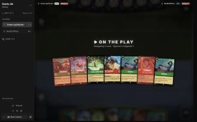
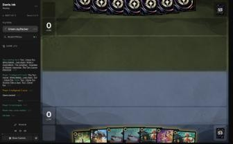
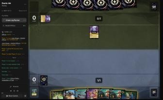
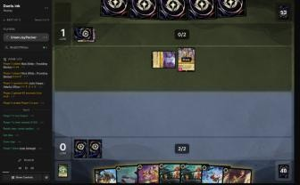
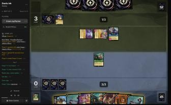
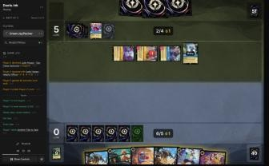
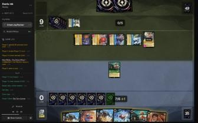
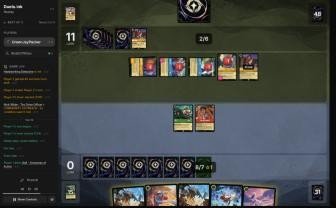
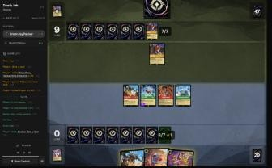
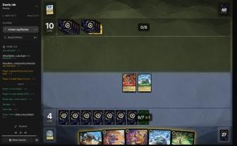

# Review: GreenJayPacker vs WrathOfKhan, game 2, 18 Nov 2026

| | |
|---|---|
| **Status** | draft (blind pass done, not yet discussed) |
| **Replay** | `01a1ef5d-fa92` (`python3 tools/brief.py 01a1ef5d-fa92 --turn N`) · [duels.ink viewer](https://duels.ink/replay/01a1ef5d-fa93-7d37-9290-5c442341aa16?step=0) |
| **Format** | Core Constructed (from game 1 of the match). Set 14 era: inks revealed before the coin toss |
| **Decks** | You: Emerald/Ruby Ruby R.E.D. ([the coach's notes on it](#cite-kb-meta-archetypes-emerald-ruby-ruby-r-e-d-against-detectives-wrathofkhan-game-1)), the same list as game 1. Them: Amber/Sapphire ([the coach's notes on this pair](#cite-kb-meta-archetypes-amber-sapphire-detectives-against-greenjaypacker-s-ruby-r-e-d-wrathofkhan)); archetype as it became clear: **Detectives** (from game 1), with Mickey Mouse – Expedition Leader off-list, and Raging Storm, which no listed Detectives list runs |
| **Play/draw** | You went first, after losing game 1 |
| **Result** | **Win**: they conceded on game turn 18, at 10–4 to them, with no cards in hand |
| **Meta data** | snapshot of 12 Nov 2026 (fresh until 26 Nov) |
| **Chosen how** | Sent by danny, the coach's user, as a replay link on 19 Nov: GreenJayPacker's, reviewed for them. Game 2 of the match; the coach reviewed game 1 first and knew its result (a loss), not this game's |

## Summary
Links go to the turn sections below (`[13](#turn-13)`).
- **Good plays:** [11](#turn-11) (Malicious sung free killed their Supporter and damaged their board, and The Torn
  Corner went down), [13](#turn-13) (drawing first found the Device, and the wipe came the same turn: their board
  down to Elisa Maza) and [15](#turn-15) (four lore, with the second Leviathan, Roller Bob and the second Device held,
  which is what their Raging Storm couldn't reach), plus the routine turns [1](#turn-1), [3](#turn-3), [5](#turn-5)
  and [9](#turn-9).
- **Close calls:** [pre-game](#turn-0) (Tod sent back with the two weaker cards), [7](#turn-7) (the Tale sung for a
  card where Tod could have killed Nick Wilde – Providing Backup).
- **Inaccuracies:** [17](#turn-17) (no ink: Strike's two cards and next turn's 10th ink for The Leviathan given up).

**What decided it:** the wipe on game turn 13 took three of their four Detectives with the Supporters already gone,
and left them one card in hand. Their Raging Storm on turn 16 cleared your board too, but they had nothing left to
follow it, and you had Max Goof, Roller Bob, a Leviathan and a Device in hand: they conceded on game turn 18.

## The game, turn by turn
Verdicts judge each decision on what you could know at the time, **including archetype knowledge an experienced
player has**. Hindsight is kept to its own section. Severity scale: good play / close call /
inaccuracy / mistake / blunder. Principle IDs and hypotheses (H-n) link to copies
in the Citations section at the end, as they stood when they were cited.

**What you knew before the game:** game 1 showed their list: Detectives (100% on its cards), with Hamm – Piggy Bank,
three Nick Wilde – Toy Drive Officers, three Day Camp Instructors, two each of Elisa Maza, Fangmeyer, Gaston and
Always Vigilant, On the Case, Belle and Grandmother Willow. You go first, so your turn k comes on game turn 2k−1 with
k ink, and theirs on game turn 2k. From game 1 and the notes on your deck: their board passed IT'S A MACHINE!'s 10 {S}
by game turn 9 (eight Supporters and cheap Detectives, and Hamm's discount); Elisa Maza challenges any exerted
character with 3 {W} or less and takes a non-character card from your hand; On the Case inks an item from play; Gaston
and Always Vigilant kill The Leviathan the turn after it lands. Their key cards, with the earliest game turn each can
come:
- **Elisa Maza** (4, with another Detective in play): your hand's non-character card of their choice. Game turn 8, or
  6 with Hamm's discount or Day Camp's ramp.
- **On the Case** (3, with another Detective): an item in play into your inkwell. Game turn 6.
- **Always Vigilant** (Shift 2 onto a Judy, with another character played that turn) and **Gaston** (5): banish a
  character with 5 {S} or more. Game turns 6 and 10 (8 with a discount).
- **The Horseman Strikes!** (3): banishes an Evasive character (White Rabbit, Phillip). Game turn 6.
- **Fangmeyer** (5): returns a Detective from their discard. Game turn 10.

### Pre-game

*The opening hand: [step 0](https://duels.ink/replay/01a1ef5d-fa93-7d37-9290-5c442341aa16?step=0) in the duels.ink replay viewer.* The intro marks the three cards you sent back.

**Setup.** On the play. The hand: Tod, White Rabbit, Strike a Good Match, The Leviathan, two Improvise and The Torn
Corner. One payoff and a lot of dig: Tod (2), Strike (2) and each Improvise (1), six cards, and the three actions
cheapen Olaf. The Device and an Olaf are both missing (8 of 53): with the hand's dig and three draws they're about 27%
by game turn 7, 37% with two more cards. The Torn Corner needs 10 cards in the discard, a late engine. The mulligan
tool (1,000 deals; it doesn't model the combo): keeping all seven 8.29 ink of 10 on turns 1–4 and 2.3 lore; without
The Torn Corner 7.95; without it and White Rabbit 7.98 and 0.7 lore; all seven back 8.96. The coach's pick: keep all
seven, a flexible hand that digs hard ([MULL-4](#cite-mull-4)); sending The Torn Corner alone is close.

**What you did:** sent back The Torn Corner, White Rabbit and Tod; kept Strike, The Leviathan and both Improvise. Drew
two Tods and Another Tale. They sent back three.

**Verdict: close call.** Sending The Torn Corner and White Rabbit is fine: the first is a late engine, and the second
adds little against a deck whose combo answers it. Tod is the hand's best dig, two cards for 3 ink on turn 3, so
sending him trades a sure two cards for one random card; that card is a dig itself about a third of the time. It
costs about a card of looks, and the turn-3 ink stays free for a Device if one comes.

### Turn 1: your turn 1

*The board before the decision: [step 2](https://duels.ink/replay/01a1ef5d-fa93-7d37-9290-5c442341aa16?step=2) in the duels.ink replay viewer.*

**Setup.** On the play, no draw. One ink: Improvise is the only play, and with no character in play its +1 {S} does
nothing but it still draws ([CR 1.7.7](#cite-cr-1-7-7): an effect with no legal choice resolves with no effect, and the rest resolves).
It's also an action for Olaf. The ink: the hand has two Tods, Strike and two Improvise for dig, so Another Tale is
spare, and its ink drop helps them as much as you. The coach's line: ink Another Tale, cast Improvise.

**What you did:** inked a Tod and cast Improvise, which drew a third Tod.

**Verdict: good play.** With two Tods, inking one instead of the Tale is as good: it keeps the Tale's drop out of
their hands, and Tod's dig is still in hand.

### Turn 3: your turn 2

*The board before the decision: [step 9](https://duels.ink/replay/01a1ef5d-fa93-7d37-9290-5c442341aa16?step=9) in the duels.ink replay viewer.*

**Setup.** You drew Prince Phillip. Their turn 2 played Judy Hopps – Helpful Officer. You have 2 ink once you ink.
Strike (2) sees two cards; Improvise (1) sees one, and the second ink has nothing to cast. Phillip is the spare
payoff (he also needs Malicious), so he's the ink. The coach's line: ink Phillip, cast Strike.

**What you did:** inked Phillip and cast Strike (drew White Rabbit and The Torn Corner; discarded The Torn Corner).

**Verdict: good play**, the coach's line.

### Turn 5: your turn 3

*The board before the decision: [step 17](https://duels.ink/replay/01a1ef5d-fa93-7d37-9290-5c442341aa16?step=17) in the duels.ink replay viewer.*

**Setup.** You drew Inner Strength. 0–1; their Judy Hopps – Helpful Officer is exerted and Nick Wilde – Providing
Backup (Support with another Detective) is drying. You have 3 ink once you ink. The Device and Olaf are still missing
(8 of 48). Next turn they have 3 ink: On the Case (36% after their draw) has no item to take yet, and Elisa needs 4.
Candidates:
- **Tod (3):** two cards, and Tod is dry next turn to sing Another Tale free (the brief's "free NEXT TURN" line),
  which leaves next turn's 4 ink for a Device and a cantrip.
- **Improvise and Inner Strength (1 + 1), before inking:** two cards and two actions for Olaf, with 1 ink unused.
- **White Rabbit (2) and a cantrip:** an Evasive quester (only The Horseman Strikes! or Lead Detective's Alert reaches
  him) and one card.

The coach's pick: ink a cantrip (Improvise), then Tod.

**What you did:** inked White Rabbit and played Tod (drew Strange Things and a Photo; discarded Strange Things).

**Verdict: good play**, the coach's line with White Rabbit inked instead of a cantrip: about level. The Rabbit was an
Evasive quester; the cantrip a card and an action for Olaf.

### Turn 6: their turn

**What happened:** they inked Mickey Mouse – Expedition Leader and played a Day Camp Instructor (no ramp: no other
character that turn). Nick Wilde – Providing Backup quested and gave Judy Hopps – Helpful Officer +3 (3–0).

### Turn 7: your turn 4

*The board before the decision: [step 28](https://duels.ink/replay/01a1ef5d-fa93-7d37-9290-5c442341aa16?step=28) in the duels.ink replay viewer.*

**Setup.** You drew Improvise. 0–3. Their board quests for 3 (20 on game turn 18) and has 7 {S}: IT'S A MACHINE!
would take all of it now, but it grows each turn. You have 4 ink with an ink; Tod is dry. The hand is all dig: two
Improvise and Inner Strength (1 each), Another Tale (free with Tod), the second Tod (3), and a Photo. Next turn they
have 4 ink: Elisa (with a Detective in play) can take a card from your hand, On the Case (32% after their draw)
an item, and a Shift onto a Judy can challenge at once. Candidates:
- **Kill Nick Wilde – Providing Backup:** Improvise on Tod (+1, 2 {S}; it draws first), and Tod challenges the
  exerted Nick (2 {W}): both die. Nick is their Support engine and their 3-{S} challenger ([H-9](#cite-h-9)). Then ink, Inner
  Strength and the second Improvise (two more cards) and the Photo: 4 of 4 ink, three cards seen, three actions into
  the discard. Another Tale waits for the second Tod.
- **Dig hardest:** Tod sings Another Tale (a card and a drop each), then the three cantrips and the Photo's mill: four
  cards and two milled, but their drop puts Gaston or Fangmeyer in reach next turn, and Nick lives.

The coach's pick: the first; the second is close.

**What you did:** Inner Strength and both Improvise on Tod (drew Roller Bob, The Leviathan and Max Goof); Tod sang
Another Tale (drew a Photo; a drop each); inked the Photo you drew and played the other.

**Verdict: close call.** Your line is the coach's second candidate: four cards seen and four actions in the discard,
against the first line's three cards and a dead Nick. With Tod at 4 {S} after the pumps, the choice at the end was
singing the Tale (a card, and a drop for each side) or challenging Nick (a kill, and Tod dies either way next turn).
Both are reasonable; the kill also keeps their drop from bringing Gaston or Fangmeyer a turn early
([H-9](#cite-h-9)).

### Turn 8: their turn

**What happened:** On the Case inked your Photo; Nick Wilde challenged the exerted Tod and killed him (taking 1); two
quests (5–0).

### Turn 9: your turn 5

*The board before the decision: [step 47](https://duels.ink/replay/01a1ef5d-fa93-7d37-9290-5c442341aa16?step=47) in the duels.ink replay viewer.*

**Setup.** You drew Another Tale. 0–5. Their four characters quest for 4 (20 on game turn 16) and have 11 {S}, one
over IT'S A MACHINE!'s 10. The Device and Olaf are still missing (4 each of 40); seven actions in the discard make
any Olaf cost 2. You have 6 ink before inking (5 and the drop). Next turn they have 6: Elisa (with a Detective in
play), Gaston (27% after their draw), Fangmeyer. Candidates:
- **Max Goof (3) discarding Another Tale, then Tod (3), both before inking:** four cards, a fourth song for the
  playlist, and Tod's discard can be the second Leviathan, which puts two characters in your discard: Roller Bob then
  has Rush next turn (the brief's TIME TO MOVE line). Both new characters are drying, so out of reach. Then ink from
  the four new cards ([SEQ-1](#cite-seq-1)).
- **Tod (discard a Leviathan), then Roller Bob with Rush now:** two cards and a kill (Nick Wilde, their Support and
  3-{S} challenger), but Bob is left exerted on 1 {W} for them.

The coach's pick: the first: twice the dig, and the kill comes a turn later.

**What you did:** Max Goof discarding Another Tale (drew White Rabbit and The Torn Corner); inked The Torn Corner; Tod
discarding a Leviathan (drew another Leviathan and the last Tod).

**Verdict: good play**, the coach's line. Roller Bob has Rush next turn (Tod and a Leviathan in the discard).

### Turn 10: their turn

**What happened:** Nick Wilde – Providing Backup and Day Camp quested and gave their Support to your Max Goof (+3, +2:
6 {S}), and Always Vigilant, Shifted onto Helpful Officer after a Nick Wilde – Toy Drive Officer, banished him with
GOT YOU NOW (5 {S} or more). That's the Detectives trick in the rulings, Support onto an opposing character. 9–0.

### Turn 11: your turn 6

*The board before the decision: [step 68](https://duels.ink/replay/01a1ef5d-fa93-7d37-9290-5c442341aa16?step=68) in the duels.ink replay viewer.*

**Setup.** You drew The Torn Corner. 0–9. Their five characters quest for 5: 14, 19, then 24 on game turn 16. The
needs check: only the wipe wins; eight actions in the discard make any Olaf cost 1, so the Device and an Olaf (4
each of 35) are the missing pieces, and The Leviathan (two in hand) costs 10 to cast. You have 8 ink with an ink.
What's on hand:
- **The first Tod challenges Nick Wilde – Providing Backup** (1 {W} left): kills him (their Support), and Tod dies:
  a card into your discard.
- **The second Tod (3), before inking:** two cards, and its discard is a second card into your discard. If they
  include the Device and an Olaf, the wipe is on this turn: the Device 3, Olaf 1 and its use 1 make 8 with Tod, and
  IT'S A MACHINE! has its two cards (the first Tod's death and the second Tod's discard). It takes Always Vigilant, On
  the Case and Day Camp (10 {S}).
- **Otherwise, Roller Bob (3) with Rush** (three characters in your discard) kills Day Camp and survives on 1 {W};
  White Rabbit (2) with the rest.

The coach's line: the first Tod into Nick, the second Tod, then the wipe if it's there, else Roller Bob into Day Camp
and White Rabbit. Their board then quests for 3 (12, 15, 18, 21: game turn 18), two turns more to find the pieces.

**What you did:** the second Tod (discarded a Leviathan; drew Malicious and another Leviathan); the first Tod sang
Malicious (free), a point of damage on each of theirs, which banished Nick Wilde – Providing Backup; The Torn Corner
(3) and its draw (1; the discard held 15) found White Rabbit, which you inked. Roller Bob stayed in hand.

**Verdict: good play**, better than the coach's. Malicious did the first Tod's kill without spending Tod, and its
damage left every one of theirs a point down: Day Camp on 1 {W} for next turn's Roller Bob (who keeps his Rush in
hand), and their whole board in reach of a Phillip. Their clock comes out the same as the coach's line (20 on game turn
18 once Bob kills Day Camp next turn), and you have The Torn Corner drawing a card a turn for 1 ink.

### Turn 12: their turn

**What happened:** Elisa Maza came down (your hand held only characters, so FOLLOW THE TRAIL took nothing), Always
Vigilant killed the singing Tod, and two quests made it 11–0.

### Turn 13: your turn 7

*The board before the decision: [step 87](https://duels.ink/replay/01a1ef5d-fa93-7d37-9290-5c442341aa16?step=87) in the duels.ink replay viewer.*

**Setup.** You drew Olaf, who costs 0 (nine actions in the discard). 0–11. Their five characters quest for 5 (16
next turn, 21 on game turn 16) and have 15 {S}. You have 9 ink with an ink, one short of casting The Leviathan, and
the Device is still missing (4 of 31; The Torn Corner draws one more a turn). The needs check: the wipe must land by
your turn 15, and even then you start from 0 lore against a deck with cards to rebuild, so this is close to lost.
The pieces for turn 15:
- **Keep the ink drop:** next turn's 9 ink and the drop make 10, The Leviathan's cost.
- **Two cards into the discard on turn 15:** challenges your characters lose (Roller Bob held for his Rush, Tod, White
  Rabbit) supply them, so keep Tod ready now.
- **This turn:** Olaf (0) drains them to 9 and stays ready (nothing of theirs challenges a ready character, and
  Gaston needs 5 {S}); The Torn Corner's draw (1) looks for the Device, which would make turn 15 cheap (Olaf in play
  is its base); White Rabbit (2) adds a body.

The coach's line: those three, 3 of the 8 ink in the well, the drop kept, Roller Bob held. Killing Day Camp with Tod
now cuts their lore by 1 a turn but costs one of turn 15's two cards.

**What you did:** The Torn Corner's draw first, which found the Device; the Device (3); Olaf (0; 11 → 9); Tod traded
with Day Camp (the first card into your discard; a try at the Device line before it had undone for want of it);
the Device turned Olaf into The Leviathan (the second card), which banished Nick Wilde – Toy Drive Officer, On the
Case and Always Vigilant (10 {S}); White Rabbit. Their board: Elisa Maza alone.

**Verdict: good play**, and better than the coach's: drawing before anything else ([SEQ-1](#cite-seq-1)) found the
Device, and the whole line fitted in 7 of your 9 ink (The Torn Corner 1, the Device 3, its use 1, White Rabbit 2),
with Tod's trade as a second card that also killed their Supporter. The coach's plan named the Device as the draw's
target but only for turn 15; it missed that the same draw made the combo affordable this turn.

### Turn 14: their turn

**What happened:** they inked an Elisa Maza and passed, with one card in hand. Elisa didn't quest.

### Turn 15: your turn 8

*The board before the decision: [step 104](https://duels.ink/replay/01a1ef5d-fa93-7d37-9290-5c442341aa16?step=104) in the duels.ink replay viewer.*

**Setup.** You drew Another Tale. 0–9. Their board is Elisa Maza alone (ready, so no challenge reaches her), with one
card in hand and 8 ink next turn. Yours: The Leviathan (3 lore) and White Rabbit (1, Evasive), the Device ready again,
The Torn Corner; in hand a second Leviathan, Roller Bob and the Tale. The race: your 4 a turn reaches 20 on game turn
23; their 1 a turn is far off, so the threat is their rebuild and Gaston (16% after their draw), or Always Vigilant
back through Fangmeyer, killing The Leviathan. Two lines:
- **Keep the second Leviathan as insurance:** The Torn Corner's draw (1), both quest (4–9), Roller Bob (3) as next
  turn's challenger for whatever they play. If The Leviathan dies, next turn's 10 ink cast the second one, with a
  losing challenge or the Tale as its two cards.
- **Swap now:** The Leviathan quests, the Device turns it into the second one, and the Tale (sung by White Rabbit) is
  the second card: IT'S A MACHINE! banishes Elisa. That empties their board but spends the insurance on a 1-lore
  character, and leaves 3 lore this turn instead of 4.

The coach's pick: the first. Another Tale's drop would help their rebuild as much as yours, so it can wait.

**What you did:** The Torn Corner's draw (a second Device); The Leviathan and White Rabbit quested (4–9). Roller Bob,
the Tale, the second Device and the second Leviathan stayed in hand.

**Verdict: good play**, the coach's line, with Roller Bob held: as good or better, since his Rush works next turn
just the same (seven characters in your discard) and in hand he's out of reach.

### Turn 16: their turn

**What happened:** Elisa quested (10–4), then Raging Storm (8) banished everything: The Leviathan, White Rabbit and
their own Elisa. They have no cards in hand. Raging Storm is in no duels.ink Detectives list, but it's Amber's
sweeper and they had 8 ink: the coach's turn-15 setup should have named it (see the coach's errors). Your line that
turn held The Leviathan, Roller Bob and the second Device in hand, which is what a Storm can't touch.

### Turn 17: your turn 9

*The board before the decision: [step 112](https://duels.ink/replay/01a1ef5d-fa93-7d37-9290-5c442341aa16?step=112) in the duels.ink replay viewer.*

**Setup.** You drew Strike. 4–10, both boards empty, and they have no cards in hand. You have 9 ink with an ink, one
short of The Leviathan; any Olaf (3 of 27) costs 0 and makes it free through the Device in play (the brief's DEVICE
LINES: 19% next draw). The race: you need 16, they need 10, and they're top-decking. The line: dig for Olaf first,
with The Torn Corner (1), Strike (2) and Another Tale (2), four cards; if Olaf comes, Olaf (drain 2) and the Device
(1) put The Leviathan in now. Then Roller Bob (3) for a body that quests. All of it is 9; without Olaf, next turn's 10
ink cast The Leviathan.

**What you did:** The Torn Corner's draw (Max Goof); Max Goof discarding Another Tale (drew a second Roller Bob and
Inner Strength), which put the sixth song in the discard, so his playlist is on; Roller Bob. No ink this turn; 1 ink
left, Strike and Inner Strength in hand.

**Verdict: inaccuracy (confidence: medium).** Max Goof was a better play than the coach's Tale: two cards, and a
4-lore quester from next turn against a board they can't challenge him with. The missed ink is the slip.

Skipping the ink is suboptimal because it cost two things you needed: Strike's two cards this turn (with an ink, 2
were left for it), a look for Olaf, who makes The Leviathan free through the Device; and next turn's 10th ink, The
Leviathan's cost (8 in the well and the drop make 9 next turn without it). Inking the second Device (one is in play)
or the second Roller Bob was better: Strike now, and The Leviathan castable next turn whether Olaf comes or not.
Nothing of yours is exposed either way: they have no characters and no cards in hand ([INK-3](#cite-ink-3)).

## Lessons
1. **Draw first, then check whether the combo fits this turn.** On [13](#turn-13) The Torn Corner's draw found the
   Device, and the Device (3), Olaf (0) and its use (1) fitted the same turn. A plan that looks only at next turn
   misses it.
2. **Against Detectives, Malicious sung free is a kill and a setup:** their 1-{W} and damaged characters die, and the
   rest are a point down for Roller Bob and Phillip ([11](#turn-11)).
3. **Hold what a Storm can't reach.** Amber decks can have Raging Storm at 8 ink even when their list doesn't show
   it. With the race won on board, keep the second payoff and the Rush body in hand ([15](#turn-15), [16](#turn-16)).
4. **Ink every turn while The Leviathan is still to be cast:** its 10 is the ceiling that matters ([17](#turn-17)).

## Proposed knowledge-base updates
Applied on 19 Nov 2026 with the review, so later reviews use them.
- **Meta (Amber/Sapphire pair file, WrathOfKhan's section):** game 2 added Judy Hopps – Helpful Officer ×2, Nick
  Wilde – Providing Backup ×2, Judy Hopps – Lead Detective (inked) and **Raging Storm**, which no duels.ink Detectives
  list runs. Support onto your Max Goof set up Always Vigilant's GOT YOU NOW (turn 10).
- **Meta (the Emerald/Ruby notes on your deck):** "against Amber decks keep the second payoff in hand once ahead:
  Raging Storm can come at 8 ink even from Detectives (01a1ef5d-fa92 turn 16)".
- **Strategy ([H-14](#cite-h-14)):** evidence for: the Device line landed the turn it was ready (turn 13), before their board grew
  past what IT'S A MACHINE! takes, and won the game.

## Hindsight
Doesn't change the verdicts above.
- **The Device:** The Torn Corner found the first one on game turn 13, about the 35th card you saw.
- **Turn 17:** they conceded the next turn, so the missed ink cost nothing in the end.

## The coach's errors
Found by the coach during the review; the discussion may add more.

| When | Error | How it was caught | How it won't happen again |
|---|---|---|---|
| Turn 13 | The coach's plan named the Device as The Torn Corner's target but only for turn 15, and missed that the same draw made the combo affordable at once (Device 3, Olaf 0, its use 1) | Comparing your line with the coach's | Proposed: the brief's DEVICE LINES, with no Device in hand, say what it would cost this turn if a draw or dig finds one ("a Device drawn now: 3 + 1 of your N ink, base in play or castable") |
| Turn 15 | The setup listed Gaston and the rebuild as their threats and left out Raging Storm (8), Amber's sweeper, with their 8 ink next turn. The decision stood (your line held everything a Storm can't touch), but the setup was wrong | Their turn 16 | Proposed: the brief's removal list adds the ink's staples from the knowledge base's ink notes (Raging Storm for Amber) once their ink reaches them, even when the likely list doesn't run them |
| Turn 17 | The coach tried to filter the brief through grep to shorten it | The guard hook refused the command | None needed: the hook did its job, and the brief was read whole |

## Open questions
- **Pre-game:** why send Tod back with The Torn Corner and White Rabbit?
- **Turn 7:** after the three pumps, was singing Another Tale with Tod worth more than his challenge on Nick Wilde?
- **Turn 17:** was skipping the ink deliberate, to keep a card in hand?

## Citations
Copies of the coach's knowledge base cited above, as they stood when they were cited (the private repository's commit and date are given with each). They don't change when the knowledge base does.

<!-- Filled in by `python3 tools/cite.py <this file>`: every principle ID, H-n, "principle N" and CR rule above
becomes a link to an entry here. Add a file or one of its sections with `--file PATH --section TEXT`, and link to
the anchor it prints. Never link into the private repository. -->

**H-9**: hypothesis, `kb/strategy/hypotheses.md` at `75074ca` (2026-11-19), working tree

> ### H-9. Against Detectives, kill their Supporters before you deploy a threat with 2 or more {S}
> - **Claim:** Detectives' removal (Judy – Always Vigilant's GOT YOU NOW, Gaston – Superior Archer's WATCH THIS!) only
>   hits characters with 5 {S} or more, and they get your characters there with Support on their own quests (CR 8.13.1:
>   Support may choose any other character). One Supporter puts every character with 2+ {S} in range: Nick Wilde –
>   Providing Backup adds 3, Daisy Duck – Paranormal Investigator 4, Judy – Day Camp Instructor, Eilonwy and Nick – Toy
>   Drive Officer 2. Characters with 0–1 {S} (Mickey – Best in Town, Luisa, Rafiki, Mowgli) are out of reach of one push.
>   So the Supporters, not the removal, are the target: kill them on your turn, and add a 2+ {S} threat when none of
>   theirs can quest next turn, or several at once so one removal a turn can't keep up.
> - **Evidence for:** danny's 16 Remember Merida games against Detectives, 27–30 Oct 2026 (studied whole, not blind).
>   About 35 of danny's characters were banished this way (two a game), always after a Support onto them: Cheshire,
>   Merlin, Merida, Hades, Pepita, Demona – Scourge (5 {S} without help).
> - **Evidence for, decision by decision** (blind reviews of danny's Rockstar Aggro, not yet discussed): 01a1cedf-0be6
>   (Ms. UK, game 1), turns 9 and 11: killing both Supporters kept every character of danny's out of Gaston and Always
>   Vigilant range. 01a1cee4-b587 (game 2), turn 4: Stitch's free kill on Eilonwy, a Supporter.
> - **Status:** open (a pattern across 16 games; no decision tested in discussion yet).

**H-14**: hypothesis, `kb/strategy/hypotheses.md` at `75074ca` (2026-11-19), working tree

> ### H-14. With Ruby R.E.D., land The Leviathan as soon as the Device line is ready, unless a sweeper can come before it quests
> - **Claim** (coach, 2026-11-17): once the Device, a character to banish and a second card for the discard are all
>   available, play The Leviathan that turn rather than develop or dig further. The exception is a sweeper they can cast
>   before The Leviathan quests (Raging Storm at 8 ink).
> - **Why:** each turn waited is a turn their board scores and grows, and The Leviathan's 3 lore a turn starts only
>   once it lands.
> - **Evidence for:** 01a1ea7f-cc42 turn 13 (GreenJayPacker vs Itz_Rj): 3 ink unused with The Leviathan one ink away;
>   Luisa lived to feed the Shops, and the combo came on turn 15, a turn before Raging Storm. Related, on getting the
>   line ready sooner: 01a1eb0c-446c turns 7 and 9 (the Device before Olaf). 01a1ee49-5204 turn 8 (vs Nick): Tod before
>   the Device pushed the line from game turn 10 to 12, by when Detectives had gone past the 10 strength IT'S A MACHINE!
>   takes. 01a1ee60-9d32 turn 9 (vs Chris Callahan): landed the turn it was ready, the turn before Rockstar Aggro would
>   have won.
> - **The exception counts the ink the wipe gives them:** Belle – Snowfield Strategist inks each character The Leviathan
>   banishes, so a five-character wipe is five ink. On 01a1ee51-e2dc turn 9 (vs NightFury) that took Control from 5 to
>   10 ink, and Raging Storm came the next turn. The wipe was still right there; plan the next turns for the Storm.
> - **Evidence against:** none yet. Against Detectives (01a1eaf6-93a9) The Leviathan died the turn after it landed, both
>   times, but each landing still banished four characters.
> - **Status:** open (three games for; the exception refined by a fourth).

**CR 1.7.7**: Comprehensive Rules, `kb/rules/cr/01-concepts.md` at `75074ca` (2026-11-19), working tree

> **1.7.7.** If an illegal choice was made as part of resolving an effect, the player undoes all operations back to the point that they made the original choice, where a new choice can be made. If no legal choices exist, then the effect resolves with no effect. If there are other effects to resolve that don’t involve the choice, then the player does as much as they can in resolving all effects.

**emerald-ruby.md, Ruby R.E.D. against Detectives: WrathOfKhan, game 1**: knowledge base, `kb/meta/archetypes/emerald-ruby.md` at `75074ca` (2026-11-19), working tree

> ### Ruby R.E.D. against Detectives: WrathOfKhan, game 1 `[coach, blind review of 01a1ef50-0454, 19 Nov 2026]`
> - **Use the base before the Device banishes it:** quest, or challenge something it survives. Olaf killed Elisa Maza
>   and was then turned into The Leviathan, a fifth character gone for nothing (turn 18). This widens "quest before the
>   Device banishes" above.
> - **An exerted Max Goof dies to Elisa Maza** (3 {S} against his 3 {W}, 1 damage back): both did, on game turns 9 and
>   11. Sing with him only when the song beats his next quest.
> - **Olaf at 0 or 1 in hand is as good as in play for the Device line,** and Elisa can't take him (she takes
>   non-characters). Holding him while actions cheapen him cost nothing (turn 10).
> - **Strange Things holds back two quests** for a turn: 3 of their 7 lore on turn 16.

**amber-sapphire.md, Detectives against GreenJayPacker's Ruby R.E.D.: WrathOfKhan**: knowledge base, `kb/meta/archetypes/amber-sapphire.md` at `75074ca` (2026-11-19), working tree

> ### Detectives against GreenJayPacker's Ruby R.E.D.: WrathOfKhan `[coach, blind review of 01a1ef50-0454 (game 1), 19 Nov 2026]`
> - **The list:** Hamm – Piggy Bank, Nick Wilde – Toy Drive Officer ×3, Judy Hopps – Day Camp Instructor ×3, Elisa Maza
>   ×2, Fangmeyer ×2, Gaston ×2 (one inked), Judy Hopps – Always Vigilant ×2 (inked), On the Case, Belle – Snowfield
>   Strategist, Higgins (inked), The Horseman Strikes! (inked), Besties, Assemble!, and off-list Mickey Mouse –
>   Expedition Leader (inked) and Grandmother Willow – Ancient Advisor.
> - **How it played (they won 20–6 on game turn 21):** Hamm's LOOSE CHANGE and Day Camp's LEND A PAW kept them a turn
>   ahead on ink, and their board passed IT'S A MACHINE!'s 10 {S} from game turn 9. Elisa Maza challenged an exerted
>   character nearly every turn (both Max Goofs, Roller Bob), and Fangmeyer returned her. On the Case inked the Photo;
>   Gaston killed The Leviathan the turn after it landed, the third game in a row against this deck.

**MULL-4**: strategy principle, `kb/strategy/principles.md` at `75074ca` (2026-11-19), working tree

> - **MULL-4. Don't chase a perfect hand.** Flexible hands with several lines beat hands that need one specific draw. `[MCL ch.12]` · baseline

**SEQ-1**: strategy principle, `kb/strategy/principles.md` at `75074ca` (2026-11-19), working tree

> - **SEQ-1. Gather information before irreversible decisions.** Draw, look and scry before choosing what to ink. Quest with draw triggers before committing other plays when the order doesn't otherwise matter. `[MCL ch.5]` · baseline

**INK-3**: strategy principle, `kb/strategy/principles.md` at `75074ca` (2026-11-19), working tree

> - **INK-3. Usually ink every turn, but not automatically.** Keeping one more playable card can beat one more ink. Missing ink with an expensive hand can leave you permanently behind. `[MCL ch.4]` · baseline
