# Review: GreenJayPacker vs WrathOfKhan, game 3, 18 Nov 2026

| | |
|---|---|
| **Status** | draft (blind pass done, not yet discussed) |
| **Replay** | `01a1ef66-702d` (`python3 tools/brief.py 01a1ef66-702d --turn N`) · [duels.ink viewer](https://duels.ink/replay/01a1ef66-702e-75bd-81fa-4473cb9681e7?step=0) |
| **Format** | Core Constructed (from game 1 of the match). Set 14 era: inks revealed before the coin toss |
| **Decks** | You: Emerald/Ruby Ruby R.E.D. ([the coach's notes on it](#cite-kb-meta-archetypes-emerald-ruby-ruby-r-e-d-against-detectives-wrathofkhan-game-1)), the same list as games 1 and 2. Them: Amber/Sapphire ([the coach's notes on this pair](#cite-kb-meta-archetypes-amber-sapphire-detectives-against-greenjaypacker-s-ruby-r-e-d-wrathofkhan)); archetype as it became clear: **Detectives** (from games 1 and 2; Uncovering Clues confirmed it on game turn 5) |
| **Play/draw** | They went first, after losing game 2 |
| **Result** | **Win**: they conceded on game turn 20, at 17–7, after Olaf's drain. GreenJayPacker won the match 2–1 |
| **Meta data** | snapshot of 12 Nov 2026 (fresh until 26 Nov) |
| **Chosen how** | Sent by danny, the coach's user, as a replay link on 19 Nov: GreenJayPacker's, reviewed for them. Game 3 of the match, the decider (1–1 after the coach's reviews of games 1 and 2); the coach knew nothing of this game's result, and downloaded it without looking at the page |

## Summary
Links go to the turn sections below (`[14](#turn-14)`).
- **Good plays:** [10](#turn-10) (the Device line the turn it was ready: The Leviathan took five of their six, and
  Improvise let Max Goof kill the sixth, so their board was empty), [14](#turn-14) (the fifth song milled, then Roller
  Bob's Rush traded with Always Vigilant and both Max Goofs quested for 4: 13–6) and [18](#turn-18) (Strange Things
  before the ink stopped both Judys and kept the second copy), plus [2](#turn-2), [4](#turn-4), [6](#turn-6),
  [8](#turn-8), [12](#turn-12), [16](#turn-16) and [20](#turn-20). On turns 10, 14 and 18 your line beat the coach's.
- **Close calls:** [pre-game](#turn-0) (Tod sent back with both Torn Corners, as in game 2), [12](#turn-12) (the
  second Photo's mill against keeping Roller Bob) and [16](#turn-16) (two certain lore against Strange Things' card).
- **Inaccuracies or worse:** none.

**What decided it:** the Device line landed on game turn 10, the first turn it was ready, and with Max Goof's
challenge it emptied a board of six. Always Vigilant answered The Leviathan the next turn, but the wipe had cost them
their whole development, and your discard then switched on Max Goof's playlist and the Photos' lore. Their Raging Storm
on turn 15 came with you at 13; the Photos, which a Storm can't touch, took you to 17, and Olaf's drain on turn 20 left
them at 7 with you 3 from winning. They conceded.

## The game, turn by turn
Verdicts judge each decision on what you could know at the time, **including archetype knowledge an experienced
player has**. Hindsight is kept to its own section. Severity scale: good play / close call /
inaccuracy / mistake / blunder. Principle IDs and hypotheses (H-n) link to copies
in the Citations section at the end, as they stood when they were cited.

**What you knew before the game:** games 1 and 2 showed their whole plan: Detectives with three Day Camp
Instructors and Hamm for ramp, Supporters (Nick Wilde ×5 across both Nicks, Day Camp), Elisa Maza and On the Case to
take your Device from hand or play, Gaston and Always Vigilant for The Leviathan, Fangmeyer for recursion, and
Raging Storm at 8 ink (game 2, turn 16), which no listed Detectives list runs. They go first: their turn k on game
turn 2k−1 with k ink, yours on game turn 2k. In game 1 their board passed IT'S A MACHINE!'s 10 {S} by game turn 9;
in game 2 the wipe on turn 13 won. Their key cards, with the earliest game turn each can come:
- **Elisa Maza** (4, with another Detective): a non-character card of their choice from your hand. Game turn 7, or 5
  with Hamm or Day Camp.
- **On the Case** (3, with another Detective): an item in play into your inkwell. Game turn 5.
- **Always Vigilant** (Shift 2 onto a Judy, with another character played) and **Gaston** (5): banish a character
  with 5 {S} or more, The Leviathan included. Game turns 5 and 9; their Supporters can lift your 3-cost characters
  past 5 for them (game 2, turn 10).
- **Raging Storm** (8): banishes everything. Game turn 15, sooner with Day Camp's ramp or your Tales' drops.

### Pre-game

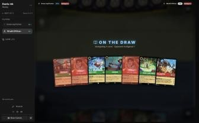
*The opening hand: [step 0](https://duels.ink/replay/01a1ef66-702e-75bd-81fa-4473cb9681e7?step=0) in the duels.ink replay viewer.* The intro marks the cards you sent back.

**Setup.** On the draw. The hand: Tod, two Torn Corners, White Rabbit, Improvise, Strike and The Leviathan. A payoff
and dig (Tod 2, Strike 2, Improvise 1), but no Device or Olaf (8 of 53). White Rabbit costs 1 on your first turn on
the draw (UNDERDOG). The Torn Corner draws only once the discard holds 10, and two are one too many. The mulligan tool
(1,000 deals; it doesn't model the combo): all seven 9.65 ink of 10 on turns 1–4, without one Torn Corner 9.63,
without both 9.52, all seven back 9.41; lore by turn 4 about the same. The coach's pick: send both Torn Corners for two
fresh looks at the Device and Olaf; keeping one is close.

**What you did:** sent back both Torn Corners and Tod; kept White Rabbit, Improvise, Strike and The Leviathan. Drew
Improvise, Malicious and a second Strike. They sent back one.

**Verdict: close call**, as in game 2, where you also sent Tod back. Three fresh cards against the coach's two, at
the cost of Tod's sure two cards on turn 3; both are reasonable ([MULL-4](#cite-mull-4)). Since it's twice now, it's
in the open questions.

### Turn 2: your turn 1

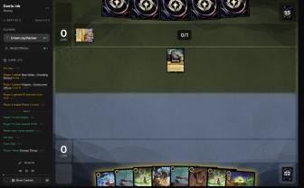
*The board before the decision: [step 5](https://duels.ink/replay/01a1ef66-702e-75bd-81fa-4473cb9681e7?step=5) in the duels.ink replay viewer.*

**Setup.** You drew Strange Things. Their turn 1: Higgins, with Nick Wilde – Providing Backup inked. One ink. White
Rabbit's UNDERDOG makes him cost 1 now (your first turn, on the draw; the brief's options miss this and call him
unaffordable), an Evasive quester none of their characters can challenge without Lead Detective's Alert, and only The
Horseman Strikes! (10%) removes. Improvise would draw a card instead. The coach's line: White Rabbit for 1, inking an
Improvise (two in hand, and two Strikes for dig).

**What you did:** inked Strange Things and played White Rabbit for 1.

**Verdict: good play**, the coach's line with Strange Things inked: as good, since its 4 ink makes it a late card.

### Turn 4: your turn 2

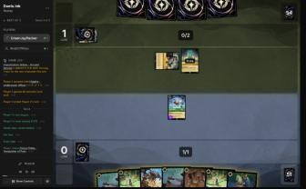
*The board before the decision: [step 12](https://duels.ink/replay/01a1ef66-702e-75bd-81fa-4473cb9681e7?step=12) in the duels.ink replay viewer.*

**Setup.** You drew Prince Phillip. Their turn 3: Grandmother Willow (a discount on their next character each turn),
and Higgins quested (1–0). You have 2 ink once you ink; White Rabbit is dry, and Evasive, so nothing of theirs can
challenge him exerted. With Malicious in hand, Phillip is a second payoff with no strength cap: Malicious damages
their whole board, then Phillip's SWIFT AND SURE banishes all of it, which matters against a deck whose board passed
IT'S A MACHINE!'s 10 {S} by game turn 9 in game 1. Candidates:
- **White Rabbit sings Strike (free) and the second Strike (2):** four cards, and two songs and two actions into the
  discard.
- **White Rabbit quests (1) and one Strike (2):** a lore and two cards.

The coach's pick: the first; a lore now is worth less than two cards toward the Device and Olaf. Ink an Improvise,
keeping Phillip and Malicious.

**What you did:** White Rabbit sang Strike before you inked (discarded Improvise; drew Tod and Max Goof); inked Tod;
the second Strike (discarded Inner Strength; drew another Inner Strength and Roller Bob).

**Verdict: good play**, the coach's line with the ink chosen after the first Strike's draw ([SEQ-1](#cite-seq-1)).

### Turn 6: your turn 3

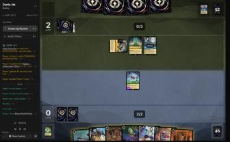
*The board before the decision: [step 24](https://duels.ink/replay/01a1ef66-702e-75bd-81fa-4473cb9681e7?step=24) in the duels.ink replay viewer.*

**Setup.** You drew a Photo. Their turn 5 inked a Lead Detective and played Judy Hopps – Uncovering Clues with
Willow's discount (it found a Day Camp, now known in their hand). 0–2. You have 3 ink once you ink. Next turn they
have 4 and Willow's discount: Elisa Maza (Uncovering Clues is a Detective) takes the non-character of their choice
from your hand, which would be Malicious; On the Case takes an item from play; a Lead Detective Shifted onto
Uncovering Clues gives their Detectives Alert, which reaches White Rabbit. Candidates:
- **Max Goof (3) discarding Malicious:** two cards, a third song in the discard, and Malicious isn't left in hand
  for Elisa. It costs the Phillip line its Malicious (three more in the deck).
- **Improvise (1), the Photo (1) and its mill (1):** a card and two milled, and the Photo down for On the Case.
- **Roller Bob (3):** a body; no Rush yet (no characters in your discard).

The coach's pick: Max Goof, the two cards and the hedge against Elisa; the Photo line is close. White Rabbit quests
(only a Lead Detective's Alert, 21% after their draw, reaches him).

**What you did:** inked Phillip; Max Goof discarding Malicious (drew a second Roller Bob and the Device); White Rabbit
quested (1–2).

**Verdict: good play**, the coach's line. With Malicious gone, inking Phillip was right: he had no damage to banish.

### Turn 8: your turn 4

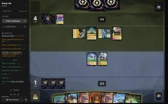
*The board before the decision: [step 36](https://duels.ink/replay/01a1ef66-702e-75bd-81fa-4473cb9681e7?step=36) in the duels.ink replay viewer.*

**Setup.** You drew Strike. Their turn 7: Nick Wilde – Toy Drive Officer with Willow's discount, two quests (4–1);
Belle was inked. Their board has 8 {S} and quests for 4 (20 on game turn 15). You have 4 ink with an ink and the
Device in hand; Olaf is missing (4 of 43) and costs 4 with five actions in the discard. Elisa Maza can take the
Device from your hand next turn (Uncovering Clues is a Detective); On the Case (21% after their draw) can take it from
play. The line:
- **White Rabbit sings Strike first** (free; Evasive, so he's safe exerted unless a Lead Detective's Alert comes):
  two cards before you ink ([SEQ-1](#cite-seq-1)), and a fourth or fifth song in the discard for Max Goof.
- **Improvise (1) and the Device (3):** a card, and the Device out of Elisa's reach. Max Goof stays ready: exerted,
  Uncovering Clues' 3 {S} kills him.

That's 4 of 4. Next turn, with seven actions in the discard, any Olaf costs 2, and Olaf, the Device's use and the
Photo's mill fit 5 ink.

**What you did:** White Rabbit sang Strike (discarded Improvise; drew Olaf and another Improvise); the Device; inked
a Roller Bob; the Photo.

**Verdict: good play**, the coach's line with the Photo in place of Improvise: as good, since the Photo's mill is
next turn's second card. Olaf now costs 2 (seven actions), so next turn's combo is Olaf 2, the Device's use 1 and
the mill 1: 4 of 5 ink.

### Turn 10: your turn 5

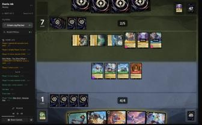
*The board before the decision: [step 52](https://duels.ink/replay/01a1ef66-702e-75bd-81fa-4473cb9681e7?step=52) in the duels.ink replay viewer.*

**Setup.** You drew a second Max Goof. Their turn 9: Uncovering Clues found Helpful Officer, who came free with
Willow; Day Camp ramped; three quests (7–1). Their six characters quest for 6 (20 on game turn 15) and have 12 {S}.
The Device survived their turn, and the combo is all here: Olaf costs 2, the Device's use 1, the Photo's mill 1 is
the second card: 4 of your 5 ink (the brief's DEVICE LINES: Olaf → The Leviathan). IT'S A MACHINE! takes 10 {S}:
Uncovering Clues 3, Nick 2, Day Camp 2, Helpful Officer 2 and Willow 1, five of six, leaving Higgins (a vanilla 2/2).
No Belle in play, so no ink for them. The order:
- **The Photo's mill first:** a fifth song among the two cards (44%) turns on Max Goof's playlist before he quests.
- **White Rabbit and Max Goof quest:** after the wipe only Higgins can challenge, and he can't kill Max (2 {S}
  against 3 {W}).
- **Olaf (2; their 7 → 5), then the Device turns him into The Leviathan** (Olaf can't quest, drying).
- **Improvise (1)** with the last ink.

Their next turn: Higgins and whatever they cast; Gaston (35% after their draw) or Always Vigilant (it needs a Judy in
play to Shift onto, and none would be left) can kill The Leviathan, and Raging Storm needs 8 ink (they'll have 6).

**What you did:** Olaf for 2 (7 → 5); the mill (White Rabbit and Inner Strength); the Device turned Olaf into The
Leviathan, which banished Day Camp, Helpful Officer, Nick Wilde, Uncovering Clues and Willow; inked a Roller Bob;
Improvise on Max Goof (drew the third Roller Bob), and Max, at 2 {S}, challenged Higgins and killed him, surviving;
White Rabbit quested (2–5).

**Verdict: good play**, better than the coach's: the coach left Higgins as the one character the wipe couldn't
reach and had Max quest for 1. Improvise's +1 let Max finish the job, so their board is empty, not a 2/2 that would
quest and challenge. The combo landed the turn it was ready, before their board grew past what it could take
([H-14](#cite-h-14)).

### Turn 11: their turn

**What happened:** Mowgli – Man Cub saw your hand (Max Goof and Roller Bob: no non-character for you to discard),
and Always Vigilant, cast for its full 4 after Mowgli, banished The Leviathan. The coach's turn-10 setup had said
Always Vigilant needed a Judy to Shift onto; it doesn't, Shift is only its cheap way in (see the coach's errors).

### Turn 12: your turn 6

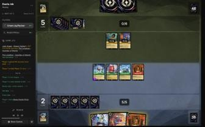
*The board before the decision: [step 72](https://duels.ink/replay/01a1ef66-702e-75bd-81fa-4473cb9681e7?step=72) in the duels.ink replay viewer.*

**Setup.** You drew a Photo. 2–5. Their board is Mowgli and Always Vigilant, both drying (out of reach), questing for
2; they have 2 cards in hand and 7 ink next turn. The brief's new INK STAPLES line: Raging Storm comes online the turn
after next (8 ink, game turn 15). You have 6 ink with an ink. Your discard holds four songs, so one more turns on Max
Goof's playlist (4 lore); the first Max has 1 {W} left (anything kills him exerted), the second is in hand. The two
Photos' mills find a song 48% (one mill) or 75% (both). The line:
- **Mill with both Photos first** (the one in play 1, the new one 1 + 1): 75% the playlist comes on.
- **Then quest:** White Rabbit (1) and, with the playlist on, the first Max for 4 (he dies to anything next turn, but
  he would anyway).
- **The second Max Goof (3):** a 4-lore quester from next turn if the playlist is on.

All 6 ink. Next turn, with Raging Storm a turn away, hold back what doesn't have to be on the board.

**What you did:** the first Photo's mill (The Leviathan and Tod: no song); the second Photo; the second Max Goof;
White Rabbit quested (3–5). No ink; Roller Bob stayed in hand, and the first Max stayed ready.

**Verdict: good play**, the coach's line with one close call in it: the second Photo's mill needed a sixth ink, which
meant inking Roller Bob, your last card. Its 48% at the playlist against a Rush body in hand that a Raging Storm can't
reach is about even, and keeping the first Max ready (1 {W} left) kept him alive.

### Turn 13: their turn

**What happened:** Fangmeyer returned Uncovering Clues to their hand; Always Vigilant quested (6–3).

### Turn 14: your turn 7

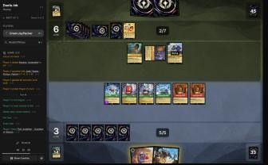
*The board before the decision: [step 85](https://duels.ink/replay/01a1ef66-702e-75bd-81fa-4473cb9681e7?step=85) in the duels.ink replay viewer.*

**Setup.** You drew The Leviathan. 3–6. Their board: Mowgli (ready), Always Vigilant (exerted, 4 {S}), Fangmeyer
(drying, 4 {S}), questing for 4; in hand Uncovering Clues and one card. Next turn they have 8 ink: the INK STAPLES
line says Raging Storm is castable then, though with 2 cards and a draw they hold one only about 1 time in 12. You
have 5 ink (6 if you ink Roller Bob, your only inkable card). Any Olaf drawn costs 0 (nine actions in the discard) and
becomes The Leviathan through the Device for 1. The pieces:
- **The Photos:** a mill finds the fifth song 52% (78% with both), which makes both Max Goofs 4-lore questers now.
  Mill with one first; if it hits, the other takes 1 lore instead.
- **Quests:** with the playlist on, both Maxes and White Rabbit make 9 (12–6), and the Maxes die to their
  challengers next turn (Mowgli kills the damaged one, Fangmeyer or Always Vigilant the other), which spends their
  turn on challenges, not quests. Without it, 3.
- **Roller Bob with Rush** (five characters in your discard) trades with the exerted Always Vigilant (4 {S} each),
  or stays in hand with The Leviathan, out of a Storm's reach.

The coach's line: mill, then quest everything if the playlist comes on (the race is the win here, and their challenges
cost them quests); hold Roller Bob and The Leviathan in hand.

**What you did:** the first Photo's mill (Tod and Malicious: the fifth song); Roller Bob with Rush traded with Always
Vigilant; both Max Goofs quested for 4 and White Rabbit for 1; the second Photo's lore (13–6).

**Verdict: good play**, slightly better than the coach's: the coach held Roller Bob against a Raging Storm they were
only about 1 in 12 to hold, while the trade took one of the three characters that could kill a Max next turn, and a
lore a turn off their clock. 13 lore with two 4-lore questers puts the race in your hands.

### Turn 15: their turn

**What happened:** Fangmeyer and Mowgli quested (9–13), then Raging Storm banished everything: both Max Goofs, White
Rabbit, and their own two. They have one card in hand (Uncovering Clues, known).

### Turn 16: your turn 8

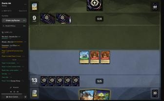
*The board before the decision: [step 103](https://duels.ink/replay/01a1ef66-702e-75bd-81fa-4473cb9681e7?step=103) in the duels.ink replay viewer.*

**Setup.** You drew Strange Things. 13–9, both boards empty. You have 5 ink; your hand is The Leviathan and Strange
Things (the only inkable card). The two Photos' lore mode is on (18 in the discard): 2 lore a turn while they stand,
which alone reaches 20 on game turn 22. Any Olaf (4 of 32) costs 0 and becomes The Leviathan through the Device. They
need 11 and have one card to rebuild with. Two lines, as 5 ink allows only one:
- **Both Photos' lore (2):** 15–9, with Strange Things kept for next turn.
- **Strange Things (4) and one Photo's lore (1):** 14–9 and a card now: a 1 in 8 chance of Olaf (The Leviathan for 1
  next turn) and about 1 in 4 of a quester.

About level: the lore is certain, and the card looks a turn sooner for what wins faster. A close call either way.

**What you did:** both Photos' lore (15–9); Strange Things kept.

**Verdict: good play**, the first of the coach's two level lines.

### Turn 17: their turn

**What happened:** Uncovering Clues found Always Vigilant, and both came down (no target for GOT YOU NOW). One card
left in their hand.

### Turn 18: your turn 9

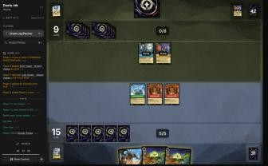
*The board before the decision: [step 114](https://duels.ink/replay/01a1ef66-702e-75bd-81fa-4473cb9681e7?step=114) in the duels.ink replay viewer.*

**Setup.** You drew a second Strange Things. 15–9. Their two Judys quest for 2 from next turn. With one Strange Things
inked you have 6: both Photos' lore (2) and the other Strange Things (4) on the two Judys, so they can't quest until
your next turn, and it draws a card. That's 17–9 with their clock stopped for a turn; the Photos then reach 20 on game
turn 22 unless On the Case (18% after their draw) inks one.

**What you did:** Strange Things on both Judys first (drew The Torn Corner); a Photo's lore; inked The Torn Corner; the
other Photo's lore (17–9). The second Strange Things stayed in hand.

**Verdict: good play**, better than the coach's: casting before inking let you ink the card Strange Things drew and
keep the second Strange Things for next turn ([SEQ-1](#cite-seq-1)).

### Turn 19: their turn

**What happened:** Elisa Maza took your second Strange Things; Higgins came down. No quests (Strange Things). They have
no cards in hand.

### Turn 20: your turn 10

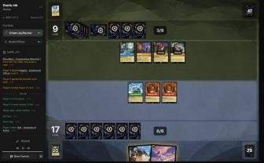
*The board before the decision: [step 126](https://duels.ink/replay/01a1ef66-702e-75bd-81fa-4473cb9681e7?step=126) in the duels.ink replay viewer.*

**Setup.** You drew Olaf, who costs 0. 17–9; their four characters can quest for 4 next turn and they have no cards
in hand. The Photos' lore makes 19 now, so the game is won next turn by any 1 lore, which they can't stop: On the Case
could ink one Photo at most. Olaf's drain (9 → 7) puts their 20 further off. The Device can turn Olaf into The
Leviathan (a 3-lore quester next turn); a wipe would need a second card, which only a Photo's mill gives, at the cost
of a lore. The line: Olaf, both Photos' lore (19–7), and The Leviathan through the Device for 1 if you like: either
way next turn wins.

**What you did:** Olaf for 0 (9 → 7). They conceded.

**Verdict: good play.**

## Lessons
1. **Land the Device line the turn it's ready, and spend what's left on what the wipe can't reach.** On
   [10](#turn-10) IT'S A MACHINE! took five of their six, and Improvise turned Max Goof's challenge into the sixth kill
   ([H-14](#cite-h-14)).
2. **The Leviathan is never safe from Always Vigilant while they have 4 ink:** GOT YOU NOW needs only another
   character played that turn, and Shift is just the cheap way in ([11](#turn-11)).
3. **Weigh a sweeper by the chance they hold it.** On [14](#turn-14) Raging Storm was castable but held about 1 time
   in 12; the trade and the quests were worth more than a body kept back for it.
4. **The Photos outlast Raging Storm.** They're items, so a Storm leaves them, and with 10 or more cards in the
   discard they make 2 lore a turn ([16](#turn-16), [18](#turn-18)).
5. **Cast the draw before the ink** ([SEQ-1](#cite-seq-1)): on [4](#turn-4), [8](#turn-8) and [18](#turn-18) it
   chose the ink after seeing the card.

## Proposed knowledge-base updates
All three were applied on 19 Nov 2026, with this draft; the discussion can change them.
- **Meta (Amber/Sapphire pair file, WrathOfKhan's section):** game 3 added Mowgli – Man Cub (HAVE A BETTER LOOK sees
  your hand and takes a non-character; played first, it let Always Vigilant be hard-cast for 4 on game turn 11 to
  banish The Leviathan) and Grandmother Willow again (a discount from game turn 3), and Raging Storm came at 8 ink
  again (game turn 15), the second game running.
- **Meta (the Emerald/Ruby notes on your deck):** "The Leviathan isn't safe from Always Vigilant once no Judy is left:
  she can be hard-cast for 4 after any other character (01a1ef66-702d turn 11). Leftover ink after the wipe can finish
  what IT'S A MACHINE! can't reach (Improvise on Max Goof, turn 10). The Photos are items, so Raging Storm leaves them:
  with 10 or more in the discard they made 2 lore a turn after the Storm (turns 16–20)."
- **Strategy ([H-14](#cite-h-14)):** evidence for: the line landed on game turn 10, the first turn it was ready, and emptied a board
  of six; The Leviathan died the next turn, but the game was won.

## Hindsight
Doesn't change the verdicts above.
- **Turn 10:** Always Vigilant was in their hand, so The Leviathan was always going to die the next turn. The wipe was
  still five characters for one card.
- **Turn 14:** they did hold Raging Storm (the 1 in 12), and cast it after two quests. Roller Bob kept in hand would
  have survived it; Always Vigilant, whom he traded with, would have quested once more before the Storm took her too.
- **Turn 20:** at 17–7, with the Photos' 2 lore a turn and nothing in their hand, the game was all but won whatever
  Olaf did.

## The coach's errors
Found by the coach during the review; the discussion may add more.

| When | Error | How it was caught | How it won't happen again |
|---|---|---|---|
| Turn 2 | The brief's options called White Rabbit unaffordable (2 with 1 ink); UNDERDOG makes him cost 1 on your first turn on the draw | The coach read his text | Done in f389cea (20 Nov 2026, with the user's agreement): the brief's options count UNDERDOG on your first turn after going second (White Rabbit shows "costs 1 … play for 1"), with a test on this turn |
| Turn 10 | The setup said Always Vigilant needed a Judy to Shift onto, so The Leviathan was safe from her once the wipe had taken the Judys. She can be hard-cast for 4 after any other character, and Mowgli did that on turn 11. The cause: the brief's removal list left her out, as the tagger read her Shift reminder text ("one of your characters named Judy Hopps") and GOT YOU NOW as one sentence and took it to be about your own cards. Eleven more cards with Shift and removal (Simba – Son of Mufasa, Mickey Mouse – Playful Sorcerer, Cheshire Cat – From the Shadows, Go Go Tomago – Cutting Edge, …) are left out the same way. The decision stood: the line was right with or without her | Their turn 11 | Done in f389cea (20 Nov 2026, with the user's agreement): the tagger drops reminder text before reading a card's sentences, with a test on Always Vigilant; twelve cards gain the removal tag, and the rebuilt Amber/Sapphire notes list her as Detectives removal (3eae4e9) |
| Turn 10 | The brief's "Dig you can use this turn" counted the Max Goof in play (draws 2), whose SWEET REMIX works only when he's played: 5 cards where 3 were on offer, and the "with this turn's dig" odds too high | Rereading the brief after the pass | Done in f389cea (20 Nov 2026, with the user's agreement): a card in play counts only for dig it can still use (quest, activated or "whenever" abilities), never a "when you play", start-of-turn or enters-play draw, with a test on this turn |
| Turn 11 | The draft said Mowgli made you discard an Improvise; your hand was Max Goof and Roller Bob, so nothing was discarded | Checking the replay during the fill-in | Done in f389cea (20 Nov 2026, with the user's agreement): `replay.py log` adds "(nothing discarded: the hand held no card it could take)" after a hand look that took nothing, with a test on this turn, checked against all 169 hand looks in the replays |
| Turn 16 | The coach ran the `--plan` brief with its output thrown away, only to pass the gate before `--happened` | The guard hook refused the command | None needed: the hook did its job, and the brief was then read whole before the setup was written |

## Open questions
- **Pre-game:** Tod went back again, as in game 2. What made the two cards he draws on turn 3 worth less than a fresh
  look?
- **Turn 12:** was keeping Roller Bob (no sixth ink for the second Photo's mill) about his Rush on the next turn?
- **Turn 16:** were the two Photo lore meant to keep Strange Things for the Judys' quests?

## Citations
Copies of the coach's knowledge base cited above, as they stood when they were cited (the private repository's commit and date are given with each). They don't change when the knowledge base does.

<!-- Filled in by `python3 tools/cite.py <this file>`: every principle ID, H-n, "principle N" and CR rule above
becomes a link to an entry here. Add a file or one of its sections with `--file PATH --section TEXT`, and link to
the anchor it prints. Never link into the private repository. -->

**H-14**: hypothesis, `kb/strategy/hypotheses.md` at `9465a9a` (2026-11-19), working tree

> ### H-14. With Ruby R.E.D., land The Leviathan as soon as the Device line is ready, unless a sweeper can come before it quests
> - **Claim** (coach, 2026-11-17): once the Device, a character to banish and a second card for the discard are all
>   available, play The Leviathan that turn rather than develop or dig further. The exception is a sweeper they can cast
>   before The Leviathan quests (Raging Storm at 8 ink).
> - **Why:** each turn waited is a turn their board scores and grows, and The Leviathan's 3 lore a turn starts only
>   once it lands.
> - **Evidence for:** 01a1ea7f-cc42 turn 13 (GreenJayPacker vs Itz_Rj): 3 ink unused with The Leviathan one ink away;
>   Luisa lived to feed the Shops, and the combo came on turn 15, a turn before Raging Storm. Related, on getting the
>   line ready sooner: 01a1eb0c-446c turns 7 and 9 (the Device before Olaf). 01a1ee49-5204 turn 8 (vs Nick): Tod before
>   the Device pushed the line from game turn 10 to 12, by when Detectives had gone past the 10 strength IT'S A MACHINE!
>   takes. 01a1ee60-9d32 turn 9 (vs Chris Callahan): landed the turn it was ready, the turn before Rockstar Aggro would
>   have won.
> - **The exception counts the ink the wipe gives them:** Belle – Snowfield Strategist inks each character The Leviathan
>   banishes, so a five-character wipe is five ink. On 01a1ee51-e2dc turn 9 (vs NightFury) that took Control from 5 to
>   10 ink, and Raging Storm came the next turn. The wipe was still right there; plan the next turns for the Storm.
> - **More evidence for** (19 Nov 2026): 01a1ef5d-fa92 turn 13 (vs WrathOfKhan's Detectives): the Device line landed the
>   turn The Torn Corner found the Device, while their board was still within IT'S A MACHINE!'s reach, and the game was
>   won. In game 1 of the match (01a1ef50-0454) the line was ready only on game turn 18, too late.
> - **Evidence against:** none yet. Against Detectives (01a1eaf6-93a9) The Leviathan died the turn after it landed, both
>   times, but each landing still banished four characters.
> - **Status:** open (four games for; the exception refined by a fifth).

**MULL-4**: strategy principle, `kb/strategy/principles.md` at `9465a9a` (2026-11-19), working tree

> - **MULL-4. Don't chase a perfect hand.** Flexible hands with several lines beat hands that need one specific draw. `[MCL ch.12]` · baseline

**SEQ-1**: strategy principle, `kb/strategy/principles.md` at `9465a9a` (2026-11-19), working tree

> - **SEQ-1. Gather information before irreversible decisions.** Draw, look and scry before choosing what to ink. Quest with draw triggers before committing other plays when the order doesn't otherwise matter. `[MCL ch.5]` · baseline

**amber-sapphire.md, Detectives against GreenJayPacker's Ruby R.E.D.: WrathOfKhan**: knowledge base, `kb/meta/archetypes/amber-sapphire.md` at `9465a9a` (2026-11-19), working tree

> ### Detectives against GreenJayPacker's Ruby R.E.D.: WrathOfKhan `[coach, blind review of 01a1ef50-0454 (game 1), 19 Nov 2026]`
> - **The list:** Hamm – Piggy Bank, Nick Wilde – Toy Drive Officer ×3, Judy Hopps – Day Camp Instructor ×3, Elisa Maza
>   ×2, Fangmeyer ×2, Gaston ×2 (one inked), Judy Hopps – Always Vigilant ×2 (inked), On the Case, Belle – Snowfield
>   Strategist, Higgins (inked), The Horseman Strikes! (inked), Besties, Assemble!, and off-list Mickey Mouse –
>   Expedition Leader (inked) and Grandmother Willow – Ancient Advisor.
> - **How it played (they won 20–6 on game turn 21):** Hamm's LOOSE CHANGE and Day Camp's LEND A PAW kept them a turn
>   ahead on ink, and their board passed IT'S A MACHINE!'s 10 {S} from game turn 9. Elisa Maza challenged an exerted
>   character nearly every turn (both Max Goofs, Roller Bob), and Fangmeyer returned her. On the Case inked the Photo;
>   Gaston killed The Leviathan the turn after it landed, the third game in a row against this deck.
> - **Game 2 (01a1ef5d-fa92; GreenJayPacker won, they conceded on game turn 18):** added Judy Hopps – Helpful Officer
>   ×2, Nick Wilde – Providing Backup ×2, Judy Hopps – Lead Detective (inked) and **Raging Storm**, which no duels.ink
>   Detectives list runs: it came at 8 ink on game turn 16 and cleared both boards. Their Supporters gave your Max Goof
>   +5 so that Always Vigilant's GOT YOU NOW could banish him (turn 10).

**emerald-ruby.md, Ruby R.E.D. against Detectives: WrathOfKhan, game 1**: knowledge base, `kb/meta/archetypes/emerald-ruby.md` at `9465a9a` (2026-11-19), working tree

> ### Ruby R.E.D. against Detectives: WrathOfKhan, game 1 `[coach, blind review of 01a1ef50-0454, 19 Nov 2026]`
> - **Use the base before the Device banishes it:** quest, or challenge something it survives. Olaf killed Elisa Maza
>   and was then turned into The Leviathan, a fifth character gone for nothing (turn 18). This widens "quest before the
>   Device banishes" above.
> - **An exerted Max Goof dies to Elisa Maza** (3 {S} against his 3 {W}, 1 damage back): both did, on game turns 9 and
>   11. Sing with him only when the song beats his next quest.
> - **Olaf at 0 or 1 in hand is as good as in play for the Device line,** and Elisa can't take him (she takes
>   non-characters). Holding him while actions cheapen him cost nothing (turn 10).
> - **Strange Things holds back two quests** for a turn: 3 of their 7 lore on turn 16.
> - **Game 2 (01a1ef5d-fa92, won):** against an Amber deck, keep the second payoff and a Rush body in hand once the race
>   is won on board: WrathOfKhan's Detectives ran Raging Storm (8 ink, turn 16), and what stayed in hand won. Malicious
>   sung free killed their 1-{W} Supporter and left the rest a point down (turn 11). Drawing first found the Device on
>   turn 13, and the combo fitted that same turn.
