# Review: GreenJayPacker vs James (Little Meeples), 21 Nov 2026

| | |
|---|---|
| **Status** | draft (blind pass done, not yet discussed) |
| **Replay** | `01a1fb8a-260a` (`python3 tools/brief.py 01a1fb8a-260a --turn N`) · [duels.ink viewer](https://duels.ink/replay/01a1fb8a-260e-7dd7-ad4f-d050ecdcfe50?step=0) |
| **Format** | Core Constructed, best of one (matchmade). **Their inks were not revealed before the game**: this replay records only yours, the first of your replays without theirs, so the coach takes it that you didn't see them either |
| **Decks** | You: Amber/Sapphire **Detectives** ([the coach's notes on it](#cite-kb-meta-archetypes-amber-sapphire-detectives-how-it-plays)). Them: **Amethyst/Emerald** ([the coach's notes on this pair](#cite-kb-meta-archetypes-amethyst-emerald-retro-device-against-danny-s-remember-merida-romancejessica)), Emerald from game turn 2 and Amethyst from turn 4; archetype as it became clear: **Retro Device** (87% from turn 5), though no Device was seen, with three Don Karnage – Khan's Couriers and off-list cards |
| **Play/draw** | You went first |
| **Result** | **Win**: they conceded on game turn 22 at 17–7, after a Malicious, Mean, and Scary that left you seven characters |
| **Meta data** | snapshot of 12 Nov 2026 (fresh until 26 Nov) |
| **Chosen how** | Sent by danny, the coach's user, as a replay link on 21 Nov: GreenJayPacker's, reviewed for them. The coach knew nothing of the result, and downloaded it without looking at the page |

## Summary
Links go to the turn sections below (`[13](#turn-13)`).
- **Good plays:** [3](#turn-3), [9](#turn-9), [13](#turn-13) (three Toy Drives drawing three), [15](#turn-15) (Support
  onto Don Karnage, then Higgins and Always Vigilant to banish him), [17](#turn-17) (Elisa first, and Higgins with
  Support for Ursula), [19](#turn-19) (Fangmeyer returning Clues, cast the same turn) and [21](#turn-21) (Support onto
  Fflewddur for Always Vigilant). On 19 and 21 your line beat the coach's plan.
- **Close calls:** [5](#turn-5) (Elisa inked over Clues), [17](#turn-17) (The Horseman Strikes! for a card, not Lead
  Detective's Shift).
- **Inaccuracies:** the mulligan ([0](#turn-0): four cards sent back from a hand with the deck's best curve),
  [1](#turn-1) (Lead Detective inked over a third 2-drop), [5](#turn-5) (Nick left home when nothing could punish his
  quest), [7](#turn-7) (two doomed characters quested instead of one trading for Ursula), [11](#turn-11) (Toy Drive
  and Nick kept home against a deck whose removal ignores whether they're ready).
- **Unwinnable from:** never; the race stayed within 3 lore until turn 19.

**What decided it:** they swept five times in nine turns (Malicious twice, two Don Karnage – Debonair Pirates, three
To Wither a Flowers) and killed ten of your characters, but every sweep cost them a card and none added to their board.
Your card flow (three Toy Drive Officers, Clues, Fangmeyer, Besties) kept rebuilding, and Support onto *their*
characters let Always Vigilant remove the two that mattered: Don Karnage on [15](#turn-15) and Fflewddur on
[21](#turn-21). By turn 19 your board of 4-willpower Detectives was more than their pings could clear.

## The game, turn by turn
Verdicts judge each decision on what you could know at the time, **including archetype knowledge an experienced
player has**. Hindsight is kept to its own section. Severity scale: good play / close call /
inaccuracy / mistake / blunder. Principle IDs and hypotheses (H-n) link to copies
in the Citations section at the end, as they stood when they were cited.

**What you knew before the game:** nothing about their deck. With no ink reveal, the opponent could be on any of
the 15 pairs; the meta snapshot gives Amber/Emerald 16%, Amber/Sapphire 15%, Emerald/Steel 15%, Amber/Amethyst 9%,
Amethyst/Steel 8%, and the rest 6% or less. The likeliest lists are Emerald/Steel Midrange (13%), Circle of Life
(10%), Detectives (8%, the mirror) and Amber/Sapphire Control (6%). What a wide Detectives board fears, by the ink it
comes at:
- **3 ink:** Malicious, Mean, and Scary (Emerald song: 1 damage to each of your characters; your 1-willpower Helpful
  Officers and Eilonwys die to it, and it sets up Prince Phillip). Strength of a Raging Fire (Steel song: damage equal
  to their characters in play). The Horseman Strikes! only hits Evasive, which you don't run.
- **4 ink:** To Wither a Flower (Emerald song: 2 damage to each damaged character of yours, the follow-up to
  Malicious).
- **5 ink:** Gaston – Superior Archer (banishes a 5-strength character: only a Supported one of yours, or Lead
  Detective).
- **6 ink:** Demona – Scourge of the Wyvern Clan (Amethyst: exerts your whole board, then draws each player to 3).
  Don Karnage – Debonair Pirate (Emerald: 1 damage to each of yours).
- **8 ink:** Raging Storm (Amber: banish everything). Circle of Life (Amber song, Sing Together 8).
- **9 ink:** Prince Phillip – Vanquisher of Foes (Emerald: banish every damaged character of yours).

Your own deck's plan, from the notes: go wide with cheap Detectives, Support onto your own or *their* characters to
reach 5 {S}, and banish with Judy – Always Vigilant (Shift 2 onto any Judy, after another character that turn) or
Gaston; Fangmeyer brings the removal back. Uncovering Clues digs for Detectives on play and on every quest.

### Pre-game

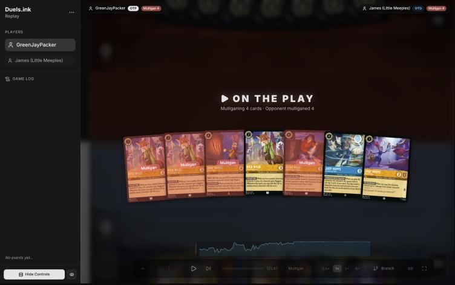
*The board before the decision: [step 0](https://duels.ink/replay/01a1fb8a-260e-7dd7-ad4f-d050ecdcfe50?step=0) in the duels.ink replay viewer.*

**What you did:** won the toss and played first. Opening seven: Nick Wilde – Providing Backup ×3, Judy Hopps – Always
Vigilant, Elisa Maza – Hardworking Detective, Judy Hopps – Uncovering Clues, Judy Hopps – Helpful Officer (all
inkable). You sent back four (Elisa Maza, two Nicks and Always Vigilant) and kept Nick, Uncovering Clues and Helpful
Officer.

**Verdict on the play/draw:** **good play.** Detectives is the aggressor against most of the field ([ROLE-1](#cite-role-1)), and with
the opponent unknown there's no matchup to make the draw better.

**Verdict on the mulligan:** **inaccuracy** (medium confidence). Sending back **Always Vigilant, Elisa Maza and the
second Nick** is suboptimal because the seven already had the deck's best curve: Helpful Officer on turn 1, Nick on
2, Nick and a spare ink on 3, and on turn 4 either Uncovering Clues or Always Vigilant Shifted onto the Helpful
Officer after a Nick (Shift 2 + Nick 2 = 4 of your 4), the deck's main removal. Keeping all seven, or sending back
only the third Nick (a 2-drop that needs another Detective to Support and has 2 willpower), is better because it
keeps that curve and both 4-drops' jobs (removal, and Elisa's hand disruption against an unknown deck whose songs and
actions are its sweepers), at no cost in ink: `tools/mulligan.py` (1,500 deals each) gives

| option | ink spent T1–4 | turns with a play | lore by T4 | characters T4 | interaction by T4 |
|---|---|---|---|---|---|
| keep all 7 | 9.43/10 | 4.00/4 | 6.2 | 4.7 | 100% |
| send back one Nick | 9.49/10 | 4.00/4 | 6.3 | 4.6 | 100% |
| **as played** (keep Nick, Uncovering Clues, Helpful Officer) | 9.21/10 | 3.95/4 | 6.5 | 4.4 | 71% |
| send back all 7 | 8.96/10 | 3.71/4 | 5.0 | 3.8 | 87% |

The four-card mulligan gains a little lore (6.5 against 6.2, within the sim's noise for card quality) and gives up
a removal piece in three games of ten by turn 4 ([MULL-2](#cite-mull-2), [MULL-4](#cite-mull-4): the seven needed no draw). The sim can't see that
three Nicks are clumsy together, which is why sending back one is reasonable; sending back four is digging for a hand
the seven already was.

### Turn 1: your turn 1

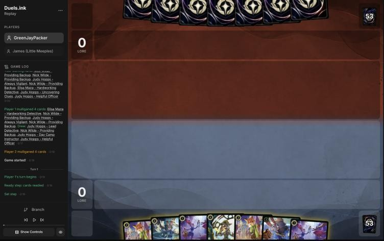
*The board before the decision: [step 3](https://duels.ink/replay/01a1fb8a-260e-7dd7-ad4f-d050ecdcfe50?step=3) in the duels.ink replay viewer.*

**What you did:** drew back Lead Detective, Nick, Day Camp Instructor and a second Helpful Officer, so the hand was
Nick ×2, Uncovering Clues, Helpful Officer ×2, Lead Detective and Day Camp Instructor (uninkable). You inked **Judy
Hopps – Lead Detective** and played Helpful Officer.

**Verdict:** **inaccuracy** (medium confidence). Inking **Lead Detective** is suboptimal because she is the hand's
best turn 4: Shift 4 onto the Helpful Officer you just played gives a 6-strength, 2-lore Detective that can quest at
once (the base is dry by then), and on your turns every Detective gains Alert and Resist +2, against an opponent
whose deck you can't see yet. Inking **a Nick Wilde – Providing Backup** is better because you held two, and the
second is the hand's least needed card ([INK-1](#cite-ink-1), [INK-2](#cite-ink-2)). Ink check, from what you knew:
- **Inking Lead Detective (as played):** turn 2 Nick (2 of 2); turn 3 Helpful Officer + Day Camp (1 + 2 = 3 of 3, and
  LEND A PAW tops a card into ink); turn 4, 5 ink: Uncovering Clues (4) and 1 spare. Lead Detective is gone.
- **Inking a Nick:** turn 2 the other Nick; turn 3 the same Helpful Officer + Day Camp; turn 4, 5 ink: Lead Detective
  Shifted onto a Helpful Officer (4) and questing for 2, or Uncovering Clues (4), with the other kept for turn 5.
  The turns 2–3 plays are the same; you give up only the third 2-drop body.
The ink for turns 2–4 comes from Clues, Lead Detective or the second Helpful Officer and your draws (47 of your 60
cards are inkable), so keeping Lead Detective doesn't cost a missed ink.

### Turn 3: your turn 2

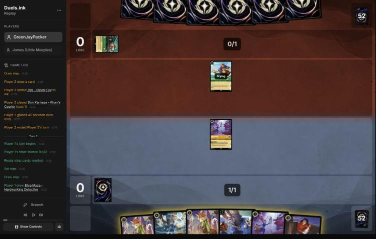
*The board before the decision: [step 10](https://duels.ink/replay/01a1fb8a-260e-7dd7-ad4f-d050ecdcfe50?step=10) in the duels.ink replay viewer.*

**What you knew:** they inked Tod – Clever Fox and played Don Karnage – Khan's Courier, so **Emerald** is one ink. That
makes Amber/Emerald **Circle of Life** the likeliest list (59%), then Amethyst/Emerald Retro Device (17%). Khan's
Courier is the Shift base for Don Karnage – Debonair Pirate (Shift 4: 1 damage to each of your characters), and the
Circle of Life plan is damage (Malicious, Mean, and Scary at 3, To Wither a Flower at 4, Don Karnage) then Prince
Phillip, often replayed free by Circle of Life ([the coach's notes](#cite-kb-meta-archetypes-amber-emerald-the-engine-discard-phillip)).
Your 1-willpower Helpful Officers die to a single ping. Nothing of that can come next turn: they'll have 2 ink and no
singer of cost 3.

**What you did:** inked a Nick, played the other, and quested with Helpful Officer (1–0).

**Verdict:** **good play.** The one 2-ink play that uses the turn, keeping Helpful Officer and Day Camp for next turn
(1 + 2 = 3 of 3, so LEND A PAW ramps). The quest exposes the Helpful Officer to Khan's Courier, an even trade that
costs them their Shift base; against a deck that wants the game long, the lore is worth it ([ROLE-1](#cite-role-1)).

### Turn 5: your turn 3

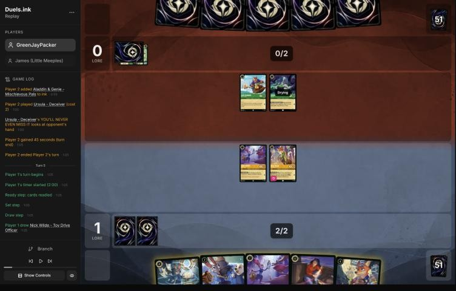
*The board before the decision: [step 17](https://duels.ink/replay/01a1fb8a-260e-7dd7-ad4f-d050ecdcfe50?step=17) in the duels.ink replay viewer.*

**What you knew:** they inked Aladdin & Genie – Mischievous Pals (Amethyst/Emerald) and played Ursula – Deceiver,
whose YOU'LL NEVER EVEN MISS IT showed them your hand (Clues, Day Camp, Helpful Officer, Elisa; no song to take). So
they're **Amethyst/Emerald, Retro Device** (87%): four Malicious, Mean, and Scary, two To Wither a Flower, two Don
Karnage – Debonair Pirate (Shift 4 onto the Khan's Courier in play), Hades – Looking for a Deal and Milo Thatch at 5
and 7, four Prince Phillip, and Retro Evolution Device to turn a cheap character into one costing 2 more
([the coach's notes](#cite-kb-meta-archetypes-amethyst-emerald-retro-device-against-danny-s-remember-merida-romancejessica)).
Next turn they have 3 ink: Malicious by ink (held 37% after their draw; neither Don (1) nor Ursula (2) can sing it).
Its 1 damage kills your Helpful Officers, and puts Nick and Day Camp on 1 for a To Wither a Flower or Don Karnage
the turn after. Their challengers: Khan's Courier (2 {S}) kills an exerted Helpful Officer or trades with Nick;
Ursula (1 {S}) kills an exerted Helpful Officer and survives, but dies to Nick's 3.

**What you did:** inked Elisa Maza, played Helpful Officer and Day Camp Instructor (1 + 2 = 3 of 3; LEND A PAW put
your top card into ink), and quested with the first Helpful Officer (2–0). Nick stayed ready.

**Verdict:**
- **Playing the second Helpful Officer and Day Camp:** **good play.** The ramp gives you 5 ink next turn, for Toy
  Drive Officer or Clues plus a 1-drop. The Helpful Officer is the card Malicious would kill, but it costs 1 and turns
  on LEND A PAW; holding it to play around a 37% song costs more than it saves.
- **Inking Elisa over Uncovering Clues:** **close call.** Elisa's FOLLOW THE TRAIL takes a non-character card, and
  this deck's sweepers are songs (Malicious, To Wither a Flower) and its engine an item (Retro Evolution Device), so
  she's the card that protects a wide board; Clues digs for a Detective on play and every quest. Keeping Elisa was
  the slightly better choice against this list. Either way the next two turns are a 4-drop and Toy Drive Officer.
- **Leaving Nick ready:** **inaccuracy** (medium confidence). Leaving **Nick** unquested is suboptimal because
  nothing of theirs could punish his quest: Ursula would die to his 3 {S} if she challenged, and Khan's Courier
  trades with him, which costs them the Shift base for Don Karnage – Debonair Pirate, their earliest ping of your
  whole board (game turn 8). Questing **Nick** too is better because it's a free lore (3–0) for the aggressor
  ([ROLE-1](#cite-role-1), [QC-3](#cite-qc-3)), and the only reply that stops it is a trade you'd take. He'd be ready again for your next turn
  either way. Same ink (3 of 3); it exposes Nick to that one trade, nothing else.

### Turn 6: their turn

**What happened:** they inked a second Tod and played **Malicious, Mean, and Scary** by ink: both Helpful Officers
died, and Nick and Day Camp were left on 1 willpower each. Ursula quested (2–1).

### Turn 7: your turn 4

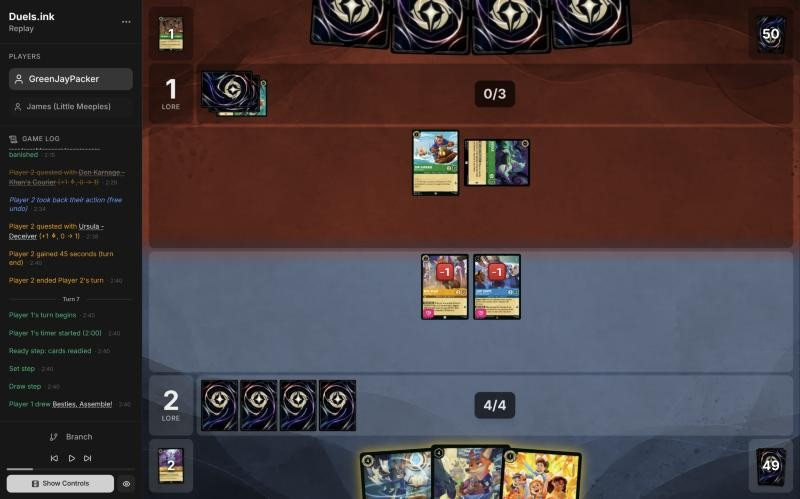
*The board before the decision: [step 30](https://duels.ink/replay/01a1fb8a-260e-7dd7-ad4f-d050ecdcfe50?step=30) in the duels.ink replay viewer.*

**Setup:**
- **The board:** your Nick (3/2) and Day Camp (2/2) on 1 willpower each; their Khan's Courier (ready) and Ursula –
  Deceiver (1/3, exerted, so challengeable).
- **Their next turn, 4 ink:** each of these kills both your damaged characters: Don Karnage – Debonair Pirate Shifted
  onto the Courier (held 18% after their draw), To Wither a Flower (18%), a second Malicious (26%). Together, Don and
  Malicious alone are 40% before their dig (two Tods seen, Aladdin & Genie's redraw). Without a ping, Ursula
  challenges an exerted Day Camp and kills it for free (she takes 2 of her 3), and the Courier kills either.
- **Resources:** 4 ink, 5 if you ink Besties or Clues; Uncovering Clues, Nick Wilde – Toy Drive Officer (uninkable),
  Besties, Assemble!.
- **The race:** 2–1. They want the game long; you want lore before Hades (5), Milo (7) and Phillip (9) come online.

**Candidate lines:**
1. **Nick challenges Ursula** (his 3 {S} kills her 3 willpower; her 1 kills him), Day Camp quests (3–1), then ink
   Besties and play Clues (4 + 0 = 4 of 5). Nick, who dies to any ping, takes their quester and the one character
   that kills your exerted Day Camp for free.
2. **Quest with both** (4–1), ink Besties, play Clues. One more lore now; Ursula lives to quest and to kill Day Camp.
3. Ink Clues, Besties (1) then Toy Drive Officer (4) = 5 of 5: a character from the top 4 and a 4-willpower body,
   but no Clues on board to dig each turn.

**What you did:** line 2: inked Besties, played Clues (she found another Clues), and quested with Nick and Day Camp
(4–1), declining both Supports. One ink was left.

**Verdict:** **inaccuracy** (medium confidence). Questing with **both damaged characters** is suboptimal because
both were likely gone next turn either way: any of three cards kills both, and without one Ursula kills the exerted
Day Camp for nothing. Challenging **Ursula with Nick** is better because it spends a character on 1 willpower for one
of theirs ([TRADE-1](#cite-trade-1), [TRADE-3](#cite-trade-3)): it costs a lore now (3–1 instead of 4–1) but takes her lore every turn after, and
leaves only the Courier able to touch Day Camp, by a trade. Same ink in both lines (Besties inked, Clues 4 of 5); it
leaves Day Camp exerted to the Courier's trade or a ping, as yours left both. Playing Clues over Toy Drive Officer was
right: she digs on every quest, and Toy Drive draws only on a turn you play two characters, which next turn's 5 ink
can do.

### Turn 8: their turn

**What happened:** they inked Luisa Madrigal – Confident Climber and Shifted **Don Karnage – Debonair Pirate** onto
the Courier (Shift 4): LASTING IMPRESSION's ping killed Nick and Day Camp and left Uncovering Clues on 2. Don quested
for 2 (4–3), and while he's exerted SO SUAVE takes 1 lore off each damaged character of yours.

### Turn 9: your turn 5

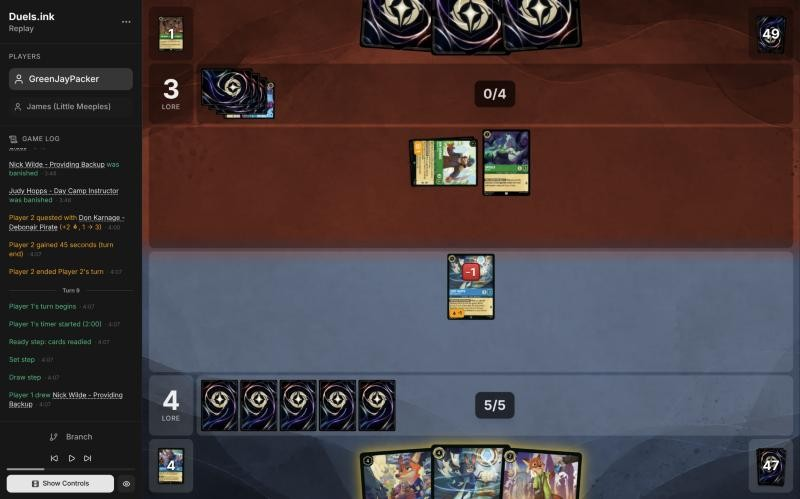
*The board before the decision: [step 43](https://duels.ink/replay/01a1fb8a-260e-7dd7-ad4f-d050ecdcfe50?step=43) in the duels.ink replay viewer.*

**Setup:** 4–3, and their board (Don 2, Ursula 1) quests 3 a turn: 20 by game turn 20. Your damaged Clues quests for
0 under SO SUAVE, but her quest still digs 3. Don (3/6) is exerted, but nothing of yours can kill him: Clues deals 3
and dies. Next turn's answer is Support onto *him*: Toy Drive Officer (+2) or Nick (+3) takes him to 5 {S}, in range of
Always Vigilant and Gaston ([how Support reaches their characters](#cite-kb-rules-rulings-support-can-add-strength-to-an-opposing-character)).
Their next turn, 5 ink: Don sings Malicious or To Wither a Flower for free, Hades – Looking for a Deal, or a Rush
Taran.

**What you did:** played Toy Drive Officer, inked the second Clues, played Nick (4 + 2 = 6 of 6), and quested with
Clues for her dig, which found another Toy Drive Officer. COMMUNITY OUTREACH drew The Horseman Strikes!.

**Verdict:** **good play.** Two characters for the draw, both undamaged so they quest at full lore under SO SUAVE, and
both Supporters for next turn's banish on Don. The Clues quest earned no lore but a card, and exposes her (2
willpower left) only to Don's challenge, which would leave him exerted and cost him his quest.

### Turn 10: their turn

**What happened:** they paid 4 for **To Wither a Flower** (2 damage to each damaged character of yours), which
killed the damaged Clues, and Don quested again (4–5). They didn't ink: 4 ink, 3 cards in hand.

### Turn 11: your turn 6

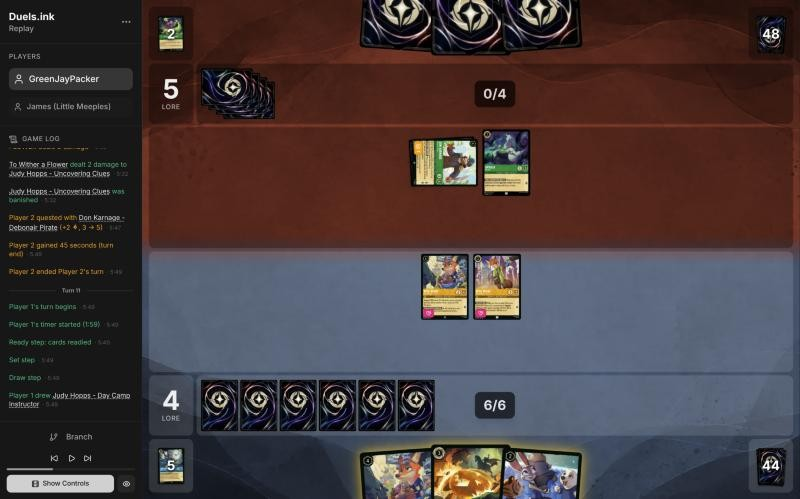
*The board before the decision: [step 53](https://duels.ink/replay/01a1fb8a-260e-7dd7-ad4f-d050ecdcfe50?step=53) in the duels.ink replay viewer.*

**Setup:**
- **The race:** 4–5. Don (2) and Ursula (1) quest 3 a turn: 20 on game turn 20. Your Toy Drive Officer and Nick are
  dry and undamaged, so each quests for 1.
- **Don is exerted, but out of reach:** Toy Drive's Support makes Nick 5, one short of Don's 6 willpower. Your
  removal (Always Vigilant, Gaston) isn't in hand. Next turn, with two Toy Drives, Nick and Day Camp ready, Support
  stacks to kill him in a challenge (+2 +2 onto Nick = 7) or to put him at 5 {S} for a Gaston or Always Vigilant.
- **Their next turn, 5 ink:** Hades – Looking for a Deal (29% after their draw), Malicious sung free by Don (22%),
  Milo needs 7. Don (3) and Ursula (1) together kill an exerted Toy Drive (4 willpower) and both survive; Don alone
  kills an exerted Nick and takes 3.
- **Resources:** 6 ink; Toy Drive Officer, Day Camp (both uninkable), The Horseman Strikes!. The Horseman's banish
  only hits Evasive, which here means Prince Phillip: keep it for him.

**Candidate lines:** Toy Drive + Day Camp (4 + 2 = 6 of 6; LEND A PAW ramps, and both Toy Drives' COMMUNITY
OUTREACH draw) in every line. Then:
1. **Quest with Toy Drive and Nick** (6–5).
2. **Keep them ready** (4–5), so nothing can be challenged.

**What you did:** line 2: Toy Drive and Day Camp (ramp to 7 ink), kept Horseman, no quests. The two Toy Drives drew
a third Toy Drive and Eilonwy.

**Verdict:**
- **The plays and keeping The Horseman Strikes!:** **good play.** The full 6 ink, two draws, a ramp, and the one
  card in your deck's reach that removes Phillip once he lands.
- **Not questing:** **inaccuracy** (medium confidence). Keeping **Toy Drive Officer and Nick** ready is suboptimal
  because waiting gained nothing a later turn won't face too: Don readies every turn, so your questers meet his 3 {S}
  whenever they quest, until he's killed. And each challenge he makes costs him his own quest: Don taking Nick is
  2 of their lore for 1 of yours, and Don with Ursula taking a Toy Drive is 3 of theirs for 1, leaving Don damaged and
  exerted for next turn's Support kill. Questing **both** is better because it's 2 lore in a race you trail (6–5
  instead of 4–5) at no cost the opponent can make without slowing their own clock ([ROLE-2](#cite-role-2), [QC-3](#cite-qc-3), [TRADE-4](#cite-trade-4)). Same ink
  (6 of 6, Horseman kept); it leaves Toy Drive and Nick exerted to those challenges, and to nothing else at 5 ink
  but a Malicious ping.
- **Revisited after the pass, with this turn's information only** ([H-6](#cite-h-6) was in this turn's brief, under Toy Drive
  Officer, and the blind verdict didn't weigh it): [H-6](#cite-h-6) says a ready board that keeps drawing can outlast
  an *exert-and-challenge* deck, and its limit keeps ready the characters whose damage back can't kill the attackers,
  as here. But this deck's removal is pings and songs, which reach ready characters as easily as exerted ones, so
  staying ready saved nothing from the sweep, only from Don's challenges, and those cost him his quest. That's
  [H-12](#cite-h-12)'s case (a waiting board that the removal reaches anyway gives up lore for nothing). The verdict
  stands.

### Turn 12: their turn

**What happened:** a **second Don Karnage – Debonair Pirate**, Shifted onto the first: 1 damage to each of yours, then
Don sang **To Wither a Flower** for 2 more to each. Nick and Day Camp died; both Toy Drive Officers were left on 1
willpower. No quests (5–4 to them), no ink (still 4), 2 cards in hand.

### Turn 13: your turn 7

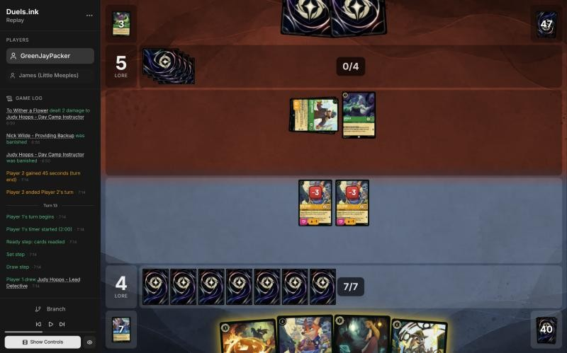
*The board before the decision: [step 61](https://duels.ink/replay/01a1fb8a-260e-7dd7-ad4f-d050ecdcfe50?step=61) in the duels.ink replay viewer.*

**Setup:**
- **The race:** 4–5. Don (2) and Ursula (1) quest 3 a turn: 20 on game turn 22. While Don is exerted your damaged
  Toy Drives quest for 0, so **Don is the card to kill**: it gives your board its lore back.
- **Don can't die this turn:** your two Toy Drives can bring 4 damage at most (one Supports the other to 4), short of
  his 6. Next turn he can: Lead Detective's 6 {S} challenges him (LATERAL THINKING's Resist +2 leaves her on 1 damage),
  or two Supporters quest onto a challenger (+2 +2 onto a Toy Drive = 6).
- **Their next turn, 4–5 ink and 2–3 cards:** Malicious sung by Don (18% after their draw) kills Eilonwy and every
  Toy Drive on 1 willpower; Hades or Chernabog at 5; Milo and Phillip are a few turns off.
- **Resources:** 7 ink; Horseman (keep for Phillip), Toy Drive Officer (uninkable), Eilonwy, Lead Detective. Each Toy
  Drive draws at the end of a turn you play two characters.

**Candidate lines:**
1. **Lead Detective + Eilonwy** (6 + 1 = 7 of 7): two Toy Drives draw 2. Lead is on the board to kill Don next turn,
   and her 4 willpower outlasts a Malicious.
2. **Toy Drive + Eilonwy** (4 + 1 = 5 of 7): three Toy Drives draw 3; Lead stays in hand, safe from Hades and
   Chernabog. Next turn the fresh Toy Drive and Eilonwy quest and Support a damaged Toy Drive to 6 to kill Don, so the
   kill costs only a quest worth 0.

**What you did:** line 2: Toy Drive and Eilonwy, no ink (Horseman and Lead kept), no quests. The three Toy Drives drew
two Always Vigilants and a second Lead Detective.

**Verdict:** **good play.** The two lines score the same over the next two turns (about 3 lore on game turn 15, Lead
questing from 17), and both kill Don next turn. Yours draws a card more and keeps Lead out of reach of a Hades or
Chernabog for a turn, for 2 unspent ink; the other uses the ink and leaves a sturdier board against a Malicious.
Not inking was right: the inkable cards were Horseman, the answer to Phillip, and the Lead Detective you'd need.

### Turn 14: their turn

**What happened:** Don sang **Malicious, Mean, and Scary** (two Toy Drives and Eilonwy died), then they paid 4 for a
third **To Wither a Flower** on the last Toy Drive, which lived on 1 willpower. Ursula quested (6–4). They're down to
1 card in hand, and still on 4 ink.

### Turn 15: your turn 8

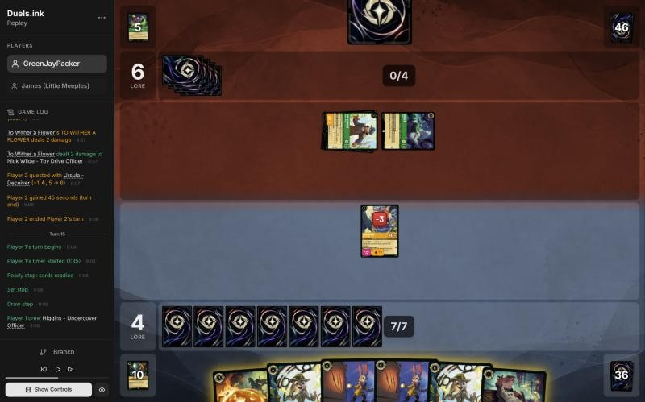
*The board before the decision: [step 75](https://duels.ink/replay/01a1fb8a-260e-7dd7-ad4f-d050ecdcfe50?step=75) in the duels.ink replay viewer.*

**Setup:** 4–6. Don (exerted, 3 {S}) is still the card to kill. The brief's STRENGTH REMOVAL line shows the way:
Toy Drive's Support puts Don at 5, in range of Always Vigilant's GOT YOU NOW, which needs another character played
first, and you drew Higgins (1). Their hand is 1 card (Hades, Milo or Phillip each 16% after their draw), so the
next sweep is unlikely soon.

**What you did:** Toy Drive quested and Supported Don to 5; Higgins (1), then Always Vigilant (4) banished Don and
the two cards under him. Then you inked a Lead Detective (5 of 8 used; Horseman kept). Toy Drive drew Elisa Maza.

**Verdict:** **good play.** Support onto *their* character to bring it into your banish range, the Detectives' key
trick ([the coach's notes](#cite-kb-meta-archetypes-amber-sapphire-detectives-how-it-plays)), and at the cheapest
cost: Higgins as the "another character" instead of a second 4-drop. Killing Don ends SO SUAVE, their free singer
for the songs, and 2 lore a turn. Inking after the plays kept every option open until the end ([SEQ-1](#cite-seq-1)), and
holding The Horseman Strikes! for Phillip, with 3 ink spare, cost only a draw.

### Turn 16: their turn

**What happened:** a refill. Ursula sang Strike a Good Match (they discarded Milo Thatch), they inked Hook Hand –
Unexpectedly Friendly (5 ink), and paid 5 for Everyone Knows Juanita, which drew 3 with 10+ cards in their discard.
No quests (6–4 to them).

### Turn 17: your turn 9

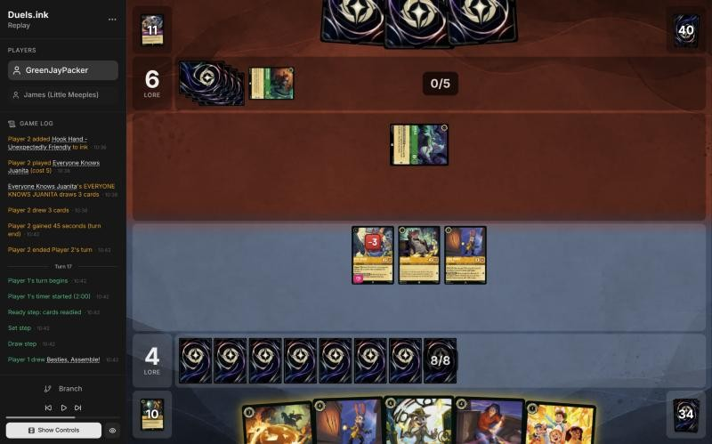
*The board before the decision: [step 89](https://duels.ink/replay/01a1fb8a-260e-7dd7-ad4f-d050ecdcfe50?step=89) in the duels.ink replay viewer.*

**Setup:** 4–6, and for the first time their board is small: Ursula alone, exerted. Your Toy Drive (on 1
willpower), Higgins and Always Vigilant are dry. Hand: Horseman, Always Vigilant, Lead Detective, Elisa Maza,
Besties; 8 ink, 9 if you ink. Their hand is 3 cards, their ink 6 next turn: Hades (33% after their draw) is the
likeliest answer, Phillip (9) can't come yet. Lead Detective Shifted onto the dry Always Vigilant (4) would quest for
2 at once.

**What you did:** Elisa Maza first: FOLLOW THE TRAIL showed their hand, **Fflewddur Fflam – Luckless Bard and two
Don Karnage – Khan's Couriers**, with nothing she could take. Then Besties (Fangmeyer) and The Horseman Strikes! (a
draw: Nick Wilde – Providing Backup), 4 + 1 + 3 = 8 of 8, no ink. Toy Drive quested and Supported Higgins to 4, who
killed Ursula and survived; Always Vigilant quested (6–6).

**Verdict:** **good play.**
- **Elisa first** was the right order ([SEQ-1](#cite-seq-1)): the reveal told you their next turn has no removal or song in hand,
  only what one draw finds, and that Phillip can't arrive before game turn 20 at the earliest.
- **Ursula killed by Higgins with Support** (the challenge you first tried with Always Vigilant, then undid) kept the
  4-strength Judy free to quest, and left their board empty.
- **The Horseman Strikes! for a card, not Lead Detective's Shift:** **close call.** With 9 ink (inking Always
  Vigilant or The Horseman), Elisa + Lead's Shift + Besties (4 + 4 + 1 = 9 of 9) quests 1 lore more this turn (Lead's 2
  for Always Vigilant's 1). Yours keeps both Always Vigilants and Lead for next turn and draws a card, which matters
  more against a deck that has already swept your board four times; and once their hand was known, The Horseman's
  only target, Phillip, was at least two turns away.

### Turn 18: their turn

**What happened:** they played both Don Karnage – Khan's Couriers from the hand Elisa saw, and didn't ink (still 5)
or play Fflewddur. Three Couriers seen shifts the archetype odds to 54% Retro Device, 46% Unnamed #1, a Don Karnage
list with four Couriers and four Debonair Pirates: so **two more Debonair Pirates may be in their deck**, each a
board-wide ping Shifted onto a Courier for 4.

### Turn 19: your turn 10

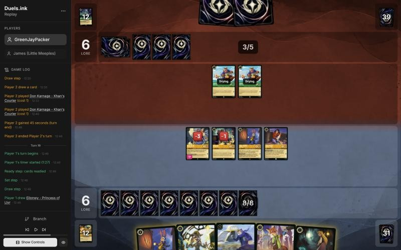
*The board before the decision: [step 108](https://duels.ink/replay/01a1fb8a-260e-7dd7-ad4f-d050ecdcfe50?step=108) in the duels.ink replay viewer.*

**Setup:** 6–6. Their board is two drying Couriers; their hand is Fflewddur and one unknown card, with 6 ink next turn.
A Debonair Pirate Shifted onto a Courier (5% after their draw) or Malicious (10%) would kill your Toy Drive and
Higgins (1 willpower each) and anything with 1 willpower you add. The Couriers trade with either if they quest. Your
four characters are dry: 4 lore a turn. Hand: Always Vigilant, Lead Detective, Fangmeyer, Nick, Eilonwy; 9 ink with
one inked.

**Candidate lines:**
1. **Lead Detective Shifted onto Always Vigilant + Fangmeyer** (4 + 5 = 9 of 9, inking Eilonwy): Lead quests at
   once, so 5 lore (11–6); Fangmeyer returns a Detective, and Toy Drive draws.
2. **Fangmeyer, returning Uncovering Clues, then Clues** (5 + 4 = 9 of 9, inking Eilonwy): 4 lore (10–6), two
   4-willpower-class bodies, Clues' dig on play, and Toy Drive's draw; Lead stays in hand for next turn's Shift.
   *This was your line; the coach's plan had line 1 and Lead + Nick + Eilonwy, and missed that Fangmeyer's return
   could be cast the same turn ([the coach's errors](#the-coachs-errors)).*

**What you did:** line 2. Fangmeyer returned Clues, you inked Eilonwy, Clues found a third Fangmeyer, and Toy Drive,
Higgins, Always Vigilant and Elisa quested (10–6). Toy Drive drew another Clues.

**Verdict:** **good play.** One lore less than line 1, for three cards more (Clues back, Fangmeyer found, and Clues
questing every turn from now) and a board their pings can't clear: Fangmeyer and Clues have 4 and 3 willpower.
Lead Detective still lands next turn, Shifted onto a dry Judy for 4, and quests at once.

### Turn 20: their turn

**What happened:** one Courier quested (10–7), they **inked Prince Phillip** (6 ink) and played Fflewddur Fflam, whose
CHASING ADVENTURE drew a card. No challenges.

### Turn 21: your turn 11

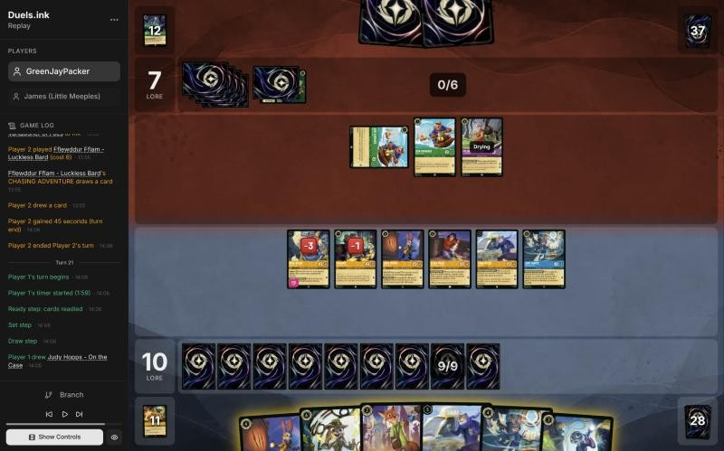
*The board before the decision: [step 125](https://duels.ink/replay/01a1fb8a-260e-7dd7-ad4f-d050ecdcfe50?step=125) in the duels.ink replay viewer.*

**Setup:** 10–7. Your six dry characters quest for 7 (17); Lead Detective Shifted onto Always Vigilant would make it 18,
not 20, so the game ends next turn at the earliest. Their board: two Couriers and Fflewddur (4 {S}, 2 lore, and a
cost-6 free singer for Malicious or To Wither a Flower, 15% held after their draw). At 7 ink they can't cast Phillip
(9), and nothing in their discard brings him back. The brief's STRENGTH REMOVAL line: Toy Drive's Support puts
Fflewddur at 6, in range of Always Vigilant, with another character played first.

**Candidate lines (9 ink):**
1. **Lead Detective Shifted onto Always Vigilant + Fangmeyer** (4 + 5 = 9 of 9): 18 lore; Fflewddur lives to sing a
   free Malicious and quest for 2.
2. **On the Case, Support onto Fflewddur, Always Vigilant hard-cast to banish him, Nick** (3 + 4 + 2 = 9 of 9): 17
   lore; their free singer, their 2-lore quester and their only 4-strength challenger are gone, and your board is nine
   characters for next turn's last 3 lore. *This was your line. The coach's plan had only line 1, though the brief's
   STRENGTH REMOVAL line printed the Fflewddur target ([the coach's errors](#the-coachs-errors)).*

**What you did:** line 2: On the Case (no item to ink), Toy Drive's quest made Fflewddur 6, Always Vigilant banished
him, Nick followed, and all six questers went (17–7). Clues found the last Toy Drive Officer; Toy Drive drew Higgins.

**Verdict:** **good play**, and better than the coach's plan. Neither line wins this turn, so the extra lore
of line 1 buys nothing unless they can stop you next turn, and line 2 is the one that takes away their best way to:
Fflewddur singing Malicious for free. They need to stop 3 lore from nine characters with 7 ink and two Couriers.

## Lessons
1. **Against a ping deck, staying ready protects nothing.** Malicious, Mean, and Scary, Don Karnage – Debonair Pirate
   and To Wither a Flower hit ready and exerted characters alike, so a character kept home only dodges challenges,
   and gives up its lore ([5](#turn-5), [11](#turn-11); [H-12](#cite-h-12)).
2. **Support onto their character is removal.** Toy Drive Officer's +2 put Don Karnage (3 {S}) and Fflewddur (4) in
   range of Always Vigilant's 5-strength banish ([15](#turn-15), [21](#turn-21)). The brief's STRENGTH REMOVAL line
   lists these targets every turn.
3. **A character on 1 willpower against this deck is a spent card.** Use it before the next ping does: a trade for
   one of theirs beats a quest ([7](#turn-7); [TRADE-3](#cite-trade-3)).
4. **Play characters in pairs while Toy Drive Officer is out.** Each Toy Drive draws at the end of a turn you play two,
   which is how your board kept outlasting their sweeps ([9](#turn-9), [13](#turn-13), [19](#turn-19)).
5. **Elisa Maza is information even when she takes nothing.** Her reveal on [17](#turn-17) showed no song or removal in
   their hand, which made the rest of that turn and the next safe to plan.
6. **Keep a seven that already curves.** Helpful Officer, Nick, Nick, then Always Vigilant or Clues on turn 4 was the
   deck's plan; sending four back gave up removal for nothing measurable ([0](#turn-0); [MULL-4](#cite-mull-4)).

## Proposed knowledge-base updates (applied after discussion)
- **Meta, Amethyst/Emerald notes:** a new section, *Retro Device (a Don Karnage build) against GreenJayPacker's
  Detectives: James (Little Meeples)* (blind review of `01a1fb8a-260a`):
  - **Seen:** Don Karnage – Khan's Courier ×3, Don Karnage – Debonair Pirate ×2, Malicious, Mean, and Scary ×2, To
    Wither a Flower ×3, Tod – Clever Fox ×2, Strike a Good Match, Milo Thatch (discarded), Ursula – Deceiver, and
    off-list Everyone Knows Juanita, Fflewddur Fflam – Luckless Bard, plus Aladdin & Genie, Luisa Madrigal – Confident
    Climber, Hook Hand – Unexpectedly Friendly and Prince Phillip all inked. No Retro Evolution Device seen.
  - **How it played:** a ping or song on game turns 6, 8, 10, 12 and 14 killed ten characters; Don Karnage's SO SUAVE
    made damaged questers worth 0 while he was exerted, and he sang the songs for free. Their own board stayed at two
    or three characters, and their lore at 7 by turn 22.
  - **What beat it:** Support onto Don, then Always Vigilant (turn 15); a board of 4-willpower characters (Fangmeyer,
    Elisa, Always Vigilant, Clues) that one ping can't kill; card flow faster than their sweeps.
- **Meta, Amber/Sapphire notes (Detectives as your deck):** GreenJayPacker's list (Toy Drive Officer ×4, Elisa ×4,
  Fangmeyer ×3, Gaston ×3, Lead Detective ×3, and Mickey Mouse – Expedition Leader, Belle – Snowfield Strategist,
  Grandmother Willow and Hamm ×2 each) and its piloting points
  from lessons 2 and 4.
- **Meta index, opponents in reviewed games:** a row for James (Amethyst/Emerald).
- **Strategy, [H-6](#cite-h-6):** evidence on its limit: against a deck whose removal is pings and songs, a ready
  board saves nothing from the sweep ([11](#turn-11)).
- **Strategy, [H-12](#cite-h-12):** evidence for, outside Rockstar Aggro: the same reasoning held for Detectives against
  ping sweepers ([5](#turn-5), [11](#turn-11)). Proposed wording: "a board whose removal doesn't need it exerted should
  quest".
- **Rules:** none.

## Hindsight
Doesn't change the verdicts above.
- **The mulligan:** the four cards drawn back (Lead Detective, Nick, Day Camp, Helpful Officer) made a playable curve;
  what the seven would have drawn instead can't be known.
- **Turn 7:** Don Karnage's ping on turn 8 killed both Nick and Day Camp, so the quest bought 1 lore more than the trade
  would have, and Ursula lived to quest four more times.
- **Turn 11:** the turn-12 sweep (a second Don Karnage, then To Wither a Flower) killed Nick and left both Toy Drives on
  1 willpower whether they had quested or not: the 2 lore not taken were simply lost.
- **Their Phillip** was inked on turn 20 and never cast; The Horseman Strikes!, kept for him until turn 17, was never
  needed.
- **Their last turn:** Tod drew two, and Malicious killed only Toy Drive and Higgins; at 17–7 against nine
  characters, they conceded.

## The coach's errors
Found by the coach during the review; the discussion may add more.

| When | Error | How it was caught | How it won't happen again |
|---|---|---|---|
| Turn 0 | The brief crashed: this is the first of your replays whose coin toss records only your inks, not theirs | The turn-0 brief failed | Fixed during the review, not yet committed: a reveal without the opponent's inks counts as none, and until two inks are seen the opponent model weighs every ink pair the cards seen allow, with each pair's odds printed. Proposed: a test on this replay at turns 0 and 3 |
| Turn 11 | The blind verdict didn't weigh [H-6](#cite-h-6), which the brief listed under Toy Drive Officer's knowledge-base notes; it was found in the search after the pass, and the verdict revisited (it stands) | The knowledge-base search after the pass | Proposed: the brief prints the hypotheses linked to the cards in view as their own short list above the card notes, so they aren't lost among dozens of pair-file pointers |
| Turn 19 | The plan missed Fangmeyer returning Uncovering Clues and Clues being cast the same turn; your line beat the plan | Comparing your line with the plan | Proposed: for a card that returns a card from your discard (Fangmeyer's REQUEST REINFORCEMENTS), the brief's options list what it can return and which of those the ink left can cast ("Fangmeyer 5 + Clues 4 = 9 of 9") |
| Turn 21 | The plan missed the Support + Always Vigilant banish on Fflewddur that the brief's STRENGTH REMOVAL line printed: the recurring error the method already names (Support onto their character for strength-threshold removal). Your line beat the plan | Comparing your line with the plan | Proposed: each "in range with your Support" target becomes a complete line in the brief's YOUR OPTIONS, with the Supporter, the "another character" Always Vigilant needs, and the ink sum ("Toy Drive +2 onto Fflewddur; On the Case 3 + Always Vigilant 4 = 7 of 9: banishes Fflewddur") |

## Open questions
- **Did duels.ink show you James's inks before the game?** This replay doesn't record them, the first of yours that
  doesn't. The review assumed you didn't see them (pre-game and turn 1).
- **Pre-game:** what were you looking for with the four-card mulligan, sending back Always Vigilant and Elisa?
- **Turn 1:** why ink Lead Detective rather than one of the two Nicks?
- **Turn 7:** were Nick and Day Camp quested rather than trading Nick for Ursula to keep them as Supporters against Don?
- **Turn 11:** why keep Toy Drive Officer and Nick home: to protect the draw engine from Don and Ursula's challenges?

## Citations
Copies of the coach's knowledge base cited above, as they stood when they were cited (the private repository's commit and date are given with each). They don't change when the knowledge base does.

<!-- Filled in by `python3 tools/cite.py <this file>`: every principle ID, H-n, "principle N" and CR rule above
becomes a link to an entry here. Add a file or one of its sections with `--file PATH --section TEXT`, and link to
the anchor it prints. Never link into the private repository. -->

**amber-emerald.md, The engine: discard Phillip**: knowledge base, `kb/meta/archetypes/amber-emerald.md` at `678297d` (2026-11-20), working tree

> ### The engine: discard Phillip, then replay him `[coach + user, one game]`
> 1. **Put Prince Phillip – Vanquisher of Foes (9) in the discard.** Tod – Clever Fox (draw 2, discard 1), Max Goof –
>    Karaoke Star (discard a song, draw 2) and Strike a Good Match (draw 2, discard 1) all do it. In 01a13b88 Tod
>    discarded him on turn 5.
> 2. **Damage your board:** Malicious, Mean, and Scary puts 1 damage on each of your characters; so does Don Karnage
>    – Debonair Pirate when played (6, or 4 by Shift onto Don Karnage – Khan's Courier). A character already damaged,
>    or exerted (so it can be challenged), doesn't need this step.
> 3. **Circle of Life** (song 8, Sing Together 8): "Play a character from your discard for free." Phillip's SWIFT AND
>    SURE then banishes every damaged character you have.
>
> - **When it can come:** as soon as Phillip is in the discard, their characters total 8 for Sing Together, and they
>   can pay 3 for Malicious or sing it.
>   - Singer counts toward Sing Together (`kb/rules/rulings.md`). Angel – Siren Singer (Singer 3) ×2 plus Tod made 9
>     on turn 9, at 5 ink. Two Ursula – Vanessa (Singer 4) make 8 alone.
>   - It happened twice in 01a13b88: turn 9 (four characters) and turn 19 (five).
> - **How likely the wipe is next turn** `[coach + user, 01a13b88 turn 18, revisited 2026-11-01]`: count the damage
>   cards together (Malicious and Don Karnage, plus Max Goof – Rebellious Teen, which takes Malicious back from their
>   discard), then add their dig. Meilin Lee (top 4, takes a song, so finds Malicious and Circle of Life), Tod, Strike
>   a Good Match, Max Goof – Karaoke Star and Akood et Emuti all let them see more cards first, and Akood also makes Don
>   Karnage cost 4. On 01a13b88 turn 18 that was about 43%, against 17% for Malicious in their hand and draw alone
>   (`kb/cards/board-damage.md`).
> - **What to do:**
>   - **Watch their discard for Phillip and count their singing total.** The decision brief shows both.
>   - The turn before, keep characters ready and undamaged where possible, and don't add more than you need.
>   - Hold the answer to the returning Phillip (6/6/3, Evasive). Wasabi's TWIN BLADES, boosted by Mulan – Martial Arts
>     Master's +2 {S}, deals 6 to him without challenging him.
> - **Known cards:** Meilin Lee – Losing Control's RED PANDA POWER reveals a song or Red Panda into their hand. On turn
>   17 it revealed Circle of Life, so it was a known card from then on.

**amber-sapphire.md, Detectives: how it plays**: knowledge base, `kb/meta/archetypes/amber-sapphire.md` at `678297d` (2026-11-20), working tree

> ### Detectives: how it plays `[coach, meta study of the user's 27 Oct 2026 games (tools/scan.py), full games, not blind, 8 games]`
> Games: 01a17e45, 01a17e54, 01a17e5d (Sallinhos, best-of-three); 01a17e64, 01a17e75, 01a17e80 (DuckyRv, best-of-three);
> 01a17e9c; 01a17ef8. Card text verified with `tools/cards.py`.
>
> **The plan:** go wide with cheap Detectives, quest wide, and remove your best characters with "banish chosen character
> with 5 {S} or more", **after pumping them with Support**.
>
> - **The key trick: Support onto your characters.** Support adds "their {S} to another chosen character's {S} this turn",
>   and they choose yours. Then Gaston – Superior Archer or a Judy Hopps – Always Vigilant banishes it.
>   - *Examples:* 01a17e54 turn 21 (+2 on Hades, then Gaston); 01a17e5d turn 12 (+2 on Cheshire, then Judy – Always
>     Vigilant); 01a17e45 turn 23 (two Judy – Always Vigilant Shifts in one turn, banishing Cheshire and Merida, both
>     pumped first).
>   - **Support stacks:** a supported character supports with its new {S}. In 01a17e45 turn 15, Judy – Day Camp gave
>     Nick Wilde +2, then Nick gave +4. Treat **any** character of yours as in range once they have Support questers and
>     their removal available.
> - **Pieces:**
>   - **Cheap Detectives:**
>     - Higgins (1)
>     - Judy – Helpful Officer (1; removes 2 damage)
>     - Nick Wilde – Providing Backup (2; Support while they have another Detective)
>     - Judy – Day Camp Instructor (2, uninkable; Support; tops a card into ink if they played another character this turn)
>     - Daisy Duck – Ghost Finder (2, Support)
>     - Eilonwy (1, Support; not a Detective)
>   - **Nick Wilde – Toy Drive Officer** (4, uninkable; Support; draws at the end of a turn they played 2+ characters).
>   - **Removal:**
>     - **Judy Hopps – Always Vigilant** (4, Shift 2 onto any Judy; GOT YOU NOW needs another character played that turn)
>     - **Gaston – Superior Archer** (5)
>     - The Horseman Strikes!
>   - **Fangmeyer – Icy Officer** (5, uninkable, 2 lore): returns a Detective from their discard, usually Judy – Always
>     Vigilant, so the removal repeats.
>   - **Hand disruption:** Elisa Maza (4; with another Detective in play, you reveal your hand and they pick a non-character
>     card to discard) and Mowgli – Man Cub (2; you discard a non-character card). They took Raging Storm and Remember Me.
>   - **Card flow:** Judy – Uncovering Clues (4; searches the top 3 for a Detective on play and on quest).
>   - **Late game:** Judy – Lead Detective (6, Shift 4; Alert and Resist +2 for Detectives on their turn).
> - **Big turns,** from about their 6th turn: wide quests for +5 to +7 (01a17e45 turn 15: five questers; 01a17e9c turn
>   18: +7 after Lead Detective). Removal turns took 3 or 4 characters by mixing banishes with pumped challengers
>   (01a17e45 turn 23, 01a17e5d turn 12, 01a17e80 turn 26). Your locations were challenged down by two Detectives at once.
> - **What to watch for:**
>   - **Count their Support total against your characters' {S}.** Judys in play are Shift 2 targets for Always Vigilant,
>     and Gaston arrives at 5 ink.
>   - **Expect the removal to repeat** while Fangmeyer can return it.
>   - **Play your actions and songs (sweepers especially) early, before Elisa Maza lands.** She needs another Detective in
>     play first. A wide board of small characters is exactly what sweepers punish.

**amethyst-emerald.md, Retro Device against danny's Remember Merida: RomanceJessica**: knowledge base, `kb/meta/archetypes/amethyst-emerald.md` at `678297d` (2026-11-20), working tree

> ### Retro Device against danny's Remember Merida: RomanceJessica `[coach, meta study of danny's 28 Oct – 2 Nov 2026 games (tools/scan.py), full games, not blind, 3 games]`
> `01a18427-ab12`, `01a18433-41ba`, `01a18442-9f20` (games 1–3).
> - **A sweep on their 4th turn:** Don Karnage – Khan's Courier on turn 2, then Debonair Pirate Shifted onto him for 4
>   (LASTING IMPRESSION: 1 damage to each opposing character, not reduced by Resist) and To Wither a Flower sung by
>   him for 2 more: three kills on game turn 7 in games 1 and 2, four on turn 10 in game 3. Again later with a fresh
>   Don for 6 (turns 21 and 24) or Malicious, Mean, and Scary sung twice (turn 18, game 3: five kills).
> - **Retro Evolution Device** (TURN INTO DINOSAUR: {E}, 1 {I}, banish one of yours to play a character costing up to 2
>   more for free): Tod or Elsa (3) into Hades – Looking for a Deal (5) on turns 9, 11 and 19; Lenny (3) into Aladdin &
>   Genie (5) on 17; Hades (5) into Milo Thatch (7) on 23.
> - **Malicious, Mean, and Scary twice, then Prince Phillip (9)** on game turn 19 (game 2, after Strike a Good Match):
>   four kills, including both Demonas.
> - Off-list: Strike a Good Match ×4.

**rulings.md, Support can add strength to an opposing character**: knowledge base, `kb/rules/rulings.md` at `678297d` (2026-11-20), working tree

> ### Support can add strength to an opposing character
> - **Situation:** a Support character quests while the opponent has a character you want to remove with a "5 {S} or
>   more" banish: Judy Hopps – Always Vigilant's GOT YOU NOW, Gaston – Superior Archer's WATCH THIS.
> - **Ruling:** Support may choose any other character, including an opposing one. Adding the Support character's {S}
>   to theirs can lift a small character to 5 {S} for the banish. Supports stack, and a supported character supports
>   with its new {S}.
> - **Basis:** CR 8.13.1 (Support: "add this character's {S} to another chosen character's {S} this turn"; "another
>   chosen character" isn't limited to your own).
> - **Confidence:** derived from CR and confirmed by duels.ink's engine: Detectives opponents did it to the user's
>   characters (01a17e54 turn 21, 01a17e5d turn 12, 01a17e45 turn 23; `kb/meta/archetypes/amber-sapphire.md`), and
>   MK_ifoughtthelore did it to their opponent's (01a19bb9 turn 7, 01a19bbd-79c2 turn 8). Not an official ruling.
> - **Added:** 2026-11-02, from the review of 01a19bb9 (vs xBWx); the trick was first recorded in the meta study of
>   1 Nov 2026.

**ROLE-1**: strategy principle, `kb/strategy/principles.md` at `678297d` (2026-11-20), working tree

> - **ROLE-1. The matchup decides your role, not your deck.** In nearly every game one player wants it short (aggressor) and one wants it long (defender). The same list can play either role. *Ask: "Which deck benefits if this game goes long?"* `[MCL ch.8]` · baseline

**MULL-2**: strategy principle, `kb/strategy/principles.md` at `678297d` (2026-11-20), working tree

> - **MULL-2. A smooth curve beats a few powerful cards.** Check that you can spend ink well on turns 1–4, have enough inkable cards, and know what turn 4 looks like. `[MCL ch.12]` · baseline
>   - **Ink spent isn't the goal by itself.** Judge a keep by a nice curve (a play each turn), early lore pressure, and
>     interaction that sets the opponent back, as well as by ink, then weigh card quality and the matchup
>     (user, 2026-11-01). `tools/mulligan.py` reports all of these.

**MULL-4**: strategy principle, `kb/strategy/principles.md` at `678297d` (2026-11-20), working tree

> - **MULL-4. Don't chase a perfect hand.** Flexible hands with several lines beat hands that need one specific draw. `[MCL ch.12]` · baseline

**INK-1**: strategy principle, `kb/strategy/principles.md` at `678297d` (2026-11-20), working tree

> - **INK-1. Inking is permanent.** Every inked card is one line of play removed for the rest of the game. *Ask: "Will I regret losing access to this card?"* `[MCL ch.4]` · baseline

**INK-2**: strategy principle, `kb/strategy/principles.md` at `678297d` (2026-11-20), working tree

> - **INK-2. Don't automatically ink the most expensive card.** It may be the late-game win condition or the key answer for this matchup. The answer depends on matchup, hand and board. `[MCL ch.4]` · baseline

**QC-3**: strategy principle, `kb/strategy/principles.md` at `678297d` (2026-11-20), working tree

> - **QC-3. Questing is favoured when:**
>   - you control the board
>   - your exerted characters can't be punished
>   - the race favours you
>   - removing their characters gains little
>
>   **Challenging is favoured when:**
>   - they have an engine or repeated-value piece
>   - the trade is efficient
>   - you need to slow the game
>   - your deck is stronger late
>
>   `[MCL ch.6]` · baseline

**TRADE-1**: strategy principle, `kb/strategy/principles.md` at `678297d` (2026-11-20), working tree

> - **TRADE-1. Judge a trade by ink invested, tempo, value already generated, and the board afterwards**, not by card count. A 2-cost for a 5-cost is a big win even if it's one-for-one. *Ask: "What does the board look like after this challenge?"* `[MCL ch.7]` · baseline

**TRADE-3**: strategy principle, `kb/strategy/principles.md` at `678297d` (2026-11-20), working tree

> - **TRADE-3. Losing a character can be right** if it removes something more important. Characters are resources. `[MCL ch.7]` · baseline

**ROLE-2**: strategy principle, `kb/strategy/principles.md` at `678297d` (2026-11-20), working tree

> - **ROLE-2. Roles change mid-game. Re-check every turn.** An early lead with 4 lore left turns the aggressor into "protect the lead". A stabilised defender can become the aggressor. *Ask: "Has my role changed? If nothing changes, who wins?"* `[MCL ch.8, ch.10, ch.11]` · baseline

**TRADE-4**: strategy principle, `kb/strategy/principles.md` at `678297d` (2026-11-20), working tree

> - **TRADE-4. Every challenge has an opportunity cost.** It's a lost quest, and the challenger may be exposed while exerted. Declining a trade is often as strong as taking it. *Ask: "Would simply questing be stronger?"* `[MCL ch.7]` · baseline

**SEQ-1**: strategy principle, `kb/strategy/principles.md` at `678297d` (2026-11-20), working tree

> - **SEQ-1. Gather information before irreversible decisions.** Draw, look and scry before choosing what to ink. Quest with draw triggers before committing other plays when the order doesn't otherwise matter. `[MCL ch.5]` · baseline

**H-6**: hypothesis, `kb/strategy/hypotheses.md` at `678297d` (2026-11-20), working tree

> ### H-6. Against an exert-and-challenge deck, a ready board that keeps drawing can outlast it
> - **Claim:** against decks whose removal is challenges set up by exert effects (Amethyst/Ruby tempo-midrange: Peter
>   Pan's Shadow, Isis, Wasabi's TWIN BLADES), keeping a wide board ready and drawing cards can beat questing into
>   their challengers, until a turn with a decisive attack (Judy Hopps – Lead Detective's Alert and Resist) or removal.
>   The risk is an exert-all (Demona – Scourge of the Wyvern Clan), which turns the waiting board into free kills.
> - **Why:** with nothing exerted, their challengers have no targets, so they must quest into your ready challengers or
>   wait too. Each waiting turn is a card for you (Nick Wilde – Toy Drive Officer's COMMUNITY OUTREACH) rather than
>   lore for them.
> - **Evidence for:** 01a19c0c (MK_ifoughtthelore vs VH INK, game 3; 2026-11-02). From turn 14 to turn 20 they mostly
>   didn't quest, and the waiting board found eight extra cards (six from COMMUNITY OUTREACH, one from Uncovering
>   Clues, one returned by Fangmeyer). On turn 22, Lead Detective's
>   Alert removed both Evasive questers and the board scored 8 (1 to 9 against 10). Won.
> - **Evidence against:** 01a19c00 (game 1). A ready board of five small characters waited, correctly at about 15% for
>   Demona that turn, and Demona – Scourge exerted it all on turn 11; every character died. A waiting board of 1- and
>   2-willpower characters loses everything to an exert-all.
> - **Evidence for, from the player:** 01a16039 (stonks 📈 vs roycelikerolls, game 3; relayed by danny, 2026-11-02).
>   Unintentional Icon and Merida stayed ready on turns 9, 11 and 17 at 1–4 and 3–4. The blind review called it a
>   mistake, since every challenger into them would die. The player's reasons: two cheap characters for Icon is a trade
>   they want, Icon's BESPOKE DESIGN is worth another turn, and a ready board forced them to spend Peter Pan's Shadow and
>   Shere Khan to reach it while their own board didn't quest. Revisited to close calls; won 13–4.
> - **Evidence for, from the player, and a limit:** 01a1a1ee-148c (MK_ifoughtthelore vs George, game 1), turn 21;
>   MK_ifoughtthelore's reasons relayed by danny on 2026-11-04. At 4–12 against Emerald/Steel's ready wall, they kept
>   Nick Wilde – Toy Drive Officer home as the card engine. The coach agreed in discussion: Flash's Resist 1 meant two
>   of their characters could kill it for free. The limit: a Lead Detective, whose 6 back kills every challenger, was
>   still worth questing, since killing her cost them two characters while a second copy kept Alert. So keep ready the
>   characters whose damage back can't kill the attackers.
> - **Evidence against, for a board that doesn't draw:** danny's Rockstar Aggro against Amber/Amethyst and
>   Amethyst/Steel challenger decks, 11 Nov 2026 (H-12): Isis, Shadow, Scourge and Cheshire reached the ready characters
>   anyway, so waiting gave up quests without saving them.
> - **Both ways, and a counter:** 01a1ced3-11cc (danny vs HØT CØCØ, game 3), turns 13 and 15. The ready board held their
>   questers back, but Cheshire Cat's boosts killed Mike and Grandmother Willow and damaged Dale without a challenge
>   (`kb/cards/cheshire-cat-inexplicable.md`). A deck with Cheshire can kill a waiting board.
> - **Status:** open (three games for, one against). Applied at the user's request, 2026-11-02. 2026-11-17: the claim needs the waiting board to draw (H-12).

**H-12**: hypothesis, `kb/strategy/hypotheses.md` at `678297d` (2026-11-20), working tree

> ### H-12. A Rockstar board should quest every turn against an exert-and-challenge deck
> - **Claim:** against Midrange decks that remove with exert effects and challengers (Amber/Amethyst and Amethyst/Steel:
>   Isis, Peter Pan's Shadow, Demona – Scourge, Cheshire Cat's moved damage, Rafiki), Rockstar Aggro's small characters
>   should quest each turn rather than wait ready. The limit: a quester that would die for nothing to a single
>   challenger needs a Bodyguard in front of it first (David entering exerted).
> - **Why:** staying ready protects only from their plain challengers (Rafiki, Hamm). Isis and Shadow exert a chosen
>   character, Scourge exerts them all, and Cheshire moves damage without a challenge, so ready characters die anyway
>   and the skipped quests are lore the race can't win back. It's H-6's opposite case: H-6's ready board gained by
>   drawing cards while it waited, and a board of 1-lore Rockstar characters draws nothing.
> - **Evidence for** (blind reviews, not yet discussed with danny, who may have had reasons to hold back):
>   - 01a1cb74-e730 (Toru89, game 2), turns 9 and 11.
>   - 01a1cbbb-ca0c (Duccio, game 1): Isis exerted Lilo for Rafiki on turn 6; two Cheshires killed Dale and Thomas on
>     turn 12; Scourge exerted four characters on turn 14.
>   - 01a1cbca-787d (Duccio, game 3), turn 4 (held back for nothing) and turn 6 (danny's quest beat the coach's wall).
>   - 01a1cbe6-f3a8 (Duccio, rematch game 1), turns 3 and 5: the Lilo kept home died to Isis and Rafiki on turn 6.
>   - 01a1ccd4-187e and 01a1ccde-6845 (EzfelDifel, games 1 and 2): four turns of holding back in each.
> - **Evidence against:** 01a1ced3-11cc (HØT CØCØ, game 3), turns 13 and 15: a ready board did hold their questers back
>   for two turns, though Cheshire's boosts killed some of it (H-6).
> - **Status:** open (six games against three opponents, from undiscussed blind reviews).
