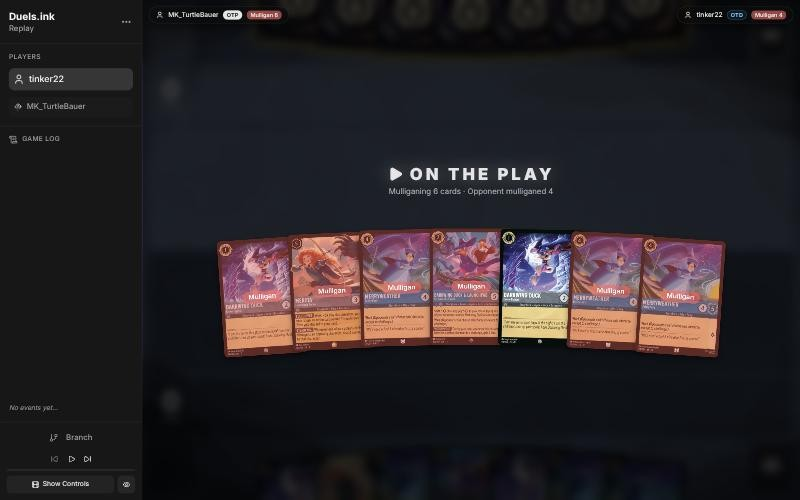
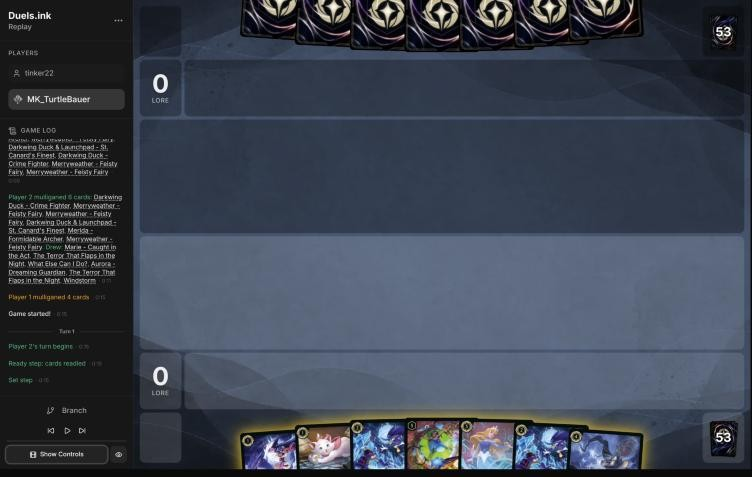
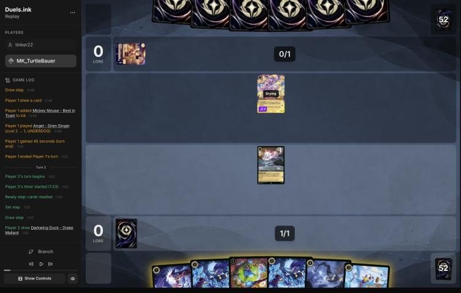
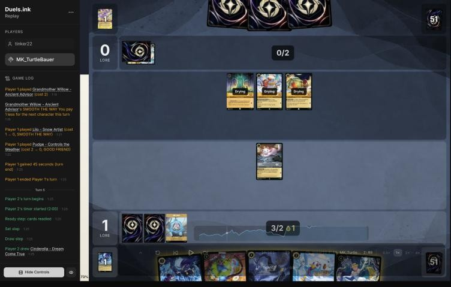
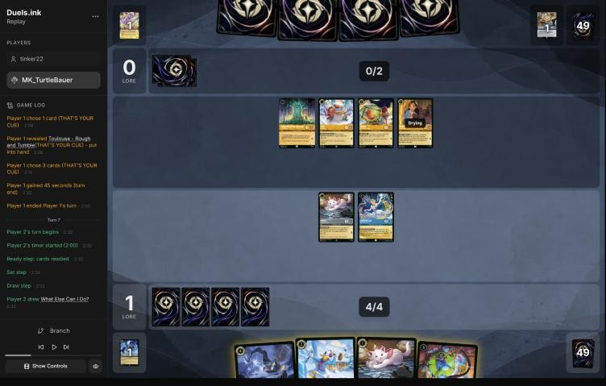
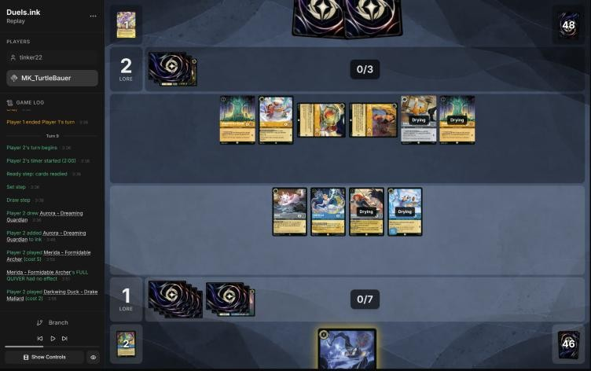
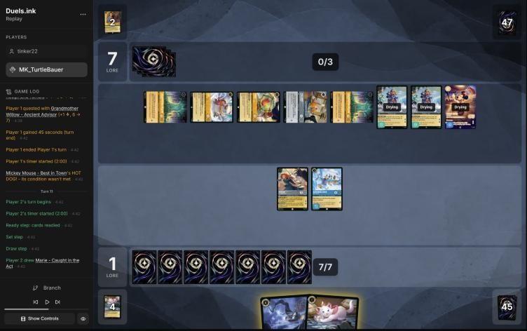
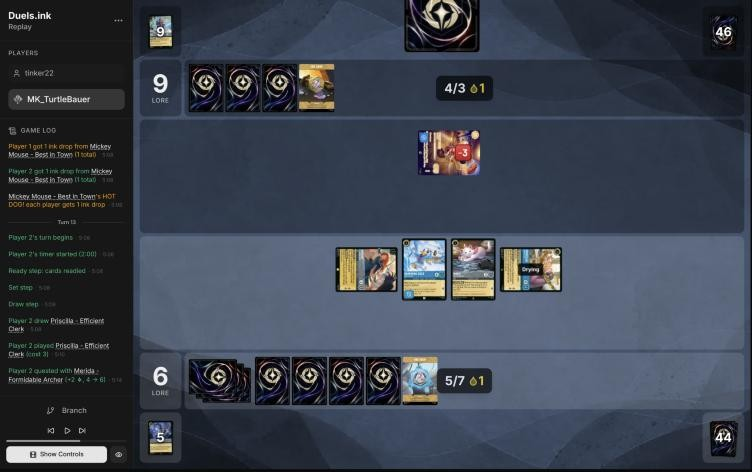
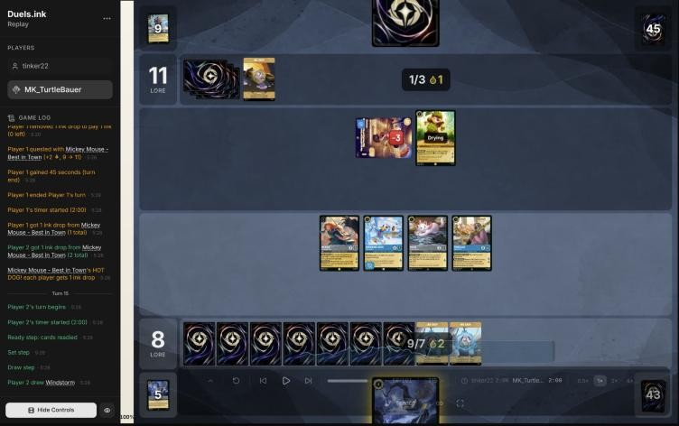
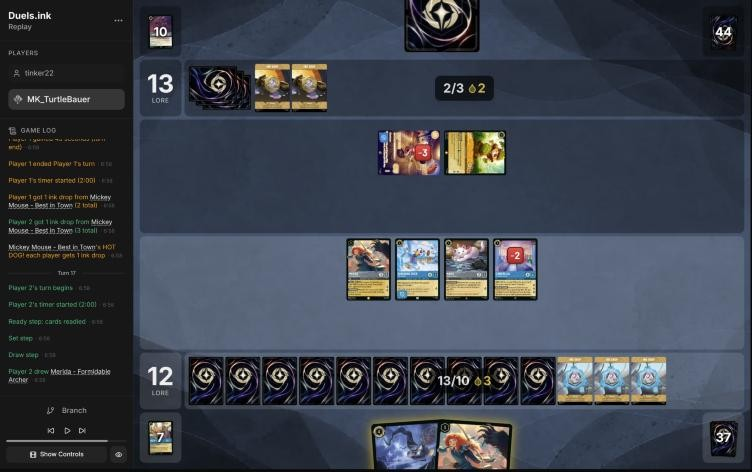

# Review: MK_TurtleBauer vs tinker22, 21 Nov 2026

| | |
|---|---|
| **Status** | in discussion (turns 9 and 13 agreed, 21 Nov 2026) |
| **Replay** | `01a1fe12-6d44` (`python3 tools/brief.py 01a1fe12-6d44 --turn N`) · [duels.ink viewer](https://duels.ink/replay/01a1fe12-6d49-72bd-b8cf-924f1fc389e8?step=0) |
| **Format** | Core Constructed, best of one. Set 14 era: inks revealed before the coin toss |
| **Decks** | You: Sapphire/Steel **Big Ramp** with the Darkwing package, a variant with Merryweather, Aurora – Dreaming Guardian and What Else Can I Do? in place of Khan Industries, Tiana and Minnie ([the coach's notes on it](#cite-kb-meta-archetypes-sapphire-steel-big-ramp-with-the-darkwing-package-how-to-play-it)). Them: **Amber/Steel** ([the coach's notes on this pair](#cite-kb-meta-archetypes-amber-steel-rockstar-aggro-savitar-s-lilo-list)); archetype as it became clear: **Rockstar Aggro** (89% from turn 3, after Mickey Mouse – Best in Town inked and Angel – Siren Singer; 100% from turn 5) |
| **Play/draw** | You went first (your choice) |
| **Result** | **Win**: they conceded at the start of game turn 18, at 13–19, with an empty board |
| **Meta data** | snapshot of 12 Nov 2026 (fresh until 26 Nov) |
| **Chosen how** | Sent by danny, the coach's user, as a replay link on 21 Nov: MK_TurtleBauer's, reviewed for them. The coach knew nothing of the result, and downloaded it without looking at the page |

## Summary
Links go to the turn sections below (`[13](#turn-13)`).
- **Good plays:** [1](#turn-1) (Marie first, for the ink drop), [3](#turn-3) (Terror on their free singer, then the
  drop), [7](#turn-7) (What Else Can I Do? digging for Merida), [11](#turn-11) (Merida and Windstorm: seven of their
  eight characters), [15](#turn-15) (Priscilla's card, then What Else sung for the Icon: your line beat the coach's
  plan) and [17](#turn-17) (two Meridas, so Windstorm killed Dale too).
- **Close calls:** the mulligan ([0](#turn-0): six sent back, level with the coach's keep of four), [1](#turn-1)
  (Aurora inked over Windstorm), [5](#turn-5) (Dream Come True's ramp over Drake Mallard and Terror).
- **Mistake:** [9](#turn-9): Dream Come True and Marie traded for Nani, which next turn's sweep killed anyway.
- **Inaccuracy:** [13](#turn-13): Mickey Mouse – Best in Town left alive, when Drake Mallard could kill him for free.
- **Unwinnable from:** never. They led only once, 7–1 after their turn 10, and the sweep came the next turn.

**What decided it:** Rockstar Aggro built a board of eight that quested for 11 a turn, and Toulouse held off your
Windstorm for a turn. Merida came down under the lock, and on [11](#turn-11) Windstorm with her STEADY AIM dealt 3 to
each of their characters and killed seven. From there your ramp (Priscilla, What Else Can I Do?, the Icon) out-drew
their top-decks, and a second Merida made the last Windstorm deal 5.

## The game, turn by turn
Verdicts judge each decision on what you could know at the time, **including archetype knowledge an experienced
player has**. Hindsight is kept to its own section. Severity scale: good play / close call /
inaccuracy / mistake / blunder. Principle IDs and hypotheses (H-n) link to copies
in the Citations section at the end, as they stood when they were cited.

**What you knew before the game:** their inks, Amber/Steel. The meta snapshot gives **Lilo & Stitch Songs 41%**,
**Rockstar Aggro 37%** and an unlisted list 23%. Both are wide decks of cheap characters; Songs leans on songs sung
by its own characters, Rockstar on +5 to +10 quest turns from five to seven 1- and 2-drops. What they have against
your deck, by the ink it comes at:
- **1 ink:** Berlioz – Tiny Rascal (Rockstar: 1 damage to a chosen character on play). Mickey Mouse – Best in Town
  (Rockstar: 2 lore, and an ink drop for **each** player when he ends their turn exerted).
- **3 ink:** Strength of a Raging Fire (both lists, 4 copies: damage to a chosen character equal to their characters
  in play). World's Greatest Criminal Mind (Songs: banish a chosen character with 5 {S} or more). Both are songs any
  cost-3 character sings for free.
- **4 ink:** Dale – Ready for His Shot (both lists: in challenges their characters deal damage with their {W}, so a
  0/4 Mickey or Mike deals 4). Angel – Experiment 624 (Songs: discard a card to deal 2 to a chosen character, once a
  turn). He Hurled His Thunderbolt (Songs: 4 damage to a chosen character; uninkable, sung by a cost-4 character).
- **Locks (Rockstar):** Toulouse (no actions or songs from you until their next turn), Mr. Big (a chosen character of
  yours can't challenge), Flash (Resist 1, takes nothing from Windstorm).

What protects you: **Ward** (Merryweather, Drake Mallard, St. Canard's Finest, and every other character of yours
while Aurora – Dreaming Guardian is in play) blanks all of their chosen removal above, though not challenges or Dale.
Your sweep is Merida's STEADY AIM with Windstorm: 3 damage to each of their characters, which kills nearly every
Rockstar or Songs body. Three Arrows with Merida does 4 and 3.

### Pre-game

*The board before the decision: [step 0](https://duels.ink/replay/01a1fe12-6d49-72bd-b8cf-924f1fc389e8?step=0) in the duels.ink replay viewer.*

**What you did:** you chose to go first, the usual choice against an aggro pair (their quick quest turns come a turn
later). Then you kept one Darkwing Duck – Crime Fighter and sent back six: the other Crime Fighter,
Merida, St. Canard's Finest and three Merryweathers.

**Verdict:** **Close call.** The seven had no 2- or 3-drop and three 4-drops, with Merida (uninkable) and Finest on
top, so keeping it all was clearly worst. Simulated over 1,500 deals (tools/mulligan.py), ink spent on turns 1–4,
turns with a play, lore by turn 4, characters by turn 4, and interaction by turn 4:

| Option | Ink (of 10) | Play turns (of 4) | Lore by T4 | Characters | Interaction |
|---|---|---|---|---|---|
| Keep all 7 | 7.76 | 3.67 | 5.8 | 3.6 | 45% |
| Keep 5 (2 Crime Fighters, Merryweather, Merida, Finest) | 8.10 | 3.74 | 6.4 | 3.7 | 61% |
| Keep 4 (2 Crime Fighters, Merryweather, Finest) | 8.94 | 3.89 | 6.7 | 4.1 | 69% |
| **Keep 1 Crime Fighter (as played)** | **9.05** | **3.85** | **6.2** | **3.8** | **83%** |
| Full mulligan | 8.86 | 3.43 | 4.7 | 3.2 | 87% |

The coach's pick before seeing yours was keep 4 or keep 5. Your keep and keep 4 are level: yours leads on ink and on
interaction (83% against 69%, the Terror, Three Arrows and Windstorm that an aggro matchup on the play wants), keep 4
on early lore and bodies. The cost of yours is card quality the sim can't see: Finest (Ward, and VICTORY POSE's 2 lore a
kill) and Merida, your Windstorm multiplier. Both have four copies, both come on turn 5 at the earliest, and a hand
built around them had nothing to do on turns 2 and 3 against a deck that floods the board then. Keeping one Merryweather
would have kept a body that their Ward-blind removal can't touch and that wins most challenges against their 1- and
2-drops, at little cost on the measures. [MULL-1](#cite-mull-1), [MULL-2](#cite-mull-2), [MULL-3](#cite-mull-3). Confidence: medium.

### Turn 1: your turn 1

*The board before the decision: [step 3](https://duels.ink/replay/01a1fe12-6d49-72bd-b8cf-924f1fc389e8?step=3) in the duels.ink replay viewer.*

**What you did:** inked Aurora – Dreaming Guardian and played Marie – Caught in the Act.

**Verdict:** **Good play** for Marie first; **close call** for the ink.
- **Marie before Darkwing** sets up turn 2: Terror for 2 on one of their 1-drops, then Marie quests for an ink drop
  (A LITTLE TREAT needs an opposing character damaged that turn), so turn 3 has 4 ink. Darkwing first would make Terror
  deal 3 but gives no drop, and 2 damage already kills most of their 1- and 2-drops (Lilo – Snow Artist, Miguel,
  Grandmother Willow, Lilo – Bundled Up on your turn, when EXTRA LAYERS doesn't apply). Marie's 1 willpower is safe on
  their turn 1 except from Berlioz (about 1 in 5), since their new characters are drying.
- **The ink.** The spare cards were Aurora, Windstorm and the second Terror (What Else Can I Do? is uninkable). The ink
  check: the next two turns play the same with any of them gone (turn 2 Terror and Marie's quest, turn 3 Darkwing and
  the other Terror, or a draw), so the choice shows only on turn 5 and later. Inking Aurora leaves What Else Can I Do?
  as your only 5-drop in hand and gives up her PROTECTIVE EMBRACE (Ward for your other characters, which blanks
  Strength of a Raging Fire, Criminal Mind, Thunderbolt, Angel's GOOD AIM and Berlioz). Inking Windstorm gives up a
  sweep that does little without Merida (1 damage kills almost nothing in their lists) but 3 to each with her, and
  Merida was 4 copies in 53 cards. The coach would have inked Windstorm, keeping the turn-5 body; it's close, since in a
  wide aggro matchup their removal matters less than their quests. [INK-1](#cite-ink-1), [INK-2](#cite-ink-2). Confidence: low.

### Turn 3: your turn 2

*The board before the decision: [step 9](https://duels.ink/replay/01a1fe12-6d49-72bd-b8cf-924f1fc389e8?step=9) in the duels.ink replay viewer.*

**What you did:** inked Darkwing Duck – Crime Fighter, cast The Terror That Flaps in the Night for 2 on Angel – Siren
Singer (banished), then quested Marie for 1 lore and an ink drop.

**Verdict:** **Good play**, the coach's line. Angel was their free singer for Strength of a Raging Fire next turn
(Singer 3), and the kill is what turns on Marie's A LITTLE TREAT, so turn 5 has 4 ink. Marie quested into an empty
board: only Berlioz (1 damage on play) or a Rush character could reach her. Inking Crime Fighter over Windstorm keeps
the sweep for Merida; Drake Mallard is also named Darkwing Duck, so Terror's 3 damage doesn't need the 1-drop. [TEMPO-2](#cite-tempo-2),
[QC-2](#cite-qc-2).

### Turn 5: your turn 3

*The board before the decision: [step 19](https://duels.ink/replay/01a1fe12-6d49-72bd-b8cf-924f1fc389e8?step=19) in the duels.ink replay viewer.*

**What you did:** inked The Terror That Flaps in the Night and played Cinderella – Dream Come True with the ink drop.
At the end of the turn, WHATEVER YOU WISH FOR put What Else Can I Do? into the inkwell and drew a card. Marie stayed
ready.

**Verdict:** **Close call.** Rockstar Aggro is now certain (Willow, Lilo – Snow Artist and a free Pudge, after Mickey
inked). Their board of three quests for 3 a turn, and Willow brings Dale – Ready for His Shot down to 3 ink next turn.
Your hand held two uninkable cards (What Else Can I Do?, Dream Come True) and three inkable ones (Terror, Windstorm,
Drake Mallard). The two real lines, each 4 of your 4 ink (3 cards and the drop):
- **Tempo:** ink Windstorm, play Drake Mallard (2) then Terror (2, 3 damage with a Darkwing in play) on Willow or Lilo,
  and quest Marie for 1 lore and a new drop. It kills a piece of their curve (Willow delays Dale a turn; Lilo makes
  each Pudge free) and leaves Marie exerted, where any of their three can challenge her (she trades with Lilo or
  Willow). Dream Come True then comes next turn, if the draw is inkable or with the drop.
- **Ramp (yours):** Dream Come True now. She counts as the Princess her own trigger needs, so What Else Can I Do?, a
  card you could only sing with a 5-cost character, became ink and a draw. Next turn has 5 ink whatever you draw, and
  she is the base for Cinderella – Unintentional Icon's Shift 5. Nothing is left exerted.

The ramp line gives up a kill and the Terror; the tempo line gives up a turn of ramp and Windstorm. Your notes on the
deck say to hold Windstorm for Merida against a board of 2- and 3-willpower characters, which is what this board is,
so keeping it over the Terror fits them. The coach leans slightly to the tempo line against a deck that wins by going
wide before the sweep, but the difference is within what the tools can't measure. Keeping Marie ready was right: with
no damage dealt there was no drop, and the quest would have offered her to three challengers for 1 lore ([TRADE-4](#cite-trade-4)).
[TEMPO-1](#cite-tempo-1), [INK-2](#cite-ink-2). Confidence: low.

### Turn 7: your turn 4

*The board before the decision: [step 27](https://duels.ink/replay/01a1fe12-6d49-72bd-b8cf-924f1fc389e8?step=27) in the duels.ink replay viewer.*

**What you did:** inked the second Marie and cast What Else Can I Do? for 5 ink: one card to hand, the other into the
inkwell. Marie and Dream Come True stayed ready.

**Verdict:** **Good play**, the coach's line. The setup: they had held all four characters back (Willow, Lilo, Pudge,
Nani), so nothing of theirs could be challenged, and Toulouse – Rough and Tumble was known in their hand from Nani's
search; played next turn, it stops your actions until their following turn, Windstorm included. Windstorm now would
have killed nothing (their smallest have 2 willpower). The needs check: your hand had the sweep's second half
(Windstorm) but not Merida (4 left, about 30% to draw by turn 15 without help), and nothing that could stop a wide
quest turn. What Else Can I Do? dug two cards toward her and ramped you to 6 ink next turn, 7 with an ink. The ink:
the second Marie, the weakest card here (Drake Mallard is a Darkwing for Finest's Shift and Terror's 3, Windstorm the
sweep). Keeping Marie and Cinderella ready was right: questing offered Marie to any of their four and Cinderella, the
Icon's Shift base, to Nani's 3 strength, for 1 lore each ([TRADE-4](#cite-trade-4)). [SEQ-4](#cite-seq-4), [CARD-1](#cite-card-1). What the dig found is in
Hindsight.

### Turn 9: your turn 5

*The board before the decision: [step 41](https://duels.ink/replay/01a1fe12-6d49-72bd-b8cf-924f1fc389e8?step=41) in the duels.ink replay viewer.* Merida and Drake Mallard are down; Dream Come True and Marie are still ready.

**What you did:** inked Aurora – Dreaming Guardian, played Merida – Formidable Archer and Drake Mallard, then
challenged Nani – Stage Manager with Cinderella – Dream Come True (she died, Nani took 2) and with Marie (both died).

**The setup.** Toulouse's UNBECOMING BEHAVIOR stopped your actions this turn, so Windstorm had to wait. Their board
was six characters, all of 2 or 3 willpower, questing for 6 a turn: 20 by game turn 14. Next turn, Windstorm with
Merida in play deals 3 to each of them and kills the whole board, so this turn's job was to get Merida down and keep
her alive. Merida and Windstorm together next turn (9 ink) were out of reach (7 or 8), so she had to come now. What
could stop the sweep: a second Toulouse (17% in their hand and draw, 21% with a Nani search), and Strength of a Raging
Fire on Merida (16% now, 23% with their draw), which Nani could sing for free and which with five or more characters
deals her 5. Nothing else could reach a ready Merida.

**Verdict:** Merida and Drake: **good play**. The two challenges: **mistake**. Challenging Nani with Dream Come True and
Marie is suboptimal because it gives two characters for one that next turn's Windstorm kills anyway. Its gains are
small: Nani's 1 lore on their turn, and Strength costing them 3 of their 4 ink instead of a free song. It doesn't stop
Strength (they could still pay for it, and with two Willows a second Toulouse costs them 0 or 1 beside it), so Merida
was no safer in the branch that mattered. Leaving both ready is better because neither could be challenged, and after
the sweep they're half your board: Dream Come True is the base for Cinderella – Unintentional Icon's Shift 5 and
inks and draws on each turn you play a Princess, and Marie quests for an ink drop on the Windstorm turn. With them,
the board after the sweep quests for 5 a turn (Merida 2, Drake, Cinderella, Marie); without them, for 3. The same ink
line either way (Merida 5 + Drake 2 = 7 of your 7); left ready, the two expose only Marie to a Berlioz ping. In the
Toulouse branch (about 1 in 5) the sweep waits a turn and Nani lives on, but that still isn't worth two characters
for a 1-lore 3/3. [TRADE-1](#cite-trade-1), [TRADE-4](#cite-trade-4), [THREAT-4](#cite-threat-4). Confidence: medium.

**Discussion (21 Nov 2026):** agreed, for the reasons above. The verdict stands as a mistake.

### Turn 11: your turn 6

*The board before the decision: [step 53](https://duels.ink/replay/01a1fe12-6d49-72bd-b8cf-924f1fc389e8?step=53) in the duels.ink replay viewer.*

**What you did:** cast Windstorm with Merida in play, which killed seven of their eight characters (both Willows, Lilo
– Snow Artist, Pudge, Toulouse and both Lilo – Bundled Ups) and left Mickey Mouse – Best in Town on 1 willpower. Then
you played Marie and quested Merida and Drake Mallard (4 lore).

**Verdict:** **Good play**, the coach's line. They were at 7 with eight characters questing for 11 a turn, so 18 next
turn and a win on turn 14: the sweep had to come now, and Toulouse's lock had ended. Questing after it was safe:
Mickey is Adventurous (he can't challenge), so nothing of theirs could reach Merida or Drake. Holding the ink (7, with
Marie and Windstorm the only cards) was right; there was nothing else to play, and inking Marie would have emptied the
hand. [INK-3](#cite-ink-3), [POS-2](#cite-pos-2).

**A rules point the coach got wrong in its plan:** it expected the two Bundled Ups to survive, reading EXTRA LAYERS
("the first time this character would take damage, she takes no damage instead") as stopping Windstorm's damage from
being dealt, so STEADY AIM wouldn't trigger. The CR separates the two: damage reduced to nothing is still *dealt*, and
the character just *takes* none ([CR 1.9.5](#cite-cr-1-9-5)). EXTRA LAYERS replaces taking, so Windstorm still dealt its 1, STEADY AIM
triggered, and its 2 was the second damage, which Bundled Up takes. duels.ink resolved it that way. The verdict is
the same either way, since the line was.

### Turn 13: your turn 7

*The board before the decision: [step 62](https://duels.ink/replay/01a1fe12-6d49-72bd-b8cf-924f1fc389e8?step=62) in the duels.ink replay viewer.* Mickey Mouse – Best in Town is exerted with 3 damage.

**What you did:** played Priscilla – Efficient Clerk and quested Merida, Drake Mallard and Marie (8 lore). Mickey
Mouse – Best in Town, exerted on 1 willpower, was left alone.

**Verdict:** **Inaccuracy.** At 4–9, their whole board was Mickey: 2 lore a turn, and an ink drop for each player at
the end of each turn he quests (he's Adventurous, so he always does). They held one card and had 4 ink. Questing Drake
Mallard is suboptimal because it's worth 1 lore, and challenging Mickey with him is better because it ends their only
lore source at no cost (Mickey has 0 strength) and makes Marie's quest pay an ink drop (A LITTLE TREAT: an opposing
character took damage this turn). The comparison:
- **Your line:** you 8, Mickey quests them to 11, and each player gets a drop.
- **Drake kills Mickey:** you 7 and a drop from Marie; they stay on 9 with no board and no drop.

So 1 lore for you against 2 lore and an ink for them, and the same drop for you either way. Mickey can be killed on
any later turn too, so the cost is one turn of him, not the game. The coach's notes on him say the same: 0
strength, so he trades for nothing, and he's often the first challenge target ([the card notes](#cite-kb-cards-mickey-mouse-best-in-town-what-it-means-in-play)). Both lines leave the same characters exerted (Merida,
Marie, Priscilla, and Drake from his challenge or his quest); their next turn can only add drying characters, so
nothing could reach them but Strength of a Raging Fire (1 or 2 damage with their board of 0 or 1, enough for Marie)
or Berlioz. Priscilla entering exerted was safe for the same reason. [QC-2](#cite-qc-2), [QC-5](#cite-qc-5). Confidence: high.

**Discussion (21 Nov 2026):** agreed, for the reasons above, and called a mistake. The coach keeps the grade at
inaccuracy: agreeing doesn't move a severity by itself, and the cost was one turn of Mickey (2 lore and a drop for
them), with the kill still there on any later turn.

### Turn 15: your turn 8

*The board before the decision: [step 68](https://duels.ink/replay/01a1fe12-6d49-72bd-b8cf-924f1fc389e8?step=68) in the duels.ink replay viewer.*

**What you did:** quested Priscilla first; FILING SYSTEM took What Else Can I Do? (the other card went into the
inkwell). Merida sang it, which found Cinderella – Unintentional Icon and gave all your characters Ward until your next
turn. You hard-cast the Icon for 7, quested Drake and Marie (12 lore), and kept Windstorm. At the end of the turn,
BESPOKE DESIGN inked Launchpad and put Merida on top of your deck.

**The setup.** 8–11. Their board: Mickey (exerted, 1 willpower left) and Dale – Ready for His Shot, whose SPIKE SUIT
makes their characters deal their willpower in challenges, both ways, so challenging Mickey cost you 4 damage (it kills
anything but Merida). They held one card and would have 4 or 5 ink. Their outs on their turn: Dale challenging one
exerted character of yours for 4 (it kills Priscilla, Drake or Marie, though Drake's 4 back kills Dale), Strength of a
Raging Fire sung free by Dale, and Berlioz. The race: your four questers made 6 a turn, so 8 → 14 → 20 on turn 17
if all of them lived, and they were 9 short of 20.

**Verdict:** **Good play**, and better than the coach's plan. The coach planned Windstorm first (Mickey dies, Dale goes
to 1 willpower, Marie's quest makes a drop), then Priscilla's card and all four quests, 14 lore. With the What Else that
Priscilla found, that line is Windstorm 4 + What Else 5 = 9 of your 9, with the Icon left in hand to come down next turn.
Yours (What Else sung for free + Icon 7 = 7 of your 9) puts the Icon, 3 lore a turn and an engine, on the board a turn
earlier, and Ward through their turn blanks Strength and Berlioz on the four characters already in play. *(Corrected after reading turn 16's log, on the rules alone: the Ward doesn't reach the Icon, played after the song resolved, since "your characters gain Ward" is an applied effect, [CR 6.4.2.2](#cite-cr-6-4-2-2). Her 6 willpower is out of reach of Strength's 2 or 3 damage anyway, so the verdict stands.)* Windstorm stays for next turn, when it also catches
whatever they add. The cost is 2 lore now (12 against 14) and one more turn of Mickey. Both lines leave four characters
exerted for Dale to pick one off, and in both a Dale challenge on Priscilla is what stops a turn-17 win. Questing
Priscilla before anything else was the right order: her card decided the turn ([SEQ-1](#cite-seq-1)). Keeping Merida on top with
BESPOKE DESIGN sets up a second STEADY AIM, which makes Windstorm deal 5 to each: enough for Dale. [TEMPO-1](#cite-tempo-1), [SEQ-4](#cite-seq-4).

### Turn 17: your turn 9

*The board before the decision: [step 85](https://duels.ink/replay/01a1fe12-6d49-72bd-b8cf-924f1fc389e8?step=85) in the duels.ink replay viewer.*

**What you did:** played the second Merida, then Windstorm: with two STEADY AIMs each of their characters was dealt 1,
then 2 and 2, which killed Mickey and Dale. You quested Merida, Drake, Marie (an ink drop) and the Icon: 19 lore.

**Verdict:** **Good play**, the coach's line. At 12–13 the board made 7, so 19 was the most this turn could reach;
the job was to make next turn's last lore certain. Two Meridas make Windstorm deal 5 to each, enough for Dale's 4
willpower, so their board was empty (Merida 5 + Windstorm 4 = 9 of your 13 ink). From 13, with only drying characters
to play, they couldn't reach 20 next turn, and they would have had to stop all five of your characters questing on
turn 19. [WIN-1](#cite-win-1), [POS-1](#cite-pos-1).

## Lessons
1. **Against Rockstar Aggro, hold Windstorm for Merida.** Their characters have 2 or 3 willpower, so 1 damage does
   nothing and 3 kills nearly all of them: seven died on [11](#turn-11). Two Meridas make it 5, which reaches Dale
   and Mickey ([17](#turn-17)). Your notes on the deck already say this; this game is a clean example.
2. **Don't trade engines for what the sweep kills next turn** ([9](#turn-9)). Dream Come True and Marie were half of
   the board that would quest after the sweep, and Nani was going to die to it anyway.
3. **Kill Mickey Mouse – Best in Town when it's free** ([13](#turn-13)). He has 0 strength, so any challenger survives,
   and every turn he lives is 2 lore and an ink drop for them.
4. **Toulouse delays the sweep by a turn,** and Nani's search showed he was in their hand. When the lock is coming,
   put Merida down under it so the sweep is ready the turn it ends ([9](#turn-9)).
5. **Two rules points that came up:** Lilo – Bundled Up's EXTRA LAYERS doesn't stop STEADY AIM ([11](#turn-11)), and
   What Else Can I Do?'s Ward reaches only the characters already in play when it resolves ([15](#turn-15)).

## Proposed knowledge-base updates (applied after discussion)
- **Rules** (the coach's rulings):
  - **EXTRA LAYERS stops damage being taken, not dealt,** so STEADY AIM still triggers on it ([CR 1.9.5](#cite-cr-1-9-5)): Windstorm's 1
    on a Lilo – Bundled Up is prevented, Merida's 2 then kills her. duels.ink resolved it that way on turn 11.
  - **"Your characters gain Ward until…" (What Else Can I Do?) is an applied effect** ([CR 6.4.2.2](#cite-cr-6-4-2-2)): a character played
    after the song doesn't get it. Strength of a Raging Fire chose the Icon on turn 16.
- **Meta** (the Sapphire/Steel notes): MK_TurtleBauer's Big Ramp variant. Four each of Merryweather,
  Aurora – Dreaming Guardian and the Icon, and three What Else Can I Do?; no Khan Industries, Tiana, Minnie or
  Thunderbolt. Against Rockstar Aggro: Terror and Marie early, ramp with Dream Come True and What Else, then
  Merida and Windstorm on game turn 11 (seven killed), and a second Merida for 5 damage on turn 17.
- **Meta** (the Amber/Steel notes): Rockstar Aggro against Big Ramp, tinker22. Their board stayed
  ready on turns 4 to 6 (no quests until turn 8). Nani found Toulouse, played the turn before the sweep could come.
  Strength was paid with ink rather than sung, so Dale stayed free to challenge Priscilla. Conceded at 13–19.
- **Meta** (the index of reviewed opponents): a row for 01a1fe12-6d44.
- **Strategy:** no new hypothesis. Turn 11 is evidence for the existing Big Ramp coaching point ("hold Windstorm for
  her"), and turn 9 for [THREAT-4](#cite-threat-4) and [TRADE-4](#cite-trade-4).

## Hindsight
Doesn't change the verdicts above.
- **The mulligan** drew Marie, two Terrors, What Else Can I Do?, Aurora and Windstorm, which supplied turns 1 to 3.
- **Turn 7:** What Else Can I Do? found Merida, the piece the hand lacked.
- **Turn 9:** no second Toulouse came, and they didn't have Strength that turn, so Merida lived and the sweep came on
  time. The Nani trade cost you the Cinderella you'd have Shifted the Icon onto: the Icon was hard-cast for 7 on turn
  15.
- **Turn 13:** the drop Mickey gave them on turn 12 paid for Dale on turn 14 (3 ink and the drop), and he quested
  them from 9 to 13 over the next two turns.
- **Turn 16:** Strength of a Raging Fire, paid with ink, hit the Icon for 2 (she had no Ward), and Dale's SPIKE SUIT
  killed Priscilla. Neither stopped your turn 17, and they conceded the turn after.
- **Was it ever lost?** No. Their best moment was eight characters questing for 11 at 7–1 after turn 10; Windstorm the
  next turn left them one damaged Mickey.

## The coach's errors
Filled in during discussion.

| When | Error | How it was caught | How it won't happen again |
|---|---|---|---|
| Turn 11, the plan | Expected both Lilo – Bundled Ups to survive Windstorm with Merida, reading EXTRA LAYERS as stopping the damage being dealt. It stops it being taken ([CR 1.9.5](#cite-cr-1-9-5)), so STEADY AIM still triggers. The verdict didn't change. | duels.ink killed both; the coach then checked the CR | Proposed: the ruling above, which the brief lists under its knowledge-base notes whenever Bundled Up or Merida is in view |
| Turn 15, the verdict | Said What Else Can I Do?'s Ward covered the Icon, played after the song resolved. It's an applied effect ([CR 6.4.2.2](#cite-cr-6-4-2-2)) and didn't. Corrected in place; the verdict stands. | Turn 16's log: Strength of a Raging Fire chose the Icon; the coach then checked the CR | Proposed: the ruling above, which the brief lists whenever What Else Can I Do? is in view |

## Open questions
- **Pre-game:** why send back six, keeping one Crime Fighter, rather than also a Merryweather?
- **Turn 1:** why ink Aurora – Dreaming Guardian rather than Windstorm or the second Terror?
- ~~**Turn 9:** what were the challenges on Nani for?~~ Answered 21 Nov 2026: a mistake, for the reasons in the verdict.
- ~~**Turn 13:** was leaving Mickey alive on purpose?~~ Answered 21 Nov 2026: no, for the reasons in the verdict.

## Citations
Copies of the coach's knowledge base cited above, as they stood when they were cited (the private repository's commit and date are given with each). They don't change when the knowledge base does.

<!-- Filled in by `python3 tools/cite.py <this file>`: every principle ID, H-n, "principle N" and CR rule above
becomes a link to an entry here. Add a file or one of its sections with `--file PATH --section TEXT`, and link to
the anchor it prints. Never link into the private repository. -->

**sapphire-steel.md, Big Ramp with the Darkwing package: how to play it**: knowledge base, `kb/meta/archetypes/sapphire-steel.md` at `8f98724` (2026-11-21), working tree

> ### Big Ramp with the Darkwing package: how to play it `[coach, study of stonks 📈's 22 games of 21 Oct 2026 (sent by the user), full games, not blind]`
> The user calls this list Sapphire/Steel Detectives, or Big Ramp. It matches duels.ink's "Big Ramp #1" (Windstorm,
> Minnie) with the Darkwing Detectives added. Games: `01a15f98` to `01a1602c` (22; see `kb/meta/index.md`). Card text
> verified with `tools/cards.py`. Also `01a15f8e` (vs MFork, game 2) and `01a16978` (vs AkatsukiCap, game 1).
> - **The list (60):**
>   - **1-drops:** Darkwing Duck – Crime Fighter ×4, Marie – Caught in the Act ×4
>   - **2-drops:** Darkwing Duck – Drake Mallard ×4 (Ward), Launchpad – Trusty Sidekick ×4, The Terror That Flaps in
>     the Night ×4
>   - **3–4:** Three Arrows ×4, Priscilla – Efficient Clerk ×3, Cinderella – Dream Come True ×4, He Hurled His
>     Thunderbolt ×2, Windstorm ×3
>   - **5–6:** Merida – Formidable Archer ×4, Khan Industries – Greenway Landmark ×4, Goliath – Clan Leader ×3
>   - **7–8:** Darkwing Duck & Launchpad – St. Canard's Finest ×4, Cinderella – Unintentional Icon ×2, Tiana – Party
>     Hostess ×4, Minnie Mouse – Urban Visionary ×3
> - **The plan:**
>   1. **Early removal** keeps their board small: Terror (3 damage while a Darkwing is in play), Three Arrows (2, then 1).
>      A Darkwing in play also makes Launchpad's draw free of the discard.
>   2. **Ramp:** Priscilla (enters exerted; each quest puts one of the top 2 into hand and the other into the inkwell,
>      2 lore), Cinderella – Dream Come True (at the end of a turn you played a Princess, ink a card from hand to draw),
>      Cinderella – Unintentional Icon (Shift 5 onto her; ramps one a turn, 3 lore), Marie (an ink drop when she quests
>      after an opposing character took damage). Ink at the start of its 5th turn was usually 5–6, and 8–9 by its 6th in the fastest games.
>   3. **The sweep: Merida, then Windstorm.** STEADY AIM adds 2 damage to every instance of action damage to an
>      opposing character, so Windstorm deals 3 to each (5 to an Evasive one): a 4- to 6-character wipe (01a1601c
>      turn 11: six Princess Aggro characters). Merida's FULL QUIVER also returns Three Arrows (then 4 and 3).
>   4. **Lore:** Khan Industries (2 a turn at their Set step; characters there can't be challenged, so Merida and
>      Priscilla move in), Merida 2, Priscilla 2, Cinderella – Unintentional Icon 3, Minnie 3, St. Canard's Finest 2
>      plus VICTORY POSE (+2 per banish in a challenge on its turn).
>   5. **Tiana – Party Hostess** (7): draw 2 and discard one; a discarded Khan Industries is played free (01a15fee,
>      01a15ff6, 01a1602c). **Minnie** (8, Ward) returns a card from the inkwell to hand when she ends a turn exerted.
>      **Goliath – Clan Leader** puts both hands to 2 at the end of each turn: strictly for pressing an advantage when
>      ahead, or for keeping a control deck's hand small; otherwise rarely played (user, 2026-11-02).
> - **Results by matchup** (13–9): Emerald/Steel Midrange 8–4, all four game 1s lost and every game 2 and 3 won;
>   Amber/Emerald Circle of Life 2–4; Princess Aggro 2–1; Amethyst/Steel Midrange 1–0.
> - **What won:** the Merida and Windstorm sweep, Finest's VICTORY POSE, Khan Industries with protected questers. Early
>   Priscilla matters: in the Emerald/Steel wins she was down by its 4th turn in five of eight, and in the four losses never
>   (a correlation from few games).
> - **It can race from behind once the questers are gone:** in 01a16978, at 5–17 against Emerald/Steel, Three Arrows
>   with STEADY AIM killed Vixey and The Queen, a second Merida returned the Arrows, and wide quests (two Meridas at 2
>   each, Darkwings, Cinderella) won 20–19.
> - **What beat it:**
>   - **Resist:** Flash – Efficient Clerk (2, 3/2/2, Resist 1) takes nothing from Windstorm's 1 and less from every
>     ping; it quested for 8 to 10 in two lost game 1s.
>   - **Ward plus recursion:** Circle of Life replayed Milo Thatch – Getting His Hands Dirty (7, Ward, bounces a
>     character on play), which bounced Merida; conceded at 3–0 (01a15f9d turn 14). Only Windstorm reaches a Ward
>     character.
>   - **Fast wide quests:** Princess Aggro's +5 and +6 turns came before the sweep (01a16020, lost 14–21); a song-and-
>     Evasive Amber/Emerald list quested +7 and +8 (01a15fdb).
> - **Coaching points:**
>   - Merida before any damage action; with their board at 2–3 willpower, hold Windstorm for her. The exception: cast
>     Three Arrows before Merida when its 2 and 1 already kill what matters, so FULL QUIVER returns it for 4 and 3 later
>     (01a19d89 turn 11).
>   - **Ink through Cinderella – Dream Come True's trigger, not the ink action,** on a turn a Princess is played (she
>     counts herself): the same card goes into the inkwell, and you draw a card. danny did it on turns 11, 15 and 19 of
>     01a1a79c-95c1; it beat the coach's plan on turn 11.
>   - **Khan Industries protects its characters only while it stands.** It has 8 willpower: two 5-{S} characters, or a
>     Scourge and Rafiki's Challenger 3, destroy it, and the characters there stay in play, exposed (CR 5.6.6). Moving
>     costs only ink, so a character can quest or challenge and then move there (CR 4.7.3). In 01a1a79c-95c1 turn 21
>     the move capped the next turn one lore short of 20 in a race; check the race before spending the ink on it.
>   - Keep a Darkwing in play for Terror's 3 and Launchpad's free draw. Quest Marie after removal for the ink drop.
>   - Move questers to Khan Industries; plan Tiana for the turn a Khan is in hand. Whether to ink a Khan is too
>     situational for a rule (user, 2026-11-02): judge it from the hand. stonks 📈 (2026-11-02): Khan Industries isn't
>     a proactive play; it's a closer in a game you already lead, or a free play from Tiana. Inking it early is fine.
>     **The matchup decides** (danny, 2026-11-02): stonks's rule comes from midrange matchups. Against sweeper Control
>     (Candle Control's Raging Storms, Amber/Sapphire Control's Storm and targeted removal), Khan Industries is lore
>     they can't reach, so don't ink it early there (01a19d66 turn 4, 01a19d7a turn 2).
>   - Name the answer to Resist and Ward early (Thunderbolt's 4, challenges, Finest): the pings don't do it.
>   - **Mulligan from the hand you have, not to a fixed plan** (user, 2026-11-02). The play pattern varies widely with
>     the opening seven, and no one line suits a given matchup: see what the hand already does, keep what bridges
>     turn 1 to the late game, and send back the rest, avoiding a full mulligan where possible. The deep mulligans
>     (3 to 7 cards) in these games came partly from the player's first games on the deck, so they aren't a guide.
>     *Superseded in part (stonks 📈, 2026-11-02):* the deep mulligans on the draw were deliberate, for the reasons in
>     the player's rules below.
>   - **Judge the plan from the hand, then the matchup:** a coached line should say how this hand gets from its early
>     turns to Merida, the sweep and the 3-lore finishers, rather than follow a stock sequence.

**amber-steel.md, Rockstar Aggro: Savitar's Lilo list**: knowledge base, `kb/meta/archetypes/amber-steel.md` at `8f98724` (2026-11-21), working tree

> ### Rockstar Aggro: Savitar's Lilo list `[coach, meta study of 15 of Savitar's games, 2 Nov 2026 (tools/scan.py), full games, not blind]`
> Studied: 01a19bbd-6ae7 and 01a19bc4-57f1 (GoldenBeast), 01a19bd8-ada2 and 01a19bdb-d8e4 (iKnowZer0), 01a19c02-ae0e,
> 01a19c06-3be1, 01a19cc1-7b0e and 01a19cc5-5243 (Kariminal), 01a19c08-a45f, 01a19c0e-1e9e and 01a19c11-9fbf
> (ligerien), 01a19cbb-e8f7 and 01a19cbe-8319 (Pandagheist), 01a19da0-735c and 01a19dad-a6c9 (DJJAZZYJIMMY). The same
> 60 in every game:
> - **1-drops:** Lilo – Snow Artist ×4 (1/2/1; +1 {L} with a Stitch in play), Stitch – Protector of Frogs ×4 (1/3/1),
>   Mickey Mouse – Best in Town ×4 (0/4/2, Adventurous; HOT DOG gives each player an ink drop).
> - **2-drops:** Grandmother Willow ×4 (uninkable; SMOOTH THE WAY: next character 1 less each turn), Lilo – Bundled Up
>   ×4 (uninkable, 1/2/2; EXTRA LAYERS: the first damage on each opponent's turn is prevented), Pudge – Controls the
>   Weather ×4 (1/3/1; **free with a Lilo in play**), David – Protective Snowboarder ×4 (1/4/1, Bodyguard), Mike Wazowski
>   – Heroic Climber ×4 (uninkable, 0/4/1; FIND A FRIEND on play and each quest: **each player** may keep a character off
>   the top), Flash – Efficient Clerk ×3 (uninkable, 3/2/2, Resist 1; no character can have Rush), Toulouse – Rough and
>   Tumble ×4 (opponents can't play actions, songs included, until your next turn), Mr. Big – Distribution Magnate ×3
>   (0/2/1; ICE OUT: if all your ink is exerted at the end of your turn, a chosen opposing character can't challenge
>   until your next turn).
> - **Higher:** Nani – Stage Manager ×4 (3; finds a 2-cost-or-less character in the top 4), Strength of a Raging Fire ×4
>   (3; damage equal to your character count), Dale – Ready for His Shot ×4 (4, 0/4/2; SPIKE SUIT: in challenges your
>   characters deal damage with their {W}), Lilo & Stitch – Fun-Loving Friends ×4 (Shift 3 onto a Lilo or Stitch;
>   3/5/3, Resist 1, Support), Lilo – Rock Star ×2 (Shift 4 onto a Lilo; each quest replays a 2-cost-or-less character
>   from the discard).
> - **Not in duels.ink's average list:** David, Flash, Mr. Big and Lilo – Rock Star; no Angel, Berlioz or Stitch – Rock
>   Star.
>
> **How it wins:**
> - **A wide board on turn 1:** Lilo – Snow Artist then three free Pudges made four characters on game turn 1 of
>   01a19bc4-57f1. Grandmother Willow's discount and Mickey's drops keep two plays a turn coming.
> - **Quest turns of +5 to +10** once five to seven 1-lore characters are out (01a19bdb-d8e4 turn 8: +10, with Lilo &
>   Stitch Shifted on for 2).
> - **Dale turns high-willpower bodies into removal:** Stitch (3 {W}) and Mike Wazowski (4 {W}) killed three of
>   ligerien's characters in one turn (01a19c08-a45f turn 8).
> - **Locks:** Mr. Big's ICE OUT on their best challenger each turn (two Mr. Bigs, two targets), Toulouse against a
>   song deck on the turn it matters, Flash against Rush.
>
> **What beat it in the study:**
> - **Board damage:** most of the deck has 2 or 3 willpower. Circle of Life's Malicious, Mean, and Scary plus To Wither
>   a Flower killed five characters on turn 7 of 01a19cc5-5243; Don Karnage – Debonair Pirate's 1 damage plus Malicious
>   killed both Mr. Bigs (01a19c02-ae0e turn 6). Emerald/Steel's Don Karnage and Elinor pings did the same slowly.
> - **Raging Storm,** from game turn 9 with ink drops: Mickeys on both sides gave iKnowZer0 three drops for it
>   (01a19bdb-d8e4 turn 9, seven of Savitar's characters at 17–7).
> - **The Headless Horseman – Terror of Sleepy Hollow** (Amber/Ruby singers): banishes a character with 2 {S} or less
>   on play, which is almost every character in this deck.
> - **Savitar conceded early** when a sweeper deck's engine was online: game turn 6 against Chernabog (01a19cc1-7b0e),
>   turn 11 against Milo Thatch (01a19c06-3be1).
>
> **Playing it:**
> - **Grandmother Willow's SMOOTH THE WAY works on the turn she lands:** Willow then a 1-drop costs 2 in all, a 2-drop
>   3 `[coach, from the blind review of 01a19bca-cf89 turn 4, where the coach's plan missed it]`.
> - **Lilo – Rock Star's I'LL COUNT YOU IN plays the character ready,** and ready characters can't be challenged: a
>   replayed Mr. Big or Pudge is lore next turn that only an action can stop `[coach, from the blind review of
>   01a19bf9-b9ff turn 9, where the player's line beat the coach's]`.
> - **David – Protective Snowboarder enters exerted to shield Dale:** as a Bodyguard he must be challenged first, and
>   under SPIKE SUIT he deals 4 back, so their challengers trade into him before they can reach Dale `[coach, from the
>   blind review of 01a19bfe-7db6 turn 8, where the player's line beat the coach's]`.
> - **Lilo & Stitch – Fun-Loving Friends is named Stitch,** so every Lilo – Snow Artist quests for 2 while it's in
>   play, and spare Stitches become ink `[coach, 01a19bca-cf89 turn 6]`.
> - Against Malicious decks (Amber/Emerald Circle of Life, Emerald/Steel Don Karnage), more bodies don't mean more lore
>   once a 1-damage effect is live: count how many survive 1 damage (Stitch, Pudge, David, Mike, Mickey, Dale, Lilo &
>   Stitch) and how many survive 3 (Malicious + To Wither a Flower).
> - Mickey's and Mike's symmetric effects feed the opponent too: count their drops toward Raging Storm (8) and the
>   characters Mike's reveal gives them (`kb/cards/mickey-mouse-best-in-town.md`).
> - **Lilo & Stitch's Support makes a 0-strength character a challenger:** quest her first, give +3 {S} to a ready Mr.
>   Big, Mike or Dale (with Dale's SPIKE SUIT a character deals its {W} instead), and challenge an exerted 2- or
>   3-willpower character: their ramp pieces (Aurora, Hamm, Dream Come True) or a singer `[coach, from the blind review
>   of 01a19c3f-185a turn 5, where the player's line beat the coach's]`.
> - **Flash – Efficient Clerk's TAKE... YOUR... TIME stops every Rush,** printed or given: all characters lose Rush and
>   can't gain it, on both sides. That covers Demona – Imperious Spellcaster's IMPETUS IMPROVISUS, Mulan's quest and
>   Sven, so with Flash in play a Shift or a fresh character of theirs can't challenge the turn it lands `[coach, from
>   the blind review of 01a1cbc6-56dc]`.
> - **Keep Toulouse in hand against Storm decks,** even as the only inkable card: against Candle Control, Mickey's
>   drops brought Raging Storm on game turn 11 while both Toulouses Savitar had drawn were in the inkwell
>   `[coach, 01a19ccd-3f04 turns 2, 8 and 11]`.
> - **Dale's SPIKE SUIT works whichever side challenges:** with Dale in play, Mike, Mickey and David (4 willpower) deal 4
>   to any challenger, which kills Reckless Liquidator, Jebidiah or Roller Bob `[coach, 01a19ccd-3f04 turn 6]`.
> - **Shift Lilo & Stitch in as soon as a dry Lilo or Stitch is there:** she quests for 3 at once, and Willow's
>   discount applies to the Shift (2 ink). Held in hand she does nothing `[coach, 01a19ccd-3f04 turn 6 and 01a19d99-ea68
>   turns 5 and 7, where she was inked or held]`.
> - **Mulligans in Savitar's reviewed games** (12 games, 2 Nov 2026): six keeps were flagged, five of them keeping Mr.
>   Big, David or Willow and sending back Flash, Bundled Up, Toulouse or Strength. `tools/mulligan.py` preferred the
>   2-lore cards and the cheap answers each time, by 0.7 to 1.8 lore by turn 4.
> - **After a Storm, rebuild with characters that stay ready through their turn** (Lilo then Lilo – Rock Star Shifted
>   on, Mr. Big, Lilo & Stitch): no challenge can reach them before they quest, so only an action or Hades – Infernal
>   Schemer stops them. Against Amber/Sapphire Control, count Hades (4 in the average list) with Storm and Let It Go
>   `[coach, 01a19c3b-62c9 turns 12–17: both rebuilt characters were taken by Hades]`.
> - Toulouse is the only way to stop a song turn before it happens: play him the turn before their singers can reach a
>   sweeper song.

**mickey-mouse-best-in-town.md, What it means in play**: knowledge base, `kb/cards/mickey-mouse-best-in-town.md` at `8f98724` (2026-11-21), working tree

> ## What it means in play `[coach, from the 27 Oct 2026 meta study]`
> - **The ramp is symmetric:** every turn he quests, the opponent also gets an ink drop. That's worth more to decks with
>   ink-drop payoffs:
>   - **Jousting Match** (Steel action, 3): 2 damage, or **5 if paid with an ink drop**. Mickey supplied an Amethyst/Steel
>     opponent's drops (01a17e37).
>   - Ink-drop decks also run Ink Explosion, Merlin – Profoundly Curious and Marie – Caught in the Act; Shere Khan –
>     Khan Industries CEO makes drops of his own.
>   - An Emerald/Steel opponent spent four of these drops on turn 6 of 01a17ddb.
> - **Adventurous forces him to quest,** so he ends every turn exerted and can be challenged. 0 strength means he trades
>   for nothing; he's often the first challenge target (01a17e9c turn 14, 01a17ddb turn 6).
> - **Against a Steel opponent,** count the drops you're giving them, and what they could pay for with them, before
>   questing with him.
> - **Drops bring Raging Storm early** `[coach, meta study of Savitar's games, 2 Nov 2026]`: Candle Control (Amber/Ruby)
>   cast it on game turn 9, their 5th turn, with 5 ink and 3 drops from both sides' Mickeys (01a19bdb-d8e4). Against an
>   Amber deck, add your Mickey's drops to their ink when you count down to Storm (8).
> - **Drops bring Circle of Life's big plays early too** `[coach, blind review of 01a1cc04-fe24]`: against Amber/Emerald
>   Circle of Life, count your Mickey's drops toward Don Karnage (6) and Phillip (9), as for Storm.

**MULL-1**: strategy principle, `kb/strategy/principles.md` at `8f98724` (2026-11-21), working tree

> - **MULL-1. Keep a plan, not the strongest cards.** *Ask: "Which hand gives me the best chance to execute my game plan in this matchup?"* `[MCL ch.12]` · baseline

**MULL-2**: strategy principle, `kb/strategy/principles.md` at `8f98724` (2026-11-21), working tree

> - **MULL-2. A smooth curve beats a few powerful cards.** Check that you can spend ink well on turns 1–4, have enough inkable cards, and know what turn 4 looks like. `[MCL ch.12]` · baseline
>   - **Ink spent isn't the goal by itself.** Judge a keep by a nice curve (a play each turn), early lore pressure, and
>     interaction that sets the opponent back, as well as by ink, then weigh card quality and the matchup
>     (user, 2026-11-01). `tools/mulligan.py` reports all of these.

**MULL-3**: strategy principle, `kb/strategy/principles.md` at `8f98724` (2026-11-21), working tree

> - **MULL-3. The right keep depends on the matchup.** Early interaction against aggro; pressure, draw and engines against slow decks. The mulligan is the first expression of your role. In the Set 14 era the opponent's inks are known before the mulligan (RULE-8), so this applies from game 1 of a match. `[MCL ch.12]` · baseline

**INK-1**: strategy principle, `kb/strategy/principles.md` at `8f98724` (2026-11-21), working tree

> - **INK-1. Inking is permanent.** Every inked card is one line of play removed for the rest of the game. *Ask: "Will I regret losing access to this card?"* `[MCL ch.4]` · baseline

**INK-2**: strategy principle, `kb/strategy/principles.md` at `8f98724` (2026-11-21), working tree

> - **INK-2. Don't automatically ink the most expensive card.** It may be the late-game win condition or the key answer for this matchup. The answer depends on matchup, hand and board. `[MCL ch.4]` · baseline

**TEMPO-2**: strategy principle, `kb/strategy/principles.md` at `8f98724` (2026-11-21), working tree

> - **TEMPO-2. Answering an expensive threat with a cheap card is a tempo swing**, and more so if the answer was sung for no ink. Other examples: playing Shift threats before the opponent can answer them, and ramping into several threats in one turn. `[MCL ch.1, ch.7]` · baseline

**QC-2**: strategy principle, `kb/strategy/principles.md` at `8f98724` (2026-11-21), working tree

> - **QC-2. Challenge the threat, not the character.** Engines, synergy pieces and big questers are worth fighting over. A 1-lore character doing nothing usually isn't. *Ask: "Does this character actually need to be removed?"* `[MCL ch.6, ch.9]` · baseline

**TRADE-4**: strategy principle, `kb/strategy/principles.md` at `8f98724` (2026-11-21), working tree

> - **TRADE-4. Every challenge has an opportunity cost.** It's a lost quest, and the challenger may be exposed while exerted. Declining a trade is often as strong as taking it. *Ask: "Would simply questing be stronger?"* `[MCL ch.7]` · baseline

**TEMPO-1**: strategy principle, `kb/strategy/principles.md` at `8f98724` (2026-11-21), working tree

> - **TEMPO-1. Tempo is how much freedom you leave the opponent, not how fast you play.** A play that forces the opponent to spend their turn answering it has stolen part of their turn. *Ask: "If I play this, what does my opponent have to do next?"* `[MCL ch.1]` · baseline

**SEQ-4**: strategy principle, `kb/strategy/principles.md` at `8f98724` (2026-11-21), working tree

> - **SEQ-4. Sequence across turns.** A slightly weaker play now can set up a much stronger next turn: keep a shift target alive, keep a singer ready, hold removal for a bigger threat. `[MCL ch.5]` · baseline

**CARD-1**: strategy principle, `kb/strategy/principles.md` at `8f98724` (2026-11-21), working tree

> - **CARD-1. Card advantage is having more meaningful options than the opponent.** Ways to get it:
>   - 2-for-1 trades, and removal that hits two targets
>   - characters that survive several challenges
>   - recursion
>   - cards that replace themselves
>   - discard
>
>   *Ask after each exchange: "Who has more useful resources left?"* `[MCL ch.2]` · baseline

**TRADE-1**: strategy principle, `kb/strategy/principles.md` at `8f98724` (2026-11-21), working tree

> - **TRADE-1. Judge a trade by ink invested, tempo, value already generated, and the board afterwards**, not by card count. A 2-cost for a 5-cost is a big win even if it's one-for-one. *Ask: "What does the board look like after this challenge?"* `[MCL ch.7]` · baseline

**THREAT-4**: strategy principle, `kb/strategy/principles.md` at `8f98724` (2026-11-21), working tree

> - **THREAT-4. Don't spend premium removal on what combat can handle next turn.** Answer the most important problem, not the first one you see. `[MCL ch.9]` · baseline

**INK-3**: strategy principle, `kb/strategy/principles.md` at `8f98724` (2026-11-21), working tree

> - **INK-3. Usually ink every turn, but not automatically.** Keeping one more playable card can beat one more ink. Missing ink with an expensive hand can leave you permanently behind. `[MCL ch.4]` · baseline

**POS-2**: strategy principle, `kb/strategy/principles.md` at `8f98724` (2026-11-21), working tree

> - **POS-2. From behind, play to your outs and accept calculated risk.** Safe efficient play from a losing position loses slowly. A line with a 30% chance beats a line with 0%. *Ask: "What has to happen for me to win, and which play makes it most likely?"* `[MCL ch.10]` · baseline

**QC-5**: strategy principle, `kb/strategy/principles.md` at `8f98724` (2026-11-21), working tree

> - **QC-5. The race changes everything.** At 18–12 up, take the last 2 lore. At 8–16 down, stopping their close-out matters more than your quests. `[MCL ch.6]` · baseline

**SEQ-1**: strategy principle, `kb/strategy/principles.md` at `8f98724` (2026-11-21), working tree

> - **SEQ-1. Gather information before irreversible decisions.** Draw, look and scry before choosing what to ink. Quest with draw triggers before committing other plays when the order doesn't otherwise matter. `[MCL ch.5]` · baseline

**WIN-1**: strategy principle, `kb/strategy/principles.md` at `8f98724` (2026-11-21), working tree

> - **WIN-1. Know your current win condition and the opponent's.** Plans change with draws and board. The question is "how do I win from here?", not "what was my deck supposed to do?". Preventing the opponent's win condition is often easier than recovering from it. `[MCL ch.11]` · baseline

**POS-1**: strategy principle, `kb/strategy/principles.md` at `8f98724` (2026-11-21), working tree

> - **POS-1. From ahead, take the safest path to victory.** Don't overextend into sweepers, don't make unnecessary trades, and make the opponent take the risks. Winning by 1 lore counts the same as winning by 10. `[MCL ch.10]` · baseline

**CR 1.9.5**: Comprehensive Rules, `kb/rules/cr/01-concepts.md` at `8f98724` (2026-11-21), working tree

> **1.9.5.** If a character or effect would deal damage and that damage is reduced to 0 when modifiers are applied, the character or effect is still considered to “deal” damage. If a character or location is dealt damage and that damage is reduced to 0 when modifiers are applied, the character or location “takes” no damage.

**CR 6.4.2.2**: Comprehensive Rules, `kb/rules/cr/06-abilities-effects-resolving.md` at `8f98724` (2026-11-21), working tree

> **6.4.2.2.** Applied static abilities generated from resolved effects affect only cards in play at the time the effect resolved. Cards that would be affected by the applied static ability but that entered play after the effect resolved aren’t affected. These kinds of effects normally apply an ability or modifier to the affected cards on resolution.
