# Review: MK_TurtleBauer vs 13Febpy, 21 Nov 2026

| | |
|---|---|
| **Status** | draft (blind pass done, not yet discussed) |
| **Replay** | `01a1fecf-eeef` (`python3 tools/brief.py 01a1fecf-eeef --turn N`) · [duels.ink viewer](https://duels.ink/replay/01a1fecf-eef2-777e-b6ed-4b6a67f07e83?step=0) |
| **Format** | Core Constructed (stated in the replay). Set 14 era: inks revealed before the coin toss |
| **Decks** | You: Amethyst/Steel, a Demona – Scourge midrange list with Merlin's Shop and Smithy, Cheshire Cat, Isis, Shere Khan, Hades and Tinker Bell – Giant Fairy. Them: Amber/Sapphire ([the coach's notes on Detectives](#cite-kb-meta-archetypes-amber-sapphire-detectives-how-it-plays)); closest list as it became clear: Detectives from turn 1 (Elisa Maza inked, Nick Wilde found), with two Grandmother Willows and Belle – Snowfield Strategist that duels.ink's Detectives list doesn't run, and at least three each of Nick Wilde – Providing Backup and Toy Drive Officer |
| **Play/draw** | 13Febpy went first; MK_TurtleBauer on the draw |
| **Result** | Win: 13Febpy went AFK on game turn 23, at 10–4 to MK_TurtleBauer, and the win was claimed |
| **Meta data** | snapshot of 12 Nov 2026 (fresh: 9 days old, stale from 26 Nov) |
| **Chosen how** | By the user, who sent the replay link. The result was not known to the coach |

## Summary
Links go to the turn sections below (`[13](#turn-13)`).
- **Good plays:**
  - [pre-game](#turn-0): sending back both Demonas and the Guidebook for a curve.
  - [6](#turn-6) and [8](#turn-8): Shadow and Shere Khan's NEW INCENTIVE opened challenges on their Support and Shift pieces.
  - [10](#turn-10) and [12](#turn-12): **better than the coach's plan.** Giant Fairy instead of Demona (no refill for
    them), then Cheshire's Boost finishing Toy Drive Officer rather than the Willows.
  - [14](#turn-14) and [16](#turn-16): Hades first, then exerts and challenges, wiping their board twice.
  - [18](#turn-18): **better than the coach's plan.** Un Poco Loco on a Boosted Cheshire returned the two cards under
    him ([CR 5.1.1.7](#cite-cr-5-1-1-7)).
  - [4](#turn-4), [20](#turn-20) and [22](#turn-22) too.
- **Close calls:**
  - [2](#turn-2): inking Violet rather than the Guidebook.
  - [16](#turn-16): inking Giant Fairy rather than Un Poco Loco.
  - [22](#turn-22): eight characters on board when holding two cards wouldn't have slowed the clock.
- **Inaccuracies:** [18](#turn-18): inking Merlin's Shop and Smithy when Angela could go in and the Shop could start
  making a lore and a card a turn.
- **Unwinnable from:** never. MK_TurtleBauer was in control from turn 8.

**What decided it:** every exert and challenge went to a Supporter, a Shift base or an engine (Day Camp Instructor,
Toy Drive Officer four times, Fangmeyer, Belle, Eilonwy). 13Febpy quested for only 4 lore in 22 turns, and their
5-strength removal never had a target, because no character of yours reached 5 {S} on their turn. They went AFK at
10–4.

## The game, turn by turn
Verdicts judge each decision on what you could know at the time, **including archetype knowledge an experienced
player has**. Hindsight is kept to its own section. Severity scale: good play / close call /
inaccuracy / mistake / blunder. Principle IDs and hypotheses (H-n) link to copies
in the Citations section at the end, as they stood when they were cited. Game turns are numbered from 13Febpy's
first turn, so yours are the even ones.

**What you knew before the game:** Amber/Sapphire, which in duels.ink's data is most often **Detectives**, then
**Control #1**, with Control #2 and players' own lists behind them. Detectives and Control play very differently,
so the first few cards decide which plan to expect. The key cards, with the earliest game turn each can come
(they're on the play, so their k-th turn is game turn 2k−1, with k ink if they ink every turn):
- **Judy Hopps – Always Vigilant** (Detectives ×4): 4, or Shift 2 onto any Judy; if they played another character
  that turn, banishes a character with 5 {S} or more. With a cheap Judy already down, Shift 2 + a 1-drop is 3 ink:
  **game turn 5**. Your Demona (5 {S}) is a natural target, and **Support puts anything in range**: their Supporters
  (Eilonwy, Day Camp Instructor, Daisy, Nick Wilde – Providing Backup with another Detective, Nick – Toy Drive)
  add their {S} to one of your characters, so Shere Khan (4) needs only +1.
- **Gaston – Superior Archer** (Detectives ×4, Control #1 ×2): 5, the same 5-{S} banish: game turn 9, or turn 7 with
  Hamm – Piggy Bank's LOOSE CHANGE ({E}: next character costs 1 less) or a Mickey drop.
- **Judy Hopps – On the Case** (Detectives ×4): 3; with another Detective in play, puts a chosen **item** into its
  player's inkwell. Junior Woodchuck Guidebook is the target; locations (the Shop) aren't items. Game turn 5.
- **Elisa Maza – Hardworking Detective** (×4): 4; with another Detective in play you reveal your hand and they discard a
  non-character card: Un Poco Loco, the Guidebook, a Shop. Game turn 7. Mowgli – Man Cub (2, ×1) does the same from
  game turn 3, but you choose the card.
- **Judy Hopps – Lead Detective** (×4): 6, or Shift 4 onto a Judy (game turn 7): during their turn their Detectives
  gain **Alert** (Peter Pan's Shadow's Evasive stops nothing) and **Resist +2**, so your challengers deal 2 less
  to them on their turn and challenges into your exerted characters cost them little.
- **Fangmeyer – Icy Officer** (5, uninkable): returns a Detective from their discard, usually Always Vigilant, so the
  removal repeats. Game turn 9.
- **The Horseman Strikes!** (3; Detectives ×1, Control #1 ×3): draws, and may banish a chosen **Evasive** character:
  Peter Pan's Shadow and Violet Parr – Learning New Powers. Game turn 5.
- **Control's answers:** Spooky Sight (6, ×1): **every character costing 3 or less goes to its player's inkwell**, and
  that's most of your deck, from game turn 11 (earlier with Mickey's drops); Hades – Infernal Schemer (7, ×4) puts one
  of your characters into your inkwell; Let It Go (5, ×1, sung by a cost-5 character) the same; **Raging Storm**
  (8, ×4, banishes everything), game turn 15 without help, but Mickey Mouse – Best in Town's HOT DOG! (an ink drop
  each turn he ends exerted, for both players) and Cinderella – Dream Come True's ink-to-draw can bring it two or three
  turns early ([the coach's Amber staples note](#cite-kb-meta-inks-raging-storm-amber-action-8-uninkable): lots of Amber decks run 1–3, Detectives players included).
- **Control's engines:** Aurora – Holding Court (Princesses 1 less), Dream Come True (4), then Cinderella –
  Unintentional Icon (7, Shift 5 onto Dream Come True: an extra ink and card selection each turn, 3 lore) from about
  game turn 7. [H-8](#cite-h-8): trade cheap characters for the ramp engine at the first chance.

Your own deck's plan against each (from the Amethyst/Steel notes): cheap challengers (Rafiki, Pepita with Challenger,
Angela's Challenger +2), exert effects (Peter Pan's Shadow, Isis) and Shere Khan's NEW INCENTIVE to pick off their
pieces, Demona – Scourge to exert their whole board for your challengers, Tinker Bell – Giant Fairy's 1 damage to each
of theirs, and Merlin's Shop for cards and lore. Against Detectives that's the right shape: their cheap Supporters
are 1–3 willpower, and [H-9](#cite-h-9) says kill the Supporters before you deploy a threat with 2 or more {S}. The danger is the
other way round from most decks: **your best characters (Demona, Shere Khan, Isis, Giant Fairy) are 4–5 {S}**, within
a Support or two of their banish.

### Pre-game

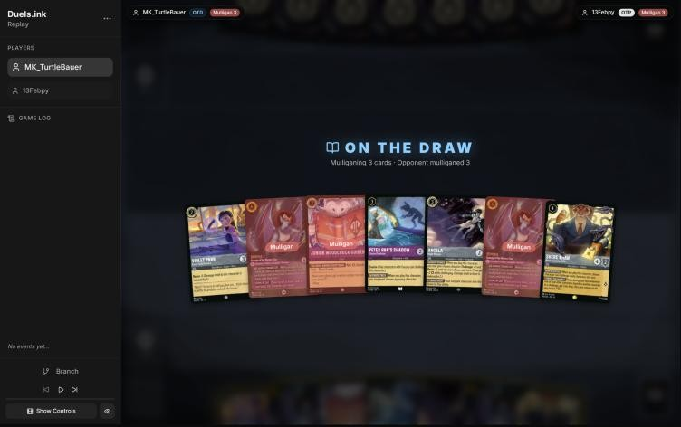
*The board before the decision: [step 0](https://duels.ink/replay/01a1fecf-eef2-777e-b6ed-4b6a67f07e83?step=0) in the duels.ink replay viewer.* Both players sent back three cards.

**What you did:** On the draw. Sent back both Demona – Scourge and the Junior Woodchuck Guidebook, keeping Violet Parr
– Force Field Practice, Peter Pan's Shadow, Angela – Night Warrior and Shere Khan.

**Verdict:** **Good play** (medium confidence). The seven had no 1-drop, two 6-drops and two uninkables (Shadow and
Shere Khan). The coach's own candidate before seeing the mulligan was to send back one Demona and keep six; the
partial mulligans that remove the clunky top end all came out ahead of it in `tools/mulligan.py` (2,000 deals each):

| Option | Ink T1–4 | Play turns | Lore by T4 | Characters T4 |
|---|---|---|---|---|
| Keep all 7 | 9.14 | 3.14 | 3.5 | 3.3 |
| Coach's keep 6 (one Demona back) | 9.27 | 3.28 | 3.9 | 3.5 |
| **As played: keep 4** (both Demonas, Guidebook back) | 9.46 | 3.49 | 4.6 | 3.8 |
| Full mulligan | 9.55 | 3.71 | 5.0 | 3.8 |

The sim can't see card quality, and that's where the decision lies. A Demona is the deck's best card against a wide
Detectives board, but it's a 6-drop on game turn 12 at the earliest, and its 5 {S} is in range of Always Vigilant
and Gaston once it lands; three more copies remain in the 56 cards, and the deck has other answers (Giant Fairy,
challengers). The Guidebook is slow card flow, and On the Case or Elisa Maza can take it. Keeping 2-, 3-, 3- and 4-drops,
including Shadow and Shere Khan, which are the hand's interaction, and drawing three for the rest, plays to [MULL-2](#cite-mull-2)
(a curve) and [MULL-3](#cite-mull-3) (early interaction against an early deck). The full mulligan curves better still, but throws away
the interaction for random cards. The only cost of the keep is that two of its four cards are uninkable, so the
three redraws and the first draws must supply ink: with 48 of 60 inkable, that's a small risk.

### Turn 2: your turn 1

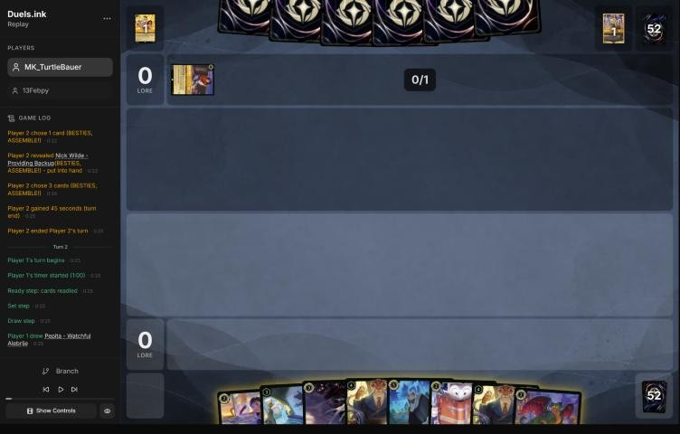
*The board before the decision: [step 8](https://duels.ink/replay/01a1fecf-eef2-777e-b6ed-4b6a67f07e83?step=8) in the duels.ink replay viewer.*

**What you did:** Drew Pepita – Watchful Alebrije and inked Violet Parr – Force Field Practice. No 1-drop to play.
13Febpy had inked Elisa Maza and found Nick Wilde – Providing Backup with Besties, Assemble!: Detectives cards, so
**most like Detectives** from here, with Control or a list of their own still possible.

**Verdict:** **Close call** (low confidence). The hand held three uninkables (Shadow and two Shere Khans) and five
inkables: Violet, Pepita, Angela, Hades and the Guidebook. Ink check for the two closest options:
- **Ink Violet (played):** turn 4 Pepita (or the Guidebook), turn 6 Shadow or Angela, turn 8 Shere Khan, inking Angela,
  the Guidebook or a draw on the way. Nothing is short.
- **Ink the Guidebook:** turn 4 Violet or Pepita, turn 6 Shadow or Angela, turn 8 Shere Khan or both 2-drops. Also
  nothing short, and it keeps a second 2-drop body.

The Guidebook is the card whose loss costs least here ([INK-2](#cite-ink-2)): with eight cards and three uninkables, the hand isn't
short of cards, and against Detectives Judy Hopps – On the Case and Elisa Maza can take an item anyway. Violet (3/2,
Resist 1) is good against their 1- and 2-drops: she kills Higgins or a Judy – Helpful Officer and survives. The edge
is small, since Pepita does Violet's job and the Guidebook will have spare ink to use later.

### Turn 4: your turn 2

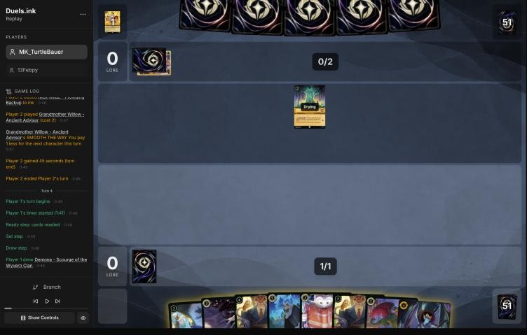
*The board before the decision: [step 13](https://duels.ink/replay/01a1fecf-eef2-777e-b6ed-4b6a67f07e83?step=13) in the duels.ink replay viewer.*

**What you did:** Drew Demona – Scourge, inked the Junior Woodchuck Guidebook and played Pepita – Watchful Alebrije.
13Febpy had inked the Nick Wilde they found and played Grandmother Willow – Ancient Advisor (the next character each
turn costs 1 less), which no duels.ink Amber/Sapphire list runs but [WrathOfKhan's Detectives](#cite-kb-meta-archetypes-amber-sapphire-detectives-against-greenjaypacker-s-ruby-r-e-d-wrathofkhan) did.

**Verdict:** **Good play** (high confidence), the coach's line too. Pepita is the hand's best 2-drop against them: with
Challenger +2 she hits for 4, enough for anything they've shown (Willow 2 {W}, Nick 2 {W}, Elisa 4 {W}). Drying,
she stays ready, so nothing can challenge her. The Guidebook is the right ink for the reasons given on turn 2, and it
keeps Angela (turn 6), Hades and Demona for later turns. Ink check: turn 6 has 3 ink for Shadow or Angela, inking one
of Angela, Hades, Demona or a draw; turn 8 has 4 for Shere Khan. Willow's discount puts Elisa Maza, Always
Vigilant, Uncovering Clues and Toy Drive Officer at 3 ink on their next turn, but Elisa and Always Vigilant need
another Detective in play or played that turn as well, which 3 ink can't also pay for unless it's Higgins or a
Helpful Officer at 1.

### Turn 6: your turn 3

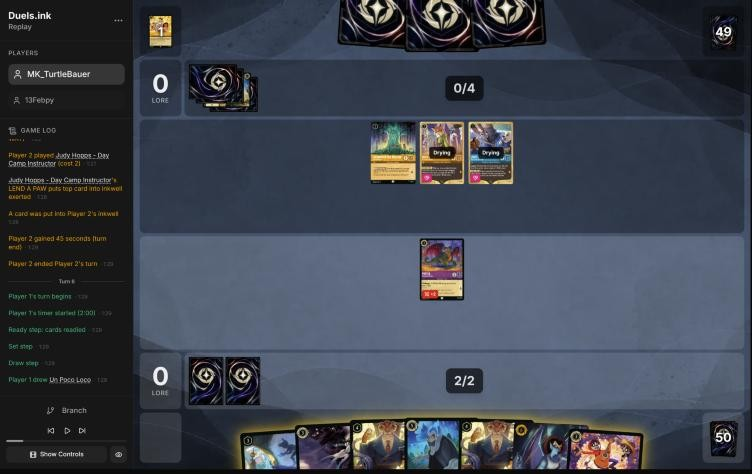
*The board before the decision: [step 21](https://duels.ink/replay/01a1fecf-eef2-777e-b6ed-4b6a67f07e83?step=21) in the duels.ink replay viewer.*

**What you did:** Drew Un Poco Loco, inked Angela, played Peter Pan's Shadow to exert Judy Hopps – Day Camp
Instructor, and Pepita (Challenger +2) killed her, taking 2. On their turn 5 13Febpy had played a second Nick Wilde –
Providing Backup (1 with Willow's discount) and Day Camp Instructor, whose LEND A PAW put them at 4 ink, a turn ahead.
Nothing quested. **Most like Detectives** now (two Nicks, Day Camp, Elisa inked), with Grandmother Willow as their own
addition.

**Verdict:** **Good play** (medium-high confidence), the coach's line. Their three characters were all ready, so only
Shadow's FAVORITE TRICK could open a challenge (Angela's Challenger +2 has no target without it). The three targets:
- **Day Camp Instructor (played):** their only Judy, so the Shift base for Judy – Always Vigilant (2) and Lead Detective
  (4), both live with their 5 ink next turn; a Supporter ([H-9](#cite-h-9)); and her death turns off Nick's Support until another
  Detective lands. Pepita survives on 1 willpower.
- **Nick Wilde (3/2):** Pepita dies to his 3 back, a straight 2-for-2 that leaves the Shift base.
- **Grandmother Willow (1/2):** the discount, but she isn't a Detective or a Supporter, and the Shift base stays.

What it exposes: Pepita is exerted on 1 willpower, so any of their characters kills her next turn, which costs that
character its quest; Shadow stays ready and Evasive, safe unless Lead Detective (Alert) lands. Ink check: Angela was
the right ink. Next turn's 4 ink is Shere Khan, turn 10's 5 is Hades, turn 12's 6 is Demona, and Un Poco Loco can be
sung for free by Shadow (cost 3). Angela's Challenger +2 and Resist +2 is the only card in hand with no job before
turn 14.

### Turn 8: your turn 4

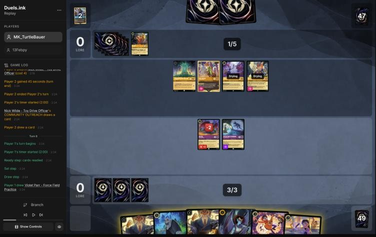
*The board before the decision: [step 32](https://duels.ink/replay/01a1fecf-eef2-777e-b6ed-4b6a67f07e83?step=32) in the duels.ink replay viewer.*

**What you did:** Drew a second Violet Parr – Force Field Practice and inked it. Played Shere Khan and gave Pepita NEW
INCENTIVE; she challenged the ready Nick Wilde – Toy Drive Officer (2/4, Support, draws when they play two
characters) and both died. CORNER THE MARKET gave an ink drop. Shadow stayed home. On their turn 7 13Febpy had inked
Gaston, played Judy Hopps – Helpful Officer (free with Willow) and Toy Drive Officer, and drawn from COMMUNITY
OUTREACH. They still hadn't quested: 0 lore after four turns.

**Verdict:** **Good play** (high confidence), the coach's line exactly.
- **The setup:** their four characters were all ready, so a challenge needed NEW INCENTIVE. Pepita, on 1 willpower,
  was going to die in any challenge, and staying ready was her only way to survive. Shadow was the alternative:
  he can kill Willow and survive her 1 damage, but dies to anything else.
- **The target:** Toy Drive Officer is the hardest of their characters to kill otherwise (4 {W}, exactly Pepita's 4),
  a Supporter ([H-9](#cite-h-9)) and a draw engine. Nick Wilde – Providing Backup (Support 3) dies to any of your 3-strength
  characters later, Willow (the discount) to Shadow.
- **The ink drop** makes next turn's ink 5 + 1 = 6: **Demona – Scourge on game turn 10**, exerting their whole board for
  Shadow and Shere Khan to challenge into.
- **What it exposes:** Shere Khan is drying and ready, so nothing can challenge him. But at 4 {S}, one Support
  (Nick's 3) puts him in range of Gaston or Judy – Always Vigilant (Shift 2 onto Helpful Officer), about one in four
  between them for the average list. That's the price of the line, and he had already paid for himself.
- **The ink:** with Demona to cast next turn and Hades the turn after, Violet and Un Poco Loco were the spare cards;
  either was fine.

Shadow could have quested for 1: Evasive, only a Lead Detective Shifted onto Helpful Officer (Alert on their turn)
could have reached him. With the game long and Shadow wanted for Un Poco Loco and next turn's challenges, keeping him
ready is a close call either way.

### Turn 10: your turn 5

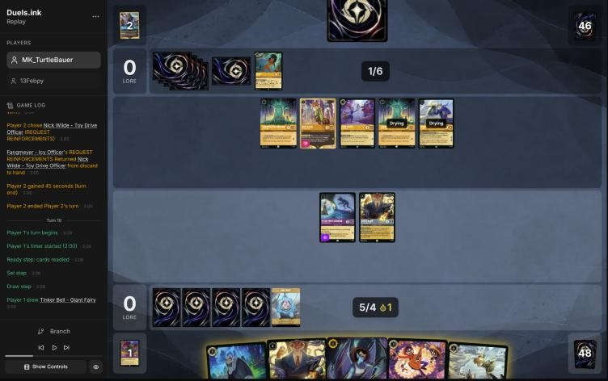
*The board before the decision: [step 43](https://duels.ink/replay/01a1fecf-eef2-777e-b6ed-4b6a67f07e83?step=43) in the duels.ink replay viewer.*

**What you did:** Drew Tinker Bell – Giant Fairy, inked Un Poco Loco and hard-cast Giant Fairy with 5 ink and the ink
drop. ROCK THE BOAT put 1 damage on each of their five characters, killing Judy Hopps – Helpful Officer. Shere Khan
quested (1–0); Shadow stayed home. On their turn 9 13Febpy had inked Mowgli, played a second Grandmother Willow and
Fangmeyer – Icy Officer (4/4, 2 lore), and taken Toy Drive Officer back to hand. Still no quests.

**Verdict:** **Good play** (medium confidence), and better than the coach's plan.
- **The setup:** 6 ink with the drop. Their board was five ready characters (Willow ×2, Nick, Helpful Officer,
  Fangmeyer), questing for 6 a turn if they ever start, with one card in hand (Toy Drive Officer, known) and 7 ink
  next turn. Their removal for next turn was only what they could draw: about 9% for Judy – Always Vigilant and 7% for
  Gaston on the average list. Raging Storm, which some Detectives players run, can't come before game turn 13.
- **The coach's plan was Demona – Scourge now:** exert all five, then Shadow kills a Willow (and survives) and Shere
  Khan trades with Fangmeyer (or Nick). That's two kills for Shere Khan, but AD SAXUM COMMUTATE's refill would have
  drawn them 2 cards (1 → 3), tripling their chance of a Gaston or Always Vigilant for the 5-strength Demona.
- **Giant Fairy first is better, for next turn ([SEQ-4](#cite-seq-4)):** it kills one and leaves Willow ×2 and Nick on 1
  willpower and Fangmeyer on 3, with no refill for them. Next turn Demona (6 ink) exerts the lot, and every
  challenge kills: Shadow, Shere Khan and Giant Fairy (dry by then, and PUNY PIRATE adds 2 damage after each of her
  kills) can take four. Their in-between turn has one card plus a draw to stop it: a second Helpful Officer heals 2,
  and a quest or a challenge only exposes their damaged characters.
- **The ink:** Un Poco Loco was the spare card, keeping Demona and Hades for the next two turns. Ink check: next turn
  is 6 ink for Demona; the turn after, 7 for Hades plus a 2-drop, or Shere Khan with Isis and Cheshire if drawn.
- **What it exposes:** Shere Khan's quest left him exerted on 2 willpower. Any of their characters can kill him, but
  each would die to his 4 damage back (they're all on 1–3 willpower now) except a fresh character, and theirs
  will be drying. So the quest risks an even trade at worst, and gains a lore. Giant Fairy (4 {S}) is one Support
  (Nick's 3) away from Gaston's range: about 7% for the draw. Shadow is ready and Evasive.

### Turn 12: your turn 6

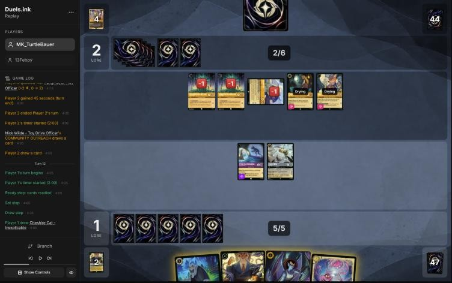
*The board before the decision: [step 52](https://duels.ink/replay/01a1fecf-eef2-777e-b6ed-4b6a67f07e83?step=52) in the duels.ink replay viewer.*

**What you did:** Drew Cheshire Cat – Inexplicable and played him. Giant Fairy challenged the exerted Fangmeyer and
killed him (taking 4), PUNY PIRATE! put 2 on Nick Wilde – Toy Drive Officer, and Cheshire's Boost moved 2 of Giant
Fairy's damage onto Toy Drive Officer, killing him too. Shadow quested (2–2); Hades was inked last. On their turn 11
13Febpy had played Eilonwy (free) and Toy Drive Officer, traded Nick Wilde – Providing Backup for Shere Khan, and
quested Fangmeyer for 2.

**Verdict:** **Good play** (medium-high confidence), and better than the coach's plan.
- **The setup:** 6 ink. Fangmeyer was exerted (he'd quested) with 3 willpower left, the Willows on 1 each, and Eilonwy and
  Toy Drive Officer fresh. They held one card, with 7 ink next turn.
- **The coach's first idea, Demona now,** exerts all five and lets Giant Fairy and Shadow kill three, but the refill
  draws them 2 cards (and you 1), and Demona's 5 {S} is the target their Gaston and Always Vigilant want. Giant Fairy
  could already reach Fangmeyer, so Demona added only Shadow's challenge.
- **The coach's preferred line without Demona** was Giant Fairy on Fangmeyer, PUNY PIRATE! on a Willow and Cheshire's
  Boost onto the other Willow: three kills, no refill. **Your targets were better:** Toy Drive Officer is a Supporter
  ([H-9](#cite-h-9)), draws them a card each turn they play two characters, and has 4 willpower that few of your characters can
  break. The Willows are on 1 willpower each, so any later point of damage (Giant Fairy's next ROCK THE BOAT,
  a Cheshire Boost) finishes them. Two kills, the right two.
- **Demona stays in hand** for when exerting their board turns more challenges into kills; their hand stays at one card.
- **What it exposes** *(revisited from this turn's information; the first version was wrong)*: Giant Fairy is exerted
  on 3 willpower. The first version said each of their characters would die to her 4 back, so the kill would cost
  them their whole board. It missed **Eilonwy's Support**: she quests, adds her 2 {S} to a Willow, and the Willow (on
  1 willpower, worth little) challenges for 3 and kills Giant Fairy. So the line costs Giant Fairy for a Willow, and
  Belle – Snowfield Strategist, if they have her, inks the Willow. No line here kept both kills and Giant Fairy:
  killing both Supporters (Eilonwy and Toy Drive Officer) needed more damage than you had, and keeping her home
  meant leaving Fangmeyer alive. Fangmeyer (2 lore) and Toy Drive Officer for Giant Fairy, who had already killed
  Helpful Officer and damaged everything, is still a good trade ([TRADE-1](#cite-trade-1)), so the verdict stands. Shadow is exerted but Evasive: only a Judy –
  Lead Detective (hard-cast for 4 with both Willows' discounts) gives Alert. Cheshire is drying and ready. Gaston
  (5 {S} or more) has no target on your board unless Eilonwy supports one: Giant Fairy 4 + 2.
- **The ink:** Hades went in, keeping Demona and Shere Khan. Inking last was right ([SEQ-1](#cite-seq-1)), though the Boost's card goes
  under Cheshire face down and tells you nothing. 1 ink went unused, with nothing that cost 1.

### Turn 14: your turn 7

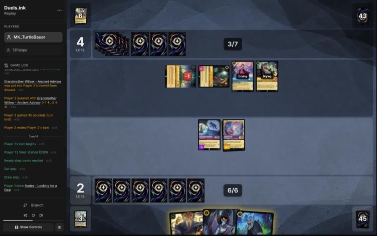
*The board before the decision: [step 73](https://duels.ink/replay/01a1fecf-eef2-777e-b6ed-4b6a67f07e83?step=73) in the duels.ink replay viewer.*

**What you did:** Drew a second Hades. Played Hades first, choosing Belle – Snowfield Strategist; 13Febpy let you draw
2 (Tinker Bell – Giant Fairy and Un Poco Loco) rather than bottom her. Then inked Demona, Shadow killed the exerted
Willow, Cheshire killed the exerted Eilonwy, and Cheshire's Boost moved his 2 damage onto Higgins, killing him. Belle
inked all three. On their turn 13 they had played Belle (2 with both Willows) and Higgins, quested Eilonwy to support
a Willow into Giant Fairy (both died), and quested for 4–2. Belle and Higgins confirm the read: **Detectives, with
Willow and Belle of their own**, much like [WrathOfKhan's list in the Amber/Sapphire notes](#cite-kb-meta-archetypes-amber-sapphire-detectives-against-greenjaypacker-s-ruby-r-e-d-wrathofkhan).

**Verdict:** **Good play** (high confidence), the coach's line, order included.
- **Not Demona:** their hand was empty, so AD SAXUM COMMUTATE would have drawn them 3. With two of their four
  characters already exerted, Demona added little. Inking her was right: with them emptying their hand every turn,
  her refill will keep feeding them, and the deck has better 6s (Giant Fairy).
- **Hades first, on Belle:** whichever they chose, it paid. Bottoming Belle would have stopped WINTER STOCKPILE inking
  the next three kills; letting her stay gave you 2 cards. Inking *after* the draw ([SEQ-1](#cite-seq-1)) kept the choice open: Demona
  was still the right ink with Giant Fairy and Un Poco Loco in hand.
- **The kills:** Eilonwy was the Supporter that had just killed Giant Fairy ([H-9](#cite-h-9)); Willow and Higgins left them a
  board of Belle alone, with no cards in hand. Belle inks the three, so they reach 10–11 ink, but with no hand, ink
  only matters for what they draw.
- **What it exposes:** Shadow (exerted, 1 willpower left, Evasive) and Cheshire (exerted, healed by the Boost) can be
  challenged only by Belle (2 {S}): she can kill neither. Their one draw is the risk: Raging Storm (8), if this list runs
  it as WrathOfKhan's did, would take Hades, Cheshire and Shadow, with Giant Fairy and Shere Khan still in hand to rebuild.

### Turn 16: your turn 8

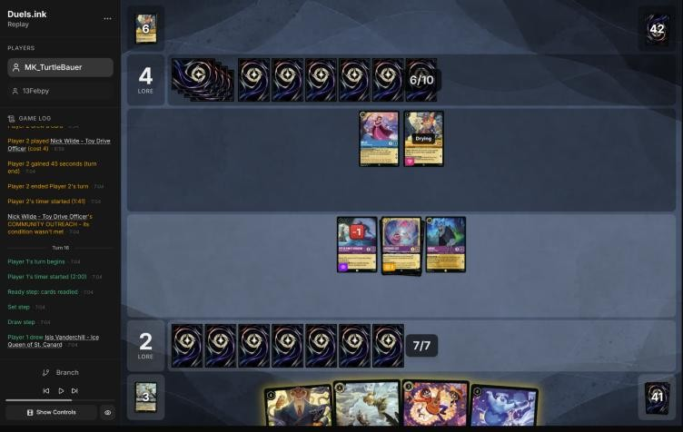
*The board before the decision: [step 90](https://duels.ink/replay/01a1fecf-eef2-777e-b6ed-4b6a67f07e83?step=90) in the duels.ink replay viewer.*

**What you did:** Drew Isis Vanderchill and inked Tinker Bell – Giant Fairy. Isis's CHILL OUT exerted Nick Wilde – Toy
Drive Officer; Shere Khan's NEW INCENTIVE let Cheshire challenge the ready Belle and kill her (an ink drop from CORNER
THE MARKET); then Shadow (dying) and Hades together killed Toy Drive Officer. Their board and hand were both empty
again. On their turn 15 13Febpy, with 10 ink, had drawn and played a second Toy Drive Officer, and nothing else.

**Verdict:** **Good play** (medium-high confidence); the coach's line, except for one choice.
- **The setup:** Belle (2 lore, inks every banished character) and Toy Drive Officer (Support, 4 willpower) were both
  ready, so each kill needed an enabler: Isis exerts one, Shere Khan lets one character challenge a ready one. Isis on
  Toy Drive and NEW INCENTIVE for Cheshire (3 {S}) on Belle (3 {W}) is the only way to kill both with 8 ink.
- **Shadow for Toy Drive Officer:** the coach would have kept Shadow and left Toy Drive on 1 willpower after Hades's
  3. That keeps a 1-lore Evasive body, but Toy Drive would then need another exert to finish, and you'd inked the
  Giant Fairy whose ROCK THE BOAT would have done it. A wiped board against an empty hand is worth the 1-willpower
  Shadow, so yours is at least as good.
- **The ink, a close call:** Giant Fairy or Un Poco Loco. Giant Fairy is 2 lore and a ROCK THE BOAT against the
  1- and 2-willpower Detectives they rebuild with. Un Poco Loco, sung for free by Cheshire or Hades, returns two of
  your characters to replay their effects: Hades's draw, Isis's exert, Shere Khan's NEW INCENTIVE. With their board empty
  and the race level, the 2-lore threat is slightly the better card to keep; the edge is small.
- **What it exposes:** nothing they have. Their board is empty and their hand is one draw; Raging Storm, if they run it,
  would take four characters, with Un Poco Loco left to rebuild. A banked ink drop makes next turn 9.

### Turn 18: your turn 9

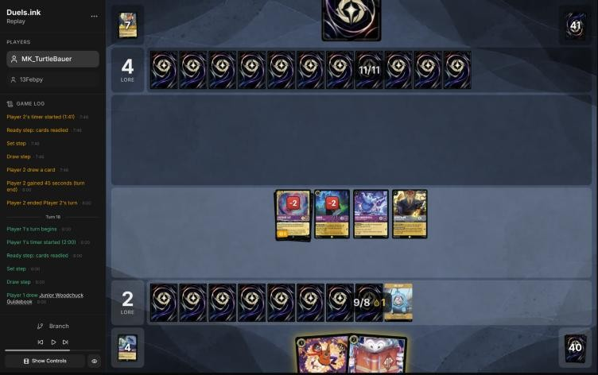
*The board before the decision: [step 101](https://duels.ink/replay/01a1fecf-eef2-777e-b6ed-4b6a67f07e83?step=101) in the duels.ink replay viewer.* Un Poco Loco.

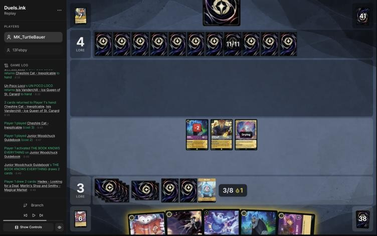
*The board before the decision: [step 107](https://duels.ink/replay/01a1fecf-eef2-777e-b6ed-4b6a67f07e83?step=107) in the duels.ink replay viewer.* The ink: Hades and the Shop just drawn, Angela and the second Guidebook back from under Cheshire.

**What you did:** Drew a Junior Woodchuck Guidebook. Quested Cheshire (3–4), then sang Un Poco Loco with Isis,
returning Cheshire and Isis to your hand; **the two cards Boosted under Cheshire came back with him** (Angela and a
second Guidebook). Replayed Cheshire, played the Guidebook and used it at once (Hades and Merlin's Shop and Smithy),
inked the Shop, played the second Guidebook, and quested Hades and Shere Khan: 5–4. On their turn 17 13Febpy, with
11 ink and an empty board, had drawn and passed.

**Verdict:** **Good play** for Un Poco Loco (high confidence), and an **inaccuracy** in the ink (medium confidence).
- **The setup:** their board was empty and they held one card, which 11 ink didn't play: most likely something with
  no target, such as Gaston or Always Vigilant (no 5-{S} character of yours), On the Case (an item, with another
  Detective), or The Horseman Strikes! (Evasive). Raging Storm would have been cast into your four characters. You
  were 2–4 behind, so this was the turn to turn board control into lore and cards.
- **Un Poco Loco: better than the coach's plan.** The coach had it as dead this turn, with nothing for Hades, Isis or
  Shere Khan to replay onto. You found the line: a character leaving play takes the cards under it to the same zone
  ([CR 5.1.1.7](#cite-cr-5-1-1-7)), so returning Cheshire to your hand **drew the two Boosted cards**, healed his 2 damage, and kept his
  quest. Isis came back for a later CHILL OUT. It cost Isis's quest and 3 ink to replay Cheshire, for two cards.
- **The ink: Angela, not the Shop.** With Isis, Hades, the Shop, Angela and the second Guidebook in hand after the
  draw, inking **the Shop** is suboptimal because it gives up a repeatable source of lore and cards against an empty board
  ([INK-2](#cite-ink-2); the Shop gives 1 lore and a card each turn a character moves there). Inking **Angela** is better: the
  same 4 ink you had left then plays the Shop (2) and moves Hades there (2) before he quests, for +1 lore and a card
  now and the same every turn after. The second Guidebook stays in hand for later. Angela's Challenger +2 and
  Resist +2 is the card you'd miss least. The Shop is also a location, so a Raging Storm leaves it standing, and any
  character they rebuild with has to choose between questing and challenging it ([RULE-3](#cite-rule-3)). Ink check: next turn (10 ink)
  is Isis 4 + Hades 5 either way; the turn after, more of the same plus a Shop move.
- **What it exposes:** Hades and Shere Khan are exerted, but they have nothing in play, so only a character that
  challenges on arrival (Rush, or a Shift) could reach them.

### Turn 20: your turn 10

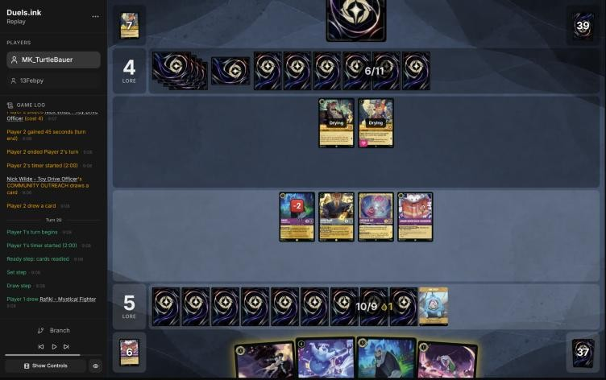
*The board before the decision: [step 115](https://duels.ink/replay/01a1fecf-eef2-777e-b6ed-4b6a67f07e83?step=115) in the duels.ink replay viewer.*

**What you did:** Drew Rafiki and used the Guidebook first (a second Isis and Tinker Bell – Curious Fairy). Isis
exerted Nick Wilde – Toy Drive Officer; Cheshire challenged him (3 damage, taking 2), then Boosted and moved his own 2
damage onto Higgins, killing him; Hades finished Toy Drive Officer and died to his 2 back (an ink drop). Then Tinker Bell
– Curious Fairy and Rafiki, and Shere Khan quested: 6–4. No ink. On their turn 19 13Febpy had played Higgins and a
third Toy Drive Officer and drawn from it.

**Verdict:** **Good play** (medium-high confidence).
- **The order:** the Guidebook's draw before anything else ([SEQ-1](#cite-seq-1)) found the second Isis, which kept the first Isis's
  exert free for this turn.
- **Your line against the coach's:** the coach would have moved Cheshire's 2 onto Toy Drive Officer to kill him and
  kept Hades, leaving Higgins. Moving it onto Higgins and finishing Toy Drive with Hades kills both and costs Hades
  (on 2 willpower after his 2 damage from turn 16). A 2-for-1 that empties their board again, so nothing of theirs can
  challenge your exerted Shere Khan and Cheshire, is at least as good as keeping a damaged 1-lore Hades.
- **Commitment:** five characters on board (Shere Khan, Cheshire, Isis, Tinker Bell, Rafiki) with Hades, Angela and
  the second Isis held. If their list has Raging Storm (none seen in about 24 of their cards), three cards rebuild
  from it, so the two 1-drops for 2 more lore a turn are a fair risk from 6–4 ahead ([POS-1](#cite-pos-1)). Tinker Bell is also the
  Shift base for the two Giant Fairies left in your deck.
- **Not inking:** at 9 ink and a drop, holding Angela, Hades and Isis rather than a tenth ink is right ([INK-3](#cite-ink-3)).

### Turn 22: your turn 11

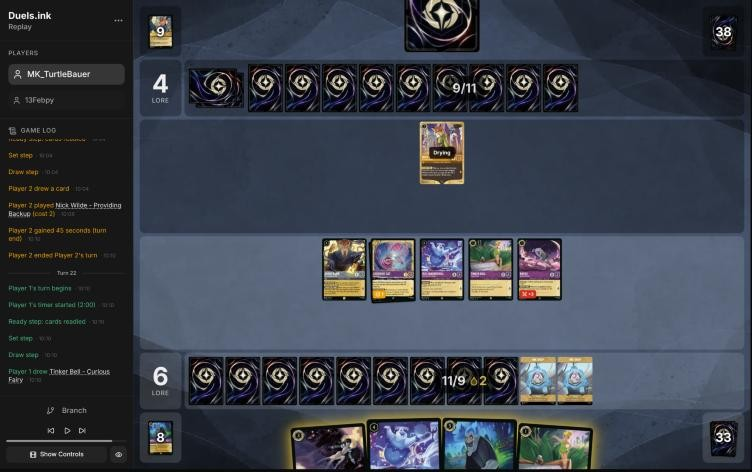
*The board before the decision: [step 131](https://duels.ink/replay/01a1fecf-eef2-777e-b6ed-4b6a67f07e83?step=131) in the duels.ink replay viewer.*

**What you did:** Drew a second Tinker Bell – Curious Fairy. Played Hades first on Nick Wilde – Providing Backup (their
only character, played on turn 21); they let you draw 2 (a third Curious Fairy and a third Isis). Inked a Curious
Fairy, played Isis to exert Nick and Angela to give the first Isis Challenger +2 and Resist +2; Isis killed Nick
taking 1 (an ink drop), and the other four quested: 10–4.

**Verdict:** **Good play** (medium confidence), with a close call on how much to commit.
- **Hades first** was right again: the draw came before the ink and the plays ([SEQ-1](#cite-seq-1)), and either answer helped you.
- **Killing Nick:** Isis with Angela's Resist +2 kills him for 1 damage, leaving them nothing to challenge your
  exerted Shere Khan or Rafiki (2 willpower each) next turn.
- **The close call: eight characters on board.** The alternative was to quest all five (11–4) and keep Isis and Angela
  in hand. Both lines win on game turn 26 if nothing changes: 10 + 8 a turn passes 20 on turn 26, and so does 11 + 5.
  So the extra bodies don't speed the clock; they make you safe from single removal and leave you more exposed to a
  sweeper. Raging Storm hasn't appeared in about 26 of their cards and isn't in duels.ink's Detectives list, though
  some Detectives players run it. From 10–4 with their hand nearly empty, [POS-1](#cite-pos-1) leans slightly towards holding the two
  cards, but the difference is small.

## Lessons
1. **Against Detectives, the Supporters and the Judys are the targets** ([H-9](#cite-h-9)). Every exert and NEW INCENTIVE challenge
   here went to a Supporter, a Shift base or an engine, and no character of yours ever reached 5 {S} on their turn,
   so their Gaston and Always Vigilant never had a target.
2. **Count their hand before Demona – Scourge.** Against a deck that empties its hand every turn, AD SAXUM COMMUTATE
   draws them 2–3 cards. On turns 10 and 14 Giant Fairy's ROCK THE BOAT, Cheshire's Boost and single exerts (Isis,
   Shadow, Shere Khan) did the same job without the refill.
3. **Un Poco Loco on a Boosted Cheshire draws the cards under him.** A character that leaves play takes the cards under
   it to the same zone ([CR 5.1.1.7](#cite-cr-5-1-1-7)), so returning Cheshire to your hand puts his Boosted cards there too.
4. **Count their Support when counting what can challenge you.** A Supporter's quest adds its {S} to one challenger, so
   Eilonwy's +2 let a 1-strength Willow kill Giant Fairy on turn 13.
5. **Once the board is yours, a Shop in play beats a Guidebook:** a lore and a card every turn, and a Raging Storm
   leaves it standing.

## Proposed knowledge-base updates (applied after discussion)
- **Rules:** a ruling: a character returned to hand takes the cards under it with it (Boost cards included; CR
  5.1.1.7), so Un Poco Loco on Cheshire Cat – Inexplicable draws his Boosted cards. Add a line to the Cheshire card
  note pointing to it.
- **Strategy:**
  - [H-9](#cite-h-9) evidence for, from turns 6, 8, 12, 14, 16 and 20. Turn 13 is the other side: the one Supporter left alive
    pumped a challenger into Giant Fairy, so Support makes their small characters dangerous in challenges as well
    as in removal.
  - [H-1](#cite-h-1), a caveat with evidence: against a deck that empties its hand each turn, Demona's refill gives the opponent
    2–3 cards every time (turns 10 and 14).
- **Meta:**
  - Amber/Sapphire notes: Detectives with two Grandmother Willows and Belle – Snowfield Strategist (13Febpy), and how it
    played against exert-and-challenge Amethyst/Steel.
  - Amethyst/Steel notes: MK_TurtleBauer's list (Shop, Un Poco Loco, Cheshire, Isis, Shere Khan, Giant Fairy, Demona) and
    its lines.
  - Meta index: a row for this game.

## Hindsight
Doesn't change the verdicts above.
- **Their hand stayed hidden to the end**, so it's unknown what they held through turn 17 (one card, 11 ink, no play)
  and turn 23. Raging Storm never appeared.
- **13Febpy quested for only 4 lore all game:** nothing before game turn 11, two passed turns with 11 ink, and an AFK at
  the end. Some of the game's ease came from that; the verdicts judge what was known, which was a Detectives deck
  that could have started questing wide at any time.
- **Demona – Scourge was never cast:** one was inked on turn 14, and Giant Fairy and the exerts did her job.

## The coach's errors
Found during the blind pass. Both preventions were made on 21 Nov 2026, after the user agreed.

| When | Error | How it was caught | How it won't happen again |
|---|---|---|---|
| Turn 12 | The exposure check said killing Giant Fairy would cost them their whole board. It missed Eilonwy's Support: her quest adds 2 to a Willow, which then kills Giant Fairy for 3. The verdict stood, but the exposure line was wrong | Turn 13's log; revisited from turn 12's information | **Made.** The brief's "WHAT CAN CHALLENGE YOUR CHARACTERS ON THEIR NEXT TURN" counts their Supporters in play: a line for each ("quests and adds +N to one challenger"), and each character's "one challenge kills it" includes the best challenger with Support. Checked on this game's turns 12 and 14, with a test on turn 14. The Amber/Sapphire notes already said they do this ([Ms. UK's Darkwing](#cite-kb-meta-archetypes-amber-sapphire-detectives-against-danny-s-rockstar-aggro-ms-uk)), so the fix is in the tool, not a note |
| Turn 18 | The coach's plan had Un Poco Loco as dead, with nothing worth replaying. It missed that returning a Boosted Cheshire returns his cards ([CR 5.1.1.7](#cite-cr-5-1-1-7)); the player found the line | The player's line, during the blind pass | **Done** (commit bf61598): a ruling and a line in the Cheshire card note, so the brief shows it whenever Cheshire or Un Poco Loco is in view |

## Open questions
- **Turn 10:** was the refill the reason for Giant Fairy over Demona, or the damage it set up?
- **Turn 18:** was there a reason to play the second Guidebook rather than ink Angela and play the Shop?
- **Turn 22:** why play Isis and Angela to kill Nick rather than hold them against a sweeper? Did you think they had
  Raging Storm?
- **Turn 2:** Violet or the Guidebook as the first ink: which did you see as the spare card?

## Citations
Copies of the coach's knowledge base cited above, as they stood when they were cited (the private repository's commit and date are given with each). They don't change when the knowledge base does.

**MULL-2**: strategy principle, `kb/strategy/principles.md` at `c032400` (2026-11-21), working tree

> - **MULL-2. A smooth curve beats a few powerful cards.** Check that you can spend ink well on turns 1–4, have enough inkable cards, and know what turn 4 looks like. `[MCL ch.12]` · baseline
>   - **Ink spent isn't the goal by itself.** Judge a keep by a nice curve (a play each turn), early lore pressure, and
>     interaction that sets the opponent back, as well as by ink, then weigh card quality and the matchup
>     (user, 2026-11-01). `tools/mulligan.py` reports all of these.

**MULL-3**: strategy principle, `kb/strategy/principles.md` at `c032400` (2026-11-21), working tree

> - **MULL-3. The right keep depends on the matchup.** Early interaction against aggro; pressure, draw and engines against slow decks. The mulligan is the first expression of your role. In the Set 14 era the opponent's inks are known before the mulligan (RULE-8), so this applies from game 1 of a match. `[MCL ch.12]` · baseline

**INK-2**: strategy principle, `kb/strategy/principles.md` at `c032400` (2026-11-21), working tree

> - **INK-2. Don't automatically ink the most expensive card.** It may be the late-game win condition or the key answer for this matchup. The answer depends on matchup, hand and board. `[MCL ch.4]` · baseline

**SEQ-4**: strategy principle, `kb/strategy/principles.md` at `c032400` (2026-11-21), working tree

> - **SEQ-4. Sequence across turns.** A slightly weaker play now can set up a much stronger next turn: keep a shift target alive, keep a singer ready, hold removal for a bigger threat. `[MCL ch.5]` · baseline

**TRADE-1**: strategy principle, `kb/strategy/principles.md` at `c032400` (2026-11-21), working tree

> - **TRADE-1. Judge a trade by ink invested, tempo, value already generated, and the board afterwards**, not by card count. A 2-cost for a 5-cost is a big win even if it's one-for-one. *Ask: "What does the board look like after this challenge?"* `[MCL ch.7]` · baseline

**SEQ-1**: strategy principle, `kb/strategy/principles.md` at `c032400` (2026-11-21), working tree

> - **SEQ-1. Gather information before irreversible decisions.** Draw, look and scry before choosing what to ink. Quest with draw triggers before committing other plays when the order doesn't otherwise matter. `[MCL ch.5]` · baseline

**RULE-3**: strategy principle, `kb/strategy/principles.md` at `c032400` (2026-11-21), working tree

> - **RULE-3. Locations can be challenged at any time and don't hit back** `[CR 4.6.8]`. They pay lore at your Set step `[CR 3.2.2.2]`, so a location that survives one opponent turn has usually already paid something. · baseline

**POS-1**: strategy principle, `kb/strategy/principles.md` at `c032400` (2026-11-21), working tree

> - **POS-1. From ahead, take the safest path to victory.** Don't overextend into sweepers, don't make unnecessary trades, and make the opponent take the risks. Winning by 1 lore counts the same as winning by 10. `[MCL ch.10]` · baseline

**INK-3**: strategy principle, `kb/strategy/principles.md` at `c032400` (2026-11-21), working tree

> - **INK-3. Usually ink every turn, but not automatically.** Keeping one more playable card can beat one more ink. Missing ink with an expensive hand can leave you permanently behind. `[MCL ch.4]` · baseline

**H-8**: hypothesis, `kb/strategy/hypotheses.md` at `c032400` (2026-11-21), working tree

> ### H-8. Trade cheap characters for the opponent's ramp engine at the first chance
> - **Claim:** against a ramp-control deck, kill their ramp engine (Cinderella – Unintentional Icon) as soon as it's
>   exposed, even at the cost of several cheap characters: those characters are what their sweepers take anyway, and
>   the engine is their lore and their ink.
> - **Evidence for:** 01a19d83 (danny vs daman, game 2), turns 8 and 10. Marie and two Launchpads could kill an exerted
>   Icon (6 willpower) both turns; left alive, she took them from 4 to 11 and ramped them into Raging Storm on turn 13.
>   danny agreed in discussion (2026-11-02): "I should've banished it while I had the chance."
> - **Evidence for, the step before:** 01a1a67f-5b3b (MK_TurtleBauer vs DiamondSamurai), turn 7. Isis could exert
>   Cinderella – Dream Come True (the Icon's Shift base and their ramp) for Pepita to kill at no loss; the play killed
>   only Aurora, and the Icon was Shifted onto her next turn. Graded a mistake in the blind review, not yet discussed.
> - **Related:** stonks 📈's rule from the other side (H-6, 01a16039): keep your own Icon ready rather than offer that
>   trade.
> - **Status:** open (one game).

**H-9**: hypothesis, `kb/strategy/hypotheses.md` at `c032400` (2026-11-21), working tree

> ### H-9. Against Detectives, kill their Supporters before you deploy a threat with 2 or more {S}
> - **Claim:** Detectives' removal (Judy – Always Vigilant's GOT YOU NOW, Gaston – Superior Archer's WATCH THIS!) only
>   hits characters with 5 {S} or more, and they get your characters there with Support on their own quests (CR 8.13.1:
>   Support may choose any other character). One Supporter puts every character with 2+ {S} in range: Nick Wilde –
>   Providing Backup adds 3, Daisy Duck – Paranormal Investigator 4, Judy – Day Camp Instructor, Eilonwy and Nick – Toy
>   Drive Officer 2. Characters with 0–1 {S} (Mickey – Best in Town, Luisa, Rafiki, Mowgli) are out of reach of one push.
>   So the Supporters, not the removal, are the target: kill them on your turn, and add a 2+ {S} threat when none of
>   theirs can quest next turn, or several at once so one removal a turn can't keep up.
> - **Evidence for:** danny's 16 Remember Merida games against Detectives, 27–30 Oct 2026 (studied whole, not blind).
>   About 35 of danny's characters were banished this way (two a game), always after a Support onto them: Cheshire,
>   Merlin, Merida, Hades, Pepita, Demona – Scourge (5 {S} without help).
> - **Evidence for, decision by decision** (blind reviews of danny's Rockstar Aggro, not yet discussed): 01a1cedf-0be6
>   (Ms. UK, game 1), turns 9 and 11: killing both Supporters kept every character of danny's out of Gaston and Always
>   Vigilant range. 01a1cee4-b587 (game 2), turn 4: Stitch's free kill on Eilonwy, a Supporter.
> - **Status:** open (a pattern across 16 games; no decision tested in discussion yet).

**H-1**: hypothesis, `kb/strategy/hypotheses.md` at `c032400` (2026-11-21), working tree

> ### H-1. Time hand-refill effects for when your hand naturally runs out
> - **Claim:** "Draw until you have N" effects (e.g. Demona – Scourge of the Wyvern Clan, refill to 3) are worth
>   most on the turn your hand empties. Playing one card per turn on the play, a 7-card hand empties around
>   turn 6, which is exactly when a 6-cost refill lands. So an inkable refill card is cheap to keep through a
>   mulligan: if the game goes differently, ink it.
> - **Why:**
>   - **Hand count when playing on curve, going first:** 7 cards; ink 1 and play 1 each turn, drawing from turn 2,
>     leaves 1 card after inking on turn 6.
>   - **Cost of keeping it, by simulation:** keeping Demona costs about 0.1 ink spent over turns 1–4, compared with
>     also mulliganing her.
> - **Caveats:**
>   - "Each player" refills, so the opponent also draws if below N. On the draw they hold one more card. The other
>     side of this, for the player facing her, is in `kb/cards/demona-scourge-of-the-wyvern-clan.md`.
>   - Demona's STONE BY DAY means she can't ready while you hold 3+ cards. After refilling to 3, you must be at ≤2
>     by your next Ready step, or she stays exerted (and challengeable) once she has quested or challenged.
>   - She's drying on the turn she's played, so her own exert-all opens the opponent's board to your *other* dry
>     characters only.
>   - Ink drops (Hyperia City) don't expire, so saved drops can bring the refill earlier than the bare count suggests.
>   - **The cap absorbs earlier card draw.** "Draw until 3" always ends at 3, so cards drawn beforehand (e.g. Junior
>     Woodchuck Guidebook) are borrowed from the refill rather than added to it. Pre-drawing buys timing, not
>     cards:
>     - earlier information
>     - a better ink choice
>     - being sure of an inkable card for the refill turn
>
>     Weigh that against what the same ink would otherwise buy, e.g. an earlier body. (User's correction,
>     2026-10-24: the coach had called this a cost of the draw without counting those gains.)
>   - The opponent's refill depends on *their* hand size when you cast it, not on your earlier choices. Check it
>     when deciding whether to cast now.
>   - **It needs your ink to reach 6 on time.** Hands with uninkable cards are short of ink, not cards, so a held
>     6-drop is rarely castable on turn 6.
>     - **01a139ad, pre-game:** an opening seven with two uninkables. Keeping Demona left her castable on turn 6
>       only ~16% of the time in simulation. Mulliganing her for a random card raised "turn 4 uses all ink" from
>       80% to 91%. In ink-short hands, the refill card is the one to send back.
>     - *This caveat is the coach's, from simulation; not yet discussed with the user.*
>   - **Against Amber/Sapphire**, Demona's 5 {S} makes her a target for Gaston – Superior Archer, Judy Hopps –
>     Always Vigilant and World's Greatest Criminal Mind (`kb/meta/archetypes/amber-sapphire.md`).
> - **Evidence for:**
>   - replay 01a14bf9 (vs Goop), 2026-10-24, pre-game: the user's mulligan reasoning.
>   - same game, turn 5: the user kept Cheshire as the bridge play on the way to Demona instead of playing an
>     extra 1-drop.
>   - same game, turn 9: Guidebook played and used before inking, which locked in an inkable card for Demona
>     on turn 11. The alternative, Cheshire plus Boost, had about a 16% chance (8 uninkables in 49 cards) of an
>     uninkable turn-11 draw blocking her.
>   - same game, turn 11 (agreed with the user): a second Cheshire instead of Boost would have developed the
>     board, used the ink better, and **emptied the hand to just Demona**. Her next-turn refill would then draw 3
>     instead of 1. The user's own summary of the lesson: develop the board and spend resources so the
>     refill draws as many cards as possible.
>   - same game, turn 13: with Demona due next turn, the user inked their spare Cheshire though that ink wasn't
>     needed. **Corollary:** when a refill is imminent, spare cards in hand are effectively free ink. The cap
>     replaces them, so inking them costs no cards and leaves Demona as the only card in hand.
>   - **Limit on that corollary** (same game, turn 15, agreed with the user): it's free in card *count* only. The cap
>     replaces the inked card with a *random* card. So it holds for cards no better than a random draw, but not
>     for engines or must-answer threats. Inking Dumbo – Ninth Wonder of the Universe (a draw-and-lore engine the
>     opponent has to answer, TEMPO-1) to top up Demona's refill from 2 to 3 was probably wrong. Better was to
>     cast Demona without inking, keep Dumbo for next turn, and accept 1 ink and 1 refill card less.
> - **Evidence against:** none yet.
> - **Status:** open.

**CR 5.1.1.7**: Comprehensive Rules, `kb/rules/cr/05-cards-and-card-types.md` at `c032400` (2026-11-21), working tree

> **5.1.1.7.** In a stack - When a card is on top of or under one or more other cards in play, it and all cards under or on top of it are considered to be in a stack. These cards are considered to be in a stack only while in play. If the top card in a stack leaves play, all cards in the stack move to the same zone as the top card, and these cards are no longer considered to be in a stack. All cards that were under the top card gain the state(s) of that card in the new zone.

**inks.md, Raging Storm (Amber action, 8, uninkable)**: knowledge base, `kb/meta/inks.md` at `c032400` (2026-11-21), working tree

> ### Raging Storm (Amber action, 8, uninkable)
> **Text:** "Banish all characters." (verified, replay 01a14bf9)
>
> **How common:** lots of Amber decks run 1–3 copies (user, 2026-10-25, Set 14 era).
>
> **Hard to play around.** The practical response is not to overcommit once an Amber opponent reaches 8 ink:
> - Keep a threat or a refill in hand.
> - Prefer lines that remove their cards without adding many of yours (POS-1).
>
> **Chance they've seen at least one copy** in a 60-card deck:
>
> | Cards seen | 1 copy | 2 copies | 3 copies |
> |---|---|---|---|
> | 12 | 20% | 36% | 49% |
> | 16 | 27% | 47% | 61% |
> | 20 | 33% | 56% | 71% |
> | 24 | 40% | 64% | 79% |
> | 28 | 47% | 72% | 86% |
>
> Count opening hand, mulligan redraws, draws, and extra cards looked at or drawn. Subtract any copies already
> seen. Around turn 14, a typical opponent has seen about 20 cards.
>
> **After one copy has been cast**, a second is much less likely in any given turn:
> - **Example (01a14bf9, turn 17):** about 8% if they run 2, 15% if 3, assuming the 3 cards available to them
>   next turn (2 in hand + 1 draw) are random among 39 unseen.
> - **It did come, on turn 18.** Low-probability events happen, so judge the commitment by the odds, not the result.
>
> **Pattern seen:** the caster quests with their own characters *first* to bank their lore, then wipes
> (01a14bf9, turn 18: +4 lore, then Raging Storm). Expect the wipe after their quests, not before.

**amber-sapphire.md, Detectives against GreenJayPacker's Ruby R.E.D.: WrathOfKhan**: knowledge base, `kb/meta/archetypes/amber-sapphire.md` at `c032400` (2026-11-21), working tree

> ### Detectives against GreenJayPacker's Ruby R.E.D.: WrathOfKhan `[coach, blind review of 01a1ef50-0454 (game 1), 19 Nov 2026]`
> - **The list:** Hamm – Piggy Bank, Nick Wilde – Toy Drive Officer ×3, Judy Hopps – Day Camp Instructor ×3, Elisa Maza
>   ×2, Fangmeyer ×2, Gaston ×2 (one inked), Judy Hopps – Always Vigilant ×2 (inked), On the Case, Belle – Snowfield
>   Strategist, Higgins (inked), The Horseman Strikes! (inked), Besties, Assemble!, and off-list Mickey Mouse –
>   Expedition Leader (inked) and Grandmother Willow – Ancient Advisor.
> - **How it played (they won 20–6 on game turn 21):** Hamm's LOOSE CHANGE and Day Camp's LEND A PAW kept them a turn
>   ahead on ink, and their board passed IT'S A MACHINE!'s 10 {S} from game turn 9. Elisa Maza challenged an exerted
>   character nearly every turn (both Max Goofs, Roller Bob), and Fangmeyer returned her. On the Case inked the Photo;
>   Gaston killed The Leviathan the turn after it landed, the third game in a row against this deck.
> - **Game 2 (01a1ef5d-fa92; GreenJayPacker won, they conceded on game turn 18):** added Judy Hopps – Helpful Officer
>   ×2, Nick Wilde – Providing Backup ×2, Judy Hopps – Lead Detective (inked) and **Raging Storm**, which no duels.ink
>   Detectives list runs: it came at 8 ink on game turn 16 and cleared both boards. Their Supporters gave your Max Goof
>   +5 so that Always Vigilant's GOT YOU NOW could banish him (turn 10).
> - **Game 3 (01a1ef66-702d; GreenJayPacker won, they conceded on game turn 20):** added Mowgli – Man Cub (HAVE A
>   BETTER LOOK sees your hand and takes a non-character). Played first on game turn 11, Mowgli let Always Vigilant be
>   hard-cast for 4 to banish The Leviathan: GOT YOU NOW needs only another character played that turn, and Shift is
>   just the cheap way in. Grandmother Willow came again (a discount from game turn 3), and Raging Storm came at 8 ink
>   again (game turn 15), the second game running.

**amber-sapphire.md, Detectives against danny's Rockstar Aggro: Ms. UK**: knowledge base, `kb/meta/archetypes/amber-sapphire.md` at `c032400` (2026-11-21), working tree

> ### Detectives against danny's Rockstar Aggro: Ms. UK `[coach, blind reviews of 01a1cedf-0be6 and 01a1cee4-b587, 12 Nov 2026]`
> - **Game 1:** Judy – Helpful Officer, Judy – Day Camp Instructor ×3, Nick Wilde – Providing Backup, Judy – Always
>   Vigilant, Judy – Uncovering Clues ×2, Elisa Maza ×2, Darkwing Duck – Drake Mallard (Ward), Gaston ×2 (both inked).
>   Slow start: no character until turn 4, 0 lore by turn 12; conceded at 0–16.
> - **Game 2:** Eilonwy, Hamm ×2, Darkwing Duck – Drake Mallard ×2 (the second returned by Fangmeyer), Fangmeyer – Icy
>   Officer (turn 7, with Hamm's discount), Judy – Day Camp Instructor, Nick Wilde – Toy Drive Officer ×2, Judy – Always
>   Vigilant ×2, Judy – Lead Detective, Gaston, Nick Wilde – Providing Backup. They used Support on their own Darkwing
>   (6 strength) to kill Lilo & Stitch on turn 11. Conceded at 2–16.
> - **What worked:** killing their Supporters first (H-9: turns 9 and 11 of game 1, turn 4 of game 2), and Lilo &
>   Stitch's Support as removal: +3 {S} on Mike or Willow killed Hamm on turn 8 and Fangmeyer on turn 10 of game 2.
>   Under Dale's SPIKE SUIT the boost does nothing, so challenge before Dale lands (`kb/cards/dale-ready-for-his-shot.md`).

**amber-sapphire.md, Detectives: how it plays**: knowledge base, `kb/meta/archetypes/amber-sapphire.md` at `c032400` (2026-11-21), working tree

> ### Detectives: how it plays `[coach, meta study of the user's 27 Oct 2026 games (tools/scan.py), full games, not blind, 8 games]`
> Games: 01a17e45, 01a17e54, 01a17e5d (Sallinhos, best-of-three); 01a17e64, 01a17e75, 01a17e80 (DuckyRv, best-of-three);
> 01a17e9c; 01a17ef8. Card text verified with `tools/cards.py`.
>
> **The plan:** go wide with cheap Detectives, quest wide, and remove your best characters with "banish chosen character
> with 5 {S} or more", **after pumping them with Support**.
>
> - **The key trick: Support onto your characters.** Support adds "their {S} to another chosen character's {S} this turn",
>   and they choose yours. Then Gaston – Superior Archer or a Judy Hopps – Always Vigilant banishes it.
>   - *Examples:* 01a17e54 turn 21 (+2 on Hades, then Gaston); 01a17e5d turn 12 (+2 on Cheshire, then Judy – Always
>     Vigilant); 01a17e45 turn 23 (two Judy – Always Vigilant Shifts in one turn, banishing Cheshire and Merida, both
>     pumped first).
>   - **Support stacks:** a supported character supports with its new {S}. In 01a17e45 turn 15, Judy – Day Camp gave
>     Nick Wilde +2, then Nick gave +4. Treat **any** character of yours as in range once they have Support questers and
>     their removal available.
> - **Pieces:**
>   - **Cheap Detectives:**
>     - Higgins (1)
>     - Judy – Helpful Officer (1; removes 2 damage)
>     - Nick Wilde – Providing Backup (2; Support while they have another Detective)
>     - Judy – Day Camp Instructor (2, uninkable; Support; tops a card into ink if they played another character this turn)
>     - Daisy Duck – Ghost Finder (2, Support)
>     - Eilonwy (1, Support; not a Detective)
>   - **Nick Wilde – Toy Drive Officer** (4, uninkable; Support; draws at the end of a turn they played 2+ characters).
>   - **Removal:**
>     - **Judy Hopps – Always Vigilant** (4, Shift 2 onto any Judy; GOT YOU NOW needs another character played that turn)
>     - **Gaston – Superior Archer** (5)
>     - The Horseman Strikes!
>   - **Fangmeyer – Icy Officer** (5, uninkable, 2 lore): returns a Detective from their discard, usually Judy – Always
>     Vigilant, so the removal repeats.
>   - **Hand disruption:** Elisa Maza (4; with another Detective in play, you reveal your hand and they pick a non-character
>     card to discard) and Mowgli – Man Cub (2; you discard a non-character card). They took Raging Storm and Remember Me.
>   - **Card flow:** Judy – Uncovering Clues (4; searches the top 3 for a Detective on play and on quest).
>   - **Late game:** Judy – Lead Detective (6, Shift 4; Alert and Resist +2 for Detectives on their turn).
> - **Big turns,** from about their 6th turn: wide quests for +5 to +7 (01a17e45 turn 15: five questers; 01a17e9c turn
>   18: +7 after Lead Detective). Removal turns took 3 or 4 characters by mixing banishes with pumped challengers
>   (01a17e45 turn 23, 01a17e5d turn 12, 01a17e80 turn 26). Your locations were challenged down by two Detectives at once.
> - **What to watch for:**
>   - **Count their Support total against your characters' {S}.** Judys in play are Shift 2 targets for Always Vigilant,
>     and Gaston arrives at 5 ink.
>   - **Expect the removal to repeat** while Fangmeyer can return it.
>   - **Play your actions and songs (sweepers especially) early, before Elisa Maza lands.** She needs another Detective in
>     play first. A wide board of small characters is exactly what sweepers punish.
