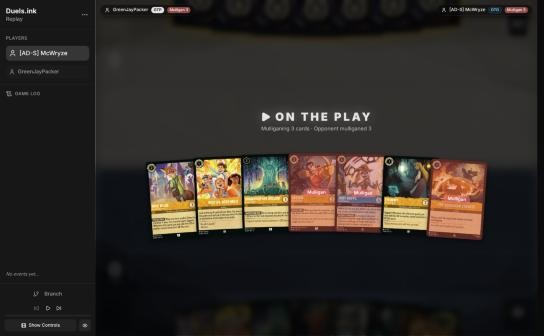
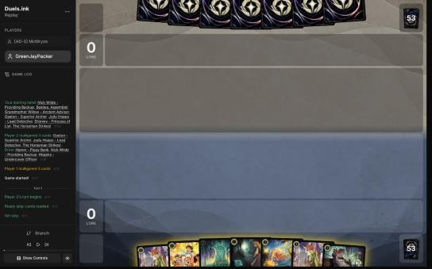
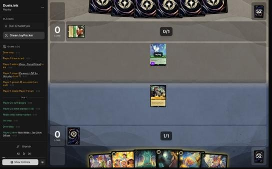
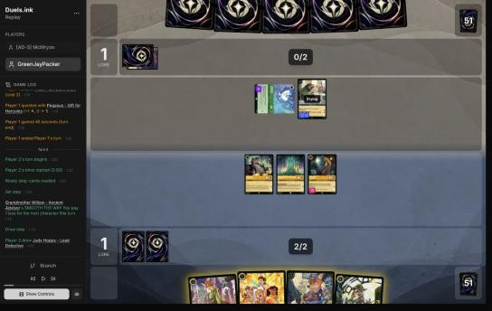
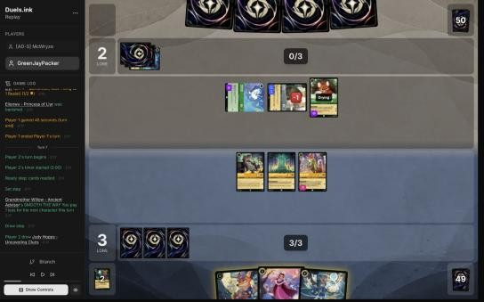
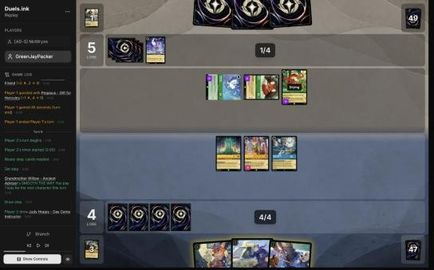
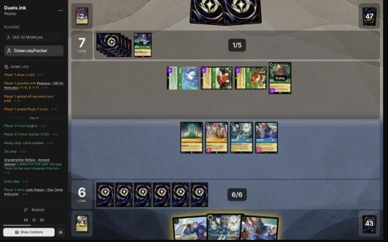
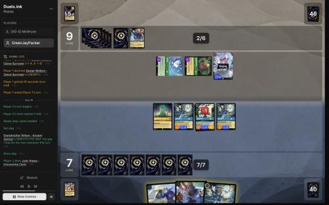
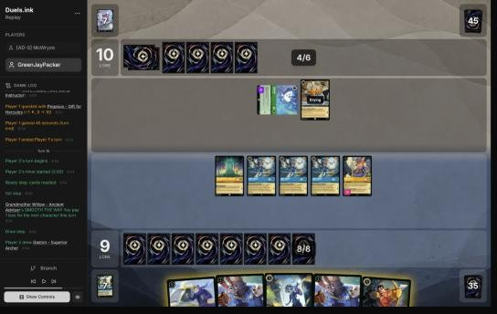
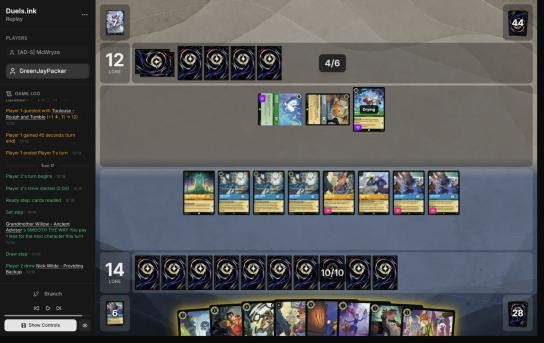

# Review: GreenJayPacker vs [AD-S] McWryze, 21 Nov 2026

| | |
|---|---|
| **Status** | draft (blind pass done, not yet discussed) |
| **Replay** | `01a1ffec-372f` (`python3 tools/brief.py 01a1ffec-372f --turn N`) · [duels.ink viewer](https://duels.ink/replay/01a1ffec-3732-7623-b813-ad5c88d65ae2?step=0) |
| **Format** | Core Constructed (stated in the replay). Set 14 era: inks revealed before the coin toss |
| **Decks** | You: Amber/Sapphire Detectives (Higgins ×4, Nick Wilde – Providing Backup ×4, Day Camp Instructor ×4, Toy Drive Officer ×4, Always Vigilant ×4, Elisa Maza ×4, Uncovering Clues ×4, Fangmeyer ×3, Gaston ×3, Lead Detective ×3, Belle – Snowfield Strategist ×2, Mickey – Expedition Leader ×2, The Horseman Strikes! ×3). Them: Emerald/Steel ([the coach's notes on this pair](#cite-kb-meta-archetypes-emerald-steel-midrange-against-detectives-watashi-and-george)); closest list as it became clear: Midrange #1 from turn 4 (Pegasus, Vixey, then Flash and Strength of a Raging Fire inked), with Francine – Eyeing the Evidence, which duels.ink's lists don't run |
| **Play/draw** | GreenJayPacker went first (and chose to) |
| **Result** | Win by lore, 21–12 on game turn 17 |
| **Meta data** | snapshot of 12 Nov 2026 (fresh: 9 days old, stale from 26 Nov) |
| **Chosen how** | By the user, who sent the replay link. The result was not known to the coach |

## Summary
Links go to the turn sections below (`[13](#turn-13)`).
- **Good plays:**
  - [1](#turn-1), [3](#turn-3) and [7](#turn-7): a curve of cheap Detectives with Willow's discount, and Higgins traded
    for Flash, their only challenger.
  - [9](#turn-9): **better than the coach's plan.** The dig found an inkable Elisa, and the extra ink paid for Toy Drive
    Officer and Day Camp Instructor together: a card drawn and an ink ramped.
  - [11](#turn-11): **better than the coach's plan.** Two digs found both Lead Detectives; one Shifted onto Day Camp and
    her Alert killed Vixey and Mushu for free.
  - [13](#turn-13): Lead Detective killed Gaetan Moliere, their card engine, with their hand empty.
  - [15](#turn-15) and [17](#turn-17): three more characters, then the winning quest.
- **Close calls:** [3](#turn-3), inking Hamm; [7](#turn-7), Uncovering Clues before Belle's ramp.
- **Inaccuracies:**
  - [pre-game](#turn-0): sending back The Horseman Strikes!, the hand's answer to their Evasive questers.
  - [5](#turn-5): inking Judy – Lead Detective, the deck's best card in this matchup, when Besties could go in and Toy
    Drive Officer come down a turn earlier.
- **Unwinnable from:** never.

**What decided it:** Uncovering Clues. Her digs, on play and on every quest, found Elisa for the ink on turn 9 and both
Lead Detectives on turn 11. Lead Detective's Alert then took their three best fliers in two turns, and with their hand
empty from turn 13 they had nothing left to rebuild with.

## The game, turn by turn
Verdicts judge each decision on what you could know at the time, **including archetype knowledge an experienced
player has**. Hindsight is kept to its own section. Severity scale: good play / close call /
inaccuracy / mistake / blunder. Principle IDs and hypotheses (H-n) link to copies
in the Citations section at the end, as they stood when they were cited.

**What you knew before the game:** they showed Emerald/Steel. Of the common lists that's most like Midrange #1, the
pair's usual list by far; it could be Midrange #2 or a list of their own (the pair's notes have seen Kit Cloudkicker,
Francine, Gaetan Moliere, Xanatos and Aladdin in Emerald/Steel decks). What its key cards do, and when:
- **Cheap Evasive questers:** White Rabbit – Late Again (2, Evasive), Vixey – Forest Friend (3, or 2 with a Tod in play;
  Evasive, 2 lore), Mushu – Stealthy Dragon (3, Evasive; draws on quest while you hold more cards), Pegasus (1,
  Evasive). Turn 2 on. Only Judy – Lead Detective's Alert lets your Detectives challenge them, and The Horseman Strikes!
  banishes one.
- **2-lore bodies:** Flash – Efficient Clerk (2, 3/2, Resist 1), Vixey, Broadway (5, 4/6 Bodyguard).
- **Removal:** Strength of a Raging Fire (song, 3: damage equal to their character count; sung free by any cost-3
  character from their turn 3 on), Angel – Experiment 624 (4: discard a card for 2 damage, once a turn), Elinor –
  Renowned Diplomat (4: at the end of their turn with 3+ exerted characters, 1 damage, 1 lore and a card). Max Goof
  (3) returns Strength from the discard for 1.
- **Combat:** Angela – Night Warrior (3: Challenger +2 and Resist +2 to a character until their next turn), Woolter &
  Jesse (3, Bodyguard, Challenger 2).
- **Locks:** Toulouse – Rough and Tumble (2: you can't play actions until their next turn), Ursula – Deceiver (2: you
  discard a song; this deck runs none).
- **No sweeper** in the lists: they win on steady +5 to +8 quest turns and pings, killing small characters one at a time.
- **Your Gaston and Always Vigilant have few targets:** only The Queen – Devious Disguise (5 {S}) reaches 5 {S}
  unaided. Your Support could put a Vixey or Mushu in range, but they're Evasive questers you'd rather Horseman.

### Pre-game

*The board before the decision: [step 0](https://duels.ink/replay/01a1ffec-3732-7623-b813-ad5c88d65ae2?step=0) in the duels.ink replay viewer.*

**What you did:** on the play. Kept Nick Wilde – Providing Backup, Besties, Assemble!, Grandmother Willow and Eilonwy;
sent back Gaston, Judy – Lead Detective and The Horseman Strikes!.

**Verdict:** **Inaccuracy** (medium confidence). The candidates, written before the sim was shown the mulligan
made: keep all 7, keep 6 (send Gaston), keep 5 (send Gaston and Lead Detective), keep 4 (send Besties too).
`tools/mulligan.py` (1,500 deals each):

| Option | Ink, turns 1–4 | Play turns | Lore by turn 4 | Characters | Interaction |
|---|---|---|---|---|---|
| Keep all 7 | 9.63 | 3.99 | 6.0 | 4.1 | 100% |
| Keep 6 (send Gaston) | 9.35 | 3.98 | 6.1 | 4.2 | 100% |
| Keep 5 (send Gaston, Lead Detective) | 9.08 | 3.97 | 6.2 | 4.3 | 100% |
| As played (send Gaston, Lead Detective, Horseman) | 8.89 | 3.95 | 6.3 | 4.3 | 54% |
| Full mulligan | 8.90 | 3.69 | 5.3 | 3.9 | 86% |

Sending back **The Horseman Strikes!** is suboptimal because it's the hand's best card in this matchup: Midrange #1
runs about fifteen Evasive questers (White Rabbit, Vixey, Mushu, Pegasus), your Detectives can't challenge them until
Lead Detective lands, and Horseman banishes one and replaces itself (a card drawn) for 3 ink on turn 3, just as Vixey
or Mushu arrives ([TEMPO-2](#cite-tempo-2), [CARD-1](#cite-card-1)). Keeping it (keep 5) costs nothing on curve or early board in the sim (6.2 lore and
4.3 characters by turn 4 against 6.3 and 4.3), and keeps the interaction (100% against 54%). Sending Gaston was right:
only The Queen reaches 5 {S} unaided, so he's mostly a 3/4 for 5 here. Lead Detective is a fair keep or send: her
Alert is the deck's other answer to fliers, but at 6 she's slow on a 1-2-2 curve. Toulouse could lock Horseman for a
turn, a small cost. Confidence is medium: the sim measures interaction coarsely, and the player may have wanted
cheap Detectives to make Nick's Support work.

### Turn 1: your turn 1

*The board before the decision: [step 3](https://duels.ink/replay/01a1ffec-3732-7623-b813-ad5c88d65ae2?step=3) in the duels.ink replay viewer.*

**What you did:** inked Nick Wilde – Providing Backup and played Higgins.

**Verdict:** **Good play.** Higgins is the better 1-drop than Eilonwy: he's a Detective, so a Nick played next to him
has Support, and his 2 willpower survives a 1-damage ping where Eilonwy's 1 doesn't. Inking the second Nick keeps one
Nick, Willow, Hamm and Eilonwy for a curve of two cheap characters a turn (Willow's SMOOTH THE WAY makes Eilonwy free
on turn 2). Inking Besties instead would have been as good. Support: neither side has a Supporter in play; theirs run
none in their lists.

### Turn 3: your turn 2

*The board before the decision: [step 9](https://duels.ink/replay/01a1ffec-3732-7623-b813-ad5c88d65ae2?step=9) in the duels.ink replay viewer.*

**What you did:** inked Hamm, played Grandmother Willow and Eilonwy free with her SMOOTH THE WAY, and quested
Higgins (1–0).

**Verdict:** **Good play.** With 2 ink, Willow plus a free Eilonwy is the only way to put two characters down, and
Willow in play makes next turn's Toy Drive Officer cost 3 (2 + Eilonwy 0 = 2 of your 2). Higgins' quest exposed him
only to Pegasus (1 {S}), which can't kill him and would die to his 2 back. Inking Hamm over Besties or Nick is a
close call: Hamm's LOOSE CHANGE would stack with Willow for a cheap double-drop later, but the hand had enough cheap
characters without him. Support: yours is Eilonwy (drying); theirs, none.

### Turn 5: your turn 3

*The board before the decision: [step 18](https://duels.ink/replay/01a1ffec-3732-7623-b813-ad5c88d65ae2?step=18) in the duels.ink replay viewer.*

**What you did:** inked Judy Hopps – Lead Detective, played Besties, Assemble! (took Belle – Snowfield Strategist),
then Nick Wilde – Providing Backup for 1 with SMOOTH THE WAY, and quested Eilonwy and Higgins (3–1). 1 ink unspent.

- **The setup:** 3 ink with the ink. Their board was Pegasus (exerted, but Evasive, so nothing of yours could
  challenge it) and a drying Flash (3/2, Resist 1). They had shown Vixey and Strength of a Raging Fire (both inked):
  Midrange #1 by every card so far. Next turn Flash can kill any one exerted character of yours for free (Resist 1
  takes 1 off Higgins' or Nick's damage back), and Angela (3 ink) could pump a challenger. No free singer for Strength
  yet (Flash costs 2). Support: yours, Eilonwy, with nothing to challenge; theirs, none.
- **The candidates:** (a) ink Besties and play Toy Drive Officer for 3 with Willow (3 of your 3), keeping Nick and Lead
  Detective; (b) ink Nick, Besties for 1 and whatever it finds up to 2 more; (c) the line played.

**Verdict:** **Inaccuracy** (medium confidence). Inking **Judy Hopps – Lead Detective** is suboptimal because she is
your deck's answer to this matchup: Midrange #1 races with Evasive questers (Pegasus already, Vixey seen), and her
LATERAL THINKING gives every Detective Alert and Resist +2 on your turn, so they can challenge the fliers and Flash
without dying. She isn't a 6-drop in this deck: she Shifts for 4 onto any Judy (sixteen in your list), so she could
land as early as next turn's 4 ink once a Judy appears. In the Watashi and George games the Emerald/Steel players
stopped questing once she was down ([the coach's notes](#cite-kb-meta-archetypes-emerald-steel-midrange-against-detectives-watashi-and-george)).
Inking **Besties** and playing **Toy Drive Officer** for 3 is better because it spends all 3 ink (the line played left
1 unspent), keeps Lead Detective and Nick in hand, and puts the draw engine down a turn earlier: next turn Nick for 1
plus any card you draw is two characters, and COMMUNITY OUTREACH draws a card ([INK-1](#cite-ink-1), [INK-2](#cite-ink-2)). Both lines put one body
down and keep two cards; the line played swapped Lead Detective for Belle (2 lore) and saw four cards with Besties.
Toy Drive (2/4) would have been drying, so out of Flash's reach. The quests were right: Higgins and Eilonwy are the
cheapest bodies to lose to Flash, and Willow stayed home for her discount.

### Turn 7: your turn 4

*The board before the decision: [step 32](https://duels.ink/replay/01a1ffec-3732-7623-b813-ad5c88d65ae2?step=32) in the duels.ink replay viewer.*

**What you did:** played Judy Hopps – Uncovering Clues for 3 with SMOOTH THE WAY (her dig took Fangmeyer), then inked
Belle, quested Nick (Support +3 onto Higgins) and challenged the exerted Flash with Higgins: both banished (4–2).
Willow stayed home; 1 ink unspent.

- **The setup:** Flash, their 2-lore challenger and the only thing that could kill your 2-willpower characters, was
  exerted on 1 willpower with Resist 1. Every challenge into it killed it and died to its 3 back, so the trade was
  Higgins (the cheapest) for Flash. Their next turn has 4 ink: Elinor or Angel, or Strength of a Raging Fire sung free
  by Vixey for one damage per character of theirs (2 to 4). Support: yours, Nick's +3 (not needed, Higgins' 2 less
  Resist already finished Flash); theirs, none.
- **The candidates:** (a) the line played; (b) Belle first for 3, so Higgins' banish puts him into your inkwell with
  WINTER STOCKPILE (a ramp to 6 ink next turn with an ink), keeping Uncovering Clues; (c) Toy Drive Officer for 3.

**Verdict:** **Good play.** Killing Flash was the turn's must ([QC-2](#cite-qc-2), [TRADE-1](#cite-trade-1): a 1-drop for their 2-lore Resist
challenger). Playing Uncovering Clues before inking let her dig decide the ink ([SEQ-1](#cite-seq-1)): Fangmeyer is uninkable, so
Belle went in. Line (b) ramps by one ink but leaves the dig for later; it's a close call between the two. Keeping
Willow home was reasonable: their Pegasus and Vixey together, or Angela on Vixey, could kill an exerted Willow, and her
discount is worth more than a lore.

### Turn 9: your turn 5

*The board before the decision: [step 46](https://duels.ink/replay/01a1ffec-3732-7623-b813-ad5c88d65ae2?step=46) in the duels.ink replay viewer.*

**What you did:** quested Uncovering Clues first (her dig took Elisa Maza), inked Elisa, played Toy Drive Officer for
3 with SMOOTH THE WAY and Day Camp Instructor for 2 (LEND A PAW put your top card into your inkwell), quested Nick
(Support onto Toy Drive), and COMMUNITY OUTREACH drew Uncovering Clues at the end of the turn (6–5). Willow stayed home.

- **The setup:** 4 ink and nothing inkable in hand (Toy Drive, Fangmeyer and Day Camp are all uninkable). Their three
  characters are all Evasive (Pegasus, Vixey, Mushu), so nothing of yours could challenge, and they reach 20 on game
  turn 16 at 4 a turn. Next turn Mushu (3 {S}) can kill any one exerted character of yours and dies to Nick's or
  Uncovering Clues' 3 back; Vixey or Mushu can sing Strength of a Raging Fire free for 3 or more. Needs check: you
  can't touch the fliers until Lead Detective (two left) or Horseman (three left), or your Support puts one at 5 {S}
  for Always Vigilant or Gaston (seven left). Support: yours, Nick's +3 and Day Camp's +2 once dry; theirs, none.
- **The coach's plan:** quest Uncovering Clues first, then Fangmeyer for 4 with Willow (2 lore, Higgins back to hand),
  holding Toy Drive and Day Camp for next turn.

**Verdict:** **Good play, better than the coach's plan.** The coach didn't see that the dig could find an inkable
Detective. Questing Uncovering Clues before anything else ([SEQ-1](#cite-seq-1)) found Elisa, and inking her made 5 ink: Toy Drive 3 +
Day Camp 2 = 5 of your 5. That put two bodies down for 2 lore a turn (Fangmeyer's 2 for one body), drew a card with
COMMUNITY OUTREACH and ramped an ink with LEND A PAW, where Fangmeyer gave only Higgins back. Elisa's FOLLOW THE TRAIL
(take a non-character card from their 3) was the other use of her, but for 3 of your 4 ink it was one body and a
guess at their hand. Keeping Willow home kept her discount, worth an ink a turn to a hand of uninkables.

### Turn 11: your turn 6

*The board before the decision: [step 65](https://duels.ink/replay/01a1ffec-3732-7623-b813-ad5c88d65ae2?step=65) in the duels.ink replay viewer.*

**What you did:** played the second Uncovering Clues for 3 with SMOOTH THE WAY (her dig took Judy – Lead Detective),
quested the first one (her dig took the other Lead Detective), inked one Lead Detective and Shifted the other onto
Day Camp Instructor for 4. With LATERAL THINKING's Alert and Resist +2, Nick challenged the exerted Vixey and Lead
Detective the exerted Mushu: both banished, for 1 damage on Lead Detective (7–7). Willow stayed home; Day Camp and
Fangmeyer stayed in hand.

- **The setup:** 6 ink, 7 with Uncovering Clues inked. They were at 7 with four Evasive questers (Pegasus, Vixey,
  Mushu, a drying Gaetan Moliere) for 5 a turn, reaching 20 on game turn 16; your four questers reached 20 on turn 17
  at best. Nothing of yours could challenge a flier without Lead Detective. Their next turn: Mushu and Gaetan can each
  kill a 2-willpower quester; Max Goof (4 ink) can return Strength of a Raging Fire to be sung free for about 5;
  Elinor and Angel at 4. Support: yours, Nick's +3 and Day Camp's +2, with no target in reach of removal you hold;
  theirs, none.
- **The coach's plan:** Fangmeyer for 4 with Willow (returning Higgins or Toy Drive Officer) and Day Camp for 2, then
  quest everything and race.

**Verdict:** **Good play, better than the coach's plan.** Digging first with both Uncovering Clues ([SEQ-1](#cite-seq-1)) gave two
looks at the top of the deck for the one card this matchup turns on (the brief gave 34% for a Lead Detective with the
dig), and the Shift onto a dry Judy made her act at once ([CR 8.10.4](#cite-cr-8-10-4)). Uncovering Clues 3 + Shift 4 = 7 of your 7. The
two challenges took 3 lore a turn off their board (Vixey's 2, Mushu's 1 and his draw), for no loss, and moved their
clock from game turn 16 to well past yours ([QC-2](#cite-qc-2), [TEMPO-1](#cite-tempo-1)). The coach's race line left all four fliers questing. What it
exposes: Nick (2 willpower), Lead Detective (3 left; her Resist works only on your turn) and the questing Uncovering
Clues are exerted. Gaetan (2) and Pegasus (1) together can kill Lead Detective, or Gaetan alone Nick, and a returned
Strength would deal about 4. Willow could have quested for a lore; she's not a Detective, so she had nothing to
challenge, and her discount next turn is worth about the same.

### Turn 13: your turn 7

*The board before the decision: [step 90](https://duels.ink/replay/01a1ffec-3732-7623-b813-ad5c88d65ae2?step=90) in the duels.ink replay viewer.*

**What you did:** quested both Uncovering Clues first (their digs took Elisa Maza and Toy Drive Officer), played the
third for 3 with SMOOTH THE WAY (her dig took Judy – On the Case), played Toy Drive Officer for 4, had Lead Detective
banish the exerted Gaetan Moliere for no damage, and inked Elisa last. COMMUNITY OUTREACH drew Day Camp Instructor
(9–9).

- **The setup:** 7 ink, 8 with an ink. Their hand was empty, and their board Pegasus (exerted), Gaetan (exerted, 5
  willpower, draws 2 on each quest, a free singer) and a drying Angel (Resist +2 while their hand is empty). On your
  turn LATERAL THINKING gives your Detectives Alert and Resist +2, so Lead Detective kills Gaetan and either Judy kills
  Pegasus, all for free. Next turn they top-deck one card (two if Gaetan lives); Angel's 3 can kill one exerted
  3-willpower character. Support: yours, Day Camp in hand; theirs, none.
- **The coach's plan:** dig with one Uncovering Clues, kill Gaetan with Lead Detective and Pegasus with the other
  Judy, then Fangmeyer, Day Camp and the Nick that Fangmeyer returns (4 + 2 + 2 = 8 of your 8).

**Verdict:** **Good play.** Gaetan was the must-kill: their only card engine with an empty hand ([THREAT-2](#cite-threat-2)). Questing
both Uncovering Clues before playing anything ([SEQ-1](#cite-seq-1)) gave three digs this turn, and inking last let them choose the
ink (Elisa). Leaving Pegasus alive for a second quest and dig is as good as the coach's kill: a 1-lore character
against a lore and a Detective. The line leaves both Uncovering Clues and Lead Detective exerted on 3 willpower each,
so Angel can kill one; that's a fair price with them on one card a turn.

### Turn 15: your turn 8

*The board before the decision: [step 107](https://duels.ink/replay/01a1ffec-3732-7623-b813-ad5c88d65ae2?step=107) in the duels.ink replay viewer.*

**What you did:** played Fangmeyer for 4 with SMOOTH THE WAY (returning Lead Detective from your discard) and both Day
Camp Instructors (each LEND A PAW put a card into your inkwell), then quested Willow, all three Uncovering Clues (their
digs took Toy Drive Officer, Always Vigilant and Helpful Officer) and Toy Drive; COMMUNITY OUTREACH drew Higgins
(14–10). No ink this turn.

- **The setup:** 8 ink, 9 with Gaston or On the Case inked. Lead Detective had traded with Angel, so nothing of yours
  could reach the exerted Pegasus. Their board was Pegasus and a drying Toulouse (no actions for you until their next
  turn; you held none), with an empty hand: 2 lore a turn, and together 2 damage, enough only for an exerted Willow.
  Your five questers made 5 a turn. Support: yours, Toy Drive's +2, which put nothing in Gaston's range (Pegasus 1 + 2);
  theirs, none.
- **The coach's plan:** the same plays and quests, with the digs first and Gaston inked.

**Verdict:** **Good play.** Three characters for 4 + 2 + 2 = 8 of your 8, two ramp inks, three digs, a draw, and
Lead Detective back in hand for a Shift next turn: from 14 your board quests for 9, so you win on game turn 17 unless
their top-deck stops it. Questing the three Uncovering Clues before the plays, and inking Gaston (he had no target),
would have found Helpful Officer in time to play her with the ninth ink: a lore more next turn, which your clock didn't
need.

### Turn 17: your turn 9

*The board before the decision: [step 131](https://duels.ink/replay/01a1ffec-3732-7623-b813-ad5c88d65ae2?step=131) in the duels.ink replay viewer.*

**What you did:** quested Willow, the three Uncovering Clues, Toy Drive Officer and Fangmeyer: 21 lore, a win.

**Verdict:** **Good play.** At 14 with eight dry questers worth 9, questing was the win; nothing they could do on your
turn could stop it, and there was nothing to play first.

## Lessons
1. **Against Evasive questers, Lead Detective is the matchup.** Her Alert lets every Detective challenge the fliers,
   and her Resist +2 makes the challenges free. She Shifts for 4 onto any of the deck's many Judys, so she comes far
   earlier than her cost of 6, and she shouldn't be inked or sent back. The same holds for The Horseman Strikes!.
   Turns [0](#turn-0), [5](#turn-5), [11](#turn-11).
2. **Dig before you decide** ([SEQ-1](#cite-seq-1)). Uncovering Clues digs on play and on every quest. Questing her first turned
   turns 9 and 11 into lines the coach hadn't planned: an inkable card for a double play, then the Lead Detective
   Shift. Inking after the digs let them choose the ink (turns 7 and 13).
3. **Kill the engine when their hand is empty.** Gaetan Moliere draws 2 on each quest; with no cards in hand, killing
   him left them top-decking one card a turn ([THREAT-2](#cite-threat-2)). Turn [13](#turn-13).

## Proposed knowledge-base updates (applied after discussion)
- **Strategy:** none new. Lesson 2 is [SEQ-1](#cite-seq-1), and lesson 1 is in the Emerald/Steel notes on Watashi and George.
- **Meta:**
  - Emerald/Steel notes: a new entry, "Midrange #1 against GreenJayPacker's Detectives: [AD-S] McWryze". The cards
    seen: Pegasus, Vixey ×2, Flash, Mushu, Gaetan Moliere, Angel, Angela (discarded to GOOD AIM), Strength of a Raging
    Fire ×2 (one inked, one sung by Vixey for 4 on Toy Drive Officer), Toulouse, White Rabbit ×2, Ursula, Darkwing
    Crime Fighter, and Francine (off-list). How the game turned: Lead Detective's Alert killed Vixey and Mushu on turn
    11 and Gaetan on turn 13, and they were top-decking from turn 13.
  - Amber/Sapphire notes: GreenJayPacker's Detectives list. It runs Grandmother Willow ×2, Hamm ×2, Belle ×2, Mickey
    – Expedition Leader ×2, Mowgli ×2, Besties ×3 and Horseman ×3, and no Daisy or Drake Mallard. Uncovering Clues
    ×4 found both Lead Detectives in one turn.
  - Meta index: a row for [AD-S] McWryze in "Opponents in reviewed games".
- **Rules:** none.

## Hindsight
Doesn't change the verdicts above.
- **The two inaccuracies cost nothing in the end.** The Horseman Strikes! never came back, but Lead Detective did
  the job. The inked Lead Detective was covered by the digs finding the other two on turn 11, a draw the turn-5 ink
  couldn't count on.
- **Their side:** Strength of a Raging Fire went into the ink on turn 4, and the second was sung on Toy Drive Officer
  on turn 10. Angel's GOOD AIM on turn 12 cost them Angela, and inking Francine emptied their hand for good.

## The coach's errors
Found in the blind pass; preventions proposed, not yet made.

| When | Error | How it was caught | How it won't happen again |
|---|---|---|---|
| Turns 9 and 11 | The coach's plans ignored what this turn's digs could find: an inkable Detective on turn 9 (for a 5-ink double play), and a Lead Detective on turn 11 (34% with the dig, in the brief), with a Day Camp Instructor in play to Shift onto. Both times the player's line was better | The player's line, read after the plan | Proposed: when a dig comes before the turn's plays, the brief prints "WHAT THIS TURN'S DIG CAN FIND", the cards it can take that change the turn, with their odds: a Shift onto a base in play, an inkable card when the hand has none, a card that completes a double play. The setup then branches on it ([the decision method, section 4](#cite-docs-decision-method-4-evaluate-each-line), item 3) |

## Open questions
- Pre-game: why send back The Horseman Strikes!, against a list of Evasive questers?
- Turn 5: why ink Lead Detective rather than Besties or Nick?
- Turn 15: was skipping the ink deliberate (Gaston had no target)?

## Citations
Copies of the coach's knowledge base cited above, as they stood when they were cited (the private repository's commit and date are given with each). They don't change when the knowledge base does.

**TEMPO-2**: strategy principle, `kb/strategy/principles.md` at `a912afd` (2026-11-21), working tree

> - **TEMPO-2. Answering an expensive threat with a cheap card is a tempo swing**, and more so if the answer was sung for no ink. Other examples: playing Shift threats before the opponent can answer them, and ramping into several threats in one turn. `[MCL ch.1, ch.7]` · baseline

**CARD-1**: strategy principle, `kb/strategy/principles.md` at `a912afd` (2026-11-21), working tree

> - **CARD-1. Card advantage is having more meaningful options than the opponent.** Ways to get it:
>   - 2-for-1 trades, and removal that hits two targets
>   - characters that survive several challenges
>   - recursion
>   - cards that replace themselves
>   - discard
>
>   *Ask after each exchange: "Who has more useful resources left?"* `[MCL ch.2]` · baseline

**INK-1**: strategy principle, `kb/strategy/principles.md` at `a912afd` (2026-11-21), working tree

> - **INK-1. Inking is permanent.** Every inked card is one line of play removed for the rest of the game. *Ask: "Will I regret losing access to this card?"* `[MCL ch.4]` · baseline

**INK-2**: strategy principle, `kb/strategy/principles.md` at `a912afd` (2026-11-21), working tree

> - **INK-2. Don't automatically ink the most expensive card.** It may be the late-game win condition or the key answer for this matchup. The answer depends on matchup, hand and board. `[MCL ch.4]` · baseline

**QC-2**: strategy principle, `kb/strategy/principles.md` at `a912afd` (2026-11-21), working tree

> - **QC-2. Challenge the threat, not the character.** Engines, synergy pieces and big questers are worth fighting over. A 1-lore character doing nothing usually isn't. *Ask: "Does this character actually need to be removed?"* `[MCL ch.6, ch.9]` · baseline

**TRADE-1**: strategy principle, `kb/strategy/principles.md` at `a912afd` (2026-11-21), working tree

> - **TRADE-1. Judge a trade by ink invested, tempo, value already generated, and the board afterwards**, not by card count. A 2-cost for a 5-cost is a big win even if it's one-for-one. *Ask: "What does the board look like after this challenge?"* `[MCL ch.7]` · baseline

**SEQ-1**: strategy principle, `kb/strategy/principles.md` at `a912afd` (2026-11-21), working tree

> - **SEQ-1. Gather information before irreversible decisions.** Draw, look and scry before choosing what to ink. Quest with draw triggers before committing other plays when the order doesn't otherwise matter. `[MCL ch.5]` · baseline

**TEMPO-1**: strategy principle, `kb/strategy/principles.md` at `a912afd` (2026-11-21), working tree

> - **TEMPO-1. Tempo is how much freedom you leave the opponent, not how fast you play.** A play that forces the opponent to spend their turn answering it has stolen part of their turn. *Ask: "If I play this, what does my opponent have to do next?"* `[MCL ch.1]` · baseline

**THREAT-2**: strategy principle, `kb/strategy/principles.md` at `a912afd` (2026-11-21), working tree

> - **THREAT-2. Distinguish immediate threats (big lore next turn) from slow engines (card advantage over turns).** Role decides which matters more: the aggressor can often ignore engines, but the defender usually can't. `[MCL ch.9]` · baseline

**CR 8.10.4**: Comprehensive Rules, `kb/rules/cr/08-keywords.md` at `a912afd` (2026-11-21), working tree

> **8.10.4.** If a shifted character is put on top of a dry character, the shifted character enters play dry. If a shifted character is put on top of a drying character, the shifted character enters play drying.

**emerald-steel.md, Midrange against Detectives: Watashi and George**: knowledge base, `kb/meta/archetypes/emerald-steel.md` at `a912afd` (2026-11-21), working tree

> ### Midrange against Detectives: Watashi and George `[coach, blind reviews of MK_ifoughtthelore's two matches, 3 Nov 2026: 01a1a189-bb09, 01a1a18d-4acf, 01a1a196-ea89 (Watashi), 01a1a1ee-148c, 01a1a1f5-4995 (George)]`
> Watashi won game 1 and the Detectives won games 2 and 3. Against George the Detectives won 2–0, both by concession.
> - **Off-list cards:**
>   - Watashi ran Gaetan Moliere – Clever Burrower (4, 2/5 Evasive; draws 2 and discards 2 on each quest), at least
>     three Vixeys, two Max Goofs and two Woolter & Jesse.
>   - George ran Aladdin – Doing His Part and You Broke My Smolder, plus Angel – Experiment 624 ×2, Toulouse ×3,
>     Don Karnage ×2, Flash ×2, Elinor ×2, White Rabbit ×2, Woolter & Jesse ×2, The Queen ×2 and Ursula.
> - **Strength of a Raging Fire came twice a game:**
>   - Max Goof returned it, once for a second cast in the same turn (Watashi game 2, turn 22).
>   - George cast two by game turn 13 with no Max Goof (game 2).
>   - A sung Strength plus two Elinor pings took both Detective Shift bases in one turn (George game 2, turn 13).
> - **Their pattern once Lead Detective was down:**
>   - They quested with Evasive characters early.
>   - Once her Alert was online, they stopped questing: Watashi for six turns, George from game 1 turn 20 and from
>     game 2 turn 13.
>   - They attacked only exerted Detectives. Woolter & Jesse entered exerted as a Bodyguard to soak the first challenge.
> - **What beat the wall:**
>   - Support onto their character, then Always Vigilant or Gaston (a 5-{S} banish that ignores ready). George game 2,
>     turn 20 removed Elinor this way.
>   - The Detectives' refill (Uncovering Clues, Toy Drive Officer, Fangmeyer) while their hand stayed empty. George
>     conceded both games once out of cards.

**decision-method.md, 4. Evaluate each line**: knowledge base, `docs/decision-method.md` at `a912afd` (2026-11-21), working tree

> ## 4. Evaluate each line
> For each line, work out:
> 1. **Immediate result:** lore gained, characters killed and lost (challenge maths from the brief, plus card text),
>    cards drawn, ink used.
> 2. **Their best reply.** Assume they make their best play with what they're likely to hold. If your line makes
>    them draw (Demona – Scourge's refill, Hades – Looking for a Deal), their hold odds go up: recompute with
>    `odds.py` for their new hand size.
> 3. **When an unknown card would change the answer, branch.** List the scenarios (they have it / they don't), give each a
>    probability from `tools/odds.py`, describe the position after each line in each scenario, then compare.
>    - Use coarse values: lore lead, board, cards, turns to 20 for each side.
>    - The comparison usually turns on a threshold ("better if the chance is under about 1 in 4"). Say so.
>    - **Check what the alternative loses in the same branch.** A "safe" line often loses something too.
>      *Example:* 01a14574 turn 15. The cautious line still lost Ursula to Lead Detective and let two characters quest
>      instead of trading, so the risky line was better than it first looked.
> 4. **The race after the line.** Turns to 20 for both sides (QC-5). From ahead, take the safest path (POS-1). From
>    behind, play to your outs (POS-2): judge each line by the needs check (section 2), the chance it finds and plays
>    what's missing in time.
> 5. **When their next turn is known, plan two turns** (SEQ-4). A known card in hand, a combo already on board, or a
>    near-certain threat. Judge each line by what survives their turn and what answers it on the turn after, not just
>    by this turn's gains. A line that sets up the answer can beat one that gains a card or a lore now.
>    *Example:* 01a13b88 turn 18. Phillip was coming back next turn, and playing Wasabi set up TWIN BLADES (+2 from
>    Martial Arts Master) to kill him on the following turn.
> 6. **Count exposure the same way for every line.** Any character you exert can be challenged and damaged before
>    their sweeper resolves, including a 1-strength poke that sets up a "banish damaged" wipe. Apply that to each
>    character in each line, not just the one you're criticising. **Damage that doesn't kill changes their turn too:** a
>    damaged character of theirs may die if it challenges, so count what your damage deters as well as what it kills
>    (danny, 2026-11-02, on 01a19d89 turn 17: Three Arrows left Hades on 2 willpower, so he couldn't challenge Merida
>    without dying).
> 7. **Value an engine by its future turns, not only its lore.** When a line exposes an engine (Unintentional Icon's
>    BESPOKE DESIGN, Priscilla's FILING SYSTEM), two cheap characters traded for it is a deal the opponent wants, even
>    if both challengers die. Early, with neither side near 20, a few lore matter less than another turn of the engine
>    (stonks 📈, 2026-11-02, on 01a16039 turns 9, 11 and 17).
