# Review: MK_TurtleBauer vs SpiritOfAlly, 22 Nov 2026

| | |
|---|---|
| **Status** | draft (blind pass done, not yet discussed) |
| **Replay** | `01a20294-b698` (`python3 tools/brief.py 01a20294-b698 --turn N`) · [duels.ink viewer](https://duels.ink/replay/01a20294-b69d-7d34-9779-7c47d00b32f7?step=0) |
| **Format** | Core Constructed (stated in the replay). Set 14 era: inks revealed before the coin toss |
| **Decks** | You: Amethyst/Steel midrange: Rafiki, Pepita, Tinker Bell – Curious Fairy, Junior Woodchuck Guidebook and Merlin's Shop ×4 each, Cheshire Cat, Un Poco Loco, Peter Pan's Shadow, Isis, Shere Khan, Hades and Demona – Scourge ×4 each, Violet Parr ×3 + 1, Angela ×2, Wildcat ×2, and four cards the data can't name (`9-P3-11`, never seen); close to [danny's Amethyst/Steel list](#cite-kb-meta-archetypes-amethyst-steel-midrange-a-variant-danny-s-amethyst-steel-list). Them: Amber/Emerald ([the coach's notes on this pair](#cite-kb-meta-archetypes-amber-emerald-the-engine-discard-phillip-then-replay-him)); closest list as it became clear: **Circle of Life** from turn 1 (Milo Thatch inked), with Ariel – Ethereal Voice, Ancestral Guitar and Mother Knows Best, which duels.ink's list doesn't run |
| **Play/draw** | SpiritOfAlly won the toss and went first; you were on the draw |
| **Result** | Win by concession, 17–0 on game turn 21 |
| **Meta data** | snapshot of 12 Nov 2026 (fresh: 10 days old, stale from 26 Nov) |
| **Chosen how** | By the user, who sent the replay link. The result was not known to the coach |

## Summary
- **Good plays:** [2](#turn-2), [6](#turn-6), [8](#turn-8), [10](#turn-10), [12](#turn-12), [14](#turn-14),
  [16](#turn-16) and [20](#turn-20) (both better than the coach's plan), [18](#turn-18).
- **Close calls:**
  - [pre-game](#turn-0): keeping all seven was as good;
  - [4](#turn-4): inking the Shop over Angela;
  - [8](#turn-8): inking Cheshire Cat over Hades;
  - [14](#turn-14): Hades rather than Shadow as the second challenger.
- **Inaccuracy:** [4](#turn-4): Rafiki kept home for nothing (1 lore).
- **Unwinnable from:** never; you led all game.

**What decided it:** every singer and engine they played died the turn after it landed:
- Ursula – Vanessa ([6](#turn-6));
- Ariel ([8](#turn-8));
- Alan-a-Dale ([10](#turn-10));
- Max Goof – Karaoke Star ([12](#turn-12));
- two Chart Toppers ([14](#turn-14), [18](#turn-18));
- Tod and Meilin Lee, twice ([16](#turn-16), [20](#turn-20)).

So Circle of Life, known in their hand from turn 15, could never be sung. It came only on turn 21, paid with 8 ink, by
which time it could reach only your damaged characters. Isis, Peter Pan's Shadow, Demona and two Shere Khans gave the
exerts and NEW INCENTIVEs for those kills, and CORNER THE MARKET turned them into ink. They never scored a lore.

## The game, turn by turn
Verdicts judge each decision on what you could know at the time, **including archetype knowledge an experienced
player has**. Hindsight is kept to its own section. Severity scale: good play / close call /
inaccuracy / mistake / blunder. Principle IDs and hypotheses (H-n) link to copies
in the Citations section at the end, as they stood when they were cited.

**What you knew before the game:** they showed Amber/Emerald. Of the common lists that's most like **Circle of
Life**; it could be **Princess Aggro**, or a list of their own (the pair notes record a bounce list, a Toy Story list
and Under the Sea run off-list). They went first and **mulliganed 5 cards**, so their seven held little they wanted.
They play the odd game turns, with (t + 1) / 2 ink on game turn t. The key cards, and the earliest each can come:
- **Malicious, Mean, and Scary** (3, song): a damage counter on each of your characters. Game turn 5 (3 ink, or sung
  by a 3-cost character played on turn 3). Your 2-willpower cards (Rafiki, Shere Khan, Violet Parr – Force Field
  Practice, Peter Pan's Shadow) are then one ping from dying.
- **To Wither a Flower** (4, uninkable song): 2 damage to each damaged character of yours. Turn 7 by ink, or turn 5
  sung by an Ursula – Vanessa (Singer 4) played on turn 3, after Malicious for 3 ink. The pair kills everything of
  yours with 3 willpower or less: all but Cheshire Cat, Isis, Hades, Tinker Bell and Demona.
- **Don Karnage – Debonair Pirate** (6, Shift 4 onto Khan's Courier): 1 damage to each of your characters, which
  Resist can't reduce. Turn 7 by Shift or with Akood et Emuti's discount; turn 11 hard-cast.
- **Prince Phillip – Vanquisher of Foes** (9, Evasive 6/6/3): banishes all your damaged characters. Turn 17 hard-cast,
  turn 13 after Akood (−2), or free through **Circle of Life** (8, Sing Together 8) once he's in their discard (Tod,
  Max Goof – Karaoke Star and Strike a Good Match discard him) and their characters' costs total 8: seen by turn 9.
- **Circle of Life** can also replay Milo Thatch (7, Ward, 5/5/3: returns a character of yours to hand on play) or a
  Don Karnage (a second 1 damage to everything).
- **Chernabog** (5): shuffles a character of yours into your deck. Turn 9, or turn 5 after a sung Akood.
- **Max Goof – Karaoke Star** (3): +3 {L} once 5 songs are in their discard, a 4-lore quester mid-game. Kill him first.
- **Under the Sea** (off-list, 8, Sing Together 8): every character of yours with 2 {S} or less to the bottom of your
  deck. Rafiki, Pepita, Angela, Peter Pan's Shadow and Tinker Bell – Curious Fairy qualify.
- **If it's Princess Aggro:** Dale – Ready for His Shot (4; SPIKE SUIT, their characters deal their {W} in challenges)
  from turn 7, or turn 5 with Pluto's discount; Elinor – Renowned Diplomat's end-of-turn ping; Pocahontas –
  Peacekeeper's challenge lock, Shifted onto Guiding the Tribe from turn 5.

How Circle of Life plays, from the [pair notes](#cite-kb-meta-archetypes-amber-emerald-the-engine-discard-phillip-then-replay-him):
little questing until the sweep. The decks that beat it had a big lead when the sweep came, and a rebuild in hand.

**Your deck:** Amethyst/Steel midrange: Merlin's Shop and Smithy ×4, the challengers Rafiki (+3) and Pepita (+2),
exert removal (Isis Vanderchill, Peter Pan's Shadow), Shere Khan – Khan Industries CEO (NEW INCENTIVE: a character can
challenge ready ones, the answer to a deck that stays ready), Cheshire Cat's damage moves, Hades and Demona – Scourge.
Four cards in the list (`9-P3-11`) aren't in the card data; with four Tinker Bell – Curious Fairy bases they are
probably Tinker Bell – Giant Fairy (Shift 4, 1 damage to each opposing character on play), which this review assumes
until one is seen.

### Pre-game

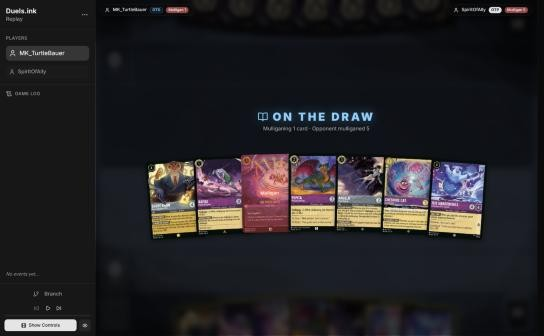
*The board before the decision: [step 0](https://duels.ink/replay/01a20294-b69d-7d34-9779-7c47d00b32f7?step=0) in the duels.ink replay viewer.*

**What you did:** on the draw, you kept six and sent back Un Poco Loco, which drew Merlin's Shop and Smithy.

**Verdict: fine; keeping all seven was as good.** The six make a curve on your first four turns: Rafiki, Pepita,
Cheshire Cat or Angela, then Isis or Shere Khan, with four inkable cards and two uninkable 4-drops. In the simulation
keeping seven and keeping six were the same (ink 9.98 and 9.89 of 10 over turns 1–4, a play on all four turns, 6 lore
by turn 4). Un Poco Loco is a mid-game card in this matchup: returned to hand, Isis and Shere Khan can be played again
for another exert or NEW INCENTIVE, and two characters damaged by Malicious or Don Karnage come back clean before
Phillip can banish them. Neither use comes before about turn 8, so sending it back for a random card cost little.

### Turn 2: your turn 1

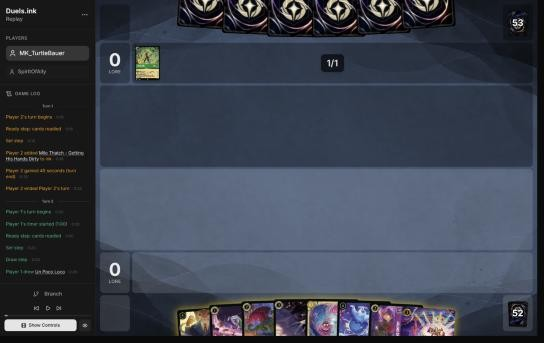
*The board before the decision: [step 5](https://duels.ink/replay/01a20294-b69d-7d34-9779-7c47d00b32f7?step=5) in the duels.ink replay viewer.*

**What you did:** drew Un Poco Loco back, inked it, and played Rafiki.

**Verdict: good.** Rafiki is the only 1-drop, and Un Poco Loco is the card the curve needs least: Pepita or the Shop,
then Cheshire Cat or Angela, then Isis or Shere Khan all stay in hand. They inked Milo Thatch on turn 1, a Circle of
Life card, so of the common lists it's most like Circle of Life from here.

### Turn 4: your turn 2

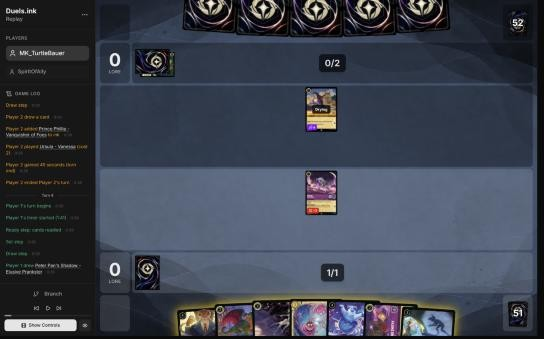
*The board before the decision: [step 11](https://duels.ink/replay/01a20294-b69d-7d34-9779-7c47d00b32f7?step=11) in the duels.ink replay viewer.*

**Setup.** 0–0. They inked Milo Thatch and Prince Phillip, and played **Ursula – Vanessa** (Singer 4): from next
turn she sings Malicious, Mean, and Scary or To Wither a Flower for free, and their 3 ink pays for the other. Both
together, about 9% by their turn (`odds.py both`), would kill every character of yours with 3 willpower or less.
Ursula is their only character, 1 {S}, so nothing of yours dies to a challenge (the brief's FREE KILLS: none).
You have 2 ink with an ink; three of your seven cards are uninkable (Shere Khan, Isis, Peter Pan's Shadow), so the
inkable four (Pepita, Angela, Cheshire Cat, the Shop) have to pay for the next turns too.

**Candidates:**
1. Ink Angela, play Pepita, quest Rafiki. Pepita (4 challenging) kills Ursula once she has sung, with Rafiki's 3 if
   needed.
2. Ink Angela, play the Shop, quest Rafiki. The Shop is safe from songs and Phillip, but a move costs 2 of your 3
   ink next turn.
3. Ink the Shop instead, keeping Angela, whose SHADOW POWER (Resist +2) can save one character from To Wither a
   Flower or a challenge.

The coach's pick was line 1: a 2-drop now, and the Shop for the long game.

**What you did:** inked the Shop, played Pepita, and kept Rafiki home.

**Verdict: inaccuracy, keeping Rafiki home.** Keeping Rafiki ready is suboptimal because it gave up a lore for
nothing: his challenge next turn doesn't need him ready now (he readies at your turn's start), and only Ursula could
punish the quest. Questing Rafiki is better because if Ursula challenged him (1 damage, nothing back), she'd give
up that turn's free song and her quest, and be exerted for Pepita to kill. Against Circle of Life, which quests
little before its sweep, the early lore is how you win: the decks that beat it had a lead when the sweep came
([pair notes](#cite-kb-meta-archetypes-amber-emerald-circle-of-life-more-routes-to-the-wipe)). A small edge: 1 lore,
against Rafiki taking a ping that only matters if Malicious follows. [QC-3](#cite-qc-3), [RULE-1](#cite-rule-1). Confidence: medium.

Inking the Shop over Angela was a close call. The Shop is the better long-game card here (lore and a card each turn
that no song or Phillip touches), and you hold three more in the deck. Angela's Resist +2 answers To Wither a Flower's
damage, though not Malicious's counters or Don Karnage's ping, which Resist can't reduce ([CR 8.8.3](#cite-cr-8-8-3)).

### Turn 5: their turn

**What happened:** they paid 2 for Strike a Good Match, discarded **Prince Phillip** with it, and inked Angel – Siren
Singer. Ursula stayed ready. The engine's first step is done: Phillip is in their discard, and Circle of Life can
play him free once their characters' costs total 8 to sing it (Ursula counts 4).

### Turn 6: your turn 3

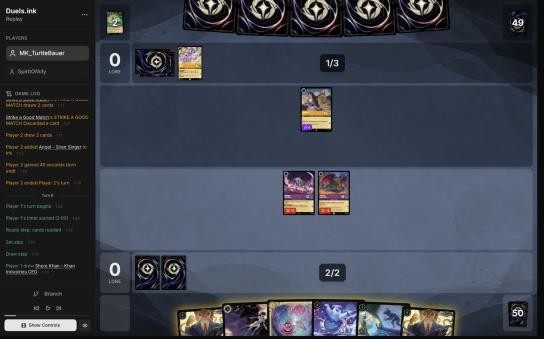
*The board before the decision: [step 18](https://duels.ink/replay/01a20294-b69d-7d34-9779-7c47d00b32f7?step=18) in the duels.ink replay viewer.*

**Setup.** 0–0. Ursula is their only character and the
centre of their next turns: she sings Malicious or To Wither a Flower for free (their 4 ink pays for the other), and
she's half the 8 Circle of Life needs to replay Phillip. She's ready, so she can't be challenged without an exert
first. You have 3 ink with an ink; Shere Khan (4) is out of reach.

**Candidates:**
1. Ink Angela, play Peter Pan's Shadow and exert Ursula with FAVORITE TRICK, then Pepita (2 + 2 = 4) challenges and
   banishes her, taking 1 back. Rafiki quests. Ink: Angela 0 + Shadow 3 = 3 of 3.
2. Play Cheshire Cat and quest both: 2 lore, Ursula untouched.
3. Ink Cheshire instead of Angela in line 1. Cheshire's 4 willpower survives Malicious and To Wither a Flower
   together, so he's the better card to keep; one of the two gets inked next turn anyway, as your other cards are
   uninkable (two Shere Khans, Isis).

What line 1 exposes: Pepita on 2 willpower and Rafiki on 2, both exerted, and Shadow drying, but they'd have no
character in play, so nothing can challenge (FREE KILLS: none). A Malicious, Mean, and Scary paid by ink still damages
all three for a later Phillip, and with To Wither a Flower too (both about 10%, and 7 of their 8 ink-turns' worth)
kills them, whatever you play.

**What you did:** line 1: inked Angela, Shadow exerted Ursula, Pepita banished her, and Rafiki quested.

**Verdict: good play.** Killing Ursula takes their free singer of both sweepers and half of Circle of Life's 8, so
the replayed Phillip now needs two new characters to land and dry first, and each song costs them ink. It spends
Shadow's exert at its best moment ([TEMPO-1](#cite-tempo-1), [QC-2](#cite-qc-2): challenge the threat), and the right card went to the inkwell.

### Turn 7: their turn

**What happened:** they inked **Circle of Life** and played **Ariel – Ethereal Voice** (4, 3/4/2, Boost 1; draws when
they play a song with a card under her). Ariel isn't in duels.ink's Circle of Life list; the pair notes saw her in
EggsTheKlexx's.

### Turn 8: your turn 4

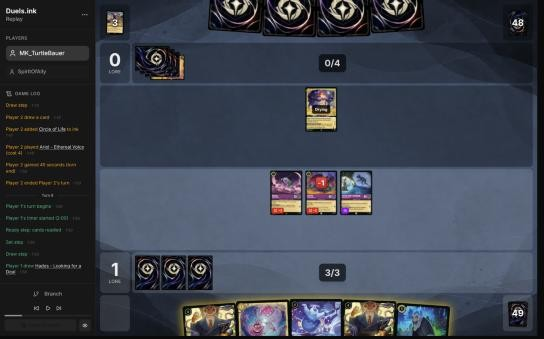
*The board before the decision: [step 28](https://duels.ink/replay/01a20294-b69d-7d34-9779-7c47d00b32f7?step=28) in the duels.ink replay viewer.*

**Setup.** 1–0. Ariel is now their engine and their singer: next turn she sings Malicious or To Wither a Flower free
(cost 4), quests for 2, and with a card under her draws on each song. She's ready, so she needs an exert or NEW
INCENTIVE. Circle of Life can't come next turn: Ariel's 4 is the only cost in play, and characters they play next
turn will be drying. Their 5 ink next turn reaches Chernabog. The brief's FREE KILLS: Ariel kills an exerted Rafiki or
Pepita and survives either, so leaving her alive makes every quest a gift. You have 4 ink with an ink, and only
Cheshire Cat and Hades are inkable.

**Candidates:**
1. Ink Cheshire or Hades, play **Shere Khan**, and give Pepita NEW INCENTIVE: Pepita (4) banishes the ready Ariel and
   dies to her 3 back, and CORNER THE MARKET gives you an ink drop, so next turn has 6. Rafiki and Shadow quest.
   Ink: 4 of 4.
2. The same with **Isis**: CHILL OUT exerts Ariel, Pepita banishes her and dies. No ink drop, but Isis's 4 willpower
   survives Malicious and To Wither a Flower together, where Shere Khan's 2 doesn't, and both Shere Khans stay in hand.
3. Play Cheshire and quest all three: Ariel then kills Rafiki or Pepita for free (FREE KILLS) and keeps singing.

What lines 1 and 2 expose: Rafiki and Shadow exerted, Shere Khan or Isis drying, against an empty board: nothing can
challenge next turn. Only a sweep reaches them: Malicious (by ink) and To Wither a Flower (4 more, so not both on 5 ink
without a singer) or a Chernabog shuffle. The coach's pick was line 1, for the extra ink, with line 2 close.

**What you did:** line 1: inked Cheshire Cat, played Shere Khan, Pepita banished Ariel (both died), the ink drop came,
and Rafiki and Shadow quested.

**Verdict: good play.** Pepita (2) for Ariel (4) is a good trade ([TRADE-1](#cite-trade-1)), it removes their only singer and engine
for the second turn running ([QC-2](#cite-qc-2)), and the ink drop makes next turn 6 ink. Inking Cheshire over Hades was a close
call: Hades draws two (or takes a character of theirs off the board) next turn with the drop to spare, while Cheshire
could have moved Malicious's counters off your characters before a Phillip.

### Turn 9: their turn

**What happened:** they inked a second Milo Thatch and played **Alan-a-Dale – Loyal Bard** (2, 3/2/1, Singer 4), using
2 of their 5 ink. That's their third singer in three turns.

### Turn 10: your turn 5

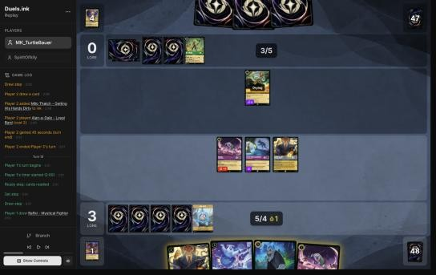
*The board before the decision: [step 38](https://duels.ink/replay/01a20294-b69d-7d34-9779-7c47d00b32f7?step=38) in the duels.ink replay viewer.*

**Setup.** 3–0. Alan-a-Dale is the must-kill: next turn he sings Malicious or To Wither a Flower free, and with their
6 ink paying for the other (or for Don Karnage – Debonair Pirate, whose 1 damage Resist can't stop), every character
of yours with 3 willpower or less dies. Without him, 6 ink pays for only one of them. Circle of Life still can't come
next turn: Alan's 4 is the only cost they'd have in play. He's ready, and his 3 {S} kills any of your characters that
challenges him. FREE KILLS if you leave them exerted: Rafiki (Alan alone). You have 6 ink with an ink, plus 1 ink drop.

**Candidates:**
1. Ink Rafiki from hand, play the second **Shere Khan**, and give the Rafiki in play NEW INCENTIVE: Rafiki (0 + 3)
   banishes Alan and dies to his 3 back. Both Shere Khans' CORNER THE MARKET trigger, each checking its own "once"
   ([CR 6.1.13.2](#cite-cr-6-1-13-2)), so that's 2 ink drops. Shadow and the first Shere Khan quest. Ink: Shere 4 of 7.
2. The same kill with **Isis**'s CHILL OUT on Alan, then Rafiki's challenge: one drop, and the second Shere Khan stays
   in hand.
3. **Hades** on Alan: they bottom him, or you draw 2. They choose, and he may stay.

After line 1, what's left: Isis and Hades, whose on-play effects both need a target, and ink drops, which last until
used ([CR 1.13.1.2](#cite-cr-1-13-1-2)). Playing Isis now would waste CHILL OUT on an empty board. What it exposes: Shadow (Evasive) and
Shere Khan exerted, Shere Khan #2 drying, against an empty board, so nothing challenges (FREE KILLS: none once Alan
is dead). Their 6 ink can still cast Don Karnage (1 damage to each) or Malicious, which would leave your Shere Khans on
1 willpower for a later Phillip.

**What you did:** line 1. Rafiki banished Alan, the two Shere Khans gave two drops (3 banked), and Shadow and Shere
Khan quested; Isis and Hades stayed in hand.

**Verdict: good play.** It kills the third singer in a row with your cheapest character, turns it into two ink
drops, and holds the two cards whose effects need a target ([SEQ-4](#cite-seq-4), [TEMPO-2](#cite-tempo-2)). Leaving 2 ink unspent costs nothing here,
since the drops carry over and next turn has 10 ([H-2](#cite-h-2)).

### Turn 11: their turn

**What happened:** **Max Goof – Karaoke Star** (discarding Mother Knows Best, off-list, to draw 2), **Ancestral
Guitar** (off-list; draws on play; FROM THE HEART: {E} and 1 ink, a character gains Singer and +2 cost to sing that
turn), and Strike a Good Match inked. Two songs are in their discard; Max Goof gets +3 {L} at five.

### Turn 12: your turn 6

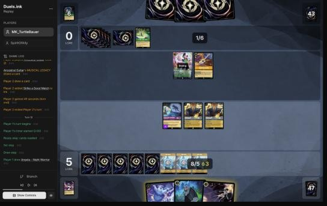
*The board before the decision: [step 52](https://duels.ink/replay/01a20294-b69d-7d34-9779-7c47d00b32f7?step=52) in the duels.ink replay viewer.*

**Setup.** 5–0. Max Goof is the fourth singer to kill: with the Guitar he sings songs up to cost 5, he's the base for
Max Goof – Chart Topper (Shift 4, which then challenges at once with 4), and later a 4-lore quester. Their 7 ink next
turn can't replay Phillip (Circle of Life needs 8 of costs in play, they have Max's 5 with the Guitar; Phillip by ink
needs 9). Their two-card sweeps (Malicious sung by Max plus To Wither a Flower, or Don Karnage plus a Wither the
Guitar lets Max sing) are each 3–6% (`odds.py both`); either kills everything of yours with 3 willpower or less, and
Isis and Hades survive both. You have 8 ink (3 of it drops), 9 with an ink, and Hades, Isis and Angela in hand.

**Candidates:**
1. **Hades first, choosing Max Goof:** they bottom him, or you draw 2. Then **Isis** exerts Max (if he's still there)
   and a Shere Khan banishes him (4 against 3 willpower), taking 1, and the other Shere Khan's CORNER THE MARKET gives
   a drop. Ink: Hades 5 + Isis 4 = 9 of 9, with an ink after Hades's draw. Shadow and the other Shere Khan quest.
2. Isis and the kill first, then Hades has no target: no draw.
3. Isis and Angela, holding Hades: the kill without the cards.

Line 1 leaves their board empty again, so nothing of theirs can challenge (FREE KILLS: none); Isis and Hades, drying,
are the two characters that survive their two-card sweeps.

**What you did:** line 1. They let you draw 2 (Junior Woodchuck Guidebook and Tinker Bell – Curious Fairy), you
inked the Tinker Bell, Isis exerted Max, Shere Khan banished him and the drop came, and Shadow and the other Shere
Khan quested to 7.

**Verdict: good play.** Hades before Isis made their choice a loss either way, and playing Hades before inking let
you ink a card from its draw and keep Angela ([SEQ-1](#cite-seq-1)). The fourth singer died the turn after it landed ([QC-2](#cite-qc-2)).

### Turn 13: their turn

**What happened:** they inked a third Prince Phillip and hard-cast **Max Goof – Chart Topper** (6, 4/5/2; NUMBER ONE
HIT: each quest plays a song of cost 4 or less from their discard free). Mother Knows Best and Strike a Good Match are
in their discard for him.

### Turn 14: your turn 7

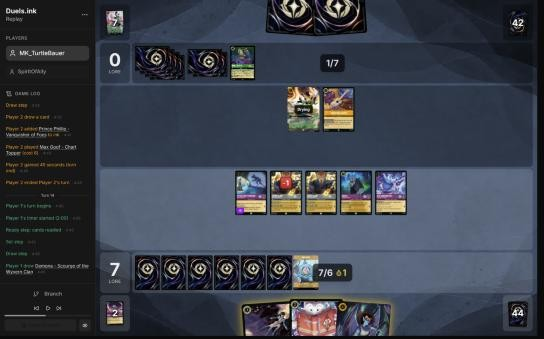
*The board before the decision: [step 65](https://duels.ink/replay/01a20294-b69d-7d34-9779-7c47d00b32f7?step=65) in the duels.ink replay viewer.*

**Setup.** 7–0. Chart Topper is the most dangerous card they've played:
- **He kills a quester a turn.** FREE KILLS: both Shere Khans, Hades and Isis if they quest, each for nothing.
  Only Shadow is safe, being Evasive.
- **He replays a song on each quest.** Mother Knows Best returns one of yours to hand.
- **He brings Phillip back next turn.** He's cost 6, and the Guitar's +2 makes 8: alone, he can sing **Circle of
  Life** to replay Phillip. With Malicious first (3 of their 8 ink), Phillip would banish your whole board. Shere
  Khan's 1 damage is already enough for Phillip to banish him.

He's ready, so he needs an exert, and only **Demona – Scourge** can give one. Every challenger of yours dies to his 4
back. The cheapest kill takes two: the damaged Shere Khan (4, on 1 willpower and Phillip's first victim anyway) and
one more. Demona's refill draws each player up to 3, so emptying your hand first draws you more. Their 8 ink also
reaches Raging Storm, an Amber staple their lists don't run.

**Candidates:**
1. Ink Angela, play the Guidebook (hand: Demona only), then Demona: exert Chart Topper, and draw 3 into an empty
   hand. They draw 1. The damaged Shere Khan and Shadow (4 + 2) kill him. The other Shere Khan's CORNER THE MARKET
   gives a drop. Isis, Hades and the other Shere Khan quest. Ink: Guidebook 2 + Demona 6 = 8 of 8, and the drop can
   pay for the Guidebook's draw 2.
2. Ink the Guidebook instead, and play Demona and then Angela with the drop. SHADOW POWER (Challenger +2, Resist +2)
   would let Isis kill Chart Topper alone and survive, but the ink is 6 + 3 = 9 of 8 before the drop. The drop needs a
   kill first, and the kill needs the exert first: Demona, a challenge, then Angela. Fewer cards drawn.
3. Keep everything ready and quest only Shadow. Chart Topper then quests, replays a song, and can sing Circle of Life.

Line 1 leaves their board empty, so nothing challenges your questers. Their best reply is Phillip by Circle of Life
paid in ink (8), which banishes only damaged characters, and none of yours would be.

**What you did:** line 1, with Hades and the damaged Shere Khan as the challengers. Demona drew you Demona, Un Poco
Loco and Tinker Bell – Curious Fairy. You kept the Guidebook and the drop for later, and Shadow, Shere Khan and Isis
quested to 10.

**Verdict: good play.** It kills their engine and the turn's Phillip threat, and draws three. Playing the Guidebook
before Demona to empty your hand was the detail that made the refill worth 3 ([H-1](#cite-h-1)). Using Hades rather than Shadow as
the second challenger was a close call. Hades's 4 willpower would survive Malicious and To Wither a Flower together;
Shadow's Evasive matters less with their board empty, but a returning Phillip is Evasive too.

### Turn 15: their turn

**What happened:** Akood et Emuti (paid), **Tod – Clever Fox** for 1 (discarding Milo Thatch, a new Circle of Life
target), and **Meilin Lee – Losing Control**, whose look revealed **Circle of Life** into their hand. They inked Ursula
– Vanessa.

### Turn 16: your turn 8

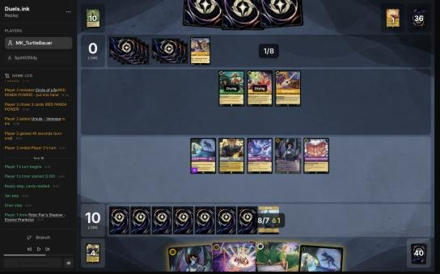
*The board before the decision: [step 82](https://duels.ink/replay/01a20294-b69d-7d34-9779-7c47d00b32f7?step=82) in the duels.ink replay viewer.*

**Setup.**
- **Lore:** 10–0. Your board quests for 5, so two more questing turns win.
- **Their wipe is one card away:**
  - **Circle of Life is known in their hand.**
  - **Next turn they can sing it free:** Tod (3), Meilin Lee (3) and the Guitar's +2 make Sing Together 8, and
    Phillip, Milo and Chart Topper are all in their discard.
  - **Their 9 ink pays for the rest:** Malicious (3) or Don Karnage (6) first, then Phillip banishes your whole board.
  - **The odds:** one of those two damage cards is about 51% by their turn, or 77% with their dig (`odds.py dig`).
  - **Without one,** Phillip still lands as a 6/6/3 Evasive.
- **Killing only one of Tod or Meilin isn't enough:** the survivor sings Malicious free, and 8 ink pays for Circle of
  Life. **Killing both is:** their 9 ink then can't pay for Circle (8) and Malicious (3) together.
- **Both are ready**, so each needs an exert. FREE KILLS: none.
- **Your hand:** Demona #2, Un Poco Loco, Tinker Bell – Curious Fairy, a second Shadow. You have 9 ink with an ink,
  counting the drop.
- **Demona's STONE BY DAY:** your first Demona won't ready while you hold 3 or more cards.

**Candidates:**
1. **Demona #2's exert-all:** Shadow kills Tod, Isis kills Meilin, and the drop comes. Shere Khan and the first
   Demona quest to 13, and the rest of the ink goes on bodies. Ink: Demona 6 + Shadow #2 3 = 9 of 10 with the drop.
   You'd keep no exert for their next threat, and Shadow and Isis end damaged, so a replayed Phillip banishes them.
2. **Max lore:** quest all four to 15 and let them try the wipe, at about 77%.
3. **Kill one singer** with the second Shadow's FAVORITE TRICK: the wipe stays live through Malicious.

The coach's pick was line 1: deny the combo, with no wipe possible next turn bar a card their lists don't run (Raging
Storm), at 13 lore against 0.

**What you did:**
1. Quested Isis to 11.
2. Sang Un Poco Loco with the Shadow in play, returning that Shadow and the exerted Isis to your hand.
3. Replayed Isis (CHILL OUT on Meilin) and the Shadow (FAVORITE TRICK on Tod).
4. Shere Khan killed Tod and the first Demona killed Meilin, giving a drop.
5. Played the second Shadow with the drops.

That's Isis 4 + Shadow 3 + Shadow 3 = 10 of 10, and the second Demona stayed in hand.

**Verdict: good play, better than the coach's plan.** Un Poco Loco re-used two on-play exerts:
- **Isis quested first,** so the 1 lore was banked before she came back.
- **Both singers died without spending Demona #2.** She's in hand for their rebuild: a replayed Chart Topper or
  Milo will be ready on your turn and need an exert.
- **One card in hand,** so the first Demona readies next turn.

The coach's line had 2 more lore (13 to 11) but no exert left. Shere Khan (1 damage) and Demona (2) are now what a
Phillip replayed for 8 ink would banish. Either way their wipe is off for a turn ([POS-1](#cite-pos-1): deny their win condition from
ahead).

The coach named this use of Un Poco Loco in the pre-game verdict, and the knowledge base records it from your game
against 13Febpy, where it returned Isis ([ruling](#cite-kb-rules-rulings-a-character-returned-to-hand-takes-the-cards-under-it-boosted-cards-included)).
The brief listed that note on this turn, yet the plan still left the play out (see "The coach's errors").

### Turn 17: their turn

**What happened:** Strike a Good Match (discarding a second Tod) and a second **Max Goof – Chart Topper**, hard-cast
for 6. They didn't ink, and Circle of Life stayed in their hand.

### Turn 18: your turn 9

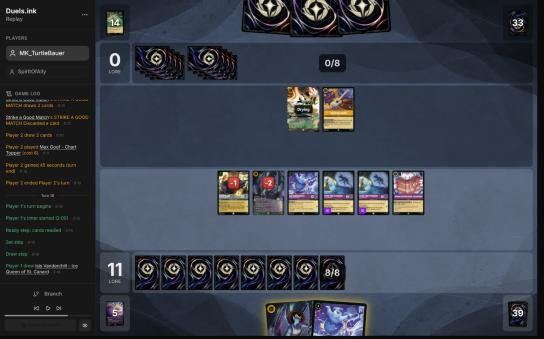
*The board before the decision: [step 100](https://duels.ink/replay/01a20294-b69d-7d34-9779-7c47d00b32f7?step=100) in the duels.ink replay viewer.*

**Setup.**
- **Lore:** 11–0, and your board quests for 6.
- **The second Chart Topper repeats turn 14's problem.** With the Guitar he sings Circle of Life alone next turn, and
  Circle of Life is known in their hand. With Malicious or Don Karnage first, about 44% by their draw before any dig,
  Phillip would banish your whole board. Chart Topper's quest also replays a song from their discard: Strike a Good
  Match digs for Malicious, and Mother Knows Best returns one of yours to hand.
- **What Chart Topper can kill:** FREE KILLS lists Shere Khan and Isis if they quest. Demona, on 4 willpower, would
  trade with him.
- **Your Phillip targets:** Shere Khan (1 damage) and Demona (2) are what a Phillip would banish even without a
  damage card.
- **Your resources:** 8 ink, the Guidebook's draw 2 (1 ink), and Isis and Demona in hand.

**Candidates:**
1. **Use the Guidebook first** ([SEQ-1](#cite-seq-1)), then kill Chart Topper.
   - Isis #2 (4) exerts him, and the damaged Demona (5 against his 5) banishes him and dies. That's a Phillip target
     spent on their engine, and the drop comes.
   - Shere Khan, Isis and the two Shadows quest to 15.
   - Ink: 1 + 4 = 5 of 8.
2. **Race:** quest all five to 17 and hold Isis and Demona as the rebuild. If they have no damage card, you win next
   turn. If they wipe, you're at 17 with two characters in hand against their Phillip.
3. **Demona #2** for the exert-all, with the same kill. Her refill (2 into a 1-card hand) puts you at 3 cards, so
   STONE BY DAY keeps her exerted once she quests.

The coach's pick was line 1: their wipe is off again for a turn, and their only line is Phillip by ink, which costs
all 8 and banishes only Shere Khan. Line 2 is close: you're far enough ahead that even a wipe leaves you favoured.

**What you did:** line 1, improved by the dig.
1. The Guidebook drew Shere Khan and a second Guidebook.
2. **Shere Khan's NEW INCENTIVE** let the damaged Demona challenge the ready Chart Topper, so no exert was needed.
   Both died, and two CORNER THE MARKET drops came.
3. You played the second Guidebook and quested Shere Khan, Isis and both Shadows to 15.
4. Isis #2 and Demona #2 stayed in hand. Ink: 1 + 4 + 2 = 7 of 8, with 2 drops banked.

**Verdict: good play.** Digging first found a cheaper kill: Shere Khan instead of Isis, with two drops instead of
one. The challenger was the character a Phillip would have banished anyway, and both exerts stayed in hand for their
next rebuild. The fifth engine piece in a row died the turn after it landed ([QC-2](#cite-qc-2), [SEQ-1](#cite-seq-1)).

### Turn 19: their turn

**What happened:** they played Tod again (discarding Max Goof – Karaoke Star) and Meilin Lee again, whose look found
**Malicious, Mean, and Scary**. They cast it for 3: the damaged Shere Khan died, and every other character of yours
took a counter. Circle of Life is still in their hand.

### Turn 20: your turn 10

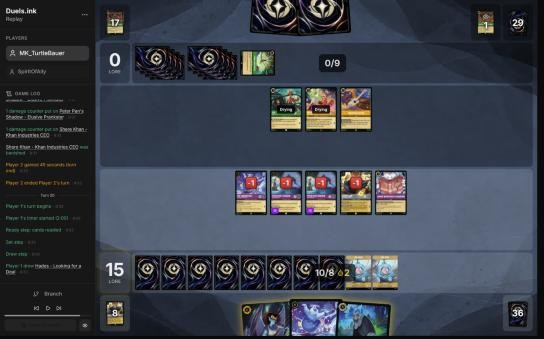
*The board before the decision: [step 119](https://duels.ink/replay/01a20294-b69d-7d34-9779-7c47d00b32f7?step=119) in the duels.ink replay viewer.*

**Setup.**
- **Lore:** 15–0, and you need 5. Your four questers (Isis, two Shadows, Shere Khan) make 19.
- **Every one of your characters is damaged.** Next turn Circle of Life (known) replays Phillip and banishes them
  all.
- **Their ways to replay him:**
  - **Sung free** by Tod, Meilin and the Guitar.
  - **Paid for**, since they have 10 ink, so killing the singers no longer stops Phillip.
- **What killing the singers does buy:** with Circle of Life paid in ink, only 2 is left, too little for a second
  Malicious. So any undamaged character you add this turn survives. With the singers alive, a second Malicious (about
  19% by their draw) sung first would let Phillip take those too.
- **Resources:**
  - 10 ink (2 of it drops), 11 with an ink.
  - The Guidebook (1 ink, draw 2), and Hades's draw 2 (5 ink; they may bottom a character instead).
  - Isis and Demona in hand.
- **A Merlin's Shop wins this turn:** a character can move there after questing, since a move has no ready
  requirement ([CR 4.7.3](#cite-cr-4-7-3)), for the 20th lore. There are 3 in your 36 cards. Of four cards seen (Guidebook and Hades),
  about 31% would include one (`odds.py hold`).

**Candidates:**
1. **Dig for the win.**
   - The Guidebook, then Hades on Tod or Meilin. A Shop for 2 and a move for 2 then make 20. Ink: 1 + 5 + 2 + 2 = 10
     of 11.
   - **Without a Shop,** quest to 19 and play Isis #2 as an undamaged body.
   - **What it risks:** the singers stay alive unless they bottom one. A sung Circle of Life after a second Malicious
     would then wipe everything, leaving you at 19 with an empty board.
2. **Deny the wipe.**
   - Isis #2 exerts Meilin and Demona #2 exerts Tod. Inking Hades empties your hand, so Demona's refill draws 3. Your
     damaged Isis and Shere Khan kill the two singers.
   - Spend the rest on undamaged bodies. The Shadows quest to 17.
   - Ink: 4 + 6 = 10 of 11.
   - Next turn three undamaged characters need only 3 lore between them.
3. **Quest all four to 19** and add undamaged bodies, without the kills.

The coach's pick was line 1, for the chance to win at once.

**What you did:** line 2.
1. Inked Hades; Isis #2 exerted Meilin and Demona #2 exerted Tod.
2. Demona's refill drew Pepita, Violet Parr – Force Field Practice and Tinker Bell into an empty hand.
3. The damaged Isis killed Tod (a drop came), and Shere Khan traded with Meilin.
4. Violet Parr came down with the drops, and the two Shadows quested to 17.

That leaves three undamaged characters (Isis #2, Demona #2, Violet Parr) that quest for 4 next turn.

**Verdict: good play, better than the coach's plan.** Line 1 wins at once about a quarter of the time. Otherwise it leaves you open to a full wipe
from the live singers, though even then you'd be at 19 against 0. Line 2 gives up the immediate win and leaves them
almost no way to stop next turn's: their Phillip can't touch an undamaged character, and 10 ink can't pay for Circle
of Life and another damage card together. Only Raging Storm, which their lists don't run, would. From this far ahead,
the safest path is right ([POS-1](#cite-pos-1)). Emptying your hand before Demona again turned her refill into three cards.

### Turn 21: their turn

**What happened:** they paid 8 for Circle of Life, replaying Prince Phillip, whose SWIFT AND SURE banished your three
damaged characters (the first Isis and both Shadows). Isis #2, Demona #2 and Violet Parr, undamaged, stayed, and
quested for 4 next turn against your 3 needed. They used the Guitar on Phillip, then conceded.

## Lessons
1. **Against Circle of Life, the singers are the combo** ([RULE-9](#cite-rule-9)).
   - Sing Together 8 counts only characters that are dry in play when they sing. A singer killed on your turn takes
     its cost out of next turn's total, and anything they play that turn is drying.
   - Killing them one turn after another kept Circle of Life to "pay 8 ink". Paying for it leaves no ink for the damage
     card Phillip needs.
   - Here: Ursula, Ariel, Alan-a-Dale, Max Goof, two Chart Toppers, and Tod and Meilin twice.
2. **This deck's removal is an exert, then a challenge.**
   - **The exerts:** Isis's CHILL OUT, Peter Pan's Shadow's FAVORITE TRICK and Demona's exert-all.
   - **NEW INCENTIVE** does the same job, and with two Shere Khans in play each kill made 2 ink drops ([CR 6.1.13.2](#cite-cr-6-1-13-2):
     each ability checks its own "once").
3. **Un Poco Loco re-uses on-play effects:** quest first, then return the character and replay it for its effect
   again ([16](#turn-16)). Singing it with a 3-cost character costs no ink.
4. **Empty your hand before Demona – Scourge** ([14](#turn-14), [20](#turn-20)). Her refill draws you up to 3, so each
   card played or inked first is a card more ([H-1](#cite-h-1)).
5. **Dig before you commit** ([18](#turn-18)). The Guidebook found Shere Khan, a cheaper kill than the Isis the coach
   planned ([SEQ-1](#cite-seq-1)).
6. **Quest a cheap character when nothing can punish it** ([4](#turn-4)). Against a deck that waits for its sweep,
   early lore is the lead you need when it comes.

## Proposed knowledge-base updates (applied after discussion)
- **Strategy:** evidence for [RULE-9](#cite-rule-9) (free singers) from Sing Together. Killing each singer the turn after it landed
  kept Circle of Life from being sung for 15 turns, and the paid one on turn 21 left no ink for a damage card. Proposed
  as evidence on [RULE-9](#cite-rule-9), not a new hypothesis.
- **Meta, Amber/Emerald notes:**
  - **SpiritOfAlly's Circle of Life:**
    - off-list cards: Ariel – Ethereal Voice, Ancestral Guitar, Mother Knows Best;
    - two Chart Toppers, hard-cast;
    - three Prince Phillips (two inked) and three Milo Thatches (two inked).
  - **The Guitar's FROM THE HEART:** it lets Chart Topper sing Circle of Life alone (6 + 2), and Tod and Meilin
    together (3 + 3 + 2).
  - **They mulliganed 5** and scored 0 lore.
- **Meta, Amethyst/Steel notes:** MK_TurtleBauer's list and how it beat Circle of Life: lessons 1–4.
- **Rules:** a ruling that two Shere Khans' CORNER THE MARKET both trigger on one banish ([CR 6.1.13.2](#cite-cr-6-1-13-2); seen on turns 10
  and 18).
- **Meta index:** a row for this game.

## Hindsight
Doesn't change the verdicts above.
- Their wipe did come, a turn late. Malicious arrived through Meilin Lee on turn 19, and Circle of Life on 21. Paying 8
  for Circle left 2 ink, too little for another damage card, so the three undamaged characters you added on turn 20
  survived.
- The four `9-P3-11` cards never appeared, so the review's guess that they are Tinker Bell – Giant Fairy is untested.
- Raging Storm, the Amber staple their lists leave out, never appeared either.

## The coach's errors
Filled in during discussion.

| When | Error | How it was caught | How it won't happen again |
|---|---|---|---|
| Turn 16, the plan | Left Un Poco Loco's re-use of Isis's and Shadow's on-play exerts out of the candidates, though the pre-game verdict named it, the knowledge base records it from MK_TurtleBauer's game against 13Febpy (Un Poco Loco returning Isis), and the brief listed that ruling on this turn. It's the second time in this player's games (01a1fecf-eeef turn 18) | The player's line, read after the plan | Made 22 Nov 2026 (not yet committed): with a card in hand that returns your characters (Un Poco Loco, Mother Knows Best), the brief prints a "REPLAY ON-PLAY EFFECTS" line under your options. It lists your characters in play whose on-play effect a replay repeats, or whose Boosted cards come back with them, with the ink to replay each and how the card can be paid or sung. The method and the review procedure require a candidate that uses it, or a reason why not. On this turn it lists Shadow, Shere Khan, Isis and Demona; on 01a1fecf-eeef turn 18, Cheshire Cat (2 cards under him), Hades, Isis and Shere Khan |
| Turn 20, the plan | Preferred digging for a Shop to win at once (about a quarter) over killing both singers. Killing them was the line that left them no way to wipe the new characters | The player's line, read after the plan | Proposed, for discussion: in the turn setup, when their known card (Circle of Life) makes a wipe likely next turn, list the lines that leave it impossible, before the lines that win sooner |

## Open questions
- **Turn 4:** was keeping Rafiki home deliberate, and if so, what was it for?
- **Turn 16:** was Un Poco Loco the plan from the turn's start, and did you weigh Demona #2's exert-all instead?
- **Turn 20:** did you consider the Guidebook and Hades to dig for a Shop and win that turn?
- **The four `9-P3-11` cards:** which card is that? The coach guessed Tinker Bell – Giant Fairy.

## Citations
Copies of the coach's knowledge base cited above, as they stood when they were cited (the private repository's commit and date are given with each). They don't change when the knowledge base does.

<!-- Filled in by `python3 tools/cite.py <this file>`: every principle ID, H-n, "principle N" and CR rule above
becomes a link to an entry here. Add a file or one of its sections with `--file PATH --section TEXT`, and link to
the anchor it prints. Never link into the private repository. -->

**amber-emerald.md, The engine: discard Phillip, then replay him**: knowledge base, `kb/meta/archetypes/amber-emerald.md` at `832c332` (2026-11-22), working tree

> ### The engine: discard Phillip, then replay him `[coach + user, one game]`
> 1. **Put Prince Phillip – Vanquisher of Foes (9) in the discard.** Tod – Clever Fox (draw 2, discard 1), Max Goof –
>    Karaoke Star (discard a song, draw 2) and Strike a Good Match (draw 2, discard 1) all do it. In 01a13b88 Tod
>    discarded him on turn 5.
> 2. **Damage your board:** Malicious, Mean, and Scary puts 1 damage on each of your characters; so does Don Karnage
>    – Debonair Pirate when played (6, or 4 by Shift onto Don Karnage – Khan's Courier). A character already damaged,
>    or exerted (so it can be challenged), doesn't need this step.
> 3. **Circle of Life** (song 8, Sing Together 8): "Play a character from your discard for free." Phillip's SWIFT AND
>    SURE then banishes every damaged character you have.
>
> - **When it can come:** as soon as Phillip is in the discard, their characters total 8 for Sing Together, and they
>   can pay 3 for Malicious or sing it.
>   - Singer counts toward Sing Together (`kb/rules/rulings.md`). Angel – Siren Singer (Singer 3) ×2 plus Tod made 9
>     on turn 9, at 5 ink. Two Ursula – Vanessa (Singer 4) make 8 alone.
>   - It happened twice in 01a13b88: turn 9 (four characters) and turn 19 (five).
> - **How likely the wipe is next turn** `[coach + user, 01a13b88 turn 18, revisited 2026-11-01]`: count the damage
>   cards together (Malicious and Don Karnage, plus Max Goof – Rebellious Teen, which takes Malicious back from their
>   discard), then add their dig. Meilin Lee (top 4, takes a song, so finds Malicious and Circle of Life), Tod, Strike
>   a Good Match, Max Goof – Karaoke Star and Akood et Emuti all let them see more cards first, and Akood also makes Don
>   Karnage cost 4. On 01a13b88 turn 18 that was about 43%, against 17% for Malicious in their hand and draw alone
>   (`kb/cards/board-damage.md`).
> - **What to do:**
>   - **Watch their discard for Phillip and count their singing total.** The decision brief shows both.
>   - The turn before, keep characters ready and undamaged where possible, and don't add more than you need.
>   - Hold the answer to the returning Phillip (6/6/3, Evasive). Wasabi's TWIN BLADES, boosted by Mulan – Martial Arts
>     Master's +2 {S}, deals 6 to him without challenging him.
> - **Known cards:** Meilin Lee – Losing Control's RED PANDA POWER reveals a song or Red Panda into their hand. On turn
>   17 it revealed Circle of Life, so it was a known card from then on.

**amber-emerald.md, Circle of Life: more routes to the wipe**: knowledge base, `kb/meta/archetypes/amber-emerald.md` at `832c332` (2026-11-22), working tree

> ### Circle of Life: more routes to the wipe `[coach, meta study of the user's 27 Oct 2026 games (tools/scan.py), full games, not blind, 4 games]`
> Games: 01a17df1, 01a17e1c, 01a17ebf, 01a17f17.
> - **Other damage sources before Phillip:**
>   - Don Karnage – Debonair Pirate (6, Shift 4; 1 damage to each opposing character, which Resist can't reduce)
>   - challenges that finish off pinged characters (01a17e1c turn 10: Malicious, Mean, and Scary sung by Tod, then Angel
>     and Ursula – Vanessa challenged the damaged ones)
> - **Two ways to Phillip:**
>   - **Replayed with Circle of Life.** 01a17df1 turn 10, their 5th turn: Akood et Emuti made Don Karnage cost 4 instead
>     of 6; Ancestral Guitar (FROM THE HEART: a character gains Singer and +2 cost to sing) let Ursula – Vanessa and
>     Angel reach Sing Together 8. Three characters banished.
>   - **Hard-cast for 7** after Akood et Emuti's discount: 01a17ebf turn 14, after Malicious, Mean, and Scary. Five
>     banished.
> - **Enablers:**
>   - Akood et Emuti (song 3: draw a card, next character costs 2 less)
>   - Strike a Good Match (draw 2, discard 1; how Phillip reaches the discard)
>   - Max Goof – Rebellious Teen (pay 1 to return a song of cost 3 or less from the discard)
>   - Meilin Lee (searches a song)
>   - Chernabog (shuffles one of your characters into your deck)
>   - Lenny (you discard an action)
> - **Tempo:** they quested very little before the wipe. They had 0 lore on turn 10 in 01a17df1 and 01a17e1c, and 0 on
>   turn 14 in 01a17ebf while you had 14. A big lore lead before the wipe, plus a rebuild in hand, is how those games
>   went your way.

**rulings.md, A character returned to hand takes the cards under it, Boosted cards included**: knowledge base, `kb/rules/rulings.md` at `832c332` (2026-11-22), working tree

> ### A character returned to hand takes the cards under it, Boosted cards included
> - **Situation:** Un Poco Loco ("Choose 2 characters of yours. If one of them is cost 3 or less, return both to your
>   hand.") on Cheshire Cat – Inexplicable with cards Boosted under him (Boost 2: "put the top card of your deck facedown
>   under this character"). The same holds for any return-to-hand effect, and for a Shift stack.
> - **Ruling:** the cards under him go to your hand with him, so the return draws the Boosted cards. Cheshire also comes
>   back with no damage, and can be replayed and Boosted again. Nobody, you included, can look at facedown cards under
>   a character while they're there, so what comes back is a random draw.
> - **Basis:** CR 5.1.1.7 (if the top card in a stack leaves play, all cards in the stack move to the same zone; the
>   2.3.0 changes added that they take its state there), 8.4.1–8.4.3 (Boost), 5.1.1.5 (no one can look at facedown
>   cards under a card), 1.9.6 (leaving play removes damage).
> - **Confidence:** derived from CR and confirmed by duels.ink's engine (replay 01a1fecf-eeef, frame 104: Un Poco Loco
>   returned Cheshire and Isis, and the two Boosted cards, Angela and a Junior Woodchuck Guidebook, reached the hand).
>   Not an official ruling.
> - **Added:** 2026-11-21, from the review of 01a1fecf-eeef (MK_TurtleBauer vs 13Febpy), turn 18, where the coach's plan
>   had Un Poco Loco as dead and the player found the line.

**amethyst-steel.md, Midrange (a variant): danny's Amethyst/Steel list**: knowledge base, `kb/meta/archetypes/amethyst-steel.md` at `832c332` (2026-11-22), working tree

> ### Midrange (a variant): danny's Amethyst/Steel list `[coach, meta study of danny's 5 Nov 2026 games (tools/scan.py), full games, not blind, 11 games]`
> `01a1ab88-3bdd` to `01a1abdf-f6ab`; danny won 6 of the 11. The classifier calls it Midrange (91%); not in duels.ink's
> list: Christopher Robin, Isis Vanderchill, Owen Burnett and Tigger.
> - **The list (×4 each):** Rafiki – Mystical Fighter, Tinker Bell – Curious Fairy, Christopher Robin – Joining the Fun,
>   Pepita, Toulouse – Rough and Tumble, Junior Woodchuck Guidebook, Owen Burnett – Xanatos's Assistant (returns a card
>   costing 2 or less to its player's hand), Peter Pan's Shadow, Strength of a Raging Fire, Isis Vanderchill (CHILL OUT:
>   exert a chosen opposing character), Shere Khan – Khan Industries CEO, Tigger – Bouncing All the Way, Hades – Looking
>   for a Deal, Demona – Scourge, Tinker Bell – Giant Fairy.
> - **Its big turns:** Tinker Bell – Giant Fairy Shifted onto Curious Fairy (ROCK THE BOAT: 1 damage to each opposing
>   character), then Strength of a Raging Fire and challenges, with PUNY PIRATE! adding 2 damage after a kill: five kills
>   (`01a1abc4-9219` turn 14). Two Isis CHILL OUTs for Hades and Scourge to challenge (`01a1ab8a-61dc` turn 13). Shere
>   Khan's CORNER THE MARKET gave an ink drop for a kill (`01a1abdf-f6ab` turn 11).
> - **What beat it:** its cheap 2- and 3-willpower bodies. Malicious, Mean, and Scary then To Wither a Flower killed three
>   or four on game turn 7, twice (Emerald/Ruby `01a1ab91-0bb5`, Circle of Life `01a1abbd-d461`), and The Leviathan took
>   three (`01a1abae-ba7c` turn 14). Shere Khan's 2 willpower falls to any 2-damage ping: David Xanatos's MINOR
>   INCONVENIENCE (`01a1ab8a-61dc` turn 12), Angel's GOOD AIM (`01a1ab97-d698` turn 17). Mouse House's Duo out-quested
>   it (`01a1abb8-c327`, 7–20).

**QC-3**: strategy principle, `kb/strategy/principles.md` at `832c332` (2026-11-22), working tree

> - **QC-3. Questing is favoured when:**
>   - you control the board
>   - your exerted characters can't be punished
>   - the race favours you
>   - removing their characters gains little
>
>   **Challenging is favoured when:**
>   - they have an engine or repeated-value piece
>   - the trade is efficient
>   - you need to slow the game
>   - your deck is stronger late
>
>   `[MCL ch.6]` · baseline

**RULE-1**: strategy principle, `kb/strategy/principles.md` at `832c332` (2026-11-22), working tree

> - **RULE-1. Only exerted characters can be challenged** `[CR 4.6.4.2]`. Questing, singing, or {E} for an ability exposes the character. Staying ready protects it. Every quest is also a decision about what the opponent can challenge next turn. · baseline
>   - *Card text overrides this* (CR 1.2.1). Shere Khan – Khan Industries CEO's NEW INCENTIVE lets one character
>     challenge ready characters that turn. Alert (e.g. from Judy Hopps – Lead Detective, to every Detective on their
>     turn) ignores Evasive. Against Ducktectives, name both in the setup. 01a14574, turns 16 and 18. `[coach, 2026-10-26]`

**TEMPO-1**: strategy principle, `kb/strategy/principles.md` at `832c332` (2026-11-22), working tree

> - **TEMPO-1. Tempo is how much freedom you leave the opponent, not how fast you play.** A play that forces the opponent to spend their turn answering it has stolen part of their turn. *Ask: "If I play this, what does my opponent have to do next?"* `[MCL ch.1]` · baseline

**QC-2**: strategy principle, `kb/strategy/principles.md` at `832c332` (2026-11-22), working tree

> - **QC-2. Challenge the threat, not the character.** Engines, synergy pieces and big questers are worth fighting over. A 1-lore character doing nothing usually isn't. *Ask: "Does this character actually need to be removed?"* `[MCL ch.6, ch.9]` · baseline

**TRADE-1**: strategy principle, `kb/strategy/principles.md` at `832c332` (2026-11-22), working tree

> - **TRADE-1. Judge a trade by ink invested, tempo, value already generated, and the board afterwards**, not by card count. A 2-cost for a 5-cost is a big win even if it's one-for-one. *Ask: "What does the board look like after this challenge?"* `[MCL ch.7]` · baseline

**SEQ-4**: strategy principle, `kb/strategy/principles.md` at `832c332` (2026-11-22), working tree

> - **SEQ-4. Sequence across turns.** A slightly weaker play now can set up a much stronger next turn: keep a shift target alive, keep a singer ready, hold removal for a bigger threat. `[MCL ch.5]` · baseline

**TEMPO-2**: strategy principle, `kb/strategy/principles.md` at `832c332` (2026-11-22), working tree

> - **TEMPO-2. Answering an expensive threat with a cheap card is a tempo swing**, and more so if the answer was sung for no ink. Other examples: playing Shift threats before the opponent can answer them, and ramping into several threats in one turn. `[MCL ch.1, ch.7]` · baseline

**SEQ-1**: strategy principle, `kb/strategy/principles.md` at `832c332` (2026-11-22), working tree

> - **SEQ-1. Gather information before irreversible decisions.** Draw, look and scry before choosing what to ink. Quest with draw triggers before committing other plays when the order doesn't otherwise matter. `[MCL ch.5]` · baseline

**POS-1**: strategy principle, `kb/strategy/principles.md` at `832c332` (2026-11-22), working tree

> - **POS-1. From ahead, take the safest path to victory.** Don't overextend into sweepers, don't make unnecessary trades, and make the opponent take the risks. Winning by 1 lore counts the same as winning by 10. `[MCL ch.10]` · baseline

**RULE-9**: strategy principle, `kb/strategy/principles.md` at `832c332` (2026-11-22), working tree

> - **RULE-9. Opposing characters are free singers.** Any opposing character with cost ≥ N can sing their N-cost songs for no ink `[CR 5.4.4.2]`. Count them as part of the threat, and removing them can deny a song. *Example:* Tod – Clever Fox (cost 3) could sing Malicious, Mean, and Scary (cost 3, 1 damage counter on each of your characters) against a board of damaged characters. Killing Tod took that away (01a139ad, turn 7). Three turns later Sven (cost 4) sang it for free, killing a damaged Jebidiah and putting a counter on each of the user's other characters (01a139ad, turn 10). `[user, 2026-10-26]` · supported
>
> ---

**H-2**: hypothesis, `kb/strategy/hypotheses.md` at `832c332` (2026-11-22), working tree

> ### H-2. Spare ink isn't automatically wasted when later turns will be short of cards
> - **Claim:** Ink grows by one every turn, but cards don't. Once later turns are likely to have more ink than
>   good cards to spend it on, cards are the scarcer resource. Then playing a low-impact card just to use spare
>   ink (giving up a better card to the inkwell instead) is usually worse than leaving the ink unspent.
> - **Applies when:** you're ahead on board (POS-1) and the extra play has little impact (WIN-2). Also when the
>   backup value of the extra card is low, e.g. a second Shift target when the opponent's removal can't hit the first.
> - **Doesn't apply when:** you're behind and need board presence now, or the cheap card has real impact.
> - **The converse, for the opponent:** extra cards are worth less to an opponent who already has a full hand and is
>   short of ink. When an effect offers "they draw 2 or you lose a body" (Hades – Looking for a Deal), keeping
>   the body is more attractive the more cards they already hold. Discard-payoff decks still get some fuel from
>   extra cards. Evidence: 01a139ad, turn 14. The opponent had 5 cards and 7 ink, and the user kept Isis
>   rather than bottoming her. Discussed 2026-10-26 and judged a close call.
> - **Evidence for:** replay 01a14bf9 (vs Goop), turn 5. The user left 1 ink unspent rather than ink Cheshire to
>   play a second Mulan – Injured Soldier. Coach first called it a close call, then agreed after the user's argument.
> - **Evidence against:** none yet.
> - **Status:** open.

**H-1**: hypothesis, `kb/strategy/hypotheses.md` at `832c332` (2026-11-22), working tree

> ### H-1. Time hand-refill effects for when your hand naturally runs out
> - **Claim:** "Draw until you have N" effects (e.g. Demona – Scourge of the Wyvern Clan, refill to 3) are worth
>   most on the turn your hand empties. Playing one card per turn on the play, a 7-card hand empties around
>   turn 6, which is exactly when a 6-cost refill lands. So an inkable refill card is cheap to keep through a
>   mulligan: if the game goes differently, ink it.
> - **Why:**
>   - **Hand count when playing on curve, going first:** 7 cards; ink 1 and play 1 each turn, drawing from turn 2,
>     leaves 1 card after inking on turn 6.
>   - **Cost of keeping it, by simulation:** keeping Demona costs about 0.1 ink spent over turns 1–4, compared with
>     also mulliganing her.
> - **Caveats:**
>   - "Each player" refills, so the opponent also draws if below N. On the draw they hold one more card. The other
>     side of this, for the player facing her, is in `kb/cards/demona-scourge-of-the-wyvern-clan.md`.
>   - Demona's STONE BY DAY means she can't ready while you hold 3+ cards. After refilling to 3, you must be at ≤2
>     by your next Ready step, or she stays exerted (and challengeable) once she has quested or challenged.
>   - She's drying on the turn she's played, so her own exert-all opens the opponent's board to your *other* dry
>     characters only.
>   - Ink drops (Hyperia City) don't expire, so saved drops can bring the refill earlier than the bare count suggests.
>   - **The cap absorbs earlier card draw.** "Draw until 3" always ends at 3, so cards drawn beforehand (e.g. Junior
>     Woodchuck Guidebook) are borrowed from the refill rather than added to it. Pre-drawing buys timing, not
>     cards:
>     - earlier information
>     - a better ink choice
>     - being sure of an inkable card for the refill turn
>
>     Weigh that against what the same ink would otherwise buy, e.g. an earlier body. (User's correction,
>     2026-10-24: the coach had called this a cost of the draw without counting those gains.)
>   - The opponent's refill depends on *their* hand size when you cast it, not on your earlier choices. Check it
>     when deciding whether to cast now.
>   - **It needs your ink to reach 6 on time.** Hands with uninkable cards are short of ink, not cards, so a held
>     6-drop is rarely castable on turn 6.
>     - **01a139ad, pre-game:** an opening seven with two uninkables. Keeping Demona left her castable on turn 6
>       only ~16% of the time in simulation. Mulliganing her for a random card raised "turn 4 uses all ink" from
>       80% to 91%. In ink-short hands, the refill card is the one to send back.
>     - *This caveat is the coach's, from simulation; not yet discussed with the user.*
>   - **Against Amber/Sapphire**, Demona's 5 {S} makes her a target for Gaston – Superior Archer, Judy Hopps –
>     Always Vigilant and World's Greatest Criminal Mind (`kb/meta/archetypes/amber-sapphire.md`).
> - **Evidence for:**
>   - replay 01a14bf9 (vs Goop), 2026-10-24, pre-game: the user's mulligan reasoning.
>   - same game, turn 5: the user kept Cheshire as the bridge play on the way to Demona instead of playing an
>     extra 1-drop.
>   - same game, turn 9: Guidebook played and used before inking, which locked in an inkable card for Demona
>     on turn 11. The alternative, Cheshire plus Boost, had about a 16% chance (8 uninkables in 49 cards) of an
>     uninkable turn-11 draw blocking her.
>   - same game, turn 11 (agreed with the user): a second Cheshire instead of Boost would have developed the
>     board, used the ink better, and **emptied the hand to just Demona**. Her next-turn refill would then draw 3
>     instead of 1. The user's own summary of the lesson: develop the board and spend resources so the
>     refill draws as many cards as possible.
>   - same game, turn 13: with Demona due next turn, the user inked their spare Cheshire though that ink wasn't
>     needed. **Corollary:** when a refill is imminent, spare cards in hand are effectively free ink. The cap
>     replaces them, so inking them costs no cards and leaves Demona as the only card in hand.
>   - **Limit on that corollary** (same game, turn 15, agreed with the user): it's free in card *count* only. The cap
>     replaces the inked card with a *random* card. So it holds for cards no better than a random draw, but not
>     for engines or must-answer threats. Inking Dumbo – Ninth Wonder of the Universe (a draw-and-lore engine the
>     opponent has to answer, TEMPO-1) to top up Demona's refill from 2 to 3 was probably wrong. Better was to
>     cast Demona without inking, keep Dumbo for next turn, and accept 1 ink and 1 refill card less.
> - **Evidence against:** none yet.
> - **Status:** open.

**CR 8.8.3**: Comprehensive Rules, `kb/rules/cr/08-keywords.md` at `832c332` (2026-11-22), working tree

> **8.8.3.** Damage put or moved onto a character with Resist isn’t affected by the ability.

**CR 6.1.13.2**: Comprehensive Rules, `kb/rules/cr/06-abilities-effects-resolving.md` at `832c332` (2026-11-22), working tree

> **6.1.13.2.** Once – An ability with this duration can happen only a single time within the specified period listed after the word “once.” The ability checks to see if it has fully resolved previously. If it has, it resolves with no effect. If a player has two or more abilities with the same name, each ability checks independently.

**CR 1.13.1.2**: Comprehensive Rules, `kb/rules/cr/01-concepts.md` at `832c332` (2026-11-22), working tree

> **1.13.1.2.** Ink drop counters represent a method to pay ink costs and are generated by resolving effects. Ink drop counters exist outside of play and can only be placed in the Inkwell. To use an ink drop counter, a player may remove any number of their ink drop counters to pay that much {I} toward any {I} cost. Ink drop counters don’t count as {I}.

**CR 4.7.3**: Comprehensive Rules, `kb/rules/cr/04-turn-actions.md` at `832c332` (2026-11-22), working tree

> **4.7.3.** To move a character to a location, the active player follows the process listed below in order.
