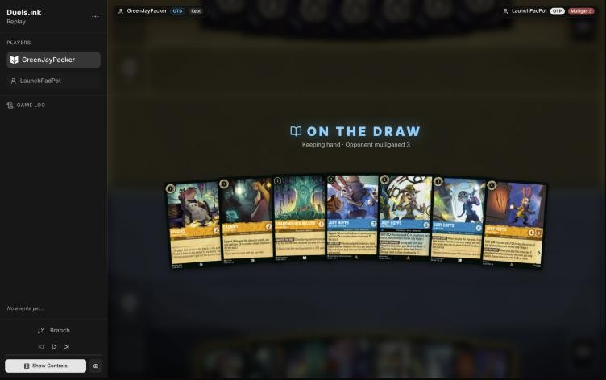
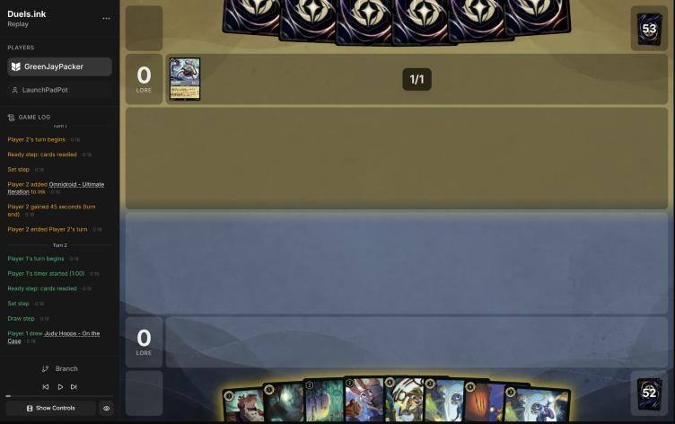
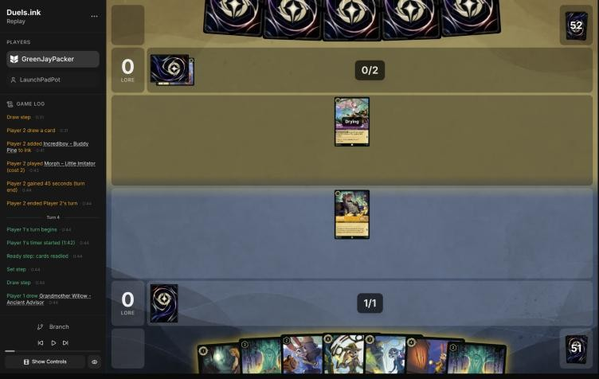
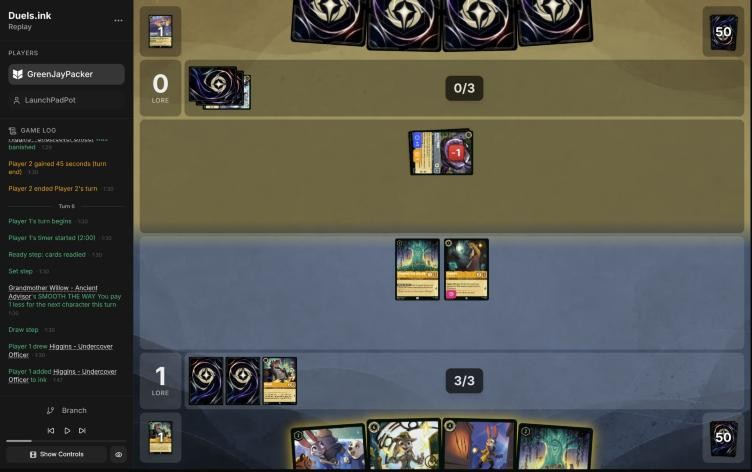
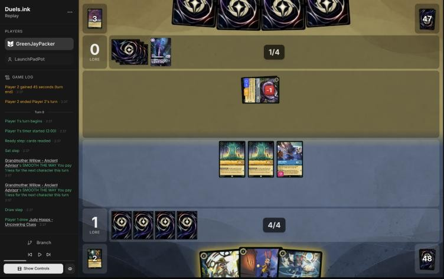
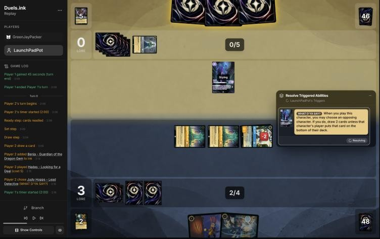
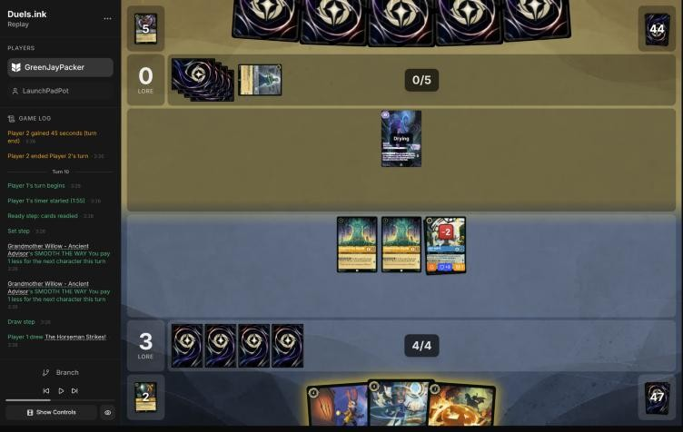
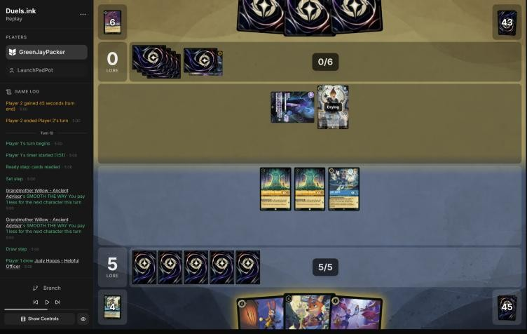
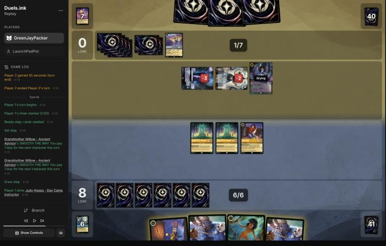
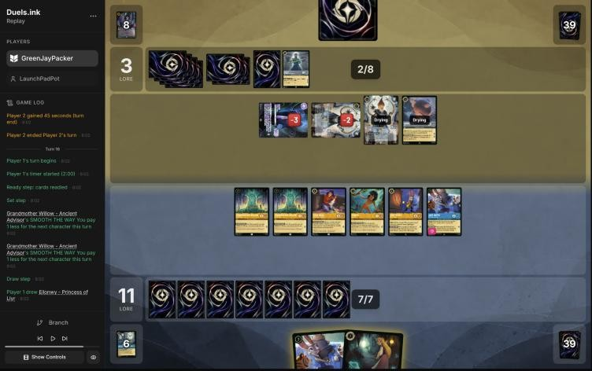

# Review: GreenJayPacker vs LaunchPadPot, 22 Nov 2026

| | |
|---|---|
| **Status** | draft (blind pass done, not yet discussed) |
| **Replay** | `01a203be-08cf` (`python3 tools/brief.py 01a203be-08cf --turn N`) · [duels.ink viewer](https://duels.ink/replay/01a203be-08d3-7e0e-95c8-49abdcc1c52b?step=0) |
| **Format** | Core Constructed (stated in the replay), judged by CR v2.3.0. Set 14 era: inks revealed before the coin toss |
| **Decks** | You: Amber/Sapphire Detectives, the same 60 as in your earlier reviewed games. Them: Amethyst/Steel ([the coach's notes on this pair](#cite-kb-meta-archetypes-amethyst-steel-archetypes)); closest list as it became clear: none of duels.ink's. From turn 3 (Morph, Incrediboy, Omnidroid inked) an Incredibles/Robot Shift deck of its own (Violet Parr – Super Resilient, Syndrome – Out for Revenge ×2, Omnidroid V.10), with Midrange's Hades, Demona – Scourge and Strength of a Raging Fire |
| **Play/draw** | LaunchPadPot went first; you were on the draw |
| **Result** | Win: LaunchPadPot conceded at 17–10 on game turn 17 (their ninth turn) |
| **Meta data** | snapshot of 2026-11-25 (fresh: stale from 2026-12-09) |
| **Chosen how** | By the project's owner: a list of GreenJayPacker's games sent for review, not chosen by result. |

## Summary
Links go to the turn sections below.
- **Good plays:** [pre-game](#turn-0) (keeping all seven); [12](#turn-12) (Elisa from Clues's dig took Second Star to
  the Right, and Toy Drive Officer drew); [14](#turn-14) (Mowgli's reveal first, then racing from 8–0 rather than trading
  three questers for Syndrome and Hades). On turns 12 and 14 your line beat my plan.
- **Close calls:** [8](#turn-8) (Lead Detective Shifted onto the dry Day Camp to challenge Violet Parr, against Support
  and Always Vigilant: a line my plan missed); [10](#turn-10) (Willows kept home from Hades's free kill).
- **Mistakes:** [6](#turn-6): Willow and Day Camp with nobody questing, where Eilonwy's Support onto Violet Parr and
  Always Vigilant Shifted onto Day Camp (3 of your 3 ink) would have banished Violet and the Morph under her.
- **Right choices on their turns:** [9](#turn-9) (let Hades draw 2 rather than bottom Lead Detective and Day Camp).
- **Unwinnable from:** never.

**What decided it:** the two Willows' discounts kept two plays a turn coming while their Shift deck landed one big
character a turn; each of those was answered (Lead Detective's challenge, Always Vigilant on Scourge), Elisa took their
refill song, and a board of eight 1-lore characters reached 17–3 before their engine paid off.

## The game, turn by turn
Verdicts judge each decision on what you could know at the time, **including archetype knowledge an experienced
player has**. Hindsight is kept to its own section. Severity scale: good play / close call /
inaccuracy / mistake / blunder. Principle IDs and hypotheses (H-n) link to copies
in the Citations section at the end, as they stood when they were cited.

**What you knew before the game:** they showed Amethyst/Steel. Of the common lists it's most like duels.ink's
Midrange (challengers and exert effects, Cheshire Cat, Dumbo, Shere Khan, Demona – Scourge); about half of the pair's
decks fit no listed list, so it could just as well be a Merlin and Shop list, a removal-action list (Jousting Match,
Ink Explosion), a Gargoyle build or something of its own. They're on the play, so their k-th turn is game turn 2k−1
and they have k ink then (one more for each ink drop from Shere Khan's CORNER THE MARKET, Merlin – Profoundly
Curious or Marie – Caught in the Act). The key cards, read in full (from [the pair's removal
and combat table](#cite-kb-meta-archetypes-amethyst-steel-removal-sweepers) and the Midrange list):
- **Peter Pan's Shadow – Elusive Prankster** (3, Evasive): exerts one of your characters on play, so a ready character
  can still be challenged that turn. From game turn 5.
- **Strength of a Raging Fire** (song, 3): damage to a chosen character equal to the number of characters they have
  in play. Cast for 3 from turn 5; sung free by any dry 3+-cost character from turn 7.
- **Angela – Night Warrior** (3): on play gives a character Challenger +2 and Resist +2 until their next turn. From
  turn 5.
- **Cheshire Cat – Inexplicable** (3, Boost 2): each Boost moves up to 2 damage onto one of your characters, no
  challenge needed, and works the turn he's played (Cheshire + Boost = 5 ink, so from turn 9; Boost alone from turn
  7 once he's in play). Any damage on either board is his to move.
- **Shere Khan – Khan Industries CEO** (4): NEW INCENTIVE lets one character challenge **ready** characters that turn;
  CORNER THE MARKET gives an ink drop for a kill. From turn 7. Only 2 willpower.
- **Angel – Experiment 624** (4): GOOD AIM discards a card for 2 damage to any character, ready or not; Resist +2 with
  an empty hand. From turn 7.
- **Dumbo – Ninth Wonder of the Universe** (4, Evasive): {E}, 1 ink: draw and 1 lore, and the same for their other
  Evasive characters. From turn 7; an engine to kill, and Lead Detective's Alert reaches him.
- **Hades – Looking for a Deal** (5): bottom your chosen character or they draw 2. From turn 9.
- **Demona – Scourge of the Wyvern Clan** (6, 5 {S}): exerts your whole board, then each player draws up to 3. From
  turn 11 (turn 9 with two ink drops). In range of your Always Vigilant and Gaston.
- **Tinker Bell – Giant Fairy** (6, Shift 4 onto Tinker Bell – Curious Fairy): 1 damage to each of your characters on
  play, and 2 more after each challenge kill. Shifted from turn 7; it kills every 1-willpower character you have
  (Eilonwy, Helpful Officer).
- **Challengers:** Rafiki (1, Challenger +3), Luisa Madrigal – Pushing Through (1, Challenger +2), Pepita (2,
  Challenger +2) kill your 2- and 3-willpower cheap Detectives in challenges from their second turn.
- **Locks:** Toulouse – Rough and Tumble (2) stops you playing actions until their next turn; Flash (2, Resist 1)
  turns off Rush.
- **Your removal's targets in their list:** Demona – Scourge (5 {S}) and Luisa – Confident Climber (6 {S}) for Always
  Vigilant and Gaston on their own; Shere Khan, Lexington and Demona – Imperious (4 {S}) with one Support; anything with
  2+ {S} with Nick Wilde – Providing Backup's +3.

No Raging Storm-style full wipe is in their inks' usual lists; the board-wide threats are Scourge's exert-all followed
by challenges, and Giant Fairy's 1 damage to everything.

### Pre-game

*The board before the decision: [step 0](https://duels.ink/replay/01a203be-08d3-7e0e-95c8-49abdcc1c52b?step=0) in the duels.ink replay viewer.*

**The plan (written before seeing the mulligan made):** you're on the draw with Higgins, Eilonwy, Grandmother Willow,
Day Camp Instructor, On the Case, Always Vigilant and Lead Detective: a 1, 1, 2, 2, 3, 4 curve and a 6 that is really a
4-ink Shift onto any of the three Judys. Five of the seven are inkable. Candidates, from `mulligan.py` (1,500 deals):

| Option | Ink T1–4 | Play turns | Lore by T4 | Characters T4 | Interaction |
|---|---|---|---|---|---|
| Keep all 7 | 9.88 | 4.00 | 7.2 | 5.5 | 100% |
| Send back Lead Detective | 9.73 | 4.00 | 7.3 | 5.5 | 100% |
| Send back Willow | 9.90 | 4.00 | 7.2 | 5.2 | 100% |
| Send back Lead Detective and Always Vigilant | 9.58 | 4.00 | 7.4 | 5.5 | 100% |
| Full mulligan | 9.35 | 3.78 | 5.2 | 4.0 | 88% |

Every partial keep is within noise of keeping all seven, and the full mulligan is clearly worse. The card-quality
points the sim can't see all favour keeping: Always Vigilant is the answer to Demona – Scourge and Luisa – Confident
Climber, and Lead Detective is the Alert answer to Evasive questers (Peter Pan's Shadow, Dumbo) with Shift bases
already in hand. Willow is uninkable, but she discounts the turn-3 or turn-4 double play that Day Camp's LEND A PAW and
Toy Drive Officer want. My pick: **keep all seven** ([MULL-1](#cite-mull-1), [MULL-2](#cite-mull-2)).

**What you did:** kept all seven. LaunchPadPot mulliganed 3 cards.

**Verdict:** **good play.** The keep had a play on each of turns 1–4 in every simulated deal, the most ink spent of
any option, and both of the deck's answers for this matchup (Always Vigilant for Scourge, Lead Detective for Evasive
engines) with their Shift bases. Confidence: high.

### Turn 1: their turn

**What happened:** LaunchPadPot inked Omnidroid – Ultimate Iteration (8, Shift 6 onto an Omnidroid, Resist 2) and
played nothing. Omnidroid is in no listed Amethyst/Steel list, so from the first card they look like a deck of their
own; Steel's Omnidroid line (V.8 at 1, Scanning for Threats at 3, V.9 at 4 with Shift 2 and 2 damage, V.10 at 6) is
worth watching for, beside Midrange's usual cards.

### Turn 2: your turn 1

*The board before the decision: [step 5](https://duels.ink/replay/01a203be-08d3-7e0e-95c8-49abdcc1c52b?step=5) in the duels.ink replay viewer.*

**The plan (written before seeing the turn):** nothing to answer yet, and nothing you play can quest or be challenged
this turn (it's drying and stays ready). Resources: 1 ink after inking; hand Higgins, Eilonwy, Willow, Day Camp, On
the Case ×2, Always Vigilant, Lead Detective (you drew the second On the Case). No dig. The curve the hand allows:
- turn 4 (2 ink): Willow, then the other 1-drop for 0 (two bodies), or both 1-drops;
- turn 6 (3 ink): Willow 2 + Day Camp 1 with LEND A PAW (another character played) for a free ink, or On the Case;
- turn 8 (4 ink, 5 with LEND A PAW): Always Vigilant hard or as a Shift 2, or Lead Detective Shifted onto a dry Judy.

**What to ink:** the second On the Case. Its HIDDEN CLUES needs an item to hit, and none has been seen; you keep one
copy for the 3-drop slot. Always Vigilant (the answer to Scourge and big Omnidroids, 5+ {S}) and Lead Detective (the
Alert answer to Shadow and Dumbo) are this matchup's answers ([INK-2](#cite-ink-2)), and both 1-drops are the early curve and
LEND A PAW's partners. Ink check: without the inked On the Case, turns 4 and 6 above are unchanged.

**What to play:** Higgins rather than Eilonwy. Neither can be punished this turn. Next turn the one played now
quests, and their 2-ink challengers (Pepita at 4 {S}, Rafiki at 3, Luisa at 2) kill either; Higgins's 2 willpower at
least survives a plain 1-drop, while Eilonwy's 1 dies to anything, and Higgins is the Detective that switches on
HIDDEN CLUES and Nick – Providing Backup. Eilonwy's Support has nothing to boost yet. A close call either way.
Candidates: (a) ink On the Case, Higgins (my pick); (b) ink On the Case, Eilonwy; (c) ink a 1-drop and play the other
(worse: it costs the turn-4 double play).

**What you did:** inked On the Case and played Higgins.

**Verdict:** the planned line. Nothing to flag.

### Turn 3: their turn

**What happened:** they inked Incrediboy – Buddy Pine (counts as Syndrome for Shift) and played Morph – Little
Imitator (2, 1/2/1: **any character can Shift onto him**, every Shift variant included). With Omnidroid – Ultimate
Iteration already inked, this looks like an Incredibles/Robot Shift deck of its own rather than any listed list: Syndrome
– Out for Revenge (Shift 4 onto Incrediboy or Morph; each quest returns a Robot from the discard and plays a Robot of
cost 8 or less for free), Omnidroid V.9 (Shift 2, 2 damage to a chosen character), V.10 (Shift 4) and Ultimate Iteration
(Shift 6, 8/8 Resist 2), and the Midrange cards (Tinker Bell – Giant Fairy can Shift onto Morph too). **A Shift onto a dry
Morph is dry at once** ([CR 8.10.4](#cite-cr-8-10-4)), so whatever lands on him can challenge that turn.

### Turn 4: your turn 2

*The board before the decision: [step 11](https://duels.ink/replay/01a203be-08d3-7e0e-95c8-49abdcc1c52b?step=11) in the duels.ink replay viewer.*

**The plan (written before seeing the turn):** you drew the second Grandmother Willow. 2 ink after inking; hand
Eilonwy, Willow ×2, Day Camp, On the Case, Always Vigilant, Lead Detective; Higgins is dry. Nothing of theirs can be
challenged (Morph is ready), and nothing must die yet, though **Morph is their Shift base and worth killing whenever
he's exerted**.

Their next turn (3 ink): Peter Pan's Shadow, Strength of a Raging Fire (2 damage with Morph and one more character),
Angela, Demona – Imperious with IMPETUS Rush (4 {S}), and above all a Shift onto Morph that acts at once: Omnidroid V.9
for 2 (4/3, ENEMY DETECTED deals 2 to any character, ready or not) is the cheapest of the Robot line. FREE KILLS on an
exerted Higgins: none from Morph (1 {S}); Imperious or a shifted V.9 would kill him, and V.9's 2 damage kills him
ready anyway. No Supporter can quest this turn, and theirs has none: no Support line yet.

Lore 0–0, both boards 1 a turn: no race yet. The needs check: the hand curves out (two Willows discount, Day Camp
ramps, Always Vigilant answers their 5+ {S} Robots and Morgana-style Shifts), so the job now is board and lore.

Candidates (all 2 of your 2 ink):
- **(a) quest Higgins, Willow (2), then Eilonwy for 0** (2 + 0 = 2 of 2): two bodies and 1 lore. Next turn Willow #2
  for 1 then Day Camp for 1 with LEND A PAW (+1 ink), or Willow #2 for 1 then On the Case for 2. **My pick.**
- (b) quest Higgins, Day Camp alone (2 of 2) as a Shift base: LEND A PAW is wasted (no other character played), and
  one body instead of two.
- (c) Eilonwy alone (1 of 2): wastes an ink.

**What to ink** (with (a)): On the Case, keeping Always Vigilant (the answer to Omnidroid V.10 and Ultimate Iteration,
Morgana, Scourge) and Lead Detective (a 2-lore Shift 4 with Alert, and Resist +2 for your Detectives' challenges). Ink
check: without On the Case, turn 6 is Willow #2 + Day Camp + LEND A PAW (2 of 3, plus a ramp), and turn 8 has 5 ink for
Always Vigilant Shifted onto Day Camp plus a drawn card, or Lead Detective Shifted plus a 1-drop. Inking Lead Detective
instead keeps On the Case for turn 8 (Always Vigilant Shift 2 + On the Case 3 = 5): a close call.

What (a) exposes: Higgins exerted (killed by Imperious's Rush or a shifted V.9's challenge); Eilonwy and Willow ready,
but a 2-damage Strength or ENEMY DETECTED kills either without a challenge. Staying home with Higgins would only dodge
the challenge cases, for 1 lore ([H-12](#cite-h-12)).

**What you did:** inked On the Case, played Willow and Eilonwy for 0, and quested with Higgins (1–0).

**Verdict:** the planned line (a). Nothing to flag.

### Turn 5: their turn

**What happened:** they inked a second Omnidroid – Ultimate Iteration, Shifted Violet Parr – Super Resilient (5, Shift
3; 4/4/2, Resist 1; HEROIC SYNERGY draws and discards whenever they play a Hero) onto the dry Morph, discarded an
Incrediboy to it, and challenged your exerted Higgins at once: Higgins died and Violet took 1. This was the turn-4 plan's
"Shift onto Morph that acts at once"; the 1 lore was the price, as expected.

### Turn 6: your turn 3

*The board before the decision: [step 23](https://duels.ink/replay/01a203be-08d3-7e0e-95c8-49abdcc1c52b?step=23) in the duels.ink replay viewer.* Higgins is inked; Violet Parr is exerted on 3 willpower.

**The plan (written before seeing the turn):** you drew Higgins. 3 ink after inking; hand Day Camp, Willow, Higgins,
Always Vigilant, Lead Detective; Willow and Eilonwy are dry. Lore 1–0.

**What must happen:** Violet Parr (2 lore, 4 {S}, Morph under her) is **exerted, on 3 willpower with Resist 1**. Your
board can't kill her in a challenge: Eilonwy deals 1, Willow 0, and even Willow with Eilonwy's Support deals only 2.
But the brief's STRENGTH REMOVAL line has the answer: **Eilonwy's Support onto Violet makes her 6 {S}, in range of
Always Vigilant's GOT YOU NOW.** The ink fits through a Shift:

- **(a) Eilonwy quests (+1, Support +2 onto Violet), Willow quests (+1), Day Camp for 1 (Willow's discount), Always
  Vigilant Shifted onto Day Camp for 2: GOT YOU NOW (Day Camp was "another character played this turn") banishes
  Violet, and Morph with her.** 1 + 2 = 3 of your 3. Their board is empty, you're 3–0, and their 5 ink of Morph and
  Violet goes for your 3 ([TEMPO-2](#cite-tempo-2), [TRADE-1](#cite-trade-1)). **My pick.**
- (b) Higgins for 0 and Day Camp for 2 with LEND A PAW, quest both dry characters (2 of 3 plus a ramp): Violet lives,
  quests for 2 and kills an exerted 1–2-willpower character each turn (the FREE KILLS line names Willow and Eilonwy).
- (c) Willow, supported by Eilonwy, challenges for 2: Violet lives on 1 and Willow dies. Worse than (a) in every way.

LEND A PAW can't be fitted into (a): Willow #2 for 1 and Day Camp for 1 with the ramp leaves 1 ink, one short of the
Shift.

**What to ink:** Higgins, the vanilla 1-drop. Lead Detective then Shifts onto the dry Always Vigilant next turn for 4
(or Willow #2 for 1 and Lead Detective for 3, with both discounts: 4 of 4) and quests for 2 at once. Ink check: with
Higgins gone, turn 8 needs an inkable draw for 4 ink (about 4 in 5: 10 uninkables left in 50); without one it's Willow
#2 plus whatever was drawn, or inking Lead Detective. Inking Lead Detective instead keeps Higgins as next turn's ink
and leaves turn 8 as Willow #2 plus a 1–3-drop: much weaker.

**Their next turn (4 ink) against (a):** Always Vigilant is ready (drying), so only non-challenge damage reaches her:
Angel's GOOD AIM (2) or Strength cast for 3 (1 damage per character of theirs, so 1 or 2). Exerted Eilonwy (1 willpower)
and Willow (2) can be killed by GOOD AIM, a 1–2-damage Strength, or Demona – Imperious's Rush (4 {S}); with Morph and
Violet gone, nothing of theirs is dry, and nothing in view can be Shifted onto. Shere Khan's NEW INCENTIVE needs a dry
character to use it. Support line: yours onto their character, Eilonwy +2 onto Violet (the line above); yours onto your
challenger, not used; theirs, none (no Supporter seen).

**What you did:** inked Higgins, played the second Willow for 1 and Day Camp for 1 (LEND A PAW put your top card into
the inkwell), and quested with nobody. 1 ink went unused; Violet Parr lived, and you stayed at 1–0.

**Verdict:** **mistake.** Playing **Willow and Day Camp and keeping everyone home** is suboptimal because it leaves
their only character, a 2-lore Violet Parr with their Shift base under her, alive to quest and to pick off whatever
you exert, and it scores nothing; the ramp is the only gain. Playing **Eilonwy's quest with Support onto Violet, Willow's
quest, Day Camp for 1 and Always Vigilant Shifted onto her for 2** (1 + 2 = 3 of your 3, inking Higgins) is better
because GOT YOU NOW banishes Violet and Morph together, a two-for-one for 3 ink against their 5, empties their board
and makes it 3–0 ([TEMPO-2](#cite-tempo-2), [TRADE-1](#cite-trade-1), [THREAT-1](#cite-threat-1); [Support can add strength to an opposing
character](#cite-kb-rules-rulings-support-can-add-strength-to-an-opposing-character), and the same trick in [your own
notes](#cite-kb-meta-archetypes-amber-sapphire-detectives-as-greenjaypacker-plays-it)). What it exposes: Eilonwy and Willow exerted with nothing of theirs dry to challenge them; only a Demona –
Imperious Rush, Angel's GOOD AIM or a cast Strength (1 damage for each character they have) can reach them, and the
last two reach them ready too. Always Vigilant would be ready, and nothing in view deals her 4.

Keeping Always Vigilant for a bigger target (two Omnidroid – Ultimate Iterations are inked, so their deck has 8-{S}
Robots) is the best case for waiting, but the deck holds three more Always Vigilants and three Gastons, and the same
banish is still there next turn only if Day Camp or Eilonwy survives to Support and Violet doesn't take a character
first. Confidence: medium-high; it rests on the Support line being available, which the rules and the engine allow.

### Turn 7: their turn

**What happened:** they inked Hades – Looking for a Deal, played Junior Woodchuck Guidebook and cracked it at once
(draw 2), then sang Strength of a Raging Fire with Violet Parr (1 character, so 1 damage) to kill Eilonwy. Violet is
exerted again, still on 1 damage. Strength and Guidebook are the first cards seen that duels.ink's Midrange runs, but
the deck is still mostly its own (Morph, Violet, Incrediboy, Omnidroid).

### Turn 8: your turn 4

*The board before the decision: [step 35](https://duels.ink/replay/01a203be-08d3-7e0e-95c8-49abdcc1c52b?step=35) in the duels.ink replay viewer.*

**The plan (written before seeing the turn):** you drew Judy Hopps – Uncovering Clues. Lore 1–0. 4 ink, 5 if you ink;
hand Uncovering Clues, Always Vigilant, Lead Detective; two Willows and Day Camp are dry. **Both Willows' SMOOTH THE
WAY apply to the next character you play** ([CR 4.3.6](#cite-cr-4-3-6): each modifier applies to the next character, Shifts included),
so the first character costs 2 less.

**What must happen:** the same as last turn. Violet Parr is exerted on 3 willpower; she has killed a character in each
of her two turns and is their free singer for Strength. The brief: Day Camp's Support +2 puts her at 6 {S}, in range of
Always Vigilant.

Candidates:
- **(a) Uncovering Clues first (4 − 2 = 2) and dig the top 3 for a Detective; Day Camp quests (+1, Support onto
  Violet); Always Vigilant Shifts onto Day Camp (2): GOT YOU NOW banishes Violet and Morph; both Willows quest (+2).**
  2 + 2 = 4 of your 4, so no ink is needed; ink after the dig ([SEQ-1](#cite-seq-1)), a spare find if there is one. 4–0 with their board
  empty. **My pick.**
- (b) Lead Detective Shifted onto Day Camp after its Support (4 − 2 = 2), then Always Vigilant hard-cast (4): 6 of 5,
  doesn't fit; Always Vigilant Shifted onto Lead Detective would bury her.
- (c) Develop without the kill (Clues and Lead Detective, 2 + 4 = 6 of 5, doesn't fit either; Clues plus quests leaves
  Violet to kill a Willow or Day Camp for free, the FREE KILLS line).

**Lead Detective:** keep her. Next turn she Shifts onto a dry Uncovering Clues for 4 − 2 = 2 and quests for 2 at once.
Ink check: holding the ink this turn costs nothing (4 of 4 used); if the dig finds a spare inkable card, ink it and
keep 5 for next turn.

**What (a) exposes on their 5-ink turn:** Willows (2 willpower) and Always Vigilant on Day Camp exerted, Clues ready
and drying. With Violet gone they have nothing dry, so challenges need Demona – Imperious's Rush; otherwise Hades
(bottom one of yours or they draw 2), a cast Strength (1–2 damage: a Willow), Angel's GOOD AIM (2: a Willow), Peter
Pan's Shadow (an exert with nothing to follow it up). No Violet base is left for a Shift 3, and nothing in view takes
a Tinker Bell or Omnidroid Shift. Support line: yours onto their character, Day Camp +2 onto Violet (used); yours onto
your challenger, none needed; theirs, none seen.

**What you did:** Shifted Lead Detective onto the dry Day Camp for 2 (both Willows' discounts) and challenged Violet
Parr at once: 6 − 1 Resist = 5 killed her (Morph went with her), and LATERAL THINKING's Resist +2 cut her 4 back to 2.
Both Willows quested (3–0). No ink, and 2 of your 4 ink unused; Always Vigilant and Uncovering Clues stayed in hand.

**Verdict:** **close call**, and a line the plan missed: I listed Lead Detective's Shift only as a way to spend ink
after Day Camp's Support, not as a dry 6-{S} challenger with Resist +2 on your turn. Compared on the merits:
- **Your line** kills Violet for 2 ink, keeps Always Vigilant in hand for the 8-{S} Robots their two inked Ultimate
  Iterations point to (and Clues for later), and puts a 2-lore quester in play. Its costs: 2 ink unused (nothing in
  hand cost 2), no Day Camp quest, and Lead Detective left exerted on 2 willpower, so Angel's GOOD AIM, a Strength cast
  after a second character (2 damage), Demona – Imperious's Rush or Cheshire moving her own 2 damage onto a Willow all
  punish it on their 5-ink turn, and Hades can ask for her.
- **(a)** (Clues 2, Day Camp's Support onto Violet, Always Vigilant Shifted for 2) uses all 4 ink, makes it 4–0, adds
  Clues's dig and a body, and leaves nothing damaged: their outs are a Willow to GOOD AIM or Strength, and Hades on
  Always Vigilant. It spends Always Vigilant on a 4-{S} character, with Lead Detective kept for next turn.

One lore, a dig and a sturdier board for (a), against Always Vigilant saved for a bigger target and 2 ink less spent
for yours; I can't separate them with confidence. Not inking with Always Vigilant and Clues as the only inkables is
fine ([INK-3](#cite-ink-3)): the Willows' discounts keep next turn's plays cheap, and next turn's draw can be inked. Confidence: medium.

### Turn 9: their turn

*The board before the decision: [step 43](https://duels.ink/replay/01a203be-08d3-7e0e-95c8-49abdcc1c52b?step=43) in the duels.ink replay viewer.*

**What happened:** they inked Benja – Guardian of the Dragon Gem and played Hades – Looking for a Deal, choosing your
Lead Detective. **You let them draw 2** rather than put her on the bottom of your deck. Hades stayed ready.

**Verdict:** the right choice. Bottoming her would have taken Lead Detective and the Day Camp under her (the stack
leaves play together, [CR 8.10.7](#cite-cr-8-10-7)): your 2-lore quester and half your board. Their hand was already 4 cards with 5 ink
and one character in play, so two more cards are worth less to them than the body is to you ([H-2](#cite-h-2)'s converse). Nothing
to flag.

### Turn 10: your turn 5

*The board before the decision: [step 45](https://duels.ink/replay/01a203be-08d3-7e0e-95c8-49abdcc1c52b?step=45) in the duels.ink replay viewer.*

**The plan (written before seeing the turn):** you drew The Horseman Strikes! (3: draw a card, may banish an Evasive
character). Lore 3–0. 4 ink, 5 if you ink; hand Always Vigilant, Uncovering Clues, Horseman; in play two dry Willows
(−2 on your first character) and Lead Detective, dry, **on 2 willpower** (2 damage). Their board: Hades (3/4/1,
ready, so it can't be challenged), 5 cards in hand, 6 ink next turn.

**Their next turn (6 ink):** Demona – Scourge (exert-all, then Hades challenges whatever it likes), Tinker Bell – Giant
Fairy hard-cast (1 damage to each of yours: Lead Detective and both Willows to 1 willpower), the 6-cost Robots (Omnidroid
V.10, Syndrome – Out for Revenge), and two cheaper ways to kill Lead Detective whether she quests or not: Strength sung
by Hades after one more character (2 damage) and Angel's GOOD AIM. FREE KILLS: each Willow, if exerted, to Hades alone.
An exerted Lead Detective would trade with Hades (her 6 back kills him), and Demona – Imperious's Rush (4) would also
die to her. No Supporter on either side; no Support line.

**The needs check:** you're 3–0 and quest for 4 a turn (20 on game turn 18); they have no lore and one character. What
you hold wins if the board holds; what could turn it is a big Robot or a Scourge turn, and Always Vigilant in hand is the
answer to anything with 5+ {S} (with a cheap character first, which the Willows make easy).

Candidates:
- **(a) Ink The Horseman Strikes! (no Evasive character seen, and Lead Detective's Alert covers them), play Uncovering
  Clues first (4 − 2 = 2) and dig; with the 3 ink left play what the dig finds (Helpful Officer heals Lead Detective's 2;
  Nick – Providing Backup; Day Camp with LEND A PAW); then quest Lead Detective and both Willows (+4, 7–0).** Up to 2 +
  3 = 5 of 5. **My pick.** It offers Hades a Willow for free or a trade for Lead Detective; either way their only
  character spends its turn on it rather than lore, and Lead Detective is likely to be shot at whether she quests or not.
- (b) As (a), but Lead Detective stays home (+2, 5–0): she dodges only Hades's challenge, and if Hades quests she kills
  him next turn for 1 damage back. Gives up 2 lore to deter one card.
- (c) Quest nothing: nothing for Hades to hit, but no lore against an opponent with no clock; Scourge would exert the
  board anyway.

Ink check: inking Horseman leaves Always Vigilant for next turn's 5+-{S} threat (Willow-discounted character, then Always
Vigilant for 4: about 2 + 4 = 6 of your 5 or 6), and Clues in play to dig on each quest.

**What you did:** played Uncovering Clues for 2 and took Nick Wilde – Toy Drive Officer from the dig, quested with Lead
Detective (5–0), then inked The Horseman Strikes!. The Willows stayed home, and 3 ink went unused (Toy Drive Officer
costs 4 once the discounts are spent).

**Verdict:** the plan's line except for the Willows: **close call.** Questing them was +2 lore and would have left each
open to a free kill by Hades. Against that: Hades can make only one challenge; a Willow kill leaves him exerted on 3
willpower, where Clues or Lead Detective kill him next turn; and their likelier target was the questing Lead Detective
anyway. For keeping them home: each Willow is a −1 on a character every turn, and with Toy Drive Officer now in hand
(COMMUNITY OUTREACH draws when you play two characters) the discounts are what make two plays a turn affordable. The
race doesn't need the 2 lore (5–0 against a board of one), so keeping the engine safe is a fair price ([POS-1](#cite-pos-1)). Inking
Horseman after the dig matches the plan ([SEQ-1](#cite-seq-1)). Confidence: medium.

### Turn 11: their turn

**What happened:** they inked Demona – Scourge of the Wyvern Clan, hard-cast Syndrome – Out for Revenge (6, 4/6/2:
whenever he quests, return a Robot from their discard to hand, then play or Shift a Robot of cost 8 or less for free),
and Hades sang a second Strength of a Raging Fire (two characters, 2 damage) to kill Lead Detective and the Day Camp
under her. The 2-willpower Lead Detective was exposed whether or not she quested (turn 10's plan named this).

### Turn 12: your turn 6

*The board before the decision: [step 56](https://duels.ink/replay/01a203be-08d3-7e0e-95c8-49abdcc1c52b?step=56) in the duels.ink replay viewer.*

**The plan (written before seeing the turn):** you drew Judy Hopps – Helpful Officer. Lore 5–0. 5 ink, 6 if you ink;
hand Always Vigilant, Toy Drive Officer, Helpful Officer; in play two dry Willows (−2 on the first character) and a dry
Uncovering Clues. Their board: Hades exerted (3/4/1), Syndrome drying and ready (4/6/2); 3 cards in hand, 7 ink next
turn.

**What must happen:** **Syndrome is the engine to kill:** each quest is 2 lore and a free Robot from hand (their discard
holds none yet), up to an 8/8 Ultimate Iteration (two are inked, so the deck has big Robots). He can't be reached this
turn: he's ready, and no Supporter of yours can quest to put him at 5 {S}. Next turn he can: Toy Drive Officer's Support
(+2) puts him at 6 for Always Vigilant. Hades is exerted and killable now, but only by Always Vigilant Shifted onto the
dry Clues (4 damage into 4 willpower; she takes 3).

**Their next turn (7 ink):** Syndrome quests (+2, a Robot if they hold one) or challenges; Hades challenges an exerted
character (FREE KILLS: each Willow, and Clues left on 1 willpower by her 3 back) or sings Strength if they draw a third;
Scourge (they inked one) or Giant Fairy at 6–7 ink. No Supporter of theirs; yours, Toy Drive next turn.

Candidates:
- **(a) Kill Hades:** Always Vigilant Shifted onto the dry Clues (2 − 2 = 0) challenges Hades and kills him (she's left
  on 1), Helpful Officer (1) heals her 2, Toy Drive Officer (4): 0 + 1 + 4 = 5 of 5, and COMMUNITY OUTREACH draws (three
  characters played). Their board is Syndrome alone, but your answer to him is spent and Clues (the dig) is buried;
  next turn's answer to Syndrome or a free Robot needs a Gaston or Always Vigilant from two draws (6 copies in 45, about
  1 in 4). Always Vigilant ends exerted on 3 willpower, a free kill for Syndrome (though challenging costs him his quest).
- **(b) Dig and develop, keep Always Vigilant:** Clues quests first (+1, look at 3), then Toy Drive Officer (4 − 2 = 2)
  and Helpful Officer (1): 3 of your 5, and COMMUNITY OUTREACH draws. Next turn Toy Drive's Support puts Syndrome at 6,
  a cheap character goes first, and Always Vigilant (Shift 2 onto Clues or Helpful Officer, or 4) banishes him, or an
  8-{S} Robot without Support. Ink after the dig: a spare find, else hold. Willows stay home: Hades kills either for free,
  and their discounts pay for next turn's two plays. **My pick**, for keeping the one answer to their engine.
- (c) As (b) with the Willows questing too (7–0): Hades and Syndrome can each take one exerted character; a Willow is
  worth more as next turn's discount than as 1 lore at 5–0.

What (b) exposes: Clues exerted on 3 willpower (Hades kills her and survives on 1; Syndrome kills her); Toy Drive and
Helpful Officer ready, but Helpful Officer's 1 willpower falls to a Giant Fairy ping or any Strength. Scourge would
exert everything for Hades and Syndrome to pick two.

**What you did:** quested with Clues first and took Elisa Maza – Hardworking Detective from the dig, played her for 2
(the Willows' discount) and, with Clues in play, made them reveal their hand and discard Second Star to the Right (Sing
Together 10: Hades and Syndrome total 11, so it was a free "draw 5" next turn). Then you inked Helpful Officer, played
Toy Drive Officer for 4 (6 of your 6 ink), quested both Willows (8–0), and COMMUNITY OUTREACH drew Day Camp. Always
Vigilant stayed in hand.

**Verdict:** **good play**, better than my plan. It kept the plan's core (dig first, keep Always Vigilant for Syndrome,
Toy Drive Officer down for next turn's Support) and then used the find: Elisa for 2 took the one card that would have
refilled their hand by five, showed you their hand for next turn's plan, and made Toy Drive's draw with two characters
while inking the 1-willpower Helpful Officer instead of playing it into a Giant Fairy or Strength. All 6 ink spent, where
my line left 2 idle. Questing the Willows, which I'd have kept home, is a fair call at 6–0: Hades and Syndrome can take
one exerted character each, and either challenge costs them a quest (Syndrome's is their engine).

### Turn 13: their turn

**What happened:** they inked a third Incrediboy, began Omnidroid V.10 and a Syndrome quest and undid both, then
played Demona – Scourge (6): your board was exerted, the refill drew you Mowgli and them two, Syndrome killed Toy
Drive Officer (taking 2) and Hades killed Uncovering Clues (taking 3). Elisa's reveal last turn had shown Scourge
and Omnidroid V.10; V.10 is still in their hand.

### Turn 14: your turn 7

*The board before the decision: [step 75](https://duels.ink/replay/01a203be-08d3-7e0e-95c8-49abdcc1c52b?step=75) in the duels.ink replay viewer.*

**The plan (written before seeing the turn):** you drew a second Day Camp Instructor. Lore 8–0. 6 ink, 7 if you ink
(Always Vigilant and Mowgli are the inkables); hand Always Vigilant, Day Camp ×2, Mowgli; in play two Willows (−2 on the
first character) and Elisa, all dry. Their board: **Hades exerted on 1 willpower**, **Syndrome exerted on 4 willpower**
(2 damage), **Scourge drying and ready** (5/6/2; STONE BY DAY: with 3 cards in hand she won't ready once she's
exerted). They hold 3 cards, Omnidroid V.10 (6/6/2) known among them, and have 8 ink next turn.

**What must happen:** Syndrome is the engine: next turn's quest plays V.10 for free (and later returns any Robot you
kill). Scourge is 2 lore and a 5-{S} attacker. The tools:
- **Always Vigilant hard-cast after a Day Camp (0 with the discounts):** GOT YOU NOW banishes Scourge (5 {S}, in
  range now). Syndrome (4 {S}) is out of reach: no Supporter of yours can quest this turn.
- **Challenges:** Elisa (3) and a Willow (1) together kill Syndrome exactly (4 left), and both die to his 4 back. A
  Willow alone kills Hades (1 left) and dies; Elisa alone kills Hades and lives on 1.

Candidates:
- **(a) Clear the board:** Day Camp (0), Always Vigilant (4, banish Scourge), the second Day Camp (2, LEND A PAW: +1
  ink); Elisa then a Willow into Syndrome (dead), the other Willow into Hades (dead). 0 + 4 + 2 = 6 of your 6, no ink
  needed (keep Mowgli as a card, [H-2](#cite-h-2)). Their board is empty, yours is two Day Camps and Always Vigilant, all ready; you
  lose Elisa and both Willows for Scourge, Syndrome and Hades. 8–0, no quests. **My pick:** it kills the engine before
  it pays once, and leaves them nothing to challenge with or sing Strength.
- **(b) As (a), but the second Willow quests (9–0) and Hades lives on 1 willpower:** keeps one discount, but Hades can
  take that exerted Willow for free next turn or sing a drawn Strength (damage = their characters).
- **(c) Kill Scourge and Hades only** (Always Vigilant, Elisa into Hades), quest the Willows (10–0): Syndrome quests next
  turn for 2 and a free V.10, Elisa is left exerted on 1 willpower and the Willows exerted, all free kills for
  Syndrome; killing Syndrome later costs the same two characters with V.10 beside him.

What (a) exposes: nothing exerted. Their 8 ink can rebuild (V.10 hard-cast plus 2), but nothing they play can
challenge that turn unless it has Rush (Demona – Imperious with IMPETUS; Flash is not in view); a cast Strength would
deal only 1–2. Support line: none of yours can quest this turn (both Day Camps are played now); theirs, none.

**What you did:** played Mowgli for 0 first (their hand was revealed: only characters, so nothing to discard), then
Always Vigilant for 4 (GOT YOU NOW banished Scourge) and a Day Camp for 2 with LEND A PAW (6 of 6 ink, plus a ramp).
Both Willows and Elisa quested (11–0); Syndrome and Hades were left alone.

**Verdict:** **good play**, better than my plan. The plan spent Elisa and both Willows to kill Syndrome and Hades,
weighing the engine over the race. Your line looked first: Mowgli for 0 (the Willows' discount, and the "other
character" GOT YOU NOW needs) showed a hand of characters only, so no Strength or other action could reach your board
next turn ([SEQ-1](#cite-seq-1)). From there the race decides it ([QC-5](#cite-qc-5), [POS-1](#cite-pos-1)): at 11–0 with six questers you score about 6 a turn and
need two more turns, while their best next turn is 3 lore (Syndrome and Hades) plus a free V.10 that is drying. Their
challengers can take at most two exerted characters (FREE KILLS: Syndrome on a Willow or Elisa; Hades, on 1 willpower,
dies to anything he challenges, and either challenge costs them that character's quest and Syndrome's free Robot).
Keeping the three characters kept your clock at two turns, where my line's three fresh bodies made it four.

### Turn 15: their turn

**What happened:** they inked a second Benja, hard-cast a second Syndrome – Out for Revenge, quested the first
(GOT ME MONOLOGUING! played Omnidroid V.10 from hand for free) and Hades (11–3). Nothing of yours was challenged.

### Turn 16: your turn 8

*The board before the decision: [step 91](https://duels.ink/replay/01a203be-08d3-7e0e-95c8-49abdcc1c52b?step=91) in the duels.ink replay viewer.*

**The plan (written before seeing the turn):** you drew Eilonwy. Lore 11–3. 7 ink, 8 if you ink Eilonwy; hand Day Camp
and Eilonwy; in play six dry characters (two Willows, Elisa, Mowgli, Always Vigilant, Day Camp), each worth 1 lore.
Their board: Hades exerted on 1 willpower, Syndrome #1 exerted on 4, Syndrome #2 and Omnidroid V.10 (6/6/2) drying and
ready; one card in hand (Mrs. Incredible – Super Stretchy, known), 9 ink next turn. Their board quests for 7.

**The race decides it.** Questing all six makes it 17–3. They can't reach 20 next turn (3 + 7 = 10), and you need 3 more
on turn 18. Their four characters can make four challenges, each giving up that character's quest (FREE KILLS: Syndrome
#2 or V.10 kill any of your six for free; Syndrome #1 kills any but Always Vigilant for free; Hades, on 1 willpower, dies
to whatever he challenges). Four kills leave two of the six plus the two you play now (ready, so not challengeable):
four questers for 3 lore. What could still stop it is a card from their one draw that removes or locks two more
(Strength sung for 4–5 damage takes one; an unseen Elsa – Spirit of Winter would lock two; Giant Fairy's ping kills
Eilonwy). The needs check: you hold the win; protect the questers' count, not individual characters.

Candidates:
- **(a) Quest all six (17–3), play Eilonwy and Day Camp** (Willows: Eilonwy for 0, Day Camp for 2 with LEND A PAW;
  2 of 7, nothing else to spend ink on; don't ink Eilonwy, she's a turn-18 quester). **My pick.**
- (b) Elisa kills Hades first (3 into 1 willpower; she survives on 1), quest the other five (16–3): removes a challenger
  that would trade with one of yours anyway, for 1 lore less; Elisa then sits exerted on 1 willpower.
- (c) Always Vigilant trades with Syndrome #1 and Elisa kills Hades, quest four (15–3): only two challengers left, but
  you need 5 on turn 18 from at most five characters.

(a) makes them spend their whole turn on challenges (0 lore) or let you win. Support line: Day Camp can Support only
in a challenge, which (a) doesn't make; theirs, none.

**What you did:** Eilonwy for 0 and Day Camp for 2 (LEND A PAW), then quested with all six (17–3).

**Verdict:** the planned line (a). Nothing to flag.

### Turn 17: their turn

**What happened:** they inked a third Benja, played Mrs. Incredible – Super Stretchy, quested with Hades, both
Syndromes (no Robot to play) and V.10 (17–10), and conceded: your eight characters were due to quest for at least 3
next turn.

## Lessons
1. **Every turn a Supporter of yours can quest, look for Support onto their character and then Always Vigilant.** On
   turn 6 Eilonwy's +2 put a 4-{S} Violet Parr at 6, and a Day Camp for 1 made Always Vigilant's Shift (2) legal and
   its GOT YOU NOW live: their 5-ink Shift for your 3. It's the trick in [your own
   notes](#cite-kb-meta-archetypes-amber-sapphire-detectives-as-greenjaypacker-plays-it), used against you by
   Detectives opponents.
2. **A Judy Shifted onto a dry Judy acts at once** ([CR 8.10.4](#cite-cr-8-10-4), [RULE-2](#cite-rule-2)), and Lead Detective's LATERAL THINKING gives her
   Resist +2 on your turn: on turn 8 that made her a 6-{S} challenger who took 2 back from a 4-{S} Violet, for 2 ink with
   the Willows. You found this; my plan didn't.
3. **Reveal first, decide after** ([SEQ-1](#cite-seq-1)). Elisa's FOLLOW THE TRAIL on turn 12 and Mowgli's on turn 14 showed their
   hand before you chose what to expose; on turn 14 a hand of characters only meant nothing could reach your questers
   but challenges, so questing everything was safe enough.
4. **Far ahead, count both clocks before trading questers for their engine** ([QC-5](#cite-qc-5), [POS-1](#cite-pos-1)). At 8–0, with three questers
   ready and three more landing, you'd reach 20 on turn 18, two turns after this one; their board needed three or more,
   and Syndrome's engine needed turns it didn't have.

## Proposed knowledge-base updates (applied after discussion)
- **Meta** (Amethyst/Steel pair file, notes): *An Incredibles/Robot Shift list (unlisted) against GreenJayPacker's
  Detectives: LaunchPadPot* (01a203be-08cf, 22 Nov 2026, blind review). Seen: Morph – Little Imitator, Violet Parr –
  Super Resilient, Incrediboy ×3 (two inked), Syndrome – Out for Revenge ×2, Omnidroid – Ultimate Iteration ×2 (both
  inked), Omnidroid V.10, Hades ×2, Demona – Scourge ×2, Strength of a Raging Fire ×2, Junior Woodchuck Guidebook,
  Second Star to the Right, Benja ×3 (inked), Mrs. Incredible – Super Stretchy. How it plays:
  - **Morph is a universal Shift base, and a Shift onto a dry Morph acts at once:** Violet Parr landed on him for 3
    and killed an exerted Higgins the same turn (turn 5). Count a Shift onto Morph among what can challenge next turn.
  - **Syndrome – Out for Revenge's quest plays a Robot of cost 8 or less free from hand** (V.10 on turn 15), and returns
    one from their discard first, so killing their Robots feeds him. Incrediboy counts as Syndrome for his Shift 4.
  - **Second Star to the Right** (Sing Together 10, draw 5) is free once two 5–6-cost characters are in play (Hades and
    Syndrome by turn 11); Elisa's FOLLOW THE TRAIL took it (turn 12).
  - **What beat it:** it develops one 5–6-cost character a turn, and each fell to Support with Always Vigilant, Lead
    Detective's Shifted challenge or Always Vigilant on Scourge, while a wide 1-lore board out-raced it (17–10, conceded).
- **Meta** (Amber/Sapphire pair file, *Detectives as GreenJayPacker plays it*): two Willows discount the same first
  character by 2 (Shifts included), which pays for two plays a turn and Toy Drive Officer's draw; Lead Detective
  Shifted onto a dry Judy is a 6-{S} challenger with Resist +2 on your turn (turn 8); reveal with Mowgli or Elisa before
  deciding what to exert (turns 12, 14).
- **Rules** (rulings): *Two Grandmother Willows discount the same character.* Each SMOOTH THE WAY is a modifier on "the
  next character you play this turn", so both apply to the first character played, Shift costs included ([CR 4.3.6](#cite-cr-4-3-6));
  duels.ink's engine agrees: Lead Detective's Shift 4 → 2 on turn 8, Uncovering Clues 4 → 2 on turn 10, Mowgli 2 → 0 on
  turn 14.
- **Strategy:** evidence for [QC-5](#cite-qc-5) and [POS-1](#cite-pos-1) from turn 14 (racing from 8–0 beat trading three questers for an engine that
  needed turns). No new hypothesis.

## Hindsight
Doesn't change the verdicts above.
- **Turn 6:** Violet Parr lived, sang Strength of a Raging Fire on turn 7 to kill Eilonwy, and was killed on turn 8 by
  Lead Detective anyway. The mistake cost Eilonwy, 2 lore and a turn; the game was won regardless.
- **Turn 8:** the damaged Lead Detective died on turn 11 to a 2-damage Strength, which an undamaged Always Vigilant
  (4 willpower) in my line would have survived. On the other side, the Always Vigilant you kept banished Demona – Scourge
  on turn 14.
- **Turn 10:** Hades never challenged a Willow; he sang Strength at Lead Detective instead.
- **Turn 14:** they didn't challenge on turn 15: Syndrome quested for a free V.10 and Hades quested too, and they
  conceded on turn 17 at 17–10, facing eight characters able to quest.

## The coach's errors
Found during the blind pass, by comparing the plan with the line played; preventions are proposals, not yet agreed.

| When | Error | How it was caught | How it won't happen again |
|---|---|---|---|
| Turn 8 | The plan left out Lead Detective Shifted onto the dry Day Camp as a challenger (6 {S}, Resist +2 on your turn), though [RULE-2](#cite-rule-2), the rules summary and [your own notes](#cite-kb-meta-archetypes-amber-sapphire-detectives-as-greenjaypacker-plays-it) all describe a Judy Shifted onto a dry Day Camp acting at once. The brief printed the Shift under "From hand" but its challenge lines cover only characters in play | Comparing the plan with the line played | Proposed: for each Shift in hand onto a dry base, the brief's options list the challenges the Shifted character could make that turn, with damage at keyword level (LATERAL THINKING's Resist included), in the same format as the in-play challenge lines |
| Turn 12 | The plan dug first but didn't branch on what the dig could find: Elisa Maza's FOLLOW THE TRAIL (live with Clues in play) and the reveal it gives weren't considered, and the plan left 2 ink idle. The same miss is listed under ["Planning before the dig"](#cite-docs-decision-method-9-the-coach-s-recurring-errors) | Comparing the plan with the line played | Proposed: the brief's "WHAT THIS TURN'S DIG CAN FIND" also lists on-play effects a find would switch on this turn (FOLLOW THE TRAIL with another Detective in play, Mowgli's reveal, LEND A PAW with another character played), with the ink left to cast it |
| Turn 14 | The plan spent Elisa and both Willows to kill Syndrome and Hades without writing each line's turns to 20; at 8–0 with six questers the race made the trade unnecessary | Comparing the plan with the line played | Proposed: every candidate line in a plan ends with both sides' turns to 20 after it (`odds.py clock`), and the brief prints, beside the current clock, the clock if every character of yours quests this turn |

## Open questions
- Turn 6: did you see Eilonwy's Support onto Violet Parr followed by Day Camp for 1 and Always Vigilant Shifted onto it?
  If you did, was Always Vigilant kept for the Omnidroid – Ultimate Iterations they had inked?
- Turn 8: was saving Always Vigilant the reason for Lead Detective's challenge, and did you weigh leaving her on 2
  willpower against Strength and Angel's GOOD AIM?
- Turn 10: were the Willows kept home to protect the discounts from Hades?
- Turn 14: did Mowgli's reveal (characters only) decide questing with everything rather than trading for Syndrome?

## Citations
Copies of the coach's knowledge base cited above, as they stood when they were cited (the private repository's commit and date are given with each). They don't change when the knowledge base does.

**rulings.md, Support can add strength to an opposing character**: knowledge base, `kb/rules/rulings.md` at `5894e68` (2026-11-26), working tree

> ### Support can add strength to an opposing character
> - **Situation:** a Support character quests while the opponent has a character you want to remove with a "5 {S} or
>   more" banish: Judy Hopps – Always Vigilant's GOT YOU NOW, Gaston – Superior Archer's WATCH THIS.
> - **Ruling:** Support may choose any other character, including an opposing one. Adding the Support character's {S}
>   to theirs can lift a small character to 5 {S} for the banish. Supports stack, and a supported character supports
>   with its new {S}.
> - **Basis:** CR 8.13.1 (Support: "add this character's {S} to another chosen character's {S} this turn"; "another
>   chosen character" isn't limited to your own).
> - **Confidence:** derived from CR and confirmed by duels.ink's engine: Detectives opponents did it to the user's
>   characters (01a17e54 turn 21, 01a17e5d turn 12, 01a17e45 turn 23; `kb/meta/archetypes/amber-sapphire.md`), and
>   MK_ifoughtthelore did it to their opponent's (01a19bb9 turn 7, 01a19bbd-79c2 turn 8). Not an official ruling.
> - **Added:** 2026-11-02, from the review of 01a19bb9 (vs xBWx); the trick was first recorded in the meta study of
>   1 Nov 2026.

**amber-sapphire.md, Detectives as GreenJayPacker plays it**: knowledge base, `kb/meta/archetypes/amber-sapphire.md` at `5894e68` (2026-11-26), working tree

> ### Detectives as GreenJayPacker plays it `[coach, blind reviews of 01a1fb8a-260a (vs James, discussed 22 Nov 2026) and 01a1ffec-372f (vs [AD-S] McWryze, not yet discussed)]`
> The same 60 in both games: Higgins ×4, Eilonwy ×3, Besties ×3, Helpful Officer ×2, Mowgli ×2, Grandmother Willow ×2,
> Hamm ×2, Day Camp Instructor ×4, Nick Wilde – Providing Backup ×4, On the Case ×2, The Horseman Strikes! ×3, Uncovering
> Clues ×4, Belle – Snowfield Strategist ×2, Mickey Mouse – Expedition Leader ×2, Toy Drive Officer ×4, Elisa Maza ×4,
> Always Vigilant ×4, Fangmeyer ×3, Gaston ×3, Lead Detective ×3. Both games won. Piloting points:
> - **Lead Detective is a 4-ink Shift, not a spare 6-drop:** sixteen other Judys to go onto. She was inked early in both
>   games (James turn 1, McWryze turn 5; "new to the deck, ink the high costs"), and against Emerald/Steel's Evasive
>   questers she was the matchup: Shifted onto a dry Day Camp, her Alert killed Vixey and Mushu (McWryze turn 11).
> - **Dig first, then plan:** Uncovering Clues digs on play and on each quest; her finds made turns 9 and 11 against
>   McWryze (an inkable Elisa for a double play, then both Lead Detectives).
> - **Support onto their character** for Always Vigilant: Don Karnage and Fflewddur (James turns 15 and 21).
> - **Play characters in pairs while Toy Drive Officer is out:** it drew a card nearly every turn in both games.
> - **Against pings, keep home only what challenges kill for free** (Toy Drive Officer, James turn 11).

**amethyst-steel.md, Archetypes**: knowledge base, `kb/meta/archetypes/amethyst-steel.md` at `5894e68` (2026-11-26), working tree

> ## Archetypes
> How often each list turns up when an opponent shows Amethyst / Steel, as a share of the pair's 168,555 games. duels.ink doesn't group the other 48%.
>
> **These are clusters of decks, not decklists** (danny, 2026-11-25). duels.ink groups decks by the cards they share, and each list below is its group's average: players build their own, so a card a list leaves out is less likely, never ruled out (a Detectives deck can run Raging Storm), and a card it lists may be missing. Any Core-legal card of the two inks is possible. Use the closest list to rank what they're likely playing and what to watch for, not to say what they can't have; the shares are a rough ranking, not odds ([index](../index.md#what-an-archetype-is)).
>
> | Archetype | Share | Tells (cards it runs more of than the pair's other lists) |
> |---|---|---|
> | [Midrange](#midrange) | 52% | - |

**decision-method.md, 9. The coach's recurring errors**: knowledge base, `docs/decision-method.md` at `5894e68` (2026-11-26), working tree

> ## 9. The coach's recurring errors
> From `reviews/calibration.md`. Check yourself against these on every turn.
> - **Treating known knowledge as new.** In 01a19bb9 turn 7 the coach missed Support on an opposing character, then
>   called it a new lesson, though the Detectives notes already described it: it had read only the opponent's
>   archetype notes, never searched for the cards in hand, and never searched before writing the lesson. Read both
>   decks' notes, use the brief's knowledge-base notes on the cards in view, and search before calling anything new.
>   Finding it afterwards is a failure to explain and fix (`.claude/skills/analyse-replay/SKILL.md`, after the blind
>   pass).
> - **Missing Support, the coach's most frequent miss** (six reviews by 2026-11-21). Support acts when its character
>   quests, not at the challenge or the removal it enables, it isn't printed on the card doing the damage, and it can
>   choose a character on either side (CR 8.13.1; Ward stops it, CR 8.15.1). So any count from printed {S} alone misses
>   it. It matters four ways, and the brief has a line for each:
>   1. **Yours onto their character, for your strength-threshold removal** (Gaston – Superior Archer, Judy Hopps – Always
>      Vigilant): "STRENGTH REMOVAL IN HAND, AND WHAT YOUR SUPPORT PUTS IN RANGE". Missed in 01a19bb9 turn 7 and
>      01a19c08-7f38 turn 9, where the player found it (user, 2026-11-02: "that cannot continue to be missed"), and in
>      01a1fb8a-260a turn 21 though the brief printed it.
>   2. **Yours onto your challenger:** your options' challenge lines, a Supporter Shifted in this turn included. Missed in
>      01a19c3f-185a turn 5 (Lilo & Stitch's +3 on Mr. Big) and 01a1a1ee-148c.
>   3. **Theirs onto their challenger:** "SUPPORT they can quest first" and "With Support" under "WHAT CAN CHALLENGE YOUR
>      CHARACTERS". Missed in 01a1fecf-eeef turn 12 (Eilonwy's +2 let a Willow kill Giant Fairy).
>   4. **Theirs onto your character, for their removal** (H-9): "THEIR STRENGTH REMOVAL, AND WHAT THEIR SUPPORT PUTS IN
>      RANGE", your characters in hand included. Counted by hand until 2026-11-21.
>
>   **Prevention:** whenever either side has a Supporter in play (or one to play or Shift in), the turn's setup has a
>   **Support line** naming all four, each from its brief line ("none" where it doesn't apply), and every line you
>   compare says which of them it uses or exposes (section 2, item 2 and 3).
> - **Planning before the dig.** In 01a1ffec-372f turns 9 and 11 the coach planned from the hand as it was, while
>   Uncovering Clues' digs (on play and on each quest) came first: they found an inkable Elisa Maza that paid for a
>   double play, then a Lead Detective to Shift onto a dry Day Camp Instructor, whose Alert killed two fliers. The
>   player's line beat the coach's both times. With a dig to use, the setup branches on the brief's "WHAT THIS TURN'S DIG
>   CAN FIND" (section 4, item 3), and the line digs first (SEQ-1).
> - **Missing a return-and-replay line.** Twice in MK_TurtleBauer's games the plan treated Un Poco Loco as dead or left
>   it out: in 01a1fecf-eeef turn 18 it returned Cheshire Cat (two Boosted cards drawn) and Isis, and in 01a20294-b698
>   turn 16 it returned Isis and Peter Pan's Shadow, whose replayed exerts let both singers of a Circle of Life die. The
>   second time the knowledge base already had the first, and the brief printed that note. Prevention: the brief's
>   "REPLAY ON-PLAY EFFECTS" line, which a turn's candidates must use or answer (section 3).
> - **Card text misread or not read.** Go Go Tomago given another card's keywords (01a14bf9). Tramp's "choose one"
>   Rush missed (01a14574 turn 19). Read each card from a single-card source, in full.
> - **Treating the archetype as settled.** In 01a1fe12-6d44 turn 5 the review called Rockstar Aggro "certain" after four
>   cards, and its pre-game read quoted the lists' shares as odds; MK_TurtleBauer's own deck that game was a variant of
>   Big Ramp. Rank the likely lists in words and keep "something else" open (section 1; user, 2026-11-21).
> - **Missing what becomes possible at their next ink.** Lead Detective hard-cast at 6 (01a14574 turn 15).
> - **Judging exposure from their board as it stands.** In 01a19bbd-79c2 turn 4 the coach said Pluto and Mike Wazowski,
>   both 0 strength, "couldn't have hurt" an exerted Eilonwy. Pluto's GOOD DOG made Dale – Ready for His Shot (a
>   Princess Aggro tell, seen in game 1) castable with their 3 ink, and his SPIKE SUIT let Mike kill her. Check their
>   next turn's combat tricks and cost reducers for every character you'd exert (section 2; caught by the user,
>   2026-11-02).
> - **Counting exposure as lore only.** In 01a1fb8a-260a turn 11 the brief said Don Karnage and Ursula could kill an
>   exerted Toy Drive Officer, the draw engine, with both surviving; the verdict counted only the lore the quest gained
>   and what their quests would give up. Prevention: the brief's FREE KILLS line, which a verdict on questing or staying
>   home has to name entry by entry (section 5).
> - **Missing archetype staples and their combos.** Prince Phillip after Malicious, Mean, and Scary (01a139ad turn 23).
> - **Missing synergies on their side.** Darkwing in play makes Launchpad's draw discard-free (01a14574 turn 5).
> - **Overstating a risk** without checking what the alternative loses in the same branch (01a14574 turn 15).
> - **Not counting what the coach's own line exposes.** In 01a19c0c turn 20 the coach suggested Shifting in Lead
>   Detective so Darkwing could kill a 1-lore Shadow. Darkwing's challenge would have left him exerted for Wasabi, and
>   TWIN BLADES could then kill the Lead Detective just played. The player held her for the 3-lore Ursula instead, and
>   won with her two turns later. Prevention: the brief's ready-damage line, and "Say what Y exposes" (section 5).
> - **Anchoring on the coach's own plan.** The user's line was better on the mulligan and turns 11 and 19 of 01a14574.
> - **Not reading the archetype's key cards before the game.** Circle of Life's text was never read, so its wipe combo (Prince Phillip replayed from the discard) was missed (01a13b88 turn 8).
> - **Counting one card of a job, and only their draw.** On 01a13b88 turn 18 the review gave a 17% chance they could
>   damage the whole board: Malicious, Mean, and Scary in their hand and draw. Don Karnage – Debonair Pirate does the
>   same on play, and their dig (Meilin Lee, Tod, Akood, Strike) let them see several more cards: about 43%. Use the
>   brief's combined line and `odds.py dig` (section 2).
> - **Overvaluing a ramp plan, and Khan Industries, on the draw against midrange.** The stonks 📈 reviews called deep
>   mulligans on the draw wrong because the hands held Priscilla, Dream Come True and Khan Industries (01a15f93,
>   01a16035, 01a16972). The player explained that Priscilla dies to their early board on the draw and that Khan
>   Industries is a closing play there (section 7, and the Big Ramp notes). Against sweeper Control the reverse holds:
>   Khan Industries is lore their Storms can't reach (danny, 2026-11-02).
> - **Ignoring a card known to be in their hand.** Meilin Lee revealed Circle of Life into their hand; the next turn's wipe was near-certain (01a13b88 turn 18).
> - **Keeping a quester ready for nothing.** Before keeping a character ready, say what waiting gains: a card, a better
>   challenge next turn, or a wipe dodged. If nothing, and it can't quest safely later either, use it now. In 01a1cbca-787d
>   turn 6 the coach's line kept Lilo & Stitch ready as a wall, though Demona – Betrayer meant it could never quest
>   safely; the player's quest into Hamm was better (H-12).
> - **Leaving a ready combo in hand.** When every piece of a line is there (the Device, a character to banish, the ink),
>   the brief's DEVICE LINES and SHIFT NEXT TURN say so; a reason to hold it (a sweeper that can come before it pays off)
>   has to be named, with the ink at which it comes. In 01a1ea7f-cc42 turn 13 The Leviathan stayed in hand with 3 ink spare
>   while Raging Storm couldn't come before game turn 16.
> - **Writing off a combo piece while its partner can still be drawn.** In 01a1eaf6-93a9 turn 16 the coach's line
>   discarded The Leviathan as dead because no base was in hand; three Olafs, each costing 0, were still in the deck,
>   with the Device in play. The player kept it and dug for Olaf. Before calling a card dead, read the brief's DEVICE
>   LINES ("has no base this turn … Left in your deck") and the needs check's odds of drawing the partner in time.

**amethyst-steel.md, Removal, sweepers**: knowledge base, `kb/meta/archetypes/amethyst-steel.md` at `5894e68` (2026-11-26), working tree

> ## Removal, sweepers, recursion, exert effects and combat tricks in these lists
> Auto-tagged from lorcana-api card text: a pointer, not a reading. 'exert-all' and 'exert' mean it exerts your characters so their challengers can reach them (Demona - Scourge of the Wyvern Clan exerts them all); 'combat' means it changes challenge maths for their other characters (strength, Rush, Challenger, or Dale's damage with {W}). Read each card with `python3 tools/cards.py get NAME` before relying on it. Cards lorcana-api lacks (Set 14) can't be tagged, so check the lists below for those too.
>
> | Card | Cost | Kind | Copies |
> |---|---|---|---|
> | Angela - Night Warrior | 3 | combat | Midrange 3 |
> | Demona - Imperious Spellcaster | 3 | combat | Midrange 1 |
> | Peter Pan's Shadow - Elusive Prankster | 3 | exert | Midrange 4 |
> | Strength of a Raging Fire | 3 | removal | Midrange 4 |
> | Angel - Experiment 624 | 4 | removal | Midrange 2 |
> | Shere Khan - Khan Industries CEO | 4 | combat | Midrange 4 |
> | Hades - Looking for a Deal | 5 | removal | Midrange 4 |
> | Demona - Scourge of the Wyvern Clan | 6 | exert-all | Midrange 4 |
> | Tinker Bell - Giant Fairy | 6 | sweeper | Midrange 1 |

**MULL-1**: strategy principle, `kb/strategy/principles.md` at `5894e68` (2026-11-26), working tree

> - **MULL-1. Keep a plan, not the strongest cards.** *Ask: "Which hand gives me the best chance to execute my game plan in this matchup?"* `[MCL ch.12]` · baseline

**MULL-2**: strategy principle, `kb/strategy/principles.md` at `5894e68` (2026-11-26), working tree

> - **MULL-2. A smooth curve beats a few powerful cards.** Check that you can spend ink well on turns 1–4, have enough inkable cards, and know what turn 4 looks like. `[MCL ch.12]` · baseline
>   - **Ink spent isn't the goal by itself.** Judge a keep by a nice curve (a play each turn), early lore pressure, and
>     interaction that sets the opponent back, as well as by ink, then weigh card quality and the matchup
>     (user, 2026-11-01). `tools/mulligan.py` reports all of these.

**INK-2**: strategy principle, `kb/strategy/principles.md` at `5894e68` (2026-11-26), working tree

> - **INK-2. Don't automatically ink the most expensive card.** It may be the late-game win condition or the key answer for this matchup. The answer depends on matchup, hand and board. `[MCL ch.4]` · baseline

**TEMPO-2**: strategy principle, `kb/strategy/principles.md` at `5894e68` (2026-11-26), working tree

> - **TEMPO-2. Answering an expensive threat with a cheap card is a tempo swing**, and more so if the answer was sung for no ink. Other examples: playing Shift threats before the opponent can answer them, and ramping into several threats in one turn. `[MCL ch.1, ch.7]` · baseline

**TRADE-1**: strategy principle, `kb/strategy/principles.md` at `5894e68` (2026-11-26), working tree

> - **TRADE-1. Judge a trade by ink invested, tempo, value already generated, and the board afterwards**, not by card count. A 2-cost for a 5-cost is a big win even if it's one-for-one. *Ask: "What does the board look like after this challenge?"* `[MCL ch.7]` · baseline

**THREAT-1**: strategy principle, `kb/strategy/principles.md` at `5894e68` (2026-11-26), working tree

> - **THREAT-1. Not every threat needs an answer.** *Ask: "What happens if I don't answer this?"* "Very little" means spend resources elsewhere. "I probably lose" means it's the priority. `[MCL ch.9]` · baseline

**SEQ-1**: strategy principle, `kb/strategy/principles.md` at `5894e68` (2026-11-26), working tree

> - **SEQ-1. Gather information before irreversible decisions.** Draw, look and scry before choosing what to ink. Quest with draw triggers before committing other plays when the order doesn't otherwise matter. `[MCL ch.5]` · baseline

**INK-3**: strategy principle, `kb/strategy/principles.md` at `5894e68` (2026-11-26), working tree

> - **INK-3. Usually ink every turn, but not automatically.** Keeping one more playable card can beat one more ink. Missing ink with an expensive hand can leave you permanently behind. `[MCL ch.4]` · baseline

**POS-1**: strategy principle, `kb/strategy/principles.md` at `5894e68` (2026-11-26), working tree

> - **POS-1. From ahead, take the safest path to victory.** Don't overextend into sweepers, don't make unnecessary trades, and make the opponent take the risks. Winning by 1 lore counts the same as winning by 10. `[MCL ch.10]` · baseline

**QC-5**: strategy principle, `kb/strategy/principles.md` at `5894e68` (2026-11-26), working tree

> - **QC-5. The race changes everything.** At 18–12 up, take the last 2 lore. At 8–16 down, stopping their close-out matters more than your quests. `[MCL ch.6]` · baseline

**RULE-2**: strategy principle, `kb/strategy/principles.md` at `5894e68` (2026-11-26), working tree

> - **RULE-2. Drying** `[CR 1.7.5]`. A newly played character can't quest, challenge or sing until next turn, so it's exposed to nothing (it's ready) but contributes nothing. **Shifting onto a dry character gives an immediate actor** `[CR 8.10.4]`. Rush allows challenges only `[CR 8.9]`. · baseline

**H-12**: hypothesis, `kb/strategy/hypotheses.md` at `5894e68` (2026-11-26), working tree

> ### H-12. A Rockstar board should quest every turn against an exert-and-challenge deck
> - **Claim:** against Midrange decks that remove with exert effects and challengers (Amber/Amethyst and Amethyst/Steel:
>   Isis, Peter Pan's Shadow, Demona – Scourge, Cheshire Cat's moved damage, Rafiki), Rockstar Aggro's small characters
>   should quest each turn rather than wait ready. The limit: a quester that would die for nothing to a single
>   challenger needs a Bodyguard in front of it first (David entering exerted).
> - **Why:** staying ready protects only from their plain challengers (Rafiki, Hamm). Isis and Shadow exert a chosen
>   character, Scourge exerts them all, and Cheshire moves damage without a challenge, so ready characters die anyway
>   and the skipped quests are lore the race can't win back. It's H-6's opposite case: H-6's ready board gained by
>   drawing cards while it waited, and a board of 1-lore Rockstar characters draws nothing.
> - **Evidence for** (blind reviews, not yet discussed with danny, who may have had reasons to hold back):
>   - 01a1cb74-e730 (Toru89, game 2), turns 9 and 11.
>   - 01a1cbbb-ca0c (Duccio, game 1): Isis exerted Lilo for Rafiki on turn 6; two Cheshires killed Dale and Thomas on
>     turn 12; Scourge exerted four characters on turn 14.
>   - 01a1cbca-787d (Duccio, game 3), turn 4 (held back for nothing) and turn 6 (danny's quest beat the coach's wall).
>   - 01a1cbe6-f3a8 (Duccio, rematch game 1), turns 3 and 5: the Lilo kept home died to Isis and Rafiki on turn 6.
>   - 01a1ccd4-187e and 01a1ccde-6845 (EzfelDifel, games 1 and 2): four turns of holding back in each.
> - **Evidence against:** 01a1ced3-11cc (HØT CØCØ, game 3), turns 13 and 15: a ready board did hold their questers back
>   for two turns, though Cheshire's boosts killed some of it (H-6).
> - **Evidence for, outside Rockstar Aggro** (01a1fb8a-260a, GreenJayPacker's Detectives vs Retro Device, turns 5 and 11;
>   discussed 22 Nov 2026): Nick was kept home twice when nothing could punish his quest without slowing their clock.
>   The limit held too: Toy Drive Officer, which two of theirs could kill for free, was rightly kept home (turn 11).
> - **Status:** open (six games against three opponents, from undiscussed blind reviews; one discussed game outside
>   Rockstar Aggro).

**H-2**: hypothesis, `kb/strategy/hypotheses.md` at `5894e68` (2026-11-26), working tree

> ### H-2. Spare ink isn't automatically wasted when later turns will be short of cards
> - **Claim:** Ink grows by one every turn, but cards don't. Once later turns are likely to have more ink than
>   good cards to spend it on, cards are the scarcer resource. Then playing a low-impact card just to use spare
>   ink (giving up a better card to the inkwell instead) is usually worse than leaving the ink unspent.
> - **Applies when:** you're ahead on board (POS-1) and the extra play has little impact (WIN-2). Also when the
>   backup value of the extra card is low, e.g. a second Shift target when the opponent's removal can't hit the first.
> - **Doesn't apply when:** you're behind and need board presence now, or the cheap card has real impact.
> - **The converse, for the opponent:** extra cards are worth less to an opponent who already has a full hand and is
>   short of ink. When an effect offers "they draw 2 or you lose a body" (Hades – Looking for a Deal), keeping
>   the body is more attractive the more cards they already hold. Discard-payoff decks still get some fuel from
>   extra cards. Evidence: 01a139ad, turn 14. The opponent had 5 cards and 7 ink, and the user kept Isis
>   rather than bottoming her. Discussed 2026-10-26 and judged a close call.
> - **Evidence for:** replay 01a14bf9 (vs Goop), turn 5. The user left 1 ink unspent rather than ink Cheshire to
>   play a second Mulan – Injured Soldier. Coach first called it a close call, then agreed after the user's argument.
> - **Evidence against:** none yet.
> - **Status:** open.

**CR 8.10.4**: Comprehensive Rules, `kb/rules/cr/08-keywords.md` at `5894e68` (2026-11-26), working tree

> **8.10.4.** If a shifted character is put on top of a dry character, the shifted character enters play dry. If a shifted character is put on top of a drying character, the shifted character enters play drying.

**CR 4.3.6**: Comprehensive Rules, `kb/rules/cr/04-turn-actions.md` at `5894e68` (2026-11-26), working tree

> **4.3.6.** Payment modifiers that apply to “the next [Card Type] you play” always apply to the next card of that type you play within the specified duration, even if you pay an alternate cost to play that card. If the payment modifier applies to a card with a specific classification, it applies to the next card with that classification, even if other cards of the same type are played before it. Some cards have a self-referential payment modifier that functions while the card is in a non-Play zone, meaning it applies to the card it’s listed on only when that card is played. A modifier that isn’t self-referential functions only while the card it’s listed on is in play.

**CR 8.10.7**: Comprehensive Rules, `kb/rules/cr/08-keywords.md` at `5894e68` (2026-11-26), working tree

> **8.10.7.** When a shifted character leaves play, all cards in its stack (i.e., all cards under it) move to the same zone as the shifted character card does, and the cards are no longer considered to be in a stack (see 5.1.1.7).
