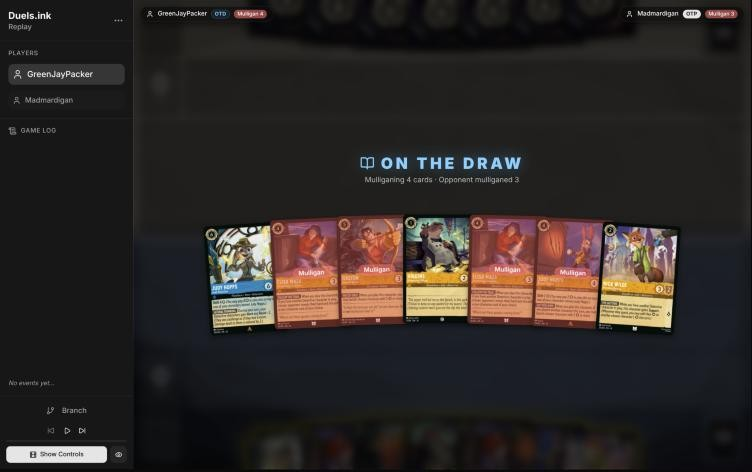
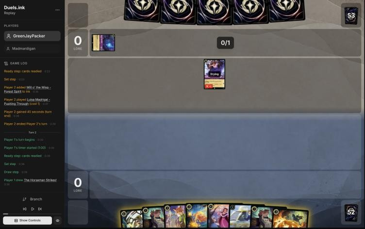
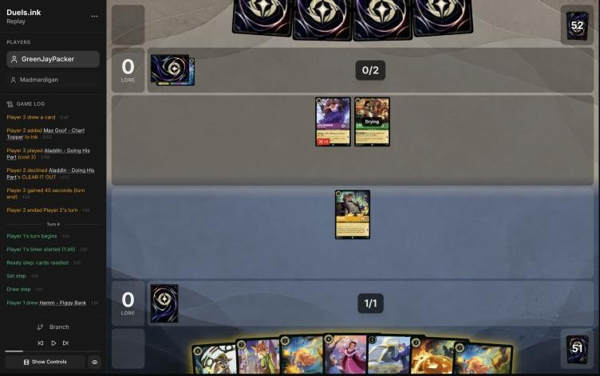
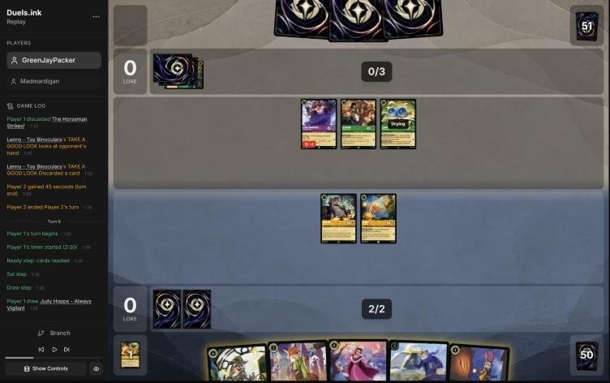
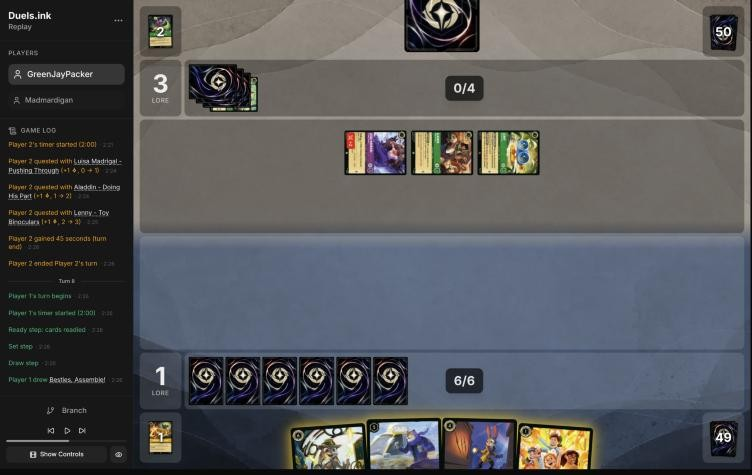
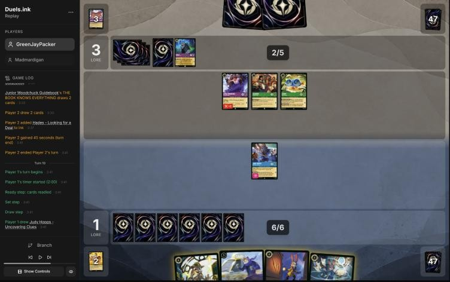
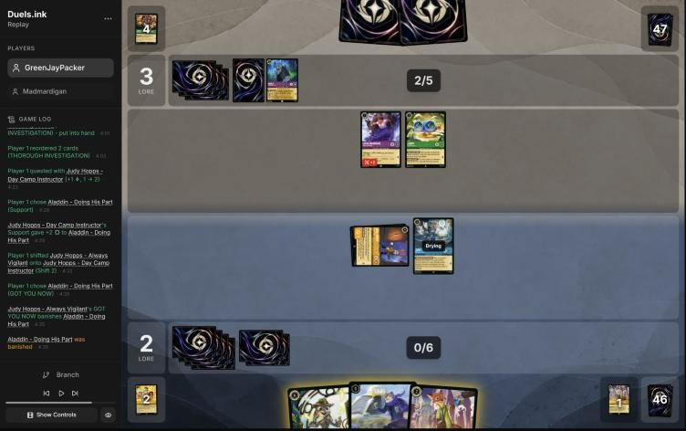
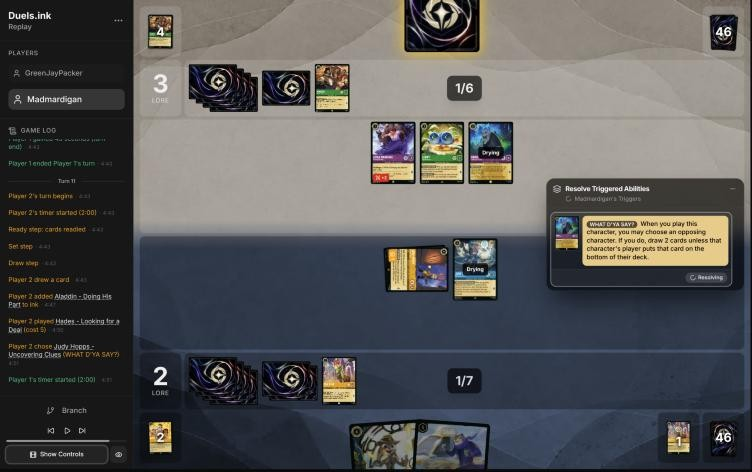
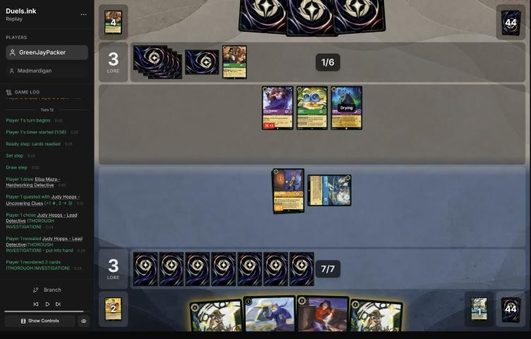

# Review: GreenJayPacker vs Madmardigan, 22 Nov 2026

| | |
|---|---|
| **Status** | draft (blind pass done, not yet discussed) |
| **Replay** | `01a203c6-da35` (`python3 tools/brief.py 01a203c6-da35 --turn N`) · [duels.ink viewer](https://duels.ink/replay/01a203c6-da3b-774c-8c2f-721439fc8eaa?step=0) |
| **Format** | Core Constructed (stated in the replay), judged by CR v2.3.0. Set 14 era: inks revealed before the coin toss |
| **Decks** | You: Amber/Sapphire Detectives (the same 60 as in your earlier reviewed games; [the coach's notes on how you play it](#cite-kb-meta-archetypes-amber-sapphire-detectives-as-greenjaypacker-plays-it)). Them: Amethyst/Emerald ([the coach's notes on this pair](#cite-kb-meta-archetypes-amethyst-emerald-retro-device-a-don-karnage-build-against-greenjaypacker-s-detectives)); closest list as it became clear: Retro Device from game turn 7 (Malicious, Wither, Strike a Good Match, Lenny, Aladdin & Genie, Guidebook, Hades), with Luisa Madrigal – Pushing Through, Will o' the Wisp and Max Goof – Chart Topper from outside it; no Device or Don Karnage seen |
| **Play/draw** | Madmardigan went first; you were on the draw |
| **Result** | Won: Madmardigan conceded at 4–3 at the start of game turn 13 (their 7th turn) |
| **Meta data** | snapshot of 2026-11-25 (fresh: 1 day old, stale from 2026-12-09) |
| **Chosen how** | By the project's owner: a list of GreenJayPacker's games sent for review, not chosen by result. |

## Summary
- **Good plays:** [8](#turn-8) (Besties found Day Camp as the Shift base, with the ink and Always Vigilant held);
  [10](#turn-10) (Clues first, then Day Camp's Support onto Aladdin and Always Vigilant's GOT YOU NOW: the deck's
  signature trick); [12](#turn-12) (Lead Detective Shifted onto the exerted Clues, which removed Hades's free kill).
- **Close calls:** the mulligan ([0](#turn-0)); the first ink ([2](#turn-2)); Higgins kept home ([4](#turn-4)); Belle
  rather than Always Vigilant ([6](#turn-6)); inking Nick ([10](#turn-10)); letting Hades draw 2 ([11](#turn-11)).
- **Inaccuracies:** [12](#turn-12): Elisa left in hand with 3 ink unused, when inking the second Lead Detective (a spare
  from the dig) paid for her and FOLLOW THE TRAIL would have taken a card from their 3.
- **Mistakes / blunders:** none.
- **Unwinnable from:** never.

**What decided it:** the expected song sweep came on game turn 7 and took three characters, but Belle turned them into
three ink, and from then on two 4-willpower Judys (Always Vigilant, then Lead Detective) gave them nothing to sweep or
challenge cheaply; Support plus Always Vigilant removed Aladdin, their only real attacker. They conceded at 4–3.

## The game, turn by turn
Verdicts judge each decision on what you could know at the time, **including archetype knowledge an experienced
player has**. Hindsight is kept to its own section. Severity scale: good play / close call /
inaccuracy / mistake / blunder. Principle IDs and hypotheses (H-n) link to copies
in the Citations section at the end, as they stood when they were cited.

**What you knew before the game:** their inks, Amethyst/Emerald, revealed before the coin toss. Of the common lists
it's most like Retro Device; it could be Unnamed #1 (Belle and Max Goof), Unnamed #2, or a deck of its own. No earlier
game of the match. The pair's key cards, with the earliest game turn each can come (they're on the play, so their
k-th turn is game turn 2k−1, with k ink if they ink every turn):
- **Don Karnage – Khan's Courier** (1, 2/2/1, no abilities): from game turn 1. A cheap body, and the Shift base for
  Debonair Pirate.
- **Malicious, Mean, and Scary** (song 3): puts 1 damage counter on each of your characters (Resist doesn't stop it).
  From game turn 5 for 3 ink, or free from game turn 7, sung by a dry character of cost 3 or more (Tod, Elsa, Lenny).
- **To Wither a Flower** (song 4, uninkable): 2 damage to each of your damaged characters. Game turn 7 for 4 ink, or
  sung free by a dry cost-4+ character.
- **Don Karnage – Debonair Pirate** (6, Shift 4, uninkable): on play, 1 damage to each of your characters, not reduced
  by Resist; SO SUAVE: while he's exerted, each damaged character of yours gets −1 {L}. **Shifted onto a dry Courier
  on game turn 7 he can sing To Wither a Flower at once: 3 damage to everything, which kills every character of yours
  with 3 willpower or less.** [The pair file's notes](#cite-kb-meta-archetypes-amethyst-emerald-retro-device-against-danny-s-remember-merida-romancejessica) show this sweep on their 4th turn.
- **Retro Evolution Device** (item 3; {E}, 1 ink, banish one of yours: play a character costing up to 2 more for
  free): from game turn 5 (played), used from game turn 7 (3 + 1 ink). A chain Tod/Elsa (3) → Hades (5) → Milo (7) →
  Prince Phillip (9) can bring Phillip by about game turn 11.
- **Prince Phillip – Vanquisher of Foes** (9, Shift 6, Evasive): banishes all your damaged characters. Hard-cast at 9
  ink on game turn 17; earlier through the Device (from a 7-cost Milo) or Shift onto a Phillip in play. After any
  ping or Malicious, treat Phillip as the archetype's wipe.
- **Hades – Looking for a Deal** (5): you bottom a chosen character of yours, or they draw 2. Game turn 9, or 7 via
  the Device.
- **Milo Thatch – Getting His Hands Dirty** (7, 5/5/3, Ward): discard a card to return a chosen character to hand; a
  draw at the end of a turn with 2+ cards to their discard. Game turn 13, or 9 via the Device.
- **Taran – Magically Armed** (5, uninkable, 5/5, Rush): on play, puts up to 2 cards from a discard on the bottom of the
  deck. Game turn 9, or 7 via the Device. He kills an exerted 4-willpower character the turn he lands.
- **Aladdin – Doing His Part** (2): banishes an item; your deck has none, so he's a 3/2 body here.
- **Lenny – Toy Binoculars** (3): reveals your hand and discards an action (Besties, Assemble!, The Horseman Strikes!).
- **Card flow:** Tod – Clever Fox (3, draw 2 discard 1), Elsa – Exploring the Unknown (3, draw 1), Strike a Good Match
  (song 2, draw 2 discard 1), Junior Woodchuck Guidebook (item 2, draw 2), Aladdin & Genie (5), Everyone Knows Juanita.
- **Off-list cards seen in this pair before:** Sven – Leaping Reindeer (4, Rush, Challenger +3, Evasive), Above the
  Crowd (song 5, bottoms a character with 3 {S} or less), Education or Elimination (Unnamed #1: banishes a damaged
  character).

**What that means for your deck:** your 1- and 2-drops have 1–2 willpower and die to one ping plus Wither, or to a
single Don wave with Malicious; your 4-drops (Elisa, Always Vigilant, Toy Drive Officer, Gaston, Fangmeyer) have 4
willpower and survive 3 damage, though damaged they're exposed to Phillip. Your 5-{S} removal (Gaston, Always
Vigilant) has targets in Milo, Taran and Phillip; Elisa's FOLLOW THE TRAIL can take their songs and the Device from
hand. From [the notes on your own deck](#cite-kb-meta-archetypes-amber-sapphire-detectives-as-greenjaypacker-plays-it): Lead Detective is a 4-ink Shift onto any Judy, Uncovering Clues digs first,
Support onto their character for Always Vigilant, characters in pairs while Toy Drive Officer is out, and against
pings keep home only what challenges kill for free.

### Pre-game

*The board before the decision: [step 0](https://duels.ink/replay/01a203c6-da3b-774c-8c2f-721439fc8eaa?step=0) in the duels.ink replay viewer.* The four cards you sent back are marked "Mulligan".

**The plan (written before seeing the mulligan made):** on the draw, seven of Higgins, Nick Wilde – Providing Backup,
Elisa Maza ×2, Judy Hopps – Always Vigilant, Gaston – Superior Archer and Judy Hopps – Lead Detective: all inkable, a
1 and a 2, then four cards at 4–6 and nothing at 3. The candidates, `tools/mulligan.py` over 1,500 deals each (turns
1–4):

| Option | Ink spent | Play turns | Lore by T4 | Characters T4 | Interaction |
|---|---|---|---|---|---|
| Keep all 7 | 9.18 | 3.91 | 6.0 | 4.1 | 100% |
| Mulligan all | 9.37 | 3.82 | 5.5 | 4.2 | 87% |
| Send back Lead Detective (keep 6) | 9.44 | 3.96 | 6.2 | 4.3 | 100% |
| Send back Lead Detective and Gaston | 9.55 | 3.98 | 6.3 | 4.5 | 100% |
| Send back Lead Detective and an Elisa | 9.55 | 3.98 | 6.3 | 4.5 | 100% |
| Keep Higgins, Nick, Elisa, Always Vigilant | 9.62 | 3.99 | 6.5 | 4.7 | 100% |

The differences are small: the hand already has a curve (Higgins, Nick, then a 4-drop each turn). What the sim can't
weigh: against a deck that pings and then wipes damaged characters, the 4-willpower bodies (Elisa, Always Vigilant,
Gaston) are the ones that survive Malicious plus Wither, Elisa's FOLLOW THE TRAIL takes a song or the Device from
their hand, and Gaston and Always Vigilant are the answers to Milo, Taran and Phillip. Lead Detective adds little early
here (their threats aren't Evasive until Phillip) and is the clunkiest card: a 6, or a 4-ink Shift that needs a Judy.
**My pick: send back Lead Detective only** (keep 6). Sending back Gaston too is close on the sim, but he's one of the
deck's few answers to their 5-{S} threats; deeper mulligans gain a few tenths of ink and lore for cards that matter in
this matchup. Keeping all 7 is a close call (Lead Detective as the turn-1 or turn-2 ink loses little).

**What you did:** on the draw (Madmardigan started). You kept Higgins, Nick Wilde – Providing Backup and Lead
Detective, and sent back Gaston, both Elisas and Always Vigilant. Madmardigan mulliganed 3.

**Verdict:** close call. On the same 1,500 deals your keep led on every curve measure (ink 9.59 against 9.44 for my
keep-6, play turns 3.98 against 3.96, lore by turn 4 6.7 against 6.2, characters 4.8 against 4.3), and trailed on
interaction (75% against 100%). Against this pair the interaction the sim counts (Gaston, Always Vigilant) has few
targets before Milo, Taran or Phillip come, around game turn 9 at the earliest, so the lower figure costs less than it
looks; what your keep gives up is the two Elisas' hand disruption against a song-based sweep, and 4-willpower bodies
that survive Malicious plus Wither. Keeping Lead Detective rather than a 4-drop follows your own rule (a 4-ink Shift
with sixteen Judys to go onto). Neither keep is clearly better ([MULL-1](#cite-mull-1), [MULL-2](#cite-mull-2), [MULL-3](#cite-mull-3)). Confidence: medium; the sim
ignores card quality and the ping sweep.

### Turn 1: their turn

**What happened:** they inked Will o' the Wisp – Forest Spirit (1, 0/3/1, returns to hand when banished in a
challenge) and played Luisa Madrigal – Pushing Through (1, 0/3/1, Challenger +2). Neither is in a listed
Amethyst/Emerald list's core (Will o' the Wisp is an Unnamed #2 card; Luisa is in none): from here the deck looks like
something of its own, closest to Retro Device or Unnamed #2.

### Turn 2: your turn 1

*The board before the decision: [step 6](https://duels.ink/replay/01a203c6-da3b-774c-8c2f-721439fc8eaa?step=6) in the duels.ink replay viewer.*

**The plan (written before seeing the turn):** you drew The Horseman Strikes!. Hand: Lead Detective, Higgins ×2, Nick
Wilde – Providing Backup, Hamm – Piggy Bank, Belle – Snowfield Strategist, Fangmeyer (uninkable) and Horseman. They have
Luisa (Challenger +2, so 2 {S} when she challenges) and 1 ink, 2 next turn. Nothing of yours is exposed this turn: a
character played now stays ready. Their 2-ink plays next turn: Aladdin – Doing His Part, Strike a Good Match, a
Guidebook, Don Karnage – Khan's Courier; nothing that pings at 2 ink. The curve the hand offers: Higgins now; Hamm or
Nick on turn 2; on turn 3 Hamm's LOOSE CHANGE makes Belle cost 3 (or Nick + Higgins); on turn 4 Hamm makes Fangmeyer
cost 4. Six inkable cards for four ink drops, so the ink choice is about which card matters least:
- **Ink Lead Detective, play Higgins.** No Judy in hand to Shift onto, and a 6 to hard-cast; turns 4–6 are already
  full (Belle, Fangmeyer, the 4-drops to come).
- **Ink the second Higgins, play Higgins.** Keeps Lead Detective for a Shift once a Judy shows up (sixteen in the
  deck), and the Alert answer to Phillip's Evasive. The second Higgins is the hand's weakest card against pings.
- **Ink Horseman:** no. It draws a card and banishes an Evasive character: one of the few answers to Prince Phillip
  (Evasive), and dig later.

My pick: ink Lead Detective and play Higgins, a close call with inking the second Higgins ([INK-1](#cite-ink-1), [INK-2](#cite-ink-2)).

**What you did:** inked the second Higgins and played the first.

**Verdict:** close call, the other half of my pick. Inking Higgins keeps Lead Detective as a Shift threat for later and
gives up a 2/2 that one ping kills; inking Lead Detective keeps a cheap body for a wider early board. Ink check: either
way turn 2 is Hamm or Nick and turn 3 Hamm's discount into Belle, or Nick plus a 1-drop, so neither ink costs a play
in the next two turns ([INK-1](#cite-ink-1), [INK-2](#cite-ink-2)). Confidence: medium.

### Turn 3: their turn

**What happened:** they inked Max Goof – Chart Topper (an Unnamed #1 card: quests to replay a song of cost 4 or less
from their discard) and played Aladdin – Doing His Part (3/2/1). Luisa stayed home. A mix of cards from different
lists so far.

### Turn 4: your turn 2

*The board before the decision: [step 13](https://duels.ink/replay/01a203c6-da3b-774c-8c2f-721439fc8eaa?step=13) in the duels.ink replay viewer.*

**The plan (written before seeing the turn):** you drew a second Hamm. 2 ink after inking; Higgins is dry. Their board:
Luisa (0/3, 2 {S} when challenging) and Aladdin – Doing His Part (3/2, dry next turn). Nothing of theirs is exerted, so
no challenge. Their next turn has 3 ink: Malicious for 3 (1 damage on each of yours; it kills nothing at full
willpower but sets up challenges), Aladdin & Genie Shifted onto Aladdin for 3, a 3-drop (Tod, Elsa), the Device. No
Supporter on either side yet (Nick in hand would be one, with Higgins in play).
- **Exposure if Higgins quests:** the brief's FREE KILLS line names him: Luisa kills him and survives on 1 willpower.
  Aladdin also kills him but dies to his 2 back. What the quest costs: a 1-cost 2/2 that the first ping half-kills
  anyway; what the kill costs them: Luisa's quest, and Luisa left exerted on 1 willpower for any of yours to finish.
  What staying home gains: nothing against Malicious, which reaches ready characters too. So quest ([H-12](#cite-h-12)'s logic, not
  Rockstar's deck).
- **What to play:** Hamm now makes the next two turns: on turn 3 LOOSE CHANGE makes Belle cost 3 (or Nick + the second
  Hamm), on turn 4 it makes Fangmeyer cost 4. Nick now has nothing to Support.
- **What to ink:** Lead Detective, the second Hamm, Belle, Nick or Horseman (Fangmeyer can't be inked). Horseman stays
  (draw, and the answer to an Evasive Phillip or Sven). Lead Detective is the long-term card: Resist +2 on your turn for
  every Detective makes your challenges into Luisa and Aladdin free, and a Judy to Shift onto is likely soon (sixteen in
  the deck). The second Hamm is a spare discount.

My pick: ink the second Hamm, play Hamm, quest Higgins. Inking Lead Detective instead is a close call.

**What you did:** inked the second Hamm, played Hamm, and kept Higgins home.

**Verdict:** close call. The ink and the play match my pick. Keeping Higgins home gave up 1 lore to avoid the brief's
one FREE KILL (Luisa, who'd survive on 1 willpower). My plan preferred the quest: the likely trade was Higgins for
Luisa, since a challenging Luisa is left exerted on 1 willpower for Hamm (2 {S} against her 0) to finish. Your line
keeps a Detective in play for Nick's Support and Elisa's FOLLOW THE TRAIL, which is worth about as much as one early
lore ([H-12](#cite-h-12), [RULE-1](#cite-rule-1)). Confidence: medium.

### Turn 5: their turn

**What happened:** they inked Strike a Good Match and played Lenny – Toy Binoculars, whose TAKE A GOOD LOOK showed them
your hand and took The Horseman Strikes! (their choice, not yours). Nobody quested: 0–0. They now know your hand: Lead
Detective, Nick, Belle, Fangmeyer.

### Turn 6: your turn 3

*The board before the decision: [step 20](https://duels.ink/replay/01a203c6-da3b-774c-8c2f-721439fc8eaa?step=20) in the duels.ink replay viewer.*

**The plan (written before seeing the turn):** you drew Always Vigilant. 3 ink after inking; Higgins and Hamm are dry.
Hand: Lead Detective, Nick, Belle, Fangmeyer (uninkable), Always Vigilant. They saw your hand last turn. Their board:
Luisa (2 when challenging), Aladdin (3/2), Lenny (0/2, drying); 0–0, and they haven't quested yet. 3 cards in hand, 4
ink next turn.
- **Their next turn:** Lenny (cost 3) can sing Malicious, Mean, and Scary for free, and 4 ink then pays for To Wither a
  Flower: 3 damage on every character of yours, which kills everything with 3 willpower or less (Higgins, Hamm, Nick,
  Belle) and leaves a 4-willpower Judy on 1. Each card on its own is about one in four for their list, both together
  much less. Don Karnage – Debonair Pirate isn't castable at 4 ink without a Courier (none seen). Hades at 5 is a turn
  away. No 5-{S} character of theirs for Always Vigilant to banish; no Supporter of yours can quest this turn, and none
  of theirs exists.
- **The setup worth making:** Always Vigilant now is a Judy for Lead Detective to Shift onto next turn (4 ink, or 3
  with LOOSE CHANGE), giving a dry 6/4/2 that quests at once, and Alert and Resist +2 to every Detective on your turns,
  which makes challenges into Luisa, Aladdin and Lenny cost nothing.
- **Exposure:** Higgins questing is the FREE KILL for Luisa (left on 1 willpower and exerted); with Always Vigilant
  in play he's no longer needed as your only other Detective, so take the lore. Hamm exerted for LOOSE CHANGE can be
  challenged only by Aladdin, who dies to his 2 back.
- **Candidates:**
  1. Ink Nick; LOOSE CHANGE, Always Vigilant for 3 (3 of 3); quest Higgins. Next turn Lead Detective onto her.
  2. Ink Lead Detective; LOOSE CHANGE, Belle for 3 (3 of 3); quest Higgins. Belle quests for 2 from next turn, and her
     WINTER STOCKPILE turns any sweep into ink.
  3. Ink Belle; Nick for 2 (2 of 3), quest Higgins and Hamm: 2 lore, but a 1-ink waste and two 2-willpower bodies.

  Which to ink in line 1: Nick (a 2/2 that one ping half-kills, and whose Support has no removal to feed yet) rather
  than Belle (2 lore, and ink back from any sweep).

My pick: line 1.

**What you did:** inked Nick; LOOSE CHANGE, Belle for 3; quested Higgins (1–0).

**Verdict:** close call (my line 2, with Nick inked). Ink sums: Belle 3 of 3 against Always Vigilant 3 of 3. Your line
gets a 2-lore quester down a turn sooner and keeps Always Vigilant's GOT YOU NOW for a real target (Milo, Taran or
Phillip, all 5+ {S}); mine would have had Lead Detective questing next turn and a body that survives Malicious plus
Wither, but spends the removal as a Shift base. Next turn both lines quest for about the same (Belle 2 against Lead
Detective 2), and your Belle turns any sweep into ink. Higgins' quest left him exposed only to Luisa's free kill, which
is fine now that he isn't your only Detective enabler ([TEMPO-1](#cite-tempo-1), [VALUE-2](#cite-value-2), [SEQ-4](#cite-seq-4)). Confidence: medium.

### Turn 7: their turn

**What happened:** the sweep from the setup. They inked Aladdin & Genie, Lenny sang Malicious, Mean, and Scary for
free, COMIN' UP FAST readied Lenny, and To Wither a Flower (4 ink) killed Higgins, Hamm and Belle. Belle's WINTER
STOCKPILE put all three into your inkwell (6 ink). Then all three of theirs quested: 1–3. Their list now looks most
like Retro Device's song package (Malicious, Wither, Strike, Lenny, Aladdin & Genie), with Luisa, Will o' the Wisp and
Max Goof – Chart Topper from outside it. Lenny singing Malicious, readying with COMIN' UP FAST and then questing, with
Wither paid in ink, is the line [the coach's Amber/Emerald notes](#cite-kb-meta-archetypes-amber-emerald-circle-of-life-against-danny-th3-truth-eggstheklexx-and-nishal) record from EggsTheKlexx on the same game turn.

### Turn 8: your turn 4

*The board before the decision: [step 36](https://duels.ink/replay/01a203c6-da3b-774c-8c2f-721439fc8eaa?step=36) in the duels.ink replay viewer.*

**The plan (written before seeing the turn):** you drew Besties, Assemble!. 6 ink ready (Belle's three), 7 if you ink;
hand of Lead Detective, Fangmeyer (uninkable), Always Vigilant and Besties; no board. Their three characters are
exerted, but nothing of yours can challenge this turn (no Rush). They hold **1 card** with 5 ink next turn: their hold
chances are low now (with their draw, about one in eight for Malicious, one in twelve for Wither, one in seven for
Hades), but Lenny still sings a Malicious for free, and Max Goof – Chart Topper (one inked) replays a song of cost 4 or
less from their discard each time he quests: Malicious and Wither are both there. Lore 1–3; their board quests for 3.
- **The needs check:** you need a board that quests and survives one ping-and-Wither: 4-willpower characters, and
  Lead Detective, whose Resist +2 makes your challenges into their 0–3 {S} characters free. Ink is no longer short (6 on
  your 4th turn) and cards are: four in hand. So inking a card costs more than an ink buys ([H-2](#cite-h-2), [INK-3](#cite-ink-3)), unless the dig
  finds a spare.
- **Dig first** ([SEQ-1](#cite-seq-1)): Besties (1) looks at 4 for a character. Then a Judy as the base for Lead Detective's Shift next
  turn (4 ink, and she quests at once): Uncovering Clues or Day Camp Instructor if Besties finds one (keeping Always
  Vigilant's GOT YOU NOW for Milo, Taran or Phillip), otherwise Always Vigilant herself (4). A 1-drop found fills the
  last ink.
- **Candidates:**
  1. No ink; Besties (1), then the Judy base (4), then a 1-drop if found: 5–6 of 6. Next turn Lead Detective Shifts on
     (4) with 2–3 ink to spare.
  2. Ink Besties; Always Vigilant (4) of 7, 3 unused: loses the dig for an ink you can't use.
  3. Hard-cast Lead Detective (6) + Besties (1) of 7, inking Always Vigilant: Lead Detective quests next turn either way,
     but costs 2 more ink and a card.
- **Exposure:** anything played now stays ready; Hades (5) can make you bottom it or let them draw 2.

My pick: line 1 (dig, then a Judy base, no ink unless the dig gives a spare card).

**What you did:** no ink. Besties found Judy Hopps – Day Camp Instructor, and you played her (3 of 6 ink), keeping
Always Vigilant and Lead Detective.

**Verdict:** good play: my line 1 with the Day Camp find. Day Camp is a Judy for Lead Detective's Shift next turn, so
Always Vigilant's GOT YOU NOW stays in hand for a 5-{S} target, and holding the ink keeps both Judys. The 3 ink left
unused had nothing worth buying: Always Vigilant needed 4, and inking Lead Detective or Always Vigilant to reach it
(with LEND A PAW's extra ink) would have spent a key card for a random one ([H-2](#cite-h-2), [INK-3](#cite-ink-3), [SEQ-1](#cite-seq-1)). Confidence: high.

### Turn 9: their turn

**What happened:** they played Junior Woodchuck Guidebook and used it at once (draw 2), and inked Hades – Looking for
a Deal. Nobody quested: still 1–3.

### Turn 10: your turn 5

*The board before the decision: [step 45](https://duels.ink/replay/01a203c6-da3b-774c-8c2f-721439fc8eaa?step=45) in the duels.ink replay viewer.*

*The board before the decision: [step 54](https://duels.ink/replay/01a203c6-da3b-774c-8c2f-721439fc8eaa?step=54) in the duels.ink replay viewer.* For the ink verdict: Aladdin just banished, Nick in hand.

**The plan (written before seeing the turn):** you drew Uncovering Clues. 6 ink (7 with an ink, but the only inkable
cards are Lead Detective, Always Vigilant and Clues); Day Camp Instructor is dry. Hand: Lead Detective, Fangmeyer,
Always Vigilant, Clues. Their three are ready (they didn't quest), so nothing can be challenged. Lore 1–3; they hold 2
cards and have 6 ink next turn.
- **Their next turn:** Lenny sings a Malicious for free if they've drawn one; 6 ink brings Don Karnage – Debonair Pirate
  hard-cast (1 damage to everything, SO SUAVE), Max Goof – Chart Topper hard-cast (from the turn after, each quest
  replays Malicious or Wither from their discard: a must-kill), Hades (5: bottom a character or they draw 2), Taran
  (5, Rush, 5 {S}). Each is roughly one in six for their list, with their draw.
- **Support line:** yours onto their character: Day Camp's quest adds +2 to Aladdin, putting him at 5 {S}, in range
  of Always Vigilant (the brief's STRENGTH REMOVAL line). Yours onto your challenger: none (nothing to challenge).
  Theirs: they have no Supporter.
- **What can punish an exerted character:** Luisa (2 when challenging) and Aladdin (3), 5 together; Malicious adds 1
  to each. An exerted Lead Detective (4 willpower) dies to Luisa plus Aladdin (both die), or to a free Malicious plus
  Aladdin. Day Camp questing is the FREE KILL for Luisa. Aladdin is the attacker that makes your quests unsafe.
- **Candidates:**
  1. **Day Camp quests (+1), Support onto Aladdin; Clues (4) digs 3 for a Detective; Always Vigilant Shifts onto Day
     Camp (2), and GOT YOU NOW (Clues was played) banishes Aladdin.** 4 + 2 = 6 of 6. Leaves Clues ready and Always
     Vigilant exerted (4 willpower: Luisa, or Luisa plus a Malicious, can't kill her; Taran's Rush can; Hades can ask for
     her). Next turn Lead Detective Shifts onto Always Vigilant (4) and quests at once with Aladdin gone.
  2. **Lead Detective Shifts onto Day Camp (4) and quests (+2), 3–3.** Two ink unused, and the 6/4 is left exerted for
     Luisa and Aladdin (they'd trade both for her) or a free Malicious plus Aladdin.
  3. **Clues (4) and hold Always Vigilant** for a bigger target (Milo, Taran, Phillip, Max Goof with Support), Day Camp
     home: develops and digs, kills nothing, 2 ink unused.

  Line 1 spends the removal on a 2-cost, but Aladdin is the one card that turns your quests into trades, it uses all
  the ink, and it digs before the rest of the turn is settled (if Clues finds something better for the 2 ink, take
  that). No ink unless the dig gives a spare card: ink is plentiful and cards aren't.

My pick: line 1.

**What you did:** Clues first (she found Nick Wilde – Providing Backup); Day Camp quested (2–3) with Support +2 onto
Aladdin; Always Vigilant Shifted onto Day Camp for 2, and GOT YOU NOW banished Aladdin. Then you inked Nick.

**Verdict:** good play: my line 1, in the best order (dig first, then the Support, then the removal). Support onto
their character to bring Always Vigilant's threshold within reach is the deck's signature trick ([your piloting
notes](#cite-kb-meta-archetypes-amber-sapphire-detectives-as-greenjaypacker-plays-it)), and it removed the
one attacker that made your quests unsafe ([H-9](#cite-h-9) from the other side; [SEQ-1](#cite-seq-1), [THREAT-1](#cite-threat-1)). Ink sum: Clues 4 + Shift 2 = 6 of
6.

Inking Nick afterwards is a close call. Ink check: inked, next turn has 7 ink for Lead Detective's Shift (4) and 3 for
whatever you draw, and two 4-drops a turn come a turn sooner; held, next turn is Lead Detective plus Nick (4 + 2 = 6
of 6), one more body and a Supporter whose +3 puts any 2-{S} character of theirs in range of Gaston or Always Vigilant.
Nick's 2 willpower makes him the first casualty of any ping, which narrows the gap ([INK-1](#cite-ink-1), [H-2](#cite-h-2)). Confidence: medium.

### Turn 11: their turn

*The board before the decision: [step 59](https://duels.ink/replay/01a203c6-da3b-774c-8c2f-721439fc8eaa?step=59) in the duels.ink replay viewer.* Hades has chosen Uncovering Clues.

**What happened:** they inked a second Aladdin – Doing His Part and played Hades – Looking for a Deal on Uncovering
Clues. **You let them draw 2** rather than bottom Clues. Nobody quested or challenged (Luisa's 2 can't kill the exerted
Always Vigilant): still 2–3.

**Verdict on the Hades choice:** close call. Bottoming Clues costs you a 4-cost dig engine (a Detective found on each
quest) and your second body; letting them draw gives a hand of 1 two more cards. What those cards buy them, by
`tools/odds.py` over the 47 cards you hadn't seen: the chance they hold a card that damages your whole board
(Malicious, Don Karnage – Debonair Pirate; 6 copies left in their list) by their next turn goes from 24% to 43%, and
Malicious plus Wither together from 1% to 3%. Your board after their turn is the same 4-willpower Always Vigilant
either way; Clues (3 willpower) is the one a ping-and-challenge kills. A hand of 1 makes their extra cards worth more
(the converse in [H-2](#cite-h-2)), and Clues's digs make yours worth more; neither side is clearly bigger ([CARD-1](#cite-card-1), [H-2](#cite-h-2)).
Confidence: low to medium.

### Turn 12: your turn 6

*The board before the decision: [step 64](https://duels.ink/replay/01a203c6-da3b-774c-8c2f-721439fc8eaa?step=64) in the duels.ink replay viewer.* After Clues found the second Lead Detective.

**The plan (written before seeing the turn):** you drew Elisa Maza. 7 ink; the only inkable cards in hand are Lead
Detective and Elisa, so an 8th ink has to come from the dig. Board: Always Vigilant and Clues, both dry. Theirs: Luisa,
Lenny, Hades (3/4, drying), all ready, so nothing to challenge. Lore 2–3. They hold 3 cards with 7 ink next turn;
Lenny and Hades are both free singers (Hades can sing Wither too).
- **What can punish an exerted character next turn:** Luisa 2 + Hades 3. Clues questing is the FREE KILL for Hades
  (left on 1 willpower). An exerted Lead Detective or Always Vigilant (4 willpower) costs them both Luisa and Hades, or
  Hades alone after a free Malicious (about one in four for their list). Taran's Rush (5) kills any of them.
- **Elisa's FOLLOW THE TRAIL** (another Detective in play: yes) shows their 3 cards and takes a non-character of your
  choice: Malicious, Wither, the Device, Strike. Played before you decide what to quest, it also tells you whether a
  Malicious is waiting.
- **Fangmeyer:** no Detective in your discard, so REQUEST REINFORCEMENTS finds nothing; he can wait.
- **Support line:** none of yours can quest with Support (Day Camp is under Always Vigilant); they have no Supporter.
- **The needs check:** their clock is slow (3 a turn if they quest, and they mostly haven't); yours needs Lead Detective
  questing and more bodies. What can turn it against you is a sweep, so taking their songs out of hand matters as much
  as lore.
- **Candidates:**
  1. **Clues quests first (dig 3 for a Detective). Ink the find if it's a spare inkable card (8 ink); Elisa (4), take
     their worst non-character; then Lead Detective Shifts onto Always Vigilant (4) and quests if what you saw allows.**
     4 + 4 = 8 of 8. If the find is a cheap Detective, play it instead and choose between Elisa and Lead Detective for
     the 4. Clues is left exposed to Hades for a card and a lore; a Hades that kills her is left on 1 for your next turn.
  2. **No dig: Lead Detective Shifts onto Always Vigilant and quests (+2), 3 ink unused.** Elisa waits a turn; their
     hand stays unseen.
  3. **No dig: Elisa (4), 3 unused;** Lead Detective next turn.

My pick: line 1.

**What you did:** Clues quested first (3–3) and found the second Lead Detective; you Shifted Lead Detective onto the
exerted Clues (4), then quested Always Vigilant (4–3). No ink; Elisa, Fangmeyer and the other Lead Detective stayed in
hand, with 3 ink unused.

**Verdict, the Shift:** good play, and better than my plan's Shift onto the dry Always Vigilant. Shifting onto the
exerted Clues turns the brief's one FREE KILL (Hades into a 3-willpower Clues) into a 6/4 that Hades can't kill alone
and that kills him back; my line would have quested Lead Detective for 1 more lore but left Clues for Hades. Both lines
leave two characters exerted: yours two 4-willpower Judys (Luisa and Hades together kill one and both die; Hades alone
after a free Malicious), mine a 4-willpower Lead Detective and a 3-willpower Clues ([TRADE-4](#cite-trade-4), [RULE-1](#cite-rule-1), [SEQ-1](#cite-seq-1)).

**Verdict, the unused ink:** inaccuracy. Leaving **Elisa** in hand with 3 ink spare is suboptimal because the dig
gave you a spare card: inking the second Lead Detective made 8 ink, enough for Elisa (4) as well as the Shift (4), and
playing **Elisa first** is better because FOLLOW THE TRAIL would have shown their 3 cards and taken the worst
non-character (Malicious, Wither, the Device) before you chose what to quest, and added a 4-willpower body that the
song sweep doesn't kill. Ink sum: Shift 4 + Elisa 4 = 8 of 8. What that line exposes: the same two exerted Judys as
yours, with Elisa ready (only a ping or Hades can touch her). What it gives up: the second Lead Detective as a threat
held against a sweep, which is worth something against this deck ([POS-1](#cite-pos-1)), but less than a card out of a 3-card hand
and a body now ([TEMPO-1](#cite-tempo-1), [INK-3](#cite-ink-3), [SEQ-1](#cite-seq-1)). [Your piloting notes](#cite-kb-meta-archetypes-amber-sapphire-detectives-as-greenjaypacker-plays-it) record the same pattern from the
McWryze game: a find from Clues that paid for a double play. Confidence: medium; it rests on their hand holding a non-character worth taking.

### Turn 13: their turn

**What happened:** they drew and conceded at 4–3, facing your Lead Detective and Always Vigilant, with Elisa,
Fangmeyer and the second Lead Detective in your hand.

## Lessons
1. **Support onto their character, then the 5-{S} removal** ([10](#turn-10)): Day Camp's +2 put Aladdin in range of
   Always Vigilant. You found it at once; it's the deck's best way to spend a GOT YOU NOW when their threats are small.
2. **With a dig, ink the spare it finds to make the double play** ([12](#turn-12)): the second Lead Detective was
   worth less than Elisa on the board and a card out of a 3-card hand, against a deck whose sweeps are songs she can
   take. And play the hand disruption before deciding what to quest: what she shows changes which quests are safe.
3. **Shift onto the base that's exposed** ([12](#turn-12)): when one Judy has already quested and is a free kill, a
   Shift onto her turns the free kill into a 6/4 that kills back, for one lore less than a Shift onto the dry Judy.
4. **Against a song sweep, a Belle in play makes it pay you** ([6](#turn-6), [7](#turn-7)): WINTER STOCKPILE inks
   each character it banishes, so a sweep of three is three ink, and the 4-willpower bodies that follow (Always
   Vigilant, Elisa, Lead Detective, Fangmeyer) survive Malicious plus Wither.

## Proposed knowledge-base updates (applied after discussion)
- **Strategy:**
  - New hypothesis: *Shift onto the exposed base.* When two Shift bases are in play and one has already quested and is a
    free kill, Shifting onto the exerted one removes the free kill (the new character enters exerted, [CR 8.10.2](#cite-cr-8-10-2), and
    keeps the base's quest) at the cost of the Shifted character's own quest. Evidence: 01a203c6-da35 turn 12 (Lead
    Detective onto the quested Clues, which Hades would have killed for free; the dry Always Vigilant quested instead).
  - Evidence for the converse in [H-2](#cite-h-2) (a close call, not discussed): 01a203c6-da35 turn 11, Hades on Clues against a
    1-card hand; letting them draw raised their chance of a board-damage card by their next turn from 24% to 43%.
- **Meta, Amethyst/Emerald notes** (below the end marker): *Retro Device (a song build) against GreenJayPacker's
  Detectives: Madmardigan* (01a203c6-da35, 22 Nov 2026). Seen: Luisa Madrigal – Pushing Through (off-list), Aladdin –
  Doing His Part ×2, Lenny, Hades ×2, Malicious, To Wither a Flower, Junior Woodchuck Guidebook; inked Will o' the Wisp,
  Max Goof – Chart Topper, Strike a Good Match, Aladdin & Genie, Hades, Aladdin. How it played: no quests until the sweep
  on game turn 7 (Lenny sang Malicious for free, readied with COMIN' UP FAST and quested; Wither for 4 ink killed
  three); Hades on game turn 11; conceded at 4–3 on game turn 13, against two 4-willpower Judys. Also copy the Lenny
  line (now in the Amber/Emerald notes only) into this pair's "Themes", since this list runs Lenny too.
- **Meta, Amber/Sapphire notes,** *Detectives as GreenJayPacker plays it:* add this game (the same 60; won) and three
  piloting points: Belle before an expected song sweep turns it into ink (turns 6–7); Shift Lead Detective onto the
  Judy that has quested when it's a free kill (turn 12); ink a spare from Clues's dig to fit Elisa (turn 12).
- **Rules:** none.

## Hindsight
Doesn't change the verdicts above.
- **Turn 6:** the sweep the setup named came on turn 7 (Malicious sung by Lenny, Wither for 4 ink). Belle died but
  inked herself, Higgins and Hamm (3 → 6 ink); my Always Vigilant line would have kept a Judy on 1 willpower and lost
  Higgins and Hamm for no ink. That's the outcome, not evidence for either line.
- **Turns 11 and 12:** what Hades drew, and what Elisa would have seen, never showed: only your hand is in the replay.
  They conceded holding 4 cards with 6 ink (7 had they inked), at 4–3, so the replay doesn't say why.
- **The game's shape:** their only quests came on the sweep turn (3 lore, game turn 7); every later turn of theirs was
  card flow (Guidebook, Hades) rather than board. Your board never fell below two characters after turn 10.

## The coach's errors
Filled in during discussion.

| When | Error | How it was caught | How it won't happen again |
|---|---|---|---|
| Turn 11 (blind pass) | The Hades choice's odds were first worked out from a hand of 2; it was 1. The opponent's turn-start board line counts the turn's draw already, and the coach subtracted the inked card and Hades from 3 + 1 | The coach, comparing the next turn's counts; fixed before the verdict was final, verdict unchanged (close call) | Proposed: the brief's `>>` lines print the opponent's hand size and deck at the moment of the choice |

## Open questions
- **Pre-game:** you sent back both Elisas, Always Vigilant and Gaston and kept Lead Detective. Was it for the curve, or
  did you rate Lead Detective higher than the 4-drops in this matchup?
- **Turn 4:** was Higgins kept home to keep a second Detective in play for Nick and Elisa, or to keep him away from
  Luisa?
- **Turn 6:** Belle rather than Always Vigilant: was it to hold Always Vigilant's GOT YOU NOW for a target, to have
  Belle's ink if they swept, or the 2 lore?
- **Turn 10:** why ink Nick rather than hold him for Lead Detective plus Nick the next turn?
- **Turn 11:** why let Hades draw rather than bottom Clues?
- **Turn 12:** did you consider inking the second Lead Detective to play Elisa? Was it held back as a threat against a
  sweep?

## Citations
Copies of the coach's knowledge base cited above, as they stood when they were cited (the private repository's commit and date are given with each). They don't change when the knowledge base does.

**amber-sapphire.md, Detectives as GreenJayPacker plays it**: knowledge base, `kb/meta/archetypes/amber-sapphire.md` at `5894e68` (2026-11-26), working tree

> ### Detectives as GreenJayPacker plays it `[coach, blind reviews of 01a1fb8a-260a (vs James, discussed 22 Nov 2026) and 01a1ffec-372f (vs [AD-S] McWryze, not yet discussed)]`
> The same 60 in both games: Higgins ×4, Eilonwy ×3, Besties ×3, Helpful Officer ×2, Mowgli ×2, Grandmother Willow ×2,
> Hamm ×2, Day Camp Instructor ×4, Nick Wilde – Providing Backup ×4, On the Case ×2, The Horseman Strikes! ×3, Uncovering
> Clues ×4, Belle – Snowfield Strategist ×2, Mickey Mouse – Expedition Leader ×2, Toy Drive Officer ×4, Elisa Maza ×4,
> Always Vigilant ×4, Fangmeyer ×3, Gaston ×3, Lead Detective ×3. Both games won. Piloting points:
> - **Lead Detective is a 4-ink Shift, not a spare 6-drop:** sixteen other Judys to go onto. She was inked early in both
>   games (James turn 1, McWryze turn 5; "new to the deck, ink the high costs"), and against Emerald/Steel's Evasive
>   questers she was the matchup: Shifted onto a dry Day Camp, her Alert killed Vixey and Mushu (McWryze turn 11).
> - **Dig first, then plan:** Uncovering Clues digs on play and on each quest; her finds made turns 9 and 11 against
>   McWryze (an inkable Elisa for a double play, then both Lead Detectives).
> - **Support onto their character** for Always Vigilant: Don Karnage and Fflewddur (James turns 15 and 21).
> - **Play characters in pairs while Toy Drive Officer is out:** it drew a card nearly every turn in both games.
> - **Against pings, keep home only what challenges kill for free** (Toy Drive Officer, James turn 11).

**amethyst-emerald.md, Retro Device (a Don Karnage build) against GreenJayPacker's Detectives**: knowledge base, `kb/meta/archetypes/amethyst-emerald.md` at `5894e68` (2026-11-26), working tree

> ### Retro Device (a Don Karnage build) against GreenJayPacker's Detectives: James (Little Meeples) `[coach, blind review of 01a1fb8a-260a, 21 Nov 2026, discussed 22 Nov]`
> A tournament-style game, inks not revealed. They conceded on game turn 22 at 7–17.
> - **Seen:** Don Karnage – Khan's Courier ×3, Don Karnage – Debonair Pirate ×2, Malicious, Mean, and Scary ×2, To Wither a
>   Flower ×3, Tod – Clever Fox ×2, Strike a Good Match, Milo Thatch (discarded), Ursula – Deceiver, and off-list Everyone
>   Knows Juanita and Fflewddur Fflam – Luckless Bard. Inked: Aladdin & Genie, Luisa Madrigal – Confident Climber, Hook
>   Hand – Unexpectedly Friendly and Prince Phillip. No Retro Evolution Device seen.
> - **How it played:** a ping or song on game turns 6, 8, 10, 12 and 14 killed ten characters. Don Karnage's SO SUAVE made
>   damaged questers worth 0 while he was exerted, and he sang the songs for free. Their own board stayed at two or three
>   characters, and their lore at 7 by turn 22.
> - **What beat it:** Support onto Don, then Always Vigilant (turn 15); a board of 4-willpower characters (Fangmeyer, Elisa,
>   Always Vigilant, Clues) that one ping can't kill; card flow faster than their sweeps (three Toy Drive Officers).
> - **Staying ready against it** saves nothing from the pings, only from challenges: worth it for a character two of
>   theirs can kill for free (Toy Drive Officer against Don and Ursula, turn 11), not otherwise.

**amber-emerald.md, Circle of Life against danny: Th3 TRUTH, EggsTheKlexx and Nishal**: knowledge base, `kb/meta/archetypes/amber-emerald.md` at `5894e68` (2026-11-26), working tree

> ### Circle of Life against danny: Th3 TRUTH, EggsTheKlexx and Nishal `[coach, meta study of danny's 5 Nov 2026 games (tools/scan.py), full games, not blind, 3 games]`
> `01a1aba9-b9fe` (Th3 TRUTH: conceded at 0–7 on game turn 11) and `01a1abbd-d461` (EggsTheKlexx: won 20–6 on turn 19),
> against danny's Amethyst/Steel; `01a1ad20-6e6f` (Nishal: danny conceded at 7–15 on turn 17), against Remember Merida.
> - **The early sweep, game turn 6 or 7:** Nishal Shifted Don Karnage – Debonair Pirate onto Khan's Courier on turn 6
>   (their 3rd turn, with an ink drop) and sang To Wither a Flower with Ursula – Vanessa: three kills. EggsTheKlexx sang
>   Malicious, Mean, and Scary with Lenny – Toy Binoculars, which readies after they play an action (COMIN' UP FAST) and
>   then quested, and cast To Wither a Flower: four kills on turn 7.
> - **Then Phillip:** Circle of Life sung by Milo and Ariel (EggsTheKlexx, turn 15: two kills), or hard-cast for 7 after
>   Akood et Emuti, with Lenny singing both songs (Nishal, turn 16: two kills).
> - **Ariel – Ethereal Voice** (off-list; 4, 3/4/2, Boost 1): a draw when they play a song with a card under her.
> - **The lore came late and fast:** EggsTheKlexx +7 on turn 17 and +12 on 19 (Milo, Phillip, Ariel, Tod); Nishal +8 on
>   16 (Max Goof – Karaoke Star quested for 4). Milo's SCHOLAR'S GAMBIT bounced Tinker Bell – Giant Fairy (turn 17).

**MULL-1**: strategy principle, `kb/strategy/principles.md` at `5894e68` (2026-11-26), working tree

> - **MULL-1. Keep a plan, not the strongest cards.** *Ask: "Which hand gives me the best chance to execute my game plan in this matchup?"* `[MCL ch.12]` · baseline

**MULL-2**: strategy principle, `kb/strategy/principles.md` at `5894e68` (2026-11-26), working tree

> - **MULL-2. A smooth curve beats a few powerful cards.** Check that you can spend ink well on turns 1–4, have enough inkable cards, and know what turn 4 looks like. `[MCL ch.12]` · baseline
>   - **Ink spent isn't the goal by itself.** Judge a keep by a nice curve (a play each turn), early lore pressure, and
>     interaction that sets the opponent back, as well as by ink, then weigh card quality and the matchup
>     (user, 2026-11-01). `tools/mulligan.py` reports all of these.

**MULL-3**: strategy principle, `kb/strategy/principles.md` at `5894e68` (2026-11-26), working tree

> - **MULL-3. The right keep depends on the matchup.** Early interaction against aggro; pressure, draw and engines against slow decks. The mulligan is the first expression of your role. In the Set 14 era the opponent's inks are known before the mulligan (RULE-8), so this applies from game 1 of a match. `[MCL ch.12]` · baseline

**INK-1**: strategy principle, `kb/strategy/principles.md` at `5894e68` (2026-11-26), working tree

> - **INK-1. Inking is permanent.** Every inked card is one line of play removed for the rest of the game. *Ask: "Will I regret losing access to this card?"* `[MCL ch.4]` · baseline

**INK-2**: strategy principle, `kb/strategy/principles.md` at `5894e68` (2026-11-26), working tree

> - **INK-2. Don't automatically ink the most expensive card.** It may be the late-game win condition or the key answer for this matchup. The answer depends on matchup, hand and board. `[MCL ch.4]` · baseline

**RULE-1**: strategy principle, `kb/strategy/principles.md` at `5894e68` (2026-11-26), working tree

> - **RULE-1. Only exerted characters can be challenged** `[CR 4.6.4.2]`. Questing, singing, or {E} for an ability exposes the character. Staying ready protects it. Every quest is also a decision about what the opponent can challenge next turn. · baseline
>   - *Card text overrides this* (CR 1.2.1). Shere Khan – Khan Industries CEO's NEW INCENTIVE lets one character
>     challenge ready characters that turn. Alert (e.g. from Judy Hopps – Lead Detective, to every Detective on their
>     turn) ignores Evasive. Against Ducktectives, name both in the setup. 01a14574, turns 16 and 18. `[coach, 2026-10-26]`

**TEMPO-1**: strategy principle, `kb/strategy/principles.md` at `5894e68` (2026-11-26), working tree

> - **TEMPO-1. Tempo is how much freedom you leave the opponent, not how fast you play.** A play that forces the opponent to spend their turn answering it has stolen part of their turn. *Ask: "If I play this, what does my opponent have to do next?"* `[MCL ch.1]` · baseline

**VALUE-2**: strategy principle, `kb/strategy/principles.md` at `5894e68` (2026-11-26), working tree

> - **VALUE-2. Flexibility is value.** A card that can quest, challenge, be inked, or serve as a shift target keeps options open. `[MCL ch.3]` · baseline

**SEQ-4**: strategy principle, `kb/strategy/principles.md` at `5894e68` (2026-11-26), working tree

> - **SEQ-4. Sequence across turns.** A slightly weaker play now can set up a much stronger next turn: keep a shift target alive, keep a singer ready, hold removal for a bigger threat. `[MCL ch.5]` · baseline

**INK-3**: strategy principle, `kb/strategy/principles.md` at `5894e68` (2026-11-26), working tree

> - **INK-3. Usually ink every turn, but not automatically.** Keeping one more playable card can beat one more ink. Missing ink with an expensive hand can leave you permanently behind. `[MCL ch.4]` · baseline

**SEQ-1**: strategy principle, `kb/strategy/principles.md` at `5894e68` (2026-11-26), working tree

> - **SEQ-1. Gather information before irreversible decisions.** Draw, look and scry before choosing what to ink. Quest with draw triggers before committing other plays when the order doesn't otherwise matter. `[MCL ch.5]` · baseline

**THREAT-1**: strategy principle, `kb/strategy/principles.md` at `5894e68` (2026-11-26), working tree

> - **THREAT-1. Not every threat needs an answer.** *Ask: "What happens if I don't answer this?"* "Very little" means spend resources elsewhere. "I probably lose" means it's the priority. `[MCL ch.9]` · baseline

**CARD-1**: strategy principle, `kb/strategy/principles.md` at `5894e68` (2026-11-26), working tree

> - **CARD-1. Card advantage is having more meaningful options than the opponent.** Ways to get it:
>   - 2-for-1 trades, and removal that hits two targets
>   - characters that survive several challenges
>   - recursion
>   - cards that replace themselves
>   - discard
>
>   *Ask after each exchange: "Who has more useful resources left?"* `[MCL ch.2]` · baseline

**TRADE-4**: strategy principle, `kb/strategy/principles.md` at `5894e68` (2026-11-26), working tree

> - **TRADE-4. Every challenge has an opportunity cost.** It's a lost quest, and the challenger may be exposed while exerted. Declining a trade is often as strong as taking it. *Ask: "Would simply questing be stronger?"* `[MCL ch.7]` · baseline

**POS-1**: strategy principle, `kb/strategy/principles.md` at `5894e68` (2026-11-26), working tree

> - **POS-1. From ahead, take the safest path to victory.** Don't overextend into sweepers, don't make unnecessary trades, and make the opponent take the risks. Winning by 1 lore counts the same as winning by 10. `[MCL ch.10]` · baseline

**H-12**: hypothesis, `kb/strategy/hypotheses.md` at `5894e68` (2026-11-26), working tree

> ### H-12. A Rockstar board should quest every turn against an exert-and-challenge deck
> - **Claim:** against Midrange decks that remove with exert effects and challengers (Amber/Amethyst and Amethyst/Steel:
>   Isis, Peter Pan's Shadow, Demona – Scourge, Cheshire Cat's moved damage, Rafiki), Rockstar Aggro's small characters
>   should quest each turn rather than wait ready. The limit: a quester that would die for nothing to a single
>   challenger needs a Bodyguard in front of it first (David entering exerted).
> - **Why:** staying ready protects only from their plain challengers (Rafiki, Hamm). Isis and Shadow exert a chosen
>   character, Scourge exerts them all, and Cheshire moves damage without a challenge, so ready characters die anyway
>   and the skipped quests are lore the race can't win back. It's H-6's opposite case: H-6's ready board gained by
>   drawing cards while it waited, and a board of 1-lore Rockstar characters draws nothing.
> - **Evidence for** (blind reviews, not yet discussed with danny, who may have had reasons to hold back):
>   - 01a1cb74-e730 (Toru89, game 2), turns 9 and 11.
>   - 01a1cbbb-ca0c (Duccio, game 1): Isis exerted Lilo for Rafiki on turn 6; two Cheshires killed Dale and Thomas on
>     turn 12; Scourge exerted four characters on turn 14.
>   - 01a1cbca-787d (Duccio, game 3), turn 4 (held back for nothing) and turn 6 (danny's quest beat the coach's wall).
>   - 01a1cbe6-f3a8 (Duccio, rematch game 1), turns 3 and 5: the Lilo kept home died to Isis and Rafiki on turn 6.
>   - 01a1ccd4-187e and 01a1ccde-6845 (EzfelDifel, games 1 and 2): four turns of holding back in each.
> - **Evidence against:** 01a1ced3-11cc (HØT CØCØ, game 3), turns 13 and 15: a ready board did hold their questers back
>   for two turns, though Cheshire's boosts killed some of it (H-6).
> - **Evidence for, outside Rockstar Aggro** (01a1fb8a-260a, GreenJayPacker's Detectives vs Retro Device, turns 5 and 11;
>   discussed 22 Nov 2026): Nick was kept home twice when nothing could punish his quest without slowing their clock.
>   The limit held too: Toy Drive Officer, which two of theirs could kill for free, was rightly kept home (turn 11).
> - **Status:** open (six games against three opponents, from undiscussed blind reviews; one discussed game outside
>   Rockstar Aggro).

**H-2**: hypothesis, `kb/strategy/hypotheses.md` at `5894e68` (2026-11-26), working tree

> ### H-2. Spare ink isn't automatically wasted when later turns will be short of cards
> - **Claim:** Ink grows by one every turn, but cards don't. Once later turns are likely to have more ink than
>   good cards to spend it on, cards are the scarcer resource. Then playing a low-impact card just to use spare
>   ink (giving up a better card to the inkwell instead) is usually worse than leaving the ink unspent.
> - **Applies when:** you're ahead on board (POS-1) and the extra play has little impact (WIN-2). Also when the
>   backup value of the extra card is low, e.g. a second Shift target when the opponent's removal can't hit the first.
> - **Doesn't apply when:** you're behind and need board presence now, or the cheap card has real impact.
> - **The converse, for the opponent:** extra cards are worth less to an opponent who already has a full hand and is
>   short of ink. When an effect offers "they draw 2 or you lose a body" (Hades – Looking for a Deal), keeping
>   the body is more attractive the more cards they already hold. Discard-payoff decks still get some fuel from
>   extra cards. Evidence: 01a139ad, turn 14. The opponent had 5 cards and 7 ink, and the user kept Isis
>   rather than bottoming her. Discussed 2026-10-26 and judged a close call.
> - **Evidence for:** replay 01a14bf9 (vs Goop), turn 5. The user left 1 ink unspent rather than ink Cheshire to
>   play a second Mulan – Injured Soldier. Coach first called it a close call, then agreed after the user's argument.
> - **Evidence against:** none yet.
> - **Status:** open.

**H-9**: hypothesis, `kb/strategy/hypotheses.md` at `5894e68` (2026-11-26), working tree

> ### H-9. Against Detectives, kill their Supporters before you deploy a threat with 2 or more {S}
> - **Claim:** Detectives' removal (Judy – Always Vigilant's GOT YOU NOW, Gaston – Superior Archer's WATCH THIS!) only
>   hits characters with 5 {S} or more, and they get your characters there with Support on their own quests (CR 8.13.1:
>   Support may choose any other character). One Supporter puts every character with 2+ {S} in range: Nick Wilde –
>   Providing Backup adds 3, Daisy Duck – Paranormal Investigator 4, Judy – Day Camp Instructor, Eilonwy and Nick – Toy
>   Drive Officer 2. Characters with 0–1 {S} (Mickey – Best in Town, Luisa, Rafiki, Mowgli) are out of reach of one push.
>   So the Supporters, not the removal, are the target: kill them on your turn, and add a 2+ {S} threat when none of
>   theirs can quest next turn, or several at once so one removal a turn can't keep up.
> - **Evidence for:** danny's 16 Remember Merida games against Detectives, 27–30 Oct 2026 (studied whole, not blind).
>   About 35 of danny's characters were banished this way (two a game), always after a Support onto them: Cheshire,
>   Merlin, Merida, Hades, Pepita, Demona – Scourge (5 {S} without help).
> - **Evidence for, decision by decision** (blind reviews of danny's Rockstar Aggro, not yet discussed): 01a1cedf-0be6
>   (Ms. UK, game 1), turns 9 and 11: killing both Supporters kept every character of danny's out of Gaston and Always
>   Vigilant range. 01a1cee4-b587 (game 2), turn 4: Stitch's free kill on Eilonwy, a Supporter.
> - **Status:** open (a pattern across 16 games; no decision tested in discussion yet).

**CR 8.10.2**: Comprehensive Rules, `kb/rules/cr/08-keywords.md` at `5894e68` (2026-11-26), working tree

> **8.10.2.** If a shifted character is put on top of an exerted card, the shifted character enters play exerted.

**amethyst-emerald.md, Retro Device against danny's Remember Merida: RomanceJessica**: knowledge base, `kb/meta/archetypes/amethyst-emerald.md` at `5894e68` (2026-11-26), working tree

> ### Retro Device against danny's Remember Merida: RomanceJessica `[coach, meta study of danny's 28 Oct – 2 Nov 2026 games (tools/scan.py), full games, not blind, 3 games]`
> `01a18427-ab12`, `01a18433-41ba`, `01a18442-9f20` (games 1–3).
> - **A sweep on their 4th turn:** Don Karnage – Khan's Courier on turn 2, then Debonair Pirate Shifted onto him for 4
>   (LASTING IMPRESSION: 1 damage to each opposing character, not reduced by Resist) and To Wither a Flower sung by
>   him for 2 more: three kills on game turn 7 in games 1 and 2, four on turn 10 in game 3. Again later with a fresh
>   Don for 6 (turns 21 and 24) or Malicious, Mean, and Scary sung twice (turn 18, game 3: five kills).
> - **Retro Evolution Device** (TURN INTO DINOSAUR: {E}, 1 {I}, banish one of yours to play a character costing up to 2
>   more for free): Tod or Elsa (3) into Hades – Looking for a Deal (5) on turns 9, 11 and 19; Lenny (3) into Aladdin &
>   Genie (5) on 17; Hades (5) into Milo Thatch (7) on 23.
> - **Malicious, Mean, and Scary twice, then Prince Phillip (9)** on game turn 19 (game 2, after Strike a Good Match):
>   four kills, including both Demonas.
> - Off-list: Strike a Good Match ×4.
