# Review: GreenJayPacker vs [FT20] IronMan, 22 Nov 2026

| | |
|---|---|
| **Status** | draft (blind pass done, not yet discussed) |
| **Replay** | `01a203d1-592d` (`python3 tools/brief.py 01a203d1-592d --turn N`) · [duels.ink viewer](https://duels.ink/replay/01a203d1-5932-7d6f-b7da-c3aa0016a672?step=0) |
| **Format** | Core Constructed (stated in the replay), judged by CR v2.3.0. Set 14 era: inks revealed before the coin toss |
| **Decks** | You: Amber/Sapphire Detectives, the same 60 as in your earlier reviewed games. Them: Amber/Steel ([the list it came closest to](#cite-kb-meta-archetypes-amber-steel-lilo-stitch-songs-1)); closest list as it became clear: most like Rockstar Aggro from turn 4 (Lilo, Stitch, Lilo & Stitch), then Lilo & Stitch Songs #1 from turn 7, when Elisa's reveal showed Ursula – Vanessa, Angel – Experiment 624 and Stitch – Carefree Snowboarder; Hamm ×2 (a Songs #2 card) and Woolter & Jesse – Bellwether's Henchmen (in no list) besides |
| **Play/draw** | You went first |
| **Result** | Loss, 3–20 on game turn 20 |
| **Meta data** | snapshot of 2026-11-25 (fresh; stale from 2026-12-09) |
| **Chosen how** | By the project's owner: a list of GreenJayPacker's games sent for review, not chosen by result. |

## Summary
Links go to the turn sections below.
- **Good plays:** [3](#turn-3) and [5](#turn-5) (the curve, and Willow before a turn of discounts),
  [13](#turn-13) (Toy Drive Officer set up Support + Gaston), [17](#turn-17) (Gaston killed Lilo & Stitch, the one
  kill that stopped 20 that turn). On [7](#turn-7), undoing Elisa to play Helpful Officer first turned FOLLOW THE TRAIL
  on.
- **Close calls:** [pre-game](#turn-0) (sending back an Elisa), [1](#turn-1) (inking Higgins over The Horseman
  Strikes!), [11](#turn-11) (Always Vigilant, Gaston kept and Helpful Officer inked).
- **Inaccuracies / mistakes / blunders:**
  - [7](#turn-7), **mistake:** inked Lead Detective, the matchup's best card and the next turn's Shift, rather than an
    Always Vigilant whose removal had no target.
  - [9](#turn-9), **mistake:** kept Always Vigilant and all 4 ink, a turn of tempo given up while her 4 {S} was what
    their 3-willpower Lilo & Stitch had to fear.
  - [15](#turn-15), **mistake:** Support + Gaston banished Angel (1 lore) rather than Lilo & Stitch (3 lore, the Lilos'
    +1, their Support), which kept their clock about two turns faster.
- **Unwinnable from:** [19](#turn-19); all but lost from [17](#turn-17) (3–14 against 7 lore a turn).

**What decided it:** their start: two Lilo & Stitch by game turn 6 (one Shifted onto a dry Stitch to kill Nick), then
GOOD AIM and Strength of a Raging Fire on turn 8 taking Willow and Helpful Officer. From there you had one or two
characters against their three or four, and turns 9 and 15 each gave them about a turn more in a race they already
led.

## The game, turn by turn
Verdicts judge each decision on what you could know at the time, **including archetype knowledge an experienced
player has**. Hindsight is kept to its own section. Severity scale: good play / close call /
inaccuracy / mistake / blunder. Principle IDs and hypotheses (H-n) link to copies
in the Citations section at the end, as they stood when they were cited.

**What you knew before the game:** they're Amber/Steel, and you're on the play, so their turns are the even game
turns (their Nth turn is game turn 2N). Of the common lists, most like Rockstar Aggro; could be Lilo & Stitch Songs
(#1, the song-heavy one) or a list of their own. Their key cards, and the earliest each can come (their ink on their
Nth turn is N; Mickey Mouse – Best in Town's HOT DOG! gives each player a drop at the end of each of their turns he
ends exerted, so from the end of game turn 4 at the earliest; Grandmother Willow – Ancient Advisor's SMOOTH THE WAY
makes their next character 1 cheaper the turn she lands):
- **Strength of a Raging Fire** (song 3, in every list): damage to a chosen character equal to the number of
  characters they have in play. Against a wide Rockstar board it kills anything you have. Sung for free by any of
  their characters of cost 3 or more (Nani, Dale, Lilo & Stitch), or by Angel – Siren Singer (Singer 3), from their
  2nd turn (game turn 4) if an Angel played on turn 2 is dry; hard-cast from game turn 6.
- **Dale – Ready for His Shot** (4): SPIKE SUIT, their characters deal their {W} in challenges, both ways. Mike
  Wazowski, Mickey and Dale (4 {W}) then kill your 1–4-willpower Detectives in a challenge. Game turn 8 on curve,
  game turn 6 with Willow's discount or a drop.
- **Lilo & Stitch – Fun-Loving Friends** (Shift 3 onto a Lilo or Stitch; 3/5/3, Resist 1, Support): a 3-lore
  quester that can add 3 {S} to another of theirs. Game turn 6, or game turn 4 with Willow (Shift 2).
- **Berlioz – Tiny Rascal** (1): 1 damage on play. Any turn.
- **Mr. Big – Distribution Magnate** (2): ICE OUT, a chosen character of yours can't challenge, if they end with all
  their ink exerted. **Toulouse – Rough and Tumble** (2): no actions for you (Besties, The Horseman Strikes!) until
  their next turn. **Flash – Efficient Clerk** (2): nobody has Rush.
- **Mike Wazowski – Heroic Climber** (2): FIND A FRIEND gives each player the top card if it's a character, on play and
  each quest.
- **Stitch – Rock Star** and **Lilo – Rock Star** (Shift 4): a card for each cheap character played, or a free
  2-drop from the discard on each quest.
- **The Songs lists add:** World's Greatest Criminal Mind (song 3: banish a character with 5 {S} or more, so Lead
  Detective, or anything their Lilo & Stitch's Support pushes there), He Hurled His Thunderbolt (song 4: 4 damage),
  Angel – Experiment 624 (4: discard a card for 2 damage). From game turn 6 to 8.
- **Their deck has almost no 5-{S} characters,** so Always Vigilant's GOT YOU NOW and Gaston's WATCH THIS! have
  little to hit unless your Support pushes one of theirs up. The Detectives' answer to Rockstar Aggro in the notes is
  Lead Detective: Resist +2 on your turn means your Detectives challenge their 1- and 2-{S} characters for nothing.

### Pre-game

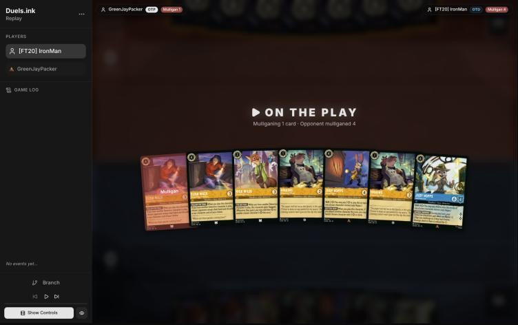
*The board before the decision: [step 0](https://duels.ink/replay/01a203d1-5932-7d6f-b7da-c3aa0016a672?step=0) in the duels.ink replay viewer.* Elisa Maza was sent back.

**The plan (written before seeing the mulligan made):** on the play, against what looks most like Rockstar Aggro: a
race where they go wide with 1- and 2-drops and quest for +5 a turn by their 5th turn. The seven is Higgins ×2, Nick
Wilde – Providing Backup, Elisa Maza ×2, Judy Hopps – Always Vigilant and Judy Hopps – Lead Detective: all seven
inkable, a 1-drop for turn 1, Nick for turn 2 (Support with a Higgins), Higgins and Higgins (or a draw) on turn 3,
an Elisa or Always Vigilant on turn 4, and Lead Detective Shifted for 4 onto Always Vigilant on turn 5, which is the
card that beats their small characters. Elisa's FOLLOW THE TRAIL can take a held Strength of a Raging Fire. The only
soft spots: no 3-drop, two 4-drop Elisas, and Always Vigilant's removal has few targets in their list.
`tools/mulligan.py` (1,500 deals) on turns 1–4:

| Option | Ink | Play turns | Lore by T4 | Chars T4 | Interaction |
|---|---|---|---|---|---|
| Keep all 7 | 9.32 | 3.99 | 6.7 | 4.6 | 100% |
| Mulligan all 7 | 8.98 | 3.71 | 5.0 | 3.8 | 86% |
| Send back one Elisa | 9.33 | 3.98 | 6.9 | 4.8 | 100% |
| Send back Lead Detective | 9.33 | 3.98 | 6.9 | 4.8 | 100% |
| Send back one Elisa and Lead Detective | 9.18 | 3.96 | 7.1 | 4.9 | 100% |
| Keep only Higgins ×2 and Nick | 8.72 | 3.89 | 7.4 | 4.9 | 64% |

The keeps of 5 to 7 are within the sim's noise on every measure; the sim can't see that Lead Detective (with a Judy
to Shift onto already in hand) is the matchup's best card, or that a second Elisa is a 4-drop with a hand-attack
against a deck holding few non-characters. My pick: **keep all 7**. Sending back one Elisa for a cheaper card is the
alternative, a close call at most.

**What you did:** you were on the play. You sent back one Elisa Maza and drew The Horseman Strikes!. They sent back
4 cards.

**Verdict:** **close call, fine.** Sending back the second Elisa was the alternative in the plan, level with keeping
all seven in the sim (ink 9.33 vs 9.32, lore by turn 4 6.9 vs 6.7). It keeps the curve, Lead Detective and her Shift
base, and trades a second 4-drop for a chance at a 2- or 3-drop. Confidence: high that the two keeps are about equal.

### Turn 1: your turn 1

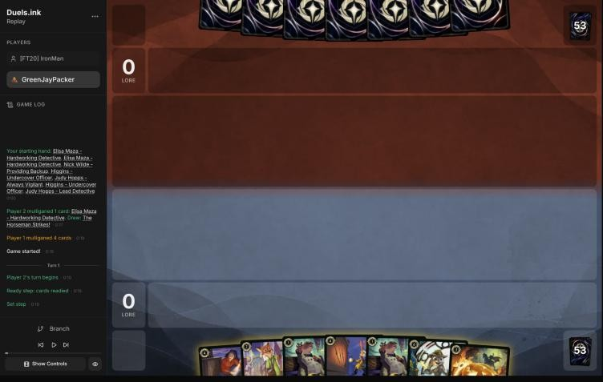
*The board before the decision: [step 3](https://duels.ink/replay/01a203d1-5932-7d6f-b7da-c3aa0016a672?step=3) in the duels.ink replay viewer.*

**The plan (written before seeing the turn):** ink one card and play a Higgins; nothing else is possible. The ink
choice is the decision. The hand's curve: Higgins now, Nick on turn 3, the second Higgins plus 2 more on turn 5, an
Elisa or Always Vigilant on turn 7, Lead Detective Shifted onto Always Vigilant on turn 9. **What to ink:** The
Horseman Strikes! is the card this matchup needs least: Rockstar Aggro's list has no Evasive character for its
banish, so it's a 3-ink "draw a card", slow in a race. Lead Detective and Always Vigilant are the turn-9 plan; Elisa is
the turn-7 play and FOLLOW THE TRAIL can take a held Strength of a Raging Fire; Nick and the second Higgins are the
next two turns. **Ink check:** inking Horseman leaves Nick (turn 3), Higgins + 1 spare or a drawn 2-drop (turn 5);
inking Elisa leaves the same, with Horseman as a turn-5 play instead of a drawn 2-drop. My pick: **ink The Horseman
Strikes!, play Higgins.** Nothing of theirs can reach a ready, drying Higgins on their turn 1, and Berlioz's 1 damage
doesn't kill him.

**What you did:** inked the second Higgins and played the first.

**Verdict:** **close call.** Inking Higgins keeps The Horseman Strikes! as a turn-5 card-draw; inking Horseman keeps
a 1-lore body for the same turn. Both leave Nick on turn 3 and the 4-drops on turns 7 and 9, and with two draws
before turn 5 either may be replaced by a drawn 2-drop. Against a deck with no Evasive, a body that quests a turn
earlier is worth a little more in a race than a 3-ink cantrip, but the gap is small ([INK-2](#cite-ink-2)). Confidence: medium.

### Turn 3: your turn 2

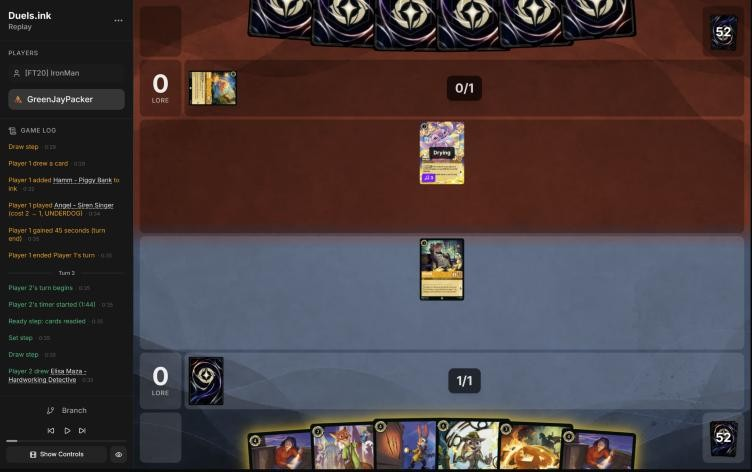
*The board before the decision: [step 9](https://duels.ink/replay/01a203d1-5932-7d6f-b7da-c3aa0016a672?step=9) in the duels.ink replay viewer.*

**The plan (written before seeing the turn):** you drew the second Elisa. 2 ink after inking; Nick Wilde – Providing
Backup is the play (he has Support from now on, with Higgins in play, though he's drying this turn). Their board is
one Angel – Siren Singer (Singer 3), dry next turn, so **Strength of a Raging Fire can be sung for free from their next
turn**: damage equal to their character count (Angel plus up to two cheap characters, so 2–3), which kills Higgins
or Nick whether they quest or not. Hamm in their inkwell fits the Songs #2 list as well as Rockstar Aggro.
- **Quest with Higgins?** Exerted, he can be challenged by Angel (2 {S} into 2 {W}); Higgins deals 2 back and kills
  her. FREE KILLS: none. That trade gives up their free singer for your 1-drop, which suits you; staying home gains
  nothing (Strength reaches him either way). So quest: +1.
- **What to ink:** with Elisa ×2, Always Vigilant, Lead Detective and Horseman in hand, the hand is top-heavy. Ink
  check: inking an Elisa leaves Horseman for turn 5 (3 ink), Elisa or Always Vigilant on turn 7, Lead Detective
  Shifted onto Always Vigilant (4) plus 1 on turn 9. Inking Horseman leaves turn 5 with nothing to play unless the
  draw is a 1–3-cost card (about half the deck), and two Elisas for turns 7 and 11. Inking Lead Detective or Always
  Vigilant gives up the turn-9 plan. My pick: **ink an Elisa, play Nick, quest Higgins.**

**What you did:** inked an Elisa, played Nick, quested with Higgins (1–0).

**Verdict:** **good**, the planned line.

### Turn 5: your turn 3

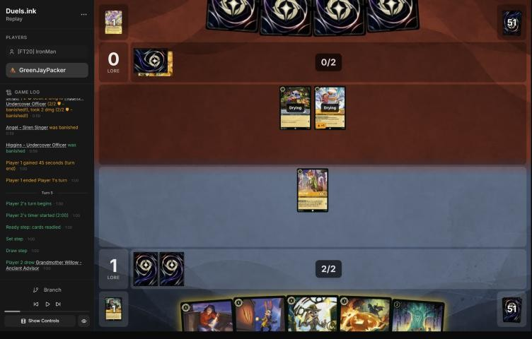
*The board before the decision: [step 18](https://duels.ink/replay/01a203d1-5932-7d6f-b7da-c3aa0016a672?step=18) in the duels.ink replay viewer.*

**The plan (written before seeing the turn):** you drew Grandmother Willow (uninkable). Angel traded with Higgins, so
Nick has lost Support (no other Detective). They have Lilo – Snow Artist (2 lore with Stitch in play) and Stitch –
Protector of Frogs, both drying: 3 lore a turn, 20 by game turn 18 if nothing changes. Now clearly most like
Rockstar Aggro. **Their next turn (3 ink):** Lilo & Stitch – Fun-Loving Friends Shifted for 3 onto the dry Lilo or
Stitch (one inked; about 25% they hold one of the other three by their turn, `odds.py hold 55 3 5`) gives a dry
3/5/3 with Resist 1 that can quest for 3 or challenge; Strength of a Raging Fire hard-cast for 3 (their only Singer 3
died) deals 2–3, which kills Nick or Willow, ready or not; Berlioz pings 1. Dale (4) can't come yet: no reducer or drop
on their side.
- **Resources:** 3 ink after inking; Willow (2) is the only character castable, and her SMOOTH THE WAY makes the next
  character 1 cheaper each turn from now on: Elisa or Always Vigilant for 3 next turn, Lead Detective's Shift for 3
  on turn 9. Willow plus a discounted card is 2 + 3 = 5 of your 3, so that waits.
- **Candidates:** (a) ink, Willow, quest Nick: 2 of 3 ink, 1 unspent. (b) ink, The Horseman Strikes! (3 of 3): a card
  but no board (no Evasive to banish), and Willow's discount a turn later. (c) Willow and keep Nick home.
- **Quest Nick?** FREE KILLS: none on their board (Stitch and Lilo together kill him only by both dying to his 3
  back). A Shifted Lilo & Stitch could kill him for free, at the cost of its own 3-lore quest; about 25% they have it,
  and less that they'd spend it that way. Strength reaches him whether he quests or not, and he readies for your turn
  either way. So the quest (+1) costs little.
- **Ink:** The Horseman Strikes! (no target in their list) rather than Elisa, Always Vigilant or Lead Detective. Ink
  check: without Horseman, turn 7 is Elisa or Always Vigilant for 3 with Willow (+1 spare), turn 9 Lead Detective
  Shifted onto Always Vigilant for 3 with 2 spare, or Elisa for 3. My pick: **(a) ink Horseman, play Willow, quest
  Nick.**

**What you did:** inked The Horseman Strikes!, played Willow, quested with Nick (2–0).

**Verdict:** **good**, the planned line.

### Turn 7: your turn 4

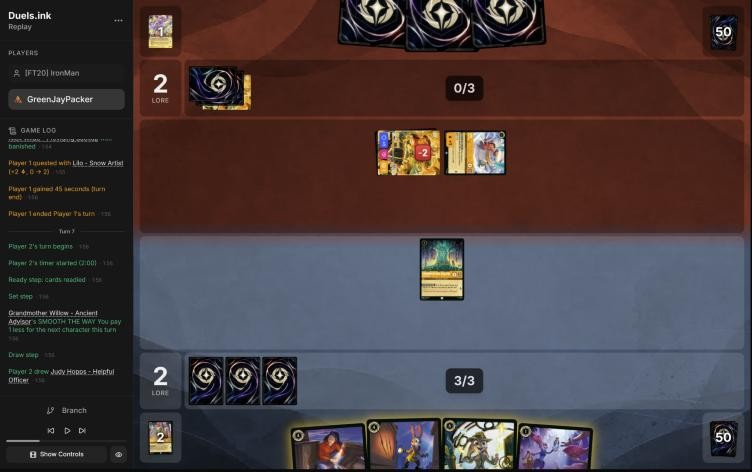
*The board before the decision: [step 27](https://duels.ink/replay/01a203d1-5932-7d6f-b7da-c3aa0016a672?step=27) in the duels.ink replay viewer.* Step 27 is the turn start; the Elisa played and undone at frame 28 left the board as it was.

**The plan (written before seeing the turn):** you drew Judy Hopps – Helpful Officer. Their Lilo & Stitch –
Fun-Loving Friends (3/5/3, Resist 1, Support; 2 damage from Nick, so 3 willpower left) and Lilo – Snow Artist (2 lore
with a Stitch in play) are both exerted, and quest for 5 a turn: 2–2 now, they reach 20 on game turn 14 if nothing
changes. Lilo & Stitch is the must-kill: 3 lore, Support, and a free singer for Strength of a Raging Fire. **Nothing of
yours can kill it this turn:** Willow (1 {S}) is your only dry character, and anything played now is drying. So this
turn sets up the next: **on turn 9, Lead Detective Shifted onto a dry Judy** (4, or 3 with Willow) can challenge at
once, kills Lilo & Stitch (6 − 1 Resist = 5) and takes 1 back (3 − 2 from LATERAL THINKING's Resist); a second
Detective kills Lilo.
- **Resources:** 4 ink after inking; Willow makes the first character 1 cheaper. Helpful Officer costs 0 with Willow,
  so Helpful Officer + Elisa or Always Vigilant = 0 + 4 = 4 of your 4. Helpful Officer's TO THE RESCUE must not take
  damage off their Lilo & Stitch (choose your own character). Always Vigilant's GOT YOU NOW has no target (nothing of
  theirs has 5 {S}, and you have no Supporter).
- **Their next turn (4 ink):** Lilo & Stitch sings Strength of a Raging Fire for free (damage = their character
  count, 2–4: kills Helpful Officer, Willow, or with 4 characters Elisa or Always Vigilant); Berlioz's 1 damage kills
  Helpful Officer; Dale (20–26%) makes their characters deal their {W}; another Lilo & Stitch, Stitch – Rock Star or
  Lilo – Rock Star Shifted in. Only actions and Berlioz reach your ready characters.
- **Candidates:**
  - **(a) Ink Always Vigilant; Helpful Officer, then Elisa (FOLLOW THE TRAIL, with Helpful Officer as the other
    Detective).** You see their three cards and discard a non-character: Strength of a Raging Fire (about 21% they
    hold one) is the likely one, and it's the card that would kill your Shift base. Lead Detective's base is Helpful
    Officer alone (Berlioz or a drawn Strength kills her; then Lead Detective is hard-cast for 5 with Willow, and
    drying).
  - **(b) Ink Elisa; Helpful Officer, then Always Vigilant.** Two Judy bases for Lead Detective, and Always Vigilant
    alone kills the damaged Lilo & Stitch next turn (4 − 1 = 3). But nothing seen, and a held Strength stays in their
    hand.
  - Inking Helpful Officer instead leaves one 4-drop for 3 and 1 unspent: worse.
- **Ink check:** (a) leaves Lead Detective in hand for turn 9 (Shift onto Helpful Officer for 3, 2 spare); (b) the same,
  with Always Vigilant as a second base. Always Vigilant's removal is nearly dead in this matchup, so it's the cheaper
  card to lose ([INK-2](#cite-ink-2)); Elisa's hand attack stays live all game.
- **Willow:** stay home. FREE KILLS: Willow, to Lilo & Stitch alone (it gives up 3 lore); or Lilo & Stitch quests and
  Supports Lilo (+3), and Lilo kills her for 2 lore. She's the discount for next turn's Shift, worth more than 1 lore
  now. (Questing her is the close alternative: if they spend Lilo's quest on her, the race swings 3 your way.)
- **My pick: (a).** Nothing is left exerted.

**What you did:** you first played Elisa (FOLLOW THE TRAIL had no other Detective, so it did nothing) and undid
it. Then you inked **Lead Detective**, played Helpful Officer for 0 (Willow's discount) and Elisa for 4: FOLLOW THE
TRAIL showed their three cards, all characters, so nothing was discarded. Willow stayed home.

**Verdict:** the board was right (Helpful Officer then Elisa, Willow home). **The ink was a mistake.** Inking **Lead
Detective** is suboptimal because she was this matchup's best card and the turn-9 plan: Shifted onto a dry Judy,
LATERAL THINKING gives every Detective Resist +2 on your turn, so your challengers take nothing from their 1- and
2-{S} board, and she's a 2-lore quester that kills Lilo & Stitch on her own (5 through its Resist). Inking **Judy
Hopps – Always Vigilant** is better because her GOT YOU NOW has almost nothing to banish here (nothing in their list
reaches 5 {S} without help, and you had no Supporter), so she was the cheapest card to lose ([INK-1](#cite-ink-1), [INK-2](#cite-ink-2)).
- **Ink check:** as played, turn 9 is Always Vigilant Shifted onto Helpful Officer for 1 (with Willow) to kill the
  damaged Lilo & Stitch (4 − 1 Resist = 3, its 3 willpower left) while Elisa kills Lilo, with 4 ink to spare; Always
  Vigilant takes 3 back and is left on 1 willpower. With Always Vigilant inked, turn 9 is Lead Detective Shifted onto
  Helpful Officer for 3: the same two kills, Lead Detective takes 1, 2 ink to spare, and LATERAL THINKING stays for
  every later turn. Both lines need Helpful Officer to survive their turn (Berlioz or a drawn Strength kills her), and
  leave nothing exerted this turn.
- The 2 ink saved on turn 9 is the case for the play; it buys a 2-drop that turn at best, against the rest of the
  game with Lead Detective. Two more Lead Detectives are left in your deck.
- The knowledge base already has this from your earlier games: "Lead Detective is a 4-ink Shift, not a spare 6-drop"
  ([the Amber/Sapphire notes](#cite-kb-meta-archetypes-amber-sapphire-detectives-as-greenjaypacker-plays-it), from
  01a1fb8a-260a and 01a1ffec-372f). Confidence: medium (how much Lead Detective adds
  over Always Vigilant depends on how long the game goes).
- Undoing the first Elisa to play Helpful Officer first was right: it turned FOLLOW THE TRAIL on.

### Turn 9: your turn 5

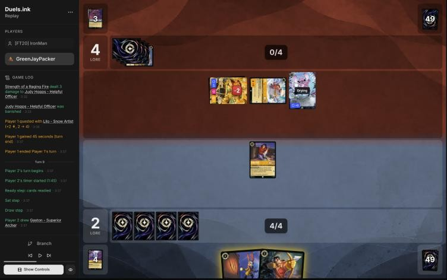
*The board before the decision: [step 45](https://duels.ink/replay/01a203d1-5932-7d6f-b7da-c3aa0016a672?step=45) in the duels.ink replay viewer.*

**The plan (written before seeing the turn):** Elisa's reveal showed Ursula – Vanessa, Angel – Experiment 624 and
Stitch – Carefree Snowboarder, so this is most like Lilo & Stitch Songs #1, not Rockstar Aggro (Songs #2 close behind).
Their turn 8 drew Strength of a Raging Fire: Angel's GOOD AIM (discarding Snowboarder) killed Willow, Lilo & Stitch
sang Strength onto Helpful Officer, and Lilo quested. Now 2–4. **Their board:** Lilo & Stitch (exerted, 2 damage, so
3 willpower left behind Resist 1), Lilo (exerted, 2 willpower, 2 lore while a Stitch is in play, and Lilo & Stitch
counts as one), Angel – Experiment 624 (drying; Resist +2 while their hand is empty, which it is). They quest for 6:
20 on game turn 14, so you have turns 9, 11 and 13. **You drew Gaston.** Hand: Always Vigilant, Gaston; Elisa is dry.
- **What must happen:** their questers have to come off the board over the next two turns. Your removal (Gaston's
  WATCH THIS!, Always Vigilant's GOT YOU NOW) needs a 5-{S} target: STRENGTH REMOVAL says none, and you have no
  Supporter to push Lilo & Stitch from 3 to 5. So kills come from challenges.
- **Elisa's challenges:** into Lilo, she kills it (3 into 2) and takes 1; into Lilo & Stitch, she deals 2 (it's left
  on 1 willpower) and takes 3 (left on 1). Nothing else of yours can attack this turn.
- **Candidates:**
  - **(a) Elisa kills Lilo; Always Vigilant hard-cast for 4** (no Judy to Shift onto). Lilo's 2 lore a turn is gone
    now, and next turn Always Vigilant, dry, kills Lilo & Stitch if it's exerted (4 − 1 = 3, its 3 left).
  - **(b) Elisa into Lilo & Stitch, then Always Vigilant:** leaves it on 1 willpower, so anything finishes it next
    turn, but Lilo keeps questing for 2 and Elisa on 1 willpower dies to anything.
  - **(c) Gaston (ink Always Vigilant) instead of Always Vigilant:** 3 {S} can't finish Lilo & Stitch next turn (3 − 1
    = 2), and WATCH THIS! has no target. Worse.
- **Exposure in (a):** Elisa is left exerted on 3 willpower. FREE KILLS: Elisa, to Lilo & Stitch alone (it takes 2
  back and is left on 1 willpower, and gives up its 3-lore quest) or to Angel (who dies to her 3 back unless their hand
  is empty again, for Resist +2). GOOD AIM (discard their one card) adds 2 to any of yours, ready or not. Always
  Vigilant stays ready, so only GOOD AIM reaches her (4 willpower: survives). Their removal next turn: Strength or He
  Hurled His Thunderbolt off the top (sung free by Lilo & Stitch or Angel; Strength now deals 2–3).
- **Ink:** hold Gaston rather than ink him. Always Vigilant uses exactly 4; Gaston is your only other card, a body
  for turn 11 (5 ink, if the draw is inkable), and later removal once a Supporter of yours can push Lilo & Stitch to 5
  (14 Supporters left in your deck). Inking him gives 1 ink you can't use this turn. Close either way ([INK-3](#cite-ink-3)).
- **My pick: (a), no ink.**

**What you did:** Elisa challenged and killed Lilo (she took 1). Nothing was played or inked: Always Vigilant and
Gaston stayed in hand, and all 4 ink stayed unused.

**Verdict:** the challenge was right: it took 2 lore a turn off their board (now 4 a turn: Lilo & Stitch 3, Angel
1). **Passing with 4 ink was a mistake.** Keeping **Always Vigilant** in hand is suboptimal because nothing on their
board has 5 {S}, so her GOT YOU NOW had no target now and won't have one without a Supporter of yours, and every turn
she waits is a turn later her 4 {S} can attack. Hard-casting **Always Vigilant** for 4 (no ink needed) is better
because, dry on turn 11, she kills Lilo & Stitch (4 − 1 Resist = 3, its 3 willpower left) whenever it quests, sings
or challenges, and that's their 3-lore quester, their Supporter and a free singer for Strength.
- **Ink sums:** Always Vigilant 4 of your 4. As played, 0 of 4.
- **What she'd have exposed:** nothing. Played ready, only GOOD AIM (2, for their one card) or a song off the top
  (Strength now 2–3; He Hurled His Thunderbolt 4, about 8%) reaches her, and only Thunderbolt kills her. Elisa is
  left exerted on 3 willpower either way (FREE KILLS: Lilo & Stitch alone, or Angel).
- **Holding her** keeps a Shift 2 for when a Judy is in play, and GOT YOU NOW for a target later. Neither is near:
  no Judy in play, and their list has nothing with 5 {S}. Hard-cast next turn instead, she's drying on turn 11 and
  attacks only on turn 13, a full turn later, against a board that quests for 4 a turn before their draws.
- The hold on Gaston (no ink) is a close call, as in the plan. Confidence: medium-high ([TEMPO-1](#cite-tempo-1), [THREAT-1](#cite-threat-1), [QC-2](#cite-qc-2)).

### Turn 11: your turn 6

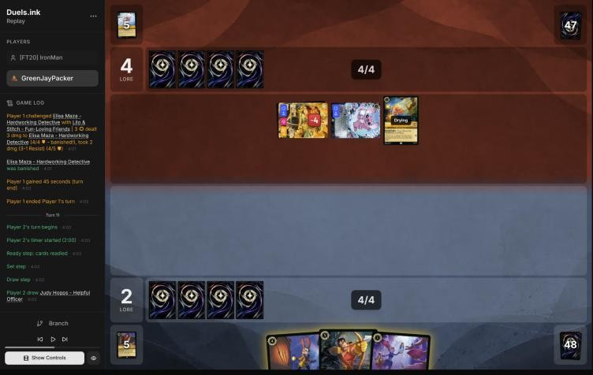
*The board before the decision: [step 51](https://duels.ink/replay/01a203d1-5932-7d6f-b7da-c3aa0016a672?step=51) in the duels.ink replay viewer.*

**The plan (written before seeing the turn):** they sang Akood et Emuti with Angel (draw, and Hamm – Piggy Bank for
0), and Lilo & Stitch killed the exerted Elisa, taking 2 more: it's on 4 damage, **1 willpower left**, and exerted.
They didn't quest: still 2–4, and their hand is empty (so Angel has Resist +2). Their board quests for 5 (Lilo &
Stitch 3, Angel 1, Hamm 1): 20 by game turn 18. You have no characters; you drew Helpful Officer. Hand: Always
Vigilant, Gaston, Helpful Officer; 5 ink if you ink.
- **Nothing can attack this turn** (all your characters would be drying). So the turn sets up turn 13: **any of your
  characters with 2 {S} kills Lilo & Stitch** next turn through its Resist (2 − 1 = 1, its 1 left) if it quests,
  sings or challenges. Helpful Officer (2 {S}) does it and trades her 1-drop for their 3-lore Supporter.
- **Their next turn (5 ink, one draw, Hamm's −1):** GOOD AIM (discard their drawn card: 2 damage) kills Helpful
  Officer; Strength or Thunderbolt off the top (6–7%) sung free; Lilo & Stitch quests (+3) or stays home to live.
  Nothing of yours is exerted, so no challenges.
- **Candidates:**
  - **(a) Ink Gaston; Helpful Officer, then Always Vigilant = 1 + 4 = 5 of 5.** Two bodies. Next turn Helpful Officer
    or Always Vigilant kills Lilo & Stitch, and the other takes Hamm (Always Vigilant 4 into 3) or Angel (4 − 2 Resist
    = 2, not enough while their hand is empty). TO THE RESCUE: choose your own character, never Lilo & Stitch.
    GOT YOU NOW: no target.
  - **(b) Ink Always Vigilant; Gaston (5 of 5).** One body; Gaston (3 {S}) also kills Lilo & Stitch next turn (2
    through Resist), but Helpful Officer waits a turn.
  - **(c) Helpful Officer now, Always Vigilant Shifted onto her next turn for 2** (she'd attack at once): 1 of 5 this
    turn, 4 ink wasted. Too slow while they score 5 a turn.
- **Ink:** Gaston. WATCH THIS! needs a Supporter of yours to push Lilo & Stitch from 3 to 5, and you have none in play
  or hand; Always Vigilant is the better body (4/4 for 4 against 3/4 for 5). Ink check: without Gaston, turn 13 has
  Helpful Officer and Always Vigilant attacking and 6 ink for the draw.
- **My pick: (a).**

**What you did:** inked Helpful Officer and hard-cast Always Vigilant (GOT YOU NOW had no target); Gaston stayed in
hand, 1 ink unused.

**Verdict:** **close call.** Against the plan's (a), your line keeps Gaston (a 3/4 for next turn's 5 ink) and inks
the 2/1, where (a) puts the 2/1 down now and inks Gaston. (a) can make two kills on turn 13 (Helpful Officer into Lilo
& Stitch, Always Vigilant into Hamm) and spends all 5 ink, but Helpful Officer's 1 willpower is exactly what GOOD AIM
kills for their one drawn card, and then (a) is one body with an empty hand. Yours makes one kill on turn 13 (Always
Vigilant into Lilo & Stitch) and adds Gaston, so it trades 1 ink now for a better card later. Both leave nothing
exerted. Confidence: medium.

### Turn 13: your turn 7

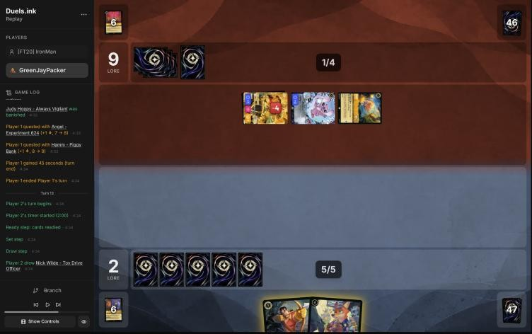
*The board before the decision: [step 62](https://duels.ink/replay/01a203d1-5932-7d6f-b7da-c3aa0016a672?step=62) in the duels.ink replay viewer.*

**The plan (written before seeing the turn):** on their turn Lilo & Stitch quested and gave Always Vigilant +3 {S}
with Support, and World's Greatest Criminal Mind (drawn that turn) banished her at 7 {S}; Angel and Hamm quested too.
Now **2–9**, their board quests for 5 (20 on game turn 18, `odds.py clock 9 5`: three more quests), their hand is
empty, and all three of their characters are exerted. You have no characters; you drew Nick Wilde – Toy Drive Officer
(uninkable). Hand: Gaston, Toy Drive Officer; 5 ink (6 only by inking Gaston).
- **Needs check:** at 2 lore with no board you can't race 5 a turn: even at 2 a turn you'd need nine quests. Your
  outs are clearing their board faster than they rebuild from topdecks, starting with Lilo & Stitch (1 willpower
  left: any 2-{S} challenger kills it through Resist 1), and their draws missing. Play to that ([POS-2](#cite-pos-2)).
- **Nothing can attack this turn.** So again the question is which body sets up turn 15:
  - **(a) Toy Drive Officer (4 of 5), Gaston held, no ink.** On turn 15 Toy Drive Officer quests (+1) and Supports
    Lilo & Stitch (3 + 2 = 5), then Gaston (5) banishes it with WATCH THIS!; or Supports Angel (3 + 2) for Gaston and
    challenges nothing. One kill and a lore, Gaston undamaged. Or Toy Drive Officer simply challenges Lilo & Stitch
    (kills it, takes 3, survives on 1).
  - **(b) Gaston (5 of 5), Toy Drive Officer held.** On turn 15 Gaston challenges Lilo & Stitch (kills it, takes 3,
    left on 1 willpower) and Toy Drive Officer is played (4 of 5–6). One kill, no lore.
  - Inking Gaston to play Toy Drive Officer with 2 spare throws away the turn-15 removal.
- **Their next turn:** GOOD AIM (discard their drawn card) does 2: neither body dies. Strength (3 characters, 3
  damage) doesn't kill a 4-willpower body; He Hurled His Thunderbolt (4) does (about 8%); World's Greatest Criminal Mind
  again with Support (+3 puts Toy Drive Officer at 5, Gaston at 6; about 4%). Nothing of yours exerted.
- **My pick: (a).** It turns Toy Drive Officer's Support into removal for Gaston next turn, the trick in your
  Detectives notes. No ink this turn: Gaston is the only inkable card and he's the turn-15 play.

**What you did:** played Toy Drive Officer, held Gaston, no ink.

**Verdict:** **good**, the planned line.

### Turn 15: your turn 8

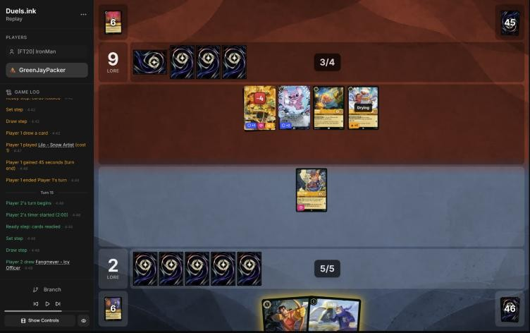
*The board before the decision: [step 66](https://duels.ink/replay/01a203d1-5932-7d6f-b7da-c3aa0016a672?step=66) in the duels.ink replay viewer.*

**The plan (written before seeing the turn):** they played a second Lilo – Snow Artist and **kept everything home**:
Lilo & Stitch (1 willpower left), Angel and Hamm are all ready, so nothing of theirs can be challenged. 2–9; their
board now quests for 7 (Lilo & Stitch 3, Lilo 2 with a Stitch, Angel 1, Hamm 1): two more quests win (`odds.py clock
9 7`), game turn 18. You drew Fangmeyer – Icy Officer (uninkable; returns a Detective from your discard). Hand:
Gaston, Fangmeyer; Toy Drive Officer is dry; 5 ink (6 by inking Gaston).
- **Support line:** yours onto their character: Toy Drive Officer quests and adds 2 to Lilo & Stitch or Angel (3 → 5),
  then Gaston's WATCH THIS! banishes it (STRENGTH REMOVAL line). Yours onto your challenger: nothing to challenge
  (all ready). Theirs onto their challenger: Lilo & Stitch +3 onto Angel kills an exerted Toy Drive Officer alone.
  Theirs onto yours: Lilo & Stitch +3 puts Fangmeyer (4) or Gaston (3) at 5+ for World's Greatest Criminal Mind
  (about 4% after their draw).
- **Candidates:**
  - **(a) Toy Drive Officer quests (+1) and Supports Lilo & Stitch; Gaston (5 of 5) banishes it.** Their board drops
    to Angel, Hamm and Lilo (who loses her +1 with no Stitch left): 3 a turn, so 20 moves from game turn 18 to 22
    (`odds.py clock 9 3`). It also removes their Support, the free singer and the card that set up World's Greatest
    Criminal Mind.
  - **(b) The same Support onto Angel instead:** removes GOOD AIM and 1 lore, leaves 6 a turn. Worse.
  - **(c) Fangmeyer (5 of 5), returning Always Vigilant or Elisa:** a 2-lore body but no kill; they reach 20 on turn 18.
- **Exposure in (a):** Toy Drive Officer exerted. FREE KILLS: Toy Drive Officer, to Angel and Hamm together (3 + 2
  into 4; both survive his 2 back) at the cost of their 2 lore, or to Angel alone with Lilo & Stitch's Support, which
  (a) removes. He's your only Supporter, so the cost is real, but the banish is worth it. Gaston stays ready: GOOD AIM
  (2) doesn't kill him; Strength (3 characters: 3) doesn't either.
- **Needs check:** even after (a) you're at 3 to their 9 with 3 a turn against you: you need them to stall while
  Fangmeyer (2 lore, returning a Detective) and whatever you draw catch up. Low, but it's the only line that plays to
  outs ([POS-2](#cite-pos-2)).
- **My pick: (a).** No ink (Gaston is cast; Fangmeyer can't be inked).

**What you did:** Toy Drive Officer quested (3–9) and Supported **Angel** (3 → 5); Gaston's WATCH THIS! banished
Angel. Fangmeyer stayed in hand.

**Verdict:** the Support-then-Gaston line was the right idea (your notes' trick, [H-9](#cite-h-9)'s other side), but **the target
was a mistake.** Banishing **Angel** is suboptimal because their lore was the problem at 3–9: with Angel gone their
board still quests for 6 next turn (Lilo & Stitch 3, Lilo 2 with a Stitch in play, Hamm 1), which takes them to 15
and to 20 on game turn 18. Banishing **Lilo & Stitch** is better because it takes 3 lore, Lilo's +1, their Support and
a free singer at once: their board would quest for 3 (Angel, Hamm, a 1-lore Lilo), 12 next turn and 20 no earlier
than game turn 22 without new characters, two of their turns more for you. *(Revisited during the blind pass, from
this turn's brief: the first version counted two Lilos, and the board had one.)*
- **The case for Angel** ([THREAT-4](#cite-threat-4): don't spend removal on what combat can handle): Lilo & Stitch has 1 willpower
  left, so Gaston or Toy Drive Officer kills it whenever it quests, sings or challenges, while Angel's Resist +2 (with
  their hand empty) makes her nearly unkillable in a challenge, and GOOD AIM pings each turn. But they choose when
  Lilo & Stitch is exposed: one quest for 3 (plus Support +3) costs them only a card they'd lose anyway, and each such
  quest is a turn off the race. Angel's 2 damage a turn costs them their only card each time, and none of your
  4-willpower characters dies to it alone.
- **Ink sums:** both lines are Gaston 5 of your 5.
- **What each exposes:** the same, Toy Drive Officer exerted. With Lilo & Stitch banished, his FREE KILL needs Angel
  and Hamm together (2 lore given up); with Angel banished, Lilo & Stitch can Support Hamm (2 + 3 = 5, kills him) or
  challenge him itself (and die to his 2 back).
- Confidence: medium (it rests on their questing Lilo & Stitch when it matters, which a player at 9 of 20 would).

### Turn 17: your turn 9

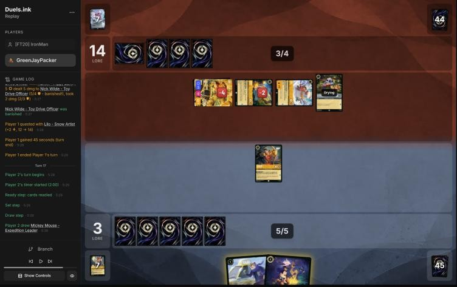
*The board before the decision: [step 79](https://duels.ink/replay/01a203d1-5932-7d6f-b7da-c3aa0016a672?step=79) in the duels.ink replay viewer.*

**The plan (written before seeing the turn):** they played Stitch – Protector of Frogs, quested Lilo & Stitch (+3)
and gave Hamm +3 with Support, and Hamm killed the exerted Toy Drive Officer; Lilo quested too. **3–14.** Their board
quests for 7 (Lilo & Stitch 3, Lilo 2 with a Stitch, Hamm 1, Stitch 1): **20 next turn** unless you take lore off it.
Lilo & Stitch (1 willpower left), Hamm (1 left) and Lilo are exerted; Stitch is drying. You drew Mickey Mouse –
Expedition Leader. Hand: Fangmeyer, Mickey; Gaston is dry; 5 ink (6 by inking Mickey).
- **What must happen:** keep them under 6 lore next turn. Gaston can kill one exerted character: Lilo & Stitch
  (leaves them 4 a turn: 18 next turn), Lilo (5: 19) or Hamm (6: 20, lost). So **Gaston kills Lilo & Stitch** (2
  through Resist into its 1; he takes 3 and is left on 1 willpower). Lilo keeps her +1 from Stitch – Protector of
  Frogs.
- **Their ways to 20 anyway from 18:** a fourth Lilo & Stitch Shifted onto the dry Stitch (+2; about 2% after their
  draw), or an off-list lore boost (Lionheart, Pocahontas – Finding the Way). Small.
- **Then:** Fangmeyer (5 of 5) returns a Detective from your discard for next turn (Always Vigilant, Elisa, Toy Drive
  Officer, Nick, Helpful Officer, Higgins); Elisa's FOLLOW THE TRAIL (with Fangmeyer in play) could strip a song or
  lore boost next turn, Always Vigilant or Nick are another attacker. Mickey is the alternative (4, a 2-lore body) but
  does nothing this turn that matters.
- **Needs check: the game is all but lost.** Even holding them to 18, their Lilo, Hamm and Stitch quest for 4 the
  turn after, and you'd have to kill two or three characters a turn while going from 3 to 20 with 1- and 2-lore
  bodies. Nothing left in your deck turns that in time (the brief: "only what you hold and this turn's dig can win",
  and there's no dig). From here the only aim is to make them need one more turn.
- **My pick:** Gaston challenges Lilo & Stitch; Fangmeyer, returning Elisa or Always Vigilant. No ink needed (Mickey
  can be inked for 6 next turn).

**What you did:** Gaston killed Lilo & Stitch (taking 3); Fangmeyer returned Toy Drive Officer to your hand; you
inked Mickey.

**Verdict:** **good**, the planned line; Toy Drive Officer (a Supporter for Gaston-style removal next turn) is as good
a return as Elisa or Always Vigilant here. From this turn the game is all but unwinnable (above).

### Turn 19: your turn 10

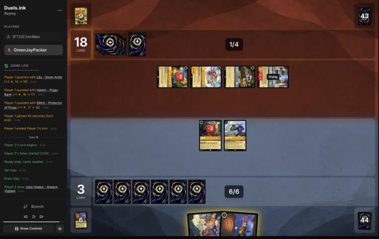
*The board before the decision: [step 91](https://duels.ink/replay/01a203d1-5932-7d6f-b7da-c3aa0016a672?step=91) in the duels.ink replay viewer.*

**The plan (written before seeing the turn):** **3–18, unwinnable.** They played Woolter & Jesse – Bellwether's
Henchmen (off-list; 4/4, Bodyguard, entered exerted, Challenger +2) and quested to 18. Their four characters quest for
5 next turn and they need 2. Woolter & Jesse's Bodyguard means your first challenge has to go into it: Fangmeyer trades
with it (4 into 4), and Gaston (1 willpower left) can then kill Hamm and die to its 2 back. That still leaves Lilo (2
with Stitch in play) and Stitch (1): 21. Always Vigilant and Toy Drive Officer would be drying, and there's no dig.
No line keeps them under 20, so this turn has no verdict ([principle 2](#cite-principle-2)).

**What you did:** Fangmeyer traded with Woolter & Jesse; Gaston killed Lilo and died; you hard-cast Always Vigilant.
That left them Hamm and Stitch, exactly the 2 they needed.

**Verdict:** unwinnable (no line kept them under 20).

### Turn 20: their turn

**What happened:** Hamm and Stitch quested: 20–3.

## Lessons
1. **Lead Detective is a 4-ink Shift, not spare ink** (turn [7](#turn-7)): the third reviewed game in which she was
   inked early. Against Amber/Steel's 1- to 3-{S} board, LATERAL THINKING's Resist +2 makes every Detective's
   challenge free, and she's 2 lore a turn. Always Vigilant, whose removal had nothing to hit, was the card to ink.
2. **Against a deck with nothing at 5 {S}, your 5-{S} removal is a body until your Support turns it on** (turns
   [9](#turn-9) and [15](#turn-15)). Cast Always Vigilant and Gaston for their bodies when nothing else uses the ink,
   and hold one back only for a turn when a Supporter of yours will be dry to push a target into range.
3. **With one removal near the end of the race, take their lore** (turn [15](#turn-15)). A 1-willpower Lilo & Stitch
   dies to combat only when they choose to expose it, and they choose the turn it matters (turn 16: quest, Support
   +3 onto Hamm, kill Toy Drive Officer).
4. **Their Support reaches your characters too** (turn 12): Lilo & Stitch's +3 put Always Vigilant (4 {S}) in World's
   Greatest Criminal Mind's range, the same trick your deck plays with Gaston ([the ruling](#cite-kb-rules-rulings-support-can-add-strength-to-an-opposing-character)).
   While Lilo & Stitch can quest, every character of yours with 2 {S} or more is in range of a Songs list's removal.

## Proposed knowledge-base updates (applied after discussion)
- **Meta, the Amber/Steel pair file's notes (new section, "Lilo & Stitch Songs #1 against GreenJayPacker's Detectives:
  [FT20] IronMan", blind review of 01a203d1-592d):**
  - **Seen:** Angel – Siren Singer, Hamm – Piggy Bank ×2 (one inked; a Songs #2 card), Lilo & Stitch – Fun-Loving
    Friends ×3 (two inked on turns 4 and 6, one Shifted), Lilo – Snow Artist ×2, Stitch – Protector of Frogs ×2,
    Ursula – Vanessa (inked), Angel – Experiment 624, Stitch – Carefree Snowboarder (discarded to GOOD AIM), Strength
    of a Raging Fire, Akood et Emuti, World's Greatest Criminal Mind; off-list, Woolter & Jesse – Bellwether's
    Henchmen (3, 4/4, Bodyguard, Challenger +2). They mulliganed 4.
  - **How it played (they won 20–3 on game turn 20):** Lilo & Stitch Shifted onto a dry Stitch on game turn 6 and
    killed an exerted Nick at once. Angel's GOOD AIM and Strength (sung by Lilo & Stitch) took two cheap Detectives on
    turn 8. Lilo & Stitch's Support put +3 on your Always Vigilant for World's Greatest Criminal Mind (turn 12) and +3
    on Hamm to kill Toy Drive Officer (turn 16). With Lilo & Stitch on 1 willpower they kept the whole board home
    for a turn (turn 14) and exposed it only for the Support kill.
  - **Against it:** kill Lilo & Stitch first: it's their 3 lore, the Lilos' +1 ([it counts as a Stitch](#cite-kb-rules-rulings-lilo-stitch-fun-loving-friends-is-named-lilo-and-stitch)), the Support that turns
    your characters into targets, and a free singer.
- **Meta, the Amber/Sapphire notes, "Detectives as GreenJayPacker plays it":** add 01a203d1-592d: Lead Detective
  inked again (turn 7, over an Always Vigilant with no target); Always Vigilant held with 4 ink unused (turn 9); Toy
  Drive Officer's Support with Gaston banished Angel (turn 15). Against Amber/Steel the 5-{S} removal needs your
  Support.
- **Strategy, a new hypothesis:** "With one removal near the end of the race, take their biggest quester even if
  combat could finish it later: they choose when a damaged quester is exposed." Evidence: 01a203d1-592d turn 15. It
  qualifies [THREAT-4](#cite-threat-4) for damaged questers; one game, not yet discussed.
- **Rules:** none new.

## Hindsight
Doesn't change the verdicts above.
- Elisa's reveal on turn 7 showed Ursula – Vanessa, Angel – Experiment 624 and Stitch – Carefree Snowboarder; Strength
  of a Raging Fire (turn 8) and World's Greatest Criminal Mind (turn 12) came from later draws.
- Their turn-8 removal killed both of the turn-9 Shift's enablers (Willow and Helpful Officer), so in this shuffle a
  kept Lead Detective couldn't have been Shifted on turn 9; she'd have been hard-cast on turn 11 at the earliest. The
  turn-7 verdict rests on what was known when the card was inked.
- Was it winnable? With Always Vigilant cast on turn 9 and Lilo & Stitch banished on turn 15, their clock would have run
  about two turns longer, but at 3 lore against 9–14 you'd still have needed their draws to stall. Their start (two
  Lilo & Stitch by game turn 6 and two removal songs drawn when they mattered) made this a hard game from turn 8.

## The coach's errors
Filled in during discussion; the first two were found during the blind pass.

| When | Error | How it was caught | How it won't happen again |
|---|---|---|---|
| Turn [15](#turn-15) verdict | Counted two Lilos on their board (8 lore a turn) where the turn's brief showed one (6 a turn) | The coach, reading turn 16's board; the verdict was revisited from turn 15's brief (it stands, with the right numbers) | Proposed: the brief's lore clock itemises their questers and prints the clock "without X" for each of their characters, so a removal comparison takes its numbers from the brief, not from a recount |
| Turns [7](#turn-7), [9](#turn-9), [11](#turn-11) plans | No four-way Support line while their Lilo & Stitch (a Supporter) was in play; the turn-11 plan left out that its Support put every candidate in range of World's Greatest Criminal Mind (it banished Always Vigilant on turn 12). It changed no verdict (all candidates were equally exposed; about 2%) | The coach, after the blind pass | Proposed: `brief.py --happened` refuses a turn whose `--plan` brief showed a Supporter on either side unless the turn's plan in the draft has a "Support line" |

## Open questions
- Turn [7](#turn-7): why ink Lead Detective rather than Always Vigilant, whose GOT YOU NOW had no target in their
  deck? Was it the plan to Shift Always Vigilant onto Helpful Officer instead?
- Turn [9](#turn-9): why keep Always Vigilant and the 4 ink? Were you waiting for a Judy to Shift onto, a target for
  GOT YOU NOW, or wary of something on their side?
- Turn [11](#turn-11): was keeping Gaston (and inking Helpful Officer) the plan for a Support + Gaston turn later?
- Turn [15](#turn-15): why Angel over Lilo & Stitch? Was it because Lilo & Stitch was on 1 willpower and combat could
  finish it, or GOOD AIM?

## Citations
Copies of the coach's knowledge base cited above, as they stood when they were cited (the private repository's commit and date are given with each). They don't change when the knowledge base does.

**rulings.md, Support can add strength to an opposing character**: knowledge base, `kb/rules/rulings.md` at `5894e68` (2026-11-26), working tree

> ### Support can add strength to an opposing character
> - **Situation:** a Support character quests while the opponent has a character you want to remove with a "5 {S} or
>   more" banish: Judy Hopps – Always Vigilant's GOT YOU NOW, Gaston – Superior Archer's WATCH THIS.
> - **Ruling:** Support may choose any other character, including an opposing one. Adding the Support character's {S}
>   to theirs can lift a small character to 5 {S} for the banish. Supports stack, and a supported character supports
>   with its new {S}.
> - **Basis:** CR 8.13.1 (Support: "add this character's {S} to another chosen character's {S} this turn"; "another
>   chosen character" isn't limited to your own).
> - **Confidence:** derived from CR and confirmed by duels.ink's engine: Detectives opponents did it to the user's
>   characters (01a17e54 turn 21, 01a17e5d turn 12, 01a17e45 turn 23; `kb/meta/archetypes/amber-sapphire.md`), and
>   MK_ifoughtthelore did it to their opponent's (01a19bb9 turn 7, 01a19bbd-79c2 turn 8). Not an official ruling.
> - **Added:** 2026-11-02, from the review of 01a19bb9 (vs xBWx); the trick was first recorded in the meta study of
>   1 Nov 2026.

**rulings.md, Lilo & Stitch – Fun-Loving Friends is named Lilo and Stitch**: knowledge base, `kb/rules/rulings.md` at `5894e68` (2026-11-26), working tree

> ### Lilo & Stitch – Fun-Loving Friends is named Lilo and Stitch
> - **Situation:** Lilo & Stitch – Fun-Loving Friends is in play or in hand, and a card looks for a character named Lilo
>   or Stitch: Pudge – Controls the Weather (free with a Lilo in play), Lilo – Snow Artist's CREATIVE INSPIRATION (+1 {L}
>   with a Stitch in play), or a Shift onto "a character named Lilo or Stitch".
> - **Ruling:** it has both names as well as its full name, so Pudge is free beside it, Snow Artist quests for 2, and a
>   second Lilo & Stitch can Shift onto the first.
> - **Basis:** CR 5.2.6.1, as for St. Canard's Finest above.
> - **Confidence:** derived from CR; duels.ink's engine made Pudge free beside it in 01a1cbe6-f3a8 turn 7. Not an official
>   ruling.
> - **Added:** 2026-11-17, from the reviews of 01a1cbe6-f3a8 and 01a1ccde-6845 (danny vs Duccio and EzfelDifel).

**amber-steel.md, Lilo & Stitch Songs #1**: knowledge base, `kb/meta/archetypes/amber-steel.md` at `5894e68` (2026-11-26), working tree

> ### Lilo & Stitch Songs #1
> 30% of the pair's games (38,400).
>
> | # | Card | Type | Cost | Tag |
> |---|---|---|---|---|
> | 4 | Miguel Rivera - Street Musician | character | 1 |  |
> | 4 | Stitch - Protector of Frogs | character | 1 |  |
> | 4 | Angel - Siren Singer | character | 2 |  |
> | 4 | Ursula - Vanessa | character | 2 |  |
> | 3 | Aurora - Delightful Musician | character | 3 |  |
> | 4 | Meilin Lee - Losing Control | character | 3 |  |
> | 3 | Pleakley - Arctic Naturalist | character | 3 |  |
> | 3 | Angel - Experiment 624 | character | 4 | removal |
> | 2 | Bambi - Ethereal Fawn | character | 4 |  |
> | 2 | Dale - Ready for His Shot | character | 4 | combat |
> | 4 | Lilo & Stitch - Fun-Loving Friends | character | 5 |  |
> | 4 | Stitch - Carefree Snowboarder | character | 5 |  |
> | 2 | Gazelle - Pop Diva | character | ? | no card data |
> | 4 | Akood et Emuti | song | 3 |  |
> | 4 | Strength of a Raging Fire | song | 3 | removal |
> | 2 | This Growing Pressure | song | 3 |  |
> | 3 | World's Greatest Criminal Mind | song | 3 | removal |
> | 4 | He Hurled His Thunderbolt | song | 4 | removal |

**amber-sapphire.md, Detectives as GreenJayPacker plays it**: knowledge base, `kb/meta/archetypes/amber-sapphire.md` at `5894e68` (2026-11-26), working tree

> ### Detectives as GreenJayPacker plays it `[coach, blind reviews of 01a1fb8a-260a (vs James, discussed 22 Nov 2026) and 01a1ffec-372f (vs [AD-S] McWryze, not yet discussed)]`
> The same 60 in both games: Higgins ×4, Eilonwy ×3, Besties ×3, Helpful Officer ×2, Mowgli ×2, Grandmother Willow ×2,
> Hamm ×2, Day Camp Instructor ×4, Nick Wilde – Providing Backup ×4, On the Case ×2, The Horseman Strikes! ×3, Uncovering
> Clues ×4, Belle – Snowfield Strategist ×2, Mickey Mouse – Expedition Leader ×2, Toy Drive Officer ×4, Elisa Maza ×4,
> Always Vigilant ×4, Fangmeyer ×3, Gaston ×3, Lead Detective ×3. Both games won. Piloting points:
> - **Lead Detective is a 4-ink Shift, not a spare 6-drop:** sixteen other Judys to go onto. She was inked early in both
>   games (James turn 1, McWryze turn 5; "new to the deck, ink the high costs"), and against Emerald/Steel's Evasive
>   questers she was the matchup: Shifted onto a dry Day Camp, her Alert killed Vixey and Mushu (McWryze turn 11).
> - **Dig first, then plan:** Uncovering Clues digs on play and on each quest; her finds made turns 9 and 11 against
>   McWryze (an inkable Elisa for a double play, then both Lead Detectives).
> - **Support onto their character** for Always Vigilant: Don Karnage and Fflewddur (James turns 15 and 21).
> - **Play characters in pairs while Toy Drive Officer is out:** it drew a card nearly every turn in both games.
> - **Against pings, keep home only what challenges kill for free** (Toy Drive Officer, James turn 11).

**INK-2**: strategy principle, `kb/strategy/principles.md` at `5894e68` (2026-11-26), working tree

> - **INK-2. Don't automatically ink the most expensive card.** It may be the late-game win condition or the key answer for this matchup. The answer depends on matchup, hand and board. `[MCL ch.4]` · baseline

**INK-1**: strategy principle, `kb/strategy/principles.md` at `5894e68` (2026-11-26), working tree

> - **INK-1. Inking is permanent.** Every inked card is one line of play removed for the rest of the game. *Ask: "Will I regret losing access to this card?"* `[MCL ch.4]` · baseline

**INK-3**: strategy principle, `kb/strategy/principles.md` at `5894e68` (2026-11-26), working tree

> - **INK-3. Usually ink every turn, but not automatically.** Keeping one more playable card can beat one more ink. Missing ink with an expensive hand can leave you permanently behind. `[MCL ch.4]` · baseline

**TEMPO-1**: strategy principle, `kb/strategy/principles.md` at `5894e68` (2026-11-26), working tree

> - **TEMPO-1. Tempo is how much freedom you leave the opponent, not how fast you play.** A play that forces the opponent to spend their turn answering it has stolen part of their turn. *Ask: "If I play this, what does my opponent have to do next?"* `[MCL ch.1]` · baseline

**THREAT-1**: strategy principle, `kb/strategy/principles.md` at `5894e68` (2026-11-26), working tree

> - **THREAT-1. Not every threat needs an answer.** *Ask: "What happens if I don't answer this?"* "Very little" means spend resources elsewhere. "I probably lose" means it's the priority. `[MCL ch.9]` · baseline

**QC-2**: strategy principle, `kb/strategy/principles.md` at `5894e68` (2026-11-26), working tree

> - **QC-2. Challenge the threat, not the character.** Engines, synergy pieces and big questers are worth fighting over. A 1-lore character doing nothing usually isn't. *Ask: "Does this character actually need to be removed?"* `[MCL ch.6, ch.9]` · baseline

**POS-2**: strategy principle, `kb/strategy/principles.md` at `5894e68` (2026-11-26), working tree

> - **POS-2. From behind, play to your outs and accept calculated risk.** Safe efficient play from a losing position loses slowly. A line with a 30% chance beats a line with 0%. *Ask: "What has to happen for me to win, and which play makes it most likely?"* `[MCL ch.10]` · baseline

**THREAT-4**: strategy principle, `kb/strategy/principles.md` at `5894e68` (2026-11-26), working tree

> - **THREAT-4. Don't spend premium removal on what combat can handle next turn.** Answer the most important problem, not the first one you see. `[MCL ch.9]` · baseline

**H-9**: hypothesis, `kb/strategy/hypotheses.md` at `5894e68` (2026-11-26), working tree

> ### H-9. Against Detectives, kill their Supporters before you deploy a threat with 2 or more {S}
> - **Claim:** Detectives' removal (Judy – Always Vigilant's GOT YOU NOW, Gaston – Superior Archer's WATCH THIS!) only
>   hits characters with 5 {S} or more, and they get your characters there with Support on their own quests (CR 8.13.1:
>   Support may choose any other character). One Supporter puts every character with 2+ {S} in range: Nick Wilde –
>   Providing Backup adds 3, Daisy Duck – Paranormal Investigator 4, Judy – Day Camp Instructor, Eilonwy and Nick – Toy
>   Drive Officer 2. Characters with 0–1 {S} (Mickey – Best in Town, Luisa, Rafiki, Mowgli) are out of reach of one push.
>   So the Supporters, not the removal, are the target: kill them on your turn, and add a 2+ {S} threat when none of
>   theirs can quest next turn, or several at once so one removal a turn can't keep up.
> - **Evidence for:** danny's 16 Remember Merida games against Detectives, 27–30 Oct 2026 (studied whole, not blind).
>   About 35 of danny's characters were banished this way (two a game), always after a Support onto them: Cheshire,
>   Merlin, Merida, Hades, Pepita, Demona – Scourge (5 {S} without help).
> - **Evidence for, decision by decision** (blind reviews of danny's Rockstar Aggro, not yet discussed): 01a1cedf-0be6
>   (Ms. UK, game 1), turns 9 and 11: killing both Supporters kept every character of danny's out of Gaston and Always
>   Vigilant range. 01a1cee4-b587 (game 2), turn 4: Stitch's free kill on Eilonwy, a Supporter.
> - **Status:** open (a pattern across 16 games; no decision tested in discussion yet).

**principle 2**: coaching principle, `CLAUDE.md` at `5894e68` (2026-11-26), working tree

> 2. **Some games are unwinnable.** Draws and matchups can make a game lost whatever the player does. Say so
>    when it's true, rather than inventing mistakes to explain a loss.
