# Review: GreenJayPacker vs Steamboat9, game 1, 22 Nov 2026

| | |
|---|---|
| **Status** | draft (blind pass done, not yet discussed) |
| **Replay** | `01a204e9-fda0` (`python3 tools/brief.py 01a204e9-fda0 --turn N`) · [duels.ink viewer](https://duels.ink/replay/01a204e9-fdb0-70b9-8a24-adee9b96f4c5?step=0) |
| **Format** | Core Constructed (stated in the replay), judged by Comprehensive Rules v2.3.0, in force on the game's date (the replay's "rules v2.2" is duels.ink's engine version, not the CR's). Set 14 era: inks revealed before the coin toss |
| **Decks** | You: Amber/Sapphire Detectives, the same 60 as in your earlier reviewed Detectives games. Them: Amethyst/Steel ([the coach's notes on this pair](#cite-kb-meta-archetypes-amethyst-steel-midrange-how-it-plays)); closest list as it became clear: Midrange, from turn 3 (Mowgli's look at their hand), with cards of their own: three Francine – Eyeing the Evidence, Goliath – Transformed Warrior, Violet Parr – Force Field Practice, Wildcat, Tinker Bell – Curious Fairy, and three Hades with two Shops for card flow |
| **Play/draw** | You went first (your choice) |
| **Result** | Lost 5–20 on game turn 24 (Steamboat9 quested to 20) |
| **Meta data** | snapshot of 2026-11-25 (fresh) |
| **Chosen how** | By the project's owner: a list of GreenJayPacker's games sent for review, not chosen by result. Game 1 of a best-of-three |

## Summary
- **Good plays:** [13](#turn-13) (dig first, then Nick's Support onto Cheshire and Gaston's WATCH THIS!: the removal
  on the one threat challenges couldn't reach). Your Hades choices on [10](#turn-10) and [20](#turn-20) (keep the
  body) were right.
- **Close calls:** [3](#turn-3) (Higgins kept home), [7](#turn-7) (Lead Detective onto Day Camp at once),
  [15](#turn-15) (Nick kept rather than traded for Hades), [16](#turn-16) (Toy Drive Officer bottomed),
  [19](#turn-19) (Lead Detective hard-cast).
- **Inaccuracies / mistakes / blunders:**
  - [11](#turn-11), **mistake:** Always Vigilant inked; Shifting her onto the Clues you'd just played, with Toy Drive
    Officer's Support on Hades, banished their only character for 2 ink. Hades and Cheshire then killed Toy Drive
    Officer.
  - [17](#turn-17), **inaccuracy:** Belle and the Horseman instead of Lead Detective and a Willow-for-Hades trade.
- **Unwinnable from:** [21](#turn-21): 5–11 against seven questers and the Shop, two questing turns from 20, with two
  kills at most on offer.

**What decided it:** their card flow and their reach. Three Hades and the Shop kept them drawing and scoring, and
from turn 12 their challengers, and their cards that kill without your character being exerted (Cheshire's moves,
Shere Khan's NEW INCENTIVE, Goliath's WHEN NIGHT FALLS, Angel's GOOD AIM, Strength of a Raging Fire for 6), took your
best characters one a turn: Toy Drive Officer, Clues, Belle, Nick and Lead Detective. The two flagged turns each left a Hades alive
that went on to quest and take part in those kills.

## The game, turn by turn
Verdicts judge each decision on what you could know at the time, **including archetype knowledge an experienced
player has**. Hindsight is kept to its own section. Severity scale: good play / close call /
inaccuracy / mistake / blunder. Principle IDs and hypotheses (H-n) link to copies
in the Citations section at the end, as they stood when they were cited.

**What you knew before the game:** their inks, Amethyst/Steel, and nothing else (game 1). Of the common lists, most
like duels.ink's Amethyst/Steel Midrange; it could be a Merlin and Shop build, a removal-actions build with ink drops
(Jousting Match, Ink Explosion), or something of their own: about half the pair's games are on no listed list. The
pair's game plan: cheap challengers (Rafiki, Luisa, Pepita), exert effects that open your board to them (Peter Pan's
Shadow, Demona – Scourge), damage moves (Cheshire Cat) and Strength of a Raging Fire as removal, with Dumbo, Merlin and
Merlin's Shop as card flow. They go second, so their *k*th turn is game turn 2*k* with *k* ink (one more for each ink
drop: Merlin – Profoundly Curious gives one on play, Shere Khan's CORNER THE MARKET one for a challenge kill).
Their key cards, read in full, and the earliest each can come:
- **Rafiki – Mystical Fighter** (1, 0/2, Challenger +3) and **Luisa Madrigal – Pushing Through** (1, 0/3, Challenger
  +2): cheap challengers that kill an exerted 2- or 3-willpower character of yours from game turn 4 (played turn 2).
- **Pepita – Watchful Alebrije** (2, 2/3, Challenger +2): 4 damage when challenging, from game turn 6 (played turn 4).
- **Flash – Efficient Clerk** (2, 3/2/2, Resist 1, uninkable): a 2-lore quester; no Rush for anyone while he's in play.
- **Peter Pan's Shadow** (3, Evasive, uninkable): FAVORITE TRICK exerts a chosen character of yours on play, so a
  ready character can be challenged the same turn. From game turn 6.
- **Strength of a Raging Fire** (song 3): damage to a chosen character equal to the number of characters they have in
  play. Hard-cast from game turn 6, or sung for free by a cost-3+ character that has dried.
- **Cheshire Cat – Inexplicable** (3, 3/4): Boost 2 moves up to 2 damage from any character to one of yours, no
  challenge, ready characters included ([the coach's Cheshire note](#cite-kb-cards-cheshire-cat-inexplicable)). Played turn 6; played and boosted
  at 5 ink (game turn 10), or boosted from a turn later.
- **Angela – Night Warrior** (3): on play, Challenger +2 and Resist +2 for a chosen character until their next turn.
  From game turn 6.
- **Shere Khan – Khan Industries CEO** (4, 4/2, uninkable): NEW INCENTIVE lets a chosen character challenge ready
  characters that turn. From game turn 8.
- **Angel – Experiment 624** (4, 3/3): GOOD AIM, discard a card to deal 2 damage to a chosen character, once a turn,
  ready ones included. From game turn 8 ([the coach's Angel note](#cite-kb-cards-angel-experiment-624)).
- **Dumbo – Ninth Wonder of the Universe** (4, Evasive): draws and gains a lore for {E} + 1, and gives that to their
  other Evasive characters (Shadow). From game turn 8.
- **Hades – Looking for a Deal** (5): on play, bottom your chosen character or they draw 2. From game turn 10.
- **Demona – Scourge of the Wyvern Clan** (6, 5/6/2): exerts all your characters on play, then refills both hands
  to 3. From game turn 12, or game turn 10 with an ink drop.
- **Tinker Bell – Giant Fairy** (6, Shift 4 onto Tinker Bell – Curious Fairy, a 1-drop): ROCK THE BOAT, 1 damage
  to each of your characters, and PUNY PIRATE! (2 more after each challenge kill). With Curious Fairy down a turn
  earlier, from game turn 8. The listed Midrange runs only one, so it's a lesser threat than in some builds.

Against this deck your 5-{S} removal (Always Vigilant, Gaston) has few targets: Demona – Scourge (5 {S}), and others
only with your Support pushing them there (Shere Khan, Lexington and Demona – Imperious at 4; Cheshire, Hades and Dumbo
at 3). Your own deck's piloting notes (["Detectives as GreenJayPacker plays it"](#cite-kb-meta-archetypes-amber-sapphire-detectives-as-greenjaypacker-plays-it)) apply:
Lead Detective as a 4-ink Shift onto any Judy, dig with Uncovering Clues before planning, Support onto their character
for Always Vigilant, characters in pairs while Toy Drive Officer is out.

### Pre-game

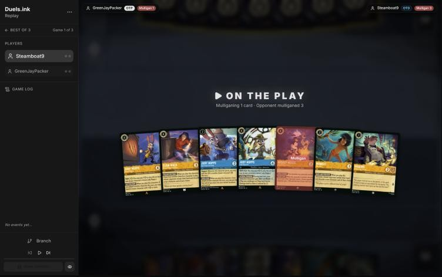
*The board before the decision: [step 0](https://duels.ink/replay/01a204e9-fdb0-70b9-8a24-adee9b96f4c5?step=0) in the duels.ink replay viewer.* Mickey Mouse – Expedition Leader was the card sent back.

**The plan (written before seeing the mulligan made):** on the play, seven of Higgins – Undercover Officer (1),
Mowgli – Man Cub (2), Judy Hopps – Day Camp Instructor (2, the only uninkable), Elisa Maza (4), Judy Hopps – Always
Vigilant (4, Shift 2), Mickey Mouse – Expedition Leader (4) and Judy Hopps – Lead Detective (6, Shift 4). It has a
play on every turn: Higgins on 1, Mowgli on 2 (HAVE A BETTER LOOK sees their hand and takes a non-character card,
which against this pair can be Strength of a Raging Fire), Day Camp on 3 with a second character for LEND A PAW's
extra ink when one is drawn, then at 4 ink Elisa (FOLLOW THE TRAIL with a Detective in play), Always Vigilant or Lead
Detective Shifted onto Day Camp. Six inkables, so ink is no problem. The candidates:
- **Keep all 7.**
- **Send back Mickey – Expedition Leader** (the fourth 4-drop; his SECRET PATH is a defensive tool).
- **Send back Mickey and Lead Detective** for more early bodies.

`mulligan.py` (1,500 deals): keep 7: ink 9.49 of 10 on turns 1–4, plays on 4.00 of 4 turns, 6.2 lore by turn 4, 4.4
characters, interaction 100%. Without Lead Detective, or without Mickey: 9.50, 3.99, 6.3, 4.5. Without both: 9.41,
3.99, 6.4, 4.7. Full mulligan: 8.98, 3.73, 5.2, 3.8, 87%. The keeps are level on every measure; the full mulligan is
clearly worse. Lead Detective is the hand's late game (Alert against Shadow and Dumbo, Resist +2 against their
challengers) and has a base in hand, so I'd keep it. Mickey is the weakest card, but he's a 2-lore body that also
blunts their challengers and is a fine ink. **Pick: keep all 7**; sending Mickey back is level.

**What you did:** you chose to go first and sent back Mickey Mouse – Expedition
Leader, drawing Besties, Assemble!. They mulliganed 3 cards.

**Verdict:** a fine keep, level with keeping all 7 (`mulligan.py` with the mulligan as played: 9.51 ink, 3.99 play
turns, 6.3 lore by turn 4, 4.5 characters). Mickey was the hand's fourth 4-drop and the card it needed least
([MULL-2](#cite-mull-2)). No flag.

### Turn 1: your turn 1

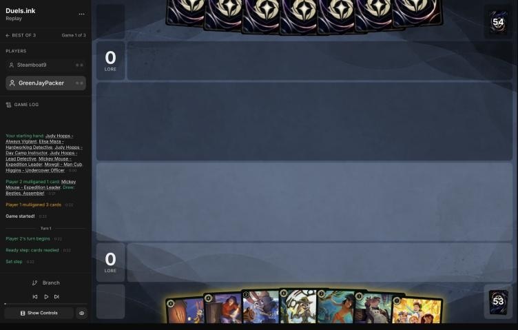
*The board before the decision: [step 3](https://duels.ink/replay/01a204e9-fdb0-70b9-8a24-adee9b96f4c5?step=3) in the duels.ink replay viewer.*

**The plan (written before seeing the turn):** no board on either side, so nothing to answer. Their turn 2 has 1 ink:
Rafiki, Luisa or a Curious Fairy at most, none of which can challenge until game turn 4. Resources: 1 ink after
inking; Higgins (1) or Besties, Assemble! (1) castable. Hand after this turn: Always Vigilant, Elisa, Day Camp, Lead
Detective, Mowgli and Besties (or Higgins), less the ink. The curve ahead: Mowgli on 2, Day Camp on 3 (with a 1-drop if
one is drawn, for LEND A PAW's extra ink), a 4-drop or Lead Detective Shifted onto Day Camp on 4. Four inkables in hand
besides Higgins and Mowgli (Always Vigilant, Elisa, Lead Detective, Besties), so ink is never short.
Candidates:
- **Higgins, ink Besties** (1 of 1): a quester on curve; Besties is the card that matters least to the next three
  turns (on turn 3 it uses the third ink but doesn't trigger LEND A PAW).
- **Higgins, ink Elisa** (1 of 1): keeps Besties as a cheap dig; Elisa's FOLLOW THE TRAIL is the hand's way to strip a
  Strength of a Raging Fire or a removal action, so I'd keep her.
- **Besties, ink something** (1 of 1): digs 4 for a character but gives up turn 1's body and its lore.

Pick: **Higgins, inking Besties**; inking Elisa instead is close. Keep Lead Detective (the Alert answer to Shadow and
Dumbo) and Always Vigilant (the answer to Demona – Scourge).

**What you did:** inked Besties, Assemble! and played Higgins.

**Verdict:** the planned line. No flag.

### Turn 3: your turn 2

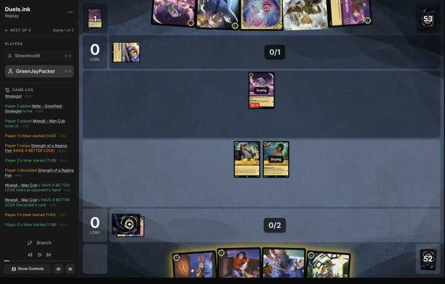
*The board before the decision: [step 12](https://duels.ink/replay/01a204e9-fdb0-70b9-8a24-adee9b96f4c5?step=12) in the duels.ink replay viewer.* Their hand was shown by Mowgli; Higgins could still quest.

**The plan (written before seeing the turn):** they inked Wildcat – Unconventional Mechanic (3, 4/3, banishes an item
on play), which no listed Amethyst/Steel list runs, and played Rafiki – Mystical Fighter (0/2, Challenger +3). Still
most like Midrange, with a card of their own. Rafiki is their only possible challenger on turn 4 (anything they play
then is drying): 3 {S} into an exerted Higgins kills him, and Higgins's 2 back kills Rafiki, so a quest offers an even
trade of 1-drops, not a free kill (the brief's FREE KILLS: none). Their removal isn't online yet: 2 ink next turn, so no
Shadow, Strength or Angela until game turn 6. No Supporter on either side. Resources: 2 ink after inking; Mowgli and
Day Camp castable; hand Always Vigilant, Elisa, Day Camp, Lead Detective, Mowgli, Belle – Snowfield Strategist (new;
2/3/2, WINTER STOCKPILE inks your banished characters). Needs check: nothing to find yet; the hand has a curve to
turn 7 (Lead Detective Shifted onto Day Camp at 4 ink).
Candidates:
- **Mowgli, ink Belle or Elisa, quest Higgins** (2 of 2): HAVE A BETTER LOOK shows their whole hand for planning the
  next turns and makes them discard a non-character card, before Strength of a Raging Fire is castable. Day Camp
  follows on turn 5, Lead Detective on it on turn 7.
- **Day Camp, ink one, quest Higgins** (2 of 2): the Shift base dries a turn earlier (Always Vigilant for 2 on turn 5),
  Mowgli on turn 5. The same ink over the two turns, but the hand information comes a turn later.
- **Either, without questing Higgins:** saves Higgins from Rafiki, but the trade is even and Rafiki is the
  challenger that would threaten every 2-willpower Detective you play, so the quest's lore is worth taking.

Pick: **Mowgli first ([SEQ-1](#cite-seq-1): see their hand before deciding the quest), then quest Higgins.** Ink: Belle or Elisa
(close); keep Always Vigilant (the answer to Demona – Scourge) and Lead Detective.

**What you did:** inked Belle, played Mowgli. HAVE A BETTER LOOK showed their six cards: Rafiki – Mystical Fighter,
Francine – Eyeing the Evidence (3, 4/3, Resist 1; off-list), Cheshire Cat – Inexplicable, Tinker Bell – Giant Fairy,
Merlin's Shop and Smithy and Strength of a Raging Fire. They discarded Strength. Higgins stayed home.

**Verdict:** Mowgli first was the plan, and it paid in information: you now knew their next turns (a second Rafiki,
the Shop, Francine and Cheshire at 3, Tinker Bell – Giant Fairy with no Curious Fairy to Shift onto), and the one
removal action in the hand was gone. Keeping Higgins home is a **close call**, mentioned because it's a habit to
watch: the quest offered Rafiki an even trade of 1-drops, which is good for you (Rafiki's Challenger +3 kills every
2-willpower Detective you'll play; Higgins is a vanilla 2/2), and with a second Rafiki in their hand Higgins could never
quest more safely later, so waiting gained nothing (["Keeping a quester ready for nothing"](#cite-docs-decision-method-9-the-coach-s-recurring-errors), the coach's
method; [RULE-1](#cite-rule-1), [TRADE-1](#cite-trade-1)). The cost was 1 lore. Confidence: medium. *Procedure note: the coach read the next turn's
brief (their turn 4) before writing this verdict; the verdict uses only the hand Mowgli showed on this turn.*

### Turn 4: their turn

**What happened:** they inked Tinker Bell – Giant Fairy and played the second Rafiki. Their hand: Francine, Cheshire,
the Shop and one unknown card (this turn's draw).

### Turn 5: your turn 3

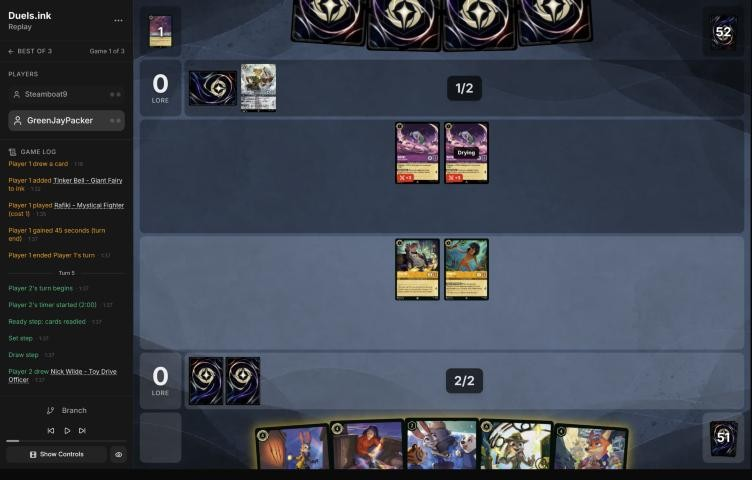
*The board before the decision: [step 16](https://duels.ink/replay/01a204e9-fdb0-70b9-8a24-adee9b96f4c5?step=16) in the duels.ink replay viewer.*

**The plan (written before seeing the turn):** 0–0. Their board: two Rafikis (Challenger +3, so 3 {S} when
challenging, 0 when challenged), both dry on their turn. Their hand: Francine, Cheshire, the Shop, one unknown card and
their draw; 3 ink next turn, so Francine or Cheshire (no Boost: Cheshire plus Boost is 5), or the Shop plus a 1-drop.
Removal or tricks they could add: only from the two unknown cards (Shadow 8% now, 15% with the draw; Angela 6% / 11%;
Strength's last copies 6% / 11%). Demona – Scourge can't come before game turn 12. No Supporter of theirs; yours is
Day Camp (and Toy Drive Officer, new), both drying if played now, so no Support line this turn.
Resources: 3 ink after inking; inkable: Always Vigilant, Elisa, Lead Detective (Day Camp and Toy Drive Officer
aren't). Castable: Day Camp (2); nothing else fits 3. Questers: Higgins, Mowgli.
What a quest exposes (their next turn): Higgins exerted, a Rafiki trades with him (2 back kills Rafiki). Mowgli
exerted is a FREE KILL for a Rafiki (left on 1 willpower). Mowgli has spent his on-play effect and is a 1/2 vanilla
now, and the Rafiki that kills him is left exerted on 1 willpower, so any of your characters kills it on your next turn
for nothing (it has 0 {S} when challenged). Rafikis that stay home never quest either, since any exerted Rafiki dies
for free to your challengers. Kept home, your 2-willpower characters can't quest safely later, so waiting gains nothing.
Needs check: no clock yet (they have 0 lore and 2 questers); the hand's plan is Lead Detective on Day Camp next turn
(4 ink), then Toy Drive Officer and Elisa with a cheap character for COMMUNITY OUTREACH and FOLLOW THE TRAIL.
Candidates:
- **Day Camp, ink Elisa or Always Vigilant, quest Higgins and Mowgli** (2 of 3): 2 lore; any trade they take is a
  Rafiki for a 1- or 2-drop you don't need, and leaves the base for Lead Detective ready.
- **Day Camp, ink one, quest only Higgins** (2 of 3): no free kill offered, 1 lore.
- **Day Camp, nobody quests** (2 of 3): a ready board; 0 lore.

Ink check. Next turn (4 ink): Lead Detective Shifted onto Day Camp; the turn after (5): Toy Drive Officer or Elisa or
Always Vigilant with 1 left. Inking Elisa leaves Always Vigilant for Demona – Scourge or a Supported Francine; inking
Always Vigilant leaves Elisa to take the Shop. Close; I'd ink Elisa. Pick: **ink Elisa, Day Camp, quest both**.

**What you did:** inked Elisa, played Day Camp, quested with Higgins and Mowgli (2–0).

**Verdict:** the planned line. Both quests offered Rafikis trades you're happy to take (the FREE KILLS entry, Mowgli,
is a spent 1/2 whose killer would die to your next challenge). No flag.

### Turn 6: their turn

**What happened:** they inked Dumbo – Ninth Wonder of the Universe and played Angela – Night Warrior, giving a Rafiki
Challenger +2 and Resist +2; that Rafiki killed Higgins and took nothing, and the other killed Mowgli and was left on
1 willpower. Both Rafikis end the turn exerted. Angela was one of their two unknown cards (6% before their draw, 11%
after it, on turn 5).

### Turn 7: your turn 4

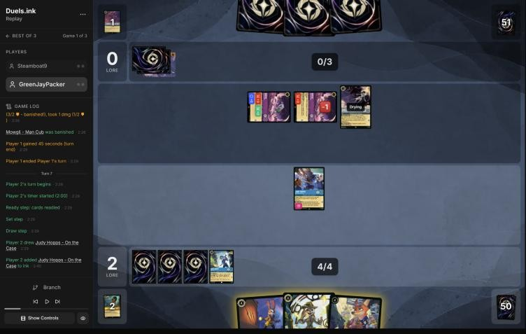
*The board before the decision: [step 29](https://duels.ink/replay/01a204e9-fdb0-70b9-8a24-adee9b96f4c5?step=29) in the duels.ink replay viewer.*

**The plan (written before seeing the turn):** 2–0. Their board: Rafiki A (exerted; Challenger +2 and Resist +2 from
Angela until the start of their turn), Rafiki B (exerted, 1 of 2 willpower left), Angela (2/3, drying). Both Rafikis
have 0 {S} when challenged, so any challenge into them is free. Their hand is fully known: Francine, Cheshire and the
Shop, plus next turn's draw, with 4 ink. So next turn they can play Francine or Cheshire (no Boost: 3 + 2 is 5), and
challenge with the surviving Rafikis (3 each) and Angela (2). Unknown removal can only come from their one draw
(Shadow 8%, Strength 6%, Angel 4%, Angela 4%). Demona – Scourge: game turn 12 at the earliest, 8% after their draw.
Support line: yours onto their character: Day Camp's +2 puts nothing of theirs at 5 {S} (Angela 4 at most), so no
Always Vigilant target; yours onto your challenger: Day Camp's quest could add +2, but it isn't needed (the Rafikis
deal nothing back); theirs: none in play or known in hand.
Resources: 4 ink after inking (Always Vigilant, Lead Detective, On the Case inkable; Toy Drive Officer isn't). Hand:
Always Vigilant, Lead Detective (Shift 4 onto Day Camp, dry, so she can act at once), Toy Drive Officer, Judy Hopps –
On the Case (new: 4/3, HIDDEN CLUES puts an item into its player's inkwell; they have no items). Day Camp can kill
Rafiki B for nothing (2 into 1 willpower), not Rafiki A (Resist 2).
Needs check: their clock is 3 a turn (game turn 20 at that rate); yours is 1. You need a board that quests through
their challengers, and Lead Detective is the card for that: on your turns your Detectives get Resist +2, and her 6
back kills anything that challenges her. Nothing is missing yet.
Candidates:
- **A. Ink On the Case; Lead Detective Shifted onto Day Camp (4 of 4); she challenges Rafiki A** (6 − 2 = 4, it dies;
  she takes 0). Kills one Rafiki. Exposes Lead Detective, exerted, 4 willpower: Rafiki B (3) + Angela (2) kill her,
  and both die to her 6 back; Francine and Cheshire are drying if played. A 2-for-1 at worst, but it spends your best
  card into the turn their challengers are still around ([TEMPO-4](#cite-tempo-4)).
- **B. Ink On the Case; Day Camp challenges Rafiki B (free kill); Toy Drive Officer (4 of 4).** Kills one Rafiki
  for nothing and lands the draw engine, which is uninkable and has to be played some time. Exposes Day Camp, exerted,
  2 willpower: a FREE KILL for Angela (left on 1 willpower and exerted, so your next challenge kills her for nothing),
  or a trade with Rafiki A. Toy Drive Officer stays ready. Keeps Lead Detective and Always Vigilant.
- **C. As B, but Always Vigilant instead of Toy Drive Officer** (4 of 4): a dry Judy in play for Lead Detective next
  turn even if Day Camp dies, but GOT YOU NOW is wasted (no target) and the removal is spent as a 4/4 body.

Pick: **B**: a free kill now, the engine down, and Lead Detective kept for when Rafikis and Angela are fewer. Next
turn (5 ink): Lead Detective onto Day Camp if it lives, or Always Vigilant plus a cheap character for COMMUNITY
OUTREACH. A is close: it trades better if they go for her, but it puts the game's best card where two of theirs can
reach it.

**What you did:** inked On the Case, Shifted Lead Detective onto Day Camp and challenged the healthy Rafiki: 4 damage
through its Resist, banished, nothing back. Lead Detective ends the turn exerted.

**Verdict:** **close call**, your line (A) against the plan's (B). Both kill one Rafiki and use all 4 ink. Yours kills
the healthy one, leaving Rafiki B on 1 willpower, and puts a 6/4/2 on the board that every challenge into dies to; it
forces their hand ([TEMPO-1](#cite-tempo-1)): to remove her they must send both Rafiki B and Angela, ending with no board while you
still hold Always Vigilant and Toy Drive Officer. The plan's line kept her for later and got the draw engine down,
at the cost of a free kill on Day Camp. Neither is clearly better; yours makes them pay two cards for your best one,
and if they don't, she quests for 2 a turn. Confidence: medium.

### Turn 8: their turn

**What happened:** they played Merlin's Shop and Smithy, inked Francine, moved Rafiki to the Shop (a card and 1 lore),
then sent Rafiki and Angela into Lead Detective: all three died. 2–1; their board is the Shop alone.

### Turn 9: your turn 5

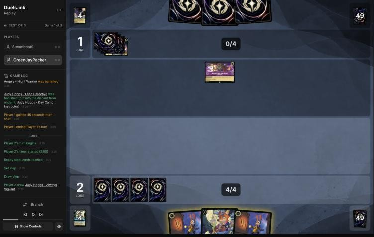
*The board before the decision: [step 38](https://duels.ink/replay/01a204e9-fdb0-70b9-8a24-adee9b96f4c5?step=38) in the duels.ink replay viewer.*

**The plan (written before seeing the turn):** 2–1, both boards empty but for their Shop (6 {W}, a card and a lore
for each move there, once a turn). Their hand: Cheshire (known) and two unknown cards; next turn 5 ink and up to two
new cards (draw and a Shop move). With no characters of theirs in play, nothing can challenge yours next turn unless
it's played with Rush (Flash would stop that anyway) or Shere Khan's NEW INCENTIVE goes onto a dry character, and they
have none. What reaches a ready character: Hades – Looking for a Deal (5; bottom it or they draw 2; 15% now, 29% after
their two cards), Angel's GOOD AIM (2 damage), Strength (1 damage per character of theirs, so 1–2 here), Shadow's
exert with nothing to follow. Cheshire's Boost has no damage to move. Demona – Scourge needs 6: not before game
turn 12. No Supporter on either side yet; Toy Drive Officer would be yours from next turn.
Resources: 4 ink, 5 if you ink an Always Vigilant (the only inkable cards). Hand: Always Vigilant ×2, Toy Drive
Officer. Nothing costs 5, so this turn plays one 4-drop whatever you ink; the ink is for next turn, when 6 lets a
4-drop and a 2-drop both land (COMMUNITY OUTREACH draws only after two characters in a turn).
Needs check: no clock on either side; you need bodies and card flow, and their engine is the Shop. Your removal (Always
Vigilant) has no target in their likely cards without your Support pushing one to 5 {S}.
Candidates:
- **Ink Always Vigilant, play Toy Drive Officer (4 of 5).** The engine and Supporter down a turn early, safe from
  challenges; GOT YOU NOW kept for a turn with a target. Next turn: Always Vigilant plus a drawn 2-drop (6 of 6),
  Toy Drive Officer's quest Supporting one of theirs into her range if it helps.
- **Ink Always Vigilant, play the other Always Vigilant (4 of 5).** A 4/4 body, but GOT YOU NOW is wasted (no other
  character played, no target), and the removal is gone as a vanilla.
- **Don't ink; Toy Drive Officer (4 of 4).** Keeps both Always Vigilants, but next turn has 5 ink, not 6.

Pick: **ink Always Vigilant, Toy Drive Officer.** Two copies of the removal aren't needed against a deck with this few
5-{S} characters, and Gaston (three left) does the same job.

**What you did:** inked an Always Vigilant and played Toy Drive Officer.

**Verdict:** the planned line. No flag.

### Turn 10: their turn

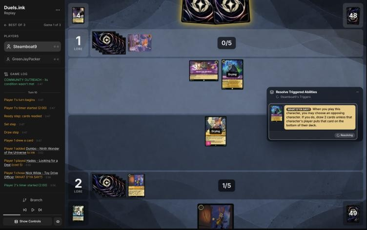
*The board before the decision: [step 44](https://duels.ink/replay/01a204e9-fdb0-70b9-8a24-adee9b96f4c5?step=44) in the duels.ink replay viewer.* Your choice: bottom it or let them draw 2.

**What happened:** they inked a second Dumbo and played Hades – Looking for a Deal on Toy Drive Officer. You let them
draw 2 rather than bottom Toy Drive Officer. 2–1.

**Verdict on your choice:** right. Bottoming Toy Drive Officer would have left you with no board and one card in hand
(Always Vigilant) against Hades and three cards; keeping it leaves your only body, your Supporter and your draw engine
in play, at the price of two cards to a hand that goes from 3 to 5 with 5 ink to spend. The more cards they already
hold, and the fewer you have, the more the body is worth ([H-2](#cite-h-2), its converse for the opponent). No flag.

### Turn 11: your turn 6

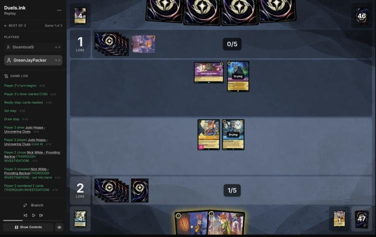
*The board before the decision: [step 49](https://duels.ink/replay/01a204e9-fdb0-70b9-8a24-adee9b96f4c5?step=49) in the duels.ink replay viewer.* Nick Wilde – Providing Backup is in hand from the dig; nothing inked yet.

**The plan (written before seeing the turn):** 2–1. Their board: the Shop and Hades (3/4/1, ready, so it can't be
challenged). Their hand: Cheshire (known) and three unknown cards (two from Hades). Next turn 6 ink: Demona –
Scourge comes online (23% now, 36% with their draw and a Shop move); Cheshire plus Boost (5) moves 2 damage onto one of
yours from any damaged character, Hades included if your damage back hurt him; Hades (3) challenges anything exerted.
Their dig: the Shop (a move), Dumbo's copies are inked. Support line: **yours onto their character:** Toy Drive Officer
quests and adds +2 to Hades (3 → 5 {S}), which puts him in Always Vigilant's range (the brief's STRENGTH REMOVAL line);
yours onto your challenger: no target, nothing of theirs is exerted; theirs: no Supporter in play or known.
Resources: 5 ink, 6 with an ink. Hand: Always Vigilant and Judy Hopps – Uncovering Clues (new: 3/3/1; on play and on
each quest, looks at the top 3 and takes a Detective). The removal line needs Clues (4) and Always Vigilant Shifted
onto her (2): 6 ink, so it needs an ink that isn't one of those two. **Dig first:** played with 5 ink before inking,
Clues looks at 3 cards, and 20 of your 48 are inkable Detectives (Higgins, Helpful Officer, Providing Backup, On the
Case, Clues, Elisa, Always Vigilant, Lead Detective): 81% to find one (`odds.py hold 48 20 3`).
Needs check: no clock on either side yet (their Shop adds a lore a turn); their Hades is the only character, and
removing him leaves a board with nothing that can challenge.
The line, with its branches:
- **Clues (4 of 5), dig. If an inkable Detective comes: ink it (6), Toy Drive Officer quests and Supports Hades to 5,
  Always Vigilant Shifts onto Clues (2; 6 of 6) and GOT YOU NOW banishes Hades** (another character, Clues, was played
  this turn). Two characters played, so COMMUNITY OUTREACH draws. 3–1, their board just the Shop. It exposes Toy Drive
  Officer, exerted: nothing of theirs can challenge it (Cheshire drying, no Rush), and Demona – Scourge's exert gives
  them no challenger either; Always Vigilant (on a drying Clues) stays ready.
- **If the dig finds only an uninkable Detective** (Day Camp, Toy Drive Officer, Fangmeyer): ink Always Vigilant and
  play a found Day Camp (2; 6 of 6) for COMMUNITY OUTREACH and LEND A PAW; keep Toy Drive Officer home.
- **If it finds nothing:** keep Toy Drive Officer home (exerted, Hades's 3 plus Cheshire moving Hades's 2 damage would
  kill him) and keep Always Vigilant for next turn's version of the same line.

Alternatives without the dig first: inking Always Vigilant before Clues gives up the removal for a 2-drop at best;
inking Clues and hard-casting Always Vigilant (4) has no other character played, so GOT YOU NOW does nothing.

**What you did:** played Clues before inking (her dig took Nick Wilde – Providing Backup), then inked Always Vigilant,
played Nick, and quested with Toy Drive Officer, declining its Support. COMMUNITY OUTREACH drew Besties, Assemble!.
3–1. Board: Toy Drive Officer (exerted), Clues and Nick (drying); theirs: Hades and the Shop.

**Verdict:** digging before inking was right ([SEQ-1](#cite-seq-1)), and the dig found what the removal line needed. **Mistake:**
Inking **Always Vigilant** and playing **Nick Wilde – Providing Backup** (Clues 4 + Nick 2 = 6 of 6) is suboptimal
because it leaves Hades, their only character, on the board, and with the Cheshire you knew they held it's a kill on
the Toy Drive Officer you then quested: Hades's 3 into its 4 willpower, then Cheshire (3) and its Boost (2), 5 of their
6 ink, moves the 2 damage Toy Drive Officer dealt back off Hades and onto it. It also gives up the removal for good. Inking
**Nick** instead, questing Toy Drive Officer **with Support onto Hades** (3 → 5 {S}) and Shifting **Always Vigilant
onto Clues** (Clues 4 + Shift 2 = 6 of 6) is better because GOT YOU NOW (another character, Clues, played this turn)
banishes Hades: a 5-cost character answered for 2 ink ([TEMPO-2](#cite-tempo-2)), their only challenger gone ([QC-2](#cite-qc-2)), and the same
COMMUNITY OUTREACH draw, since Clues and the Shift are two characters played. What it exposes: Toy Drive Officer,
exerted, with nothing of theirs in play to challenge it. Their next turn can't reach it except with Demona –
Imperious Spellcaster giving herself Rush (10%); Demona – Scourge's exert finds no challenger, and Cheshire has no
damage to move. Always Vigilant, on a drying Clues, stays ready. What it costs: Clues's THOROUGH INVESTIGATION, since
a shifted character doesn't keep the text of the card under it ([CR 8.10.5](#cite-cr-8-10-5)), and the 3/2 body of Nick, inked. That's
less than their only character plus your exposed engine. Principles: [TEMPO-2](#cite-tempo-2), [QC-2](#cite-qc-2), [RULE-1](#cite-rule-1); the Detectives' own trick,
Support onto their character ([the ruling "Support can add strength to an opposing character"](#cite-kb-rules-rulings-support-can-add-strength-to-an-opposing-character); the brief
printed Hades "in range with your Support"). Ink check: under either line next turn's hand is the card drawn this
turn plus next turn's draw, with 7 ink; your line keeps three bodies and Clues's digs, the suggested one two bodies and
their empty board. Confidence: medium (it rests on how much Clues's future digs are worth; she has to quest, exposed,
to use them).

### Turn 12: their turn

**What happened:** Hades challenged Toy Drive Officer (3 damage, 2 back), then Cheshire Cat came down, Boosted, and
moved Hades's 2 damage onto Toy Drive Officer, which died. They inked Violet Parr – Force Field Practice (2, 3/2,
Resist 1; off-list for Midrange, a card of the Merlin and Shop builds in the pair file). Hades ends the turn exerted
and undamaged; Cheshire is drying with one card under him.

### Turn 13: your turn 7

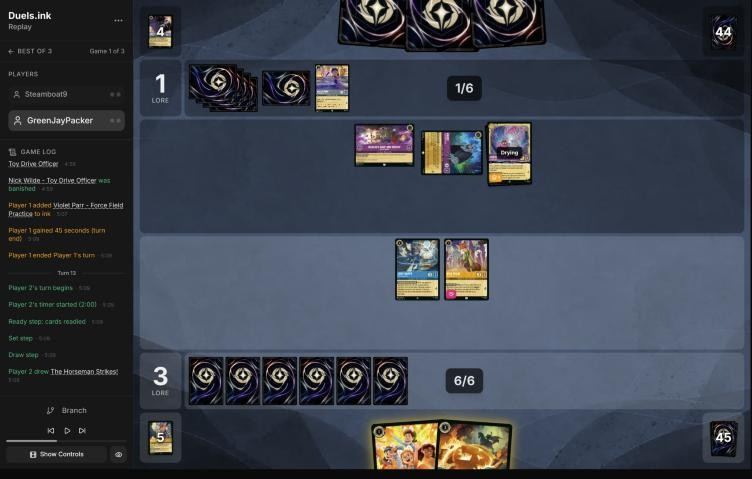
*The board before the decision: [step 63](https://duels.ink/replay/01a204e9-fdb0-70b9-8a24-adee9b96f4c5?step=63) in the duels.ink replay viewer.*

**The plan (written before seeing the turn):** 3–1. Your board: Clues (3/3) and Nick – Providing Backup (3/2, Support
while another Detective is in play), both dry. Theirs: the Shop, Hades (exerted, healthy: challengeable), Cheshire
(drying, one card under). Their hand: three unknown cards; 7 ink next turn. What their next turn does to you:
Cheshire's Boost moves up to 2 damage from any damaged character onto one of yours, ready or not, so any damage on
your board is theirs to use; Hades and Cheshire (3 each) kill any exerted character of yours (FREE KILLS: Clues and
Nick, each leaving Hades on 1). Demona – Scourge (6; 24% now, 37% with their draw and a Shop move) would exert your
board for both of them to challenge; Shadow (24% / 37%) exerts one. Strength of a Raging Fire is sung free by Hades or
Cheshire for 2–3 damage. Support line: **yours onto their character:** Nick's quest adds +3, putting Hades or Cheshire
at 6, in range of a Gaston or Always Vigilant if one is found; **yours onto your challenger:** Nick's +3 lets Clues kill
Hades (6 into 4), but she dies to his 3 back and Nick is left exerted for Cheshire: two of yours for Hades;
theirs: none.
Race: their board makes 2 a turn plus 1 from the Shop (game turn 26 at that rate); yours 2 (turn 29). You're behind on
the current boards. Needs check: you need to remove Cheshire and Hades without giving them free kills, and more
questers; the answers left are Gaston ×3, Always Vigilant ×2, Lead Detective ×2 (Shift 4 onto Clues, dry, so she acts
at once, and on your turn her Resist +2 makes Hades's 3 back a 1), and Fangmeyer ×3, which returns the Lead Detective
in your discard.
Resources: 6 ink, 7 inking Besties or The Horseman Strikes! (new: draw a card, may banish a character with Evasive;
nothing Evasive on their board, while Shadow and Dumbo are in their deck). **Dig first:** ink the Horseman (its banish
waits for a Shadow or Dumbo) and cast Besties (1): four cards for a character, with 6 ink left. Lead, Gaston or
Always Vigilant among the four: 50%; counting Fangmeyer, 60% (`odds.py hold`).
Branches after Besties:
- **Lead Detective:** Shift onto Clues (4; 1 + 4 = 5 of 7), challenge Hades: 6 kills him, she takes 1. Nick stays home.
  Exposes Lead, exerted on 3 willpower left, to Cheshire's 3 (both die).
- **Gaston:** Nick quests and Supports Hades to 6; Gaston (5; 1 + 5 = 6 of 7) banishes him. Exposes Nick (a free kill for
  Cheshire); Clues and Gaston stay ready.
- **Always Vigilant:** no second character to play, so GOT YOU NOW can't fire; Shift her onto Clues (2) and challenge
  Hades (4 kills him; she takes 3, left on 1). Exposes her to Cheshire's Boost or challenge. Or hold her for a turn with
  a second character.
- **Fangmeyer:** play him (5; 6 of 7) to return Lead Detective to hand for next turn.
- **Anything else:** play it, keep Clues and Nick ready (no damage on your board for Cheshire to move), and don't
  trade Clues and Nick for Hades.

**What you did:** cast Besties without inking (it found Gaston – Superior Archer), quested Clues (her dig found Toy
Drive Officer), quested Nick with Support onto **Cheshire** (3 → 6 {S}), and played Gaston, whose WATCH THIS!
banished Cheshire (Angel – Experiment 624 was the card under him). 6 of 6 ink; the Horseman stays in hand. 5–1.

**Verdict:** **good play**, and better than the plan's branch, which aimed Gaston at Hades. Cheshire was the right
target: Hades can be challenged whenever he's exerted, and he dies to two of your 3-{S} characters, but Cheshire
stays ready and kills without a challenge every turn his Boost moves damage
([the coach's Cheshire note](#cite-kb-cards-cheshire-cat-inexplicable): "it kills a waiting board without a challenge"), so only removal that needs no
challenge answers him ([THREAT-2](#cite-threat-2), [QC-2](#cite-qc-2)). Digging first, then the Support-and-Gaston line, is the Detectives' signature
trick done right ([SEQ-1](#cite-seq-1)). The quests' exposure is small: Hades can make one challenge, killing Clues or Nick and being
left on 1 willpower for your next turn, and the second quest gave a lore and a card. Not inking kept the Horseman as a
play for next turn (Toy Drive Officer 4 + Horseman 3 needs 7, so next turn's draw has to be inked); [INK-3](#cite-ink-3), fine either way.

### Turn 14: their turn

**What happened:** Hades challenged and killed Clues, taking 3 (1 willpower left, exerted). They played Goliath –
Transformed Warrior (4, 5/5/1, Gargoyle; WHEN NIGHT FALLS discards a card to move 2 damage from himself to one of yours;
STONE BY DAY) and Pepita – Watchful Alebrije (2/3, Challenger +2). No ink this turn (still 6). 5–1.

### Turn 15: your turn 8

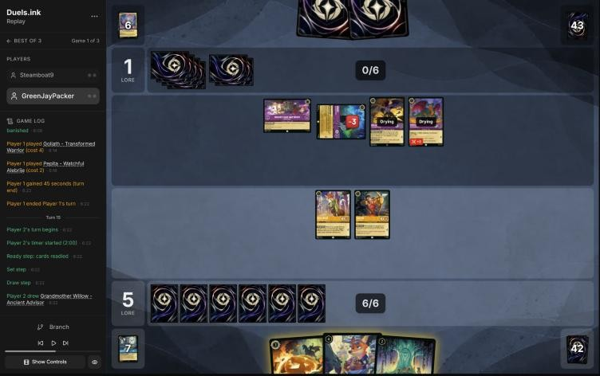
*The board before the decision: [step 79](https://duels.ink/replay/01a204e9-fdb0-70b9-8a24-adee9b96f4c5?step=79) in the duels.ink replay viewer.*

**The plan (written before seeing the turn):** 5–1, but the clocks have turned: their board quests for 3 plus the Shop
(game turn 24 at that rate), yours for 2 (turn 29). Their board: the Shop, Hades (exerted, 1 willpower left), Goliath –
Transformed Warrior (5/5/1, ready) and Pepita (2/3, Challenger +2, ready); two cards in hand, 7 ink next turn. Their
next turn: Goliath (5) and Pepita (4 when challenging) kill anything of yours left exerted, and Hades (3) too if he
lives; after a challenge, Goliath's WHEN NIGHT FALLS (discard a card) moves 2 of his damage onto one of your ready
characters. FREE KILLS listed: Nick and Gaston, each to Goliath alone. Demona – Scourge (17% now, 32% with their
draw and a Shop move) at 7 ink exerts your whole board for those challengers; Strength of a Raging Fire, sung free by
Goliath or Hades, deals 3–4 (13% / 25%). Support line: Nick has Support only while another Detective is in play (Gaston
isn't one; Toy Drive Officer is); no strength removal in hand, so **yours onto their character: none this turn;**
yours onto your challenger: Nick would need to quest, exposing him; theirs: none.
Resources: 6 ink, 7 inking the Horseman. Hand: The Horseman Strikes! (no Evasive target now; Shadow and Dumbo are
their Evasives), Toy Drive Officer (uninkable), Grandmother Willow – Ancient Advisor (new, uninkable: SMOOTH THE WAY
makes the next character 1 cheaper). Willow then Toy Drive Officer is 2 + 3 = 5, two characters, so COMMUNITY OUTREACH
draws. Challenges into Hades (1 left): Nick kills him and dies to his 3 back; Gaston kills him and survives on 1
willpower, exerted.
Needs check: you lead on lore but not on board or clock. Their engine is the Shop (a card and a lore a turn), their
threat Goliath; your answers left: Always Vigilant ×2 and Gaston ×2 (Goliath is at 5 {S} without help), Lead
Detective ×2, Fangmeyer ×3 (returns Lead Detective or Clues). You need card flow to find them: Toy Drive Officer.
Candidates:
- **A. Nick challenges Hades (both die); Willow, then Toy Drive Officer (5 of 6), no ink, keep the Horseman.** A
  2-drop for their 5-drop, nothing of yours left exerted, a card drawn. Exposes nothing to challenges; only a Scourge
  (or Shadow's exert) gets their challengers in.
- **B. Gaston challenges Hades (he survives on 1); Willow and Toy Drive Officer (5 of 6).** Keeps Nick's Support for a
  later removal trick, but leaves Gaston exerted on 1 willpower: Pepita trades with him or Goliath kills him for free
  and then moves 2 damage onto Willow or Nick.
- **C. Quest with both and develop:** +2 lore, but two free kills and no Hades kill.

Pick: **A.** It removes a quester and challenger at no exposure, and the Horseman stays as a cantrip and the answer to
a Shadow or Dumbo.

**What you did:** Willow, then Toy Drive Officer for 3; no ink, no quest, no challenge. COMMUNITY OUTREACH drew Judy
Hopps – Lead Detective. Board: Nick, Gaston, Willow, Toy Drive Officer, all ready. 5–1.

**Verdict:** **close call.** The development and the draw were the plan. The difference is Hades: Nick's trade
would have removed one of their three challengers (and a quester) for a 2-drop, so next turn's quests face Goliath and
Pepita only. Keeping Nick keeps his Support (+3 with Toy Drive Officer in play), which is what turns a drawn Always
Vigilant or Gaston into removal for anything with 2+ {S}, and Hades on 1 willpower dies to any of your characters the
next time he exerts. Both keep your board out of reach of their challengers this turn; neither line is clearly
better. Not inking kept the Horseman, a cantrip that's their Shadow's answer ([INK-3](#cite-ink-3)). Confidence: medium.

### Turn 16: their turn

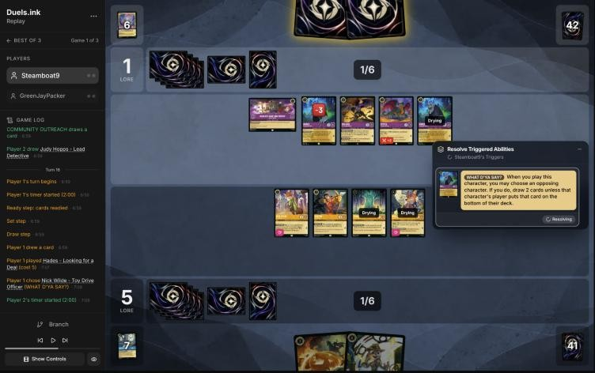
*The board before the decision: [step 84](https://duels.ink/replay/01a204e9-fdb0-70b9-8a24-adee9b96f4c5?step=84) in the duels.ink replay viewer.* Your choice: bottom it or let them draw 2.

**What happened:** a second Hades – Looking for a Deal, on Toy Drive Officer; **you put Toy Drive Officer on the
bottom of your deck** rather than let them draw 2. They inked a second Shop, moved the first Hades to the Shop (a card
and a lore), and quested with that Hades and Goliath. 5–4.

**Verdict on your choice:** **close call.** Unlike turn 10, you had a board (Nick, Gaston, Willow) and they had a
hand (3 cards before the draw 2, with the Shop drawing them one more each turn), so the two cards were worth more to
them and the body less to you: Toy Drive Officer draws only on turns you play two characters, and your hand was the
Horseman and a Lead Detective with no Judy to Shift onto. Against that, it was a 4-willpower body and your Supporter
([H-2](#cite-h-2), its converse: the body is worth more the more cards they already hold, and they held few). Either is defensible.

### Turn 17: your turn 9

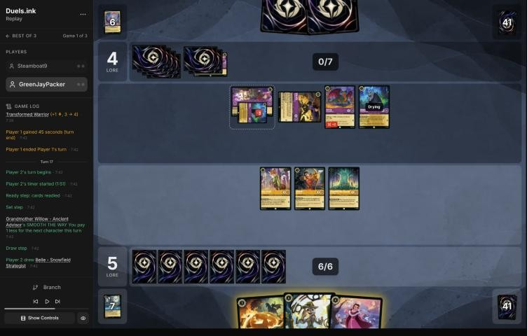
*The board before the decision: [step 90](https://duels.ink/replay/01a204e9-fdb0-70b9-8a24-adee9b96f4c5?step=90) in the duels.ink replay viewer.*

**The plan (written before seeing the turn):** 5–4, and you're behind on the clock: their four characters quest for 4
and the Shop adds 1 (they reach 20 on game turn 24 at that rate; you, at 3 a turn, on 25). Their board: the Shop,
Hades A (at the Shop, exerted, 1 willpower left), Goliath (exerted, 5/5), Pepita (ready) and Hades B (drying); two
cards in hand, 8 ink next turn. What their next turn does: every exerted character of yours is a FREE KILL for Goliath
(Nick, Gaston and Willow all listed); Pepita (4) and the Hadeses (3) kill the small ones; Goliath's WHEN NIGHT FALLS moves
2 of his damage onto a ready one after he's been hit. Demona – Scourge (18% now, 33% with the draw and a Shop move),
Shadow (18% / 33%) and Shere Khan (18% / 33%) are the cards that reach ready characters. Support line: Nick has
Support only with another Detective in play, and none is (Gaston and Willow aren't); with Lead Detective down he has
it again. No strength removal in hand, so **yours onto their character: none;** theirs: none.
Resources: 6 ink, 7 with an ink. Hand: the Horseman (no Evasive target), Lead Detective (no Judy in play, so a 6-cost
hard cast, 5 with Willow's SMOOTH THE WAY), Belle (new: 4, 2/3/2; WINTER STOCKPILE inks your banished characters).
Challenges: Hades A (1 left) dies to anything; Willow kills him and dies, Nick kills him and dies (survives on 1
with Lead Detective's Resist +2 in play), Gaston kills him and is left on 1. Goliath (5) takes two challengers, and
both die.
Needs check: the board and the race are going their way; you need to remove questers and land bodies that survive.
Lead Detective is the strongest thing you can add: 6 back kills any one challenger, and on your turns her Resist +2
lets Nick and later Detectives challenge into Hades or Pepita and live. Answers to Goliath left: Always Vigilant ×2,
Gaston ×2.
Candidates:
- **A. Ink the Horseman; Lead Detective for 5 with Willow's discount (5 of 7); then Willow challenges Hades A (both
  die).** A 2-drop for a quester that also feeds their Shop; nothing of yours ends the turn exerted. Lead Detective,
  Nick (Support again) and Gaston are ready. Exposes nothing to challenges; only a Scourge, Shadow or Shere Khan gets
  their challengers in.
- **B. As A, but Gaston kills Hades A instead** (left on 1, exerted): keeps Willow's discount, but Gaston is a free kill
  next turn.
- **C. Belle (3 with the discount) and the Horseman's draw** (6 of 7): two lore a turn from Belle, but no Hades kill
  and Lead Detective waits a turn.

Pick: **A**; keep Belle for next turn.

**What you did:** Belle for 3 with Willow's discount, then The Horseman Strikes! for its draw (Elisa Maza); no ink
(the third turn running), no quest, no challenge. 6 of 6 ink. Board: Nick, Gaston, Willow, Belle, all ready. Hand:
Lead Detective, Elisa. 5–4.

**Verdict:** **inaccuracy.** Playing **Belle and the Horseman** (3 + 3 = 6 of 6) is suboptimal because it leaves
Hades A, a quester that also feeds their Shop, alive, and keeps your best card in hand another turn while their clock
is the faster one. Inking the Horseman and playing **Lead Detective for 5 with Willow's discount, then trading Willow
into Hades A** (5 of 7) is better because it removes a quester for your cheapest body and puts the card that wins
this matchup on the board a turn sooner: on your next turn her Resist +2 lets her kill an exerted Goliath and live
(5 − 2 = 3 into 4 willpower), and Nick (Support again with a Detective in play) and Elisa challenge into their
questers taking 2 less ([THREAT-1](#cite-threat-1), [TEMPO-1](#cite-tempo-1)). What it exposes: nothing exerted. Lead Detective, Nick and Gaston stay
ready, so only Demona – Scourge, Shadow's exert or Shere Khan's NEW INCENTIVE (each about 1 in 3 with their draw and a
Shop move) get Goliath into her, and he dies to her 6 back. Your line's gains, a card and a 2-lore body, are real
but don't slow their clock. Ink check: your line keeps Lead Detective and Elisa with 6 ink (7 inking next turn's
draw: Lead Detective 5 plus 2); the suggested one keeps Belle and has 7 now. Confidence: low to medium (it rests on Lead
Detective surviving their next turn, and their reach cards are about 1 in 3 each, not combined here).

### Turn 18: their turn

**What happened:** Shere Khan – Khan Industries CEO came down; NEW INCENTIVE let Goliath challenge your ready Belle
(banished; WINTER STOCKPILE put her into your inkwell, and CORNER THE MARKET gave them an ink drop). Goliath then
discarded Francine for WHEN NIGHT FALLS and moved his 2 damage onto Nick, who died. A Hades moved to the Shop (a card
and a lore) and both Hadeses quested. 5–7.

### Turn 19: your turn 10

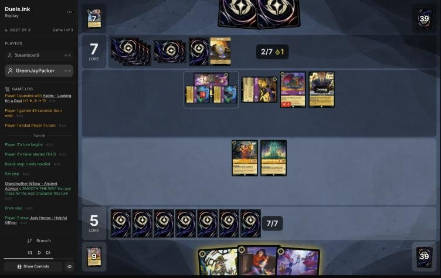
*The board before the decision: [step 105](https://duels.ink/replay/01a204e9-fdb0-70b9-8a24-adee9b96f4c5?step=105) in the duels.ink replay viewer.*

**The plan (written before seeing the turn):** 5–7, and the race is theirs: five characters quest for 5 and the Shop
adds 1, so they reach 20 on game turn 24 at that rate (sooner with one more lore), while your two characters make 2.
Their board: the Shop; Hades A (exerted, 1 willpower left), Hades B (exerted, healthy), Goliath (exerted, healthy),
Pepita (ready), Shere Khan (drying); two cards in hand, 9 ink next turn (one an ink drop). Their next turn reaches
ready characters only with Shadow (19% now, 35% with their draw and a Shop move), Demona – Scourge (19% / 35%) or a
second Shere Khan (14% / 27%); anything exerted is a FREE KILL (Gaston and Willow both listed). Support line: no
Supporter on your board; none on theirs.
Resources: 7 ink, 8 with an ink. Hand: Lead Detective, Elisa, Judy Hopps – Helpful Officer (new: 1, 2/1/1; TO THE
RESCUE removes 2 damage). Willow's discount goes on the first character played: Helpful Officer for 0, then Lead
Detective Shifted onto her (a Judy) for 4. 4 of 7, and all three cards fit only if one is inked, which loses one of
them. Lead Detective lands drying (her base is drying), so she can't challenge this turn, but from your next turn her
6 kills any of theirs and her Resist +2 (your turn) keeps her alive against Goliath's 5. Challenges now: only Gaston and
Willow are dry. Hades A (1 left) dies to either; Willow dies to his 3 back, Gaston is left on 1, exerted.
Needs check: you can't outrace 6 a turn with 2; you have to kill questers every turn from now, starting with the
exerted ones. Lead Detective is the card for it; Elisa's FOLLOW THE TRAIL (see their hand, take a non-character) is
second.
Candidates:
- **A. Helpful Officer (0), Lead Detective Shifted onto her (4); Willow then challenges Hades A (both die).** 4 of 7,
  no ink (Elisa next turn). Nothing of yours left exerted; Lead Detective and Gaston ready.
- **B. As A, but Gaston kills Hades A** and is left on 1, exerted: keeps Willow's discount for Elisa next turn, but
  Gaston is a free kill (it costs them a quest).
- **C. Helpful Officer (0) and Elisa (4):** FOLLOW THE TRAIL sees their two cards and takes a non-character; Lead
  Detective waits a turn.

Pick: **A.**

**What you did:** Lead Detective hard-cast for 5 with Willow's discount, then Helpful Officer (1): 6 of 7, no ink, no
challenge. Board: Gaston, Willow, Lead Detective, Helpful Officer, all ready. 5–7.

**Verdict:** **close call.** Your line puts the same Lead Detective down and keeps Helpful Officer as a separate body
and Willow (with her discount for Elisa next turn), for 2 more ink than the Shift. The plan's line spends Willow to
kill Hades A now, so he doesn't quest or feed the Shop next turn. One lore of theirs against a 2/1 body and Willow's
next discount; on a board where their questers will be exerted on your next turn either way, neither is clearly
better. Both leave nothing exerted.

### Turn 20: their turn

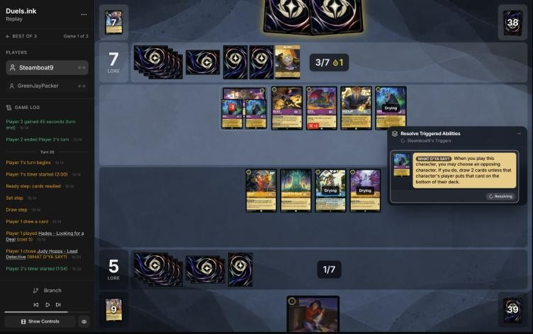
*The board before the decision: [step 111](https://duels.ink/replay/01a204e9-fdb0-70b9-8a24-adee9b96f4c5?step=111) in the duels.ink replay viewer.* Your choice: bottom her or let them draw 2.

**What happened:** a third Hades, on Lead Detective; **you let them draw 2** rather than bottom her. Shere Khan then
sang Strength of a Raging Fire for 6 (one per character of theirs) and Lead Detective died. They played Tinker Bell –
Curious Fairy (the Giant Fairy's Shift base), moved a Hades to the Shop with their ink drop (a card and a lore),
inked Francine and quested with two Hadeses and Goliath. 5–11.

**Verdict on your choice:** right. Bottoming Lead Detective loses your best card for certain. Letting them draw
risks her only if the two cards, or what they already held, include an answer, and a 6-willpower kill needed
Strength of a Raging Fire with six characters, or a combination of challenges. Strength alone, with its three
copies still to come in the listed deck, was roughly a 1-in-3 to 1-in-2 chance across the cards they'd see (`odds.py
hold 39 3 6`: 40%). Giving cards is the price of keeping the body that wins the matchup ([H-2](#cite-h-2)'s converse).

### Turn 21: your turn 11

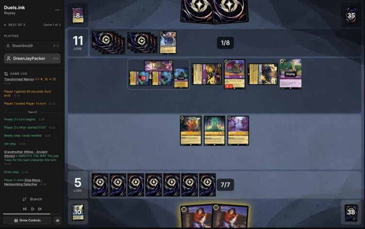
*The board before the decision: [step 121](https://duels.ink/replay/01a204e9-fdb0-70b9-8a24-adee9b96f4c5?step=121) in the duels.ink replay viewer.*

**The plan (written before seeing the turn):** 5–11. Their seven characters quest for 7 and the Shop adds 1: two more
questing turns reach 20 (`odds.py clock 11 7`), so they win on game turn 24, or on 22 if they find 1 more lore (a
Tinker Bell – Giant Fairy Shifted onto the Curious Fairy is a 2-lore quester). Your board quests for 3: five turns
(`odds.py clock 5 3`). Their board: the Shop; Hades A (exerted, 1 left), Hades B (exerted), Hades C (drying), Goliath
(exerted), Shere Khan (exerted, 2 willpower), Pepita (ready), Tinker Bell – Curious Fairy (drying). Hand: 2; 9 ink next
turn. Everything of yours left exerted is a FREE KILL (Gaston, Willow, Helpful Officer to Goliath alone). No Supporter
on either side.
Resources: 7 ink, 8 with an ink; hand Elisa ×2 (a second one, new). With Helpful Officer in play, each Elisa's FOLLOW
THE TRAIL shows their hand and takes a non-character card.
**Needs check: nothing you hold or can draw wins in time.** Kills available now: Hades A (Willow or Helpful Officer
dies to his 3 back; Gaston survives on 1) and Shere Khan (2 willpower; Gaston or Helpful Officer kills him and dies to
his 4). Hades B and Goliath are out of reach of any single challenger. At most two kills, leaving five questers and the
Shop: 6 a turn, so 17 after their next turn and over 20 the turn after, while you're at most 8–10. Your next turn would
need to kill four or five more with two drying Elisas and what survives. No card left in your deck turns that (a
Gaston or Always Vigilant kills one; there is no sweeper in the list). **Unwinnable from here ([principle 2](#cite-principle-2)):** the
game is lost to their board's lore whatever you do, so this turn and the rest get "unwinnable" rather than a severity.
The line that keeps the most outs (their misplay, [POS-2](#cite-pos-2)): play one Elisa first to see their hand and strip a removal
action, kill Hades A and Shere Khan, and quest with what's left.

**What you did:** both Elisas (the first for 3 with Willow's discount; 7 of 7, no ink), each looking at their hand
(two characters, nothing to take); Helpful Officer traded with Shere Khan, and Gaston killed Hades A, surviving on 1.

**Verdict:** **unwinnable** from this turn. Your line was the plan's: the two kills on offer, and both looks at their
hand.

### Turn 22: their turn

**What happened:** Tinker Bell – Curious Fairy moved to the Shop (a card and a lore); Angel – Experiment 624's GOOD AIM
(discarding Angela) killed Willow; Goliath killed the damaged Gaston; Flash came down; two Hadeses, Tinker Bell and
Pepita quested. 5–16.

### Turn 23: your turn 12

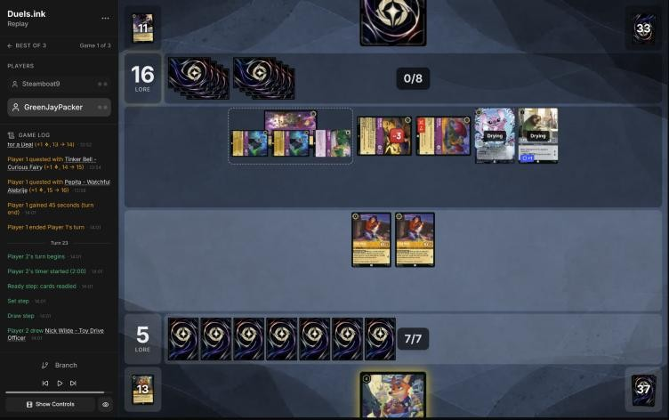
*The board before the decision: [step 138](https://duels.ink/replay/01a204e9-fdb0-70b9-8a24-adee9b96f4c5?step=138) in the duels.ink replay viewer.*

**The plan (written before seeing the turn):** 5–16. They need 4, and their board holds 8 lore of questers (Goliath,
Pepita, two Hadeses, Tinker Bell, Angel, Flash for 2) plus the Shop. Your two Elisas can kill at most two of the
exerted ones (Goliath is on 2 willpower, Pepita on 3), and Toy Drive Officer (drawn) lands drying. Unwinnable, as on
turn 21: they reach 20 next turn whatever you do.

**What you did:** the Elisas killed Goliath (one Elisa died) and Pepita; Toy Drive Officer came down.

**Verdict:** **unwinnable.** The two kills on offer.

### Turn 24: their turn

**What happened:** Peter Pan's Shadow exerted Toy Drive Officer; two Hadeses, Tinker Bell and Angel quested to 20.
They won 20–5.

## Lessons
1. **A dig's find can pay for the removal line** ([11](#turn-11)). When the removal needs a second card played and
   all your ink, ink the card the dig found and keep the removal: here Clues (4) and Always Vigilant Shifted onto her (2)
   was 6 of 6 only by inking the Nick she found, and Toy Drive Officer's Support (+2) put Hades at 5 {S}. Read the
   brief's STRENGTH REMOVAL line ("in range with your Support") after every dig, not only at the start of the turn.
2. **Spend removal that needs no challenge on what challenges can't reach** ([13](#turn-13)). Hades can be challenged
   whenever he exerts; Cheshire stays ready and kills by moving damage. Gaston on Cheshire was the right target.
3. **Against Amethyst/Steel, a ready board isn't a safe board.** NEW INCENTIVE, WHEN NIGHT FALLS, GOOD AIM, Cheshire's
   Boost and Strength of a Raging Fire all reach ready characters (turns [18](#turn-18), [20](#turn-20) and
   [22](#turn-22)). Count them before deciding that staying home protects a character, and weigh the
   quest you give up against them ([H-12](#cite-h-12), a pattern being watched).
4. **Hades – Looking for a Deal: keep the body that's your engine or your win condition when your hand is short**
   ([10](#turn-10), [20](#turn-20)); bottoming is an option for a replaceable body when they're short of cards
   ([16](#turn-16)). [H-2](#cite-h-2)'s converse.

## Proposed knowledge-base updates (applied after discussion)
- **Strategy:**
  - [H-2](#cite-h-2) (its converse for the opponent), evidence from three Hades choices in this game: turn 10 (kept Toy Drive
    Officer with one card in hand and no other board: right), turn 16 (bottomed it with a board and their hand short:
    close call), turn 20 (kept Lead Detective: right).
  - [H-12](#cite-h-12), pattern evidence outside Rockstar Aggro (outcomes, so pattern only): of the eight characters their turns took
    from you from turn 12 on, five were ready when they went (Toy Drive Officer bottomed by Hades; Belle to NEW INCENTIVE; Nick to WHEN
    NIGHT FALLS; Lead Detective to Strength; Willow to GOOD AIM). The blind verdicts on turns 15–19 favoured staying
    home; whether questing would have done better is an open question below.
- **Meta** (for the Amethyst/Steel pair file's hand-written notes): "Midrange with three Hades and two Shops
  against GreenJayPacker's Detectives: Steamboat9 (01a204e9-fda0, game 1, 22 Nov 2026)". The list seen: Rafiki ×2,
  Tinker Bell – Curious Fairy, Tinker Bell – Giant Fairy (inked), Flash ×2, Merlin's Shop and Smithy ×2 (one inked), Pepita,
  Violet Parr – Force Field Practice (inked; off-list), Angela ×2, Cheshire Cat, Francine – Eyeing the Evidence ×3 (two
  inked, one discarded; off-list), Peter Pan's Shadow, Strength of a Raging Fire ×2, Wildcat (inked; off-list), Angel –
  Experiment 624 ×2, Dumbo ×2 (both inked), Goliath – Transformed Warrior (off-list; WHEN NIGHT FALLS moves 2 of his
  damage onto a ready character after he challenges), Shere Khan, Hades ×3. How it played: early Rafikis with Angela's
  Challenger +2 and Resist +2 traded up (turn 6); Hades + Cheshire killed Toy Drive Officer (turn 12); Shere Khan's NEW
  INCENTIVE let Goliath kill a ready Belle, then WHEN NIGHT FALLS killed Nick (turn 18); Strength sung for 6 with six
  characters killed Lead Detective (turn 20). Shop moves gave them a card and a lore on five turns.
- **Cards:** for the Cheshire Cat card note: "Gaston or Always Vigilant with Support is the clean answer:
  Nick – Providing Backup's +3 put a ready Cheshire at 6 for WATCH THIS! (01a204e9-fda0 turn 13)."
- **Detectives piloting** (the Amber/Sapphire pair file, ["Detectives as GreenJayPacker plays it"](#cite-kb-meta-archetypes-amber-sapphire-detectives-as-greenjaypacker-plays-it)): "Ink the dig's
  find to pay for the Shift-removal line" (turn 11).
- **Rules:** none.

## Hindsight
Doesn't change the verdicts above.
- **Turn 6:** Angela, the card that let a Rafiki kill Higgins and survive, was one of their two unknown cards (about
  1 in 10 at the time). The turn-5 quests were still right.
- **Turn 11:** with Hades banished, their turn 12 had Cheshire and Violet Parr in hand and nothing in play to
  challenge or to move damage from, so Toy Drive Officer would most likely have lived; instead Hades and Cheshire killed
  it, as the plan said they could.
- **Turn 17:** their turn 18 brought Shere Khan, whose NEW INCENTIVE reaches ready characters, so the suggested line's
  Lead Detective would have faced Goliath through it; she'd have taken Goliath with her (6 back into 5 willpower).
- **Turn 20:** they had a Strength of a Raging Fire by the time they sang it (in hand or among Hades's two cards), so
  Lead Detective was lost whichever way you chose.
- **Their draws:** three Hades, two Shops, Goliath, Shere Khan and two Strengths. Their card flow beat yours, and from
  turn 12 their reach cards killed a character of yours nearly every turn whether it was exerted or not.

## The coach's errors
Filled in during discussion.

| When | Error | How it was caught | How it won't happen again |
|---|---|---|---|
| Turn 3 (blind pass) | The coach ran the next turn's brief (their turn 4) before writing turn 3's verdict. The verdict used only what Mowgli showed on turn 3, but the order broke the skill's rule ("finish the turn's section before reading the next turn"). | The coach, at once; noted in the turn's verdict. | Proposed: `brief.py` refuses any turn after one of yours whose draft section has a plan but no **Verdict:** line, as it already refuses a turn whose earlier sections are missing. |

## Open questions
- Turn 11: did you see Always Vigilant Shifted onto Clues, with Toy Drive Officer's Support on Hades? What made you
  prefer Nick and inking Always Vigilant: Clues's future digs, or something else?
- Turn 16: you kept Toy Drive Officer against the first Hades and bottomed it against the second. What changed?
- Turn 17: why Belle and the Horseman over Lead Detective that turn?
- Turns 13–21: you didn't ink on five turns running. Was that to keep cards in hand, or did the hand never offer a
  spare card?
- Turns 15–19: the board stayed home rather than quest into their challengers. Did you weigh questing anyway, since
  their reach cards could kill ready characters too ([H-12](#cite-h-12))?
- Turn 3: Higgins stayed home after Mowgli showed a second Rafiki. What was the reason?

## Citations
Copies of the coach's knowledge base cited above, as they stood when they were cited (the private repository's commit and date are given with each). They don't change when the knowledge base does.

**amethyst-steel.md, Midrange: how it plays**: knowledge base, `kb/meta/archetypes/amethyst-steel.md` at `6cecbcd` (2026-11-27), working tree

> ### Midrange: how it plays `[coach, meta study of the user's 27 Oct 2026 games (tools/scan.py), full games, not blind, 1 game]`
> 01a17dc3.
> - **Merlin – Profoundly Curious:** an ink drop on play, a draw on each quest, 2 lore.
> - **Questers:**
>   - Diablo – Stone Servant (+2 {S} and +1 {L} with a Villain in play; their Villains can't be challenged while he's
>     exerted)
>   - Tinker Bell – Giant Fairy (Shift 4; 1 damage to each opposing character on play; 2 lore)
>   - Maleficent – Exultant Spellcaster
> - **Removal through tricks** (turn 14): Peter Pan's Shadow exerts your character, Cheshire Cat's Boost moves 2 damage onto
>   it, then a challenge finishes it.

**cheshire-cat-inexplicable.md**: knowledge base, `kb/cards/cheshire-cat-inexplicable.md` at `6cecbcd` (2026-11-27), working tree

> # Cheshire Cat – Inexplicable
>
> Amethyst, 3-cost, 3/4/1 (text verified from replay data, 01a18275):
> - **Boost 2 {I}:** once during your turn, pay 2 to put the top card of your deck facedown under him.
> - **IT'S LOADS OF FUN:** whenever you put a card under him, you may move up to 2 damage counters from chosen
>   character to chosen opposing character.
>
> ## Timing `[coach + user, 01a18275, 2026-11-02]`
> - **Boost costs ink, not an exert,** so it works the turn he's played, while he's drying. Cheshire for 3 plus Boost
>   for 2 is a 5-ink play that moves damage at once.
> - **The source can be your own character:** moving damage off yours heals it and puts it on theirs.
>   - 01a18275 turn 7: Mickey's 2 damage moved onto Violet Parr (2/1), killing her and healing Mickey.
>   - Turn 9: Cheshire moved his own 2 damage onto Tinker Bell – Giant Fairy, then challenged and traded with her.
> - **Against it:** any damage on your board is a resource for their Cheshire too. On turn 14 their Cheshire moved
>   Arthur's 2 damage (from challenging your Merlin) onto your Demona – Imperious Spellcaster and killed her. Evasive
>   doesn't help: moving damage isn't a challenge.
> - **Midrange Amethyst runs 4** (Amethyst/Steel and Amber/Amethyst lists), so count damaged characters on both sides
>   as a threat while one is in play or likely in hand.
> - **Resist doesn't stop it** `[coach, blind review of 01a1cbe6-f3a8 turn 8]`. Moving damage removes counters from one
>   character and puts them on another (CR 1.9.2.4); it isn't damage dealt, which is all Resist reduces (CR 8.8.1). A
>   Lilo & Stitch (Resist 1) took the full 2.
> - **The damage your character deals back is theirs to move.** In 01a1cbe6-f3a8 turn 8 Isis took 3 from challenging
>   Lilo & Stitch, and Cheshire moved 2 of it back onto Lilo & Stitch to finish it. So when you count what can kill a
>   character next turn, add 2 for a castable Cheshire plus Boost (with their cost reducers: Hamm put it at 4 ink).
> - **It kills a waiting board without a challenge** `[coach, blind review of 01a1ced3-11cc turns 13-16]`: against a
>   ready board (H-6), Cheshire's boosts killed Mike Wazowski and Grandmother Willow and damaged Dale. Staying ready
>   doesn't protect a character from it.
> - **Returning him to hand draws the Boosted cards** `[coach, blind review of 01a1fecf-eeef turn 18]`. A return effect
>   takes the cards under him to the hand too (CR 5.1.1.7; `kb/rules/rulings.md`, "A character returned to hand takes
>   the cards under it"). Un Poco Loco, sung for free, returned Cheshire with two cards under him: two cards drawn, his
>   damage gone, and his quest already taken that turn.

**angel-experiment-624.md**: knowledge base, `kb/cards/angel-experiment-624.md` at `6cecbcd` (2026-11-27), working tree

> # Angel – Experiment 624
>
> Steel character, 4 cost, 3/3/1, inkable. Text verified with `tools/replay.py card 01a1bd40-04ec "Angel - Experiment 624"`:
> - **UNTOUCHABLE** While you have no cards in your hand, this character gains Resist +2.
> - **GOOD AIM** Once during your turn, you may choose and discard a card to deal 2 damage to chosen character.
>
> Three copies in each of duels.ink's average Emerald/Steel Midrange lists (meta of 26 Oct 2026).
>
> ## What it means in play `[coach, 01a1bd40-04ec turns 9–12, blind review of the user's game]`
> - **UNTOUCHABLE and GOOD AIM work together.** Each GOOD AIM discards a card, and once their hand is empty Angel has
>   Resist +2. Count their hand *after their plays*, not at the start of your turn, before you count your damage back:
>   in 01a1bd40-04ec turn 9 the coach's trade count had Angel dying to a 3-strength character's damage back, though
>   their plays could empty their hand (1 card, 2 after their draw) and Resist +2 keep him alive. He survived two
>   challenges that way later in the game.
> - **Under SPIKE SUIT** it cuts the damage back from a 3- or 4-willpower character to 1 or 2.
> - **GOOD AIM reaches ready characters** (2 damage, no challenge), so it adds to their challenges against your exerted
>   ones and kills 2-willpower characters on its own. The brief lists it under "their characters that can damage your
>   ready ones".
> - **The brief counts UNTOUCHABLE as on** in "what can challenge your characters" (a CONDITIONAL RESIST line, with their
>   hand size now and after their draw).

**amber-sapphire.md, Detectives as GreenJayPacker plays it**: knowledge base, `kb/meta/archetypes/amber-sapphire.md` at `6cecbcd` (2026-11-27), working tree

> ### Detectives as GreenJayPacker plays it `[coach, blind reviews of 01a1fb8a-260a (vs James, discussed 22 Nov 2026) and 01a1ffec-372f (vs [AD-S] McWryze, not yet discussed)]`
> The same 60 in both games: Higgins ×4, Eilonwy ×3, Besties ×3, Helpful Officer ×2, Mowgli ×2, Grandmother Willow ×2,
> Hamm ×2, Day Camp Instructor ×4, Nick Wilde – Providing Backup ×4, On the Case ×2, The Horseman Strikes! ×3, Uncovering
> Clues ×4, Belle – Snowfield Strategist ×2, Mickey Mouse – Expedition Leader ×2, Toy Drive Officer ×4, Elisa Maza ×4,
> Always Vigilant ×4, Fangmeyer ×3, Gaston ×3, Lead Detective ×3. Both games won. Piloting points:
> - **Lead Detective is a 4-ink Shift, not a spare 6-drop:** sixteen other Judys to go onto. She was inked early in both
>   games (James turn 1, McWryze turn 5; "new to the deck, ink the high costs"), and against Emerald/Steel's Evasive
>   questers she was the matchup: Shifted onto a dry Day Camp, her Alert killed Vixey and Mushu (McWryze turn 11).
> - **Dig first, then plan:** Uncovering Clues digs on play and on each quest; her finds made turns 9 and 11 against
>   McWryze (an inkable Elisa for a double play, then both Lead Detectives).
> - **Support onto their character** for Always Vigilant: Don Karnage and Fflewddur (James turns 15 and 21).
> - **Play characters in pairs while Toy Drive Officer is out:** it drew a card nearly every turn in both games.
> - **Against pings, keep home only what challenges kill for free** (Toy Drive Officer, James turn 11).

**decision-method.md, 9. The coach's recurring errors**: knowledge base, `docs/decision-method.md` at `6cecbcd` (2026-11-27), working tree

> ## 9. The coach's recurring errors
> From `reviews/calibration.md`. Check yourself against these on every turn.
> - **Treating known knowledge as new.** In 01a19bb9 turn 7 the coach missed Support on an opposing character, then
>   called it a new lesson, though the Detectives notes already described it: it had read only the opponent's
>   archetype notes, never searched for the cards in hand, and never searched before writing the lesson. Read both
>   decks' notes, use the brief's knowledge-base notes on the cards in view, and search before calling anything new.
>   Finding it afterwards is a failure to explain and fix (`.claude/skills/analyse-replay/SKILL.md`, after the blind
>   pass).
> - **Missing Support, the coach's most frequent miss** (six reviews by 2026-11-21). Support acts when its character
>   quests, not at the challenge or the removal it enables, it isn't printed on the card doing the damage, and it can
>   choose a character on either side (CR 8.13.1; Ward stops it, CR 8.15.1). So any count from printed {S} alone misses
>   it. It matters four ways, and the brief has a line for each:
>   1. **Yours onto their character, for your strength-threshold removal** (Gaston – Superior Archer, Judy Hopps – Always
>      Vigilant): "STRENGTH REMOVAL IN HAND, AND WHAT YOUR SUPPORT PUTS IN RANGE". Missed in 01a19bb9 turn 7 and
>      01a19c08-7f38 turn 9, where the player found it (user, 2026-11-02: "that cannot continue to be missed"), and in
>      01a1fb8a-260a turn 21 though the brief printed it.
>   2. **Yours onto your challenger:** your options' challenge lines, a Supporter Shifted in this turn included. Missed in
>      01a19c3f-185a turn 5 (Lilo & Stitch's +3 on Mr. Big) and 01a1a1ee-148c.
>   3. **Theirs onto their challenger:** "SUPPORT they can quest first" and "With Support" under "WHAT CAN CHALLENGE YOUR
>      CHARACTERS". Missed in 01a1fecf-eeef turn 12 (Eilonwy's +2 let a Willow kill Giant Fairy).
>   4. **Theirs onto your character, for their removal** (H-9): "THEIR STRENGTH REMOVAL, AND WHAT THEIR SUPPORT PUTS IN
>      RANGE", your characters in hand included. Counted by hand until 2026-11-21.
>
>   **Prevention:** whenever either side has a Supporter in play (or one to play or Shift in), the turn's setup has a
>   **Support line** naming all four, each from its brief line ("none" where it doesn't apply), and every line you
>   compare says which of them it uses or exposes (section 2, item 2 and 3).
> - **Planning before the dig.** In 01a1ffec-372f turns 9 and 11 the coach planned from the hand as it was, while
>   Uncovering Clues' digs (on play and on each quest) came first: they found an inkable Elisa Maza that paid for a
>   double play, then a Lead Detective to Shift onto a dry Day Camp Instructor, whose Alert killed two fliers. The
>   player's line beat the coach's both times. With a dig to use, the setup branches on the brief's "WHAT THIS TURN'S DIG
>   CAN FIND" (section 4, item 3), and the line digs first (SEQ-1).
> - **Missing a return-and-replay line.** Twice in MK_TurtleBauer's games the plan treated Un Poco Loco as dead or left
>   it out: in 01a1fecf-eeef turn 18 it returned Cheshire Cat (two Boosted cards drawn) and Isis, and in 01a20294-b698
>   turn 16 it returned Isis and Peter Pan's Shadow, whose replayed exerts let both singers of a Circle of Life die. The
>   second time the knowledge base already had the first, and the brief printed that note. Prevention: the brief's
>   "REPLAY ON-PLAY EFFECTS" line, which a turn's candidates must use or answer (section 3).
> - **Card text misread or not read.** Go Go Tomago given another card's keywords (01a14bf9). Tramp's "choose one"
>   Rush missed (01a14574 turn 19). Read each card from a single-card source, in full.
> - **Treating the archetype as settled.** In 01a1fe12-6d44 turn 5 the review called Rockstar Aggro "certain" after four
>   cards, and its pre-game read quoted the lists' shares as odds; MK_TurtleBauer's own deck that game was a variant of
>   Big Ramp. Rank the likely lists in words and keep "something else" open (section 1; user, 2026-11-21).
> - **Missing what becomes possible at their next ink.** Lead Detective hard-cast at 6 (01a14574 turn 15).
> - **Judging exposure from their board as it stands.** In 01a19bbd-79c2 turn 4 the coach said Pluto and Mike Wazowski,
>   both 0 strength, "couldn't have hurt" an exerted Eilonwy. Pluto's GOOD DOG made Dale – Ready for His Shot (a
>   Princess Aggro tell, seen in game 1) castable with their 3 ink, and his SPIKE SUIT let Mike kill her. Check their
>   next turn's combat tricks and cost reducers for every character you'd exert (section 2; caught by the user,
>   2026-11-02).
> - **Counting exposure as lore only.** In 01a1fb8a-260a turn 11 the brief said Don Karnage and Ursula could kill an
>   exerted Toy Drive Officer, the draw engine, with both surviving; the verdict counted only the lore the quest gained
>   and what their quests would give up. Prevention: the brief's FREE KILLS line, which a verdict on questing or staying
>   home has to name entry by entry (section 5).
> - **Missing archetype staples and their combos.** Prince Phillip after Malicious, Mean, and Scary (01a139ad turn 23).
> - **Missing synergies on their side.** Darkwing in play makes Launchpad's draw discard-free (01a14574 turn 5).
> - **Overstating a risk** without checking what the alternative loses in the same branch (01a14574 turn 15).
> - **Not counting what the coach's own line exposes.** In 01a19c0c turn 20 the coach suggested Shifting in Lead
>   Detective so Darkwing could kill a 1-lore Shadow. Darkwing's challenge would have left him exerted for Wasabi, and
>   TWIN BLADES could then kill the Lead Detective just played. The player held her for the 3-lore Ursula instead, and
>   won with her two turns later. Prevention: the brief's ready-damage line, and "Say what Y exposes" (section 5).
> - **Anchoring on the coach's own plan.** The user's line was better on the mulligan and turns 11 and 19 of 01a14574.
> - **Not reading the archetype's key cards before the game.** Circle of Life's text was never read, so its wipe combo (Prince Phillip replayed from the discard) was missed (01a13b88 turn 8).
> - **Counting one card of a job, and only their draw.** On 01a13b88 turn 18 the review gave a 17% chance they could
>   damage the whole board: Malicious, Mean, and Scary in their hand and draw. Don Karnage – Debonair Pirate does the
>   same on play, and their dig (Meilin Lee, Tod, Akood, Strike) let them see several more cards: about 43%. Use the
>   brief's combined line and `odds.py dig` (section 2).
> - **Overvaluing a ramp plan, and Khan Industries, on the draw against midrange.** The stonks 📈 reviews called deep
>   mulligans on the draw wrong because the hands held Priscilla, Dream Come True and Khan Industries (01a15f93,
>   01a16035, 01a16972). The player explained that Priscilla dies to their early board on the draw and that Khan
>   Industries is a closing play there (section 7, and the Big Ramp notes). Against sweeper Control the reverse holds:
>   Khan Industries is lore their Storms can't reach (danny, 2026-11-02).
> - **Ignoring a card known to be in their hand.** Meilin Lee revealed Circle of Life into their hand; the next turn's wipe was near-certain (01a13b88 turn 18).
> - **Keeping a quester ready for nothing.** Before keeping a character ready, say what waiting gains: a card, a better
>   challenge next turn, or a wipe dodged. If nothing, and it can't quest safely later either, use it now. In 01a1cbca-787d
>   turn 6 the coach's line kept Lilo & Stitch ready as a wall, though Demona – Betrayer meant it could never quest
>   safely; the player's quest into Hamm was better (H-12).
> - **Leaving a ready combo in hand.** When every piece of a line is there (the Device, a character to banish, the ink),
>   the brief's DEVICE LINES and SHIFT NEXT TURN say so; a reason to hold it (a sweeper that can come before it pays off)
>   has to be named, with the ink at which it comes. In 01a1ea7f-cc42 turn 13 The Leviathan stayed in hand with 3 ink spare
>   while Raging Storm couldn't come before game turn 16.
> - **Writing off a combo piece while its partner can still be drawn.** In 01a1eaf6-93a9 turn 16 the coach's line
>   discarded The Leviathan as dead because no base was in hand; three Olafs, each costing 0, were still in the deck,
>   with the Device in play. The player kept it and dug for Olaf. Before calling a card dead, read the brief's DEVICE
>   LINES ("has no base this turn … Left in your deck") and the needs check's odds of drawing the partner in time.

**rulings.md, Support can add strength to an opposing character**: knowledge base, `kb/rules/rulings.md` at `6cecbcd` (2026-11-27), working tree

> ### Support can add strength to an opposing character
> - **Situation:** a Support character quests while the opponent has a character you want to remove with a "5 {S} or
>   more" banish: Judy Hopps – Always Vigilant's GOT YOU NOW, Gaston – Superior Archer's WATCH THIS.
> - **Ruling:** Support may choose any other character, including an opposing one. Adding the Support character's {S}
>   to theirs can lift a small character to 5 {S} for the banish. Supports stack, and a supported character supports
>   with its new {S}.
> - **Basis:** CR 8.13.1 (Support: "add this character's {S} to another chosen character's {S} this turn"; "another
>   chosen character" isn't limited to your own).
> - **Confidence:** derived from CR and confirmed by duels.ink's engine: Detectives opponents did it to the user's
>   characters (01a17e54 turn 21, 01a17e5d turn 12, 01a17e45 turn 23; `kb/meta/archetypes/amber-sapphire.md`), and
>   MK_ifoughtthelore did it to their opponent's (01a19bb9 turn 7, 01a19bbd-79c2 turn 8). Not an official ruling.
> - **Added:** 2026-11-02, from the review of 01a19bb9 (vs xBWx); the trick was first recorded in the meta study of
>   1 Nov 2026.

**MULL-2**: strategy principle, `kb/strategy/principles.md` at `6cecbcd` (2026-11-27), working tree

> - **MULL-2. A smooth curve beats a few powerful cards.** Check that you can spend ink well on turns 1–4, have enough inkable cards, and know what turn 4 looks like. `[MCL ch.12]` · baseline
>   - **Ink spent isn't the goal by itself.** Judge a keep by a nice curve (a play each turn), early lore pressure, and
>     interaction that sets the opponent back, as well as by ink, then weigh card quality and the matchup
>     (user, 2026-11-01). `tools/mulligan.py` reports all of these.

**SEQ-1**: strategy principle, `kb/strategy/principles.md` at `6cecbcd` (2026-11-27), working tree

> - **SEQ-1. Gather information before irreversible decisions.** Draw, look and scry before choosing what to ink. Quest with draw triggers before committing other plays when the order doesn't otherwise matter. `[MCL ch.5]` · baseline

**RULE-1**: strategy principle, `kb/strategy/principles.md` at `6cecbcd` (2026-11-27), working tree

> - **RULE-1. Only exerted characters can be challenged** `[CR 4.6.4.2]`. Questing, singing, or {E} for an ability exposes the character. Staying ready protects it. Every quest is also a decision about what the opponent can challenge next turn. · baseline
>   - *Card text overrides this* (CR 1.2.1). Shere Khan – Khan Industries CEO's NEW INCENTIVE lets one character
>     challenge ready characters that turn. Alert (e.g. from Judy Hopps – Lead Detective, to every Detective on their
>     turn) ignores Evasive. Against Ducktectives, name both in the setup. 01a14574, turns 16 and 18. `[coach, 2026-10-26]`

**TRADE-1**: strategy principle, `kb/strategy/principles.md` at `6cecbcd` (2026-11-27), working tree

> - **TRADE-1. Judge a trade by ink invested, tempo, value already generated, and the board afterwards**, not by card count. A 2-cost for a 5-cost is a big win even if it's one-for-one. *Ask: "What does the board look like after this challenge?"* `[MCL ch.7]` · baseline

**TEMPO-4**: strategy principle, `kb/strategy/principles.md` at `6cecbcd` (2026-11-27), working tree

> - **TEMPO-4. Don't put a whole turn into one expensive character that will likely be removed before it does anything.** `[MCL ch.1]` · baseline

**TEMPO-1**: strategy principle, `kb/strategy/principles.md` at `6cecbcd` (2026-11-27), working tree

> - **TEMPO-1. Tempo is how much freedom you leave the opponent, not how fast you play.** A play that forces the opponent to spend their turn answering it has stolen part of their turn. *Ask: "If I play this, what does my opponent have to do next?"* `[MCL ch.1]` · baseline

**TEMPO-2**: strategy principle, `kb/strategy/principles.md` at `6cecbcd` (2026-11-27), working tree

> - **TEMPO-2. Answering an expensive threat with a cheap card is a tempo swing**, and more so if the answer was sung for no ink. Other examples: playing Shift threats before the opponent can answer them, and ramping into several threats in one turn. `[MCL ch.1, ch.7]` · baseline

**QC-2**: strategy principle, `kb/strategy/principles.md` at `6cecbcd` (2026-11-27), working tree

> - **QC-2. Challenge the threat, not the character.** Engines, synergy pieces and big questers are worth fighting over. A 1-lore character doing nothing usually isn't. *Ask: "Does this character actually need to be removed?"* `[MCL ch.6, ch.9]` · baseline

**THREAT-2**: strategy principle, `kb/strategy/principles.md` at `6cecbcd` (2026-11-27), working tree

> - **THREAT-2. Distinguish immediate threats (big lore next turn) from slow engines (card advantage over turns).** Role decides which matters more: the aggressor can often ignore engines, but the defender usually can't. `[MCL ch.9]` · baseline

**INK-3**: strategy principle, `kb/strategy/principles.md` at `6cecbcd` (2026-11-27), working tree

> - **INK-3. Usually ink every turn, but not automatically.** Keeping one more playable card can beat one more ink. Missing ink with an expensive hand can leave you permanently behind. `[MCL ch.4]` · baseline

**THREAT-1**: strategy principle, `kb/strategy/principles.md` at `6cecbcd` (2026-11-27), working tree

> - **THREAT-1. Not every threat needs an answer.** *Ask: "What happens if I don't answer this?"* "Very little" means spend resources elsewhere. "I probably lose" means it's the priority. `[MCL ch.9]` · baseline

**POS-2**: strategy principle, `kb/strategy/principles.md` at `6cecbcd` (2026-11-27), working tree

> - **POS-2. From behind, play to your outs and accept calculated risk.** Safe efficient play from a losing position loses slowly. A line with a 30% chance beats a line with 0%. *Ask: "What has to happen for me to win, and which play makes it most likely?"* `[MCL ch.10]` · baseline

**H-2**: hypothesis, `kb/strategy/hypotheses.md` at `6cecbcd` (2026-11-27), working tree

> ### H-2. Spare ink isn't automatically wasted when later turns will be short of cards
> - **Claim:** Ink grows by one every turn, but cards don't. Once later turns are likely to have more ink than
>   good cards to spend it on, cards are the scarcer resource. Then playing a low-impact card just to use spare
>   ink (giving up a better card to the inkwell instead) is usually worse than leaving the ink unspent.
> - **Applies when:** you're ahead on board (POS-1) and the extra play has little impact (WIN-2). Also when the
>   backup value of the extra card is low, e.g. a second Shift target when the opponent's removal can't hit the first.
> - **Doesn't apply when:** you're behind and need board presence now, or the cheap card has real impact.
> - **The converse, for the opponent:** extra cards are worth less to an opponent who already has a full hand and is
>   short of ink. When an effect offers "they draw 2 or you lose a body" (Hades – Looking for a Deal), keeping
>   the body is more attractive the more cards they already hold. Discard-payoff decks still get some fuel from
>   extra cards. Evidence: 01a139ad, turn 14. The opponent had 5 cards and 7 ink, and the user kept Isis
>   rather than bottoming her. Discussed 2026-10-26 and judged a close call.
> - **Evidence for:** replay 01a14bf9 (vs Goop), turn 5. The user left 1 ink unspent rather than ink Cheshire to
>   play a second Mulan – Injured Soldier. Coach first called it a close call, then agreed after the user's argument.
> - **Evidence against:** none yet.
> - **Status:** open.

**H-12**: hypothesis, `kb/strategy/hypotheses.md` at `6cecbcd` (2026-11-27), working tree

> ### H-12. A Rockstar board should quest every turn against an exert-and-challenge deck
> - **Claim:** against Midrange decks that remove with exert effects and challengers (Amber/Amethyst and Amethyst/Steel:
>   Isis, Peter Pan's Shadow, Demona – Scourge, Cheshire Cat's moved damage, Rafiki), Rockstar Aggro's small characters
>   should quest each turn rather than wait ready. The limit: a quester that would die for nothing to a single
>   challenger needs a Bodyguard in front of it first (David entering exerted).
> - **Why:** staying ready protects only from their plain challengers (Rafiki, Hamm). Isis and Shadow exert a chosen
>   character, Scourge exerts them all, and Cheshire moves damage without a challenge, so ready characters die anyway
>   and the skipped quests are lore the race can't win back. It's H-6's opposite case: H-6's ready board gained by
>   drawing cards while it waited, and a board of 1-lore Rockstar characters draws nothing.
> - **Evidence for** (blind reviews, not yet discussed with danny, who may have had reasons to hold back):
>   - 01a1cb74-e730 (Toru89, game 2), turns 9 and 11.
>   - 01a1cbbb-ca0c (Duccio, game 1): Isis exerted Lilo for Rafiki on turn 6; two Cheshires killed Dale and Thomas on
>     turn 12; Scourge exerted four characters on turn 14.
>   - 01a1cbca-787d (Duccio, game 3), turn 4 (held back for nothing) and turn 6 (danny's quest beat the coach's wall).
>   - 01a1cbe6-f3a8 (Duccio, rematch game 1), turns 3 and 5: the Lilo kept home died to Isis and Rafiki on turn 6.
>   - 01a1ccd4-187e and 01a1ccde-6845 (EzfelDifel, games 1 and 2): four turns of holding back in each.
> - **Evidence against:** 01a1ced3-11cc (HØT CØCØ, game 3), turns 13 and 15: a ready board did hold their questers back
>   for two turns, though Cheshire's boosts killed some of it (H-6).
> - **Evidence for, outside Rockstar Aggro** (01a1fb8a-260a, GreenJayPacker's Detectives vs Retro Device, turns 5 and 11;
>   discussed 22 Nov 2026): Nick was kept home twice when nothing could punish his quest without slowing their clock.
>   The limit held too: Toy Drive Officer, which two of theirs could kill for free, was rightly kept home (turn 11).
> - **Status:** open (six games against three opponents, from undiscussed blind reviews; one discussed game outside
>   Rockstar Aggro).

**principle 2**: coaching principle, `CLAUDE.md` at `6cecbcd` (2026-11-27), working tree

> 2. **Some games are unwinnable.** Draws and matchups can make a game lost whatever the player does. Say so
>    when it's true, rather than inventing mistakes to explain a loss.

**CR 8.10.5**: Comprehensive Rules, `kb/rules/cr/08-keywords.md` at `6cecbcd` (2026-11-27), working tree

> **8.10.5.** A player can use a shifted character to perform all turn actions of the character it was put on top of. The shifted character doesn’t gain the text of the character it’s put on top of (e.g., an activated ability), but it does keep any effects that apply to that character when the shifted character enters play. A player can exert a shifted character to sing a song if the character it was put on top of was dry when the shifted character entered play.
