# Review: GreenJayPacker vs Steamboat9, 22 Nov 2026 (game 2)

| | |
|---|---|
| **Status** | draft (blind pass done, not yet discussed) |
| **Replay** | `01a204f7-9c73` (`python3 tools/brief.py 01a204f7-9c73 --turn N`) · [duels.ink viewer](https://duels.ink/replay/01a204f7-9c73-7ce8-90de-fbd2d5bdf824?step=0) |
| **Format** | Core Constructed (from game 1 of the match), judged by the current Comprehensive Rules, version 2.3.0 (the replay's engine reports its own rules v2.2). Set 14 era: inks revealed before the coin toss |
| **Decks** | You: Amber/Sapphire Detectives, the same 60 as in your earlier reviewed games ([the coach's notes on how you play it](#cite-kb-meta-archetypes-amber-sapphire-detectives-as-greenjaypacker-plays-it)). Them: Amethyst/Steel ([the coach's notes on this pair](#cite-kb-meta-archetypes-amethyst-steel-from-reviewed-games-and-discussion)); closest list throughout: Midrange, with Goliath, Tinker Bell – Curious Fairy (four), Violet Parr, Wildcat and Taran – Magically Armed from outside it, and three Shere Khans, two Cheshires and two Scourges |
| **Play/draw** | You went first |
| **Result** | Loss: Steamboat9 quested to 20 on game turn 34 (11–20) |
| **Meta data** | snapshot of 2026-11-25 (fresh) |
| **Chosen how** | By the project's owner: a list of GreenJayPacker's games sent for review, not chosen by result. |

## Summary
- **Good plays:** turns [3](#turn-3), [7](#turn-7) (staying home against Cheshire's Boost), [9](#turn-9) (dig first:
  Elisa for a double play and a look at their hand; your line beat the plan), [13](#turn-13) (the plays),
  [15](#turn-15) (Clues' dig found Always Vigilant, hard-cast to banish Scourge and keep Clues), [19](#turn-19),
  [21](#turn-21), [27](#turn-27) (Lead Detective's Alert killed the Evasive Shadow), [29](#turn-29) (two 1-drops for
  Cheshire).
- **Close calls:** the [pre-game](#turn-0) keep of three; the turn-[1](#turn-1) ink; Fangmeyer's return on
  [11](#turn-11); Flash over Cheshire on [13](#turn-13); Mowgli held on [23](#turn-23); staying home on
  [25](#turn-25) (a real alternative to the plan's quests).
- **Inaccuracies:** [5](#turn-5) (Higgins kept home for nothing); [17](#turn-17) (Cheshire left alive on 1 willpower
  while he was exerted); [22](#turn-22) (letting Hades draw them 2 with their hand at 1 and 3 ink spare).
- **Unwinnable from:** turn [31](#turn-31): their four questers at 12 against your one, with no removal in hand.

**What decided it:** their removal outlasted your card flow. Cheshire's Boost, three Shere Khans, two Scourges and a
Giant Fairy removed a character of yours on almost every turn from turn 8, while your strength-threshold removal found
one target all game (Scourge); the Supporters that would have put their 3–4-{S} characters in range died first.

## The game, turn by turn
Verdicts judge each decision on what you could know at the time, **including archetype knowledge an experienced
player has**. Hindsight is kept to its own section. Severity scale: good play / close call /
inaccuracy / mistake / blunder. Principle IDs and hypotheses (H-n) link to copies
in the Citations section at the end, as they stood when they were cited.

**What you knew before the game:** Amethyst/Steel, game 2 of the match. Of the common lists, most like the one
duels.ink calls Midrange (the only list it groups for the pair, about half its games); could be one of the many
unlisted builds. Game 1 showed Angel – Experiment 624, Angela – Night Warrior, Cheshire Cat – Inexplicable, Dumbo –
Ninth Wonder of the Universe, Flash – Efficient Clerk, Francine – Eyeing the Evidence, Goliath – Transformed Warrior,
Hades – Looking for a Deal, Merlin's Shop and Smithy, Pepita, Peter Pan's Shadow, Rafiki – Mystical Fighter, Shere
Khan – Khan Industries CEO, Strength of a Raging Fire, Tinker Bell – Curious Fairy and Giant Fairy, Violet Parr –
Force Field Practice and Wildcat – Unconventional Mechanic: Midrange's core plus Francine, Goliath, Violet, Wildcat and
Curious Fairy from outside it. You're on the play, so their *n*th turn is game turn 2*n* with *n* ink if they ink
every turn. Their key cards, with the earliest turn each can come:
- **Peter Pan's Shadow – Elusive Prankster** (3, Evasive): on play, exerts one of your characters for their
  challengers. Game turn 6.
- **Strength of a Raging Fire** (3, song): damage to a chosen character equal to the number of characters they have
  in play. Hard-cast on game turn 6, or sung free by any of their dry characters costing 3 or more.
- **Angela – Night Warrior** (3): on play, Challenger +2 and Resist +2 to a chosen character until their next turn.
  Game turn 6.
- **Cheshire Cat – Inexplicable** (3, Boost 2): each Boost moves up to 2 damage from any character to one of yours,
  no challenge needed, and Resist doesn't stop it. Cheshire plus Boost is 5 ink (game turn 10), or a Boost from game
  turn 8 if he landed earlier.
- **Shere Khan – Khan Industries CEO** (4): NEW INCENTIVE lets one character challenge ready characters that turn;
  CORNER THE MARKET gives an ink drop for a kill in a challenge. Game turn 8.
- **Angel – Experiment 624** (4): GOOD AIM, discard a card for 2 damage to a chosen character, ready or not. Game
  turn 8.
- **Goliath – Transformed Warrior** (4, 5/5, off-list, seen in game 1): discards to move 2 of his damage to your
  character. His 5 {S} puts him in Always Vigilant's and Gaston's range. Game turn 8.
- **Dumbo – Ninth Wonder of the Universe** (4, Evasive): {E} and 1 ink to draw and gain 1 lore; gives the same to
  their other Evasive characters. A target for The Horseman Strikes!. Game turn 8.
- **Tinker Bell – Giant Fairy** (6, Shift 4 onto Tinker Bell – Curious Fairy, which game 1 showed): 1 damage to each of
  your characters on play. Game turn 8 by Shift, 12 hard-cast.
- **Hades – Looking for a Deal** (5): you bottom a chosen character or they draw 2. Game turn 10.
- **Demona – Scourge of the Wyvern Clan** (6): exerts your whole board on play, then refills hands to 3. Game turn 12.
- **Merlin's Shop and Smithy** (2): a card and 1 lore each turn a character moves there. Game turn 4.
- No cost reducers seen in game 1; Shere Khan's ink drops can bring the next card a turn early.

Your own deck's notes (Detectives as you play it): Lead Detective as a 4-ink Shift onto any Judy, dig with Uncovering
Clues before planning, Support onto their character to put it in Always Vigilant's range, characters in pairs while
Toy Drive Officer is out, and keep home only what their challengers can kill for free.

### Pre-game

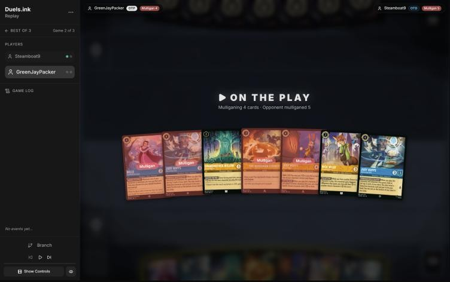
*The board before the decision: [step 0](https://duels.ink/replay/01a204f7-9c73-7ce8-90de-fbd2d5bdf824?step=0) in the duels.ink replay viewer.*

**The plan (written before seeing the mulligan made):** on the play with Belle – Snowfield Strategist, Judy –
Uncovering Clues ×2, Grandmother Willow, The Horseman Strikes!, Judy – Always Vigilant and Nick Wilde – Providing
Backup. No 1-drop, and four 4-drops (Belle, both Clues, Always Vigilant), of which only one can be played a turn
until 8 ink. The core is good for this matchup: Willow (turn 2) discounts Clues to 3 on turn 3; Nick gives Support,
which puts their 2–4 {S} characters (Shere Khan, Cheshire, Dumbo) in Always Vigilant's range; The Horseman Strikes!
answers their Evasive engines (Dumbo, Shadow) and draws a card. `tools/mulligan.py` (1,500 deals, on the play):

| Option | Ink T1–4 | Play turns | Lore by T4 | Chars T4 | Interaction |
|---|---|---|---|---|---|
| Keep all 7 | 9.00 | 3.00 | 2.8 | 3.1 | 100% |
| Mulligan all 7 | 8.89 | 3.74 | 5.4 | 3.9 | 83% |
| Send back Belle | 9.19 | 3.23 | 3.3 | 3.4 | 100% |
| Send back Belle and one Clues | 9.29 | 3.39 | 3.8 | 3.6 | 100% |
| Keep Willow, Nick, Clues, Always Vigilant | 9.05 | 3.53 | 4.5 | 4.1 | 100% |
| Send back Willow | 9.23 | 3.23 | 3.0 | 2.8 | 100% |

The full mulligan leads on curve and early lore but throws away Willow, the Clues engine, Always Vigilant and The
Horseman Strikes!, which the sim can't value. My pick: **send back Belle and one Clues** (keep Willow, Nick, Clues,
Always Vigilant and The Horseman Strikes!): it uses the most ink, has a play on most of turns 1–4, and keeps the
engine and both answers. Keeping The Horseman Strikes! too (rather than the keep-4) costs a little early lore for an
answer to Dumbo and Shadow that also draws. Sending back only Belle is close.

**What you did:** kept Grandmother Willow, Nick Wilde – Providing Backup and one Uncovering Clues, and sent back
Belle, the other Clues, Always Vigilant and The Horseman Strikes! (drew Fangmeyer, Higgins, Toy Drive Officer and Day
Camp Instructor). They sent back 5.

**Verdict: close call.** `tools/mulligan.py` on the keep you made against my keep of five: ink on turns 1–4 9.09 vs
9.29, play turns 3.62 vs 3.39 of 4, lore by turn 4 4.9 vs 3.8, characters 4.2 vs 3.6, interaction 68% vs 100%. Yours
leads on the curve and early lore, mine on ink and on holding an answer. Against Midrange, whose first real threats
(Shere Khan, Dumbo, Angel, Goliath) come on their 4th turn, after your 4th, the answers can still be drawn in time:
the deck has four Always Vigilant, three Gaston and three The Horseman Strikes! (On the Case takes only items). And on the play a
wide early Detectives board is the deck's plan ([MULL-1](#cite-mull-1), [MULL-3](#cite-mull-3)). The cost is real but small: Always Vigilant was a
known answer to Goliath's 5 {S} and, with Nick's Support, to most of their board. The pattern matches [H-5](#cite-h-5)'s
limit: with a turn-2 play and an engine, the partial mulligans are close. Confidence: medium (the sim can't weigh the
answers' value against this list).

### Turn 1: your turn 1

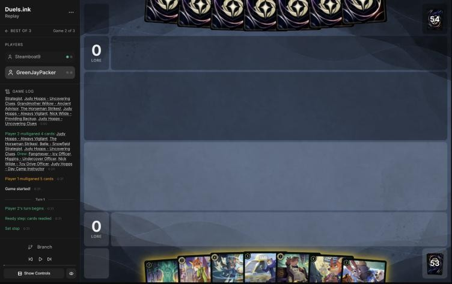
*The board before the decision: [step 2](https://duels.ink/replay/01a204f7-9c73-7ce8-90de-fbd2d5bdf824?step=2) in the duels.ink replay viewer.*

**The plan (written before seeing the turn):** the hand after the mulligan holds four uninkables (Grandmother
Willow, Day Camp Instructor, Toy Drive Officer, Fangmeyer) and three inkables (Higgins, Nick Wilde – Providing Backup,
Uncovering Clues), so one of the three goes in now. Nothing of theirs is in play and nothing they can do at 1 ink
threatens a ready Higgins. Candidates:
- **(a) Ink Nick, play Higgins (1 of 1).** Keeps Clues for turn 3 at 3 with Willow (a dig of 3 for a Detective). Turn
  2 Willow; turn 3 Clues; Day Camp's LEND A PAW ramp only comes late, since Nick is gone and Toy Drive plus Day Camp
  is 5 ink.
- **(b) Ink Clues, play Higgins (1 of 1).** Turn 2 Nick (Support with Higgins in play); turn 3 Willow then Day Camp
  for 1 (2 + 1 = 3 of 3), LEND A PAW ramping a card; turn 4 Toy Drive for 3 with Willow plus a 2-drop drawn, for the
  COMMUNITY OUTREACH draw; turn 5 Fangmeyer for 4.
- **(c) Ink Higgins, play nothing.** Keeps both Nick and Clues, but gives up the only turn-1 play and its quests.

My pick is (b), narrowly over (a): the hand's 4- and 5-cost turns are already filled by two uninkables, so Clues is
the inkable card it misses least ([INK-2](#cite-ink-2)), and (b) gives the wider early board and the turn-3 ramp. (a) keeps the
better card; it's close.

**What you did:** inked Nick Wilde – Providing Backup and played Higgins.

**Verdict: close call** (line (a) of the plan). Keeping Clues keeps the hand's dig, at the cost of the turn-3 Day Camp
ramp; (b) trades the dig for an earlier, wider board. Neither is clearly better ([INK-1](#cite-ink-1), [INK-2](#cite-ink-2)). Confidence: medium.

### Turn 3: your turn 2

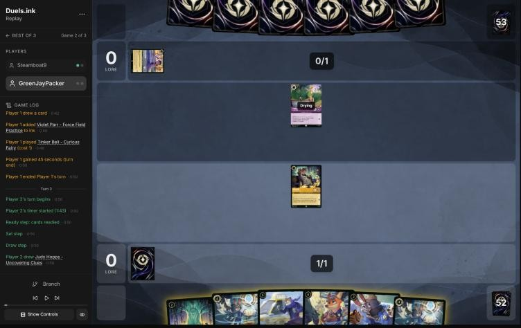
*The board before the decision: [step 8](https://duels.ink/replay/01a204f7-9c73-7ce8-90de-fbd2d5bdf824?step=8) in the duels.ink replay viewer.*

**The plan (written before seeing the turn):** you drew a second Uncovering Clues, and the two Clues are the only
inkable cards in hand, so one is inked whatever you play. Their board is a drying Tinker Bell – Curious Fairy (0 {S});
nothing they can play at 2 ink can challenge next turn (no Rush seen), so Higgins quests for free (FREE KILLS: none).
The Curious Fairy is a Shift base: Tinker Bell – Giant Fairy (1 damage to each of your characters) can come on their
4th turn (game turn 8). Candidates:
- **(a) Ink Clues, Grandmother Willow (2 of 2), quest Higgins.** Willow's discount then covers the next turns: Clues
  for 3 on turn 5 (or Toy Drive for 3), Fangmeyer for 4 later.
- **(b) Ink Clues, Day Camp Instructor (2 of 2), quest Higgins.** No LEND A PAW (nothing else played this turn), and
  it leaves Willow for later, when her discount does less.

Pick (a).

**What you did:** inked a Clues, played Grandmother Willow and quested with Higgins (1–0).

**Verdict: good play**, the plan's line (a): Willow's discount on the turns that need it, and a free quest.

### Turn 5: your turn 3

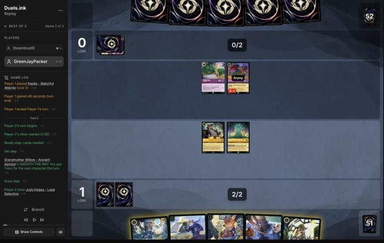
*The board before the decision: [step 15](https://duels.ink/replay/01a204f7-9c73-7ce8-90de-fbd2d5bdf824?step=15) in the duels.ink replay viewer.*

**The plan (written before seeing the turn):** you drew Judy – Lead Detective. The hand's only inkables are Uncovering
Clues and Lead Detective, so one of them goes in; 3 ink with it, and Willow takes 1 off the first character.
- **Their next turn (3 ink):** Pepita (dry, 4 {S} challenging) kills any one of your 2- or 3-willpower characters left
  exerted. FREE KILLS: Higgins (Pepita left on 1 willpower) and Willow (Pepita on 2). At 3 ink they can add Peter
  Pan's Shadow (exerts a ready character, so Pepita reaches it anyway), Angela (+2 and Resist +2 on Pepita), or
  Strength of a Raging Fire (2–3 damage, one of your characters). So one character may die whatever you do.
- **No Supporters in play on either side yet;** Day Camp (Support) is in hand. Your removal: none in hand.
- **Lore:** 1–0; both boards quest for 2.
- **Needs check:** early; the hand has no removal, and the deck's Always Vigilant ×4, Gaston ×3, Horseman ×3 and On
  the Case ×2 come with draws and digs. Clues' dig is the way to find them faster.

Candidates:
- **(a) Ink Lead Detective, Clues for 3 (3 of 3), dig, quest Higgins, Willow home.** The dig finds a Detective now and
  on each quest. Higgins' quest either scores or trades him for Pepita's quest and leaves Pepita on 1 willpower for
  Clues to finish. Willow, the discount engine, stays ready.
- **(b) Ink Clues, Day Camp for 1 (1 of 3), then Lead Detective Shifted onto her next turn for 4.** Lead Detective
  quests for 2 at once on turn 7 and gives your Detectives Alert (their Evasive Shadow and Dumbo) and Resist +2 on your
  turns. Costs 2 ink unused now, and Day Camp must survive a turn (Strength of a Raging Fire kills her).
- **(c) Ink Clues, Toy Drive Officer for 3 (3 of 3).** No draw (one character played), and no Judy for Lead
  Detective to go onto next turn.

Pick (a): it uses the ink, starts the card flow and keeps the board growing; Lead Detective's 4-ink Shift is worth
keeping in general, but the hand can't afford both, and (b) gives up 2 ink and a dig for a 2-lore quester a turn
later. Close with (b).

**What you did:** inked Lead Detective, played Clues for 3 (her dig took a second Higgins), and quested with nobody.

**Verdict:** the ink and Clues are the plan's line (a): **good play**. Keeping Higgins home is an **inaccuracy**:
keeping Higgins home is suboptimal because it gives up 1 lore and gains nothing, and questing him is better because
the only answer is Pepita's free kill, which costs them Pepita's own quest and leaves her on 1 willpower, exerted,
for Clues (3 {S}) to finish next turn. Staying ready protects Higgins only from Pepita: Peter Pan's Shadow or Strength
of a Raging Fire reach him either way. Willow staying home is right (FREE KILLS: Pepita kills her and keeps 2
willpower, and her discount is worth more than her lore). The quest would have exposed only Higgins, to Pepita (4
challenging) or anything Angela pumps. A small edge on a 1-drop ([TRADE-1](#cite-trade-1), [TRADE-4](#cite-trade-4); the recurring "keeping a quester
ready for nothing"). Confidence: low to medium; it's worth 1 lore and a likely trade.

### Turn 7: your turn 4

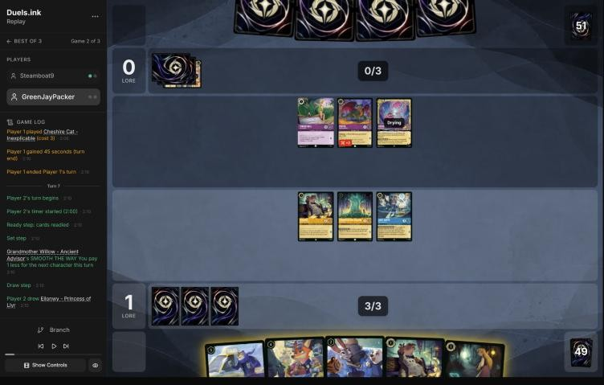
*The board before the decision: [step 23](https://duels.ink/replay/01a204f7-9c73-7ce8-90de-fbd2d5bdf824?step=23) in the duels.ink replay viewer.*

**The plan (written before seeing the turn):** you drew Eilonwy. 4 ink if you ink Higgins or Eilonwy (the only
inkables), and Willow takes 1 off the first character. All three of theirs are ready (nobody quested), so there is
nothing to challenge.
- **What their next turn (4 ink) can do to an exerted character:** Pepita (4 challenging) and Cheshire (3) are both
  dry. FREE KILLS: Higgins (Pepita left on 1), Willow (Pepita on 2) and Clues (Cheshire on 1). **Cheshire's Boost (2 of
  their 4 ink) turns one challenge into two kills:** the damage your character deals back can be moved off their
  challenger onto another of yours ([the coach's Cheshire notes](#cite-kb-cards-cheshire-cat-inexplicable)). So Higgins questing means Higgins and
  then Willow dead, with Pepita healed; Clues questing means Clues and a 2-willpower character dead. Against a ready
  board the Boost has no damage to move.
- **What reaches you even if you stay ready:** Strength of a Raging Fire sung free by Cheshire (3 damage, 4 if they
  play a character first), Peter Pan's Shadow's exert, Shere Khan's NEW INCENTIVE, Angel's GOOD AIM (2), Tinker Bell –
  Giant Fairy Shifted for 4 (1 to each: kills a 1-willpower Eilonwy).
- **Support line:** yours: none in play; Toy Drive, Day Camp and Eilonwy in hand would all be drying, so no Support
  this turn. Next turn a Supporter's quest puts Cheshire (3) at 5 for Always Vigilant or Gaston if you find one.
  Theirs: none.
- **Lore:** 1–0. **Needs check:** no removal in hand; the plan is to out-draw them with Toy Drive and Clues and find
  Always Vigilant or Gaston (with Support onto Cheshire) before Demona – Scourge at 6 ink (game turn 12) exerts your
  board.
- **The dig:** Clues' quest digs 3; the finds that change the turn (Always Vigilant, Lead Detective) can't act well
  this turn (no 5-{S} target; Lead Detective onto an exerted Clues would be exerted too), so the dig is worth only the
  card, against the two kills it exposes.

Candidates:
- **(a) Ink Higgins, Toy Drive for 3 + Eilonwy for 1 (4 of 4), no quests.** Two characters played, so COMMUNITY
  OUTREACH draws at the end of the turn; nothing exerted for Pepita or the Boost. (Higgins instead of Eilonwy is the
  same, a sturdier body against a ping but no Support.)
- **(b) The same, plus Clues quests first for the dig and 1 lore.** Gains a card and a lore; exposes Clues to
  Cheshire's free kill and a second kill through the Boost.
- **(c) Higgins for 0 (Willow) + Day Camp for 2 with LEND A PAW ramp, ink Eilonwy (2 of 4).** Ramps but leaves 2 ink
  idle and no draw.

Pick (a).

**What you did:** inked Eilonwy, played Toy Drive Officer for 3 and Higgins, quested with nobody; COMMUNITY OUTREACH
drew Judy – Helpful Officer.

**Verdict: good play**, the plan's line (a) with Higgins as the second character. Staying home was right here: with
Cheshire's Boost, any quest into Pepita or Cheshire was likely to lose two characters, and the ready board left them
nothing to challenge ([RULE-1](#cite-rule-1), [H-6](#cite-h-6)). Keeping Eilonwy's Support and inking Higgins would have been the same; inking
Eilonwy keeps the sturdier body. Confidence: medium.

### Turn 9: your turn 5

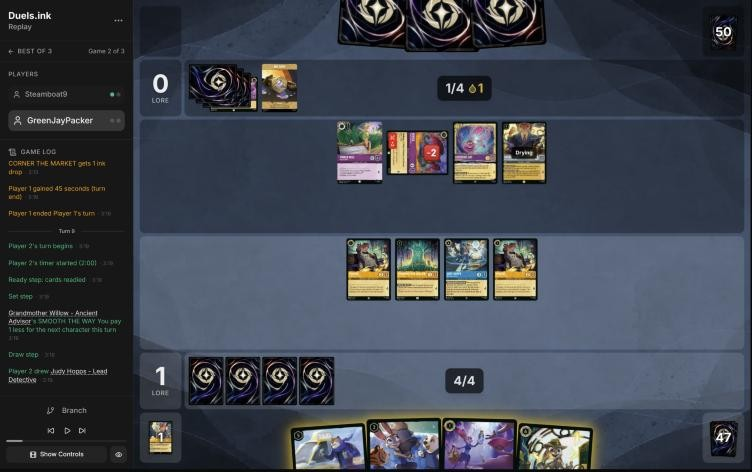
*The board before the decision: [step 32](https://duels.ink/replay/01a204f7-9c73-7ce8-90de-fbd2d5bdf824?step=32) in the duels.ink replay viewer.*

**The plan (written before seeing the turn):** you drew a second Lead Detective. Shere Khan's NEW INCENTIVE let Pepita
kill a ready Toy Drive Officer last turn; Pepita is exerted on 1 willpower (2 damage), and the ink drop gives them 6
ink next turn. 5 ink for you with an ink (Helpful Officer or Lead Detective), Willow's 1 off the first character,
which counts against a Shift cost too ([CR 4.3.2.3](#cite-cr-4-3-2-3), 4.3.6): Lead Detective onto the dry Clues costs 3.
- **Must happen: kill Pepita.** Left alive, her 2 damage is ammunition for Cheshire's Boost, which can move it onto a
  ready 2-willpower character of yours (Higgins, Willow, Day Camp) and kill it without a challenge, and she'd ready as
  a 4-{S} challenger. Killing her takes the counters off the board. Any of yours kills her (1 willpower left): Higgins
  trades (2 back kills him), Clues survives on 1 (but her damage is then Boost ammunition), and with Lead Detective in
  play first, LATERAL THINKING's Resist +2 lets Higgins take 0.
- **Their next turn (6 ink):** Demona – Scourge becomes castable (exerts your board for Cheshire 3 and Shere Khan 4);
  Hades (bottom a character or they draw 2); Strength of a Raging Fire sung free by Cheshire or Shere Khan (3 damage
  with three characters, 4 if they add one: kills a 4-willpower Lead Detective); Angel's GOOD AIM; Peter Pan's Shadow.
  Exerted characters of yours face Cheshire (FREE KILLS on Higgins, Willow, Clues) plus the Boost moving his damage
  back onto a second character, and Shere Khan, who kills a 4-willpower Lead Detective but dies to her 6 back.
- **Support line:** yours: none can quest this turn (Day Camp would be drying); next turn Day Camp's quest puts
  Cheshire or Shere Khan at 5 {S} for any Always Vigilant or Gaston found. Theirs: none in play.
- **Lore:** 1–0, neither side questing. **Needs check:** no removal in hand yet; your card flow (Clues' quests, a Toy
  Drive returned by Fangmeyer) has to find Always Vigilant or Gaston, and Lead Detective's Alert and Resist make your
  challenges free on your turns.

Candidates:
- **(a) Ink Helpful Officer; Lead Detective Shifted onto the ready Clues for 3; Higgins challenges Pepita under
  Resist +2 (kills her, takes 0); Day Camp for 2 with LEND A PAW ramp (3 + 2 = 5 of 5). No quests.** Leaves a ready
  6-{S} Lead Detective to punish anything that exerts, a card ramped, and Fangmeyer for next turn: Fangmeyer returns
  Toy Drive and Toy Drive follows (4 + 4 − 1 = 7 with the ramp and an ink), two characters for a draw. Exposes only
  Higgins (exerted from the challenge): Cheshire kills him and can Boost the 2 damage back onto a second character,
  but that leaves Cheshire exerted for Lead Detective next turn.
- **(b) As (a), but Higgins trades with Pepita before Lead Detective lands.** Higgins dies for certain, nothing is
  left exerted or damaged, and the Boost has no ammunition at all.
- **(c) Ink Lead Detective; Higgins trades with Pepita; Fangmeyer for 4 (returning Toy Drive or Higgins) + Helpful
  Officer for 1 (5 of 5).** More bodies now, but the hand is left with no inkable card, and Lead Detective is gone.

Quest nothing else: Lead Detective exerted would trade with Shere Khan (and take Clues with her), and every
2-willpower quester is a Cheshire kill plus a Boost. Pick (a), close with (b).

**What you did:** quested with Clues first (+1) and took Elisa Maza from the dig, played Elisa for 3 (Willow), whose
FOLLOW THE TRAIL showed their 3-card hand (no non-character card to take, so no Strength of a Raging Fire or other
action in it), traded Higgins for Pepita, inked Helpful Officer, played Day Camp for 2 with LEND A PAW's ramp, and
quested with the other Higgins (3–0). Lead Detective stayed in hand.

**Verdict: good play; your line beat the plan.** The plan put Lead Detective onto a ready Clues and so never used
Clues' dig, though the method says to dig first and branch on the find. Your order did: the dig found Elisa, castable
for 3, so the turn made two plays and 5 of 5 ink as well, and her reveal told you their hand held only characters, no
removal song. You still killed Pepita, whose damage was the Boost's ammunition, and kept Lead Detective for a later
Shift onto Day Camp or Clues. The cost is exposure: Clues and Higgins are exerted for Cheshire (a free kill on either)
and Shere Khan (who dies to either's damage back), and a Cheshire challenge plus a Boost can move his damage onto a
second character. But any such challenge leaves Cheshire or Shere Khan exerted for your Lead Detective Shift next turn,
and the 2 lore start a race they haven't joined ([SEQ-1](#cite-seq-1), [TEMPO-1](#cite-tempo-1)). Confidence: medium.

### Turn 10: their turn

**What happened:** Cheshire killed the exerted Clues (an ink drop from CORNER THE MARKET), and the Boost moved 2 of
his damage onto Day Camp and killed her; a second Cheshire and Flash came down; Shere Khan traded with Higgins. The
exposure the turn-9 verdict named cost three characters for Shere Khan.

### Turn 11: your turn 6

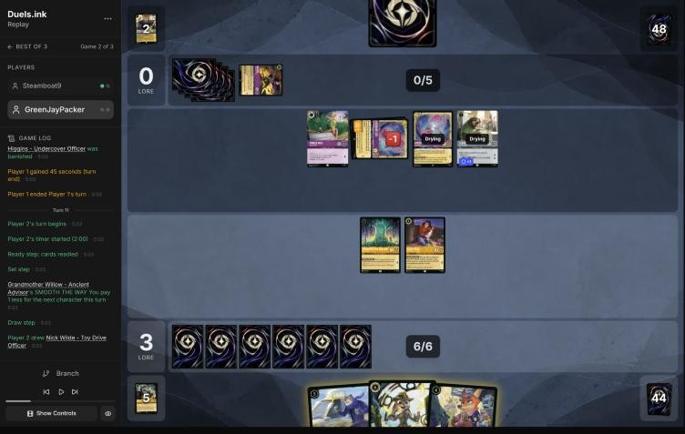
*The board before the decision: [step 53](https://duels.ink/replay/01a204f7-9c73-7ce8-90de-fbd2d5bdf824?step=53) in the duels.ink replay viewer.*

**The plan (written before seeing the turn):** you drew a second Toy Drive Officer. Hand: Fangmeyer, Lead Detective
(no Judy in play to Shift onto) and Toy Drive; Lead Detective is the only inkable. 6 ink (7 if Lead Detective is
inked), Willow's 1 off the first character.
- **Known in their hand: Demona – Scourge**, their only card. They have 5 ink, so she comes next turn if their draw is
  inkable (most of their cards are). She exerts your whole board, so **staying ready protects nothing next turn**;
  their challengers then are Cheshire #2 (3), Flash (3, Resist 1), Tinker Bell (0) and Cheshire #1 if he lives. With
  all 6 ink on her, no Boost that turn. Her refill draws you up to 3 if you hold fewer
  ([the coach's Scourge notes](#cite-kb-cards-demona-scourge-of-the-wyvern-clan-facing-her)).
- **Must happen: kill Cheshire #1** (exerted, 3 willpower left, a card under him). Elisa kills him and survives on 1;
  Willow would die.
- **Their removal next turn** beyond Scourge: only their draw (Strength, Shadow, Hades each about 8%).
- **Support line:** yours: Toy Drive and a Day Camp returned by Fangmeyer would be drying, so no Support this turn.
  Theirs: none.
- **Lore:** 3–0. **Needs check:** Scourge (5 {S}) is in range of Always Vigilant and Gaston without help; seven in
  the deck, so the refill and your draws are how you find one.

Candidates:
- **(a) Elisa kills Cheshire #1; Fangmeyer for 4 (Willow), returning Day Camp; Day Camp for 2 with LEND A PAW ramp
  (6 of 6); Willow quests; Lead Detective kept, not inked.** Two 4-willpower bodies (Elisa damaged) and two small ones;
  their two challengers can kill one 4-willpower character together or two small ones, and Fangmeyer's 4 back kills
  either. Hand left: Toy Drive and Lead Detective, so the refill draws 1. Next turn: Toy Drive (3) + Lead Detective
  Shifted onto Day Camp or another Judy (4) = 7 with the ramp.
- **(b) As (a), but ink Lead Detective (6 of 7).** One more ink now and next turn, and the refill draws 2 instead of
  1: Lead Detective becomes an ink and a random card ([H-1](#cite-h-1)'s corollary). Lead Detective is better than a random card
  here (6 {S}, and Resist +2 makes your challenges free), so (a).
- **(c) Fangmeyer returning Clues instead, held for next turn's Clues + Lead Detective (4 + 4 − 1 = 7).** A strong
  next turn, but leaves 2 ink idle now and no ramp.

Willow's quest costs nothing if Scourge comes (she'd be exerted anyway); if it doesn't (their draw uninkable),
Cheshire #2 or Flash kill her for free. Pick (a).

**What you did:** Fangmeyer for 4 (Willow), returning Uncovering Clues to hand; Elisa killed Cheshire #1 (Angel –
Experiment 624 went to the discard from under him) and took 3; inked Lead Detective; 3 ink unused; Willow stayed home.

**Verdict: close call.** Killing Cheshire was the must, and Fangmeyer was the right play. The choice was what she
returned:
- **Your line (Clues to hand, Lead Detective inked):** hand Toy Drive and Clues, 7 ink next turn. Next turn Clues (3
  with Willow) + Toy Drive (4) is 7: a dig on play and COMMUNITY OUTREACH's draw, from cards Scourge can't touch.
- **Day Camp returned and played for 2 (LEND A PAW), Lead Detective kept:** the same 7 ink next turn, since the ramp
  card comes off the deck instead of Lead Detective, so it's a card up, with Lead Detective in hand and a Judy for her
  to Shift onto. But the extra body is a 2-willpower Day Camp going into a Scourge turn, where it's the cheapest kill
  for Cheshire or Flash, and Clues' dig is lost.

The card's worth roughly what the dig is worth, so neither is clearly better ([CARD-1](#cite-card-1), [INK-3](#cite-ink-3)). Willow at home: with
Scourge known and likely castable, staying ready protects her only if their draw isn't inkable, at the cost of 1 lore;
a small point either way. Confidence: low.

### Turn 12: their turn

**What happened:** they didn't ink (their hand was Demona – Scourge and a drawn second Shere Khan, uninkable), played
Shere Khan, whose NEW INCENTIVE let Flash kill a ready Willow (Resist 1 took Willow's 1 back); Cheshire killed the
exerted, damaged Elisa, and his Boost moved 2 damage onto Fangmeyer. Tinker Bell quested: 3–1.

### Turn 13: your turn 7

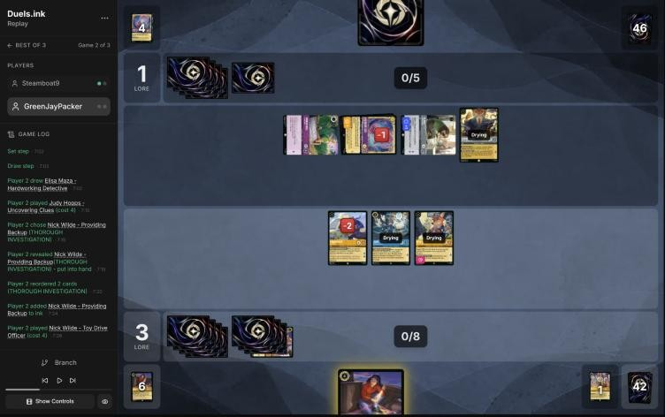
*The board before the decision: [step 75](https://duels.ink/replay/01a204f7-9c73-7ce8-90de-fbd2d5bdf824?step=75) in the duels.ink replay viewer.*

**The plan (written before seeing the turn):** you drew Elisa Maza. Board: Fangmeyer alone, on 2 willpower. Hand: Toy
Drive, Clues, Elisa; 7 ink, 8 with an ink; no Willow, so no discount. Lore 3–1.
- **Known in their hand: Demona – Scourge, their only card.** They have 5 ink and didn't ink last turn, so she needs
  an inkable draw next turn (most of their cards are inkable). She exerts your board whatever you do, and refills
  your hand to 3. Their challengers then: Shere Khan (4), Flash (3, Resist 1), Cheshire (3) if he lives, Tinker Bell
  (0). With all 6 ink on her, no Boost.
- **Exerted on their side:** Tinker Bell, Cheshire (3 willpower left, a card under him) and Flash. Only Fangmeyer can
  challenge: Tinker Bell for free, or trade with Cheshire or Flash.
- **Must happen: kill Cheshire.** His Boost has killed two of your characters without a challenge, and he's a free
  Strength of a Raging Fire singer. Fangmeyer, on 2 willpower, is exposed next turn anyway (Scourge, or any
  challenger once he quests), so trading him now costs little ([TRADE-3](#cite-trade-3)).
- **The dig:** Clues on play digs 3 for a Detective. Always Vigilant would be castable but has no target (nothing of
  theirs has 5 {S}, and no Supporter of yours can quest this turn). Gaston isn't a Detective, so Clues can't find him.
- **Support line:** yours: Toy Drive would be drying; none. Theirs: none.
- **Needs check:** their board (Tinker Bell, Flash 2 lore, Shere Khan) plus Scourge (2 lore) out-quests yours; Scourge
  (5 {S}) is in range of Always Vigilant and Gaston, so finding one of the seven is how the game turns. Clues' dig,
  Toy Drive's draw and Scourge's refill are the ways to see more cards.

Candidates:
- **(a) Clues (4) first and dig; Toy Drive (4) for COMMUNITY OUTREACH's draw (8 of 8); ink Elisa (her FOLLOW THE TRAIL
  would find only Scourge, a character, so she's just a body here, and inking her also lowers your hand for the
  refill); Fangmeyer trades with Cheshire.** Leaves Clues and Toy Drive drying and ready; under Scourge, Shere Khan
  and Flash each kill one, and both die to the damage back except Flash against Toy Drive.
- **(b) The same plays, Fangmeyer quests for 2 instead.** 2 lore, but Cheshire lives to challenge and Boost later,
  and Fangmeyer dies anyway once exerted.
- **(c) The same plays, Fangmeyer kills Tinker Bell for free.** Removes a quester and Giant Fairy's Shift base, but
  leaves Cheshire.

Pick (a).

**What you did:** Clues dug Nick Wilde – Providing Backup, which you inked (keeping Elisa); Toy Drive (8 of 8);
Fangmeyer traded with Flash, not Cheshire; COMMUNITY OUTREACH drew The Horseman Strikes!.

**Verdict:** the plays and the ink are the plan's line: **good play** (inking the 2-drop and keeping Elisa's 4-willpower
body is as good as the plan's choice). **The target was a close call.** Flash quests for 2, their biggest quester, and
his Resist 1 makes him hard for your 2-{S} characters to kill later; Cheshire's Boost is removal, but it costs 2 ink,
which a Scourge turn (6 of their 6) doesn't leave, and on 1 damage he dies to Clues' 3 back if he challenges her. So
with Scourge known, taking the 2 lore off their board first is about as good as taking the engine ([QC-2](#cite-qc-2), [THREAT-2](#cite-threat-2)).
Confidence: low.

### Turn 14: their turn

**What happened:** they inked one Demona – Scourge and played another (two copies): your Clues and Toy Drive were
exerted, the refill drew them 3 and you 1 (a second The Horseman Strikes!). Cheshire sang Strength of a Raging Fire
for 4 on Clues; Shere Khan traded with Toy Drive; Tinker Bell quested (3–2).

### Turn 15: your turn 8

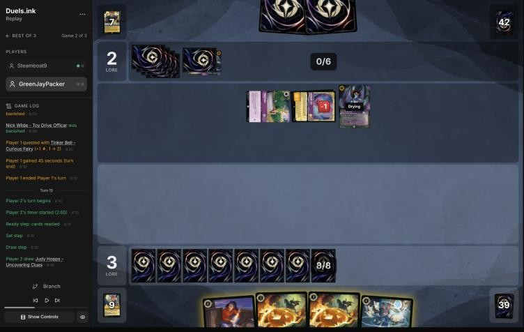
*The board before the decision: [step 84](https://duels.ink/replay/01a204f7-9c73-7ce8-90de-fbd2d5bdf824?step=84) in the duels.ink replay viewer.*

**The plan (written before seeing the turn):** you drew Clues. Your board is empty; hand Elisa, Clues and two The
Horseman Strikes!; 8 ink, 9 with an ink. Theirs: Tinker Bell and Cheshire (both exerted; Cheshire on 1 damage, a card
under him) and a drying Demona – Scourge (5/6/2); 2 cards in hand, 7 ink next turn. Lore 3–2; their board quests for
4 a turn from here.
- **Must happen if possible: remove Scourge.** She's their 2-lore quester and a 5-{S} challenger that kills anything
  of yours, and her 5 {S} puts her in range of Always Vigilant (Shift 2 onto Clues, GOT YOU NOW needing only Clues
  played first) and Gaston, with no Support needed. Neither is in hand. The Horseman Strikes! has no target (nothing
  of theirs is Evasive), so here it's 3 ink to draw a card.
- **The digs, in the order that finds the most:** The Horseman Strikes! first (3): its draw can be Gaston or Always
  Vigilant (18%). Then, if it's Gaston, Gaston for 5 (8 of 9); if it's Always Vigilant, Clues (4) + Shift (2) (9 of
  9); otherwise Clues (4) digs 3 for an Always Vigilant to Shift for 2 (29%), or else a cheap Detective for the last 2.
  About 42% in all (17.9% + 82% × 29.1%, from `tools/odds.py`). Clues first finds less (about 36%), since a Gaston from
  the Horseman draw would then be unaffordable. Ink after the draw, not before ([SEQ-1](#cite-seq-1)): the second Horseman or Elisa.
- **Their next turn (7 ink):** Scourge (if alive) challenges anything exerted; Cheshire's Boost (2) moves his 1
  damage; Strength of a Raging Fire sung free by Cheshire or Scourge (3–4 damage); Hades (5, bottom a character or
  they draw 2); a third Shere Khan (NEW INCENTIVE: Scourge challenges a ready character); a third Scourge.
- **Support line:** none on either side.
- **Needs check:** with nothing in play you can't race 4 a turn; the game turns on removing Scourge and rebuilding with
  the card flow (Clues' quests), before they reach 20 around game turn 24 on the current board.

Candidates:
- **(a) Horseman, then branch as above (Gaston, or Clues + Always Vigilant); ink after the draw.** The best chance to
  kill Scourge this turn; if nothing turns up, Clues and a cheap find are on the board.
- **(b) Clues (4) + Elisa (4) (8 of 9), ink a Horseman.** FOLLOW THE TRAIL shows their 2 cards and takes an action
  (a Strength, say), and two bodies land; Scourge lives, and only Clues' dig looks for Always Vigilant (28%), with no
  ink left to Shift it.

Pick (a).

**What you did:** Clues first: her dig found Always Vigilant, which you hard-cast for 4 (8 of 9) and whose GOT YOU NOW
banished Scourge; inked a Horseman.

**Verdict: good play.** The order was a close call with the plan's: Horseman first finds an answer a little more often
(about 42% against 36%, since its draw can also be Gaston), but after paying 3 for it a found Always Vigilant can only
be Shifted onto Clues, which buries Clues' dig under her. Clues first, when it hits, lets Always Vigilant be hard-cast,
so you kept two bodies and Clues' THOROUGH INVESTIGATION on every quest, which the plan didn't weigh. Hard-casting
rather than Shifting, once she was found, was clearly right (a second body and the engine kept, for 2 more ink you had
spare). Confidence: medium.

### Turn 16: their turn

**What happened:** they didn't ink; Peter Pan's Shadow exerted Clues, Cheshire's Boost moved 1 damage onto her and
Cheshire challenged and killed her, taking 3 (he's on 1 willpower, two cards under him). Tinker Bell quested (3–3).

### Turn 17: your turn 9

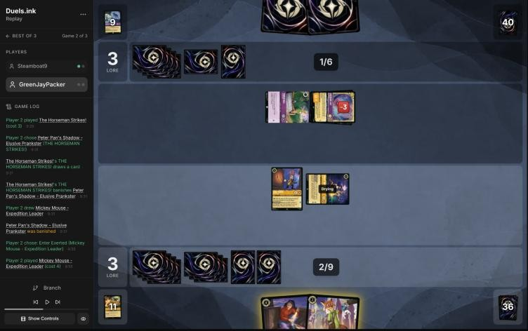
*The board before the decision: [step 107](https://duels.ink/replay/01a204f7-9c73-7ce8-90de-fbd2d5bdf824?step=107) in the duels.ink replay viewer.* Cheshire is exerted on 1 willpower.

**The plan (written before seeing the turn):** you drew Nick Wilde – Providing Backup. Board: Always Vigilant (dry).
Hand: Elisa (4), The Horseman Strikes! (3), Nick (2): exactly your 9 ink, so nothing to ink if all three are played.
Theirs: Tinker Bell and Cheshire exerted (Cheshire on 1 willpower), Peter Pan's Shadow drying; 2 cards in hand; 7 ink
next turn. Lore 3–3.
- **Targets:** The Horseman Strikes! now has one: Shadow is Evasive, and the card draws as well. Always Vigilant
  kills Cheshire (takes 3, survives on 1) or Tinker Bell (takes 0). **Cheshire must die:** his Boost has been their
  removal all game, and his own 3 damage is ammunition he can move onto your characters.
- **Elisa:** with Always Vigilant in play, FOLLOW THE TRAIL shows their 2 cards and takes a non-character (a Strength
  or other action, if they hold one).
- **Their next turn (7 ink), after this line:** Tinker Bell is their only character, 0 {S}, so nothing of theirs in
  play can challenge; new characters are drying (Tinker Bell – Giant Fairy Shifted onto the dry Curious Fairy could,
  and its ROCK THE BOAT kills a 1-willpower Always Vigilant). Strength hard-cast does 1–2 damage (their character
  count); Angel's GOOD AIM (2) kills the damaged Always Vigilant; Hades bottoms one or draws them 2; a third Scourge
  exerts your board but leaves them no challengers.
- **Support line:** yours: Nick gains Support with another Detective in play, but he'll be drying; none this turn.
  Theirs: none.
- **Needs check:** this turn turns the board: after it, theirs quests for 1 and yours for 3. Your card flow is the
  Horseman's draw and your normal draws; Clues is gone (one left in the deck).

Candidates:
- **(a) The Horseman Strikes! first (draw, banish Shadow), Elisa (reveal, discard), Nick (3 + 4 + 2 = 9 of 9),
  Always Vigilant kills Cheshire.** Clears both of their removal pieces and develops two bodies; leaves only the
  damaged Always Vigilant exerted, which nothing of theirs in play can challenge.
- **(b) As (a), but Always Vigilant kills Tinker Bell and Cheshire is left on 1 willpower.** Takes 0 damage, removes the
  Giant Fairy base, but leaves the Boost engine with 3 damage to move.
- **(c) Hold Nick, ink him (7 of 10).** Keeps a card for nothing in particular; Nick on the board is a Supporter for
  later Always Vigilant or Gaston plays.

Pick (a), drawing first so the draw can change the rest ([SEQ-1](#cite-seq-1)).

**What you did:** The Horseman Strikes! banished Shadow and drew Mickey Mouse – Expedition Leader; Mickey came in
exerted (LONG JOURNEY); Always Vigilant quested (4–3), so SECRET PATH gave Cheshire −2 {S} until your next turn; Nick
for 2 (9 of 9). Elisa stayed in hand, and Cheshire lived.

**Verdict: inaccuracy.** Questing Always Vigilant and leaving Cheshire on 1 willpower is suboptimal because Cheshire
is their removal engine and this was the turn he could be reached: he readies next turn, and a ready Cheshire can't be
challenged while his Boost (2 of their 7 ink) moves 2 of his own 3 damage onto Nick and kills him, or onto Mickey.
SECRET PATH's −2 {S} stops his challenge, not the Boost. Always Vigilant challenging him is better because it ends the
engine for the 1 lore the quest gave. The cost is real: she'd be on 1 willpower, so a hard-cast Strength (1–2
damage with their 1–2 characters), Angel's GOOD AIM or Tinker Bell – Giant Fairy's ROCK THE BOAT finishes her, where
your line keeps her healthy. With Mickey drawn, the rest of your line (Mickey exerted for SECRET PATH and his 2 lore,
Nick, Elisa kept) is as good as the plan's Elisa. What the suggested line exposes: Always Vigilant exerted on 1
willpower (nothing of theirs in play can challenge her: Tinker Bell has 0 {S}), Mickey exerted (3 willpower, out of
reach of everything but a Shifted Giant Fairy). [THREAT-1](#cite-threat-1), [QC-2](#cite-qc-2). Confidence: medium-low; it turns on how much the Boost
would have done.

### Turn 18: their turn

**What happened:** Tinker Bell – Giant Fairy was Shifted onto the Curious Fairy: ROCK THE BOAT put 1 on each of yours,
she killed the exerted Always Vigilant (taking 4), and PUNY PIRATE! killed Nick; Cheshire's Boost moved 2 onto Mickey
and killed him. Your board was cleared. They still didn't ink (6).

### Turn 19: your turn 10

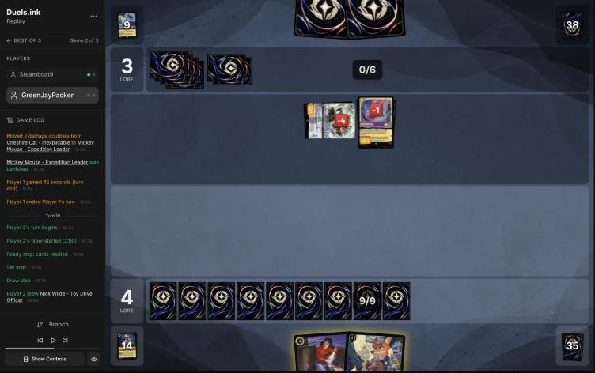
*The board before the decision: [step 121](https://duels.ink/replay/01a204f7-9c73-7ce8-90de-fbd2d5bdf824?step=121) in the duels.ink replay viewer.*

**The plan (written before seeing the turn):** you drew Toy Drive Officer. Your board is empty; hand Elisa and Toy
Drive; 9 ink. Theirs: Giant Fairy exerted on 1 willpower (4 damage), Cheshire ready (1 damage, three cards under);
2 cards in hand. Lore 4–3; they quest for 3 a turn.
- **Nothing can challenge this turn** (new characters are drying), so Giant Fairy's 1 willpower can't be reached.
- **The only real line: Toy Drive (4), then Elisa (4) (8 of 9).** Toy Drive first makes Elisa's FOLLOW THE TRAIL
  live (another Detective in play): their 2 cards are shown and a non-character is discarded; two characters played
  draws a card at the end of the turn. Inking Elisa instead (10 ink, Toy Drive alone) loses the draw, the reveal and a
  body.
- **Their next turn (7 ink):** both of yours ready, so no challenges unless Shere Khan or Shadow come again; Cheshire's
  Boost can move 2 of Giant Fairy's damage onto one of them, and Strength sung free (2–3 damage) on top kills a
  4-willpower character; Hades bottoms one or draws 2.
- **Support line:** Toy Drive has Support but will be drying; none this turn. Theirs: none.
- **Needs check:** they're ahead on board; your outs are Gaston and Always Vigilant (three each left) for Giant Fairy
  (4 {S}: needs one Support to reach 5) and the card flow from Toy Drive.

Pick: Toy Drive, Elisa, discard their best non-character.

**What you did:** Toy Drive, then Elisa (her reveal found only characters, so nothing was discarded); COMMUNITY
OUTREACH drew Mowgli – Man Cub.

**Verdict: good play**, the plan's line, in the right order. The reveal also told you their hand holds no Strength
or other action for next turn.

### Turn 20: their turn

**What happened:** Cheshire's Boost moved 2 of Giant Fairy's damage onto Toy Drive; a third Shere Khan's NEW
INCENTIVE let Giant Fairy challenge the ready Toy Drive and kill him, and PUNY PIRATE! put 2 on Elisa; an ink drop
from CORNER THE MARKET. They inked Dumbo.

### Turn 21: your turn 11

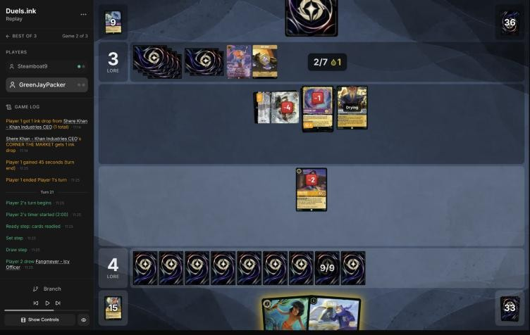
*The board before the decision: [step 136](https://duels.ink/replay/01a204f7-9c73-7ce8-90de-fbd2d5bdf824?step=136) in the duels.ink replay viewer.*

**The plan (written before seeing the turn):** you drew Fangmeyer. Board: Elisa on 2 willpower (dry). Hand: Mowgli,
Fangmeyer; 9 ink, 10 with Mowgli inked. Theirs: Giant Fairy exerted on 1 willpower, Cheshire ready (1 damage, four
cards under), Shere Khan drying; **known in their hand: Hades – Looking for a Deal, their only card**; 9 ink next
turn. Lore 4–3.
- **Must happen: kill Giant Fairy** (2 lore, PUNY PIRATE!, and her 4 damage is Boost ammunition). Elisa deals 3 and
  dies to her 4 back: a 4-drop for their 6-drop. Nothing else of yours can challenge.
- **Fangmeyer's return:** Toy Drive (played at once for 4, so two characters and COMMUNITY OUTREACH's draw; and his
  Support puts Shere Khan or Cheshire at 5 {S} for a later Always Vigilant or Gaston), Clues (played at once, a dig
  of 3 for a Detective, about a 1 in 4 chance of an Always Vigilant), or Always Vigilant (no 5-{S} target now).
- **Mowgli:** HAVE A BETTER LOOK takes a non-character, and their only card is Hades, so he's a 1/2 body; inking him
  is the better use.
- **Their next turn (9 ink):** Hades (bottom one of yours or they draw 2), Cheshire's Boost (only his own 1 damage to
  move unless something of yours is damaged), Shere Khan dry. Your new characters will be ready, so nothing challenges
  them without another NEW INCENTIVE (three Shere Khans seen) or Shadow.
- **Support line:** yours: Toy Drive would be drying; none this turn. Theirs: none.
- **Needs check:** their board out-quests yours (Cheshire, Shere Khan, Hades to come); your removal (Gaston and Always
  Vigilant, three each left) needs a 5-{S} target, so a Supporter in play is what makes it live.

Candidates:
- **(a) Elisa trades with Giant Fairy; ink Mowgli; Fangmeyer (5) returning Toy Drive; Toy Drive (4) (9 of 10).**
- **(b) The same, returning Clues instead (9 of 10):** a dig of 3 now and on each quest, no Support, no draw.
- **(c) Elisa quests; Fangmeyer + Mowgli.** Giant Fairy lives on 1 willpower with 4 damage to Boost onto your board.

Pick (a), close with (b).

**What you did:** Fangmeyer returning Toy Drive, Toy Drive (9 of 9), Elisa traded with Giant Fairy; Mowgli kept, not
inked. COMMUNITY OUTREACH drew Grandmother Willow.

**Verdict: good play**, the plan's line (a). Not inking Mowgli costs nothing this turn (the extra ink would have gone
unused), and he can still be inked next turn.

### Turn 22: their turn, and your Hades choice

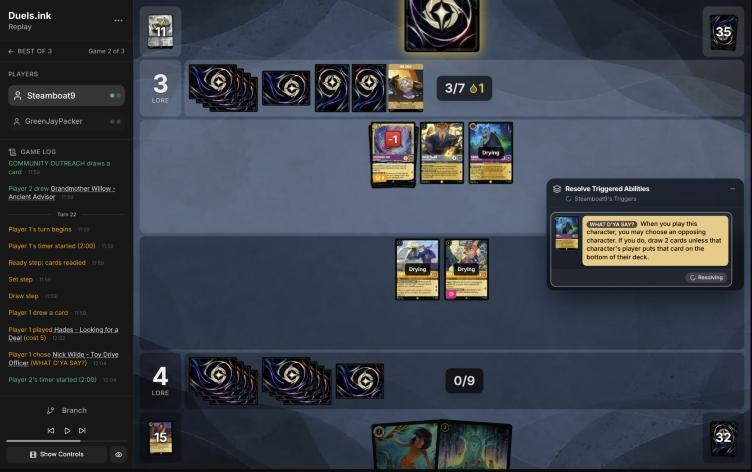
*The board before the decision: [step 144](https://duels.ink/replay/01a204f7-9c73-7ce8-90de-fbd2d5bdf824?step=144) in the duels.ink replay viewer.* Your choice is pending: bottom Toy Drive or let them draw 2.

**What happened:** Hades – Looking for a Deal chose Toy Drive Officer, and **you let them draw 2** rather than put
Toy Drive on the bottom of your deck. They then played Peter Pan's Shadow (exerting Toy Drive) and Shere Khan traded
with him; Tinker Bell – Curious Fairy came down again.

**Verdict: inaccuracy.** At the choice (frame 144) they held 1 card with 3 ink left (2 plus a drop), Shere Khan dry
and ready, and Cheshire's Boost on the board. Letting them draw 2 is suboptimal because it doubles their hand when
they can spend the cards at once: any 3-cost they draw (Shadow's exert for Shere Khan's challenge, Angela, Strength
once they add a character) reaches Toy Drive anyway, so the 2 cards were likely to cost you Toy Drive as well.
Putting Toy Drive on the bottom is better because it costs you one card and them nothing, against them gaining two;
against a deck that has removed one of your characters every turn, a 4-willpower body's life expectancy is about a
turn, and his draw needs two characters played a turn, which your hand (Mowgli and Willow) could give only once. This
is the case [H-2](#cite-h-2) describes from the other side: extra cards are worth most to an opponent with a short hand and spare
ink. [CARD-1](#cite-card-1). Confidence: medium-low (Toy Drive's Support was also your way to put their 4-{S} characters in Always
Vigilant's range).

### Turn 23: your turn 12

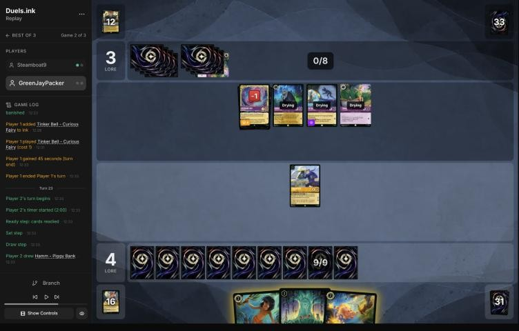
*The board before the decision: [step 152](https://duels.ink/replay/01a204f7-9c73-7ce8-90de-fbd2d5bdf824?step=152) in the duels.ink replay viewer.*

**The plan (written before seeing the turn):** you drew Hamm – Piggy Bank. Board: Fangmeyer (dry). Hand: Mowgli,
Willow, Hamm; 9 ink. Theirs: Cheshire ready (1 damage, four cards under), Hades, Shadow and Tinker Bell – Curious
Fairy all drying (ready), **no cards in hand**, 9 ink next turn. Lore 4–3; their board quests for 4 a turn.
- **Nothing to challenge:** all their characters are ready.
- **Fangmeyer's quest (+2):** FREE KILLS: none. Exerted, he takes two of their challengers (Cheshire then Hades, both
  dying to his 4 back), or Cheshire's Boost (moving his 1 damage) plus Hades, who still dies to the 4 back. So the
  quest costs them Hades, or two characters, if they want him.
- **Their next turn:** one drawn card plus the board. Their removal is in that one card (Strength, Shadow, Shere Khan,
  Scourge, Angel, each 3–9%), or the Boost, which has only Cheshire's 1 damage to move.
- **Mowgli's** HAVE A BETTER LOOK does nothing against an empty hand; he's a 1/2 quester or an ink, and with 9 ink and
  an empty hand after this turn, another ink buys little.
- **Support line:** none in play on either side (Hamm and Mowgli have none).
- **Needs check:** you're 1 ahead but their board quests for 4 a turn against your 2; Gaston and Always Vigilant need a
  5-{S} target (theirs top out at 3), so the deck's Supporters (Day Camp ×3, Nick ×1) matter. Lore and bodies now.

Candidates:
- **(a) Willow (2), Hamm (1 with Willow), Mowgli (2) (5 of 9); Fangmeyer quests.** Three more questers for next turn,
  Hamm's LOOSE CHANGE for later discounts, and 2 lore.
- **(b) The same, Fangmeyer stays home.** Protects him from a Hades trade, at 2 lore a turn.
- **(c) Ink Mowgli; Willow and Hamm only (3 of 10).** An ink you don't need for a body you do.

Pick (a).

**What you did:** Willow, Hamm for 1, Fangmeyer quested (6–3); Mowgli kept in hand (3 of 9 ink).

**Verdict: close call** (the plan's line (a) except Mowgli). Mowgli on the board now is a 1-lore quester; held, his
HAVE A BETTER LOOK can take an action they draw and keep, which an empty hand can't give him now, and a card in hand
also counts for a Scourge refill. Neither is clearly better. Fangmeyer's quest was right (it costs them Hades or two
characters to answer).

### Turn 24: their turn

**What happened:** they drew and cast Strength of a Raging Fire for 4 on the exerted Fangmeyer; Cheshire's Boost
moved his last damage onto Hamm; all four of theirs quested (6–7).

### Turn 25: your turn 13

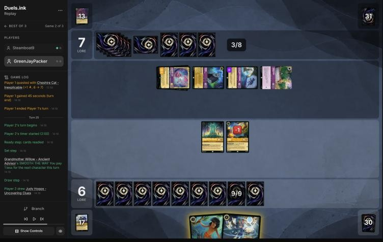
*The board before the decision: [step 168](https://duels.ink/replay/01a204f7-9c73-7ce8-90de-fbd2d5bdf824?step=168) in the duels.ink replay viewer.*

**The plan (written before seeing the turn):** you drew Uncovering Clues. Board: Willow, Hamm (1 damage). Hand:
Mowgli, Clues; 9 ink. Theirs: Cheshire (no damage, five cards under), Hades, Shadow and Tinker Bell, **all exerted**,
and **no cards in hand**; 9 ink next turn if they draw an inkable card. Lore 6–7; their board quests for 4 a turn and
reaches 20 on game turn 32 if nothing changes.
- **Challenges:** Willow (1) and Hamm (2) can't kill any of them (Cheshire, Hades and Tinker Bell have 4 willpower;
  Shadow is Evasive). Chip damage is Boost ammunition, so no.
- **The dig:** Clues for 3 (Willow) digs 3 for a Detective; the find can be played with the 6 ink left: Fangmeyer (5,
  returning Toy Drive or Always Vigilant), Toy Drive (4, a draw with Clues as the second character), Day Camp (2,
  LEND A PAW), Elisa or Nick. Always Vigilant has no target (nothing of theirs has 5 {S}, and no Supporter of yours can
  quest this turn). Hamm's LOOSE CHANGE could take another 1 off, at the cost of his quest; ink isn't short.
- **Quests:** Willow and Hamm (+2). FREE KILLS: both (Cheshire kills either and survives); each kill costs them a
  quest, and with them on 7 and racing, a challenge instead of a quest slows them. Staying home protects them only from
  challenges, not from the Boost or a drawn Strength.
- **Support line:** none in play on either side; a found Day Camp or Nick would be drying.
- **Needs check:** behind on board and the race (their 4 a turn against your 2). Winning needs their questers removed
  faster than they're replaced: Gaston and Always Vigilant need a Supporter to reach 4-{S} targets (Hades and Cheshire
  have 3), so a Supporter plus removal, or more bodies than their one card a turn can answer. Their empty hand helps:
  they topdeck from here.

Candidates:
- **(a) Clues (3) and dig; play the find if it adds a body or a draw; Mowgli (2) as another quester; quest Willow and
  Hamm.** Up to 9 of 9.
- **(b) The same, with Hamm's LOOSE CHANGE on Clues instead of his quest,** if the find needs the ink.
- **(c) Hold Mowgli again** for a drawn action they keep (they've played each card the turn they drew it).

Pick (a).

**What you did:** Clues for 3, whose dig took Judy – Helpful Officer; Helpful Officer for 1, her TO THE RESCUE taking
Hamm's damage off; Mowgli for 2 (their hand was empty, so nothing to discard); no quests (6 of 9).

**Verdict: close call; your line is a real alternative the plan undervalued.** With their hand empty, their only ways
to reach a ready board were a topdecked Shadow, Shere Khan or Scourge, and the Boost; taking Hamm's damage off left the
Boost nothing to move. So staying home cost them their whole turn's interaction and left them only to quest (to 11),
exposing all four, while your five characters stayed whole. The plan's quests (+2) would have given Cheshire and
Hades free kills on Willow and Hamm, each costing them a quest. What the comparison turns on: every challenger of
yours dies to Cheshire's or Hades' 3 back, so a ready board doesn't trade well next turn either; its value is as five
questers for a race (your 5 a turn against their 4). Neither is clearly better ([RULE-1](#cite-rule-1), [H-6](#cite-h-6), [H-12](#cite-h-12)). Confidence: low.

### Turn 26: their turn

**What happened:** they topdecked and played Pepita, and quested only with the Evasive Shadow (6–8): against your
ready board, their other characters stayed home.

### Turn 27: your turn 14

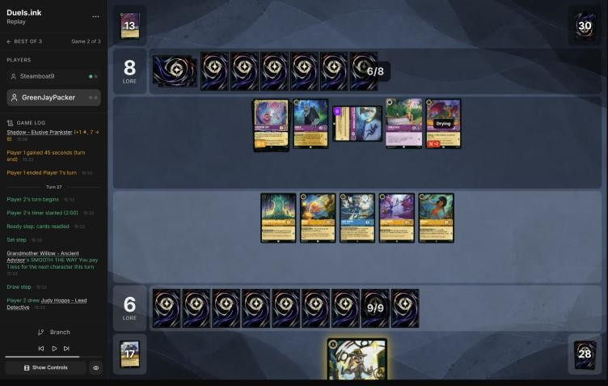
*The board before the decision: [step 179](https://duels.ink/replay/01a204f7-9c73-7ce8-90de-fbd2d5bdf824?step=179) in the duels.ink replay viewer.*

**The plan (written before seeing the turn):** you drew the last Judy – Lead Detective. Board: Willow, Hamm, Clues,
Helpful Officer, Mowgli, all dry and ready. 9 ink. Theirs: Cheshire, Hades, Tinker Bell ready, Pepita drying, Shadow
exerted (Evasive); **no cards in hand**. Lore 6–8; both boards quest for 5 a turn, and each side reaches 20 on its
third questing turn from now (you on game turn 31, they on 32).
- **Lead Detective Shifted onto a dry Judy acts at once** (4, or 3 with Willow): onto Helpful Officer (1 willpower)
  keeps Clues' dig separate. LATERAL THINKING then gives your Detectives Alert and Resist +2 on this turn: **Shadow is
  reachable**, and Lead Detective kills him taking 0 (or Clues does, also taking 0).
- **The dig first:** Clues' quest digs 3; Always Vigilant has no target (nothing of theirs has 5 {S}, and no Supporter
  of yours can quest); a cheap Detective found can be played with the ink left (9 − 3 = 6).
- **Their next turn:** one topdecked card, 9 ink. Everything you quest is exerted for Cheshire (3), Hades (3), Pepita
  (4 challenging) and Shadow if he lives; FREE KILLS: Willow, Hamm, Clues, Helpful Officer and Mowgli to Cheshire
  alone; Lead Detective (4 willpower, no Resist on their turn) dies to Pepita (who dies to her 6 back) or to Cheshire
  and Hades together. The Boost moves a challenger's damage onto a second character. Each kill costs them a quest.
- **Support line:** none in play on either side.
- **Needs check:** with their hand empty, the race is board against board. You need 14; questing 4–6 a turn wins on
  game turn 31 only if enough survives, so the line should make them choose between killing and questing. Removal is
  still out of reach (their {S} tops out at 3–4).

Candidates:
- **(a) Clues quests and digs; Lead Detective Shifted onto Helpful Officer (3 with Willow); Lead Detective (Alert)
  kills Shadow; Willow, Hamm and Mowgli quest; play the find if it adds a body (3 of 9 plus the find).** +4 (to 10),
  their Evasive quester gone; five exerted characters for their four challengers, so each kill is a quest they lose.
- **(b) As (a), but Lead Detective quests (+2, to 12) and Shadow lives.** Two more lore now; Shadow keeps questing out of
  reach and adds a fifth challenger.
- **(c) Lead Detective kills Shadow; only Clues quests; the rest stay home.** +1, keeps the ready wall that held them to
  1 lore last turn; but the race stalls while their board is the bigger one.

Pick (a), close with (b).

**What you did:** Clues quested first and dug Nick Wilde – Providing Backup; Lead Detective Shifted onto Helpful
Officer for 3; Lead Detective (Alert, Resist +2) killed Shadow, taking 0; Nick for 2; Mowgli, Hamm and Willow quested
(10–8). 5 of 9 ink.

**Verdict: good play**, the plan's line (a), with the dig's Nick added as a sixth body (ready, since he was drying).

### Turn 28: their turn

**What happened:** they topdecked Angel – Experiment 624 and played it; Hades killed Clues, the Boost moved 2 of Hades'
damage onto the ready Nick and killed him, Pepita traded with Lead Detective, and Cheshire killed Hamm. Tinker Bell
quested (10–9). Of your six characters, Willow and Mowgli are left.

### Turn 29: your turn 15

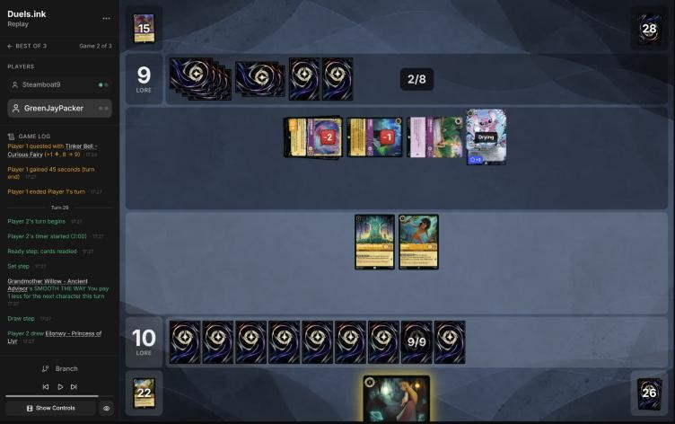
*The board before the decision: [step 200](https://duels.ink/replay/01a204f7-9c73-7ce8-90de-fbd2d5bdf824?step=200) in the duels.ink replay viewer.*

**The plan (written before seeing the turn):** you drew Eilonwy. Board: Willow and Mowgli (1/2 each, dry). 9 ink.
Theirs: Cheshire exerted on 2 willpower (2 damage, six cards under), Hades exerted on 3 (1 damage), Tinker Bell
exerted, Angel drying (Resist +2 while their hand is empty; GOOD AIM discards a card for 2 damage to any character);
**no cards in hand**. Lore 10–9; their board quests for 4 a turn, yours for 2.
- **Cheshire can be killed:** Willow (1) then Mowgli (1) take his last 2 willpower; both die to his 3 back. Half-killing
  him only adds Boost ammunition (moving damage off him heals him).
- **Their next turn (9 ink, one drawn card):** if you quest, Willow and Mowgli are FREE KILLS for Cheshire; the Boost
  moves a challenger's damage onto a ready Eilonwy (1 willpower); Angel's GOOD AIM (discarding the drawn card) kills
  any 1–2-willpower character, ready or not.
- **Support line:** Eilonwy has Support (+2). Played now, she can quest next turn and put Hades or Angel (3 {S}) at 5
  for an Always Vigilant or Gaston you draw. Theirs: none.
- **Needs check:** on boards you lose the race (their 4 a turn against your 2). What turns it: removal for their
  questers (Gaston ×3, Always Vigilant ×3, a Fangmeyer that returns one) with Eilonwy's Support, about 1 in 4 on the
  next draw, and Besties to dig. Cheshire is the card that keeps killing your board, one character a turn.

Candidates:
- **(a) Willow and Mowgli kill Cheshire; Eilonwy (1 of 9).** Their engine and a quester gone for two 1-drops; their
  board quests for 3; Eilonwy is set up for a Support and removal turn, but exposed to GOOD AIM.
- **(b) Willow and Mowgli quest (12–9); Eilonwy.** 2 lore; both are free kills, and the Boost and GOOD AIM reach
  Eilonwy, so the board is likely gone next turn with Cheshire alive.

Pick (a) ([TRADE-3](#cite-trade-3), [THREAT-1](#cite-threat-1)).

**What you did:** Eilonwy for 0 (Willow), then Willow and Mowgli challenged Cheshire in turn and killed him (both
died; his six cards under went to the discard).

**Verdict: good play**, the plan's line (a), and playing Eilonwy before Willow's challenge used the discount.

### Turn 30: their turn

**What happened:** they topdecked Taran – Magically Armed (5, 5/5/1, Rush, off-list), whose WEAKEN THE CAULDRON put both
Toy Drive Officers from your discard on the bottom of your deck, and quested with Hades, Tinker Bell and Angel
(10–12).

### Turn 31: your turn 16

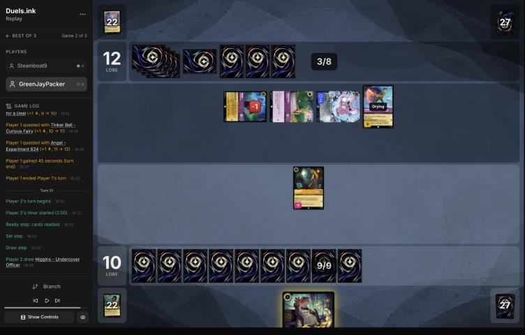
*The board before the decision: [step 212](https://duels.ink/replay/01a204f7-9c73-7ce8-90de-fbd2d5bdf824?step=212) in the duels.ink replay viewer.*

**The plan (written before seeing the turn):** you drew Higgins. Board: Eilonwy (dry). 9 ink. Theirs: Hades (3
willpower left), Tinker Bell and Angel exerted, Taran drying; no cards in hand. Lore 10–12.
- **The race:** their four questers make 16 next turn and 20 on game turn 34. You quest for 1–2 a turn. Removing one
  quester delays them a turn; you'd still need 10 lore, and your deck's biggest questers give 2.
- **Removal:** Taran's 5 {S} is in range of Always Vigilant and Gaston with no Support, and Eilonwy's Support (+2) puts
  Hades or Angel there; none in hand (about a 1 in 5 chance on the next draw of either). Eilonwy can't kill anything
  (2 {S} against 3–4 willpower; Angel has Resist +2).
- **Needs check:** to win you'd have to remove two or three questers in the next two turns and still find about 10
  lore by game turn 37; the deck has no lore burst and you draw a card a turn. **I think the game is unwinnable from
  here** short of a run of removal draws ([principle 2](#cite-principle-2)).

Candidates (little between them): **(a) Higgins (1); Eilonwy quests (11–12),** exposing her to a free kill by Hades;
**(b) Higgins; Eilonwy home,** so she's ready to Support a drawn Gaston or Always Vigilant next turn (Angel's GOOD
AIM, discarding their drawn card, still reaches her). Pick (b): it keeps the only out (two removals' worth of targets)
alive.

**What you did:** Higgins; Eilonwy stayed home.

**Verdict: unwinnable** (the plan's line (b)); no severity.

### Turn 32: their turn

**What happened:** Angel's GOOD AIM (discarding a drawn Rafiki) killed Eilonwy; all four quested (10–16).

### Turn 33: your turn 17

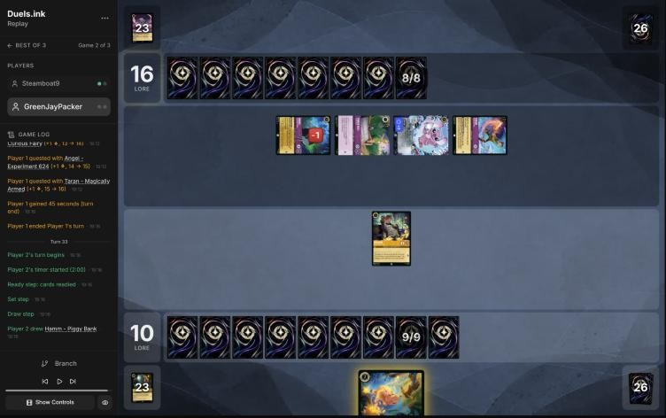
*The board before the decision: [step 224](https://duels.ink/replay/01a204f7-9c73-7ce8-90de-fbd2d5bdf824?step=224) in the duels.ink replay viewer.*

**The plan (written before seeing the turn):** 10–16; their four questers reach 20 next turn, and you hold Hamm with
Higgins in play. Nothing you hold can remove even one of them (Higgins' 2 {S} kills nothing; Taran, the only 5-{S}
target, needs a Gaston or Always Vigilant you don't have), and three would have to go. **Unwinnable**; any line
(Hamm, quests, or conceding) is the same.

**What you did:** Hamm; Higgins quested (11–16).

**Verdict: unwinnable**; no severity.

## Lessons
1. **Against Cheshire Cat – Inexplicable, damage anywhere is their removal.** A challenge that leaves their
   challenger damaged becomes a second kill through the Boost, and damage left on your characters is a kill waiting
   for 2 ink. So questing 2- and 3-willpower characters into a Cheshire board gives up two characters, not one
   ([9](#turn-9)–[10](#turn-10), [11](#turn-11)–[12](#turn-12)); an exerted Cheshire is the one to kill, because a
   ready one can't be reached ([17](#turn-17)); and removing damage from your own board (Helpful Officer's TO THE
   RESCUE, [25](#turn-25)) leaves the Boost nothing to move.
2. **Dig first, then plan** ([9](#turn-9)): Clues' quest found Elisa for a double play and a look at their hand, which
   the coach's plan, built around Lead Detective, skipped. And when a dig finds Always Vigilant, hard-casting her keeps
   the Clues she'd otherwise bury ([15](#turn-15)).
3. **Against this Midrange, Detectives' removal has few targets.** Their characters had 2–4 {S}; only Demona – Scourge
   and Taran reached Always Vigilant's and Gaston's 5 without Support, and your Supporters (Day Camp, Toy Drive, Nick,
   Eilonwy) kept dying before they could quest. So the removal was mostly an answer to Scourge, and the game was a
   trade of bodies, which their Boost and three Shere Khans won.
4. **Hades' choice:** when their hand is short and their ink spare, bottom the character rather than give them 2
   cards ([22](#turn-22); [H-2](#cite-h-2)'s converse).

## Proposed knowledge-base updates (applied after discussion)
- **Meta** ([the Amethyst/Steel pair file's notes](#cite-kb-meta-archetypes-amethyst-steel-from-reviewed-games-and-discussion), below the end marker): *Midrange against GreenJayPacker's Detectives: Steamboat9
  (01a204f7-9c73, game 2 of a best-of-three, 22 Nov 2026)*. Seen this game: Cheshire Cat – Inexplicable ×2 (Boosted
  every turn from turn 10, moving damage onto your characters), Shere Khan ×3 (NEW INCENTIVE let Pepita, Flash and
  Giant Fairy kill ready characters), Demona – Scourge ×2 (one inked, one cast on turn 14), Tinker Bell – Curious
  Fairy ×4 and Giant Fairy (Shifted on turn 18: ROCK THE BOAT and PUNY PIRATE! with the Boost cleared three), Hades
  ×3, Peter Pan's Shadow ×2, Strength of a Raging Fire ×2, Angel ×2, Pepita ×2, Rafiki ×3, Flash, Violet Parr ×2,
  Goliath and Dumbo (inked), Merlin's Shop ×2, Wildcat, and off-list Taran – Magically Armed (5, 5/5/1, Rush; puts up
  to 2 cards from a discard on the bottom of the deck: they took both of your Toy Drives). They quested little until
  turn 24 and removed a character almost every turn; won 20–11 on game turn 34.
- **Cards** ([the Cheshire Cat card note](#cite-kb-cards-cheshire-cat-inexplicable)): add *Healing denies the Boost* (Judy – Helpful Officer's TO THE RESCUE
  took Hamm's damage off, leaving nothing to move, turn 25) and *Kill him while he's exerted*: after he challenges or
  sings, a ready Cheshire can't be challenged, and his own damage from the challenge is the next Boost's ammunition
  (turn 17). Coach's inference from one game; not yet discussed.
- **Strategy:** evidence for [H-2](#cite-h-2)'s converse (turn 22: they held 1 card with 3 ink spare; letting them draw 2 was graded
  an inaccuracy; undiscussed). Evidence on [H-6](#cite-h-6): turns 25–26, a ready board with no damage on it held a 4-character
  board with an empty hand to 1 lore (only the Evasive Shadow quested).
- **Your deck's notes** (["Detectives as GreenJayPacker plays it"](#cite-kb-meta-archetypes-amber-sapphire-detectives-as-greenjaypacker-plays-it)): hard-cast Always Vigilant after
  Clues rather than Shift her onto Clues, to keep the dig (turn 15); against Amethyst/Steel Midrange, Gaston and Always
  Vigilant are mostly answers to Scourge (5 {S}).

## Hindsight
Doesn't change the verdicts above.
- **Result:** Steamboat9 won 20–11 on game turn 34.
- **Their removal never ran out.** From turn 8 they removed at least one of your characters on every turn but two
  (Cheshire's Boost, three Shere Khans, Demona – Scourge, two Strengths, Giant Fairy, Hades, two Shadows, Angel), and
  their topdecks kept finding more while their hand was empty from turn 23. Your deck found one Always Vigilant (by
  Clues' dig) and no Gaston.
- **Turn 17:** Giant Fairy came the next turn. In the suggested line (Always Vigilant kills Cheshire), ROCK THE BOAT
  would still have killed the damaged Always Vigilant, and Giant Fairy and PUNY PIRATE! could still have taken Mickey
  and Nick; the difference would have been a dead Cheshire for the rest of the game, whose Boost killed Toy Drive's
  successor, Nick and others later.
- **Turn 22:** their two draws included Peter Pan's Shadow, played at once to exert Toy Drive for Shere Khan: the risk
  the verdict named.
- **Was it winnable?** Probably not after turn 14 on these draws: two Scourges, three Shere Khans and a Giant Fairy
  against one removal piece found.

## The coach's errors
Filled in during discussion.

| When | Error | How it was caught | How it won't happen again |
|---|---|---|---|
| Turn 9 | The plan put Lead Detective onto a ready Clues and never used Clues' dig, though the brief printed a dig; your line dug first and found Elisa (a double play and a reveal of their hand) | Comparing your line in the verdict | Proposed: the brief's "WHAT THIS TURN'S DIG CAN FIND" lists only Shifts, inkables and removal; add a character castable with the ink left after the dig, and on-play reveals (Elisa, Mowgli), so a plan that skips the dig has to say why |

## Open questions
- Pre-game: you kept three (Willow, Nick, one Clues). Was it for the opening curve, and did you consider keeping
  Always Vigilant or The Horseman Strikes! against this deck?
- Turn 5: what kept Higgins home?
- Turn 11: Fangmeyer returned Clues rather than Day Camp (playable at once for LEND A PAW): was it to keep Clues safe
  from the Scourge you'd seen?
- Turn 13: why Flash rather than Cheshire for Fangmeyer's trade?
- Turn 17: you quested Always Vigilant with Mickey's SECRET PATH on Cheshire rather than have her kill him while he was
  exerted. What did you expect from Cheshire next turn?
- Turn 22: why let Hades draw them 2 rather than put Toy Drive on the bottom?
- Turn 25: was staying home with everything, once Helpful Officer had taken Hamm's damage off, a plan to deny the
  Boost?

## Citations
Copies of the coach's knowledge base cited above, as they stood when they were cited (the private repository's commit and date are given with each). They don't change when the knowledge base does.

**amethyst-steel.md, From reviewed games and discussion**: knowledge base, `kb/meta/archetypes/amethyst-steel.md` at `6cecbcd` (2026-11-27), working tree

> ## From reviewed games and discussion
> ### Midrange: how it plays `[coach, meta study of the user's 27 Oct 2026 games (tools/scan.py), full games, not blind, 1 game]`
> 01a17dc3.
> - **Merlin – Profoundly Curious:** an ink drop on play, a draw on each quest, 2 lore.
> - **Questers:**
>   - Diablo – Stone Servant (+2 {S} and +1 {L} with a Villain in play; their Villains can't be challenged while he's
>     exerted)
>   - Tinker Bell – Giant Fairy (Shift 4; 1 damage to each opposing character on play; 2 lore)
>   - Maleficent – Exultant Spellcaster
> - **Removal through tricks** (turn 14): Peter Pan's Shadow exerts your character, Cheshire Cat's Boost moves 2 damage onto
>   it, then a challenge finishes it.
>
> ### A removal-heavy variant (unlisted) `[coach, meta study of the user's 27 Oct 2026 games (tools/scan.py), full games, not blind, 1 game]`
> 01a17e37.
> - **Steel actions:**
>   - **Jousting Match** (2 damage, or **5 if they paid with an ink drop**)
>   - **Ink Explosion** (4 damage, and they get an ink drop)
>   - Three Arrows, Windstorm, He Hurled His Thunderbolt, Fire the Cannons!, You Broke My Smolder
> - **Characters:** Merida – Formidable Archer, Pluto – Steel Champion, Demona – Scourge, Dumbo, Dante.
> - **Card flow:** Junior Woodchuck Guidebook ×4.
> - **Big turn (turn 25):** Ink Explosion, then two Jousting Matches paid with ink drops (5 damage each), then challenges.
>   Five of your characters were gone.
> - **Ink drops feed this deck.** Your Mickey – Best in Town gave them one in this game.
>
> ### A Merlin and Shop variant (unlisted) `[coach + user, 01a18275 vs InkModeOn, 2026-10-28, blind review]`
> `output/reviews/2026-10-28_01a18275_vs-inkmodeon-g2.md`. The classifier swung between Midrange and "unlisted" all game:
> Midrange's core plus cards no listed list runs.
> - **Card and lore engines:**
>   - Merlin – Profoundly Curious, three seen: an ink drop on play, a draw on each quest
>   - Merlin's Shop and Smithy ×2 (1 lore and a card each time a character moves there; `kb/cards/merlins-shop-and-smithy-magical-market.md`)
>   - Arthur – Merlin's Assistant (3, 3/3/1): moves to a location for free on play and gets an ink drop
> - **Heroes:** the Violet Parrs (At Wits' End, 1-cost 2/1 with Alert; Force Field Practice, 2-cost 3/2 Resist 1;
>   Super Resilient, 4/4/2 Resist 1, Shift 3), Tinker Bell – Curious Fairy → Giant Fairy (Shift 4).
> - **Others:** Cheshire Cat (moves damage; `kb/cards/cheshire-cat-inexplicable.md`), Dr. Hamsterviel – Evil Observer
>   (3/4/1, Alert), Pepita, Strength of a Raging Fire, Angel – Experiment 624 and Demona – Scourge (both inked).
> - **How it played:** removal by Cheshire's damage moves, Strength and challenges (including your Shop, twice);
>   steady lore from Merlins and Shop moves. Shop moves gave 6 of their 20 lore, including the winning point.
> - **Alert on Violet Parr and Hamsterviel** gets past Evasive, so Dumbo – The Flying Elephant's AERIAL DUO protects
>   less while either is in play.
>
> ### PS Inkbonk against Big Ramp `[coach, study of 01a15f8e (stonks 📈 vs MFork, game 2, 21 Oct 2026), full game, not blind]`
> MFork's list: Demona – Scourge of the Wyvern Clan ×3, Broadway – Sturdy and Strong ×2, Marie – Caught in the Act ×2,
> Pepita – Watchful Alebrije ×2, Lexington – Small in Stature, Merlin – Profoundly Curious, Merlin's Shop and Smithy,
> Cheshire Cat – Inexplicable, Rafiki – Mystical Fighter, Tiana – Restauranteur. A slow game: Big Ramp's three-character
> sweep on turn 15 and a +5 quest turn decided it at 6–4 (conceded).
>
> ### PS Inkbonk against Big Ramp: game 3 `[coach, blind review of 01a15f93 (stonks 📈 vs MFork, game 3, 21 Oct 2026)]`
> - **More of the list:** Shere Khan ×2, Madam Mim – Resourceful Trickster, Merlin ×2, Strength of a Raging Fire ×3,
>   Rafiki ×4, Luisa Madrigal – Pushing Through, Pepita, Black Heron, Lexington, Hades, Demona – Imperious Spellcaster,
>   Tiana – Restauranteur.
> - **How it beat Big Ramp:** Shere Khan on ready characters (turns 7 and 13), Demona's refill finding the song that
>   killed Merida (turn 11), Shere Khan challenging Khan Industries twice, and the song for 5 on Goliath (turn 19). Merlin,
>   the Shop and Madam Mim kept their hand full.
>
> ### Midrange against Big Ramp `[coach, blind reviews of 01a16035 and 01a16039 (stonks 📈 vs roycelikerolls, games 2 and 3, 21 Oct 2026)]`
> - **The list:** Shere Khan ×3, Angela – Night Warrior ×2, Pepita ×2, Tinker Bell – Curious Fairy ×2 and Giant Fairy ×2,
>   Woolter & Jesse ×2, Hades – Looking for a Deal ×2, Demona – Scourge ×2, Peter Pan's Shadow, Cheshire Cat, Diablo –
>   Stone Servant, Maleficent – Exultant Spellcaster, Maleficent & Diablo – Evil Incarnate, David Xanatos, Flash,
>   Toulouse, Dumbo, Merlin, You Broke My Smolder, Strength of a Raging Fire. Not in the listed Midrange: Xanatos,
>   Maleficent & Diablo, Woolter & Jesse and You Broke My Smolder.
> - **Game 2 (they won):** NEW INCENTIVE picked off Drake Mallard (turn 9), Merida (turn 11) and Unintentional Icon (turn
>   15, with Angela's Challenger +2 on Demona); Pepita killed Priscilla as she landed (turn 7).
> - **Game 3 (Big Ramp won):** a tall, ready board kept them from questing; they spent Peter Pan's Shadow and Shere Khan
>   to reach it (turns 12 and 16), and both Shere Khans challenged Khan Industries down (turn 20). Challenging with a
>   NEW INCENTIVE character costs them that character unless it banishes something, so they sometimes pass (turn 18).
>
> ### Midrange: Giannisefoa `[coach, meta study of danny's 28 Oct – 2 Nov 2026 games (tools/scan.py), full games, not blind, 1 game]`
> `01a18daf-c900`, 15 turns, little seen: Shere Khan ×2, Hyperia City Express, Wildcat, Olaf – Helping Hand (off-list),
> Peter Pan's Shadow, Demona – Imperious Spellcaster, He Hurled His Thunderbolt.
>
> ### Midrange (a variant): danny's Amethyst/Steel list `[coach, meta study of danny's 5 Nov 2026 games (tools/scan.py), full games, not blind, 11 games]`
> `01a1ab88-3bdd` to `01a1abdf-f6ab`; danny won 6 of the 11. The classifier calls it Midrange (91%); not in duels.ink's
> list: Christopher Robin, Isis Vanderchill, Owen Burnett and Tigger.
> - **The list (×4 each):** Rafiki – Mystical Fighter, Tinker Bell – Curious Fairy, Christopher Robin – Joining the Fun,
>   Pepita, Toulouse – Rough and Tumble, Junior Woodchuck Guidebook, Owen Burnett – Xanatos's Assistant (returns a card
>   costing 2 or less to its player's hand), Peter Pan's Shadow, Strength of a Raging Fire, Isis Vanderchill (CHILL OUT:
>   exert a chosen opposing character), Shere Khan – Khan Industries CEO, Tigger – Bouncing All the Way, Hades – Looking
>   for a Deal, Demona – Scourge, Tinker Bell – Giant Fairy.
> - **Its big turns:** Tinker Bell – Giant Fairy Shifted onto Curious Fairy (ROCK THE BOAT: 1 damage to each opposing
>   character), then Strength of a Raging Fire and challenges, with PUNY PIRATE! adding 2 damage after a kill: five kills
>   (`01a1abc4-9219` turn 14). Two Isis CHILL OUTs for Hades and Scourge to challenge (`01a1ab8a-61dc` turn 13). Shere
>   Khan's CORNER THE MARKET gave an ink drop for a kill (`01a1abdf-f6ab` turn 11).
> - **What beat it:** its cheap 2- and 3-willpower bodies. Malicious, Mean, and Scary then To Wither a Flower killed three
>   or four on game turn 7, twice (Emerald/Ruby `01a1ab91-0bb5`, Circle of Life `01a1abbd-d461`), and The Leviathan took
>   three (`01a1abae-ba7c` turn 14). Shere Khan's 2 willpower falls to any 2-damage ping: David Xanatos's MINOR
>   INCONVENIENCE (`01a1ab8a-61dc` turn 12), Angel's GOOD AIM (`01a1ab97-d698` turn 17). Mouse House's Duo out-quested
>   it (`01a1abb8-c327`, 7–20).
>
> ### Midrange: Mauix `[coach, meta study of danny's 5 Nov 2026 games (tools/scan.py), full games, not blind, 1 game]`
> `01a1aba0-4f24`, against danny's Amethyst/Steel; conceded at 0–13 on game turn 14. Merlin, Merlin's Shop and Smithy,
> Pepita ×2, Cheshire, Flash, Shere Khan, Rafiki, and two off-list cards: Hyperia City Express ×2 and Sven – Leaping
> Reindeer.
>
> ### Midrange against danny's Rockstar Aggro: LennyO `[coach, meta study of danny's 6–8 Nov 2026 games (tools/scan.py), full games, not blind, 1 game]`
> `01a1b518-a639`: won 21–16 on game turn 17, after trailing 0–11 on turn 8.
> - **GOOD AIM picked off the discounts and Dale:** Angel – Experiment 624 killed Grandmother Willow on turn 8 and Dale on
>   turn 12.
> - **Their race:** Christopher Robin – Joining the Fun, Flash and Owen Burnett quested.
> - **Off-list:** Christopher Robin, Hyperia City Express ×3, Khan Industries and Owen Burnett.
>
> ### Midrange against danny's Rockstar Aggro: Toru89 and EzfelDifel `[coach, blind reviews of 01a1cb74-e730, 01a1ccd4-187e and 01a1ccde-6845, 11 Nov 2026]`
> - **Toru89 (01a1cb74-e730, game 2):** a challenger build: Rafiki (Challenger +3), Pepita (+2), Peter Pan's Shadow,
>   Cheshire Cat ×2, Dumbo – Ninth Wonder, Flash, Strength of a Raging Fire ×3; off-list, Francine ×2, Dumbo – The Flying
>   Elephant and Goliath – Clan Leader. On turn 16 they used every challenger, Cheshire's boost (moving damage onto a
>   drying Mowgli) and Strength sung for 6 to clear five characters.
> - **EzfelDifel, game 1 (01a1ccd4-187e):** Midrange with a Gargoyle package: Rafiki ×2, Pepita, Lexington – Small in
>   Stature ×2 (Alert), Angela – Night Warrior, Demona – Imperious and Scourge (turn 12), Tinker Bell – Curious Fairy ×2
>   with Giant Fairy, Peter Pan's Shadow, Angel – Experiment 624, Flash, Merlin's Shop; off-list, Goliath – Clan
>   Leader, Owen Burnett and Wildcat.
> - **EzfelDifel, game 2 (01a1ccde-6845):** Demona – Betrayer of the Clan (off-list; 4, 4/6, Challenger +2), Cheshire Cat,
>   Shere Khan (turn 10, Demona challenging a ready Dale), Hades ×2, Junior Woodchuck Guidebook ×2, Merlin's Shop ×2,
>   Flash ×2, Angela, Strength of a Raging Fire, Tinker Bell – Giant Fairy Shifted onto Curious Fairy on turn 16. No
>   challenge until turn 10: turns 2–8 were all development.
> - **Against both:** H-12 (quest every turn; holding back didn't keep characters alive).
>
> ### A Shop list with three Hyperia City Expresses against GreenJayPacker's Ruby R.E.D.: Divine Water Dragon `[coach, blind review of 01a1eb0c-446c, 17 Nov 2026]`
> - **The list:** Merlin's Shop and Smithy ×2, Hyperia City Express ×3 (each moves a character to the Shop for free: a
>   card and 1 lore, once a turn), Merlin – Profoundly Curious, Pepita, Smash ×2 (one inked, one cast on Max Goof),
>   Bodyguards (Woolter & Jesse ×2, Inspector Tezuka, The Headless Horseman ×2 inked), Tinker Bell – Snowflake Collector
>   ×2, Luisa Madrigal and Hades (both inked).
> - **How it played (GreenJayPacker won 20–5 on game turn 17):** its cheap bodies fell to The Leviathan's IT'S A MACHINE!
>   (turn 11) and to Malicious with Phillip (turn 15). Three Expresses give the Shop 12 {W}, so The Leviathan's challenge
>   left it standing.

**amber-sapphire.md, Detectives as GreenJayPacker plays it**: knowledge base, `kb/meta/archetypes/amber-sapphire.md` at `6cecbcd` (2026-11-27), working tree

> ### Detectives as GreenJayPacker plays it `[coach, blind reviews of 01a1fb8a-260a (vs James, discussed 22 Nov 2026) and 01a1ffec-372f (vs [AD-S] McWryze, not yet discussed)]`
> The same 60 in both games: Higgins ×4, Eilonwy ×3, Besties ×3, Helpful Officer ×2, Mowgli ×2, Grandmother Willow ×2,
> Hamm ×2, Day Camp Instructor ×4, Nick Wilde – Providing Backup ×4, On the Case ×2, The Horseman Strikes! ×3, Uncovering
> Clues ×4, Belle – Snowfield Strategist ×2, Mickey Mouse – Expedition Leader ×2, Toy Drive Officer ×4, Elisa Maza ×4,
> Always Vigilant ×4, Fangmeyer ×3, Gaston ×3, Lead Detective ×3. Both games won. Piloting points:
> - **Lead Detective is a 4-ink Shift, not a spare 6-drop:** sixteen other Judys to go onto. She was inked early in both
>   games (James turn 1, McWryze turn 5; "new to the deck, ink the high costs"), and against Emerald/Steel's Evasive
>   questers she was the matchup: Shifted onto a dry Day Camp, her Alert killed Vixey and Mushu (McWryze turn 11).
> - **Dig first, then plan:** Uncovering Clues digs on play and on each quest; her finds made turns 9 and 11 against
>   McWryze (an inkable Elisa for a double play, then both Lead Detectives).
> - **Support onto their character** for Always Vigilant: Don Karnage and Fflewddur (James turns 15 and 21).
> - **Play characters in pairs while Toy Drive Officer is out:** it drew a card nearly every turn in both games.
> - **Against pings, keep home only what challenges kill for free** (Toy Drive Officer, James turn 11).

**cheshire-cat-inexplicable.md**: knowledge base, `kb/cards/cheshire-cat-inexplicable.md` at `6cecbcd` (2026-11-27), working tree

> # Cheshire Cat – Inexplicable
>
> Amethyst, 3-cost, 3/4/1 (text verified from replay data, 01a18275):
> - **Boost 2 {I}:** once during your turn, pay 2 to put the top card of your deck facedown under him.
> - **IT'S LOADS OF FUN:** whenever you put a card under him, you may move up to 2 damage counters from chosen
>   character to chosen opposing character.
>
> ## Timing `[coach + user, 01a18275, 2026-11-02]`
> - **Boost costs ink, not an exert,** so it works the turn he's played, while he's drying. Cheshire for 3 plus Boost
>   for 2 is a 5-ink play that moves damage at once.
> - **The source can be your own character:** moving damage off yours heals it and puts it on theirs.
>   - 01a18275 turn 7: Mickey's 2 damage moved onto Violet Parr (2/1), killing her and healing Mickey.
>   - Turn 9: Cheshire moved his own 2 damage onto Tinker Bell – Giant Fairy, then challenged and traded with her.
> - **Against it:** any damage on your board is a resource for their Cheshire too. On turn 14 their Cheshire moved
>   Arthur's 2 damage (from challenging your Merlin) onto your Demona – Imperious Spellcaster and killed her. Evasive
>   doesn't help: moving damage isn't a challenge.
> - **Midrange Amethyst runs 4** (Amethyst/Steel and Amber/Amethyst lists), so count damaged characters on both sides
>   as a threat while one is in play or likely in hand.
> - **Resist doesn't stop it** `[coach, blind review of 01a1cbe6-f3a8 turn 8]`. Moving damage removes counters from one
>   character and puts them on another (CR 1.9.2.4); it isn't damage dealt, which is all Resist reduces (CR 8.8.1). A
>   Lilo & Stitch (Resist 1) took the full 2.
> - **The damage your character deals back is theirs to move.** In 01a1cbe6-f3a8 turn 8 Isis took 3 from challenging
>   Lilo & Stitch, and Cheshire moved 2 of it back onto Lilo & Stitch to finish it. So when you count what can kill a
>   character next turn, add 2 for a castable Cheshire plus Boost (with their cost reducers: Hamm put it at 4 ink).
> - **It kills a waiting board without a challenge** `[coach, blind review of 01a1ced3-11cc turns 13-16]`: against a
>   ready board (H-6), Cheshire's boosts killed Mike Wazowski and Grandmother Willow and damaged Dale. Staying ready
>   doesn't protect a character from it.
> - **Returning him to hand draws the Boosted cards** `[coach, blind review of 01a1fecf-eeef turn 18]`. A return effect
>   takes the cards under him to the hand too (CR 5.1.1.7; `kb/rules/rulings.md`, "A character returned to hand takes
>   the cards under it"). Un Poco Loco, sung for free, returned Cheshire with two cards under him: two cards drawn, his
>   damage gone, and his quest already taken that turn.

**demona-scourge-of-the-wyvern-clan.md, Facing her**: knowledge base, `kb/cards/demona-scourge-of-the-wyvern-clan.md` at `6cecbcd` (2026-11-27), working tree

> ## Facing her `[coach + user, 2026-11-02; the hand-size point is the user's]`
> - **She makes "stay ready" worthless for a turn.** The exert-all doesn't choose, so Ward doesn't stop it (CR 8.15.2).
>   Their challengers then hit any of your characters. In 01a19c00 turn 11 a waiting board of five small characters
>   was exerted, and Wasabi – Called into Battle (TWIN BLADES), Luisa, Pepita and Cheshire Cat killed all five.
> - **Her refill is yours too.** If you hold 2 or fewer cards when she lands, you draw up to 3. So before their 6-ink
>   turn, getting your hand down is worth something:
>   - **Ink spare cards** rather than play them: the refill replaces them, and a wider board is exactly what her
>     exert-all punishes.
>   - **Only cards no better than a random draw.** The refill gives random cards (H-1's limit), so keep engines,
>     removal and must-play threats.
>   - **Weigh it against how likely she is.** Count her copies in their hand and next draw (`tools/odds.py hold`) and
>     whether their ink reaches 6. The caster can also wait until your hand is full.
>   - In 01a19c00 turn 11 the player held 1 card and drew 2 from her refill.
> - **She's a target for strength removal.** Her 5 {S} puts her in range of Gaston – Superior Archer, Judy Hopps –
>   Always Vigilant and World's Greatest Criminal Mind (`kb/meta/archetypes/amber-sapphire.md`, Removal profile).
>   01a19c00 turn 16: Always Vigilant banished her.
> - **STONE BY DAY after the refill:** they often hold 3 cards right after it, so once she has quested or challenged
>   she may stay exerted, and challengeable, into your next turn.
> - **In the mirror, her refill locks the other side's Demonas too** `[coach, blind review of 01a1a692-eb30]`. Their
>   Scourge exerted MK_TurtleBauer's board and drew them up to 3 cards (turn 15), so Betrayer and Imperious couldn't
>   ready at the next Ready step and spent the turn exerted. On turn 17 his own Scourge's refill did the same to theirs.
>   Before their 6-ink turn, a hand of 0–2 cards with exerted Gargoyles in play becomes 3 on the refill: IMPETUS
>   (a discard) on your turn is the way back under 3 (`kb/cards/demona-imperious-spellcaster.md`).
> - **Your own cards change their hand count around STONE BY DAY** `[coach, blind review of 01a1cbca-787d turns
>   16–19]`. Mowgli – Man Cub's discard can take them below 3 and free their exerted Demonas; Mike Wazowski – Heroic
>   Climber's FIND A FRIEND offers them a character (they may decline it to stay under 3); letting Hades – Looking for a
>   Deal draw them 2 keeps them at 3 or more, so their Demonas stay exerted and challengeable.

**MULL-1**: strategy principle, `kb/strategy/principles.md` at `6cecbcd` (2026-11-27), working tree

> - **MULL-1. Keep a plan, not the strongest cards.** *Ask: "Which hand gives me the best chance to execute my game plan in this matchup?"* `[MCL ch.12]` · baseline

**MULL-3**: strategy principle, `kb/strategy/principles.md` at `6cecbcd` (2026-11-27), working tree

> - **MULL-3. The right keep depends on the matchup.** Early interaction against aggro; pressure, draw and engines against slow decks. The mulligan is the first expression of your role. In the Set 14 era the opponent's inks are known before the mulligan (RULE-8), so this applies from game 1 of a match. `[MCL ch.12]` · baseline

**INK-2**: strategy principle, `kb/strategy/principles.md` at `6cecbcd` (2026-11-27), working tree

> - **INK-2. Don't automatically ink the most expensive card.** It may be the late-game win condition or the key answer for this matchup. The answer depends on matchup, hand and board. `[MCL ch.4]` · baseline

**INK-1**: strategy principle, `kb/strategy/principles.md` at `6cecbcd` (2026-11-27), working tree

> - **INK-1. Inking is permanent.** Every inked card is one line of play removed for the rest of the game. *Ask: "Will I regret losing access to this card?"* `[MCL ch.4]` · baseline

**TRADE-1**: strategy principle, `kb/strategy/principles.md` at `6cecbcd` (2026-11-27), working tree

> - **TRADE-1. Judge a trade by ink invested, tempo, value already generated, and the board afterwards**, not by card count. A 2-cost for a 5-cost is a big win even if it's one-for-one. *Ask: "What does the board look like after this challenge?"* `[MCL ch.7]` · baseline

**TRADE-4**: strategy principle, `kb/strategy/principles.md` at `6cecbcd` (2026-11-27), working tree

> - **TRADE-4. Every challenge has an opportunity cost.** It's a lost quest, and the challenger may be exposed while exerted. Declining a trade is often as strong as taking it. *Ask: "Would simply questing be stronger?"* `[MCL ch.7]` · baseline

**RULE-1**: strategy principle, `kb/strategy/principles.md` at `6cecbcd` (2026-11-27), working tree

> - **RULE-1. Only exerted characters can be challenged** `[CR 4.6.4.2]`. Questing, singing, or {E} for an ability exposes the character. Staying ready protects it. Every quest is also a decision about what the opponent can challenge next turn. · baseline
>   - *Card text overrides this* (CR 1.2.1). Shere Khan – Khan Industries CEO's NEW INCENTIVE lets one character
>     challenge ready characters that turn. Alert (e.g. from Judy Hopps – Lead Detective, to every Detective on their
>     turn) ignores Evasive. Against Ducktectives, name both in the setup. 01a14574, turns 16 and 18. `[coach, 2026-10-26]`

**SEQ-1**: strategy principle, `kb/strategy/principles.md` at `6cecbcd` (2026-11-27), working tree

> - **SEQ-1. Gather information before irreversible decisions.** Draw, look and scry before choosing what to ink. Quest with draw triggers before committing other plays when the order doesn't otherwise matter. `[MCL ch.5]` · baseline

**TEMPO-1**: strategy principle, `kb/strategy/principles.md` at `6cecbcd` (2026-11-27), working tree

> - **TEMPO-1. Tempo is how much freedom you leave the opponent, not how fast you play.** A play that forces the opponent to spend their turn answering it has stolen part of their turn. *Ask: "If I play this, what does my opponent have to do next?"* `[MCL ch.1]` · baseline

**CARD-1**: strategy principle, `kb/strategy/principles.md` at `6cecbcd` (2026-11-27), working tree

> - **CARD-1. Card advantage is having more meaningful options than the opponent.** Ways to get it:
>   - 2-for-1 trades, and removal that hits two targets
>   - characters that survive several challenges
>   - recursion
>   - cards that replace themselves
>   - discard
>
>   *Ask after each exchange: "Who has more useful resources left?"* `[MCL ch.2]` · baseline

**INK-3**: strategy principle, `kb/strategy/principles.md` at `6cecbcd` (2026-11-27), working tree

> - **INK-3. Usually ink every turn, but not automatically.** Keeping one more playable card can beat one more ink. Missing ink with an expensive hand can leave you permanently behind. `[MCL ch.4]` · baseline

**TRADE-3**: strategy principle, `kb/strategy/principles.md` at `6cecbcd` (2026-11-27), working tree

> - **TRADE-3. Losing a character can be right** if it removes something more important. Characters are resources. `[MCL ch.7]` · baseline

**QC-2**: strategy principle, `kb/strategy/principles.md` at `6cecbcd` (2026-11-27), working tree

> - **QC-2. Challenge the threat, not the character.** Engines, synergy pieces and big questers are worth fighting over. A 1-lore character doing nothing usually isn't. *Ask: "Does this character actually need to be removed?"* `[MCL ch.6, ch.9]` · baseline

**THREAT-2**: strategy principle, `kb/strategy/principles.md` at `6cecbcd` (2026-11-27), working tree

> - **THREAT-2. Distinguish immediate threats (big lore next turn) from slow engines (card advantage over turns).** Role decides which matters more: the aggressor can often ignore engines, but the defender usually can't. `[MCL ch.9]` · baseline

**THREAT-1**: strategy principle, `kb/strategy/principles.md` at `6cecbcd` (2026-11-27), working tree

> - **THREAT-1. Not every threat needs an answer.** *Ask: "What happens if I don't answer this?"* "Very little" means spend resources elsewhere. "I probably lose" means it's the priority. `[MCL ch.9]` · baseline

**H-5**: hypothesis, `kb/strategy/hypotheses.md` at `6cecbcd` (2026-11-27), working tree

> ### H-5. A hand that can't make an opening curve can be worth a deep mulligan, even with a decent core
> - **Claim:** if the opening seven can't spend its ink on turns 1–4 (no early character, or no 1-drop with
>   uninkables and clumped 4-drops), a deep or full mulligan for an opening curve can beat keeping a reasonable core
>   (e.g. two 3-drops and card draw).
> - **Why:** mulligan replacements come from the cards *not* in your hand (CR 2.2.2, draw before shuffling). A seven
>   holding none of your cheap characters leaves all of them in the redraw pool, so the new cards are richer in
>   exactly what the hand lacks. Keeping part of the hand also keeps its cards' share of the next draws away from
>   the cheap ones.
> - **Evidence for:** 01a14574 (vs Shinobana, game 2), pre-game. Seven of Demona – Scourge, Cheshire ×2, Ursula,
>   Mulan – Elite Archer ×2 and Guidebook, on the play against Ducktectives. Simulated over 20,000 deals:
>   - same ink spent on turns 1–4: 9.31 (full mulligan) vs 9.25 (keep Demona, Cheshire ×2, Guidebook)
>   - character by turn 2: 97% vs 79%
>   - characters in play by turn 3: 2.9 vs 2.0
>
>   The user's reasoning: "no characters until turn 3, so I'm doing the full mulligan to try to have an opening curve."
> - **Evidence for:** 01a13b88 (vs Vhalarus, Amber/Emerald Circle of Life), pre-game, on the draw. Seven of Martial
>   Arts Master, Jebidiah, Isis, Luisa – Confident Climber, Dumbo, Shadow and Demona – Imperious Spellcaster: no 1-drop,
>   two uninkables, three 4-drops. The user kept only Jebidiah. Simulated (the five unknown Set 14 cards modelled as
>   1-cost or 3-cost characters):
>   - ink spent on turns 1–4: 9.63 / 9.55 vs 9.24 / 9.15 for keeping 7
>   - characters by turn 4: 4.9 / 4.4 vs 3.8 / 3.6
>
>   The user confirmed the same reasoning (an opening curve), 2026-11-01.
> - **Caveat: the goal isn't maximum ink spend** (user, 2026-11-01). Compare options on curve (a play each turn),
>   early lore pressure, interaction that sets the opponent back, and ink use, then weigh card quality and the
>   matchup. `python3 tools/mulligan.py <replay> --plan --keep "…"` reports the first four for any replay (the original
>   sims were ad hoc scripts, since lost; the tool reproduces their numbers). It can't judge card quality or engines.
>   With the replay card cache (2026-11-01), the user's Set 14 cards have data, so no costs are guessed for these two
>   games:
>   - **01a14574:** the full mulligan led on every measure. Against keeping Demona, Cheshire ×2 and Guidebook: ink
>     9.27 vs 9.18, play turns 3.65 vs 3.37 of 4, lore by turn 4 3.9 vs 2.4, interaction 60% vs 45%.
>   - **01a13b88:** the mulligan made (keep Jebidiah) led on curve and early lore against keeping the engines (Martial
>     Arts Master, Jebidiah, Dumbo, Shadow, Demona – Imperious Spellcaster): play turns 3.70 vs 3.39, lore by turn 4 3.7
>     vs 2.3. The engines option led on interaction (100% vs 90%) and kept Dumbo.
> - **Evidence against:** an independent blind review of 01a13b88 by a fresh coach session (2026-11-01) argued that
>   this hand had a turn-2 play and engines (Dumbo, Martial Arts Master).
>   - **Sending back only Isis and Luisa – Confident Climber** spends 9.29 ink on turns 1–4 (vs 9.51 for the full
>     mulligan, `mulligan.py`) and keeps the engines.
>   - **Against a likely slow sweeper deck** (Circle of Life, 60%), card quality matters more than early bodies
>     (MULL-3), and most of the extra bodies are 0-strength 1-drops.
>   - **So the broadened claim may be too broad.** It fits hands with no early play (01a14574) better than hands with
>     a turn-2 play and engines. The user agreed to grade 01a13b88's mulligan a close call (2026-11-01).
> - **Evidence, a close call:** 01a19bbd-79c2 (MK_ifoughtthelore vs xBWx, game 2, a match the user sent; 2026-11-02),
>   pre-game, on the draw against Princess Aggro. A seven with no 1-drop and three uninkables: Day Camp Instructor,
>   Fangmeyer, Nick Wilde – Toy Drive Officer, Always Vigilant ×2, The Horseman Strikes! ×2. They kept only Day Camp
>   Instructor. `mulligan.py` (1,500 deals) against also keeping Always Vigilant and one Horseman: ink on turns 1–4
>   9.48 vs 9.58, play turns 3.78 vs 3.66 of 4, lore by turn 4 6.0 vs 5.2, characters 4.9 vs 4.3, interaction 80% vs
>   100%. The deep mulligan led on early board and lore, the partial one on interaction: graded a close call.
> - **Evidence, a close call:** 01a19c0c (MK_ifoughtthelore vs VH INK, game 3, a match the user sent; 2026-11-02),
>   pre-game, on the draw against Amethyst/Ruby tempo-midrange. Kept Eilonwy, Helpful Officer and The Horseman
>   Strikes!; sent back Fangmeyer, Elisa Maza, Judy Hopps – Lead Detective and Gaston – Superior Archer.
>   `mulligan.py` (1,500 deals) against also keeping Lead Detective and Gaston (keep 5): lore by turn 4 7.5 vs 6.9,
>   characters 5.2 vs 4.6, ink on turns 1–4 9.67 vs 9.79. The deep mulligan led on early board but sent back the
>   matchup's best answers, which the sim can't weigh: graded a close call.
> - **Evidence for, from the player (stonks 📈, relayed by danny, 2026-11-02):** three deep mulligans on the draw with
>   Big Ramp, which the blind reviews had graded down for sending back a ramp plan (Priscilla, Dream Come True, Khan
>   Industries): 01a15f93 (kept only Terror), 01a16035 (kept one Crime Fighter), 01a16972 (kept Marie). The player's
>   reason: on the draw the hand must interact early, Priscilla dies for free to their 1- to 3-drops before she quests,
>   and Khan Industries and Goliath come later. The sim already favoured the deep mulligan in 01a15f93; in 01a16035 its
>   edge for the keep rested on Priscilla surviving. Revisited to good, close call and close call
>   (`kb/meta/archetypes/sapphire-steel.md`, the player's rules).
> - **Status:** open. Supported for hands with no early character (01a14574), and on the draw when the hand's plan
>   can't survive the opponent's early board (01a15f93, 01a16035). For hands with an early play and engines, test the
>   partial mulligans first; there it's a close call (01a13b88).

**H-6**: hypothesis, `kb/strategy/hypotheses.md` at `6cecbcd` (2026-11-27), working tree

> ### H-6. Against an exert-and-challenge deck, a ready board that keeps drawing can outlast it
> - **Claim:** against decks whose removal is challenges set up by exert effects (Amethyst/Ruby tempo-midrange: Peter
>   Pan's Shadow, Isis, Wasabi's TWIN BLADES), keeping a wide board ready and drawing cards can beat questing into
>   their challengers, until a turn with a decisive attack (Judy Hopps – Lead Detective's Alert and Resist) or removal.
>   The risk is an exert-all (Demona – Scourge of the Wyvern Clan), which turns the waiting board into free kills.
> - **Why:** with nothing exerted, their challengers have no targets, so they must quest into your ready challengers or
>   wait too. Each waiting turn is a card for you (Nick Wilde – Toy Drive Officer's COMMUNITY OUTREACH) rather than
>   lore for them.
> - **Evidence for:** 01a19c0c (MK_ifoughtthelore vs VH INK, game 3; 2026-11-02). From turn 14 to turn 20 they mostly
>   didn't quest, and the waiting board found eight extra cards (six from COMMUNITY OUTREACH, one from Uncovering
>   Clues, one returned by Fangmeyer). On turn 22, Lead Detective's
>   Alert removed both Evasive questers and the board scored 8 (1 to 9 against 10). Won.
> - **Evidence against:** 01a19c00 (game 1). A ready board of five small characters waited, correctly at about 15% for
>   Demona that turn, and Demona – Scourge exerted it all on turn 11; every character died. A waiting board of 1- and
>   2-willpower characters loses everything to an exert-all.
> - **Evidence for, from the player:** 01a16039 (stonks 📈 vs roycelikerolls, game 3; relayed by danny, 2026-11-02).
>   Unintentional Icon and Merida stayed ready on turns 9, 11 and 17 at 1–4 and 3–4. The blind review called it a
>   mistake, since every challenger into them would die. The player's reasons: two cheap characters for Icon is a trade
>   they want, Icon's BESPOKE DESIGN is worth another turn, and a ready board forced them to spend Peter Pan's Shadow and
>   Shere Khan to reach it while their own board didn't quest. Revisited to close calls; won 13–4.
> - **Evidence for, from the player, and a limit:** 01a1a1ee-148c (MK_ifoughtthelore vs George, game 1), turn 21;
>   MK_ifoughtthelore's reasons relayed by danny on 2026-11-04. At 4–12 against Emerald/Steel's ready wall, they kept
>   Nick Wilde – Toy Drive Officer home as the card engine. The coach agreed in discussion: Flash's Resist 1 meant two
>   of their characters could kill it for free. The limit: a Lead Detective, whose 6 back kills every challenger, was
>   still worth questing, since killing her cost them two characters while a second copy kept Alert. So keep ready the
>   characters whose damage back can't kill the attackers.
> - **Evidence against, for a board that doesn't draw:** danny's Rockstar Aggro against Amber/Amethyst and
>   Amethyst/Steel challenger decks, 11 Nov 2026 (H-12): Isis, Shadow, Scourge and Cheshire reached the ready characters
>   anyway, so waiting gave up quests without saving them.
> - **Both ways, and a counter:** 01a1ced3-11cc (danny vs HØT CØCØ, game 3), turns 13 and 15. The ready board held their
>   questers back, but Cheshire Cat's boosts killed Mike and Grandmother Willow and damaged Dale without a challenge
>   (`kb/cards/cheshire-cat-inexplicable.md`). A deck with Cheshire can kill a waiting board.
> - **Evidence on the limit, against pings:** 01a1fb8a-260a (GreenJayPacker's Detectives vs James's Retro Device), turn 11;
>   discussed 22 Nov 2026. Against Malicious, Don Karnage – Debonair Pirate and To Wither a Flower, staying ready saved
>   nothing from the sweeps, only from challenges. It was right for a Toy Drive Officer that Don and Ursula could kill
>   for free, and not for a Nick only Don could reach, at the cost of his quest.
> - **Status:** open (three games for, one against). Applied at the user's request, 2026-11-02. 2026-11-17: the claim needs the waiting board to draw (H-12).

**H-1**: hypothesis, `kb/strategy/hypotheses.md` at `6cecbcd` (2026-11-27), working tree

> ### H-1. Time hand-refill effects for when your hand naturally runs out
> - **Claim:** "Draw until you have N" effects (e.g. Demona – Scourge of the Wyvern Clan, refill to 3) are worth
>   most on the turn your hand empties. Playing one card per turn on the play, a 7-card hand empties around
>   turn 6, which is exactly when a 6-cost refill lands. So an inkable refill card is cheap to keep through a
>   mulligan: if the game goes differently, ink it.
> - **Why:**
>   - **Hand count when playing on curve, going first:** 7 cards; ink 1 and play 1 each turn, drawing from turn 2,
>     leaves 1 card after inking on turn 6.
>   - **Cost of keeping it, by simulation:** keeping Demona costs about 0.1 ink spent over turns 1–4, compared with
>     also mulliganing her.
> - **Caveats:**
>   - "Each player" refills, so the opponent also draws if below N. On the draw they hold one more card. The other
>     side of this, for the player facing her, is in `kb/cards/demona-scourge-of-the-wyvern-clan.md`.
>   - Demona's STONE BY DAY means she can't ready while you hold 3+ cards. After refilling to 3, you must be at ≤2
>     by your next Ready step, or she stays exerted (and challengeable) once she has quested or challenged.
>   - She's drying on the turn she's played, so her own exert-all opens the opponent's board to your *other* dry
>     characters only.
>   - Ink drops (Hyperia City) don't expire, so saved drops can bring the refill earlier than the bare count suggests.
>   - **The cap absorbs earlier card draw.** "Draw until 3" always ends at 3, so cards drawn beforehand (e.g. Junior
>     Woodchuck Guidebook) are borrowed from the refill rather than added to it. Pre-drawing buys timing, not
>     cards:
>     - earlier information
>     - a better ink choice
>     - being sure of an inkable card for the refill turn
>
>     Weigh that against what the same ink would otherwise buy, e.g. an earlier body. (User's correction,
>     2026-10-24: the coach had called this a cost of the draw without counting those gains.)
>   - The opponent's refill depends on *their* hand size when you cast it, not on your earlier choices. Check it
>     when deciding whether to cast now.
>   - **It needs your ink to reach 6 on time.** Hands with uninkable cards are short of ink, not cards, so a held
>     6-drop is rarely castable on turn 6.
>     - **01a139ad, pre-game:** an opening seven with two uninkables. Keeping Demona left her castable on turn 6
>       only ~16% of the time in simulation. Mulliganing her for a random card raised "turn 4 uses all ink" from
>       80% to 91%. In ink-short hands, the refill card is the one to send back.
>     - *This caveat is the coach's, from simulation; not yet discussed with the user.*
>   - **Against Amber/Sapphire**, Demona's 5 {S} makes her a target for Gaston – Superior Archer, Judy Hopps –
>     Always Vigilant and World's Greatest Criminal Mind (`kb/meta/archetypes/amber-sapphire.md`).
> - **Evidence for:**
>   - replay 01a14bf9 (vs Goop), 2026-10-24, pre-game: the user's mulligan reasoning.
>   - same game, turn 5: the user kept Cheshire as the bridge play on the way to Demona instead of playing an
>     extra 1-drop.
>   - same game, turn 9: Guidebook played and used before inking, which locked in an inkable card for Demona
>     on turn 11. The alternative, Cheshire plus Boost, had about a 16% chance (8 uninkables in 49 cards) of an
>     uninkable turn-11 draw blocking her.
>   - same game, turn 11 (agreed with the user): a second Cheshire instead of Boost would have developed the
>     board, used the ink better, and **emptied the hand to just Demona**. Her next-turn refill would then draw 3
>     instead of 1. The user's own summary of the lesson: develop the board and spend resources so the
>     refill draws as many cards as possible.
>   - same game, turn 13: with Demona due next turn, the user inked their spare Cheshire though that ink wasn't
>     needed. **Corollary:** when a refill is imminent, spare cards in hand are effectively free ink. The cap
>     replaces them, so inking them costs no cards and leaves Demona as the only card in hand.
>   - **Limit on that corollary** (same game, turn 15, agreed with the user): it's free in card *count* only. The cap
>     replaces the inked card with a *random* card. So it holds for cards no better than a random draw, but not
>     for engines or must-answer threats. Inking Dumbo – Ninth Wonder of the Universe (a draw-and-lore engine the
>     opponent has to answer, TEMPO-1) to top up Demona's refill from 2 to 3 was probably wrong. Better was to
>     cast Demona without inking, keep Dumbo for next turn, and accept 1 ink and 1 refill card less.
> - **Evidence against:** none yet.
> - **Status:** open.

**H-2**: hypothesis, `kb/strategy/hypotheses.md` at `6cecbcd` (2026-11-27), working tree

> ### H-2. Spare ink isn't automatically wasted when later turns will be short of cards
> - **Claim:** Ink grows by one every turn, but cards don't. Once later turns are likely to have more ink than
>   good cards to spend it on, cards are the scarcer resource. Then playing a low-impact card just to use spare
>   ink (giving up a better card to the inkwell instead) is usually worse than leaving the ink unspent.
> - **Applies when:** you're ahead on board (POS-1) and the extra play has little impact (WIN-2). Also when the
>   backup value of the extra card is low, e.g. a second Shift target when the opponent's removal can't hit the first.
> - **Doesn't apply when:** you're behind and need board presence now, or the cheap card has real impact.
> - **The converse, for the opponent:** extra cards are worth less to an opponent who already has a full hand and is
>   short of ink. When an effect offers "they draw 2 or you lose a body" (Hades – Looking for a Deal), keeping
>   the body is more attractive the more cards they already hold. Discard-payoff decks still get some fuel from
>   extra cards. Evidence: 01a139ad, turn 14. The opponent had 5 cards and 7 ink, and the user kept Isis
>   rather than bottoming her. Discussed 2026-10-26 and judged a close call.
> - **Evidence for:** replay 01a14bf9 (vs Goop), turn 5. The user left 1 ink unspent rather than ink Cheshire to
>   play a second Mulan – Injured Soldier. Coach first called it a close call, then agreed after the user's argument.
> - **Evidence against:** none yet.
> - **Status:** open.

**H-12**: hypothesis, `kb/strategy/hypotheses.md` at `6cecbcd` (2026-11-27), working tree

> ### H-12. A Rockstar board should quest every turn against an exert-and-challenge deck
> - **Claim:** against Midrange decks that remove with exert effects and challengers (Amber/Amethyst and Amethyst/Steel:
>   Isis, Peter Pan's Shadow, Demona – Scourge, Cheshire Cat's moved damage, Rafiki), Rockstar Aggro's small characters
>   should quest each turn rather than wait ready. The limit: a quester that would die for nothing to a single
>   challenger needs a Bodyguard in front of it first (David entering exerted).
> - **Why:** staying ready protects only from their plain challengers (Rafiki, Hamm). Isis and Shadow exert a chosen
>   character, Scourge exerts them all, and Cheshire moves damage without a challenge, so ready characters die anyway
>   and the skipped quests are lore the race can't win back. It's H-6's opposite case: H-6's ready board gained by
>   drawing cards while it waited, and a board of 1-lore Rockstar characters draws nothing.
> - **Evidence for** (blind reviews, not yet discussed with danny, who may have had reasons to hold back):
>   - 01a1cb74-e730 (Toru89, game 2), turns 9 and 11.
>   - 01a1cbbb-ca0c (Duccio, game 1): Isis exerted Lilo for Rafiki on turn 6; two Cheshires killed Dale and Thomas on
>     turn 12; Scourge exerted four characters on turn 14.
>   - 01a1cbca-787d (Duccio, game 3), turn 4 (held back for nothing) and turn 6 (danny's quest beat the coach's wall).
>   - 01a1cbe6-f3a8 (Duccio, rematch game 1), turns 3 and 5: the Lilo kept home died to Isis and Rafiki on turn 6.
>   - 01a1ccd4-187e and 01a1ccde-6845 (EzfelDifel, games 1 and 2): four turns of holding back in each.
> - **Evidence against:** 01a1ced3-11cc (HØT CØCØ, game 3), turns 13 and 15: a ready board did hold their questers back
>   for two turns, though Cheshire's boosts killed some of it (H-6).
> - **Evidence for, outside Rockstar Aggro** (01a1fb8a-260a, GreenJayPacker's Detectives vs Retro Device, turns 5 and 11;
>   discussed 22 Nov 2026): Nick was kept home twice when nothing could punish his quest without slowing their clock.
>   The limit held too: Toy Drive Officer, which two of theirs could kill for free, was rightly kept home (turn 11).
> - **Status:** open (six games against three opponents, from undiscussed blind reviews; one discussed game outside
>   Rockstar Aggro).

**principle 2**: coaching principle, `CLAUDE.md` at `6cecbcd` (2026-11-27), working tree

> 2. **Some games are unwinnable.** Draws and matchups can make a game lost whatever the player does. Say so
>    when it's true, rather than inventing mistakes to explain a loss.

**CR 4.3.2.3**: Comprehensive Rules, `kb/rules/cr/04-turn-actions.md` at `6cecbcd` (2026-11-27), working tree

> **4.3.2.3.** Third, the player determines the total cost needed to play the card. The total cost is the ink cost or alternate cost plus any payment modifiers. The resulting cost is the total cost.
