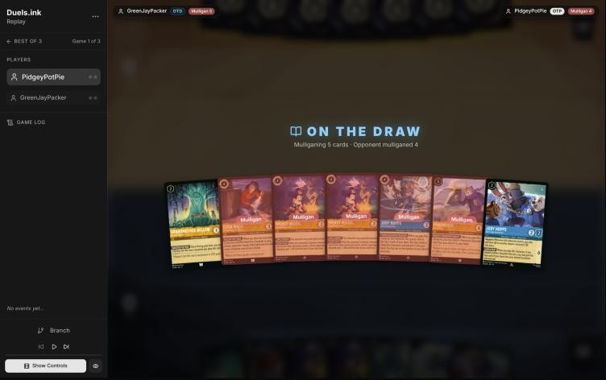
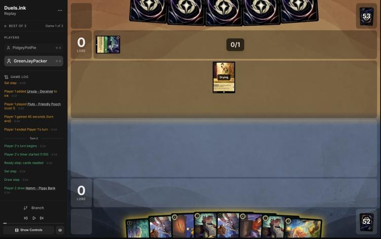
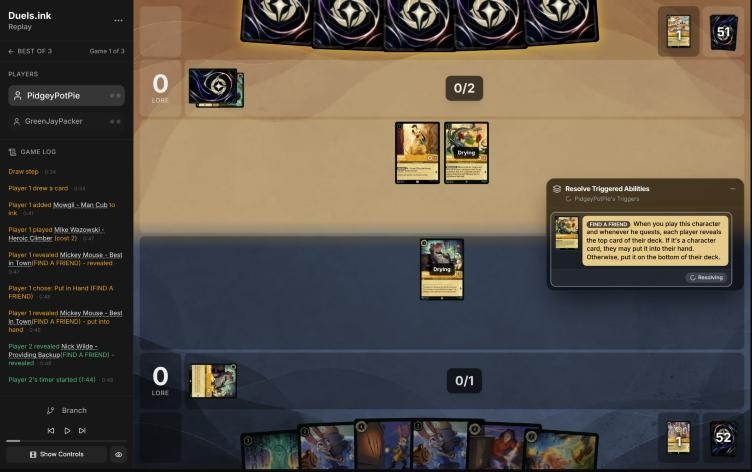
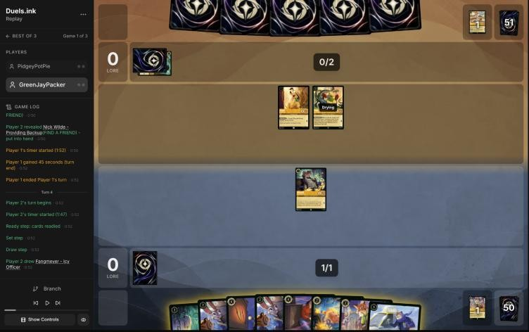
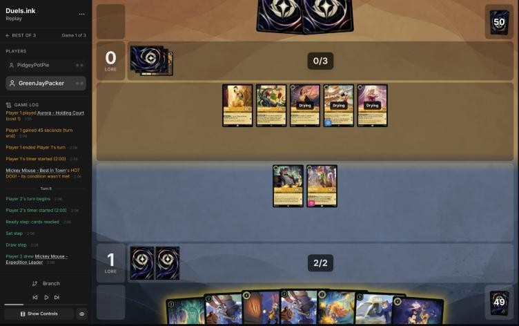
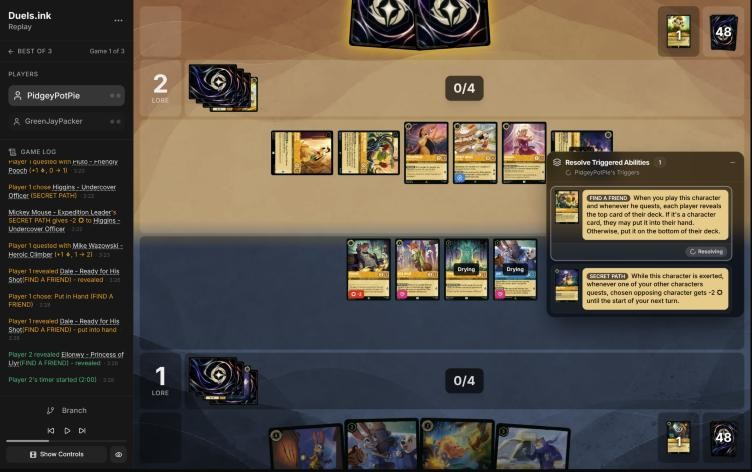
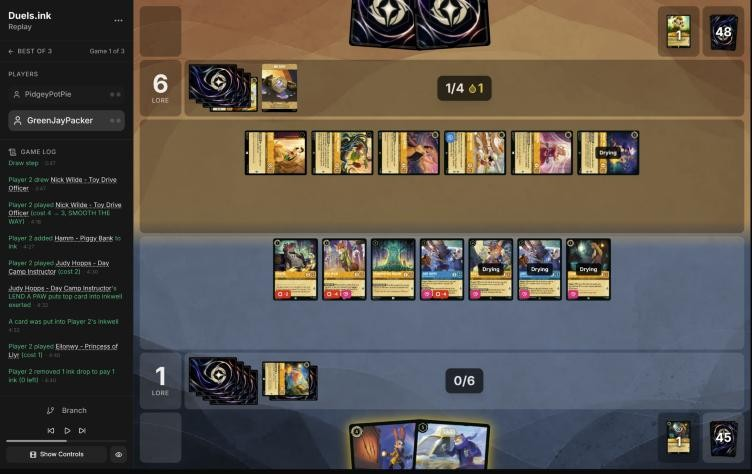
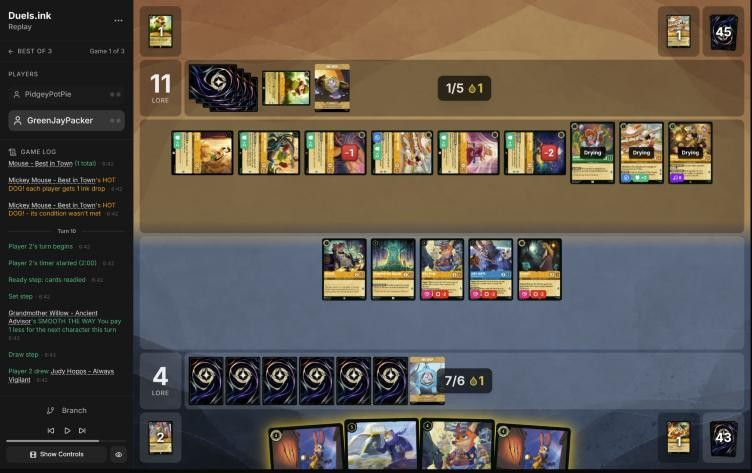

# Review: GreenJayPacker vs PidgeyPotPie, 25 Nov 2026 (game 1)

| | |
|---|---|
| **Status** | draft (blind pass done, not yet discussed) |
| **Replay** | `01a2144a-400e` (`python3 tools/brief.py 01a2144a-400e --turn N`) · [duels.ink viewer](https://duels.ink/replay/01a2144a-4023-7236-bdbf-4d77ba85f9ec?step=0) |
| **Format** | Core Constructed (stated in the replay), judged by CR v2.3.0. Set 14 era: inks revealed before the coin toss |
| **Decks** | You: Amber/Sapphire Detectives, the same 60 as in your earlier reviewed games ([the coach's notes on how you play it](#cite-kb-meta-archetypes-amber-sapphire-detectives-as-greenjaypacker-plays-it)). Them: Amber/Emerald ([the coach's notes on Princess Aggro](#cite-kb-meta-archetypes-amber-emerald-princess-aggro-dale-discounts-and-the-peacekeeper-base)); closest list: Princess Aggro from turn 2 (Pluto and an inked Ursula – Deceiver), with Mowgli – Man Cub and Mickey Mouse – Amber Champion off the list |
| **Play/draw** | PidgeyPotPie went first; you were on the draw |
| **Result** | Loss by lore, 9–20, on game turn 11 |
| **Meta data** | snapshot of 2026-11-25 (fresh: 1 day old, stale from 2026-12-09) |
| **Chosen how** | By the project's owner: a list of GreenJayPacker's games sent for review, not chosen by result. |

## Summary
Links go to the turn sections below.
- **Good plays:** the mulligan to Willow and Day Camp ([pre-game](#turn-0)); Nick – Providing Backup before Willow,
  better than my pick ([4](#turn-4)); the turn-8 plays, Toy Drive Officer, Day Camp and Eilonwy with Always Vigilant
  kept ([8](#turn-8)).
- **Close calls:** staying home, and inking Mickey – Expedition Leader rather than Hamm ([6](#turn-6)); questing three
  on turn 8 ([8](#turn-8)).
- **Inaccuracies / mistakes / blunders:** none.
- **Unwinnable from:** turn 10 for certain: nothing could remove the 4 lore of questers needed to stop their 20 on game
  turn 11 ([10](#turn-10)). In practice from turn 8, when SECRET PATH had taken your board's strength away on the turn
  their six questers were exposed ([8](#turn-8)).

**What decided it:** their curve. Princess Aggro put six characters on the board by game turn 7 and quested them all,
and Mickey Mouse – Expedition Leader, entering exerted, turned each quest into −2 {S} on one of your characters, so the
board that should have punished their exerted questers on turns 8 and 10 couldn't kill anything. Mickey – Amber
Champion's +2 {W} finished the job. No decision of yours was meaningfully wrong.

## The game, turn by turn
Verdicts judge each decision on what you could know at the time, **including archetype knowledge an experienced
player has**. Hindsight is kept to its own section. Severity scale: good play / close call /
inaccuracy / mistake / blunder. Principle IDs and hypotheses (H-n) link to copies
in the Citations section at the end, as they stood when they were cited.

**What you knew before the game:** their inks, Amber/Emerald, and nothing else (game 1 of the match). Of the common
lists it is most like **Circle of Life** (the pair's most common list by a distance); it could be **Princess Aggro**, or
a deck of its own (a sixth of the pair's games fit no list). The two play very differently: Circle of Life barely
quests and sweeps a wide board of small characters from about game turn 5; Princess Aggro goes wide and quests hard,
with Dale's SPIKE SUIT making its high-willpower bodies kill in challenges. Before a card is seen they can't be told
apart. They are on the play, so their turns are game turns 1, 3, 5, … and their ink on game turn 2k−1 is k.

Key cards, read in full from the card data (`tools/cards.py`), with the earliest game turn each can come:
- **Malicious, Mean, and Scary** (Emerald song, 3): 1 damage counter on each of your characters. Game turn 5 (3 ink,
  or sung by a cost-3 character or Angel – Siren Singer's Singer 3, played on game turn 3). Against a Detectives
  board of 1- and 2-willpower bodies it is a sweeper by itself.
- **To Wither a Flower** (Emerald song, 4, uninkable): 2 damage to each of your *damaged* characters. With Malicious,
  3 damage on everything. Game turn 5 too: Malicious for 3 ink and an Ursula – Vanessa (Singer 4, played game turn 3)
  singing Wither; otherwise game turn 7.
- **Don Karnage – Debonair Pirate** (Emerald 6, Shift 4 onto Don Karnage – Khan's Courier, a 1-drop): on play,
  1 damage to each of your characters, through Resist. Game turn 7 by Shift; game turn 5 if a sung Akood et Emuti takes
  2 off the Shift (payment modifiers apply to alternate costs, [CR 4.3.6](#cite-cr-4-3-6)).
- **Prince Phillip – Vanquisher of Foes** (Emerald 9, Shift 6, Evasive 6/6/3): on play, banish all your damaged
  characters. Hard-cast he is far off (game turn 17; 15 with Akood). The real route is **Circle of Life** replaying him
  from the discard, where Tod – Clever Fox, Strike a Good Match or Max Goof – Karaoke Star put him.
- **Circle of Life** (Amber song, 8, Sing Together 8): play a character from their discard free. Needs their dry
  characters' costs to total 8 (Singer counts: two Ursula – Vanessa make 8 alone). In the pair notes it came on their
  4th–5th turn (game turns 7–9).
- **Chernabog – Unnatural Force** (Emerald 5, uninkable): shuffles one of your characters into your deck (you may then
  play a character from your discard free). Game turn 9 at 5 ink; game turn 5 after a sung Akood.
- **Milo Thatch – Getting His Hands Dirty** (Emerald 7, Ward 5/5/3): on play, discard a card to return one of your
  characters to your hand. Game turn 13 at 7 ink, game turn 9 after Akood, or free from Circle of Life.
- **Tod – Clever Fox, Strike a Good Match, Max Goof – Karaoke Star, Meilin Lee – Losing Control, Akood et Emuti:**
  their dig, from game turn 3–5; Meilin finds a song (Malicious, Wither or Circle of Life). Max Goof – Karaoke Star
  quests for 4 once 5 songs are in their discard.
- **Princess Aggro's pieces:** Dale – Ready for His Shot (4, SPIKE SUIT: their characters deal damage with their {W} in
  challenges) at game turn 7, or 5 with Pluto's GOOD DOG or their own Grandmother Willow; Pocahontas – Peacekeeper
  (Shift 3 onto Pocahontas – Guiding the Tribe: no challenges until their next turn) at game turn 5; Elinor – Renowned
  Diplomat (4: 1 damage, +1 lore and a draw at the end of a turn with 3 exerted) at game turn 7, earlier with Queen
  discounts; Rapunzel – Tower Defender (4: discard to bounce one of yours) at game turn 7; Mike Wazowski – Heroic
  Climber's symmetrical FIND A FRIEND.
- **Raging Storm** (Amber staple, 8): game turn 15 at the earliest.

Your own deck's notes (the Amber/Sapphire pair file, "Detectives as GreenJayPacker plays it"): Lead Detective is a
4-ink Shift onto any Judy; dig with Uncovering Clues before planning; Support onto their character for Always Vigilant
and Gaston; play characters in pairs while Toy Drive Officer is out. Against Circle of Life the pair notes say a big
lore lead before the wipe, with a rebuild in hand, is how such games went the other way, and that the turn before a
likely wipe you keep characters ready and undamaged and don't add more than you need. Elisa Maza's FOLLOW THE TRAIL
(with another Detective in play, take a non-character card from their hand) can strip a song from their hand.

### Pre-game

*The board before the decision: [step 0](https://duels.ink/replay/01a2144a-4023-7236-bdbf-4d77ba85f9ec?step=0) in the duels.ink replay viewer.* Cards marked "Mulligan" are the five sent back.

**The plan (written before seeing the mulligan made):** on the draw against Amber/Emerald, most likely Circle of Life.
The seven: Grandmother Willow, Judy – Day Camp Instructor, Judy – Uncovering Clues, Elisa Maza, Mickey – Expedition
Leader ×2, Fangmeyer. No 1-drop, three uninkables (Willow, Day Camp, Fangmeyer), and four 4-drops that clump. Ink is
fine (four inkable cards), the curve isn't: turns 1 and 3 have little to do, and turn 4 has three 4-drops for one slot.
Candidates, `tools/mulligan.py` (1,500 deals each; ink on turns 1–4 of 10, turns with a play of 4, lore by turn 4,
characters by turn 4, interaction by turn 4):

| Option | Ink | Play turns | Lore T4 | Chars T4 | Interaction |
|---|---|---|---|---|---|
| Keep all 7 | 8.81 | 3.23 | 3.8 | 3.7 | 52% |
| Full mulligan | 9.49 | 3.86 | 5.7 | 4.3 | 91% |
| Keep Willow, Day Camp, Uncovering Clues | 9.40 | 3.73 | 5.2 | 4.5 | 79% |
| Keep those and Elisa | 9.32 | 3.65 | 4.9 | 4.3 | 77% |
| Keep Willow, Clues, Elisa, one Mickey | 9.24 | 3.63 | 4.7 | 3.9 | 78% |
| Keep Willow, Day Camp, Clues, Elisa, one Mickey | 9.20 | 3.54 | 4.5 | 4.2 | 70% |
| Keep all but Fangmeyer | 9.03 | 3.41 | 4.2 | 3.9 | 62% |

Keeping five or more is clearly worse on curve and early lore, which is what matters against a deck that sweeps a
wide board around game turn 5–7 and barely quests before then (the plan is a lore lead before the wipe). The best two
are the **full mulligan** and **keeping Willow, Day Camp and Uncovering Clues**: the full mulligan leads slightly on
ink, curve, lore and interaction, the keep-3 on bodies, and it keeps a sure turn-2 play and the deck's dig engine,
which the sim doesn't value. Keeping Elisa as a fourth card costs a little curve for a hand attack that is strong
against a song deck. My pick: **keep Willow, Day Camp and Uncovering Clues**, about level with the full mulligan; send
back both Mickeys, Elisa and Fangmeyer.

**What you did:** kept Grandmother Willow and Judy – Day Camp Instructor, and sent back five: both Mickeys, Elisa,
Fangmeyer and Uncovering Clues. PidgeyPotPie mulliganed four.

**Verdict:** **good play.** Run with `--as-played`, your keep-2 sits between my two picks on every measure: ink 9.44,
play turns 3.80, lore by turn 4 5.4, characters 4.6 (the most of any option), interaction 82%. It keeps the turn-2
Willow and a second 2-drop to follow it at a discount, and gives up the one card of value in the rest (Uncovering
Clues) for a deeper redraw into the deck's nine 1-drop characters. Against a deck whose plan is to sweep a wide board
of small characters, the case for more bodies is weaker than the sim suggests, but against Princess Aggro it is
stronger, and before a card is seen both are live. Tied for best with the full mulligan and keep-3 ([MULL-1](#cite-mull-1), [MULL-2](#cite-mull-2),
[MULL-3](#cite-mull-3), [H-5](#cite-h-5)). Confidence medium: the sim doesn't value Uncovering Clues' dig.

### Turn 2: your turn 1

*The board before the decision: [step 6](https://duels.ink/replay/01a2144a-4023-7236-bdbf-4d77ba85f9ec?step=6) in the duels.ink replay viewer.*

**The plan (written before seeing the turn):** their turn 1 was an inked Ursula – Deceiver and Pluto – Friendly Pooch,
both Princess Aggro cards: of the common lists they now look most like **Princess Aggro**, which runs four of each;
could still be a deck of its own. So the threats to plan for are a wide, fast board with discounts (Pluto's GOOD DOG
already makes a 3-drop castable with their 2 ink next turn, the brief's COST REDUCERS line: Nani – Stage Manager),
Dale's SPIKE SUIT from game turn 5 with Pluto, Pocahontas – Peacekeeper's challenge lock (Shift 3 onto Guiding the
Tribe) from game turn 5, and Elinor's end-of-turn pings from game turn 5–7. Princess Aggro has almost no songs or
actions, so Elisa Maza's FOLLOW THE TRAIL has little to take; and Always Vigilant's 5-{S} removal has few targets
there (Peacekeeper is 3/6, Lionheart 4/7), though your own Support can put one in range later.
- **Resources:** 0 ink, up to 1. Hand: Willow, Day Camp ×2 (all uninkable), Higgins ×2, Hamm, Elisa, Always Vigilant
  (inkable). Five inkable cards for the inks of turns 1–4, and Day Camp's LEND A PAW can add one.
- **Nothing to stop or kill yet;** no Supporter on either side, so no Support line. A Higgins played now is ready on
  their turn and can't be challenged.
- **The next turns:** turn 4 (2 ink) Willow or Hamm; turn 6 (3 ink) Willow's discount plus Day Camp's LEND A PAW
  (a 1-drop first, then Day Camp) for a wide turn and a ramp; Always Vigilant Shifted for 2 onto a dry Day Camp is a
  4/4 that can act at once.
- **Candidates:** (a) ink Elisa, play Higgins (1 of 1); (b) ink the second Higgins, play Higgins (1 of 1); (c) ink
  Hamm, play Higgins. Elisa is the card worth least here: a 3/4 for 4 whose ability is near-dead against an
  all-character deck. Higgins is a body that also turns on LEND A PAW and costs 0 with Willow, and Hamm is a second
  discount engine. **Pick: (a), ink Elisa and play Higgins.** Ink check: turn 4 inks Higgins or Hamm and plays Willow;
  turn 6 has 3 ink plus Willow for Hamm/Higgins and a Day Camp with LEND A PAW. Under (b) the same turns work with
  Elisa still in hand as a later 4-drop, so the gap is small.

**What you did:** inked the second Higgins and played the first.

**Verdict:** **fine** (my candidate (b)). Keeping Elisa over the second Higgins keeps a 4-drop body for later and
gives up a 1-drop that Willow would have made free; neither is clearly better ([INK-1](#cite-ink-1), [INK-2](#cite-ink-2)). No severity.

### Turn 3: their turn

*The board before the decision: [step 12](https://duels.ink/replay/01a2144a-4023-7236-bdbf-4d77ba85f9ec?step=12) in the duels.ink replay viewer.*

**What happened:** they inked Mowgli – Man Cub (not in duels.ink's Princess Aggro list, but seen in Princess Aggro
before) and played Mike Wazowski – Heroic Climber. FIND A FRIEND gave them Mickey Mouse – Best in Town (now known in
their hand: Adventurous, and each turn he ends exerted both players get an ink drop) and you Nick Wilde – Providing
Backup. Pluto didn't quest.

**Verdict:** taking Nick into your hand was the only sensible choice (a free card). No severity.

### Turn 4: your turn 2

*The board before the decision: [step 14](https://duels.ink/replay/01a2144a-4023-7236-bdbf-4d77ba85f9ec?step=14) in the duels.ink replay viewer.*

**The plan (written before seeing the turn):** of the common lists they look most like **Princess Aggro** (four of
their five cards are in it; Mowgli isn't). Known in their hand: Mickey – Best in Town. No songs, no Sing Together to
speak of (3), nothing in their discard.
- **Their next turn:** 3 ink plus Pluto's GOOD DOG makes a 4-drop castable (the brief's COST REDUCERS line: Dale,
  Elinor, Rapunzel – Tower Defender, Mickey – Expedition Leader). The list's removal and combat cards: **Dale**
  (about a third, counting their draw), **Elinor** (same; but her ping needs 3 of theirs exerted at the end of their
  turn, and with Pluto exerting for the discount and Mickey drying they'd have two), **Rapunzel** (bounce, about a
  fifth). Mickey – Best in Town will likely come down too.
- **Exposure:** Higgins quested is exerted. FREE KILLS: none as their board stands (Pluto and Mike have 0 {S}). **If
  Dale lands first** (Pluto exerts for the discount, so Mike is the attacker), Mike deals 4 under SPIKE SUIT and kills
  Higgins, taking 2 back from 4 willpower. So questing Higgins risks him in roughly a third of their draws, and the
  kill costs them Mike's quest and FIND A FRIEND.
- **Support line:** none in any direction. No Supporter of yours can quest (Nick and Day Camp are in hand), and they
  have none.
- **Resources:** 1 ink, up to 2. Hand: Willow, Day Camp ×2, Fangmeyer (uninkable); Always Vigilant, Elisa, Hamm,
  Nick – Providing Backup (inkable). Four uninkables, so ink will be tight: Day Camp's LEND A PAW and Willow's discount
  matter.
- **Needs check:** nothing to find yet; their clock is game turn 23 at the current rate and will speed up. The deck's
  answers to a wide Princess board are challengers (4-{S} Always Vigilant kills Mike or Mickey, both 0/4), and Support
  onto their characters for Always Vigilant and Gaston (5 {S}).
- **Candidates (all 2 of 2):**
  - **(a) ink Elisa, play Willow, quest Higgins.** Turn 6 (3 ink): Nick for 1 with Willow, then Day Camp for 2 with
    LEND A PAW (+1 ink): four bodies and a ramp. Turn 8: Always Vigilant Shifted onto the dry Day Camp for 1 (Willow's
    discount applies to a Shift, [CR 4.3.6](#cite-cr-4-3-6)) can quest or challenge at once, plus more.
  - **(b) ink Elisa, play Day Camp, quest Higgins.** Turn 6: Willow (2) and Always Vigilant Shifted onto Day Camp for 1
    = 3 of 3: a 4/4 questing on turn 6, but no ramp and one body fewer.
  - **(c) ink Elisa, play Nick – Providing Backup** (Support with Higgins in play), quest Higgins.
  - Ink: Elisa in all three, as on turn 2 (her ability is near-dead against an all-character deck).

  **Pick: (a).** It builds the cheapest curve (Willow's discount every turn from turn 6, Day Camp's ramp) and keeps
  the Shift for turn 8, when Mickey – Best in Town will have quested and be exerted for a 4-{S} challenger. (b) is
  close: the 4/4 a turn sooner. Quest Higgins in all of them: +1 lore, with about a one-in-three risk that Dale lets Mike
  kill him, at the price of Mike's quest.

**What you did:** inked Elisa, played Nick Wilde – Providing Backup, quested Higgins (1–0).

**Verdict:** **good play, better than my pick.** Willow's SMOOTH THE WAY works on the turn she lands (the brief's
DISCOUNT FROM HAND line says so), so playing her now gains nothing over playing her on turn 6: Willow (2) then Day
Camp for 1 with LEND A PAW is still 3 of 3 on turn 6, the same four bodies and ramp as my line (a). What your order
adds is that the 2-drop played now is dry a turn sooner, and Nick (3/2, Support while Higgins is in play) is worth
more dry on turn 6 than Willow (1/2): he can challenge an exerted Pluto or any 2–3-willpower character they add, or quest and add 3
{S} to another character. Nick, like Willow, is ready through their turn, so nothing can challenge him. The Higgins
quest was the right risk ([QC-3](#cite-qc-3), [RULE-1](#cite-rule-1)): +1 lore, losing him only to a Pluto-discounted Dale with Mike giving up his
quest to make the kill. My plan read the discount as needing a turn in play, though the brief said otherwise ([SEQ-4](#cite-seq-4)).
Confidence medium.

### Turn 5: their turn

**What happened:** they inked Nani – Stage Manager, played Pocahontas – Guiding the Tribe (STAY CLOSE put Mickey – Best
in Town into play free) and Aurora – Holding Court. Nothing quested: five characters, 0 lore, 2 cards left in hand.
Pocahontas – Guiding the Tribe is the Shift base for Pocahontas – Peacekeeper's challenge lock.

### Turn 6: your turn 3

*The board before the decision: [step 24](https://duels.ink/replay/01a2144a-4023-7236-bdbf-4d77ba85f9ec?step=24) in the duels.ink replay viewer.*

**The plan (written before seeing the turn):** Princess Aggro, as clearly as a list can be (seven of their eight cards
are in it). Their five characters are all ready, so nothing can be challenged this turn; next turn they quest for 6
(Mickey – Best in Town 2, the rest 1), which puts them on 20 by game turn 13 if nothing dies. **You're the defender
here** ([ROLE-1](#cite-role-1)): their board is wider and faster, and your deck's edge is removal and challengers, so the job is to
kill questers once they're exerted.
- **Their next turn** (4 ink, 2 cards in hand plus a draw; Pluto's GOOD DOG and Aurora's ROYAL WELCOME discount it):
  - **Pocahontas – Peacekeeper** Shifted onto Guiding the Tribe (3, less with Aurora's and Pluto's discounts): if none
    of theirs challenged, no character can challenge until their next turn, so your turn 8 couldn't attack their
    exerted questers. About one in five with their draw, for the average list.
  - **Dale** (same odds): SPIKE SUIT makes every one of theirs deal its {W} in challenges (Mike 4, Pocahontas 3,
    Pluto and Aurora 2), so anything of yours left exerted dies.
  - **Elinor** (same odds): after a wide quest, 1 damage to one of yours, +1 lore and a card.
  - Mickey – Best in Town must quest (Adventurous), so HOT DOG! gives both players an ink drop at the end of their turn.
- **FREE KILLS if you quest:** Higgins, by Guiding the Tribe alone (she survives on 1 willpower). Nick would trade with
  her (his 3 back kills her). With Dale, both die for nothing. Either challenge costs them that character's quest and
  the Peacekeeper lock (CALMING WORDS needs no challenge that turn), and a Guiding the Tribe that challenged is
  exerted and damaged on your turn.
- **Support line:** yours onto their character: Nick (+3) would put Guiding the Tribe in Always Vigilant's range, but
  Always Vigilant isn't castable this turn (3 ink). Yours onto your challenger: no challenges this turn. Theirs onto
  their challenger: they have no Supporter. Theirs onto yours: no 5-{S} removal in this list.
- **Turn 8 is the swing turn.** Their questers will be exerted (unless Peacekeeper locks challenges): Always Vigilant
  Shifted onto a dry Day Camp (4 {S}) kills Mickey – Best in Town or Mike (0/4); Nick kills Guiding the Tribe;
  Higgins, Day Camp and Willow kill Aurora or Pluto (2 willpower). And **if Peacekeeper locks challenges, Always Vigilant
  still banishes her** after a Support quest (3 {S} + Nick's 3 or Day Camp's 2 ≥ 5). Turn 8's ink: 3 now, +1 from
  LEND A PAW, +1 from Mickey's drop, +1 if you ink: up to 6.
- **Needs check:** at their pace you have three draws before game turn 13; what wins is killing their questers faster
  than they rebuild, with Always Vigilant + Support for whatever challenges can't reach. That's in hand already.
- **Resources:** 2 ink, up to 3 (ink Always Vigilant, Hamm or Mickey – Expedition Leader). Keep Always Vigilant (the
  turn-8 removal). Hamm is the spare: Mickey – Expedition Leader is a 2-lore body whose SECRET PATH (entering exerted,
  each other quest gives one of theirs −2 {S}) is a real defensive tool against this board.
- **Candidates:**
  - **(a) ink Hamm; Willow (2), then Day Camp (1 with Willow) with LEND A PAW: 3 of 3, +1 ink; quest Higgins and
    Nick (+2).** Exposes Higgins (free kill) and Nick (a trade), each at the cost of a quest and the lock for them.
  - **(b) the same plays, quest Higgins only,** keeping Nick (Support for turn 8's Always Vigilant) safe.
  - **(c) the same plays, no quests:** nothing exposed, every challenger ready for turn 8, 0 lore.
  - (Hamm plus Willow instead of Day Camp gives no ramp and no Shift base: worse.)

  **Pick: (a).** A quested Higgins or Nick is a trade they pay for with a quest and the lock; if they decline, it's 2
  lore. (b) is close; (c) gives up lore for safety that matters only in the Dale branch.

**What you did:** inked Mickey – Expedition Leader, played Willow, then Day Camp for 1 (LEND A PAW put your top card
into ink). No quests: Higgins and Nick stayed ready. 1–0.

**Verdict:** **close call** (my candidate (c), with Mickey inked instead of Hamm).
- **Staying home.** It gives up 2 lore. FREE KILLS named one: Higgins, whom Guiding the Tribe could kill and survive;
  Nick would only have traded with her. What waiting gains is real, though: all four of your characters are ready
  challengers for turn 8, the swing turn, and the Dale branch (about one in five), where both questers die for nothing
  and Nick's Support for Always Vigilant goes with them, is avoided. As the defender in this race ([ROLE-1](#cite-role-1), [TRADE-5](#cite-trade-5)) the
  lore matters less than the turn-8 attack, so keeping the attackers is a fair price. My line (a) is not clearly better
  ([QC-3](#cite-qc-3), [RULE-1](#cite-rule-1)).
- **The ink.** Mickey – Expedition Leader over Hamm: Hamm is the cheaper card to deploy next to Willow, and Mickey a
  2-lore body whose SECRET PATH (−2 {S} to one of theirs per other quest) is useful against Guiding the Tribe and
  Aurora but does nothing once Dale makes them deal their {W}. Ink check: turn 8 has the same ink either way (4 in the
  inkwell, Mickey's drop and one more ink from Hamm, Always Vigilant or a draw); with Hamm kept it can be Hamm (1 with
  Willow) + Day Camp + Always Vigilant's Shift, with Mickey kept Mickey (3 with Willow) + Always Vigilant's Shift. Even
  ([INK-1](#cite-ink-1), [INK-2](#cite-ink-2)).

### Turn 7: their turn

*The board before the decision: [step 37](https://duels.ink/replay/01a2144a-4023-7236-bdbf-4d77ba85f9ec?step=37) in the duels.ink replay viewer.*

**What happened:** they inked Lionheart – Incumbent Mayor and played **Mickey Mouse – Expedition Leader exerted** (LONG
JOURNEY), then quested all five others for 6 (6–1). Each of those quests triggered SECRET PATH: −2 {S} on Higgins, on
Nick twice and on Day Camp twice, until the start of their next turn. Mike's FIND A FRIEND gave them **Dale – Ready for
His Shot** (now known in their hand) and you Eilonwy – Princess of Llyr, which you took. HOT DOG! gave each player an
ink drop.

**Verdict:** taking Eilonwy was the only sensible choice (a free card). No severity.

### Turn 8: your turn 4

*The board before the decision: [step 52](https://duels.ink/replay/01a2144a-4023-7236-bdbf-4d77ba85f9ec?step=52) in the duels.ink replay viewer.* Toy Drive Officer, Day Camp and Eilonwy are already played.

**The plan (written before seeing the turn):** this is the turn I expected to be the swing turn, and SECRET PATH has
taken it away. All six of theirs are exerted, but your four characters have 0 (Higgins), −1 (Nick), 1 (Willow) and −2
(Day Camp) {S} this turn, so no challenge kills anything (the brief's options: Willow deals 1 and dies to Guiding the
Tribe or Mickey – Expedition Leader). Everything you play now is drying, and **Always Vigilant Shifted onto Day Camp
keeps Day Camp's −4 {S}** (a shifted character keeps the effects on the card under it, [CR 8.10.5](#cite-cr-8-10-5)), so it challenges for
0. Always Vigilant's GOT YOU NOW has no target: nothing of theirs has 5 {S}, and your Supporters' negative {S} adds
nothing.
- **The race:** 1–6. Their board quests for 8 (both Mickeys 2, the rest 1): 14 after their next turn, and with Dale
  (known in hand, 2 lore) 10 a turn after that, so **they reach 20 on game turn 11** (`odds.py clock`). You can't reach
  20 before game turn 14. To survive game turn 11 your turn 10 must leave them no more than 5 lore of questers out of
  about 10 (both Mickeys, Dale, four 1-lore characters, plus whatever else they play): three kills, two of them
  2-lore characters.
- **What turn 10 will face:** Dale in play (SPIKE SUIT: their characters deal their {W} back, 2–4 each), and SECRET
  PATH again: Mickey – Expedition Leader quests first, and each of their other five quests puts −2 {S} on a character
  of yours they choose (−10 in all), on the characters you have in play by then. Cards you play on turn 10 aren't hit,
  but they're drying.
- **Their next turn otherwise** (6 ink and a drop; Dale plus one card and a draw): Elinor (1 damage, +1 lore, a card)
  and Rapunzel – Tower Defender (bounce) are the list's other interaction, unlikely. **FREE KILLS if you quest:**
  Higgins, Willow and Day Camp to Guiding the Tribe alone, and with Dale cast first (it's in their hand), every
  exerted character of yours dies to any of theirs.
- **Support line:** yours onto their character: none worth anything this turn (Nick and Day Camp have negative {S});
  on turn 10, Supporters questing onto **Dale** (0 {S}) can put him in Always Vigilant's range: Nick's 3 and Day Camp's
  2, or two 2-{S} Supporters and one more, which also switches SPIKE SUIT off before you challenge. Yours onto your
  challenger: no useful challenge this turn. Theirs onto their challenger, and onto yours for removal: they have no
  Supporter and no 5-{S} removal.
- **Needs check:** what you hold doesn't win. What could: a turn-10 multi-kill, for which you need many Supporters
  and challengers in play (so the −10 can't neuter them all), Always Vigilant in hand for Dale, and luck: Lead Detective
  (Resist +2 for your Detectives on your turn, which blunts SPIKE SUIT) or Gaston, one of six in 46, about one in four
  over your next two cards if Toy Drive Officer draws (`odds.py hold 46 6 2`). Realistically **the game is lost from
  here unless they misplay** ([principle 2](#cite-principle-2)); the plan is the best try.
- **Resources:** 4 ink + 1 drop = 5, up to 6 if you ink (Always Vigilant, Hamm, Eilonwy). Hand: Always Vigilant, Day
  Camp, Hamm, Fangmeyer, Eilonwy, Nick – Toy Drive Officer. Willow's discount once.
- **Candidates** (6 of 6 each, inking Hamm, which matters least here):
  - **(a) Toy Drive Officer (3 with Willow) + Day Camp (2, LEND A PAW: +1 ink) + Eilonwy (1); no quests.** Three new
    Supporters, a card from COMMUNITY OUTREACH at the end of the turn, Always Vigilant kept for turn 10. Board for turn
    10: seven characters, six of them Supporters or challengers, 15 {S} before SECRET PATH.
  - **(b) Fangmeyer (4 with Willow) + Eilonwy (1); no quests.** A 4-{S} challenger, but one fewer body, no draw, no
    ramp, and they'll put two −2s on Fangmeyer.
  - **(c) Always Vigilant hard-cast (3 with Willow) + Day Camp (2) + Eilonwy (1).** Wastes GOT YOU NOW, which is the one
    effect SECRET PATH can't touch if she's played on turn 10.
  - **Quest or stay home:** questing the four in play gains 4 lore that can't matter before game turn 14, and gives
    them free kills that cost them only quests they can spare; it thins the board turn 10 needs. Stay home.

  **Pick: (a), no quests.**

**What you did:** played Toy Drive Officer for 3 (Willow), inked Hamm, played Day Camp (LEND A PAW) and Eilonwy (with
the ink drop): line (a)'s plays exactly. Then quested Nick (Support +0 onto Guiding the Tribe), Higgins and Day Camp
for 3 (4–6), keeping Willow home. COMMUNITY OUTREACH drew a second Toy Drive Officer.

**Verdict:** **good play on the plays; close call on the quests.**
- The plays build the widest board of Supporters for turn 10, draw a card, ramp, and keep Always Vigilant in hand
  ([TEMPO-4](#cite-tempo-4), [SEQ-4](#cite-seq-4)).
- **The quests:** I'd have kept everyone home, but your quests are as good. FREE KILLS named Higgins and Day Camp
  (Guiding the Tribe kills either and survives), and with Dale cast first Nick dies too; Willow, also a free kill,
  stayed home. What those kills would cost: Higgins is a 1-drop, Day Camp is Always Vigilant's Shift base and a 2-{S}
  Supporter, Nick the best Supporter (+3). What they'd cost *them*: each character that challenges doesn't quest, and
  they need 14 lore in two turns from 18 available. A kill they take is a lore they don't gain toward the turn-11 win,
  which lowers what your turn 10 has to kill; a kill they don't take leaves you 3 lore up for nothing. My objection
  (a thinner turn-10 board) holds only in the branch where they trade lore for it. Roughly even ([POS-2](#cite-pos-2), [RULE-1](#cite-rule-1), [QC-5](#cite-qc-5)).
  Confidence medium.

### Turn 9: their turn

**What happened:** Mickey – Expedition Leader challenged and killed the exerted Day Camp (taking 2), which also left
him exerted for SECRET PATH; Guiding the Tribe then killed Nick, whose {S} the first SECRET PATH had cut to 1. Mike
quested (FIND A FRIEND: a second Mickey – Best in Town for them; The Horseman Strikes! went to the bottom of your deck,
not a character). They played Bobby Zimuruski (draw, then discard), the second Mickey – Best in Town and **Mickey
Mouse – Amber Champion** (4, 2/5/1: their other Amber characters get +2 {W}; Singer 8 with two other Ambers), and
quested Pluto, Mickey and Aurora: 11–4. SECRET PATH put −2 {S} on Toy Drive Officer, the second Day Camp and Eilonwy.
Dale never came down: one copy went to Bobby's SO CHEESY discard and a second was inked (two seen). So the two quests of turn 8 cost Day
Camp and Nick, and cost them two quests (Mickey – Expedition Leader's 2 and Guiding the Tribe's 1).

### Turn 10: your turn 5

*The board before the decision: [step 80](https://duels.ink/replay/01a2144a-4023-7236-bdbf-4d77ba85f9ec?step=80) in the duels.ink replay viewer.*

**The plan (written before seeing the turn):** 4–11. Their nine characters quest for 12 next turn and they need 9.
Six are exerted (Pluto, Mike, Guiding the Tribe, Mickey – Best in Town, Aurora, Mickey – Expedition Leader: 8 lore);
Bobby, the second Mickey – Best in Town and Amber Champion are ready (4 lore) and can't be challenged. **To stop them
you must remove 4 lore of questers this turn**, and Amber Champion's LEADING THE WAY has put +2 {W} on their Ambers.
- **What can kill:** SECRET PATH left Toy Drive Officer, Day Camp and Eilonwy on 0 {S}; Higgins has 2, Willow 1.
  Always Vigilant Shifted onto Day Camp keeps its −2 ([CR 8.10.5](#cite-cr-8-10-5)): 2 {S}, dry, so it can challenge. Everything else
  you could play is drying. So the attackers total 5 damage: Higgins 2, Willow 1, Always Vigilant 2. Mickey –
  Expedition Leader has 3 willpower left (Willow and Always Vigilant, or Willow and Higgins, kill him); Guiding the
  Tribe 4 left (Always Vigilant and Higgins); Pluto, Aurora 4, Mike and Mickey – Best in Town 6. **At most one kill: 2
  lore, Mickey – Expedition Leader.** GOT YOU NOW has no target (nothing of theirs has 5 {S}, and your Supporters add 0).
- **Support line:** yours onto their character or your challenger: your Supporters (Toy Drive Officer, Day Camp,
  Eilonwy) have 0 {S}, so they add nothing. Theirs: no Supporter, no 5-{S} removal.
- **Needs check:** nothing in hand or in play removes 4 lore of questers, and they reach 20 on game turn 11 before
  your next draw (the brief says only what you hold can win). **The game is unwinnable from here** ([principle 2](#cite-principle-2)): the
  best you can do is kill Mickey – Expedition Leader, so they need 9 of their remaining 10, and hope for a misplay.
- **The best try:** play first while Willow is alive (her discount), then Always Vigilant Shifted onto Day Camp (2
  ink) and Willow challenge Mickey – Expedition Leader (Willow dies, Always Vigilant survives on 2 damage), and quest
  the rest. The choice of plays doesn't change the result.

**What you did:** played the second Toy Drive Officer (3 with Willow) and hard-cast Always Vigilant (GOT YOU NOW had no
target), quested all five for 5 (9–11), inked the second Always Vigilant. COMMUNITY OUTREACH drew two (Elisa Maza and
Nick – Providing Backup).

**Verdict:** **unwinnable** ([principle 2](#cite-principle-2)). No line removed the 4 lore of questers needed; killing Mickey – Expedition
Leader would have left them needing 9 of 10 instead of 9 of 12, a little more room for a misplay and nothing more.
Banking 5 lore and two cards in case they stumbled is as reasonable a try as any. No severity.

### Turn 11: their turn

**What happened:** they quested Pluto, Mike (FIND A FRIEND: Grandmother Willow for them, Gaston for you), Guiding the
Tribe, Mickey – Best in Town, Aurora, Mickey – Expedition Leader and Bobby, and reached 20 (20–9).

## Lessons
1. **Against Princess Aggro, Mickey Mouse – Expedition Leader is a combat card.** He can enter exerted (LONG JOURNEY),
   and while he's exerted each of their other quests puts −2 {S} on a character of yours until their next turn. After a
   wide quest turn your board can't challenge, and an Always Vigilant Shifted onto a shrunk Judy keeps the −{S} (CR
   8.10.5). Plan the turn after his first quest turn around what he can't touch: characters you play that turn (drying,
   but GOT YOU NOW and WATCH THIS still work) and Supporters he didn't shrink. Kill him the first turn he's exerted and
   you have the strength to.
2. **Grandmother Willow's discount works the turn she lands** ([4](#turn-4)): playing her early buys nothing, so play
   first the 2-drop that's worth more dry next turn.
3. **When they need nearly every quest to win on time, a quester you expose is a trade they pay for in lore**
   ([8](#turn-8)): it's not the free kill it looks like. It still costs you the character if they take it, so it fits
   characters you can spare.

## Proposed knowledge-base updates (not applied; for discussion)
- **Strategy:** none new; lesson 3 is a single game's evidence, and close to the existing turn-8 reasoning in [H-12](#cite-h-12).
  If GreenJayPacker's answers support it, add this game to [H-12](#cite-h-12) as evidence on the "quest anyway" side.
- **Meta** (Amber/Emerald pair file, below the end marker): *Princess Aggro against GreenJayPacker's Detectives:
  PidgeyPotPie (01a2144a-400e, game 1, 25 Nov 2026).* Seen: Pluto, Mike Wazowski – Heroic Climber, Mickey – Best in Town
  ×2, Pocahontas – Guiding the Tribe, Aurora – Holding Court, Mickey – Expedition Leader, Bobby Zimuruski, Mickey Mouse –
  Amber Champion (off-list: their other Ambers +2 {W}; Singer 8 with two other Ambers); inked Ursula – Deceiver, Mowgli,
  Nani, Lionheart, Dale (a second Dale discarded). Nothing quested before game turn 7; then 0 → 6 → 11 → 20 on game
  turns 7, 9, 11. **The swing piece was Mickey – Expedition Leader entering exerted before five quests:** −10 {S} on
  the Detectives board, so the turn their questers were exposed nothing could kill them. Dale was never needed.
- **Cards:** a note on Mickey Mouse – Expedition Leader (both sides: GreenJayPacker runs two). LONG JOURNEY makes
  SECRET PATH live the turn he's played; a challenge exerts him too, so he can challenge first and still shrink your
  characters for each later quest (turn 9 here); the −{S} lasts until the start of their next turn, hits only
  characters in play, and stays on a character Shifted over ([CR 8.10.5](#cite-cr-8-10-5)).
- **Rules:** a ruling: *a shifted character keeps the stat changes on the card under it.* Always Vigilant Shifted onto
  a Day Camp with two SECRET PATHs would have had 0 {S} ([CR 8.10.5](#cite-cr-8-10-5): it "does keep any effects that apply to that
  character when the shifted character enters play").

## Hindsight
Doesn't change the verdicts above.
- **Was it winnable with the full shuffle?** Hardly. Their curve was close to the list's best: six characters by game
  turn 7, Mickey – Expedition Leader's SECRET PATH on that turn, Amber Champion on turn 9. Your deck's answers either
  needed {S} you no longer had (challenges) or targets with 5 {S} that their 0–2 {S} board never offered without your
  Support, which SECRET PATH had also shrunk. Gaston arrived only from Mike's FIND A FRIEND on the final turn.
- **Turn 8's quests in the event:** they took both kills (Mickey – Expedition Leader on Day Camp, Guiding the Tribe on
  Nick), giving up 3 lore of quests, and reached 11 instead of 14; on turn 11 they needed 9 and quested exactly 9 with
  two characters to spare. Staying home would have left them on 14 needing 6: the same result.
- **Turn 10's kill on Mickey – Expedition Leader** would have left them 10 lore of questers for the 9 they needed;
  they'd still have won.
- **The mulligan:** the redraw gave Always Vigilant, two Higgins, a second Day Camp and Elisa, a fine curve. The game
  wasn't lost there.

## The coach's errors
Found during the blind pass; to be confirmed in discussion.

| When | Error | How it was caught | How it won't happen again |
|---|---|---|---|
| Pre-game to turn 6 | Never named Mickey Mouse – Expedition Leader's SECRET PATH as a threat, though Princess Aggro runs two, the pair file's notes describe it ([an unlisted midrange list](#cite-kb-meta-archetypes-amber-emerald-an-unlisted-midrange-list)), the turn-4 brief listed it as castable a turn early, and its text was in the brief on turn 6 (GreenJayPacker drew one). The turn-6 plan called turn 8 "the swing turn"; SECRET PATH took it away. No verdict changed (nothing on turn 6 could stop it), but the plans were wrong about turn 8 | The coach, on reading the turn-8 brief | Proposed: the brief's auto-tagger (`meta.py`'s COMBAT pattern) matches only "+N {S}" pumps, Rush and Challenger for their side; extend it to "−N {S}" on opposing characters (SECRET PATH, Goofy – Galumphing Gumshoe, Someone Will Lose His Head), so such cards appear in the brief's combat list with hold odds and their text under THEIR KEY CARDS, and the pre-game read lists them |
| Turn 4 | Planned Willow before Nick on the belief that her discount needed a turn in play, though the brief's DISCOUNT FROM HAND line said it works the turn she lands | The verdict, comparing the player's line | Proposed: none beyond reading the brief's DISCOUNT line; the plan cited the wrong timing from memory. If it recurs, have the brief print the discounted two-card total next to each pair, as it already does for some ("Grandmother Willow + it: 3 of your 3") |

## Open questions
For GreenJayPacker:
- **Turn 6:** why ink Mickey – Expedition Leader rather than Hamm? And why keep Higgins and Nick home: the risk of
  Dale, or saving them for turn 8's attack?
- **Turn 8:** what made you quest three this time, with Dale known in their hand? Were you inviting the trades, or
  banking lore?
- **SECRET PATH:** you run two Mickey – Expedition Leaders yourself. Did you expect theirs to shrink your board after
  their turn-7 quests, and was there anything on turn 6 you'd have done differently?
- **Turn 10:** did you look at killing Mickey – Expedition Leader (Always Vigilant Shifted onto Day Camp plus Willow),
  or had you already judged the game lost?

## Citations
Copies of the coach's knowledge base cited above, as they stood when they were cited (the private repository's commit and date are given with each). They don't change when the knowledge base does.

**amber-emerald.md, Princess Aggro: Dale, discounts and the Peacekeeper base**: knowledge base, `kb/meta/archetypes/amber-emerald.md` at `5894e68` (2026-11-26), working tree

> ### Princess Aggro: Dale, discounts and the Peacekeeper base `[coach + user, one match: 01a19bb9 and 01a19bbd-79c2, 2026-11-02]`
> MK_ifoughtthelore (Amber/Sapphire Detectives) vs xBWx, won 2–0; sent by the user, reviews in
> `output/reviews/2026-11-02_01a19bb9_vs-xbwx-g1.md` and `…01a19bbd_vs-xbwx-g2.md`. Card text verified from the replays.
> - **Dale – Ready for His Shot is the key piece** (4, 0/4/2; `kb/cards/dale-ready-for-his-shot.md`). SPIKE SUIT: in
>   challenges their characters deal damage with their {W}, so Mike Wazowski – Heroic Climber (0/4), Thomas – Wide-Eyed
>   Recruit (0/4) and David – Protective Snowboarder (1/4) deal 4. Before he's in play, a quest that exerts a cheap
>   character can still be exposed: judge it from their next turn. Once he lands, remove him first (01a19bbd-79c2 turn 8:
>   two Supports made him 5 {S} for Gaston – Superior Archer's WATCH THIS).
> - **Discounts bring cards a turn early.** Pluto – Friendly Pooch's GOOD DOG ({E}: next character 1 cheaper) made Dale
>   castable with 3 ink (01a19bbd-79c2 turn 5). They stack: two GOOD DOGs and Aurora – Holding Court's ROYAL WELCOME (next
>   Princess or Queen 1 cheaper) put Elinor – Renowned Diplomat (a Queen) into play for 1 on turn 9.
> - **Pocahontas – Guiding the Tribe** (2, 2/3/1) plays a cost-1 character for free, and **she's the Shift base for
>   Pocahontas – Peacekeeper's challenge lock**. Remove her early (01a19bb9 turn 7). When Peacekeeper is known in
>   their hand and a Guiding the Tribe is in play, fight this turn: the next one may allow no challenges (01a19bbd-79c2
>   turn 14, then their turn 15).
> - **Elinor's COORDINATED EFFORTS** needs 3 exerted characters at the end of their turn; with their wide board it
>   usually has them. Its 1 damage killed a 1-willpower Eilonwy (01a19bbd-79c2 turn 9).
> - **Mike Wazowski – Heroic Climber's FIND A FRIEND is symmetrical** (on play and on each quest, each player reveals
>   their top card and takes it if it's a character). Against a character-heavy deck such as Detectives it feeds you
>   about as often as them (01a19bb9).
> - **Hand attack:** Mowgli – Man Cub (you discard a non-character card of your choice) and Ursula – Deceiver (you
>   discard a song of their choice). Small against an all-character deck.
> - **Removal is light:** Elinor's ping and Rapunzel – Tower Defender (4; they discard a card to return your character
>   to your hand).
> - **Their cards across the match** (most copies seen in one game): David ×4, Mike ×3, Pocahontas – Guiding the
>   Tribe ×3, Bobby Zimuruski ×2, Mowgli ×2, Mushu – Stealthy Dragon ×2, Pluto ×2, and one each of Aurora – Holding
>   Court, Dale, Elinor, Nani – Stage Manager, Pocahontas – Peacekeeper, Rapunzel – Tower Defender, The Queen – Regal
>   Monarch, Thomas and Ursula – Deceiver. Mowgli and Mushu aren't in duels.ink's average list.

**amber-sapphire.md, Detectives as GreenJayPacker plays it**: knowledge base, `kb/meta/archetypes/amber-sapphire.md` at `5894e68` (2026-11-26), working tree

> ### Detectives as GreenJayPacker plays it `[coach, blind reviews of 01a1fb8a-260a (vs James, discussed 22 Nov 2026) and 01a1ffec-372f (vs [AD-S] McWryze, not yet discussed)]`
> The same 60 in both games: Higgins ×4, Eilonwy ×3, Besties ×3, Helpful Officer ×2, Mowgli ×2, Grandmother Willow ×2,
> Hamm ×2, Day Camp Instructor ×4, Nick Wilde – Providing Backup ×4, On the Case ×2, The Horseman Strikes! ×3, Uncovering
> Clues ×4, Belle – Snowfield Strategist ×2, Mickey Mouse – Expedition Leader ×2, Toy Drive Officer ×4, Elisa Maza ×4,
> Always Vigilant ×4, Fangmeyer ×3, Gaston ×3, Lead Detective ×3. Both games won. Piloting points:
> - **Lead Detective is a 4-ink Shift, not a spare 6-drop:** sixteen other Judys to go onto. She was inked early in both
>   games (James turn 1, McWryze turn 5; "new to the deck, ink the high costs"), and against Emerald/Steel's Evasive
>   questers she was the matchup: Shifted onto a dry Day Camp, her Alert killed Vixey and Mushu (McWryze turn 11).
> - **Dig first, then plan:** Uncovering Clues digs on play and on each quest; her finds made turns 9 and 11 against
>   McWryze (an inkable Elisa for a double play, then both Lead Detectives).
> - **Support onto their character** for Always Vigilant: Don Karnage and Fflewddur (James turns 15 and 21).
> - **Play characters in pairs while Toy Drive Officer is out:** it drew a card nearly every turn in both games.
> - **Against pings, keep home only what challenges kill for free** (Toy Drive Officer, James turn 11).

**amber-emerald.md, An unlisted midrange list**: knowledge base, `kb/meta/archetypes/amber-emerald.md` at `5894e68` (2026-11-26), working tree

> ### An unlisted midrange list `[coach, meta study of the user's 27 Oct 2026 games (tools/scan.py), full games, not blind, 1 game]`
> 01a17f1f. Emerald questers:
> - Mushu – Stealthy Dragon (Evasive; draws when you hold more cards)
> - Vixey (Evasive, 2 lore)
> - White Rabbit
> - Ursula – Deceiver (you discard a song of their choice)
>
> Also Chernabog ×2, Mickey Mouse – Expedition Leader (while exerted, each of their other quests gives your chosen
> character −2 {S}), Aurora – Delightful Musician and Mother Knows Best. Steady 2-lore quests won it 20–8.

**MULL-1**: strategy principle, `kb/strategy/principles.md` at `5894e68` (2026-11-26), working tree

> - **MULL-1. Keep a plan, not the strongest cards.** *Ask: "Which hand gives me the best chance to execute my game plan in this matchup?"* `[MCL ch.12]` · baseline

**MULL-2**: strategy principle, `kb/strategy/principles.md` at `5894e68` (2026-11-26), working tree

> - **MULL-2. A smooth curve beats a few powerful cards.** Check that you can spend ink well on turns 1–4, have enough inkable cards, and know what turn 4 looks like. `[MCL ch.12]` · baseline
>   - **Ink spent isn't the goal by itself.** Judge a keep by a nice curve (a play each turn), early lore pressure, and
>     interaction that sets the opponent back, as well as by ink, then weigh card quality and the matchup
>     (user, 2026-11-01). `tools/mulligan.py` reports all of these.

**MULL-3**: strategy principle, `kb/strategy/principles.md` at `5894e68` (2026-11-26), working tree

> - **MULL-3. The right keep depends on the matchup.** Early interaction against aggro; pressure, draw and engines against slow decks. The mulligan is the first expression of your role. In the Set 14 era the opponent's inks are known before the mulligan (RULE-8), so this applies from game 1 of a match. `[MCL ch.12]` · baseline

**INK-1**: strategy principle, `kb/strategy/principles.md` at `5894e68` (2026-11-26), working tree

> - **INK-1. Inking is permanent.** Every inked card is one line of play removed for the rest of the game. *Ask: "Will I regret losing access to this card?"* `[MCL ch.4]` · baseline

**INK-2**: strategy principle, `kb/strategy/principles.md` at `5894e68` (2026-11-26), working tree

> - **INK-2. Don't automatically ink the most expensive card.** It may be the late-game win condition or the key answer for this matchup. The answer depends on matchup, hand and board. `[MCL ch.4]` · baseline

**QC-3**: strategy principle, `kb/strategy/principles.md` at `5894e68` (2026-11-26), working tree

> - **QC-3. Questing is favoured when:**
>   - you control the board
>   - your exerted characters can't be punished
>   - the race favours you
>   - removing their characters gains little
>
>   **Challenging is favoured when:**
>   - they have an engine or repeated-value piece
>   - the trade is efficient
>   - you need to slow the game
>   - your deck is stronger late
>
>   `[MCL ch.6]` · baseline

**RULE-1**: strategy principle, `kb/strategy/principles.md` at `5894e68` (2026-11-26), working tree

> - **RULE-1. Only exerted characters can be challenged** `[CR 4.6.4.2]`. Questing, singing, or {E} for an ability exposes the character. Staying ready protects it. Every quest is also a decision about what the opponent can challenge next turn. · baseline
>   - *Card text overrides this* (CR 1.2.1). Shere Khan – Khan Industries CEO's NEW INCENTIVE lets one character
>     challenge ready characters that turn. Alert (e.g. from Judy Hopps – Lead Detective, to every Detective on their
>     turn) ignores Evasive. Against Ducktectives, name both in the setup. 01a14574, turns 16 and 18. `[coach, 2026-10-26]`

**SEQ-4**: strategy principle, `kb/strategy/principles.md` at `5894e68` (2026-11-26), working tree

> - **SEQ-4. Sequence across turns.** A slightly weaker play now can set up a much stronger next turn: keep a shift target alive, keep a singer ready, hold removal for a bigger threat. `[MCL ch.5]` · baseline

**ROLE-1**: strategy principle, `kb/strategy/principles.md` at `5894e68` (2026-11-26), working tree

> - **ROLE-1. The matchup decides your role, not your deck.** In nearly every game one player wants it short (aggressor) and one wants it long (defender). The same list can play either role. *Ask: "Which deck benefits if this game goes long?"* `[MCL ch.8]` · baseline

**TRADE-5**: strategy principle, `kb/strategy/principles.md` at `5894e68` (2026-11-26), working tree

> - **TRADE-5. Trade according to role.** Aggro preserves pressure and often ignores trades. Midrange seeks consistently favourable trades. Control accepts even neutral trades that extend the game. `[MCL ch.7]` · baseline

**TEMPO-4**: strategy principle, `kb/strategy/principles.md` at `5894e68` (2026-11-26), working tree

> - **TEMPO-4. Don't put a whole turn into one expensive character that will likely be removed before it does anything.** `[MCL ch.1]` · baseline

**POS-2**: strategy principle, `kb/strategy/principles.md` at `5894e68` (2026-11-26), working tree

> - **POS-2. From behind, play to your outs and accept calculated risk.** Safe efficient play from a losing position loses slowly. A line with a 30% chance beats a line with 0%. *Ask: "What has to happen for me to win, and which play makes it most likely?"* `[MCL ch.10]` · baseline

**QC-5**: strategy principle, `kb/strategy/principles.md` at `5894e68` (2026-11-26), working tree

> - **QC-5. The race changes everything.** At 18–12 up, take the last 2 lore. At 8–16 down, stopping their close-out matters more than your quests. `[MCL ch.6]` · baseline

**H-5**: hypothesis, `kb/strategy/hypotheses.md` at `5894e68` (2026-11-26), working tree

> ### H-5. A hand that can't make an opening curve can be worth a deep mulligan, even with a decent core
> - **Claim:** if the opening seven can't spend its ink on turns 1–4 (no early character, or no 1-drop with
>   uninkables and clumped 4-drops), a deep or full mulligan for an opening curve can beat keeping a reasonable core
>   (e.g. two 3-drops and card draw).
> - **Why:** mulligan replacements come from the cards *not* in your hand (CR 2.2.2, draw before shuffling). A seven
>   holding none of your cheap characters leaves all of them in the redraw pool, so the new cards are richer in
>   exactly what the hand lacks. Keeping part of the hand also keeps its cards' share of the next draws away from
>   the cheap ones.
> - **Evidence for:** 01a14574 (vs Shinobana, game 2), pre-game. Seven of Demona – Scourge, Cheshire ×2, Ursula,
>   Mulan – Elite Archer ×2 and Guidebook, on the play against Ducktectives. Simulated over 20,000 deals:
>   - same ink spent on turns 1–4: 9.31 (full mulligan) vs 9.25 (keep Demona, Cheshire ×2, Guidebook)
>   - character by turn 2: 97% vs 79%
>   - characters in play by turn 3: 2.9 vs 2.0
>
>   The user's reasoning: "no characters until turn 3, so I'm doing the full mulligan to try to have an opening curve."
> - **Evidence for:** 01a13b88 (vs Vhalarus, Amber/Emerald Circle of Life), pre-game, on the draw. Seven of Martial
>   Arts Master, Jebidiah, Isis, Luisa – Confident Climber, Dumbo, Shadow and Demona – Imperious Spellcaster: no 1-drop,
>   two uninkables, three 4-drops. The user kept only Jebidiah. Simulated (the five unknown Set 14 cards modelled as
>   1-cost or 3-cost characters):
>   - ink spent on turns 1–4: 9.63 / 9.55 vs 9.24 / 9.15 for keeping 7
>   - characters by turn 4: 4.9 / 4.4 vs 3.8 / 3.6
>
>   The user confirmed the same reasoning (an opening curve), 2026-11-01.
> - **Caveat: the goal isn't maximum ink spend** (user, 2026-11-01). Compare options on curve (a play each turn),
>   early lore pressure, interaction that sets the opponent back, and ink use, then weigh card quality and the
>   matchup. `python3 tools/mulligan.py <replay> --plan --keep "…"` reports the first four for any replay (the original
>   sims were ad hoc scripts, since lost; the tool reproduces their numbers). It can't judge card quality or engines.
>   With the replay card cache (2026-11-01), the user's Set 14 cards have data, so no costs are guessed for these two
>   games:
>   - **01a14574:** the full mulligan led on every measure. Against keeping Demona, Cheshire ×2 and Guidebook: ink
>     9.27 vs 9.18, play turns 3.65 vs 3.37 of 4, lore by turn 4 3.9 vs 2.4, interaction 60% vs 45%.
>   - **01a13b88:** the mulligan made (keep Jebidiah) led on curve and early lore against keeping the engines (Martial
>     Arts Master, Jebidiah, Dumbo, Shadow, Demona – Imperious Spellcaster): play turns 3.70 vs 3.39, lore by turn 4 3.7
>     vs 2.3. The engines option led on interaction (100% vs 90%) and kept Dumbo.
> - **Evidence against:** an independent blind review of 01a13b88 by a fresh coach session (2026-11-01) argued that
>   this hand had a turn-2 play and engines (Dumbo, Martial Arts Master).
>   - **Sending back only Isis and Luisa – Confident Climber** spends 9.29 ink on turns 1–4 (vs 9.51 for the full
>     mulligan, `mulligan.py`) and keeps the engines.
>   - **Against a likely slow sweeper deck** (Circle of Life, 60%), card quality matters more than early bodies
>     (MULL-3), and most of the extra bodies are 0-strength 1-drops.
>   - **So the broadened claim may be too broad.** It fits hands with no early play (01a14574) better than hands with
>     a turn-2 play and engines. The user agreed to grade 01a13b88's mulligan a close call (2026-11-01).
> - **Evidence, a close call:** 01a19bbd-79c2 (MK_ifoughtthelore vs xBWx, game 2, a match the user sent; 2026-11-02),
>   pre-game, on the draw against Princess Aggro. A seven with no 1-drop and three uninkables: Day Camp Instructor,
>   Fangmeyer, Nick Wilde – Toy Drive Officer, Always Vigilant ×2, The Horseman Strikes! ×2. They kept only Day Camp
>   Instructor. `mulligan.py` (1,500 deals) against also keeping Always Vigilant and one Horseman: ink on turns 1–4
>   9.48 vs 9.58, play turns 3.78 vs 3.66 of 4, lore by turn 4 6.0 vs 5.2, characters 4.9 vs 4.3, interaction 80% vs
>   100%. The deep mulligan led on early board and lore, the partial one on interaction: graded a close call.
> - **Evidence, a close call:** 01a19c0c (MK_ifoughtthelore vs VH INK, game 3, a match the user sent; 2026-11-02),
>   pre-game, on the draw against Amethyst/Ruby tempo-midrange. Kept Eilonwy, Helpful Officer and The Horseman
>   Strikes!; sent back Fangmeyer, Elisa Maza, Judy Hopps – Lead Detective and Gaston – Superior Archer.
>   `mulligan.py` (1,500 deals) against also keeping Lead Detective and Gaston (keep 5): lore by turn 4 7.5 vs 6.9,
>   characters 5.2 vs 4.6, ink on turns 1–4 9.67 vs 9.79. The deep mulligan led on early board but sent back the
>   matchup's best answers, which the sim can't weigh: graded a close call.
> - **Evidence for, from the player (stonks 📈, relayed by danny, 2026-11-02):** three deep mulligans on the draw with
>   Big Ramp, which the blind reviews had graded down for sending back a ramp plan (Priscilla, Dream Come True, Khan
>   Industries): 01a15f93 (kept only Terror), 01a16035 (kept one Crime Fighter), 01a16972 (kept Marie). The player's
>   reason: on the draw the hand must interact early, Priscilla dies for free to their 1- to 3-drops before she quests,
>   and Khan Industries and Goliath come later. The sim already favoured the deep mulligan in 01a15f93; in 01a16035 its
>   edge for the keep rested on Priscilla surviving. Revisited to good, close call and close call
>   (`kb/meta/archetypes/sapphire-steel.md`, the player's rules).
> - **Status:** open. Supported for hands with no early character (01a14574), and on the draw when the hand's plan
>   can't survive the opponent's early board (01a15f93, 01a16035). For hands with an early play and engines, test the
>   partial mulligans first; there it's a close call (01a13b88).

**H-12**: hypothesis, `kb/strategy/hypotheses.md` at `5894e68` (2026-11-26), working tree

> ### H-12. A Rockstar board should quest every turn against an exert-and-challenge deck
> - **Claim:** against Midrange decks that remove with exert effects and challengers (Amber/Amethyst and Amethyst/Steel:
>   Isis, Peter Pan's Shadow, Demona – Scourge, Cheshire Cat's moved damage, Rafiki), Rockstar Aggro's small characters
>   should quest each turn rather than wait ready. The limit: a quester that would die for nothing to a single
>   challenger needs a Bodyguard in front of it first (David entering exerted).
> - **Why:** staying ready protects only from their plain challengers (Rafiki, Hamm). Isis and Shadow exert a chosen
>   character, Scourge exerts them all, and Cheshire moves damage without a challenge, so ready characters die anyway
>   and the skipped quests are lore the race can't win back. It's H-6's opposite case: H-6's ready board gained by
>   drawing cards while it waited, and a board of 1-lore Rockstar characters draws nothing.
> - **Evidence for** (blind reviews, not yet discussed with danny, who may have had reasons to hold back):
>   - 01a1cb74-e730 (Toru89, game 2), turns 9 and 11.
>   - 01a1cbbb-ca0c (Duccio, game 1): Isis exerted Lilo for Rafiki on turn 6; two Cheshires killed Dale and Thomas on
>     turn 12; Scourge exerted four characters on turn 14.
>   - 01a1cbca-787d (Duccio, game 3), turn 4 (held back for nothing) and turn 6 (danny's quest beat the coach's wall).
>   - 01a1cbe6-f3a8 (Duccio, rematch game 1), turns 3 and 5: the Lilo kept home died to Isis and Rafiki on turn 6.
>   - 01a1ccd4-187e and 01a1ccde-6845 (EzfelDifel, games 1 and 2): four turns of holding back in each.
> - **Evidence against:** 01a1ced3-11cc (HØT CØCØ, game 3), turns 13 and 15: a ready board did hold their questers back
>   for two turns, though Cheshire's boosts killed some of it (H-6).
> - **Evidence for, outside Rockstar Aggro** (01a1fb8a-260a, GreenJayPacker's Detectives vs Retro Device, turns 5 and 11;
>   discussed 22 Nov 2026): Nick was kept home twice when nothing could punish his quest without slowing their clock.
>   The limit held too: Toy Drive Officer, which two of theirs could kill for free, was rightly kept home (turn 11).
> - **Status:** open (six games against three opponents, from undiscussed blind reviews; one discussed game outside
>   Rockstar Aggro).

**principle 2**: coaching principle, `CLAUDE.md` at `5894e68` (2026-11-26), working tree

> 2. **Some games are unwinnable.** Draws and matchups can make a game lost whatever the player does. Say so
>    when it's true, rather than inventing mistakes to explain a loss.

**CR 4.3.6**: Comprehensive Rules, `kb/rules/cr/04-turn-actions.md` at `5894e68` (2026-11-26), working tree

> **4.3.6.** Payment modifiers that apply to “the next [Card Type] you play” always apply to the next card of that type you play within the specified duration, even if you pay an alternate cost to play that card. If the payment modifier applies to a card with a specific classification, it applies to the next card with that classification, even if other cards of the same type are played before it. Some cards have a self-referential payment modifier that functions while the card is in a non-Play zone, meaning it applies to the card it’s listed on only when that card is played. A modifier that isn’t self-referential functions only while the card it’s listed on is in play.

**CR 8.10.5**: Comprehensive Rules, `kb/rules/cr/08-keywords.md` at `5894e68` (2026-11-26), working tree

> **8.10.5.** A player can use a shifted character to perform all turn actions of the character it was put on top of. The shifted character doesn’t gain the text of the character it’s put on top of (e.g., an activated ability), but it does keep any effects that apply to that character when the shifted character enters play. A player can exert a shifted character to sing a song if the character it was put on top of was dry when the shifted character entered play.
