# Review: GreenJayPacker vs PidgeyPotPie, game 2, 25 Nov 2026

| | |
|---|---|
| **Status** | draft (blind pass done, not yet discussed) |
| **Replay** | `01a21452-0582` (`python3 tools/brief.py 01a21452-0582 --turn N`) · [duels.ink viewer](https://duels.ink/replay/01a21452-0582-7287-b85c-41f080c427c2?step=0) |
| **Format** | Core Constructed (from game 1 of the match), judged by Comprehensive Rules v2.3.0 (the game is after its 16 Oct 2026 start; duels.ink engine v2.2). Set 14 era: inks revealed before the coin toss |
| **Decks** | You: Amber/Sapphire Detectives, the same 60 as in your earlier reviewed games. Them: Amber/Emerald ([the coach's notes on this pair](#cite-kb-meta-archetypes-amber-emerald-princess-aggro-dale-discounts-and-the-peacekeeper-base)); closest list as it became clear: Princess Aggro from game 1's cards, and every card this game fitted it except Mowgli (inked on turn 2; Mickey – Amber Champion in game 1 was the other card off the list). Seen this game: three Plutos, three Auroras, and two each of Thomas, Willow, Guiding the Tribe, Mike and Elinor |
| **Play/draw** | You went first |
| **Result** | Loss, 14–20, on game turn 16 (Lionheart's +2 for their exact 20) |
| **Meta data** | snapshot of 2026-11-25 (fresh; stale from 2026-12-09) |
| **Chosen how** | By the project's owner: a list of GreenJayPacker's games sent for review, not chosen by result. |

## Summary
Links go to the turn sections below (`[13](#turn-13)`).
- **Good plays:** [13](#turn-13): the four kills that held them to 18 at most, with Gaston and Providing Backup's +3
  on the Peacekeeper base. [15](#turn-15): all four exerted characters killed, the only line that made Lionheart need an
  inkable draw.
- **Close calls:** [pre-game](#turn-0) (the deep mulligan, at least as good as keeping seven); [5](#turn-5) (Clues
  for 3 over Mowgli + Day Camp; your line kept the dig engine and at least matched my plan); [11](#turn-11) (Lead Detective's
  Resist for three free kills, against Gaston on Elinor); [15](#turn-15) (the quest/challenge split gave up a lore).
- **Inaccuracies / mistakes / blunders:**
  - [7](#turn-7), inaccuracy: both Higginses stayed home for 2 lore, when the main risk was a Dale about 1 in 5.
  - [9](#turn-9), **mistake**: no challenges, though Day Camp's Support, the Higginses and Providing Backup could kill
    David, Bobby and Pluto for nothing, against a seven-character board that out-raced yours. Four quests were skipped too.
- **Unwinnable from:** not unwinnable. From [15](#turn-15) the game was lost unless their draw was uninkable (about 1 in
  5): the ready Willow, Mike and Dale were out of reach, and Lionheart's +2 on them made exactly 20.

**What decided it:** their wide board of 1-lore characters, which turn 9 left intact for two more turns. From turn 11
you took every kill on offer, but the three characters you couldn't reach plus Lionheart's +2 were exactly 20.

## The game, turn by turn
Verdicts judge each decision on what you could know at the time, **including archetype knowledge an experienced
player has**. Hindsight is kept to its own section. Severity scale: good play / close call /
inaccuracy / mistake / blunder. Principle IDs and hypotheses (H-n) link to copies
in the Citations section at the end, as they stood when they were cited.

**What you knew before the game:** Amber/Emerald, and game 1's cards: Aurora – Holding Court, Bobby Zimuruski, Dale –
Ready for His Shot, Grandmother Willow, Lionheart – Incumbent Mayor, Mickey Mouse – Amber Champion, Mickey Mouse – Best
in Town, Mickey Mouse – Expedition Leader, Mike Wazowski – Heroic Climber, Mowgli, Nani – Stage Manager, Pluto, Pocahontas
– Guiding the Tribe and Ursula – Deceiver. Of the common lists that is most like Princess Aggro (twelve of the fourteen
are in its average list); Mowgli and Mickey – Amber Champion, which no list runs, say it's their own version, and
Circle of Life or something else stays possible, though nothing from Circle of Life showed in game 1. The
key cards, what each does and the earliest it can come (they're on the draw, so their turn k is game turn 2k):
- **Dale – Ready for His Shot** (4, 0/4/2): SPIKE SUIT, in challenges their characters deal damage with their {W}, so
  Mike (0/4), David (1/4) and Thomas (0/4) deal 4, on their attacks and when you challenge them. On curve game turn 8;
  game turn 6 with one discount (Pluto's GOOD DOG, Willow's SMOOTH THE WAY). From the turn he can land, any character you
  exert with 4 or less {W} is exposed to their 0-strength bodies.
- **Mickey Mouse – Amber Champion** (4, 2/5/1): their other Amber characters get +2 {W}; with Dale that is +2 damage in
  every challenge (Mike deals 6). Singer 8 with two other Ambers in play. Game turn 6 with a discount, 8 on curve.
- **Pocahontas – Peacekeeper** (5, Shift 3 onto a Pocahontas): Shifted with none of theirs having challenged, no
  character can challenge until their next turn. Game turn 6 at the earliest, Shifted onto a Guiding the Tribe (2, plays a
  cost-1 character free) from game turn 4. Guiding the Tribe in play is the warning sign.
- **Elinor – Renowned Diplomat** (4, uninkable): at the end of their turn with 3+ exerted characters, 1 damage to one of
  yours, +1 lore and a draw. Game turn 6 with a discount (Aurora's ROYAL WELCOME counts, she's a Queen), 8 on curve.
  Kills your 1-{W} Eilonwy and Helpful Officer.
- **Mickey Mouse – Expedition Leader** (4, 2/3/2): while exerted, each of their other quests gives your chosen character
  −2 {S} until their next turn, which can take a Supporter's push or a challenger's kill away.
- **Lionheart – Incumbent Mayor** (6, 4/7/2, Bodyguard): up to two characters +1 {L} this turn. Game turn 10–12 on curve,
  sooner with discounts or Mickey's drops.
- **Rapunzel – Tower Defender** (4; two in the list): discard a card to return one of your characters to hand.
- **Mike Wazowski – Heroic Climber** (2, 0/4): FIND A FRIEND gives each player their top card if it's a character; your
  deck is nearly all characters.
- **Mickey Mouse – Best in Town** (1, Adventurous): an ink drop for each player at the end of each of their turns he ends
  exerted; add those to their ink.
- **Discounts:** Pluto (GOOD DOG, {E}), Grandmother Willow (SMOOTH THE WAY), Aurora (ROYAL WELCOME on a quest, Princess or
  Queen). They stack.
- **Hand attack:** Ursula – Deceiver (a song: you run none, so it only reveals your hand) and Mowgli (you discard a
  non-character card of your choice: The Horseman Strikes!, Besties).
- **No sweeper in the Princess Aggro list.** Amber decks can run Raging Storm (8), which their discounts don't reach
  (it's an action); Malicious, Mean, and Scary and To Wither a Flower would mean Circle of Life or something else.

Your own deck's notes ([Detectives as GreenJayPacker plays it](#cite-kb-meta-archetypes-amber-sapphire-detectives-as-greenjaypacker-plays-it)):
dig first with Uncovering Clues, play characters in pairs while Toy Drive Officer is out, Support onto their character
for Always Vigilant and Gaston, Lead Detective as a 4-ink Shift. Against this deck the
[Dale note](#cite-kb-cards-dale-ready-for-his-shot-what-it-means-in-play) says remove Dale first, with Support pushing
his 0 {S} to 5 for Gaston or Always Vigilant, and judge exposure from the turn he can land.

### Pre-game

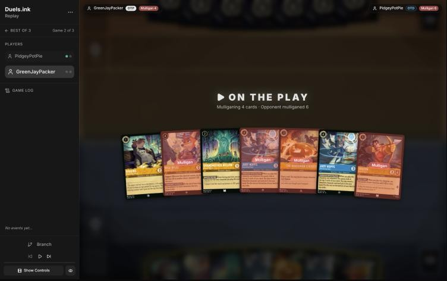
*The board before the decision: [step 0](https://duels.ink/replay/01a21452-0582-7287-b85c-41f080c427c2?step=0) in the duels.ink replay viewer.* Cards marked "Mulligan" are the ones sent back.

**The plan (written before seeing the mulligan made):** on the play against a Princess Aggro-like deck. Seven: Higgins,
Grandmother Willow, Uncovering Clues ×2, Toy Drive Officer, Gaston and The Horseman Strikes!. It curves: Higgins on 1,
Willow on 2, Clues on 3 with Willow's discount, Clues or Toy Drive Officer on 4, Gaston or a pair on 5. Five inkables
(Higgins, both Clues, Gaston, Horseman) and two uninkables. The weak card for this matchup is The Horseman Strikes!:
game 1 showed no Evasive character, so it's a 3-ink cantrip, but it's also the obvious first ink, which keeps Gaston
and both Clues in hand. Gaston has few targets on his own (their list tops out at 4 {S}), but with Support he
reaches Dale, and he's a 3/4 body.

`tools/mulligan.py` (1,500 deals, on the play):

| Option | Ink T1–4 | Play turns | Lore by T4 | Chars T4 | Interaction |
|---|---|---|---|---|---|
| Keep all 7 | 9.98 | 4.00 | 5.3 | 3.3 | 100% |
| Mulligan all | 8.97 | 3.73 | 5.2 | 3.9 | 83% |
| Send Horseman (keep 6) | 9.09 | 3.90 | 6.0 | 4.0 | 100% |
| Send Horseman and Gaston | 9.21 | 3.93 | 6.2 | 4.2 | 54% |
| Send Gaston and one Clues | 9.71 | 3.98 | 5.9 | 3.9 | 100% |
| Keep Higgins, Willow, Clues ×2 | 9.29 | 3.96 | 6.4 | 4.5 | 64% |

The "interaction" column counts Horseman and Gaston, which do little here, so it flatters the keeps that hold them.
Keeping 7 leads on curve and ink; sending Horseman back buys about 0.7 lore and 0.7 characters by turn 4 in the sim
(a random card is a Detective far more often than not) but costs the ink card. My pick: **keep all 7**, Horseman as the
first ink. Sending Horseman back is close behind; a full or deep mulligan throws away a curve hand.

**What you did:** kept Higgins, Grandmother Willow and one Uncovering Clues; sent back Toy Drive Officer, The Horseman
Strikes!, Gaston and the second Clues. Drew Day Camp Instructor, Mowgli and two more Higgins. They sent back 6.

**Verdict:** close call. `tools/mulligan.py` on your keep: ink on turns 1–4 9.18 (against 9.98 for keeping 7), play
turns 3.96 (4.00), lore by turn 4 6.5 (5.3), characters by turn 4 4.6 (3.3). Your keep gives up about 0.8 ink and the
Toy Drive Officer engine for about 1.2 lore and 1.3 characters by turn 4, and it sends back the uninkable 4-drop and
the two cards that do least against this deck. Against an aggro deck on the play, an early board that can trade with
their 1- and 2-drops matters ([MULL-3](#cite-mull-3)), so your line is at least as good as mine; the sim can't weigh Toy Drive
Officer's draws or the second Clues. Confidence: medium.

### Turn 1: your turn 1

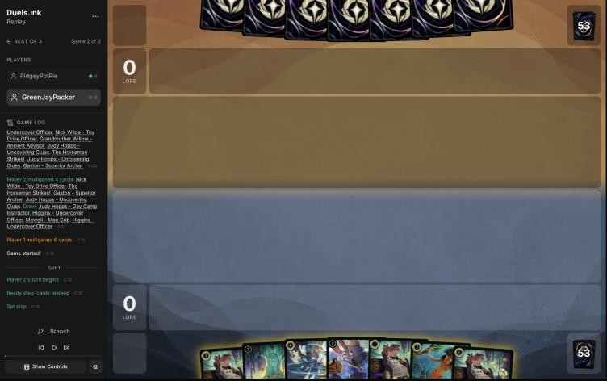
*The board before the decision: [step 2](https://duels.ink/replay/01a21452-0582-7287-b85c-41f080c427c2?step=2) in the duels.ink replay viewer.*

**The plan (written before seeing the turn):** 0 ink, hand Higgins ×3, Willow, Day Camp Instructor, Mowgli and
Uncovering Clues; inkables are the Higginses, Mowgli and Clues. Nothing can quest or be challenged this turn, so the
only choices are the ink and the 1-drop. Ink a spare Higgins (three is more than the curve needs) and play another;
keep Mowgli, whose reveal of their hand is worth having against a deck whose big turns (Dale, Peacekeeper, Elinor)
come from hand, though its discard will rarely hit (their list is all characters). Next turn: Willow, then a Higgins
free; Day Camp Instructor's ink ramp wants a second character the same turn. Candidates: ink Higgins (pick) or ink
Mowgli; both play Higgins.

**What you did:** inked a Higgins and played another.

**Verdict:** as planned; no comment needed.

### Turn 3: your turn 2

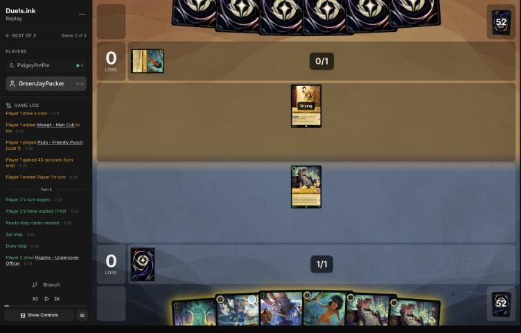
*The board before the decision: [step 8](https://duels.ink/replay/01a21452-0582-7287-b85c-41f080c427c2?step=8) in the duels.ink replay viewer.*

**The plan (written before seeing the turn):** they inked Mowgli (off the average list, as in game 1) and played
Pluto. You have 2 ink with this turn's ink; hand Willow, Day Camp Instructor, Mowgli, Uncovering Clues and two Higgins;
Higgins in play is dry. Their next turn: 2 ink plus Pluto's GOOD DOG makes a 3-drop (Nani) or Guiding the Tribe plus a
free 1-drop; Dale and Elinor need 3 with a discount, so not yet. Pluto has 0 {S} and anything they play will be drying,
so a questing Higgins is safe (no FREE KILLS). Candidates:
- **Ink a Higgins; Willow, then the other Higgins free (2 + 0 = 2 of 2); quest Higgins.** Two bodies and Willow's
  discount from now on. Next turn Mowgli (1 with Willow) + Day Camp Instructor (2) = 3 of 3, which also triggers LEND A
  PAW's ramp and shows you their hand. My pick.
- Ink a Higgins; two Higgins (1 + 1 = 2 of 2); quest. Same bodies, no discount engine.
- Ink a Higgins; Mowgli (2 of 2) to see their hand now; quest. One body fewer.
The ink is a Higgins rather than Mowgli so that next turn's Mowgli + Day Camp pair uses all 3 ink; Clues stays as the
next ink if the draw isn't inkable.

**What you did:** inked a Higgins, played Willow and a Higgins for 0, quested the first Higgins (1–0).

**Verdict:** as planned; no comment needed.

### Turn 5: your turn 3

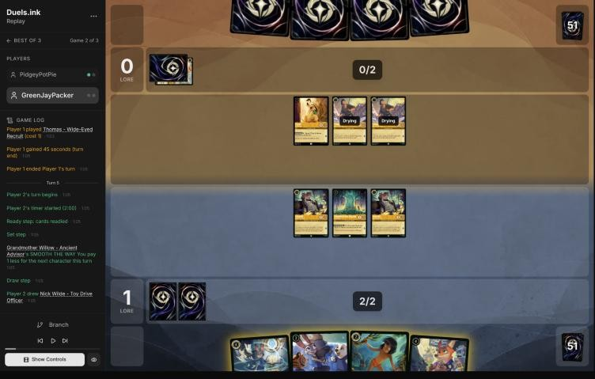
*The board before the decision: [step 17](https://duels.ink/replay/01a21452-0582-7287-b85c-41f080c427c2?step=17) in the duels.ink replay viewer.*

**The plan (written before seeing the turn):** they inked Mickey – Best in Town and played two Thomas (0/4); Pluto
stayed ready, and they have 4 cards. 1–0. You have 3 ink with this turn's ink (Clues or Mowgli are the inkables);
hand Day Camp Instructor, Mowgli, Uncovering Clues and the Toy Drive Officer just drawn; Willow and both Higginses are
dry.
- **Their next turn:** 3 ink, and Pluto's GOOD DOG makes the 4-drops castable: Dale, Elinor, Mickey – Expedition Leader,
  Rapunzel (the brief: Dale or Elinor in their hand about 1 in 4, nearer 1 in 3 with the draw, for the average list).
  **Dale is the danger:** with SPIKE SUIT the two Thomases deal 4 each, so any two of your exerted 2-{W} characters
  die. Without Dale nothing they have deals damage (all 0 {S}), so no FREE KILLS. Elinor would ping one character for 1
  (Pluto exerted for GOOD DOG plus two questing Thomases make her three). No sweeper in this list; nothing of theirs
  has Support, and you have no strength removal in hand, so no Support line applies.
- **Order: Mowgli first.** HAVE A BETTER LOOK reveals their hand before you decide who quests ([SEQ-1](#cite-seq-1)). If it shows no
  Dale, only their draw can bring one (7% if they run four), and questing all three is close to free.
- **Candidates:**
  - **Ink Clues; Mowgli (2 − 1 Willow = 1) + Day Camp Instructor (2) = 3 of 3.** LEND A PAW puts your top card into
    ink (5 ink next turn with an ink), two bodies, their hand seen. Then quest Higginses and Willow unless the hand shows
    Dale; with Dale shown, quest only what you can lose (the Higginses, not the Willow discount). My pick.
  - Ink Mowgli; Uncovering Clues (4 − 1 = 3 of 3), dig 3 for a Detective. One body, no ramp, no look at their hand.
  - Ink Clues; Toy Drive Officer (4 − 1 = 3 of 3). One body, no draw (it needs two characters played).
- Ink check: inking Clues leaves Toy Drive Officer (3 with Willow) plus whatever you draw for next turn's 5 ink, and the
  dig engine is gone; inking Mowgli keeps Clues but next turn has 4 ink for Day Camp and Toy Drive Officer (2 + 3 = 5 of
  4 with Willow). The ramp line comes out ahead.

**What you did:** inked Mowgli and played Uncovering Clues for 3 with Willow's discount; her dig found Nick Wilde –
Providing Backup. Quested both Higginses (3–0), Willow stayed home.

**Verdict:** close call, and your line is at least as good as mine. My plan counted Clues only as a card to ink, but
on the board she's an engine: every quest from next turn digs 3 for a Detective, and your deck is mostly Detectives.
Your line: one body (3/3), a card found now, and the dig every turn after; ink 3 of 3. Mine: two bodies, a card's worth
of ramp and a look at their hand, but Clues gone for good; ink 3 of 3. Next turn yours still has Day Camp Instructor +
Providing Backup (1 + 2 with Willow, LEND A PAW's ramp) or Toy Drive Officer, so the ramp comes a turn later rather than
never. Keeping Willow home was right: with Dale castable next turn (about 1 in 3), the two Thomases could kill two
exerted characters, and the Higginses are the ones to risk, not the discount. Without Mowgli's look you quested blind
into that chance, which is the one thing my line did better. Confidence: medium.

### Turn 7: your turn 4

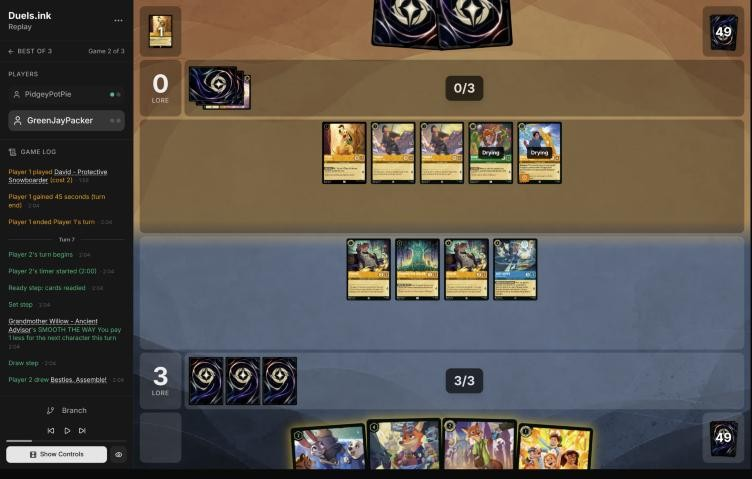
*The board before the decision: [step 31](https://duels.ink/replay/01a21452-0582-7287-b85c-41f080c427c2?step=31) in the duels.ink replay viewer.*

**The plan (written before seeing the turn):** they played Bobby (looting away a second Pluto) and David ready, inked
Aurora, and still haven't quested: 3–0, their hand down to 2 cards. Nothing of theirs is exerted, so there's nothing
to challenge. You have 4 ink with this turn's ink (Besties or Providing Backup); hand Day Camp Instructor, Toy Drive
Officer, Providing Backup and Besties; Clues, both Higginses and Willow are dry.
- **Their next turn:** 4 ink, plus Pluto. Dale (about 1 in 5 now, with only 2 cards in hand) would let Thomas ×2,
  David, Bobby and Pluto deal 4/4/4/2/2 in challenges, so every exerted character you have could die. Without him their
  board deals 2 in all: FREE KILLS lists **Willow** (Bobby + David, both survive her 1 back); a Higgins costs them Bobby;
  Clues (3 {W}) is out of reach. Elinor (same odds) would ping one character. Peacekeeper needs a Pocahontas to Shift
  onto, and none is in play. No sweeper in this list.
- **Support line:** none this turn in all four directions. You have no strength removal in hand, none of your
  Supporters is dry, nothing can be challenged, and none of their characters has Support.
- **Dig first:** quest Clues before anything else (top 3 for a Detective). What it can find that changes the turn: a
  1-cost Detective (Helpful Officer, the last Higgins) to play with the spare ink; Lead Detective or Always Vigilant
  can Shift onto her, but GOT YOU NOW has no 5-{S} target and the Shift isn't needed yet.
- **Candidates:**
  - **Quest Clues; ink Besties; Providing Backup (2 − 1 Willow = 1) then Day Camp Instructor (2) = 3 of 4, LEND A PAW
    ramps one; the last ink for a 1-drop the dig finds. Quest both Higginses, Willow home.** Two bodies, a Supporter
    pair that can push Dale to 5 {S} for Gaston or Always Vigilant later (3 + 2), and 6 ink next turn for Toy Drive
    Officer (3 with Willow) plus a pair. My pick.
  - Quest Clues; ink Providing Backup; Toy Drive Officer (3 with Willow) + a 1-drop if the dig finds one (for its draw).
    One body unless the dig hits; no ramp.
  - Quest Clues; ink Providing Backup; Besties (1) first, then Day Camp (1 with Willow) and a 2-drop it finds (2) = 4.
- **Questing:** Clues for the dig (safe unless Dale); the Higginses are the characters to risk (a Higgins costs them
  Bobby and two quests); Willow stays home, since her discount is worth more than 1 lore and she's their free kill.
  Lore clock: you'd be at 6 with 6 a turn of board; they're at 0 with 5 a turn if they ever quest.

**What you did:** Providing Backup (1 with Willow) and Day Camp Instructor (2), whose LEND A PAW ramped a card. Then
Clues quested (4–0) and found Always Vigilant, which you inked; Besties (1) found Belle – Snowfield Strategist. The
Higginses and Willow stayed home.

**Verdict:** the development and the ink are good: inking Always Vigilant rather than Besties cost little, since GOT
YOU NOW has no target here without a 5-{S} push (Dale is the one use, and three Gastons and three Always Vigilants are
left for that), and casting Besties turned the spare ink into Belle. Same bodies and ramp as my line, a card more.

Keeping the Higginses home is an **inaccuracy**. Keeping **both Higginses at home** is suboptimal because staying
ready protected them only during their turn, and both lines leave them ready to challenge on your next turn; questing
both is better because it's 2 lore (6–0) against an opponent who hasn't quested yet. The FREE KILLS line had only
Willow, who rightly stayed home; a Higgins cost them Bobby and two quests (Bobby + David, Bobby dying to your 2 back),
a trade you'd take. The real risk was Dale (about 1 in 5 with 2 cards in hand and a draw), which would let their
challengers kill both; even then they spend those characters' quests doing it. The line I'd suggest uses the same ink
(Providing Backup 1 + Day Camp 2 + Besties 1 = 4 of 4, Always Vigilant inked) and leaves Clues and both Higginses
exerted. [QC-3](#cite-qc-3), [QC-5](#cite-qc-5) (the race), [RULE-1](#cite-rule-1). Confidence: low, since it rests on how likely Dale is.

### Turn 9: your turn 5

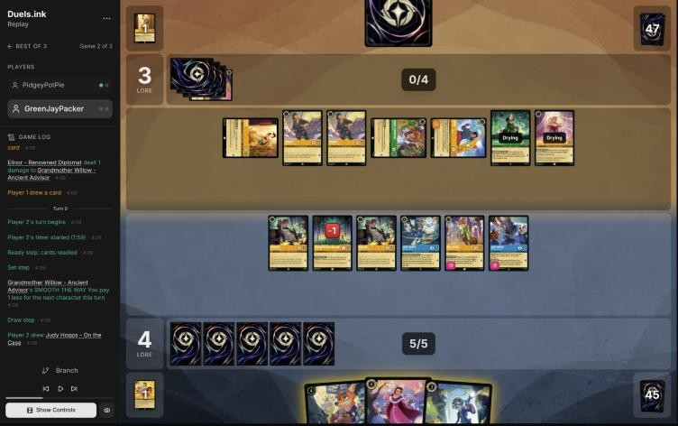
*The board before the decision: [step 50](https://duels.ink/replay/01a21452-0582-7287-b85c-41f080c427c2?step=50) in the duels.ink replay viewer.* David, Pluto and Bobby are exerted.

**The plan (written before seeing the turn):** they inked Pocahontas – Guiding the Tribe (so no Peacekeeper Shift
base in play), played Elinor for 3 with GOOD DOG and Aurora, quested Bobby and David, and Elinor pinged Willow (1
{W} left): 4–3. Their hand is 1 card. Exerted: Pluto, Bobby and David, **and David is a Bodyguard, so every challenge
must go into him first**. You have 6 ink with this turn's ink, Willow's discount, hand Toy Drive Officer, Belle and
Judy – On the Case (a 4/3 body here; no items for HIDDEN CLUES); all six characters are dry.
- **The race:** your board quests for 6 (game turn 13 on the clock); theirs for 7, plus 1 a turn from Elinor (game
  turn 14). Questing everything gets you to 10 and leaves them seven questers: they'd reach 11 next turn and could reach
  20 on game turn 12 with any extra lore, a turn before you. **Their board has to shrink this turn.**
- **Their next turn:** 5 ink, 2 cards. Lionheart (6) needs Pluto's discount: killing Pluto keeps him out a turn. Dale
  (about 1 in 6 for the list) would let the Thomases kill two more. Elinor's end-of-turn ping will finish a 1-{W}
  character (Willow, or whatever your challenges leave on 1), so Willow dies to it whether she quests or not. FREE
  KILLS: Elinor kills any one of your characters she can reach (each 2–3 {W}), Bobby kills Willow; each costs them a
  quest.
- **Support line:** yours onto their character: no strength removal in hand, but if Clues's dig finds Always Vigilant,
  Day Camp's +2 (or Providing Backup's +3) on Elinor makes her 5–6 {S} for GOT YOU NOW. Yours onto your challenger: Day
  Camp's +2 lets a Higgins (4) kill David alone. Theirs: they have no Supporters and no strength removal.
- **Dig first:** quest Clues (top 3). Always Vigilant (about 1 in 5) changes the turn: then Day Camp's Support goes on
  Elinor, both Higginses kill David together (2 + 2), Providing Backup kills Pluto, and Toy Drive Officer (3 with
  Willow) + the Shift (2) = 5 of 6 banishes Elinor. Lead Detective doesn't fit with the other plays (4 + 3 = 7 of 6).
- **My pick without Always Vigilant:** Clues quests; Day Camp quests, +2 onto a Higgins, which kills David (takes 1);
  the other Higgins kills Bobby (takes 1); Providing Backup kills Pluto (takes nothing back); Willow quests, since the
  ping kills her anyway. Ink Belle; Toy Drive Officer (3 with Willow) + On the Case (3) = 6 of 6, two characters, so
  COMMUNITY OUTREACH draws. 7–3, and their board is down to two Thomases, Elinor and Aurora (4 a turn plus Elinor).
  It leaves Clues, Day Camp, Willow, Providing Backup and the Higginses exerted for Elinor (one kill) and Aurora
  (Willow or a damaged Higgins), with Toy Drive Officer and On the Case ready behind.
- **Alternatives compared:** all quest (10–3, but their seven questers out-race you, above); the two Higginses on David
  and Day Camp's own challenge on Pluto (same kills, a lore less).

**What you did:** Clues quested (5–3) and found Lead Detective. You inked Belle and played On the Case (2 with
Willow) and Toy Drive Officer (4), whose COMMUNITY OUTREACH drew Elisa Maza. No challenges; the Higginses, Willow,
Providing Backup and Day Camp stayed home.

**Verdict:** **mistake**. Playing **On the Case and Toy Drive Officer with only Clues questing** is suboptimal because
it left David, Pluto and Bobby alive when all three could be killed with none of your characters dying, against a
board that out-races yours; **killing them first** is better because:
- **The kills were free.** David's Bodyguard means he goes first: Day Camp quests and adds +2 to a Higgins (4 {S}),
  which kills David and takes 1 back. Then the other Higgins kills Bobby (takes 1), Providing Backup kills Pluto (takes
  nothing). [TRADE-2](#cite-trade-2).
- **The race needed it.** Their seven characters quest for 7 a turn plus Elinor's 1. Your line leaves them able to
  reach about 11 next turn while you're on 5. Mine takes 3 a turn off their clock for good, has you at 7 with Day Camp's
  and Willow's quests, and puts them on two Thomases, Aurora and Elinor ([QC-3](#cite-qc-3), [QC-5](#cite-qc-5)).
- **Pluto was the discount for Lionheart:** without him, their 5 ink next turn can't reach the 6-drop ([THREAT-3](#cite-threat-3)).
- **Same ink:** Belle inked, On the Case (2 with Willow) + Toy Drive Officer (4) = 6 of 6, and the draw still comes.

What it exposes: Clues, Day Camp, Willow, Providing Backup and both Higginses exerted. Elinor can kill one of them
(FREE KILLS; she takes 2–3 back) instead of questing, and Aurora can kill Willow (or trade with a damaged Higgins,
dying to its 2 back). Elinor's ping finishes a 1-{W} character, as it would Willow anyway. Dale (about 1 in 6) would let
the two Thomases kill two more. Toy Drive Officer and On the Case stay ready. Your line exposed only Clues, but it gave
up the three kills and 4 quests (Higginses, Willow, Day Camp; Providing Backup's lore aside). If they keep refusing to
quest into a ready board, as on their first turns, some of that comes back next turn, which is why this isn't graded
higher. Confidence: medium-high.

My plan also said Lead Detective didn't fit with the other plays; with Willow's discount on the Shift ([CR 4.3.6](#cite-cr-4-3-6): it
applies to an alternate cost) she costs 3, so Lead Detective + On the Case = 6 of 6 was possible. It doesn't change
the verdict: the challenges above all survive without her Resist.

### Turn 10: their turn

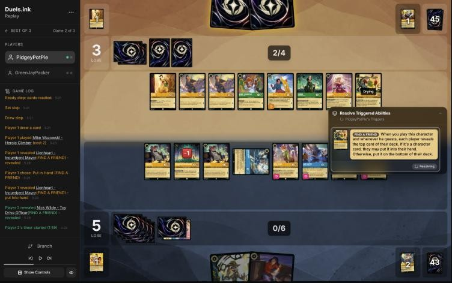
*The board before the decision: [step 60](https://duels.ink/replay/01a21452-0582-7287-b85c-41f080c427c2?step=60) in the duels.ink replay viewer.*

**What happened:** no ink (they stayed on 4). Mike Wazowski – Heroic Climber's FIND A FRIEND gave them Lionheart and
you a third Toy Drive Officer, which you took. Grandmother Willow, then Aurora, Bobby and one Thomas quested; Elinor's
ping killed your Willow and drew them a card: 5–7. Clues was left alone; Elinor, David, Pluto and a Thomas stayed
ready. **Lionheart is known in their hand.**

**Verdict:** taking Toy Drive Officer was the only sensible choice (a character for your hand, nothing to weigh).

### Turn 11: your turn 6

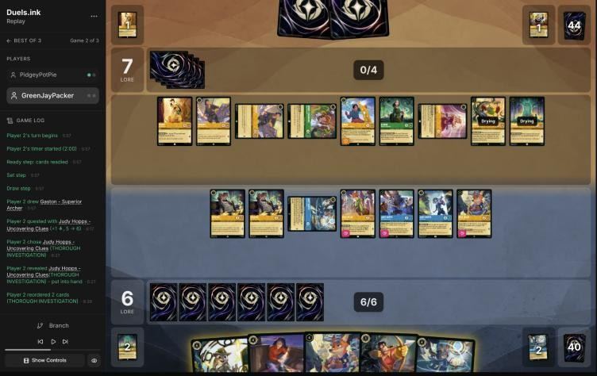
*The board before the decision: [step 70](https://duels.ink/replay/01a21452-0582-7287-b85c-41f080c427c2?step=70) in the duels.ink replay viewer.*

**The plan (written before seeing the turn):** 5–7. They have nine characters: Pluto, Thomas A, David, Elinor ready;
Thomas B, Bobby and Aurora exerted; Mike and Willow drying. Hand 2, **Lionheart known**; 4 ink, 5 next turn, and Willow
or Pluto brings Lionheart (6) down to 5. You have 7 ink with this turn's ink (Elisa, Gaston or Lead Detective);
hand Lead Detective, Elisa, Toy Drive Officer, Gaston; all seven characters are dry. Willow is gone, so no discount.
- **The race:** their nine quest for 9 a turn, plus Elinor's 1 and Lionheart's +2 next turn: if nothing dies they
  reach 19 next turn and win on game turn 14. Your seven quest for 7. **Their board has to shrink, and Elinor first.**
- **Removal, with Support:** Gaston's WATCH THIS needs 5 {S}. The brief: Elinor (3) is in range with Toy Drive
  Officer's +2; anything else of theirs needs Providing Backup's +3 and Day Camp's +2 together. Quest Toy Drive Officer,
  +2 on Elinor, play Gaston (5 of 7), banish her: the engine, their only 3-{S} attacker, and 2 lore a turn.
- **Challenges on their exerted characters** (the brief's options; none of yours dies): On the Case (4) kills Thomas B
  and takes nothing; a Higgins kills Bobby, the other Aurora, each taking 1.
- **Support line:** yours onto theirs, as above (Toy Drive Officer onto Elinor for Gaston; Providing Backup + Day Camp,
  +5, if the dig finds Always Vigilant). Yours onto your challengers: not needed, each kill above works unaided. Theirs:
  they have no Supporters and no strength removal.
- **Dig first:** Clues quests before anything else. Always Vigilant (about 1 in 5) changes the turn: Gaston (5) + its
  Shift (2) = 7 of 7, GOT YOU NOW (Gaston is the other character played) banishes a second target pushed to 5 by
  Providing Backup and Day Camp (Mike, David or Thomas A). Lead Detective can't fit beside Gaston (4 + 5 = 9 of 7).
- **Candidates:**
  - **A (my pick): Clues quests (dig); Toy Drive Officer quests, +2 on Elinor; Gaston banishes Elinor; On the Case
    kills Thomas B, the Higginses kill Bobby and Aurora; Providing Backup and Day Camp quest. Ink Elisa.** 9–7, four of
    theirs gone, leaving Pluto, Thomas A, David, Mike and Willow (5 a turn) and Lionheart to come: about 14 after their
    turn. Next turn 8 ink is Lead Detective's Shift (4) + Toy Drive Officer (4), and Lead Detective's Resist +2 and 6 {S}
    clear their exerted questers, Lionheart included if he comes in exerted as a Bodyguard (6 + 3 Support kills his 7).
    It exposes the two damaged Higginses (1 {W}: David alone kills one for free, Willow trades) and the 2-{W} Supporters
    (two 1-{S} attackers each). Their attack is only David and Willow (2 {S}) unless Dale lands (about 1 in 6), which
    would let Thomas A, Mike and David kill three or more.
  - B, the race: Gaston on Elinor as above, and all seven quest: 12–7. They then need to stop you reaching 20 on game
    turn 13 (12 + 8 questers + Lead Detective's extra lore = 21, so you can lose one). Bobby, David, Aurora and Willow
    can kill two of your 2-{W} characters (two attackers each), which leaves you on 19 and them on about 13 with Lionheart
    and the 0-{S} questers intact, to win on turn 14. It's faster when they don't fight, and loses when they do.
  - D: as A but On the Case quests and Thomas B lives (10–7). It still can't reach 20 on turn 13 (10 + 9 = 19) and
    leaves them a quester.
- Ink check: Elisa is the card to ink (her FOLLOW THE TRAIL only discards non-characters, and their deck is all
  characters). Next turn: Lead Detective Shift 4 + Toy Drive Officer 4 = 8 of 8; the turn after, whatever comes.

**What you did:** Clues quested and found another Uncovering Clues. You Shifted Lead Detective onto the dry On the Case
(4 of 7) and inked Elisa. With LATERAL THINKING's Resist +2, Toy Drive Officer killed Aurora and a Higgins killed Bobby,
both taking nothing; Providing Backup quested and gave the other Higgins +3, which killed Thomas B. Lead Detective and
Day Camp quested: 10–7. Gaston stayed in hand; 3 ink unused.

**Verdict:** close call. Your line made the same three kills as mine with no damage taken (Lead Detective's Resist
turned Bobby's and Aurora's 1 back into 0) and scored a lore more (10 against 9), with Lead Detective on the board a turn
early. Mine spent the turn's ink on Gaston instead, to kill Elinor now: that denies them a turn of COORDINATED EFFORTS
(a lore, a card and a ping) and her quest, and takes away their only 3-{S} attacker, but leaves both Higginses on 1 {W}
for David to pick off. Net, about a lore and a card in my line's favour against a lore and two healthy Higginses in
yours, so they come out close. Ink sums: yours 4 of 7 (3 unused), mine 5 of 7. Gaston kills Elinor next turn either way
(5 of 8 ink, Toy Drive Officer's +2 on her). Confidence: medium.

### Turn 12: their turn

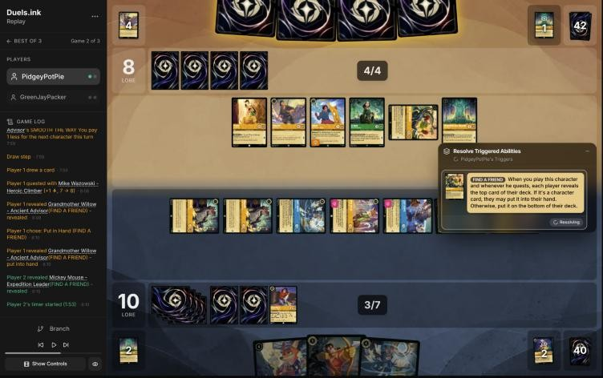
*The board before the decision: [step 84](https://duels.ink/replay/01a21452-0582-7287-b85c-41f080c427c2?step=84) in the duels.ink replay viewer.*

**What happened:** Mike quested; FIND A FRIEND gave them a second Willow and you Mickey Mouse – Expedition Leader, which
you took. Willow (1), then Pocahontas – Guiding the Tribe (1), whose STAY CLOSE played a second Pluto free. Elinor
challenged and killed Day Camp Instructor (Elinor took 2), David challenged a Higgins (1 damage; David took 2), Thomas
and Pluto quested, and Elinor's ping finished that Higgins: 10–11. Still 4 ink, Lionheart still in hand. **Guiding the
Tribe in play is Pocahontas – Peacekeeper's Shift base.**

**Verdict:** taking Expedition Leader was the only sensible choice.

### Turn 13: your turn 7

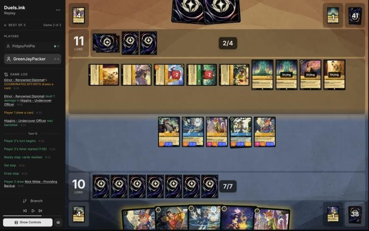
*The board before the decision: [step 95](https://duels.ink/replay/01a21452-0582-7287-b85c-41f080c427c2?step=95) in the duels.ink replay viewer.*

**The plan (written before seeing the turn):** 10–11. You can't win this turn (your board quests for 6), and they
reach 20 next turn unless their board shrinks: nine characters (all dry by their turn) plus Lionheart's +2 (castable
for 4 with both Willows' discounts, so they needn't even ink) plus Elinor's +1. Their most next turn is 11 + questers +
2 + 1 for Elinor: **to keep them under 20, Elinor and at least three more must die, or five with Elinor alive.** A card
I can't see (a second lore boost) would need a kill more.
- **Their exerted characters:** David (Bodyguard, 2 damage: 2 {W} left), so every challenge goes into him first; Elinor
  (2 {W} left); Pluto A, Thomas A, Mike. Ready: both Willows, Pocahontas – Guiding the Tribe, Pluto B.
- **Your side:** 8 ink with this turn's ink; hand Toy Drive Officer, Gaston, a second Clues, Mickey – Expedition Leader,
  Providing Backup; Higgins, Clues, Providing Backup, Lead Detective and Toy Drive Officer are dry, and Lead Detective
  gives every Detective Resist +2 on your turn, so the brief's challenges all come back at 0 (Elinor's 3 at 1).
- **Support line:** yours onto theirs for Gaston: Toy Drive Officer's +2 puts Elinor in range; Providing Backup's +3
  puts Pocahontas (2) in range, the Peacekeeper base and their only 2-{S} attacker. Yours onto your challengers: not
  needed (Lead Detective's 6 kills a 4-{W}; the rest are on 2 {W}). Theirs: no Supporters, no strength removal.
- **Dig first:** Clues quests (+1). Always Vigilant (about 2 in 5 across both Clues' digs) Shifts onto a Judy for 2
  and banishes another target pushed to 5.
- **Candidates:**
  - **K4 (my pick):** Clues quests (dig); Higgins kills David; Toy Drive Officer kills Elinor (takes 1); Lead Detective
    kills Mike (FIND A FRIEND is their card engine); Providing Backup quests, +3 on Pocahontas, Gaston (5) banishes her;
    Providing Backup #2 (2) makes it two characters played, so Toy Drive Officer draws. Ink Clues #2, keep Mickey.
    7 of 8 ink. 12–11, four kills. Their most next turn: Pluto A, Thomas A, two Willows and Pluto B (5) + Lionheart's 2
    = 18. Next turn your board quests for 8 (Higgins, Clues, Providing Backup ×2, Lead Detective 2, Toy Drive Officer,
    Gaston): 20 if nothing dies. It leaves Clues, Providing Backup, Higgins, Toy Drive Officer and Lead Detective
    exerted; their attackers are only the two Willows (1 {S} each), so killing a 2-{W} Higgins or Providing Backup takes
    both, and both die to its 2 back. Dale (about 1 in 6) would let Thomas and the Plutos hit for 4 and 2, but Dale and
    Lionheart don't fit their ink together.
  - K6: no Gaston. Mickey – Expedition Leader enters exerted (4) and Toy Drive Officer #2 (4) = 8 of 8, two draws.
    Challenges kill David, Elinor, Mike and Pluto A (Providing Backup); Clues's quest gives SECRET PATH's −2 {S} to
    Pocahontas until your next turn. 11–11, four kills, their most 18; your next-turn quests 9 = 20. Pocahontas lives
    on as the Peacekeeper base, and Mickey's 3 {W} is exposed.
  - K1, all challenges: five kills (David, Elinor, Mike, Pluto A, Thomas A) and no quests: 10–11, their most 17, but
    your next turn can't reach 20 (10 + 8) and no Supporter is left to fire Gaston.

**What you did:** Toy Drive Officer killed David and Higgins killed Elinor (taking 1); Providing Backup quested and gave
Pocahontas +3, and Gaston banished her; Lead Detective killed Mike. Clues quested (her dig found a second Lead
Detective), then Providing Backup #2, Clues #2 inked, and Toy Drive Officer drew Fangmeyer. 12–11.

**Verdict:** **good play**: the four-kill line that keeps them off 20 next turn (their most is 18), with Gaston on the
Peacekeeper base rather than on Elinor, who was already in reach of a 2-{S} challenger. Two small points, neither worth
a severity: Higgins on Elinor left him on 1 {W}, where one Willow can trade for him (Toy Drive Officer on Elinor and
Higgins on David would have needed both Willows); and Clues's dig came last, after the plays it might have changed
([SEQ-1](#cite-seq-1)); it found a Lead Detective, which this turn's ink couldn't use anyway.

### Turn 14: their turn

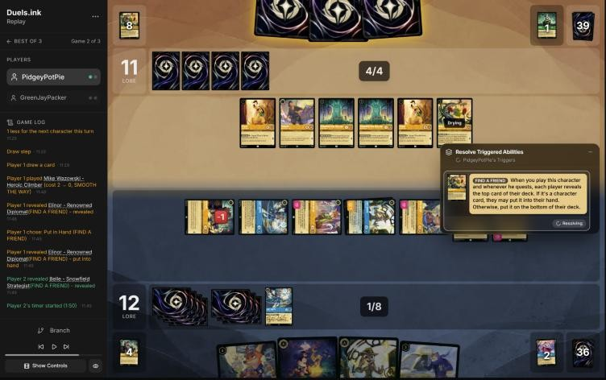
*The board before the decision: [step 111](https://duels.ink/replay/01a21452-0582-7287-b85c-41f080c427c2?step=111) in the duels.ink replay viewer.*

**What happened:** a second Mike for 0 (two Willow discounts); FIND A FRIEND gave them a second Elinor and you Belle,
which you took. Then Dale (4), the card the review had flagged since turn 5: with SPIKE SUIT a Thomas dealt 4 and killed
Clues (taking 3 back). Both Plutos and a Willow quested: 12–14. Lionheart stayed in hand. **Known in their hand:
Lionheart and Elinor.**

**Verdict:** taking Belle was the only sensible choice.

### Turn 15: your turn 8

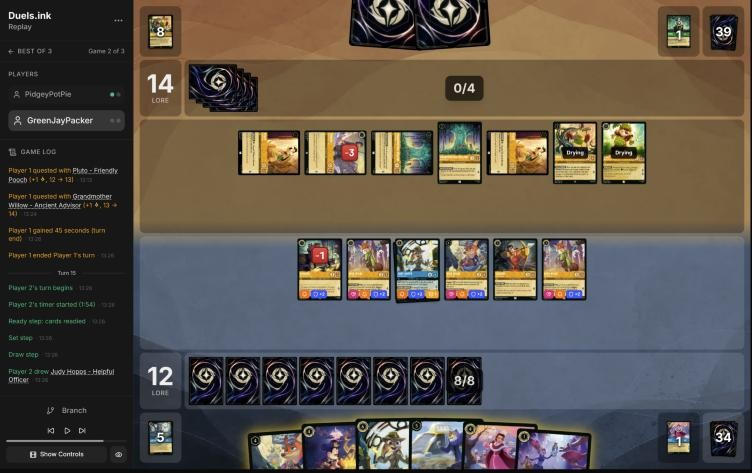
*The board before the decision: [step 118](https://duels.ink/replay/01a21452-0582-7287-b85c-41f080c427c2?step=118) in the duels.ink replay viewer.* Dale is in play.

**The plan (written before seeing the turn):** 12–14. Their hand is known exactly: Lionheart and Elinor. Board: Pluto
A, Thomas (3 damage, 1 {W} left), Willow A and Pluto B exerted; Willow B ready; Mike #2 and Dale drying. **Dale's SPIKE
SUIT is in play:** their characters deal their {W} in every challenge, yours included, so Pluto and Willow hit back for
2 and Thomas for 4; Lead Detective's Resist +2 takes that to 0 and 2 for your Detectives (Gaston isn't one).
- **You can't win this turn:** Higgins, both Providing Backups, Lead Detective (2), Toy Drive Officer and Gaston quest
  for 7, so 19 at most. So everything turns on their next turn.
- **What they need: 6.** Next turn every character of theirs is dry: Dale quests for 2, the rest for 1. Lionheart (6)
  adds +2 and costs 6 less 1 for each Willow in play and each Pluto they exert; Elinor adds +1 at the end of the turn
  with three exerted (4, less a discount). Their ink is 4, plus whatever they draw if it's inkable (Lionheart can't pay
  for itself; Elinor is uninkable).
- **The arithmetic, kill by kill:** Willow B, Mike and Dale are ready or drying and out of reach (no removal in hand,
  Gaston already used). They quest for 4 between them. If any of Willow A, Pluto A or Pluto B lives, Lionheart costs 4
  and they win (4 + 2 more, or more). If Thomas lives, Elinor (3 with Willow B) alone makes it 4 + 1 + 1 = 20. **So all
  four exerted characters must die.** Then Lionheart costs 5, and they have it only if their draw is an inkable card
  to ink: about 4 in 5 (roughly 7 uninkables in their 39, `tools/odds.py`: 18% their draw is one), and then it's exactly
  20. Otherwise Elinor makes it 19, and you win on game turn 17. Not unwinnable, but lost unless the draw is uninkable.
- **The kills, all from the brief's challenge lines:** Higgins on Pluto A, Providing Backup on Pluto B, Providing
  Backup #2 on Willow A (each takes 0 after Resist); Toy Drive Officer on Thomas (takes 2, survives on 2). Lead
  Detective (2) and Gaston (1) quest: 15–14. Lead Detective on Thomas instead would cost her 2 lore for Toy Drive
  Officer's 1.
- **Support line:** none matters. Yours onto theirs: no strength removal in hand. Yours onto your challengers: SPIKE
  SUIT doesn't touch your strength, and every kill above works unaided. Theirs: no Supporters.
- **The ink (9 with this turn's):** whatever survives their turn has to make 5 on game turn 17. Their attackers if they
  can't win (Willow B 2, Mike 4, Dale 4 under SPIKE SUIT) can kill about three exerted characters, so add 2-lore bodies
  now: Mickey – Expedition Leader (4) + Belle (4) + Helpful Officer (1) = 9 of 9, three characters, so Toy Drive Officer
  draws. Ink the second Lead Detective (a Shift onto the first does nothing). Fangmeyer (5) + Mickey (4) does the same
  job. Mickey's SECRET PATH (−2 {S}) is no help under SPIKE SUIT, which deals {W}.
- **Alternatives:** questing all seven for 19 leaves them eight questers: they win. Killing three and questing one
  more (16) leaves either a Lionheart discount or Thomas for Elinor's exact 20.

**What you did:** inked Mickey – Expedition Leader. Gaston killed Pluto A (taking 2: he's no Detective, so no Resist),
Higgins killed Pluto B, Toy Drive Officer killed Willow A, Lead Detective killed Thomas (taking 2). Both Providing
Backups quested (14–14), each adding +3 to Dale, which did nothing with no removal to follow. Helpful Officer healed
Lead Detective, and Fangmeyer (5) returned Uncovering Clues; 6 of 9 ink. Toy Drive Officer drew Day Camp.

**Verdict:** **good play** on the decision that mattered: all four exerted characters died, the only way to make them
need an inkable draw for Lionheart. The split between questers and challengers gave up a lore: with Lead Detective
(2) and Gaston (1) questing and the two Providing Backups on Willow A and a Pluto, it's 15–14 with Gaston unhurt, and
game turn 17 needs 5 instead of 6. That only matters if they can't win and spend their turn attacking. Even then your
board makes 6 after losing three characters (Higgins, both Providing Backups, Helpful Officer and Fangmeyer's 2), so
it's a close call, not worth a severity. The Supports on Dale were harmless.

### Turn 16: their turn

**What happened:** they drew Aurora, an inkable card, and inked it; that made 5 ink, and Lionheart cost 5 with the
surviving Willow's discount. APPROVAL RATING gave Dale and Mike +1 lore each, and Mike (2), Dale (3) and Willow (1)
quested: 14–20. Mike's FIND A FRIEND showed you an Uncovering Clues, which you bottomed; by then 20 was certain, so it
changed nothing.

## Lessons
1. **Against a wide board of 1-lore characters, take the free kills before questing** ([9](#turn-9)). Each exerted
   quester killed for nothing is a lore a turn off their clock for the rest of the game, and one fewer attacker. A quest
   is one lore once ([TRADE-2](#cite-trade-2), [QC-3](#cite-qc-3)).
2. **Plan their finishing turn with every discount and lore boost on their board** ([13](#turn-13), [15](#turn-15)).
   Willow's SMOOTH THE WAY stacks, so two Willows make Lionheart a 4-drop. Lionheart's APPROVAL RATING is +2, and Dale
   quests for 2. The kills to make are the ones that keep that total under 20, discount pieces first.
3. **Lead Detective's LATERAL THINKING makes your Detectives' challenges free against 1-{S} boards** ([11](#turn-11)),
   and against SPIKE SUIT's 2-{W} Plutos and Willows too ([15](#turn-15)). Shift her in before the challenges.
4. **Willow's discount applies to a Shift** ([CR 4.3.6](#cite-cr-4-3-6)): Lead Detective's Shift costs 3 with Willow in play
   ([9](#turn-9); the coach's miss, below).

## Proposed knowledge-base updates (applied after discussion)
- **Strategy:** a new hypothesis: "Against Princess Aggro and other wide 1-lore boards, kill every exerted
  quester you can kill for free before you quest." Evidence: [9](#turn-9), where three kills were skipped. On
  [11](#turn-11), [13](#turn-13) and [15](#turn-15), each turn's arithmetic needed the kills to keep them under 20.
  Counter-point to record: their discounts rebuild cheaply (turn 12: Willow, Guiding the Tribe and a free Pluto for 2
  ink), so kills only gain if they keep up with that refill. Undiscussed, one game.
- **Meta:** a note for the Amber/Emerald pair file, below the end marker: "Princess Aggro: PidgeyPotPie (game 2 of a
  match against GreenJayPacker's Detectives, 01a21452-0582, 25 Nov 2026)":
  - **Cards seen:** Mowgli again (off the list); three Plutos; three Auroras; two each of Thomas, Willow, Guiding the
    Tribe, Mike and Elinor; Dale, David, Bobby, Lionheart, Mickey – Best in Town. Game 1 added Mickey – Amber Champion
    (off the list), Mickey – Expedition Leader, Nani and Ursula – Deceiver.
  - **Habits:** no quests on their first three turns while your characters were ready. Elinor's ping every turn from
    game turn 8, finishing 1-{W} and damaged characters. Lionheart held for the finishing turn, cast for 5 with one
    Willow, APPROVAL RATING on Dale and Mike for exactly 20 on game turn 16.
  - **FIND A FRIEND** gave them Lionheart, a Willow, an Elinor and a Mickey – Best in Town, and you three characters.
- **Your deck's notes** ("Detectives as GreenJayPacker plays it"): against Princess Aggro, Lead Detective's Resist +2
  makes challenges into 1-{S} characters free. Gaston with Providing Backup's +3 reaches Pocahontas – Guiding the Tribe,
  the Peacekeeper base.
- **Rules:** none new. [CR 4.3.6](#cite-cr-4-3-6) (discounts on alternate costs) is already in the rules summary, and the Amber/Steel notes
  already say Willow's discount applies to a Shift.

## Hindsight
Doesn't change the verdicts above.
- **Game turn 16:** their draw was Aurora, an inkable card. Inked, it let Lionheart come down for 5. An uninkable draw
  (about 1 in 5) would have left them on 19 at most, and your board quested for 10 on game turn 17.
- **Turn 9's kills:** David, Bobby and Pluto A died later (Bobby on turn 11, David on 13, Pluto A on 15), but not
  before Bobby quested on turn 10 and Pluto A on turns 12 and 14, and David's turn-12 challenge set up the Elinor ping
  that killed a Higgins. Other things equal, those three dead on turn 9 meant about 3 lore less for them by turn 16,
  enough to keep them off 20 that turn.
- **Turn 7:** Dale didn't come until turn 14, so the Higginses' quests would have been safe.
- **Turn 11:** Elinor, left alive, killed Day Camp on turn 12, pinged a Higgins dead, and drew a card and a lore. Gaston
  on her that turn would have stopped all of it, at the cost of the Higginses' health and Lead Detective a turn later.
- **Turn 5:** the dig engine your line kept found Providing Backup (turn 5), Always Vigilant (turn 7), Lead Detective
  (turn 9), a second Clues (turn 11) and a second Lead Detective (turn 13).

## The coach's errors
Filled in during discussion.

| When | Error | How it was caught | How it won't happen again |
|---|---|---|---|
| Turn 5, plan | My pick inked Uncovering Clues to play Mowgli + Day Camp, counting her only as a dig given up. On the board she digs on every quest, as your deck's notes say ("Dig first, then plan") | Comparing your line in the verdict: it kept the engine and was at least as good | Proposed: the plan's ink check says, for each card it would ink, what that card would do on the board over the next two turns (a repeat effect, not only its on-play one) |
| Turn 9, plan | Said Lead Detective couldn't fit beside On the Case (4 + 3 = 7 of 6), missing that Willow's discount applies to a Shift ([CR 4.3.6](#cite-cr-4-3-6), already in the Amber/Steel notes): 3 + 3 = 6 of 6 | The coach's own re-check while writing the verdict; it doesn't change the verdict | Proposed: the brief applies discounts in play (Willow, Hamm, Pluto) to Shift costs in its option and dig lines, as its "DISCOUNT FROM HAND" line already does for printed costs |

## Open questions
- Pre-game: what was the plan behind the deep mulligan (keeping Higgins, Willow and one Clues, sending back Toy Drive
  Officer and the second Clues)?
- Turn 7: why did both Higginses stay home? Was it Dale, or something the replay doesn't show?
- Turn 9: why no challenges on the exerted David, Bobby and Pluto, and why did only Clues quest? Did you expect them
  not to quest into a ready board, as on their first turns?
- Turn 11: did you weigh Gaston on Elinor (Toy Drive Officer's +2) against Lead Detective that turn?
- Turn 15: were the two Supports on Dale meant to set something up?

## Citations
Copies of the coach's knowledge base cited above, as they stood when they were cited (the private repository's commit and date are given with each). They don't change when the knowledge base does.

**amber-emerald.md, Princess Aggro: Dale, discounts and the Peacekeeper base**: knowledge base, `kb/meta/archetypes/amber-emerald.md` at `6cecbcd` (2026-11-27), working tree

> ### Princess Aggro: Dale, discounts and the Peacekeeper base `[coach + user, one match: 01a19bb9 and 01a19bbd-79c2, 2026-11-02]`
> MK_ifoughtthelore (Amber/Sapphire Detectives) vs xBWx, won 2–0; sent by the user, reviews in
> `output/reviews/2026-11-02_01a19bb9_vs-xbwx-g1.md` and `…01a19bbd_vs-xbwx-g2.md`. Card text verified from the replays.
> - **Dale – Ready for His Shot is the key piece** (4, 0/4/2; `kb/cards/dale-ready-for-his-shot.md`). SPIKE SUIT: in
>   challenges their characters deal damage with their {W}, so Mike Wazowski – Heroic Climber (0/4), Thomas – Wide-Eyed
>   Recruit (0/4) and David – Protective Snowboarder (1/4) deal 4. Before he's in play, a quest that exerts a cheap
>   character can still be exposed: judge it from their next turn. Once he lands, remove him first (01a19bbd-79c2 turn 8:
>   two Supports made him 5 {S} for Gaston – Superior Archer's WATCH THIS).
> - **Discounts bring cards a turn early.** Pluto – Friendly Pooch's GOOD DOG ({E}: next character 1 cheaper) made Dale
>   castable with 3 ink (01a19bbd-79c2 turn 5). They stack: two GOOD DOGs and Aurora – Holding Court's ROYAL WELCOME (next
>   Princess or Queen 1 cheaper) put Elinor – Renowned Diplomat (a Queen) into play for 1 on turn 9.
> - **Pocahontas – Guiding the Tribe** (2, 2/3/1) plays a cost-1 character for free, and **she's the Shift base for
>   Pocahontas – Peacekeeper's challenge lock**. Remove her early (01a19bb9 turn 7). When Peacekeeper is known in
>   their hand and a Guiding the Tribe is in play, fight this turn: the next one may allow no challenges (01a19bbd-79c2
>   turn 14, then their turn 15).
> - **Elinor's COORDINATED EFFORTS** needs 3 exerted characters at the end of their turn; with their wide board it
>   usually has them. Its 1 damage killed a 1-willpower Eilonwy (01a19bbd-79c2 turn 9).
> - **Mike Wazowski – Heroic Climber's FIND A FRIEND is symmetrical** (on play and on each quest, each player reveals
>   their top card and takes it if it's a character). Against a character-heavy deck such as Detectives it feeds you
>   about as often as them (01a19bb9).
> - **Hand attack:** Mowgli – Man Cub (you discard a non-character card of your choice) and Ursula – Deceiver (you
>   discard a song of their choice). Small against an all-character deck.
> - **Removal is light:** Elinor's ping and Rapunzel – Tower Defender (4; they discard a card to return your character
>   to your hand).
> - **Their cards across the match** (most copies seen in one game): David ×4, Mike ×3, Pocahontas – Guiding the
>   Tribe ×3, Bobby Zimuruski ×2, Mowgli ×2, Mushu – Stealthy Dragon ×2, Pluto ×2, and one each of Aurora – Holding
>   Court, Dale, Elinor, Nani – Stage Manager, Pocahontas – Peacekeeper, Rapunzel – Tower Defender, The Queen – Regal
>   Monarch, Thomas and Ursula – Deceiver. Mowgli and Mushu aren't in duels.ink's average list.

**amber-sapphire.md, Detectives as GreenJayPacker plays it**: knowledge base, `kb/meta/archetypes/amber-sapphire.md` at `6cecbcd` (2026-11-27), working tree

> ### Detectives as GreenJayPacker plays it `[coach, blind reviews of 01a1fb8a-260a (vs James, discussed 22 Nov 2026) and 01a1ffec-372f (vs [AD-S] McWryze, not yet discussed)]`
> The same 60 in both games: Higgins ×4, Eilonwy ×3, Besties ×3, Helpful Officer ×2, Mowgli ×2, Grandmother Willow ×2,
> Hamm ×2, Day Camp Instructor ×4, Nick Wilde – Providing Backup ×4, On the Case ×2, The Horseman Strikes! ×3, Uncovering
> Clues ×4, Belle – Snowfield Strategist ×2, Mickey Mouse – Expedition Leader ×2, Toy Drive Officer ×4, Elisa Maza ×4,
> Always Vigilant ×4, Fangmeyer ×3, Gaston ×3, Lead Detective ×3. Both games won. Piloting points:
> - **Lead Detective is a 4-ink Shift, not a spare 6-drop:** sixteen other Judys to go onto. She was inked early in both
>   games (James turn 1, McWryze turn 5; "new to the deck, ink the high costs"), and against Emerald/Steel's Evasive
>   questers she was the matchup: Shifted onto a dry Day Camp, her Alert killed Vixey and Mushu (McWryze turn 11).
> - **Dig first, then plan:** Uncovering Clues digs on play and on each quest; her finds made turns 9 and 11 against
>   McWryze (an inkable Elisa for a double play, then both Lead Detectives).
> - **Support onto their character** for Always Vigilant: Don Karnage and Fflewddur (James turns 15 and 21).
> - **Play characters in pairs while Toy Drive Officer is out:** it drew a card nearly every turn in both games.
> - **Against pings, keep home only what challenges kill for free** (Toy Drive Officer, James turn 11).

**dale-ready-for-his-shot.md, What it means in play**: knowledge base, `kb/cards/dale-ready-for-his-shot.md` at `6cecbcd` (2026-11-27), working tree

> ## What it means in play `[coach + user, one match: 01a19bb9 and 01a19bbd-79c2]`
> - **It turns their weakest-looking characters into killers.** These aggro lists run 0- and 1-strength characters with
>   high willpower: Mike Wazowski – Heroic Climber (0/4), Thomas – Wide-Eyed Recruit (0/4), David – Protective
>   Snowboarder (1/4). With Dale in play, each deals 4 in a challenge, enough to kill most cheap characters.
> - **It works both ways.** "During challenges" covers your challenges too, so challenging their Mike costs your
>   attacker 4 damage. The brief's challenge figures include SPIKE SUIT whenever it's in play.
> - **Their Challenger and strength pumps stop mattering while it's in play,** since damage comes from {W}.
> - **He can come a turn early.** Cost reducers make him castable with 3 ink: Pluto – Friendly Pooch's GOOD DOG ({E}: next
>   character 1 cheaper) in 01a19bbd-79c2 turn 5. The brief's "COST REDUCERS" line shows this.
> - **Judge exposure before he's in play.** From the turn they could cast him, every character you exert with 4 or
>   less willpower is exposed to their 0-strength characters. In 01a19bbd-79c2 turn 4 the coach called a 0-strength board
>   harmless; the user caught it.
> - **Removing him:** he has 0 {S} and 4 {W}, and deals 4 back if challenged. A Detectives deck can push his strength to
>   5 with Support (Support may target an opposing character, `kb/rules/rulings.md`) and banish him with Gaston –
>   Superior Archer's WATCH THIS or Judy Hopps – Always Vigilant's GOT YOU NOW (01a19bbd-79c2 turn 8). Remove him before
>   making other challenges.
> - **A Bodyguard under SPIKE SUIT hits back hard** `[coach, 01a1a59f-4c28 turn 12]`. Pete – Suave Showoff (4, 1/6/2,
>   Bodyguard) exerted must be challenged first, and deals 6 to whatever challenges him. Send a character you'd lose
>   anyway, such as a Demona that STONE BY DAY won't let ready, or Challenger +2 on 6 willpower.
> - **Killing Dale without challenging him:** damage that isn't a challenge's doesn't care about SPIKE SUIT. Wasabi –
>   Called into Battle's TWIN BLADES (01a1a59f-4c28 turn 12: 6 to Dale after a challenge elsewhere) or Mulan – Elite
>   Archer's TRIPLE SHOT. Or exert him (Peter Pan's Shadow, Isis) and challenge with 5+ willpower, so his 4 back doesn't
>   kill (turn 18: Demona – Betrayer, 6 willpower).
> - **Support doesn't help your challenges while he's in play** `[coach, blind review of 01a1cee4-b587 turn 10]`. Lilo &
>   Stitch's Support adds strength, but under SPIKE SUIT your characters deal their {W}, so the boost does nothing. Make
>   a Supported challenge (Mike or Willow with +3 {S}) before you play Dale, not after.

**amber-steel.md, Shift Lilo & Stitch in as soon as**: knowledge base, `kb/meta/archetypes/amber-steel.md` at `6cecbcd` (2026-11-27), working tree

> - **Shift Lilo & Stitch in as soon as a dry Lilo or Stitch is there:** she quests for 3 at once, and Willow's
>   discount applies to the Shift (2 ink). Held in hand she does nothing `[coach, 01a19ccd-3f04 turn 6 and 01a19d99-ea68
>   turns 5 and 7, where she was inked or held]`.

**MULL-3**: strategy principle, `kb/strategy/principles.md` at `6cecbcd` (2026-11-27), working tree

> - **MULL-3. The right keep depends on the matchup.** Early interaction against aggro; pressure, draw and engines against slow decks. The mulligan is the first expression of your role. In the Set 14 era the opponent's inks are known before the mulligan (RULE-8), so this applies from game 1 of a match. `[MCL ch.12]` · baseline

**SEQ-1**: strategy principle, `kb/strategy/principles.md` at `6cecbcd` (2026-11-27), working tree

> - **SEQ-1. Gather information before irreversible decisions.** Draw, look and scry before choosing what to ink. Quest with draw triggers before committing other plays when the order doesn't otherwise matter. `[MCL ch.5]` · baseline

**QC-3**: strategy principle, `kb/strategy/principles.md` at `6cecbcd` (2026-11-27), working tree

> - **QC-3. Questing is favoured when:**
>   - you control the board
>   - your exerted characters can't be punished
>   - the race favours you
>   - removing their characters gains little
>
>   **Challenging is favoured when:**
>   - they have an engine or repeated-value piece
>   - the trade is efficient
>   - you need to slow the game
>   - your deck is stronger late
>
>   `[MCL ch.6]` · baseline

**QC-5**: strategy principle, `kb/strategy/principles.md` at `6cecbcd` (2026-11-27), working tree

> - **QC-5. The race changes everything.** At 18–12 up, take the last 2 lore. At 8–16 down, stopping their close-out matters more than your quests. `[MCL ch.6]` · baseline

**RULE-1**: strategy principle, `kb/strategy/principles.md` at `6cecbcd` (2026-11-27), working tree

> - **RULE-1. Only exerted characters can be challenged** `[CR 4.6.4.2]`. Questing, singing, or {E} for an ability exposes the character. Staying ready protects it. Every quest is also a decision about what the opponent can challenge next turn. · baseline
>   - *Card text overrides this* (CR 1.2.1). Shere Khan – Khan Industries CEO's NEW INCENTIVE lets one character
>     challenge ready characters that turn. Alert (e.g. from Judy Hopps – Lead Detective, to every Detective on their
>     turn) ignores Evasive. Against Ducktectives, name both in the setup. 01a14574, turns 16 and 18. `[coach, 2026-10-26]`

**TRADE-2**: strategy principle, `kb/strategy/principles.md` at `6cecbcd` (2026-11-27), working tree

> - **TRADE-2. The best trade removes theirs and keeps yours.** A survivor keeps generating value and demands more answers. `[MCL ch.7]` · baseline

**THREAT-3**: strategy principle, `kb/strategy/principles.md` at `6cecbcd` (2026-11-27), working tree

> - **THREAT-3. The biggest threat may not be on the board yet.** Consider:
>   - the opponent's ink next turn
>   - shift targets already in play
>   - support pieces that enable their next turn
>
>   `[MCL ch.9]` · baseline

**CR 4.3.6**: Comprehensive Rules, `kb/rules/cr/04-turn-actions.md` at `6cecbcd` (2026-11-27), working tree

> **4.3.6.** Payment modifiers that apply to “the next [Card Type] you play” always apply to the next card of that type you play within the specified duration, even if you pay an alternate cost to play that card. If the payment modifier applies to a card with a specific classification, it applies to the next card with that classification, even if other cards of the same type are played before it. Some cards have a self-referential payment modifier that functions while the card is in a non-Play zone, meaning it applies to the card it’s listed on only when that card is played. A modifier that isn’t self-referential functions only while the card it’s listed on is in play.
