# Review: GreenJayPacker vs Teddy West Side, 25 Nov 2026 (game 1)

| | |
|---|---|
| **Status** | draft (blind pass done, not yet discussed) |
| **Replay** | `01a21461-1eac` (`python3 tools/brief.py 01a21461-1eac --turn N`) · [duels.ink viewer](https://duels.ink/replay/01a21461-1ebc-76d6-89f4-551d5e6006ca?step=0) |
| **Format** | Core Constructed (stated in the replay). Set 14 era: inks revealed before the coin toss |
| **Decks** | You: Amber/Sapphire Detectives, the same 60 as in your earlier Detectives reviews ([the coach's notes on it](#cite-kb-meta-archetypes-amber-sapphire-detectives-as-greenjaypacker-plays-it)). Them: Amethyst/Steel ([Midrange's average list](#cite-kb-meta-archetypes-amethyst-steel-midrange)); closest list as it became clear: Midrange, from turn 11 (Flash, Shere Khan ×3, Angel ×2, Hades ×2, Demona – Scourge, Dumbo ×2, Cheshire Cat ×3, Rafiki ×3, Strength, Tinker Bell – Giant Fairy, Merlin's Shop), with Goliath, Wildcat, Black Heron ×2 and Tinker Bell – Curious Fairy ×4 off the list |
| **Play/draw** | You went first |
| **Result** | Loss, 11–20 by lore on game turn 26 (game 1 of a best-of-three) |
| **Meta data** | snapshot of 2026-11-25 (fresh; stale from 2026-12-09) |
| **Chosen how** | By the project's owner: a list of GreenJayPacker's games sent for review, not chosen by result. |

## Summary
Links go to the turn sections below.
- **Good plays:** [13](#turn-13) (Always Vigilant killing Angel, their removal engine, the one turn it sat exerted on 1
  willpower); [19](#turn-19) (the counter-attack on an exerted board: Nick's Support onto a Willow for Cheshire Cat,
  Elisa into Angel); [9](#turn-9)'s targets and order (Higgins first so GOT YOU NOW was live, Support onto the ready Shere
  Khan); [21](#turn-21) (Support onto Dumbo for Gaston, though the game was gone by then).
- **Close calls:** the mulligan ([0](#turn-0)); Higgins's quest on [13](#turn-13) (revisited); the Willows kept home on
  [11](#turn-11), [15](#turn-15) and [19](#turn-19).
- **Inaccuracies:** [5](#turn-5) (On the Case and inking Always Vigilant left 1 ink idle and set up a one-card Flash kill;
  Toy Drive for 3 did more); [7](#turn-7) (inking Gaston and leaving Wildcat alive, where Gaston onto a Supported Wildcat
  and On the Case into Flash emptied their board); [9](#turn-9) (Shifting Always Vigilant with ink to spare, where
  hard-casting her kept On the Case too).
- **Mistakes:** [17](#turn-17) (nobody quested at 9–5 against five questers: they scored 5 freely and took the lead).
- **Unwinnable from:** their turn [20](#turn-20). At 10–12, with a Shop, Dumbo and Hades drawing for them against your
  empty hand and 4 ink, their board reached 20 by turn 24 at the latest, and yours couldn't reach it by turn 23.

**What decided it:** card flow. Your hand was empty from turn 9, after Shere Khan's NEW INCENTIVE killed the ready Toy
Drive Officer on turn 8, while Dumbo, the Shop and Hades gave them two or three cards a turn; your ink stayed at 4 for
the second half, so the deck's 2-lore cards never came. You led 9–5 at turn 17; the turn without quests let their five
characters take the lead.

## The game, turn by turn
Verdicts judge each decision on what you could know at the time, **including archetype knowledge an experienced
player has**. Hindsight is kept to its own section. Severity scale: good play / close call /
inaccuracy / mistake / blunder. Principle IDs and hypotheses (H-n) link to copies
in the Citations section at the end, as they stood when they were cited.

**What you knew before the game:** they're on Amethyst/Steel. Of the common lists the pair has only one, Midrange
(about half the pair's games); the other half is decks duels.ink doesn't group, so it's most like Midrange, could be
a Merlin and Shop build, a removal-heavy Steel-actions build, or something of their own. Game 1, so no earlier cards.
You're on the play, so they have 1 ink on game turn 2, 2 on turn 4, 3 on turn 6, 4 on turn 8, 5 on turn 10, 6 on
turn 12, one turn earlier for each ink drop (Shere Khan's CORNER THE MARKET, Merlin – Profoundly Curious). Their key
cards, read in full, with the earliest game turn each can come:
- **Peter Pan's Shadow – Elusive Prankster** (3, Evasive): FAVORITE TRICK exerts one of your characters on play, so a
  ready character can be challenged. From turn 6.
- **Strength of a Raging Fire** (3, song): damage to one of your characters equal to the number of characters they
  have. Any of their 3+-cost characters sings it for free once dry. From turn 6 by ink, turn 8 sung.
- **Angela – Night Warrior** (3): gives a character Challenger +2 and Resist +2 until their next turn. From turn 6.
- **Cheshire Cat – Inexplicable** (3, Boost 2): each Boost moves up to 2 damage from any character onto one of yours;
  damage your characters deal back is his to move. Turn 6 to play, turn 10 to play and Boost at once.
- **Demona – Imperious Spellcaster** (3): a discard gives a Gargoyle Rush and Evasive. From turn 6.
- **Shere Khan – Khan Industries CEO** (4, 4/2): NEW INCENTIVE lets one character challenge **ready** characters that
  turn, and CORNER THE MARKET gives an ink drop for a kill. From turn 8: from then on, staying ready doesn't keep a
  character safe.
- **Angel – Experiment 624** (4): GOOD AIM, a discard for 2 damage to a chosen character, once a turn. From turn 8.
- **Tinker Bell – Giant Fairy** (6, Shift 4 onto Tinker Bell – Curious Fairy): 1 damage to each of your characters on
  play, and 2 more after each kill in a challenge. From turn 8 Shifted onto a Curious Fairy (1-cost) already in play,
  turn 12 hard-cast.
- **Hades – Looking for a Deal** (5): you bottom a chosen character of yours or they draw 2. From turn 10.
- **Demona – Scourge of the Wyvern Clan** (6, 5/6/2): exerts your whole board, then each player draws up to 3. From
  turn 12 (turn 10 with an ink drop). With your board exerted, their challengers reach everything.
- **Cheap challengers:** Rafiki (1, 0/2, Challenger +3), Luisa – Pushing Through (1, 0/3, Challenger +2), Pepita (2,
  2/3, Challenger +2), Lexington (3, 4/4, Alert): any exerted 2-willpower character of yours dies to them from turn 4 (corrected after the blind pass; this read first said turn 3).
- No cost reducers in the list; Flash (2, 3/2/2, Resist 1) is a 2-lore quester that removes Rush.

Their removal is mostly challenges set up by exerts (Shadow, Scourge, Shere Khan), plus Strength and Hades. Your
strength removal (Gaston, Always Vigilant, 5 {S} or more) reaches only Demona – Scourge on its own; for anything else
it needs your Support on their character ([ruling: Support onto an opposing character](#cite-kb-rules-rulings-support-can-add-strength-to-an-opposing-character)).

### Pre-game

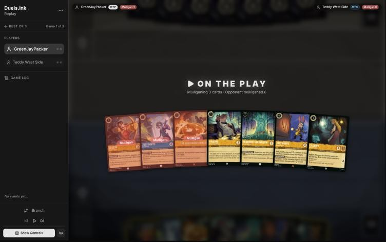
*The board before the decision: [step 0](https://duels.ink/replay/01a21461-1ebc-76d6-89f4-551d5e6006ca?step=0) in the duels.ink replay viewer.*

**The plan (written before seeing the mulligan made):** the seven is Higgins, Eilonwy, Grandmother Willow, Judy –
On the Case, Judy – Always Vigilant, The Horseman Strikes! and Gaston: a curve of 1, 1 + 2 (Willow's discount), 3, then
Always Vigilant Shifted onto On the Case for 2 with another character, and Gaston at 5; six inkable cards; Horseman's
Evasive banish has targets in Peter Pan's Shadow and Dumbo, and draws a card. `mulligan.py` (1,500 deals each, on the
play):

| Option | Ink T1–4 | Play turns | Lore by T4 | Characters T4 | Interaction |
|---|---|---|---|---|---|
| Keep 7 | 9.74 | 4.00 | 6.5 | 4.4 | 100% |
| Full mulligan | 8.87 | 3.68 | 4.9 | 3.7 | 78% |
| Keep 6 (send Gaston) | 9.54 | 3.99 | 6.7 | 4.5 | 100% |
| Keep 5 (send Gaston and Horseman) | 9.31 | 3.96 | 7.1 | 4.9 | 100% |
| Keep 5 (send Gaston and Always Vigilant) | 9.28 | 3.96 | 6.9 | 4.7 | 100% |
| Keep 5 (send Gaston and Willow) | 9.42 | 3.98 | 6.6 | 4.3 | 100% |

Keeping all 7 leads on ink and curve and is within a few tenths on early lore and board. Against Midrange's
exert-and-challenge plan the 5-drop Gaston is the weakest card early (one natural target, Demona – Scourge), so
sending it back for a cheap Detective is the one change worth considering: about +0.2 lore and +0.1 characters by turn
4 for −0.2 ink. That's within noise, and Gaston is a fine 5-drop to curve into and, with Support, removal. **Pick:
keep all 7.** Any partial mulligan of Gaston alone is a close call, not a mistake.

**What you did:** kept Higgins, Eilonwy, Grandmother Willow and Always Vigilant; sent back On the Case, Gaston and The
Horseman Strikes!. They mulliganed 6.

**Verdict:** **close call.** `mulligan.py` on the mulligan made: ink on turns 1–4 8.92 (keep 7: 9.74), play turns 3.94
(4.00), lore by turn 4 7.2 (6.5), characters by turn 4 4.9 (4.4). It trades about 0.8 ink for more early board and
lore: the deep end of the partial mulligans, and it sends back the Shift base for Always Vigilant, though fifteen
other Judys in the deck can take her. Against Midrange's cheap challengers ([MULL-3](#cite-mull-3)) a wider early board has value, and
against its slow exert plan card quality does too, so neither choice is clearly better. My pick was to keep all 7.

### Turn 1: your turn 1

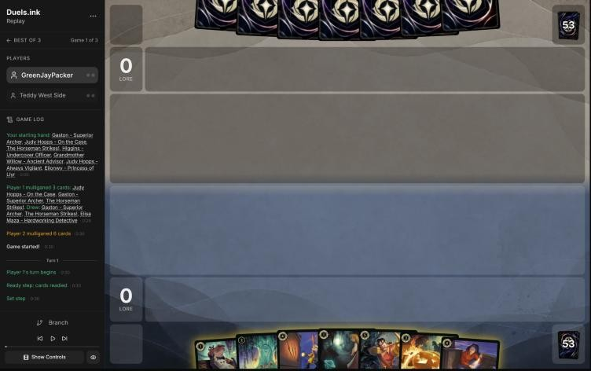
*The board before the decision: [step 3](https://duels.ink/replay/01a21461-1ebc-76d6-89f4-551d5e6006ca?step=3) in the duels.ink replay viewer.*

**The plan (written before seeing the turn):** the hand after the mulligan is Higgins, Eilonwy, Grandmother Willow,
Always Vigilant, Elisa Maza, Gaston and The Horseman Strikes!. Nothing to answer; their 1-drops (Rafiki, Luisa,
Tinker Bell – Curious Fairy) can't challenge before game turn 4. The curve the hand offers: Higgins now; Willow + Eilonwy
for 0 (SMOOTH THE WAY) on turn 3; Elisa for 3 with Willow on turn 5 (FOLLOW THE TRAIL needs another Detective:
Higgins), taking a song or action from their hand; Always Vigilant hard-cast (no Judy in play to Shift onto) or
Gaston after. **Which 1-drop:** Higgins (2/2, a Detective for Elisa and Nick – Providing Backup) over Eilonwy (2/1,
whose Support has nothing to add to yet). **What to ink:** the hand has six inkable cards and the deck 13 uninkables,
so ink is no worry yet. Gaston or The Horseman Strikes!: Always Vigilant covers Gaston's job (5 {S}, natively only
Demona – Scourge), while Horseman is the one card in hand that answers their Evasives (Peter Pan's Shadow ×4, Dumbo ×4
in the list, and Dumbo is an engine your Detectives can't challenge) and replaces itself. **Pick: ink Gaston, play
Higgins.** Inking Horseman instead is close: Gaston is a 3/4 body and a second removal piece.

**What you did:** inked Elisa Maza and played Higgins.

**Verdict:** fine. Higgins was the right 1-drop. Inking Elisa rather than Gaston is a close call: ink check, the next
two turns are the same either way (Willow + Eilonwy on turn 3, then Always Vigilant for 3 with Willow's discount on
turn 5, Gaston for 4 with it later), and what's given up is FOLLOW THE TRAIL, whose targets in this list are only
Strength of a Raging Fire and Merlin's Shop, against a second 5-{S} removal piece. Both are fair ([INK-2](#cite-ink-2)).

### Turn 3: your turn 2

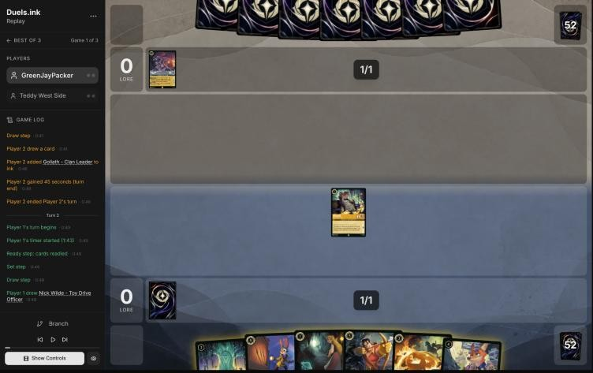
*The board before the decision: [step 8](https://duels.ink/replay/01a21461-1ebc-76d6-89f4-551d5e6006ca?step=8) in the duels.ink replay viewer.*

**The plan (written before seeing the turn):** they inked Goliath – Clan Leader (6, 6/5/2; DUSK TO DAWN sets each
player's hand to 2 at the end of each turn), which no listed Amethyst/Steel list runs: a Gargoyle package, as in
EzfelDifel's and Toru89's Midrange. Still most like Midrange; could be its own build. Goliath's 6 {S} is a Gaston and
Always Vigilant target. Their board is empty and they have 1 ink (2 next turn), so nothing can challenge on turn 4:
whatever they play is drying, and no Rush in the list. Resources: 1 ink + an ink drop to 2; hand Willow, Eilonwy,
Always Vigilant, Toy Drive Officer (new, uninkable), Gaston, Horseman. **Lines:**
- **A:** ink, Willow (2) then Eilonwy for 0 (SMOOTH THE WAY), quest Higgins. 2 of 2 ink, +1 lore, three characters.
  Next turn Toy Drive for 3 with a fresh Willow discount, or Always Vigilant for 3.
- **B:** Willow alone, holding Eilonwy to pair with a 4-drop later so COMMUNITY OUTREACH draws. Gives up Eilonwy's quest
  for a later card; with 3 ink next turn, Toy Drive (3 with Willow) + Eilonwy (1) doesn't fit anyway.

Higgins quests safely (nothing of theirs can challenge on turn 4). **Pick: A**, inking Gaston or Horseman (Always
Vigilant already does Gaston's job, Horseman is the Evasive answer; Goliath makes Gaston a little more useful, so it's
close). Ink is getting tighter: Willow and Toy Drive can't be inked, which leaves Always Vigilant and one of
Gaston/Horseman as the inkable cards for turns 5 and 7 unless the draws bring more.

**What you did:** inked The Horseman Strikes!, played Willow, then Eilonwy for 0, and quested Higgins (1–0).

**Verdict:** good: line A, with the other half of the close ink choice. Keeping Gaston for the Goliaths and Scourges
is as sound as keeping Horseman for Dumbo and Shadow ([INK-2](#cite-ink-2)).

### Turn 5: your turn 3

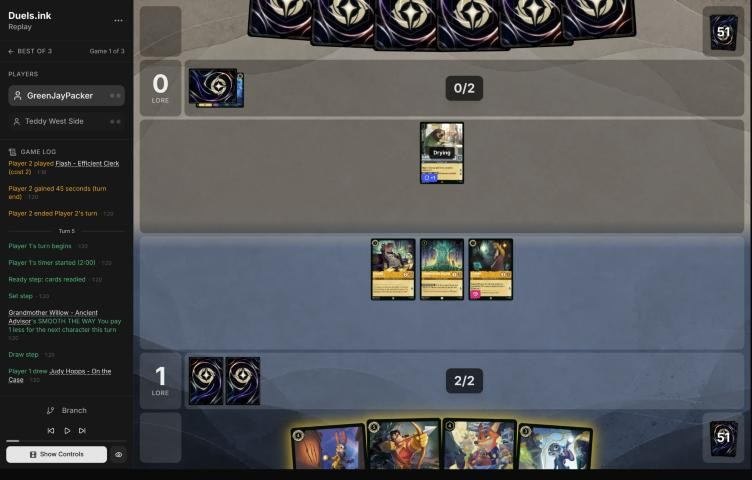
*The board before the decision: [step 16](https://duels.ink/replay/01a21461-1ebc-76d6-89f4-551d5e6006ca?step=16) in the duels.ink replay viewer.*

**The plan (written before seeing the turn):** they played Flash – Efficient Clerk (2, 3/2/2, Resist 1, no Rush for
anyone) and inked Hades. Flash is the problem piece: 2 lore a turn, and the brief's FREE KILLS line says it kills
Higgins, Willow or Eilonwy for free if any is exerted (each does 0–1 damage to it past Resist). It's drying now, so
it can't be challenged (it's ready) and nothing of mine can reach it this turn: Always Vigilant for 3 (Willow) needs
another character played first, and Gaston costs 4 with Willow, one more than the 3 ink. **Their next turn (3 ink):**
Peter Pan's Shadow (held about 4 in 10 for the list) exerts a ready character for Flash to kill; Strength of a Raging
Fire hits for their character count, 1 with only Flash, which kills Eilonwy; Angela would make Flash a 5-{S}
challenger but needs 3 more ink to do anything with it. **Support line:** yours onto their character: Eilonwy's +2 puts
Flash at 5 {S} for Gaston or Always Vigilant (the brief's STRENGTH REMOVAL line), but not this turn; yours onto your
challenger: nothing to challenge; theirs: none. **So the plan is to kill Flash next turn,** with Eilonwy questing onto it
and then Gaston for 4 (Willow), or On the Case for 2 (Willow) + Always Vigilant Shifted onto her for 2, whose GOT YOU NOW
counts On the Case as the other character. That needs Eilonwy alive, so **she stays home** (she'd also die to Flash).
Willow stays home too (the discount the plan needs, and Flash's free kill). **Higgins is the one to quest:** 1 lore, and
if Flash takes the free kill it gives up 2 lore, takes 1 damage and is left exerted for my turn. **What to play with
3 ink:**
- **A:** ink Gaston, play Toy Drive Officer for 3 (Willow). A 2/4 that Flash can't kill and Strength can't reach; it
  can finish a damaged Flash (1 past Resist) next turn and survive. Turn 7: On the Case + Always Vigilant Shift for 4,
  two characters played so COMMUNITY OUTREACH draws, and Flash banished. That needs a 4th ink from the draw (inkable
  about 4 in 5) or a cheap Judy to Shift onto.
- **B:** ink On the Case, play Toy Drive; turn 7 is Gaston for 4 onto a supported Flash: surer, but one character, no
  draw.
- **C:** On the Case now for 2 (Willow), 1 ink unused: a Shift base, but turn 7 then has no second character for
  GOT YOU NOW without a lucky cheap draw.

**Pick: A**, questing only Higgins. B is the safer version if ink worries you. Nothing gets the clock going fast:
1–0 now, their Flash quests for 2 a turn.

**What you did:** played On the Case for 2 (Willow), then inked Always Vigilant; 1 ink unused, nobody quested.

**Verdict:** **inaccuracy** (medium confidence). Playing **On the Case and inking Always Vigilant** is suboptimal
because it leaves 1 of 3 ink unused and sets up next turn's Flash kill as a one-card play (Eilonwy onto Flash, then
Gaston for 4 with Willow: one character played, so nothing for COMMUNITY OUTREACH), and **inking Gaston and playing Toy
Drive Officer for 3** is better because it uses all 3 ink now and next turn does the same kill with two characters:
Eilonwy onto Flash, On the Case for 2 (Willow) and Always Vigilant Shifted onto her for 2 (a payment modifier for "the
next character" applies to a Shift too, [CR 4.3.6](#cite-cr-4-3-6)), so GOT YOU NOW banishes Flash, Toy Drive draws a card at the end of
the turn and quests for 1 itself. Ink sums: yours 2 of 3 now, Gaston 4 of 4 next turn; Toy Drive 3 of 3 now, 2 + 2 = 4
of 4 next turn. Both need a 4th ink from the next draw (about 4 in 5 are inkable); with an uninkable draw the Toy Drive
line still works if it's a Day Camp Instructor (1 with Willow + Shift 2 = 3 of 3), while yours can't cast Gaston. What
it exposes: Toy Drive is a 2/4, beyond Flash and a 1-damage Strength, and ready on their turn, so nothing of theirs
reaches it; the same is true of your On the Case (4/3). What your line keeps: On the Case is a 4-{S} Judy, a better
challenger into Flash and a Shift base for the Always Vigilants and Lead Detectives still in the deck, which is why
this is only an inaccuracy ([TEMPO-1](#cite-tempo-1), [SEQ-4](#cite-seq-4)).

Keeping Higgins home was a close call: his quest was 1 lore against Flash's free kill (FREE KILLS: Higgins, Willow and
Eilonwy all), which would have cost them Flash's 2-lore quest and left it damaged and exerted. Keeping Eilonwy and
Willow home was right: they're next turn's Support and discount.

### Turn 7: your turn 4

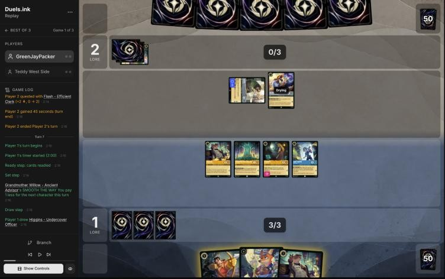
*The board before the decision: [step 25](https://duels.ink/replay/01a21461-1ebc-76d6-89f4-551d5e6006ca?step=25) in the duels.ink replay viewer.*

**The plan (written before seeing the turn):** they inked Tinker Bell – Curious Fairy (so Giant Fairy's Shift is in
the deck), played Wildcat – Unconventional Mechanic (3, 4/3/1, off-list) and quested Flash, which is **exerted** now.
Lore 1–2. Three off-list cards (Goliath, Curious Fairy, Wildcat): a build of their own with Midrange's core. Wildcat is
a free singer of Strength of a Raging Fire from next turn. Resources: 3 ink + an ink drop to 4; hand Gaston, Toy Drive
Officer, Higgins (new); Higgins, Willow, Eilonwy and On the Case all dry. **Support line:** yours onto their character:
Eilonwy's +2 puts Wildcat (6) or Flash (5) in Gaston's range (the brief's STRENGTH REMOVAL line); yours onto your
challenger: Eilonwy's +2 lets Higgins kill Flash (and die); theirs: none. **Lines:**
- **A, clear the board:** ink Higgins; Eilonwy quests and supports Wildcat; Gaston for 4 (Willow) banishes Wildcat; On
  the Case challenges the exerted Flash (4 − Resist 1 = 3, it dies; she takes 3 and dies too); Higgins and Willow quest.
  Gaston 4 of 4. Their board is empty, lore 4–2, and you lose On the Case for their Flash and Wildcat.
- **B:** Eilonwy supports Flash, Gaston banishes it, On the Case stays home. Wildcat lives and kills exerted Eilonwy (or
  Higgins) for free next turn (FREE KILLS). Weaker than A.
- **C, develop and draw:** ink Gaston; Toy Drive for 3 (Willow) + Higgins for 1 (4 of 4), so COMMUNITY OUTREACH draws;
  Eilonwy supports Higgins, who kills Flash and dies. Keeps On the Case and gains a card, but gives up Gaston for good
  and leaves Wildcat to kill exerted Eilonwy for free.

**Their next turn (4 ink) against A:** whatever they play is drying, and with Flash gone only Rush can challenge:
Demona – Imperious Spellcaster giving herself Rush (likelier than the list's one copy, with Gargoyles in their deck).
Angel – Experiment 624's GOOD AIM (2 damage for a discard, usable the turn it lands) and a 1-damage Strength (after a
1-drop) hit ready characters as well, so questing exposes little beyond Demona. Shere Khan has nothing dry to give NEW
INCENTIVE to; Hades and Scourge are a turn or two off. So the quests are nearly free. **Pick: A**, questing Higgins,
Willow and Eilonwy: their two characters (5 ink) for On the Case and the Gaston play, and their 2-lore-a-turn engine
gone ([TEMPO-1](#cite-tempo-1), [TRADE-1](#cite-trade-1), [QC-2](#cite-qc-2)). The cost is a thin hand (Toy Drive only) against their five cards.

**What you did:** line C: inked Gaston, played Higgins for 0 (Willow) and Toy Drive for 4; Eilonwy quested and
supported the dry Higgins, who traded with Flash; On the Case quested. COMMUNITY OUTREACH drew a Higgins. Lore 3–2.

**Verdict:** **inaccuracy** (medium confidence). Inking **Gaston** and leaving **Wildcat** alive is suboptimal because
Wildcat, a 4-{S} challenger and a free singer of Strength, then kills exerted Eilonwy for nothing (the FREE KILLS
line) or trades with your exerted On the Case, and makes every later quest of your 1–4-willpower characters a
challenge target; Gaston, your removal, is gone for good ([INK-1](#cite-ink-1)). **Inking Higgins, Eilonwy onto Wildcat, Gaston (4 with
Willow) banishing it and On the Case trading with the exerted Flash** is better because it empties their board
(their turn-4 and turn-6 plays, 5 ink, for On the Case), so Higgins, Willow and Eilonwy could all quest (lore 4–2 rather
than 3–2) with only a Rush Demona – Imperious Spellcaster able to challenge them, and Toy Drive stays in hand for next
turn's 5 ink with another character. Ink sums: yours 1 − 1 (Willow) + 4 = 4 of 4; the suggestion 5 − 1 = 4 of 4,
inking Higgins. What it exposes: three exerted 1-lore characters to Demona's Rush, and to Angel's GOOD AIM and a
1-damage Strength, which hit ready characters too. Your line's case: Toy Drive in play a turn sooner (the card it drew),
On the Case and a second Higgins on the board. The card count comes out level, so the edge is tempo: their board and the
safety of your quests ([TEMPO-1](#cite-tempo-1), [QC-2](#cite-qc-2), [THREAT-1](#cite-threat-1)).

*Revisited (argued from the turn-7 brief only, after the blind pass):* the exposure sentence for your line left out
Shere Khan – Khan Industries CEO, which the brief listed (castable with their 4 ink, held about 4 in 10 for the list
after their draw): his NEW INCENTIVE lets the dry Wildcat challenge a **ready** character, and its 4 {S} kills the
drying Toy Drive (4 willpower) as well as anything exerted ([RULE-1](#cite-rule-1)'s note on NEW INCENTIVE; the pre-game read above
said the same). In the suggested line Wildcat is dead and nothing of theirs is dry, so NEW INCENTIVE has no user. That
adds to the case for killing Wildcat; the verdict stays an inaccuracy, on the edge of a mistake. The miss is in "The
coach's errors".

### Turn 9: your turn 5

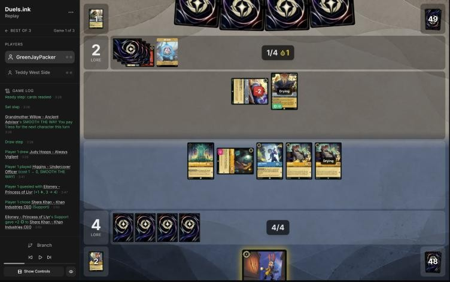
*The board before the decision: [step 43](https://duels.ink/replay/01a21461-1ebc-76d6-89f4-551d5e6006ca?step=43) in the duels.ink replay viewer.*

**The plan (written before seeing the turn):** on their turn Shere Khan's NEW INCENTIVE let the dry Wildcat challenge
the ready Toy Drive Officer (killed; Wildcat took 2) and CORNER THE MARKET gave them an ink drop; they inked Black Heron
(off-list). Lore 3–2. Now: Wildcat **exerted on 1 willpower**, Shere Khan (4/2) drying and ready. Their ink next turn is
5 cards + 1 drop = **6: Demona – Scourge comes online**, as do Goliath and a hard-cast Giant Fairy (1 damage to each of
yours: Eilonwy dies). Resources: 4 ink; hand Higgins and Always Vigilant (new); Willow, Eilonwy, On the Case and
Higgins all dry. **Support line:** yours onto their character: Eilonwy's +2 puts Shere Khan or Wildcat at 6 for GOT YOU
NOW (the STRENGTH REMOVAL line); yours onto your challenger: not needed, Wildcat has 1 willpower left; theirs: none.
**What must happen:** Shere Khan can only be reached by Always Vigilant (he's ready); Wildcat dies to any challenge, but
its 4 back kills every challenger I have. With both gone, a Scourge next turn exerts my board with nothing dry of
theirs to challenge it, and its refill draws me up to 3 (my hand will be empty). **Lines:**
- **A:** Eilonwy quests onto Shere Khan; Higgins (new) for 0 (Willow), so GOT YOU NOW is live; **Always Vigilant
  hard-cast for 4** banishes Shere Khan; the dry Higgins trades with Wildcat; On the Case and Willow quest. Ink
  0 + 4 = 4 of 4. Their board empty, lore 6–2, five characters left (Willow, Eilonwy, On the Case, Higgins, Always
  Vigilant).
- **B:** the same, but Always Vigilant Shifted onto On the Case for 2: she's dry and quests at once, but On the Case
  disappears under her, so one body fewer for the same lore (On the Case quests in A), with 2 ink unused.
- **C:** Always Vigilant onto Wildcat and leave Shere Khan: worse, since a dry Shere Khan (4 {S}) kills Eilonwy, Higgins or
  On the Case next turn, and a 1-willpower Wildcat dies to any of them.

Nothing to ink: both cards are needed ([INK-3](#cite-ink-3)). Exposure after A: Willow, Eilonwy and On the Case exerted, but their
board is empty and only a Rush Demona – Imperious can challenge; Giant Fairy's ping kills only Eilonwy, and Strength
hits for their character count, exerted or not. **Pick: A.** I'm ahead now ([POS-1](#cite-pos-1)), and the board they rebuild faces a
five-character board that quests for 5.

**What you did:** line B: Higgins for 0, Eilonwy onto Shere Khan, Always Vigilant Shifted onto On the Case for 2,
GOT YOU NOW banished Shere Khan, the dry Higgins traded with Wildcat, Always Vigilant and Willow quested. Lore 6–2, their
board empty; 2 of 4 ink used, no ink added.

**Verdict:** the plan was right (**good** on the targets and the order: Higgins first so GOT YOU NOW was live, Support on
the ready Shere Khan, the cheapest character into the 1-willpower Wildcat), but the Shift was an **inaccuracy** (high
confidence, a small edge). **Shifting Always Vigilant onto On the Case** is suboptimal because it spends 2 of 4 ink and
turns two characters into one, and **hard-casting her for 4** is better because the ink had no other use (the hand was
empty after her), On the Case quests in her place for the same lore, and you keep both: a fifth character, 1 more lore
a turn, and a stack that Hades' WHAT D'YA SAY? or a challenge can't take two cards from at once. Ink sums: 0 + 2 = 2 of 4;
0 + 4 = 4 of 4. What the suggestion exposes: On the Case exerted (3 willpower) instead of Always Vigilant (4), against an
empty board, and a drying Always Vigilant that's ready on their turn. Not inking was right: both cards were needed ([INK-3](#cite-ink-3)).

### Turn 11: your turn 6

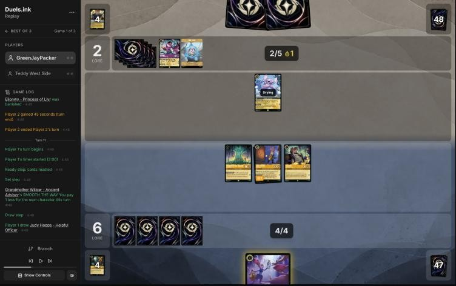
*The board before the decision: [step 56](https://duels.ink/replay/01a21461-1ebc-76d6-89f4-551d5e6006ca?step=56) in the duels.ink replay viewer.*

**The plan (written before seeing the turn):** they inked Demona – Scourge (one copy gone), played Angel – Experiment
624 and discarded their second Shere Khan to GOOD AIM, killing Eilonwy. Lore 6–2. Their board: Angel (3/3/1, drying, so
ready and not challengeable); hand 2 (3 after their draw); 6 ink next turn plus the drop, so 7: another Scourge,
Goliath, Hades or a hard-cast Giant Fairy are all castable. Still most like Midrange (Flash, Shere Khan ×2, Angel,
Hades, Scourge) with its own extras (Goliath, Wildcat, Black Heron, Curious Fairy). Mine: Willow, Always Vigilant and
Higgins, all dry; hand Judy – Helpful Officer (new, 1, 2/1); 4 ink. No Supporter on either side, so no Support line.
**Their next turn against each character:** GOOD AIM (2 damage for a discard, no challenge) kills Willow, Higgins or
Helpful Officer whether ready or exerted; Angel's challenge kills Willow or Higgins if exerted (FREE KILLS: both, Angel
left on 3 or 1 willpower, or untouched if their hand is empty and UNTOUCHABLE's Resist +2 is on); Always Vigilant
(4 willpower) dies only to a Rush Demona – Imperious. A Scourge exerts everything anyway. So staying home saves at most
one small character from Angel's challenge, and costs 1 lore each. **Lines:**
- **A:** Helpful Officer for 0 (Willow), then quest Always Vigilant, Willow and Higgins: 9–2. Worst case next turn, GOOD
  AIM plus Angel's challenge take two 1-lore characters, and Angel doesn't quest.
- **B:** quest only Always Vigilant (7–2): GOOD AIM still takes one, and Angel quests.
- **C:** ink Helpful Officer instead: a 5th ink matters only for a drawn Gaston or Fangmeyer without Willow, and Lead
  Detective needs just 4 to Shift onto Always Vigilant. A 1-lore body is worth more.

**Needs check:** I'm well ahead (their board quests for 1), so the race is mine to lose; what loses it is their removal
grinding my board while my hand is empty. Nothing in hand changes that, so lore now and bodies on board are the plan
([POS-1](#cite-pos-1), [QC-3](#cite-qc-3)). **Pick: A.**

**What you did:** Helpful Officer for 0 (TO THE RESCUE had nothing to heal); Always Vigilant and Higgins quested,
Willow stayed home. 8–2.

**Verdict:** good, with a close call on Willow. Developing the 1-lore body and questing Always Vigilant and Higgins
was line A. Keeping Willow home gave up 1 lore and saved her from Angel's challenge only (FREE KILLS: Willow and
Higgins), not from GOOD AIM. Angel can challenge once and GOOD AIM once, so with Higgins already exerted the worst case
is two of the small three either way; keeping the discount engine out of the challenge is a fair use of the edge
([QC-3](#cite-qc-3)).

### Turn 13: your turn 7

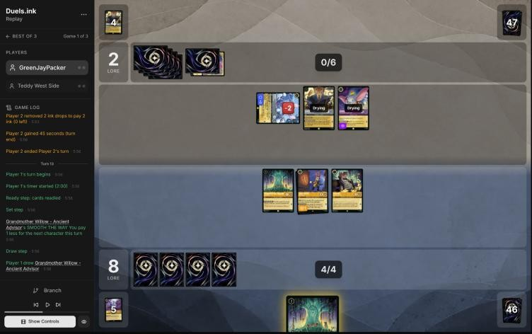
*The board before the decision: [step 67](https://duels.ink/replay/01a21461-1ebc-76d6-89f4-551d5e6006ca?step=67) in the duels.ink replay viewer.*

**The plan (written before seeing the turn):** a third Shere Khan gave Angel NEW INCENTIVE to kill the ready Helpful
Officer (Angel took 2; another ink drop), and both drops paid for Dumbo – Ninth Wonder (3/3, Evasive; BREAKING
RECORDS draws and gains 1 lore for 1 ink). Cheshire Cat was inked. Lore 8–2. Their board: **Angel exerted on 1
willpower**, with Resist +2 while their hand is empty (it is); Shere Khan (4/2) and Dumbo drying. Their hand 0, ink 7
next turn, so whatever they draw is castable, and Dumbo is a second card a turn from then on. Mine: Willow, Always
Vigilant and Higgins, dry; hand a second Willow (uninkable); 4 ink, nothing to ink. No Supporter either side.
**What matters:** Angel is their repeatable removal (GOOD AIM, 2 damage to a ready character for a discard) and, with
an empty hand, a challenger my small characters can't hurt (Resist +2). Today it's exerted on 1 willpower: only
Always Vigilant reaches it (4 − 2 = 2 damage; she takes 3 and lives on 1). Dumbo is the other engine, Evasive, out of
reach of my challengers; it needs Horseman, a Supported Gaston or Always Vigilant, or Lead Detective's Alert.
**Lines:**
- **A:** Always Vigilant challenges and banishes Angel (she's left exerted on 1 willpower; any challenger into her still
  takes 4 and dies, so only a ping kills her for free: Strength sung free by Shere Khan or Dumbo, about 1 in 10 to
  hold); Willow #2 for 1 (discount); Higgins quests (9–2): Shere Khan dies to his 2 back, Dumbo is left on 1. The
  Willows stay home.
- **B:** Always Vigilant quests (9–2), the rest home, Willow #2: Angel lives to GOOD AIM a Willow or Higgins each turn
  their draw allows, and to quest. Their only way into Always Vigilant costs them Shere Khan, or Dumbo and Angel
  together.
- **C:** quest everything (11–2): Shere Khan trades with Always Vigilant, and Angel and Dumbo kill Higgins and Willow
  for free (FREE KILLS: Willow, Higgins), leaving me a lone Willow against their engines.

**Pick: A.** I'm far ahead in lore, and the way I lose is their engines grinding a board I can't refill (my hand is
one uninkable card); Angel on 1 willpower is the cheap chance to remove one ([QC-2](#cite-qc-2), [THREAT-2](#cite-threat-2)). Needs check: 12 lore to
go at 3–4 a turn, so about game turn 19–21 if the board holds; the cards that would change the game are an answer to
Dumbo (Horseman ×2, Gaston ×2, Always Vigilant ×2 with a Supporter, Lead Detective ×3 Shifted onto a Judy for 4) and
draw (Uncovering Clues, Toy Drive, Besties).

**What you did:** line A: Willow #2 for 1, Always Vigilant banished Angel (2 damage past Resist +2; she took 3),
Higgins quested. 9–2.

**Verdict:** **good play.** Killing the removal engine in the one turn it was cheap to reach, and questing only the
character whose damage back punishes their challengers, was the best use of a thin hand ([QC-2](#cite-qc-2), [THREAT-2](#cite-threat-2), [POS-1](#cite-pos-1)).

*Revisited (argued from the turn-13 brief only, after the blind pass reached turn 14):* the plan's exposure sentence
named only Strength as a free way to finish Always Vigilant on 1 willpower, but the brief's MOVED DAMAGE line also
listed Cheshire Cat (cast and Boosted for 5 of their 7 ink; held about 6% after their draw, and a copy already inked, so
it was in their deck) moving damage "from any damaged character, a challenger hurt by your damage back included". The
Higgins quest supplied exactly that: Dumbo could challenge him and live on 1 willpower, leaving 2 damage counters to
move. So the Higgins quest is a **close call**, not part of the good play: 1 lore against a near-free kill for Dumbo
and a small chance of losing Always Vigilant with him. The Angel challenge stands as good. The miss is in "The coach's
errors".

### Turn 15: your turn 8

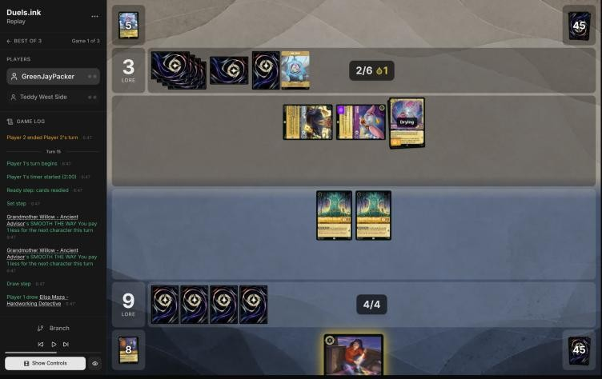
*The board before the decision: [step 80](https://duels.ink/replay/01a21461-1ebc-76d6-89f4-551d5e6006ca?step=80) in the duels.ink replay viewer.*

**The plan (written before seeing the turn):** Dumbo killed Higgins (taking 2), a second Cheshire Cat was cast and
Boosted to move Dumbo's 2 damage onto Always Vigilant (on 1 willpower: banished, On the Case with her), and Shere Khan
quested. Lore 9–3. Their board: Shere Khan and Dumbo exerted, Cheshire drying with a card under it; hand 0; 8 ink next
turn. Mine: two Willows (both dry); hand Elisa Maza (new; FOLLOW THE TRAIL needs another Detective in play, and their
hand is empty anyway); 4 ink, and two SMOOTH THE WAYs make my next character 2 cheaper. No Supporter either side.
**Challenges:** a Willow into the exerted Shere Khan deals 1 and dies; both Willows kill him and both die: no. Dumbo is
Evasive. **Their next turn:** Shere Khan, Dumbo and Cheshire all dry: each kills an exerted Willow for free (FREE KILLS:
both Willows, Shere Khan left on 1), Cheshire's Boost moves 2 more damage, and Dumbo draws. Elisa, played now, is
ready on their turn and 4 willpower, so only a moved 2 or a Strength reaches her. **Needs check:** 11 lore to go; what
I hold (two 1-lore Willows and Elisa) gets there only in about four quest turns if nothing dies (`odds.py clock`: 9 at
3 a turn, 4 turns), and their board of three outclasses it. What would turn it: 2-lore bodies (Lead Detective, castable
for 4 with both discounts, Fangmeyer returning Always Vigilant, Mickey, Belle), an answer to Dumbo (Horseman, Gaston),
and draw (Uncovering Clues, Toy Drive, Besties). **Lines:**
- **A:** Elisa for 2 (two discounts), both Willows quest: 11–3. They likely spend two challengers on the Willows (those
  two don't quest), so the swing is about +2 for me and −2 for them; I'm left with Elisa.
- **B:** Elisa, Willows home: 9–3. They quest for 3 (and Dumbo draws); I keep the discounts, which make next turn's
  draw cheaper (a 6-drop for 4), and the same dilemma next turn.
- **C:** Elisa and one Willow quests (10–3), keeping one discount.

The Willows can never quest safely into this board, so waiting gains only the discount ([the method,
"Keeping a quester ready for nothing"](#cite-docs-decision-method-keeping-a-quester-ready-for-nothing)). **Pick: A**, the race being the thing I'm ahead in ([QC-5](#cite-qc-5)); C is close if the
discount for next turn's draw matters more than 1 lore.

**What you did:** line B: Elisa for 2; the Willows stayed home. 9–3.

**Verdict:** **close call.** Line A's two Willow quests were +2 lore and two of their challengers kept from questing,
for two 1-lore bodies that can never quest safely here; your line keeps both discounts for the next draw (a Lead
Detective or Fangmeyer for 4 or 3) and gives them nothing to challenge, at the cost of their three quests going
unanswered. Neither is clearly better: it turns on what you draw next, which the discount helps you play ([QC-5](#cite-qc-5),
[SEQ-4](#cite-seq-4)).

### Turn 17: your turn 9

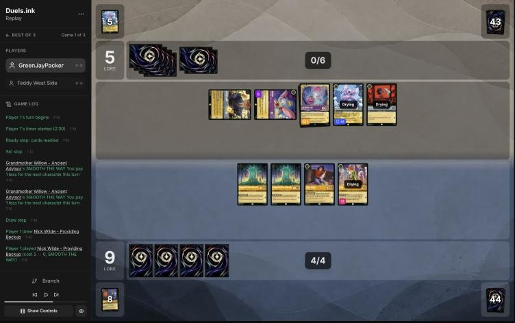
*The board before the decision: [step 88](https://duels.ink/replay/01a21461-1ebc-76d6-89f4-551d5e6006ca?step=88) in the duels.ink replay viewer.*

**The plan (written before seeing the turn):** Dumbo used BREAKING RECORDS (+1, a card), and they played a second Angel
and Black Heron (3/3/1); Shere Khan quested. Lore 9–5. Their board: Shere Khan and Dumbo exerted; Cheshire ready;
Angel and Heron drying; hand 0 (so Angel has Resist +2). **The race has turned:** five characters quest for 5 a turn,
20 on game turn 22; my board (two Willows and Elisa) quests for 3, 20 on turn 23 if nothing dies. Hand: Nick Wilde –
Providing Backup (new, 3/2/1, Support while I have another Detective: Elisa); two discounts make him free. **Support
line:** yours: Nick is drying, so no Support this turn (next turn he can lift a challenger or put one of theirs in range
of a drawn Gaston or Always Vigilant); theirs: none. **Challenges:** Elisa into the exerted Shere Khan is a trade (3
kills him, his 4 kills her); Willows into him die. **Their next turn against each line:** every exerted Willow is a
free kill (FREE KILLS: both Willows; Elisa too, for Cheshire and Angel together, or for Shere Khan, who dies to her 3
back), GOOD AIM (when they have a card to discard) and Cheshire's Boost reach ready characters, and each challenger they
use is a quest they don't make. **Needs check:** with Nick, quests of 3 now and 4 on turns 19 and 21 reach exactly 20 on
turn 21, a turn before them, but only if nothing dies, which their board won't allow. So every line has to make them
choose between questing and killing, and the draws on turns 19 and 21 (Lead Detective, Fangmeyer, Mickey, Belle for 2
lore; Gaston or Horseman for Dumbo) have to add the rest. **Lines:**
- **A:** Nick for 0; Willows and Elisa quest: 12–5. To clear them they spend about four challengers (or three with
  Shere Khan dying into Elisa) and quest for 1–2; I keep Nick.
- **B:** Elisa trades with Shere Khan, Nick for 0, Willows quest: 11–5. Shere Khan's lore and free kills gone for sure,
  but 1 lore less, and they still kill both Willows and quest with the rest.
- **C:** Nick, nobody quests: 9–5, they quest for 5. Losing slowly.

**Pick: A**: it scores the most and leaves them the same choice B forces, at a lore more ([QC-5](#cite-qc-5), [POS-2](#cite-pos-2)). Nothing to ink
(Nick is the only card and is worth more on the board).

**What you did:** line C: Nick for 0, nobody quested. 9–5.

**Verdict:** **mistake** (medium confidence). **Keeping the Willows and Elisa home** is suboptimal because it gives up
3 lore and stops nothing: their five characters quest for 5 next turn (10–9 to them, 20 on game turn 22) whether or
not yours are exerted, GOOD AIM and Cheshire's Boost reach ready characters anyway, and a board this size can never
quest safely into theirs, so waiting doesn't buy a safer quest later ([the method, "Keeping a quester ready
for nothing"](#cite-docs-decision-method-keeping-a-quester-ready-for-nothing); [H-12](#cite-h-12)). **Questing both Willows and Elisa after Nick** is better because it puts you on 12 and makes them
choose: clearing the three costs them about four challengers' quests (or Shere Khan, who dies to Elisa's 3 back), so
they score 1–2 instead of 5, and you end their turn some 5 lore ahead instead of 1 behind. What it exposes: the
Willows as free kills and Elisa to two challengers or Shere Khan (all three named in FREE KILLS); Nick stays ready but
2 willpower, in reach of GOOD AIM and a moved 2. Ink: 0 of 4 either way (two discounts; Nick was the only card).
The ready board's one upside, challenging their exerted questers on your next turn, is worth about one kill a turn
(Elisa with Nick's Support), against 5 lore a turn for them ([QC-5](#cite-qc-5), [POS-2](#cite-pos-2), [ROLE-2](#cite-role-2)).

### Turn 19: your turn 10

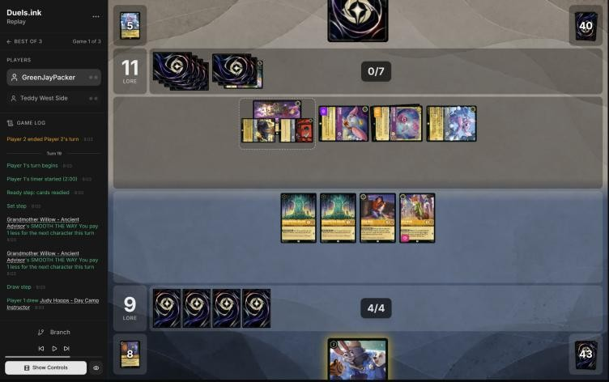
*The board before the decision: [step 99](https://duels.ink/replay/01a21461-1ebc-76d6-89f4-551d5e6006ca?step=99) in the duels.ink replay viewer.*

**The plan (written before seeing the turn):** they played Merlin's Shop and Smithy, moved Black Heron and Shere Khan
there (+1 and a card), inked a second Curious Fairy, used BREAKING RECORDS (+1, a card) and quested the other four.
**11–9 to them**, and every character of theirs is **exerted**. Their rate is now 5 questers + 1 from the Shop = 6 a
turn: 17 on turn 20, 20 on turn 22 (the brief's clock). Their hand is 1, so Angel has no Resist. Mine: two Willows,
Elisa and Nick (Support, with Elisa a Detective), all dry; hand Judy – Day Camp Instructor (new, uninkable), free with
the two discounts; 4 ink. **Needs check:** questing everything gives 13 now and at most 18 on turn 21, so I can't win
before their turn 22; the only way to win is to cut their rate enough that turn 22 doesn't reach 20, and keep a board
that scores after it. My outs in the deck: Lead Detective (Shift 4 onto Day Camp, or 4 with both discounts; her
LATERAL THINKING gives my Detectives Resist +2 on my turn, so they win challenges) and the 2-lore characters. **Support
line:** yours onto your challenger: Nick's quest gives +3 to one challenger (a Willow at 4 kills any of their 3–4
willpower characters; Elisa at 6 kills Cheshire or the Shop); yours onto their character: no strength removal in hand;
theirs: none. **Challenges** (all their characters exerted; Dumbo is Evasive): Elisa kills Angel or Heron and lives on
1, or trades with Shere Khan; Nick kills Angel, Heron or Shere Khan and dies; a Supported Willow kills any one and dies;
the two Willows together kill Shere Khan and both die. **Lines** (Day Camp for 0 first in each):
- **A, kill the two that kill without challenging:** Nick quests, +3 onto a Willow, who kills Cheshire (and dies);
  Elisa kills Angel (left on 1); the other Willow quests. 11–11; their rate drops to 4 (Shere Khan, Dumbo, Heron, Shop),
  15 on turn 20, and my board (Willow, Nick, Elisa, Day Camp) threatens the same counter-attack on turn 21 against
  whatever quests.
- **B, three kills:** Nick trades with Heron, Elisa kills Angel, both Willows kill Shere Khan. 9–11; their rate 3 (Dumbo,
  Cheshire, Shop), but I'm left with Elisa on 1 and Day Camp, which Cheshire's Boost and one challenge clear.
- **C, race:** everything quests, 13–11. They reach 23 on turn 22 by questing alone. Loses.

**Pick: A.** It's the line that keeps both a board and a lead in their turn-20 choice: race (and face another
counter-attack) or spend challengers on my exerted characters (Nick and Elisa each kill what challenges them; only the
Willow is a free kill). From here the game is very likely lost whatever I do: their board, hand and two draw engines
outgrow a one-card-a-turn hand, and winning needs their mistakes or a Lead Detective.

**What you did:** line A: Day Camp for 0; Nick quested and supported a Willow, who killed Cheshire and died; Elisa
killed Angel (left on 1). The other Willow stayed home. 10–11.

**Verdict:** **good play.** The counter-attack on an exerted board took out the two characters that kill without
challenging (Cheshire's Boost and Angel's GOOD AIM), at the cost of a 1-lore Willow, and cut their rate from 6 to 4
([QC-2](#cite-qc-2), [TRADE-1](#cite-trade-1)). Keeping the second Willow home was a close call: 1 lore against a free kill for any of their three
(FREE KILLS: the Willow) and the discount it keeps for your next draw.

### Turn 20: their turn

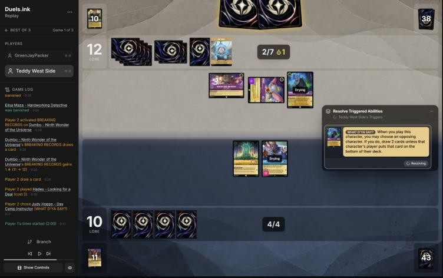
*The board before the decision: [step 111](https://duels.ink/replay/01a21461-1ebc-76d6-89f4-551d5e6006ca?step=111) in the duels.ink replay viewer.*

**What happened:** they traded rather than raced: Black Heron into Nick and Shere Khan into Elisa (both pairs died;
an ink drop), BREAKING RECORDS (+1, 12), then **Hades – Looking for a Deal chose your Day Camp Instructor, and you let
them draw 2** rather than bottom her. Then Dumbo moved to the Shop (+1, 13, a card), Rafiki was inked and a Tinker Bell
– Curious Fairy (a Giant Fairy Shift base) played. 10–13; their hand 4.

**Verdict on the Hades choice:** **unwinnable from here** ([principle 2](#cite-principle-2)), so no severity. At the moment of the choice
they were on 12 with the Shop move still to come, Dumbo and Hades questing from turn 22 and a hand of 3 plus two draw
engines; you had Willow and a drying Day Camp, no hand and 4 ink. Your most lore by game turn 23 is 10 + 2 (turn 21) +
about 4 (turn 23, with a 2-lore character drawn on turn 21) = about 16, while their board makes 17 on turn 22 and 20
on turn 24 at the latest, with every extra character they play adding to it. Neither answer to Hades changes that.
For the record, on the merits: their hand was 3 with 3 ink left that turn, so the 2 cards were worth little to them
at once ([H-2](#cite-h-2)'s converse), and Day Camp was your only Shift base for a drawn Lead Detective; keeping her was the more
useful half of a choice that couldn't matter.

### Turn 21: your turn 11

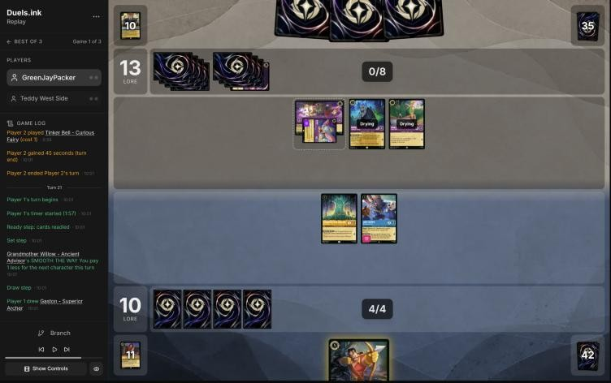
*The board before the decision: [step 116](https://duels.ink/replay/01a21461-1ebc-76d6-89f4-551d5e6006ca?step=116) in the duels.ink replay viewer.*

**The plan (written before seeing the turn):** unwinnable (see turn 20); the plan is only to score what's possible and
keep any out alive in case they stumble: quest with what can quest, play what's drawn (a Lead Detective Shifted onto
Day Camp for 4 would be the one card that makes challenges work), and keep their quests as costly as possible. The
draw is Gaston, and the brief's STRENGTH REMOVAL line shows the play: Day Camp quests and supports Dumbo (3 + 2 = 5),
then Gaston for 4 (Willow) banishes him, their draw-and-lore engine. Willow quests too (13–12 to them).

**What you did:** Day Camp quested and supported Dumbo; Gaston for 4 (Willow) banished him. Willow stayed home.
11–13.

**Verdict:** unwinnable, but worth naming: Support onto their character to bring an Evasive engine into Gaston's range
is the Detectives' signature trick ([ruling: Support onto an opposing character](#cite-kb-rules-rulings-support-can-add-strength-to-an-opposing-character)), found at once.

### Turn 23: your turn 12

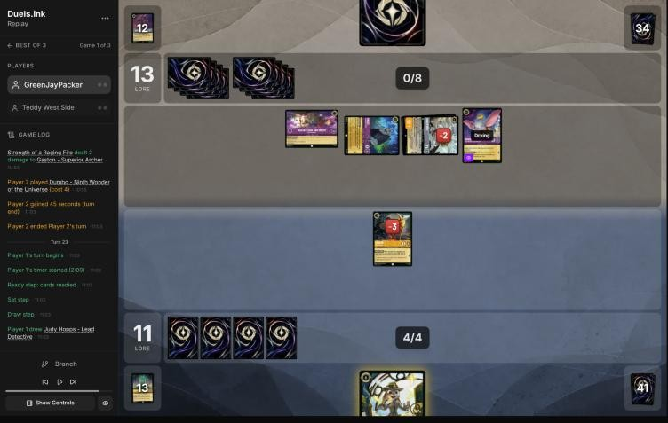
*The board before the decision: [step 130](https://duels.ink/replay/01a21461-1ebc-76d6-89f4-551d5e6006ca?step=130) in the duels.ink replay viewer.*

**The plan (written before seeing the turn):** unwinnable; play what's drawn, keep their quests costly, and score
what's safe. Their turn 22 was Tinker Bell – Giant Fairy Shifted onto Curious Fairy (1 to each of mine, then a kill on
Day Camp and PUNY PIRATE's 2 on Willow), Strength sung by Hades for 2 on Gaston, and a second Dumbo: 13–11, my board
Gaston on 1 willpower. The draw is Lead Detective, uncastable (6, no Judy to Shift onto, 4 ink); hold her for a Judy
next turn rather than ink her. Gaston, who dies to anything next turn, trades with the exerted Giant Fairy (3 into its
3 left; their 2-lore quester and PUNY PIRATE).

**What you did:** Gaston traded with Giant Fairy; Lead Detective held, not inked. 11–13, both boards nearly empty.

**Verdict:** unwinnable; the trade and the held Lead Detective were the right shape of play.

### Turn 25: your turn 13

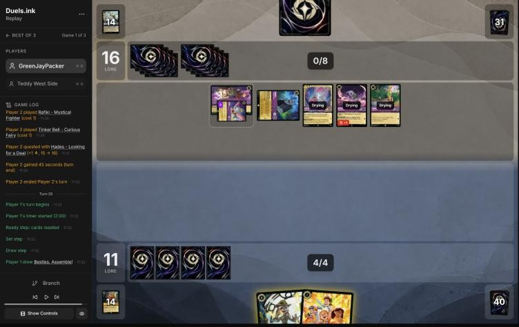
*The board before the decision: [step 139](https://duels.ink/replay/01a21461-1ebc-76d6-89f4-551d5e6006ca?step=139) in the duels.ink replay viewer.*

**The plan (written before seeing the turn):** unwinnable; play what's drawn: a Judy drawn lets Lead Detective Shift
onto her for 4, otherwise whatever is castable with 4 ink. They're on 16 with five characters and the Shop, so they
reach 20 next turn whatever happens; the draw is Besties, Assemble!, and Besties (1) + a Judy + a Lead Detective Shift
(4) is more than the 5 ink there is anyway.

**What you did:** Besties found Nick Wilde – Providing Backup, who was played. 11–16.

**Verdict:** unwinnable.

### Turn 26: their turn

**What happened:** Hades, Dumbo, Cheshire Cat and Rafiki quested: 20–11, and they won.

## Lessons
1. **Against Shere Khan – Khan Industries CEO, "ready" isn't "safe" while they have a dry challenger and 4 ink.** NEW
   INCENTIVE killed a ready Toy Drive Officer on turn 8 and a ready Helpful Officer on turn 12 ([RULE-1](#cite-rule-1)'s note). Kill
   their dry challengers before relying on staying home, above all for a draw engine.
2. **Damage you deal back is Cheshire Cat's ammunition.** A challenger of theirs that survives on damage lets Cheshire
   move 2 onto one of yours: on turn 14 Dumbo's 2 from Higgins finished a 1-willpower Always Vigilant
   ([Cheshire Cat note](#cite-kb-cards-cheshire-cat-inexplicable-timing)).
3. **Use all the ink, and prefer two bodies to one when the ink is free.** Turn 5 left 1 idle; turn 9 Shifted for 2 with
   2 more spare, where hard-casting kept On the Case on the board.
4. **When their board out-quests yours and none of yours can quest safely, quest anyway.** Waiting at 9–5 on turn 17
   didn't make a later quest safer; it gave them 5 free lore ([H-12](#cite-h-12)).

## Proposed knowledge-base updates (applied after discussion)
- **Meta, Amethyst/Steel pair file (notes):** "Midrange with a Fairy and Gargoyle package against GreenJayPacker's
  Detectives: Teddy West Side (01a21461-1eac, game 1)". Seen: Flash, Shere Khan ×3, Angel – Experiment 624 ×2, Hades ×2,
  Demona – Scourge (inked), Dumbo ×2, Cheshire Cat ×3, Rafiki ×3, Strength of a Raging Fire, Merlin's Shop, Tinker Bell –
  Curious Fairy ×4 and Giant Fairy; off-list Goliath (inked), Wildcat, Black Heron ×2. How it played: NEW INCENTIVE
  twice on ready characters (turns 8 and 12), each kill an ink drop that paid for Dumbo early (turn 12); GOOD AIM with
  their spare cards; Cheshire moving a survivor's damage onto a 1-willpower character (turn 14); from turn 12 Dumbo, then
  the Shop (turn 18) and Hades (turn 20) gave them two or three cards a turn; Giant Fairy Shifted onto Curious Fairy on
  turn 22 (ROCK THE BOAT, then PUNY PIRATE after a kill). Detectives' answers that worked: Always Vigilant and Gaston
  with Support onto their character (turns 9 and 21), and counter-attacks on their exerted questers (turns 13 and 19).
- **Meta, Amber/Sapphire "Detectives as GreenJayPacker plays it":** add this game (a loss), and two piloting points:
  against Shere Khan decks, the Toy Drive Officer isn't safe ready while they have a dry 4-{S} character; and with
  spare ink and an empty hand, hard-cast Always Vigilant rather than Shift, to keep the base on the board.
- **Strategy, [H-12](#cite-h-12):** evidence for, outside Rockstar Aggro: 01a21461-1eac turn 17 (a Detectives board kept home at 9–5
  against five questers; graded a mistake in the blind review, not yet discussed).
- **Rules (rulings.md):** "Two Grandmother Willows reduce the same next character by 2": each SMOOTH THE WAY is its own
  payment modifier on "the next character you play this turn", so both apply to it ([CR 4.3.6](#cite-cr-4-3-6), [CR 1.5.4](#cite-cr-1-5-4)); confirmed by
  duels.ink's engine in 01a21461-1eac (Elisa Maza 4 → 2 at frame 81, Nick 2 → 0 at frame 88, Day Camp 2 → 0 at frame
  100). The same rule makes the discount apply to a Shift ([CR 4.3.6](#cite-cr-4-3-6)), not yet seen in the engine.
- **Card note (new), Shere Khan – Khan Industries CEO:** NEW INCENTIVE needs a dry character of theirs to use it, so
  killing their dry challengers switches it off for a turn; CORNER THE MARKET's ink drops bring their next big card a
  turn early (two drops paid for Dumbo on turn 12 here).

## Hindsight
Doesn't change the verdicts above.
- They held Shere Khan on turn 8: the dry Wildcat that turn 7's line C left alive killed the Toy Drive Officer through
  NEW INCENTIVE, which is the branch the turn-7 verdict first left out. Line A would have left NEW INCENTIVE without a
  dry character to give it to.
- Turn 14's Cheshire Cat, about a 1-in-16 chance at the time, moved Dumbo's damage onto Always Vigilant: the branch the
  turn-13 plan missed.
- Your draws after turn 9 were Helpful Officer, Willow, Elisa, Nick, Day Camp, Gaston, Lead Detective and Besties:
  mostly 1-lore bodies, no Uncovering Clues, Toy Drive or Fangmeyer to refill, and Lead Detective only on turn 23 with no
  Judy to Shift onto. Their draws kept finding characters for the Shop and Dumbo to feed.
- Whether the game was winnable on the full shuffle can't be settled from here, but from turn 17 on it needed their
  board to stop questing, which a board of 1-lore Detectives couldn't force.

## The coach's errors
Found by the coach during the blind pass; the discussion may add more.

| When | Error | How it was caught | How it won't happen again |
|---|---|---|---|
| Turn 13 (blind pass) | The plan named only Strength as a free way to finish Always Vigilant on 1 willpower, though the brief's MOVED DAMAGE line listed Cheshire Cat (a copy already inked, so in their deck) and the [Cheshire Cat note](#cite-kb-cards-cheshire-cat-inexplicable-timing) says the damage you deal back is theirs to move. So Higgins's quest, which left Dumbo alive on damage, was graded part of a good play. | Self-caught: turn 14 prompted a re-check from the turn-13 brief; revisited to a close call. | Proposed: when a Cheshire Cat is in play or castable with its Boost, the brief's FREE KILLS line adds, for each challenger of theirs that survives your damage back, "then Cheshire moves N onto X" for each character of yours N kills; a verdict on questing names it like any free kill. |
| Turn 7 (blind pass), and turn 11 | The exposure sentence for the line played left out Shere Khan's NEW INCENTIVE (held about 4 in 10 for the list on turn 7), which lets their dry Wildcat challenge a ready character, though the pre-game read and [RULE-1](#cite-rule-1)'s note both say it. On turn 11 the same omission (held about 1 in 8) for Angel into a ready character. | Self-caught after the blind pass, from the turn-7 brief; the verdict stands, the exposure is completed. | Proposed: a brief line under "WHAT CAN CHALLENGE YOUR CHARACTERS", "READY ONES IN REACH": when their list runs a card that lets a character challenge ready ones (NEW INCENTIVE), castable next turn, list each of your ready characters their dry characters would kill with it, with the hold chance. |

## Open questions
For GreenJayPacker:
- **Pre-game:** why send back On the Case, Gaston and The Horseman Strikes!? Was it for a lower curve against
  Amethyst/Steel's early challengers?
- **Turn 5:** On the Case and inking Always Vigilant rather than Toy Drive for 3: was the plan Gaston onto a Supported
  Flash next turn, or the 4-{S} body?
- **Turn 7:** Toy Drive and Higgins rather than Gaston onto a Supported Wildcat: did you weigh Shere Khan's NEW
  INCENTIVE on a ready Toy Drive?
- **Turn 9:** was there a reason to Shift Always Vigilant rather than hard-cast her with the spare ink?
- **Turn 17:** why did nobody quest at 9–5? Were you waiting to counter-attack their exerted questers, as you did on
  turn 19?
- **Turns 11, 15, 19:** were the Willows kept home for their discount, or to keep them away from challenges?

## Citations
Copies of the coach's knowledge base cited above, as they stood when they were cited (the private repository's commit and date are given with each). They don't change when the knowledge base does.

**amber-sapphire.md, Detectives as GreenJayPacker plays it**: knowledge base, `kb/meta/archetypes/amber-sapphire.md` at `6cecbcd` (2026-11-27), working tree

> ### Detectives as GreenJayPacker plays it `[coach, blind reviews of 01a1fb8a-260a (vs James, discussed 22 Nov 2026) and 01a1ffec-372f (vs [AD-S] McWryze, not yet discussed)]`
> The same 60 in both games: Higgins ×4, Eilonwy ×3, Besties ×3, Helpful Officer ×2, Mowgli ×2, Grandmother Willow ×2,
> Hamm ×2, Day Camp Instructor ×4, Nick Wilde – Providing Backup ×4, On the Case ×2, The Horseman Strikes! ×3, Uncovering
> Clues ×4, Belle – Snowfield Strategist ×2, Mickey Mouse – Expedition Leader ×2, Toy Drive Officer ×4, Elisa Maza ×4,
> Always Vigilant ×4, Fangmeyer ×3, Gaston ×3, Lead Detective ×3. Both games won. Piloting points:
> - **Lead Detective is a 4-ink Shift, not a spare 6-drop:** sixteen other Judys to go onto. She was inked early in both
>   games (James turn 1, McWryze turn 5; "new to the deck, ink the high costs"), and against Emerald/Steel's Evasive
>   questers she was the matchup: Shifted onto a dry Day Camp, her Alert killed Vixey and Mushu (McWryze turn 11).
> - **Dig first, then plan:** Uncovering Clues digs on play and on each quest; her finds made turns 9 and 11 against
>   McWryze (an inkable Elisa for a double play, then both Lead Detectives).
> - **Support onto their character** for Always Vigilant: Don Karnage and Fflewddur (James turns 15 and 21).
> - **Play characters in pairs while Toy Drive Officer is out:** it drew a card nearly every turn in both games.
> - **Against pings, keep home only what challenges kill for free** (Toy Drive Officer, James turn 11).

**rulings.md, Support can add strength to an opposing character**: knowledge base, `kb/rules/rulings.md` at `6cecbcd` (2026-11-27), working tree

> ### Support can add strength to an opposing character
> - **Situation:** a Support character quests while the opponent has a character you want to remove with a "5 {S} or
>   more" banish: Judy Hopps – Always Vigilant's GOT YOU NOW, Gaston – Superior Archer's WATCH THIS.
> - **Ruling:** Support may choose any other character, including an opposing one. Adding the Support character's {S}
>   to theirs can lift a small character to 5 {S} for the banish. Supports stack, and a supported character supports
>   with its new {S}.
> - **Basis:** CR 8.13.1 (Support: "add this character's {S} to another chosen character's {S} this turn"; "another
>   chosen character" isn't limited to your own).
> - **Confidence:** derived from CR and confirmed by duels.ink's engine: Detectives opponents did it to the user's
>   characters (01a17e54 turn 21, 01a17e5d turn 12, 01a17e45 turn 23; `kb/meta/archetypes/amber-sapphire.md`), and
>   MK_ifoughtthelore did it to their opponent's (01a19bb9 turn 7, 01a19bbd-79c2 turn 8). Not an official ruling.
> - **Added:** 2026-11-02, from the review of 01a19bb9 (vs xBWx); the trick was first recorded in the meta study of
>   1 Nov 2026.

**cheshire-cat-inexplicable.md, Timing**: knowledge base, `kb/cards/cheshire-cat-inexplicable.md` at `6cecbcd` (2026-11-27), working tree

> ## Timing `[coach + user, 01a18275, 2026-11-02]`
> - **Boost costs ink, not an exert,** so it works the turn he's played, while he's drying. Cheshire for 3 plus Boost
>   for 2 is a 5-ink play that moves damage at once.
> - **The source can be your own character:** moving damage off yours heals it and puts it on theirs.
>   - 01a18275 turn 7: Mickey's 2 damage moved onto Violet Parr (2/1), killing her and healing Mickey.
>   - Turn 9: Cheshire moved his own 2 damage onto Tinker Bell – Giant Fairy, then challenged and traded with her.
> - **Against it:** any damage on your board is a resource for their Cheshire too. On turn 14 their Cheshire moved
>   Arthur's 2 damage (from challenging your Merlin) onto your Demona – Imperious Spellcaster and killed her. Evasive
>   doesn't help: moving damage isn't a challenge.
> - **Midrange Amethyst runs 4** (Amethyst/Steel and Amber/Amethyst lists), so count damaged characters on both sides
>   as a threat while one is in play or likely in hand.
> - **Resist doesn't stop it** `[coach, blind review of 01a1cbe6-f3a8 turn 8]`. Moving damage removes counters from one
>   character and puts them on another (CR 1.9.2.4); it isn't damage dealt, which is all Resist reduces (CR 8.8.1). A
>   Lilo & Stitch (Resist 1) took the full 2.
> - **The damage your character deals back is theirs to move.** In 01a1cbe6-f3a8 turn 8 Isis took 3 from challenging
>   Lilo & Stitch, and Cheshire moved 2 of it back onto Lilo & Stitch to finish it. So when you count what can kill a
>   character next turn, add 2 for a castable Cheshire plus Boost (with their cost reducers: Hamm put it at 4 ink).
> - **It kills a waiting board without a challenge** `[coach, blind review of 01a1ced3-11cc turns 13-16]`: against a
>   ready board (H-6), Cheshire's boosts killed Mike Wazowski and Grandmother Willow and damaged Dale. Staying ready
>   doesn't protect a character from it.
> - **Returning him to hand draws the Boosted cards** `[coach, blind review of 01a1fecf-eeef turn 18]`. A return effect
>   takes the cards under him to the hand too (CR 5.1.1.7; `kb/rules/rulings.md`, "A character returned to hand takes
>   the cards under it"). Un Poco Loco, sung for free, returned Cheshire with two cards under him: two cards drawn, his
>   damage gone, and his quest already taken that turn.

**decision-method.md, Keeping a quester ready for nothing**: knowledge base, `docs/decision-method.md` at `6cecbcd` (2026-11-27), working tree

> - **Keeping a quester ready for nothing.** Before keeping a character ready, say what waiting gains: a card, a better
>   challenge next turn, or a wipe dodged. If nothing, and it can't quest safely later either, use it now. In 01a1cbca-787d
>   turn 6 the coach's line kept Lilo & Stitch ready as a wall, though Demona – Betrayer meant it could never quest
>   safely; the player's quest into Hamm was better (H-12).

**amethyst-steel.md, Midrange**: knowledge base, `kb/meta/archetypes/amethyst-steel.md` at `6cecbcd` (2026-11-27), working tree

> ### Midrange
> 52% of the pair's games (87,624).
>
> | # | Card | Type | Cost | Tag |
> |---|---|---|---|---|
> | 4 | Luisa Madrigal - Pushing Through | character | 1 |  |
> | 1 | Maleficent - Exultant Spellcaster | character | 1 |  |
> | 1 | Marie - Caught in the Act | character | 1 |  |
> | 3 | Rafiki - Mystical Fighter | character | 1 |  |
> | 1 | The Horned King - Heartless Devil | character | 1 |  |
> | 1 | Diablo - Stone Servant | character | 2 |  |
> | 4 | Flash - Efficient Clerk | character | 2 |  |
> | 4 | Pepita - Watchful Alebrije | character | 2 |  |
> | 1 | Toulouse - Rough and Tumble | character | 2 |  |
> | 3 | Angela - Night Warrior | character | 3 | combat |
> | 4 | Cheshire Cat - Inexplicable | character | 3 |  |
> | 1 | Demona - Imperious Spellcaster | character | 3 | combat |
> | 1 | Lexington - Small in Stature | character | 3 |  |
> | 4 | Peter Pan's Shadow - Elusive Prankster | character | 3 | exert |
> | 2 | Angel - Experiment 624 | character | 4 | removal |
> | 4 | Dumbo - Ninth Wonder of the Universe | character | 4 |  |
> | 4 | Shere Khan - Khan Industries CEO | character | 4 | combat |
> | 4 | Hades - Looking for a Deal | character | 5 | removal |
> | 1 | Luisa Madrigal - Confident Climber | character | 5 |  |
> | 4 | Demona - Scourge of the Wyvern Clan | character | 6 | exert-all |
> | 1 | Tinker Bell - Giant Fairy | character | 6 | sweeper |
> | 4 | Strength of a Raging Fire | song | 3 | removal |
> | 3 | Merlin's Shop and Smithy - Magical Market | location | 2 |  |
> <!-- meta.py:end -->

**MULL-3**: strategy principle, `kb/strategy/principles.md` at `6cecbcd` (2026-11-27), working tree

> - **MULL-3. The right keep depends on the matchup.** Early interaction against aggro; pressure, draw and engines against slow decks. The mulligan is the first expression of your role. In the Set 14 era the opponent's inks are known before the mulligan (RULE-8), so this applies from game 1 of a match. `[MCL ch.12]` · baseline

**INK-2**: strategy principle, `kb/strategy/principles.md` at `6cecbcd` (2026-11-27), working tree

> - **INK-2. Don't automatically ink the most expensive card.** It may be the late-game win condition or the key answer for this matchup. The answer depends on matchup, hand and board. `[MCL ch.4]` · baseline

**TEMPO-1**: strategy principle, `kb/strategy/principles.md` at `6cecbcd` (2026-11-27), working tree

> - **TEMPO-1. Tempo is how much freedom you leave the opponent, not how fast you play.** A play that forces the opponent to spend their turn answering it has stolen part of their turn. *Ask: "If I play this, what does my opponent have to do next?"* `[MCL ch.1]` · baseline

**SEQ-4**: strategy principle, `kb/strategy/principles.md` at `6cecbcd` (2026-11-27), working tree

> - **SEQ-4. Sequence across turns.** A slightly weaker play now can set up a much stronger next turn: keep a shift target alive, keep a singer ready, hold removal for a bigger threat. `[MCL ch.5]` · baseline

**TRADE-1**: strategy principle, `kb/strategy/principles.md` at `6cecbcd` (2026-11-27), working tree

> - **TRADE-1. Judge a trade by ink invested, tempo, value already generated, and the board afterwards**, not by card count. A 2-cost for a 5-cost is a big win even if it's one-for-one. *Ask: "What does the board look like after this challenge?"* `[MCL ch.7]` · baseline

**QC-2**: strategy principle, `kb/strategy/principles.md` at `6cecbcd` (2026-11-27), working tree

> - **QC-2. Challenge the threat, not the character.** Engines, synergy pieces and big questers are worth fighting over. A 1-lore character doing nothing usually isn't. *Ask: "Does this character actually need to be removed?"* `[MCL ch.6, ch.9]` · baseline

**INK-1**: strategy principle, `kb/strategy/principles.md` at `6cecbcd` (2026-11-27), working tree

> - **INK-1. Inking is permanent.** Every inked card is one line of play removed for the rest of the game. *Ask: "Will I regret losing access to this card?"* `[MCL ch.4]` · baseline

**THREAT-1**: strategy principle, `kb/strategy/principles.md` at `6cecbcd` (2026-11-27), working tree

> - **THREAT-1. Not every threat needs an answer.** *Ask: "What happens if I don't answer this?"* "Very little" means spend resources elsewhere. "I probably lose" means it's the priority. `[MCL ch.9]` · baseline

**RULE-1**: strategy principle, `kb/strategy/principles.md` at `6cecbcd` (2026-11-27), working tree

> - **RULE-1. Only exerted characters can be challenged** `[CR 4.6.4.2]`. Questing, singing, or {E} for an ability exposes the character. Staying ready protects it. Every quest is also a decision about what the opponent can challenge next turn. · baseline
>   - *Card text overrides this* (CR 1.2.1). Shere Khan – Khan Industries CEO's NEW INCENTIVE lets one character
>     challenge ready characters that turn. Alert (e.g. from Judy Hopps – Lead Detective, to every Detective on their
>     turn) ignores Evasive. Against Ducktectives, name both in the setup. 01a14574, turns 16 and 18. `[coach, 2026-10-26]`

**INK-3**: strategy principle, `kb/strategy/principles.md` at `6cecbcd` (2026-11-27), working tree

> - **INK-3. Usually ink every turn, but not automatically.** Keeping one more playable card can beat one more ink. Missing ink with an expensive hand can leave you permanently behind. `[MCL ch.4]` · baseline

**POS-1**: strategy principle, `kb/strategy/principles.md` at `6cecbcd` (2026-11-27), working tree

> - **POS-1. From ahead, take the safest path to victory.** Don't overextend into sweepers, don't make unnecessary trades, and make the opponent take the risks. Winning by 1 lore counts the same as winning by 10. `[MCL ch.10]` · baseline

**QC-3**: strategy principle, `kb/strategy/principles.md` at `6cecbcd` (2026-11-27), working tree

> - **QC-3. Questing is favoured when:**
>   - you control the board
>   - your exerted characters can't be punished
>   - the race favours you
>   - removing their characters gains little
>
>   **Challenging is favoured when:**
>   - they have an engine or repeated-value piece
>   - the trade is efficient
>   - you need to slow the game
>   - your deck is stronger late
>
>   `[MCL ch.6]` · baseline

**THREAT-2**: strategy principle, `kb/strategy/principles.md` at `6cecbcd` (2026-11-27), working tree

> - **THREAT-2. Distinguish immediate threats (big lore next turn) from slow engines (card advantage over turns).** Role decides which matters more: the aggressor can often ignore engines, but the defender usually can't. `[MCL ch.9]` · baseline

**QC-5**: strategy principle, `kb/strategy/principles.md` at `6cecbcd` (2026-11-27), working tree

> - **QC-5. The race changes everything.** At 18–12 up, take the last 2 lore. At 8–16 down, stopping their close-out matters more than your quests. `[MCL ch.6]` · baseline

**POS-2**: strategy principle, `kb/strategy/principles.md` at `6cecbcd` (2026-11-27), working tree

> - **POS-2. From behind, play to your outs and accept calculated risk.** Safe efficient play from a losing position loses slowly. A line with a 30% chance beats a line with 0%. *Ask: "What has to happen for me to win, and which play makes it most likely?"* `[MCL ch.10]` · baseline

**ROLE-2**: strategy principle, `kb/strategy/principles.md` at `6cecbcd` (2026-11-27), working tree

> - **ROLE-2. Roles change mid-game. Re-check every turn.** An early lead with 4 lore left turns the aggressor into "protect the lead". A stabilised defender can become the aggressor. *Ask: "Has my role changed? If nothing changes, who wins?"* `[MCL ch.8, ch.10, ch.11]` · baseline

**H-12**: hypothesis, `kb/strategy/hypotheses.md` at `6cecbcd` (2026-11-27), working tree

> ### H-12. A Rockstar board should quest every turn against an exert-and-challenge deck
> - **Claim:** against Midrange decks that remove with exert effects and challengers (Amber/Amethyst and Amethyst/Steel:
>   Isis, Peter Pan's Shadow, Demona – Scourge, Cheshire Cat's moved damage, Rafiki), Rockstar Aggro's small characters
>   should quest each turn rather than wait ready. The limit: a quester that would die for nothing to a single
>   challenger needs a Bodyguard in front of it first (David entering exerted).
> - **Why:** staying ready protects only from their plain challengers (Rafiki, Hamm). Isis and Shadow exert a chosen
>   character, Scourge exerts them all, and Cheshire moves damage without a challenge, so ready characters die anyway
>   and the skipped quests are lore the race can't win back. It's H-6's opposite case: H-6's ready board gained by
>   drawing cards while it waited, and a board of 1-lore Rockstar characters draws nothing.
> - **Evidence for** (blind reviews, not yet discussed with danny, who may have had reasons to hold back):
>   - 01a1cb74-e730 (Toru89, game 2), turns 9 and 11.
>   - 01a1cbbb-ca0c (Duccio, game 1): Isis exerted Lilo for Rafiki on turn 6; two Cheshires killed Dale and Thomas on
>     turn 12; Scourge exerted four characters on turn 14.
>   - 01a1cbca-787d (Duccio, game 3), turn 4 (held back for nothing) and turn 6 (danny's quest beat the coach's wall).
>   - 01a1cbe6-f3a8 (Duccio, rematch game 1), turns 3 and 5: the Lilo kept home died to Isis and Rafiki on turn 6.
>   - 01a1ccd4-187e and 01a1ccde-6845 (EzfelDifel, games 1 and 2): four turns of holding back in each.
> - **Evidence against:** 01a1ced3-11cc (HØT CØCØ, game 3), turns 13 and 15: a ready board did hold their questers back
>   for two turns, though Cheshire's boosts killed some of it (H-6).
> - **Evidence for, outside Rockstar Aggro** (01a1fb8a-260a, GreenJayPacker's Detectives vs Retro Device, turns 5 and 11;
>   discussed 22 Nov 2026): Nick was kept home twice when nothing could punish his quest without slowing their clock.
>   The limit held too: Toy Drive Officer, which two of theirs could kill for free, was rightly kept home (turn 11).
> - **Status:** open (six games against three opponents, from undiscussed blind reviews; one discussed game outside
>   Rockstar Aggro).

**H-2**: hypothesis, `kb/strategy/hypotheses.md` at `6cecbcd` (2026-11-27), working tree

> ### H-2. Spare ink isn't automatically wasted when later turns will be short of cards
> - **Claim:** Ink grows by one every turn, but cards don't. Once later turns are likely to have more ink than
>   good cards to spend it on, cards are the scarcer resource. Then playing a low-impact card just to use spare
>   ink (giving up a better card to the inkwell instead) is usually worse than leaving the ink unspent.
> - **Applies when:** you're ahead on board (POS-1) and the extra play has little impact (WIN-2). Also when the
>   backup value of the extra card is low, e.g. a second Shift target when the opponent's removal can't hit the first.
> - **Doesn't apply when:** you're behind and need board presence now, or the cheap card has real impact.
> - **The converse, for the opponent:** extra cards are worth less to an opponent who already has a full hand and is
>   short of ink. When an effect offers "they draw 2 or you lose a body" (Hades – Looking for a Deal), keeping
>   the body is more attractive the more cards they already hold. Discard-payoff decks still get some fuel from
>   extra cards. Evidence: 01a139ad, turn 14. The opponent had 5 cards and 7 ink, and the user kept Isis
>   rather than bottoming her. Discussed 2026-10-26 and judged a close call.
> - **Evidence for:** replay 01a14bf9 (vs Goop), turn 5. The user left 1 ink unspent rather than ink Cheshire to
>   play a second Mulan – Injured Soldier. Coach first called it a close call, then agreed after the user's argument.
> - **Evidence against:** none yet.
> - **Status:** open.

**principle 2**: coaching principle, `CLAUDE.md` at `6cecbcd` (2026-11-27), working tree

> 2. **Some games are unwinnable.** Draws and matchups can make a game lost whatever the player does. Say so
>    when it's true, rather than inventing mistakes to explain a loss.

**CR 4.3.6**: Comprehensive Rules, `kb/rules/cr/04-turn-actions.md` at `6cecbcd` (2026-11-27), working tree

> **4.3.6.** Payment modifiers that apply to “the next [Card Type] you play” always apply to the next card of that type you play within the specified duration, even if you pay an alternate cost to play that card. If the payment modifier applies to a card with a specific classification, it applies to the next card with that classification, even if other cards of the same type are played before it. Some cards have a self-referential payment modifier that functions while the card is in a non-Play zone, meaning it applies to the card it’s listed on only when that card is played. A modifier that isn’t self-referential functions only while the card it’s listed on is in play.

**CR 1.5.4**: Comprehensive Rules, `kb/rules/cr/01-concepts.md` at `6cecbcd` (2026-11-27), working tree

> **1.5.4.** A cost can’t be changed; however, the total amount paid can be affected. Adjustments to the total amount paid to play a card are called payment modifiers and affect only the amount paid to play a card, not the cost of the card itself.
