# Review: GreenJayPacker vs Teddy West Side, game 2, 25 Nov 2026

| | |
|---|---|
| **Status** | draft (blind pass done, not yet discussed) |
| **Replay** | `01a2146c-1667` (`python3 tools/brief.py 01a2146c-1667 --turn N`) · [duels.ink viewer](https://duels.ink/replay/01a2146c-1667-7979-a85d-e7a14a64e686?step=0) |
| **Format** | Core Constructed (from game 1 of the match), judged by CR v2.3.0 (duels.ink's engine: rules v2.2). Set 14 era: inks revealed before the coin toss |
| **Decks** | You: Amber/Sapphire Detectives, the same 60 as in your earlier reviewed games. Them: Amethyst/Steel; closest list ([the coach's notes on this pair](#cite-kb-meta-archetypes-amethyst-steel-midrange-a-variant-danny-s-amethyst-steel-list)): duels.ink's Midrange from game 1's cards on, a version of its own with Tinker Bell – Curious Fairy and Goliath – Clan Leader (and game 1's Black Heron and Wildcat) off the list |
| **Play/draw** | You went first |
| **Result** | Loss: you conceded at 4–17 on game turn 21 (your turn 11) |
| **Meta data** | snapshot of 2026-11-25 (fresh) |
| **Chosen how** | By the project's owner: a list of GreenJayPacker's games sent for review, not chosen by result. |

## Summary
- **Good plays:** Mowgli on turn [3](#turn-3), which showed their whole hand (it stayed fully known until turn 8);
  Besties before the ink on turn [5](#turn-5); both Hades choices, turns [12](#turn-12) and [18](#turn-18); and on
  turn [17](#turn-17) the Detectives' Support trick, Toy Drive Officer's +2 putting Dumbo in Always Vigilant's range,
  with Flash killed by the same Always Vigilant.
- **Close calls:** turn [13](#turn-13), keeping both Judys and skipping the ink (instructive as the second ink skipped
  in three turns).
- **Inaccuracies:** the four-card mulligan ([pre-game](#turn-0)); Eilonwy kept home on turn [3](#turn-3), and Eilonwy
  and Mowgli on turn [5](#turn-5), when staying home saved nothing; The Horseman Strikes! on Shadow with 2 ink unspent
  on turn [9](#turn-9), with Dumbo, the engine, landing next; the ink skipped and Fangmeyer held on turn [11](#turn-11).
- **Mistakes:** turn [7](#turn-7): Mickey played exerted and Mowgli questing into a Giant Fairy known to be in their
  hand, with its Shift base dry and exactly the ink for it. ROCK THE BOAT, the Fairy's challenge and PUNY PIRATE! then
  killed all three of your characters; playing Mickey ready and keeping Mowgli home would have lost only Eilonwy.
- **Unwinnable from:** turn [15](#turn-15). At 2–9 their board quested for 6 a turn, and no line of yours reached 20
  first even after killing the Fairy.

**What decided it:** the turn-8 Giant Fairy swing left you with no board for two turns while Dumbo, the Fairy and Hades
quested, and the inks skipped on turns 11 and 13 slowed the rebuild. The turn-7 exposure is the decision to take from
the game: the card was known.

## The game, turn by turn
Verdicts judge each decision on what you could know at the time, **including archetype knowledge an experienced
player has**. Hindsight is kept to its own section. Severity scale: good play / close call /
inaccuracy / mistake / blunder. Principle IDs and hypotheses (H-n) link to copies
in the Citations section at the end, as they stood when they were cited.

**What you knew before the game:** their inks, Amethyst/Steel, and the 15 cards they showed in game 1: Angel –
Experiment 624, Black Heron – Real Bad Egg, Cheshire Cat – Inexplicable, Demona – Scourge of the Wyvern Clan, Dumbo –
Ninth Wonder of the Universe, Flash – Efficient Clerk, Goliath – Clan Leader, Hades – Looking for a Deal, Merlin's Shop
and Smithy, Rafiki – Mystical Fighter, Shere Khan – Khan Industries CEO, Strength of a Raging Fire, Tinker Bell –
Curious Fairy and Giant Fairy, Wildcat – Unconventional Mechanic. Of the common lists it is most like duels.ink's
Midrange (the only listed Amethyst/Steel archetype; 11 of the 15 cards are in it), but Goliath, Black Heron, Wildcat and
Curious Fairy are off that list, so it's their own version of it, and other off-list cards should be expected. You were
on the play, so their k-th turn is game turn 2k, with k ink if they ink every turn. Their key cards, with the earliest
game turn each can come:
- **Peter Pan's Shadow – Elusive Prankster** (3, Evasive): FAVORITE TRICK exerts one of your characters on play, so a
  challenger can reach it. From game turn 6.
- **Strength of a Raging Fire** (3, song): damage to one character equal to the number of characters they have. Sung for
  free by any dry character of cost 3+, so from game turn 6 (hard-cast) and free from the turn after a 3-drop lands.
- **Cheshire Cat – Inexplicable** (3, 3/4): Boost 2 moves up to 2 damage counters onto one of yours, no challenge
  needed ([the coach's card note](#cite-kb-cards-cheshire-cat-inexplicable-timing)). Played on game turn 6, boosting from turn 8; played and boosted at
  once from turn 10.
- **Angela – Night Warrior** (3): on play, Challenger +2 and Resist +2 for a chosen character until their next turn.
  From game turn 6.
- **Angel – Experiment 624** (4): GOOD AIM, discard a card to deal 2 damage to any character, the turn he lands (no
  exert); Resist +2 with an empty hand. From game turn 8. It kills your 1- and 2-willpower characters while they're
  ready.
- **Shere Khan – Khan Industries CEO** (4, 4/2): NEW INCENTIVE lets one character challenge ready characters that turn.
  From game turn 8: staying ready doesn't protect a character that turn.
- **Tinker Bell – Giant Fairy** (6, Shift 4 onto Tinker Bell – Curious Fairy, a 1-drop): ROCK THE BOAT, 1 damage to each
  of your characters on play. From game turn 8 if Curious Fairy is down by turn 6. Every Eilonwy and Helpful Officer
  dies to it.
- **Hades – Looking for a Deal** (5): bottom a chosen character of yours, or they draw 2. From game turn 10.
- **Demona – Scourge of the Wyvern Clan** (6): exerts your whole board on play, then each player under 3 cards draws
  to 3 ([the coach's card note](#cite-kb-cards-demona-scourge-of-the-wyvern-clan-facing-her)). From game turn 12.
- **Goliath – Clan Leader** (6, 6/5/2): DUSK TO DAWN, at the end of each player's turn, a player with more than 2 cards
  discards down to 2, and one with fewer draws up to 2. From game turn 12. Against a hand of Detectives, it turns
  every card held past 2 into a discard: play or ink them before it lands.
- **Dumbo – Ninth Wonder of the Universe** (4, Evasive): draw and 1 lore for {E} and 1 ink. From game turn 8; a target
  for The Horseman Strikes!.
- **Cheap challengers:** Rafiki (0/2, Challenger +3), Pepita (2/3, Challenger +2), Luisa (0/3, Challenger +2) kill an
  exerted Eilonwy, Higgins or Day Camp Instructor for nothing.
- **Flash – Efficient Clerk** (2, 3/2/2, Resist 1): no Rush for anyone. Merlin's Shop: a card and 1 lore a turn for a
  character moving there.

Your own deck's notes (["Detectives as GreenJayPacker plays it"](#cite-kb-meta-archetypes-amber-sapphire-detectives-as-greenjaypacker-plays-it)): Lead Detective
as a 4-ink Shift onto any Judy; dig with Uncovering Clues before planning; Support onto their character for Always
Vigilant and Gaston (5 {S} or more); play characters in pairs while Toy Drive Officer is out; against pings, keep home
only what challenges kill for free. Their 5-{S} targets from game 1: Goliath (6), Demona – Scourge (5), Shere Khan
(4, one Support away), Giant Fairy (4).

### Pre-game

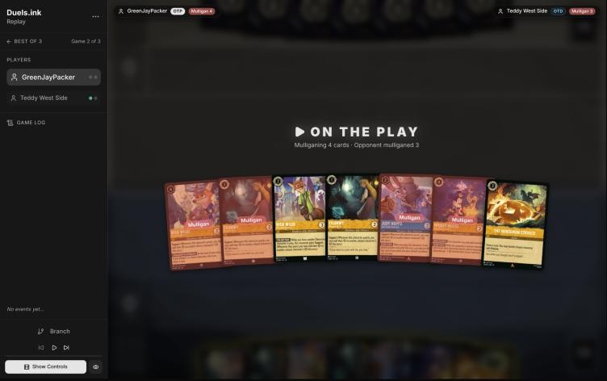
*The board before the decision: [step 0](https://duels.ink/replay/01a2146c-1667-7979-a85d-e7a14a64e686?step=0) in the duels.ink replay viewer.* The four cards sent back are marked "Mulligan".

**The plan (written before seeing the mulligan made):** the seven: Nick Wilde – Toy Drive Officer, Eilonwy ×2, Nick
Wilde – Providing Backup, Judy Hopps – Day Camp Instructor, Mickey Mouse – Expedition Leader, The Horseman Strikes!.
Five inkable (both Eilonwys, Providing Backup, Mickey, Horseman), two not (Toy Drive Officer, Day Camp). It has a play
on every turn: Eilonwy on 1, Providing Backup on 2, Eilonwy + Day Camp on 3 (LEND A PAW ramps), then Toy Drive Officer
or Mickey on 4 with Toy Drive drawing off pairs from then on. Horseman has targets in this deck (Dumbo seen in game 1,
Peter Pan's Shadow in the list) and draws a card if not. `tools/mulligan.py` (1,500 deals, on the play):

| Option | Ink T1–4 | Play turns | Lore by T4 | Characters T4 | Interaction |
|---|---|---|---|---|---|
| Keep all 7 | 9.59 | 3.98 | 7.1 | 4.9 | 100% |
| Mulligan all 7 | 8.96 | 3.71 | 5.0 | 3.8 | 88% |
| Send back Horseman | 9.34 | 3.96 | 7.1 | 4.8 | 31% |
| Send back Mickey | 9.33 | 3.96 | 7.1 | 4.8 | 100% |
| Send back Mickey and Horseman | 9.14 | 3.95 | 7.2 | 4.8 | 41% |

Keeping all seven leads on every measure. The one doubt is the 1-willpower Eilonwys against their cheap challengers
and Giant Fairy's ping, but on the play they quest before those come, and they are Support for the 5-{S} removal later.
The pick: keep all seven ([MULL-1](#cite-mull-1), [MULL-2](#cite-mull-2)).

**What you did:** kept Eilonwy, Providing Backup and The Horseman Strikes!, and sent back four: Mickey, Day Camp
Instructor, Toy Drive Officer and the second Eilonwy. (They sent back 3.)

**Verdict: inaccuracy** (medium confidence). Sending back four is suboptimal because the seven already had a play on
every turn and the deck's card engine, and keeping all seven is better because it leads the four-card mulligan on
every measure the sim has (`tools/mulligan.py`, 1,500 deals): ink on turns 1–4 9.59 against 9.47, lore by turn 4 7.1
against 6.3, characters by turn 4 4.9 against 4.3, interaction 100% both. What the sim can't see points the same
way: Toy Drive Officer is the engine your notes say drew a card nearly every turn, and Day Camp's LEND A PAW is ramp on
turn 3. The likely reasons to send them back (two uninkables, a second 1-willpower Eilonwy that their Rafiki, Pepita
or Giant Fairy kill for nothing) are real, but five inkables in seven is plenty, and the redraws are random Detectives
of the same kind. The edge given up is small ([MULL-2](#cite-mull-2), [MULL-4](#cite-mull-4)); worth asking what you were looking for.

### Turn 1: your turn 1

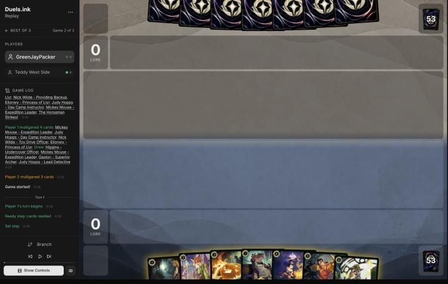
*The board before the decision: [step 2](https://duels.ink/replay/01a2146c-1667-7979-a85d-e7a14a64e686?step=2) in the duels.ink replay viewer.*

**The plan (written before seeing the turn):** the hand after the mulligan: Eilonwy, Higgins, Nick Wilde – Providing
Backup, The Horseman Strikes!, Mickey – Expedition Leader, Gaston – Superior Archer, Judy Hopps – Lead Detective, all
inkable. Nothing on their side yet; no lore race. The questions are the 1-drop and the ink.
- **The 1-drop.** Higgins (2/2, a Detective) turns on Providing Backup's Support next turn (I'VE GOT THIS needs another
  Detective; Eilonwy isn't one) and survives a 1-damage ping. Eilonwy (2/1, Support) dies to anything. Higgins first,
  Eilonwy later as a second play.
- **The ink, judged on this matchup ([INK-1](#cite-ink-1), [INK-2](#cite-ink-2)):** keep Horseman (Dumbo, their card engine, and Peter Pan's Shadow
  are its targets, and it draws), Gaston (Goliath, Scourge, and with one Support Giant Fairy and Shere Khan), Providing
  Backup (turn 2's play) and Eilonwy. Lead Detective has no Judy to Shift onto yet (about 82% to draw one of the 16 other
  Judys by turn 6, `tools/odds.py`), and Mickey is the only 4-drop in hand (about 74% to draw another 4-drop by turn 4).
  So Mickey or Lead Detective. Lead Detective's Alert answers their Evasives and her Resist +2 wins challenges later;
  Mickey is a plain 2-lore body. Ink Mickey, keep Lead Detective; inking her instead is close.
- **Candidates:** (a) ink Mickey, Higgins (pick); (b) ink Lead Detective, Higgins; (c) Eilonwy first. Nothing they
  can do on their turn 1 punishes a quest next turn, since their 1-drops are drying.

**What you did:** inked Higgins and played Eilonwy.

**Verdict: close call.** Inking Higgins keeps every card with a job in this matchup (Horseman, Gaston, Lead Detective,
Mickey) and gives up a vanilla 2/2, which is a fair way to see it ([INK-2](#cite-ink-2)). What it costs: Providing Backup next turn
has no Detective partner, so no Support until another Detective lands, and turn 3 has fewer cheap plays (Horseman
needs a target). Eilonwy rather than Higgins on the board is the more fragile body. Both lines are within the
uncertainty.

### Turn 3: your turn 2

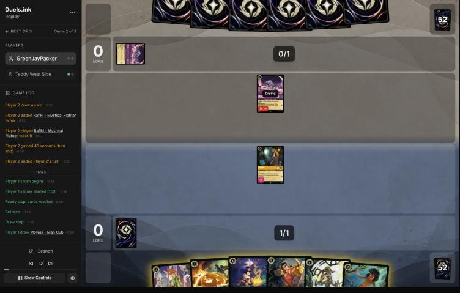
*The board before the decision: [step 8](https://duels.ink/replay/01a2146c-1667-7979-a85d-e7a14a64e686?step=8) in the duels.ink replay viewer.*

**The plan (written before seeing the turn):** they inked one Rafiki – Mystical Fighter and played the other (0/2,
Challenger +3: 3 strength when challenging). You drew Mowgli – Man Cub. Hand: Providing Backup, Mowgli, Horseman,
Mickey, Gaston, Lead Detective; Eilonwy dry; 2 ink after inking.
- **Their next turn (2 ink):** Rafiki is their only challenger, 3 strength: it kills any exerted 1- or 2-willpower
  character of yours, and dies to 2 back. Their 2-drops (Pepita, Flash, Black Heron, a Shop) land drying. No
  Shere Khan (4) or Shadow (3) yet. FREE KILLS: none (the brief).
- **Lore:** 0–0, nothing to race yet.
- **Candidates:**
  - (a) ink Mickey, play Mowgli, quest Eilonwy (pick). HAVE A BETTER LOOK shows their whole hand (Strength of a Raging
    Fire, Shadow, Scourge counts for the next turns) and takes a non-character of their choice. Next turn Providing
    Backup (+1 spare) or Horseman, then a 4-drop, then Gaston.
  - (b) the same with Providing Backup now and Mowgli next turn: a better body now (3/2) and the same curve, but the
    look at their hand comes a turn later, after they've played a card from it.
  - (c) keep Eilonwy home. Her quest offers a 1-for-1 with Rafiki, the card that kills every small quester you have;
    that trade is fine for you ([TRADE-1](#cite-trade-1)), so quest.
- **The ink:** Mickey or Lead Detective, as on turn 1; Mickey is the only 4-drop in hand, so inking him leans on drawing
  one (about 3 in 4 by turn 4), and Lead Detective has no Judy base yet. Close; I'd keep Lead Detective, the stronger
  card later in this matchup.

**What you did:** inked Providing Backup, played Mowgli (they discarded Merlin's Shop and Smithy; you saw their hand),
and kept Eilonwy home.

**Verdict:** two decisions.
- **Mowgli now: good play.** Their whole hand seen on your turn 2 shapes every later setup, and the discard took their lore
  engine (Merlin's Shop). Inking Providing Backup rather than Mickey or Lead Detective keeps both of those and makes
  turn 3 a Horseman turn (a card drawn, and a banish if they play an Evasive): a close call against the plan's ink,
  and a reasonable one.
- **Eilonwy kept home: inaccuracy** (low confidence). Keeping Eilonwy ready is suboptimal because waiting gains
  nothing while Rafiki stays in play: she can never quest without offering the same trade, and questing is better
  because the 1 lore is free unless they take a 1-for-1 that removes the Challenger +3 that would otherwise kill each of
  your 2-willpower questers later ([TRADE-1](#cite-trade-1), [QC-3](#cite-qc-3)). FREE KILLS: none, so nothing of yours dies for nothing. The quest
  exposes only Eilonwy, to Rafiki (both die). The case for home: Eilonwy is +2 Support for Gaston later. That's worth
  something, but Rafiki will still be there then.

### Turn 5: your turn 3

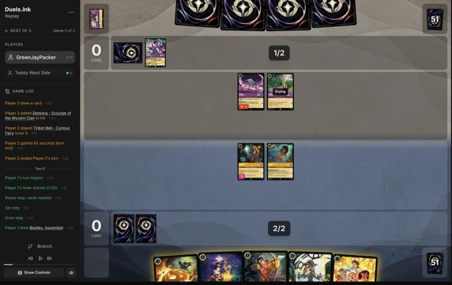
*The board before the decision: [step 15](https://duels.ink/replay/01a2146c-1667-7979-a85d-e7a14a64e686?step=15) in the duels.ink replay viewer.*

**The plan (written before seeing the turn):** Mowgli showed their hand on turn 3: Angel – Experiment 624, Dumbo,
Peter Pan's Shadow, Tinker Bell – Curious Fairy, Tinker Bell – Giant Fairy and the Shop he discarded. On turn 4 they
inked Demona – Scourge (their one unknown card, the draw) and played Curious Fairy, so **their hand is fully known:
Angel, Dumbo, Shadow, Giant Fairy**, plus whatever they draw. You drew Besties, Assemble!. Hand: Horseman, Mickey,
Gaston, Lead Detective, Besties; Eilonwy and Mowgli dry; 3 ink with an ink.
- **Their next turn (3 ink):** Peter Pan's Shadow is the only known play: it exerts one of yours, and Rafiki (3 to
  challenge) kills it. So they kill one of your characters next turn whether you quest or not. FREE KILLS: Mowgli
  (Rafiki survives on 1); Eilonwy trades with Rafiki. Nothing known punishes a second quester, since Rafiki can
  challenge once. Their draw adds little at 3 ink (Strength of a Raging Fire about 1 in 12).
- **The turn after (game turn 8, 4 ink):** Giant Fairy Shifted onto Curious Fairy (dry by then) deals 1 to each of
  your characters (every 1-willpower one dies), then can challenge at once with 4, and PUNY PIRATE adds 2 after a kill.
  Or Angel (2 damage from GOOD AIM), or Dumbo. Plan for that turn now: it's the swing.
- **Lore:** 0–0. Their known hand is development and removal, not a fast clock.
- **Quest both:** staying home saves nothing, because Shadow exerts one anyway; questing gets 2 lore. Mowgli's job is
  done (1/2/1); Eilonwy is +2 Support later, but Giant Fairy's ping kills her on turn 8 whatever you do.
- **Dig first ([SEQ-1](#cite-seq-1)):** Besties, Assemble! for 1 of the 2 ready ink, before inking: take a character from the top 4,
  then choose the ink and spend the last 2.
  - **A Judy 2-drop (Day Camp) or 1-drop (Helpful Officer):** play it, and keep Lead Detective for a Shift for 4 next
    turn. A dry Lead Detective on game turn 7 gives your Detectives Alert and Resist +2: she can challenge Shadow, and
    she's out of range of everything they hold except Giant Fairy's challenge.
  - **Another 2-drop:** play it.
  - **A 4-drop:** take it for next turn; nothing more this turn.
- **Hold The Horseman Strikes!:** Shadow and Dumbo are both known in their hand, so it will have a target within two
  turns; no target now.
- **The ink:** after the dig. Mickey or Gaston if a Judy comes (Lead Detective then has a base); otherwise Lead
  Detective or Mickey, as before. Keep Gaston: Giant Fairy (4) is one Support from his range, and Scourge is in their
  deck.

**What you did:** Besties, Assemble! first, taking Hamm – Piggy Bank; inked Lead Detective; played Hamm. Eilonwy and
Mowgli stayed home again.

**Verdict:** two decisions.
- **Besties before the ink, then Hamm: good play.** The dig came first ([SEQ-1](#cite-seq-1)), it found a 2-drop that uses the last 2
  ink, and Hamm's LOOSE CHANGE makes next turn's 4-drop cost 3. With no Judy found, inking Lead Detective was the
  plan's own choice.
- **Eilonwy and Mowgli kept home: inaccuracy** (medium confidence). Keeping them ready is suboptimal because their
  hand was known and its only play at 3 ink, Peter Pan's Shadow, exerts one of them for Rafiki anyway, so staying home
  saved nothing; questing both was better by 2 lore. FREE KILLS: Mowgli, whose job was done, and Rafiki can make only
  one kill a turn, so the second quester was never at risk. The one case for home is that they might hold Shadow back
  for a bigger target later; then their turn is spent doing nothing, which is fine for you too. Waiting gains a card,
  a better challenge or a wipe dodged only for a board that draws ([H-6](#cite-h-6)'s limit, [H-12](#cite-h-12)).

### Turn 7: your turn 4

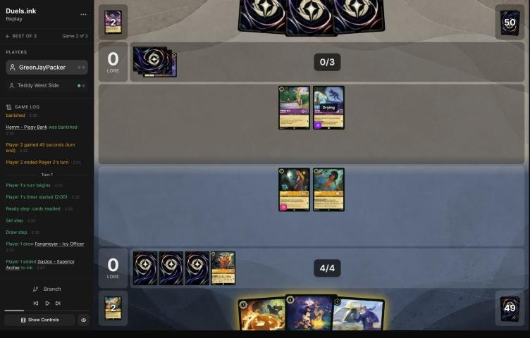
*The board before the decision: [step 28](https://duels.ink/replay/01a2146c-1667-7979-a85d-e7a14a64e686?step=28) in the duels.ink replay viewer.* Gaston has just been inked; Giant Fairy and Curious Fairy's Shift are in their known hand.

**The plan (written before seeing the turn):** on turn 6 Peter Pan's Shadow exerted Hamm and Rafiki traded with him;
they inked Pepita, their draw. **Their hand is still fully known: Angel – Experiment 624, Dumbo, Tinker Bell – Giant
Fairy**, plus next turn's draw. You drew Fangmeyer – Icy Officer (uninkable; no Detective in your discard to return).
Hand: Horseman, Mickey, Gaston, Fangmeyer; Eilonwy and Mowgli dry; 4 ink with an ink. Lore 0–0.
- **Their next turn (4 ink): Giant Fairy Shifted onto the dry Curious Fairy is the likely play.** ROCK THE BOAT deals 1
  to each of yours: Eilonwy dies, Mowgli is left on 1, a Mickey on 2. The Fairy is dry ([CR 8.10.4](#cite-cr-8-10-4)), so it challenges at
  once with 4, and PUNY PIRATE! adds 2 to another of yours after a kill. Shadow (dry) challenges for 2. Every exerted
  character of yours is a kill, and each kill by the Fairy brings a second one. Their alternatives: Dumbo, or Angel
  with GOOD AIM (2 damage to anything). Strength of a Raging Fire is about 1 in 12 from the draw, free with Shadow.
- **FREE KILLS** (brief): Mowgli to Shadow alone; with the Fairy, any exerted character.
- **So:** Eilonwy quests (the ping kills her anyway; free lore), **Mowgli stays home**, and anything played stays
  ready. Mickey's SECRET PATH (enter exerted, −2 {S} on one of theirs per quest) doesn't pay: −2 on Curious Fairy
  carries to a Fairy Shifted onto it ([CR 8.10.5](#cite-cr-8-10-5)), but Mickey exerted on 2 willpower after the ping still dies to its 2.
- **Candidates:**
  - (a) ink Gaston, Mickey (4) entering ready, quest Eilonwy; hold Horseman for Dumbo (pick). Dumbo, their card and
    lore engine, is known in hand and lands within a turn or two; Horseman is your only answer to an Evasive in hand.
    After the Fairy you keep Mowgli (1 left) and Mickey (2 left), both ready, and next turn Fangmeyer or Horseman.
  - (b) Horseman on Shadow now (3) + 1 spare, quest Eilonwy: removes a 1-lore Evasive and Dumbo's future partner, and
    draws, but spends the only answer to Dumbo, which then draws and quests every turn. Board: Mowgli only.
  - (c) Mickey and quest both: offers the Fairy a kill and a PUNY PIRATE second kill.
- **The ink:** Gaston or Horseman (Fangmeyer can't be inked). Gaston has no target in their known hand (the Fairy is 4,
  and your Supporters die to its ping); Scourge (one inked, three left) and game 1's Goliath are his targets later.
  Horseman has a known target. Ink Gaston; close.
- **The needs check:** nothing to race yet. Their engine is Dumbo; what you need is to keep a board through the Fairy
  turn and answer Dumbo when it lands.

**What you did:** inked Gaston, played Mickey exerted (LONG JOURNEY), quested Mowgli and Eilonwy, and put both SECRET
PATH triggers on Shadow (−4 {S} until your next turn); Eilonwy's Support went on Mickey.

**Verdict:** two decisions.
- **Gaston inked, Horseman held: good.** The plan's own choice: Horseman stays for Dumbo.
- **Mickey exerted and Mowgli questing into a known Giant Fairy: mistake** (high confidence). Exerting Mickey and
  questing Mowgli is suboptimal because Giant Fairy was known in their hand since turn 3, Curious Fairy was dry to
  Shift onto, and their next turn had exactly the 4 ink for it: ROCK THE BOAT leaves Mowgli on 1 and Mickey on 2, the
  dry Fairy challenges one of them for 4, and PUNY PIRATE!'s 2 kills the other, so all three of your characters can
  die. SECRET PATH's −4 on Shadow guards against Shadow's 2, which was never the threat. Playing Mickey ready and
  keeping Mowgli home is better because the same turn then costs you only Eilonwy (to the ping, questing for free
  first): Mowgli and Mickey are ready on 1 and 2 willpower, the Fairy and Shadow can't challenge them, and Angel can't
  be cast beside the Shift (8 ink of their 4). That line gives up Mowgli's 1 lore. It exposes Eilonwy alone; if they
  play Angel instead, GOOD AIM kills Mowgli or Shadow trades with Eilonwy, the same as your line would lose. FREE
  KILLS: Mowgli, to Shadow, which your −4 did cover; the brief's "Challenges the turn it lands: Tinker Bell – Giant
  Fairy … held 100%" was the line to answer (and the pair file's notes describe this exact turn: [Giant Fairy Shifted onto
  Curious Fairy, then challenges with PUNY PIRATE!](#cite-kb-meta-archetypes-amethyst-steel-midrange-a-variant-danny-s-amethyst-steel-list)) ([THREAT-3](#cite-threat-3), [RULE-1](#cite-rule-1)). The difference is two characters and 6 ink of board on
  their swing turn, for 1 lore.

### Turn 8: their turn

**What happened:** they inked Angel and Shifted Giant Fairy onto Curious Fairy. ROCK THE BOAT killed Eilonwy, the Fairy
challenged the exerted Mickey (taking 2), and PUNY PIRATE! finished Mowgli. Shadow quested. Your board is empty; theirs
is Giant Fairy (exerted, 2 damage) and Shadow (exerted). Their hand: Dumbo and one unknown card.

### Turn 9: your turn 5

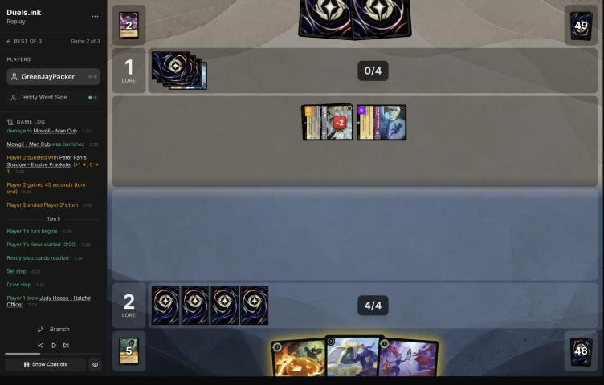
*The board before the decision: [step 44](https://duels.ink/replay/01a2146c-1667-7979-a85d-e7a14a64e686?step=44) in the duels.ink replay viewer.*

**The plan (written before seeing the turn):** lore 2–1, your board empty. Theirs: Giant Fairy (4/5/2, exerted, 3
willpower left) and Shadow (exerted, Evasive), questing for 3 a turn. You drew Judy Hopps – Helpful Officer. Hand:
Horseman, Fangmeyer (uninkable; nothing in your discard is a Detective, so REQUEST REINFORCEMENTS returns nothing),
Helpful Officer; 5 ink with an ink.
- **Their next turn (5 ink):** Dumbo (known) with 1 ink left for a BREAKING RECORDS on Shadow (MAKING HISTORY gives it
  the ability): a card and a lore. The unknown card and their draw: Shere Khan (about 1 in 6: NEW INCENTIVE lets the
  Fairy challenge a ready character), Strength of a Raging Fire (1 in 6, free with the Fairy or Shadow singing; 2–3
  damage at their board's size), Hades (1 in 6). The Fairy quests for 2, or stays ready.
- **What must happen:** answer Dumbo when it lands (Horseman, held for it), and the Fairy before it quests for long.
  The Fairy dies to 3 more damage while exerted; your Gaston is inked, and the Fairy's 4 {S} needs Support for Always
  Vigilant or Gaston. **Don't use TO THE RESCUE on it**: Helpful Officer removes damage from any chosen character.
- **Candidates:**
  - (a) ink Helpful Officer, Fangmeyer (5 = 5 of your 5) (pick). A 4/4/2 that stays ready (drying) this turn, so only a
    Shere Khan reaches it; Strength's 2–3 damage doesn't kill it. Next turn: Horseman on Dumbo (3) and Fangmeyer's 4
    into the Fairy if it quested (3 left: it dies, and so does Fangmeyer to its 4), with 3 ink for a draw.
  - (b) Horseman on Shadow now (draw first, then ink the draw if it's inkable), Helpful Officer: removes Shadow and
    Dumbo's partner, but spends the answer to Dumbo, the engine that lands next turn; Fangmeyer waits a turn.
  - (c) ink Horseman, Fangmeyer: keeps the Judy base for Always Vigilant, but throws away the Dumbo answer.
- **The needs check:** you're behind on board (0 against 3 a turn, Dumbo coming). To win from here you need the Fairy
  and Dumbo answered and a board rebuilt; Horseman is the Dumbo answer, Fangmeyer the Fairy answer, Always Vigilant ×4
  and Gaston ×2 are left for later threats (about 4 in 10 to see an Always Vigilant in the next six draws).

**What you did:** The Horseman Strikes! on Shadow (banished; you drew Judy Hopps – Always Vigilant), inked Always
Vigilant, and ended the turn with 2 ink unspent, Fangmeyer and Helpful Officer in hand.

**Verdict: inaccuracy** (low confidence). Horseman on Shadow with 2 ink left over is suboptimal because it spends the
one answer in hand to Dumbo, the known card and lore engine that lands next turn, on a 1-lore 2/2 whose on-play effect
was already used, and it puts nothing on the board on a turn when yours was empty. Inking Helpful Officer and playing
Fangmeyer (5 of your 5), with Horseman held for Dumbo, is better because it uses all the ink, puts a 4/4/2 in play that
next turn trades with the Fairy if it quests (3 willpower left against Fangmeyer's 4), and still answers Dumbo the turn
it lands. That line leaves Fangmeyer ready (drying): only a Shere Khan's NEW INCENTIVE (about 1 in 6) lets the Fairy
reach it, and Strength's 2–3 damage doesn't kill it. What your line does better: Shadow can't become Dumbo's second
BREAKING RECORDS, and the Horseman draw came a turn earlier. And Dumbo can be answered later by Support onto it for
Gaston or Always Vigilant (3 + 2). Smaller points in the same turn:
- **Always Vigilant inked rather than Helpful Officer: close call.** Ink check: your way, next turn is Fangmeyer +
  Helpful Officer (6 of 6), with no removal left in hand; keeping Always Vigilant and inking Helpful Officer, next turn
  is Fangmeyer + 1 or Always Vigilant + 2, and the 5-{S} answer stays for Scourge (three left in their deck) or game 1's
  Goliath. It had no target yet (the Fairy is 4 and you had no Supporter), which is the case for inking it.
- **Helpful Officer held with 2 ink spare:** it would have quested a turn earlier; held, it can't be pinged, but nothing
  of theirs was worth spending on a 2/1. Small ([INK-3](#cite-ink-3)).

### Turn 11: your turn 6

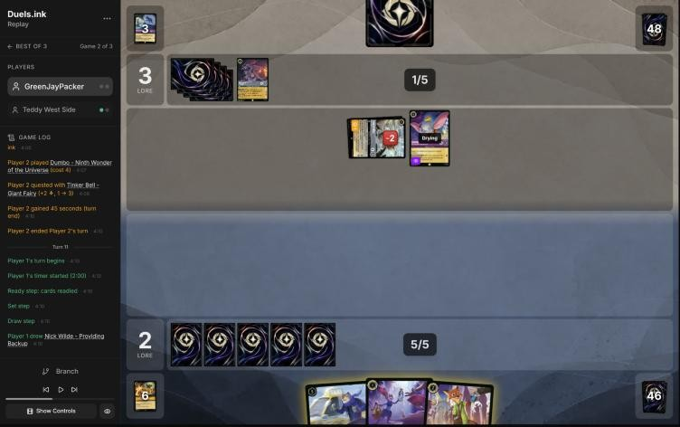
*The board before the decision: [step 52](https://duels.ink/replay/01a2146c-1667-7979-a85d-e7a14a64e686?step=52) in the duels.ink replay viewer.*

**The plan (written before seeing the turn):** on turn 10 they inked Goliath – Clan Leader, played Dumbo and quested the
Fairy. Lore 2–3; your board is empty; theirs is Giant Fairy (exerted, 3 willpower left) and Dumbo (drying, so his
BREAKING RECORDS starts next turn). Their hand: one unknown card. You drew Nick Wilde – Providing Backup. Hand:
Fangmeyer, Helpful Officer, Providing Backup; 6 ink with an ink. Nothing of yours can challenge this turn.
- **Their next turn (6 ink):** Dumbo draws and gains 1 for 1 ink, which digs for more. Scourge is castable (6): it
  exerts your board for the Fairy (4) and Dumbo (3) to challenge; held about 1 in 8 after their draw, more with Dumbo's
  draw first. Shere Khan (about 1 in 6) lets the Fairy hit a ready character. Strength of a Raging Fire is free with the
  Fairy or Dumbo singing, for 2 (their character count): it kills a Helpful Officer or a Nick. Without those, nothing
  reaches a ready character, and the Fairy quests or waits.
- **What must happen:** kill the Fairy (3 more damage while it's exerted: Fangmeyer's 4 or Nick's 3 next turn) and
  answer Dumbo (Evasive, 3 {S}: Lead Detective's Alert, or Support +2 for Gaston or Always Vigilant). Their clock: 3 a
  turn plus Dumbo's lore, 20 around game turn 21.
- **TO THE RESCUE** removes damage from a chosen character: choose your own (with none on it), never the Fairy.
- **Candidates:**
  - (a) ink Providing Backup, Fangmeyer + Helpful Officer (5 + 1 = 6 of 6) (pick). Two bodies, 3 lore a turn, and a
    Judy in play for Always Vigilant's Shift 2 or Lead Detective's Shift 4 when one comes. Next turn Fangmeyer kills
    the Fairy if it quested.
  - (b) ink Helpful Officer, Fangmeyer alone (5 of 6), Nick held: Nick and a second Detective next turn give Support
    (+3), but this turn loses 1 ink and a body.
  - (c) Nick + Helpful Officer, Fangmeyer held: 3 of 6 ink.
- **Exposure:** both new characters stay ready (drying). Scourge or Shere Khan is the risk; FREE KILLS: none (nothing of
  yours is exerted).

**What you did:** played Providing Backup and Helpful Officer (TO THE RESCUE on herself, no effect), held Fangmeyer, and
didn't ink: with Fangmeyer the only card left, there was nothing inkable. 3 of 5 ink used.

**Verdict: inaccuracy** (medium confidence). Nick and Helpful Officer with Fangmeyer held is suboptimal because it skips
the turn's ink for good ([INK-3](#cite-ink-3): you are a card of ink behind for the rest of the game) and leaves 2 ink unspent, and
it puts 2 lore a turn on the board instead of 3. Inking Providing Backup and playing Fangmeyer + Helpful Officer
(5 + 1 = 6 of 6) is better because it uses every ink, adds the inkwell card, and puts a 4/4/2 next to a Judy base; next
turn Fangmeyer's 4 kills the Fairy if it quests (3 left), as Nick's 3 does in your line. It exposes the same: both
characters ready, reachable only through Scourge, Shere Khan, or Strength (2 damage kills Helpful Officer either way;
Fangmeyer's 4 willpower survives it where Nick's 2 doesn't). The case for your line: Fangmeyer's REQUEST
REINFORCEMENTS had no Detective to return this turn, and held, it gets back whichever of Nick or Helpful Officer they
kill; and Nick has Support with Helpful Officer in play. That value is real but small (a 1- or 2-drop back), against a
permanent ink and a turn of Fangmeyer's 2 lore.

### Turn 12: their turn

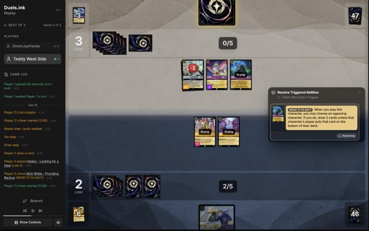
*The board before the decision: [step 58](https://duels.ink/replay/01a2146c-1667-7979-a85d-e7a14a64e686?step=58) in the duels.ink replay viewer.*

**What happened:** they didn't ink. Hades – Looking for a Deal chose Providing Backup, and **you put Nick on the bottom
of your deck** rather than let them draw 2. Then Dumbo sang Strength of a Raging Fire (3 characters: 3 damage) to kill
Helpful Officer, and the Fairy quested (5 lore). Their hand is now empty.

**Verdict on your choice: good.** Their hand was down to one card when Hades resolved, so 2 more cards were worth far
more to them than a 2-drop was to you ([H-2](#cite-h-2)'s converse: the body is worth keeping when they hold many cards, not few).

### Turn 13: your turn 7

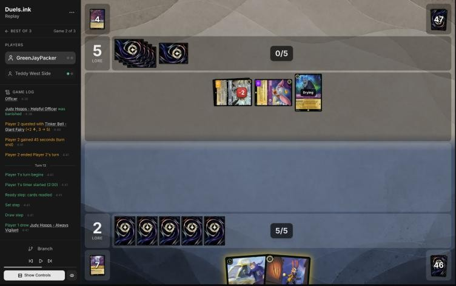
*The board before the decision: [step 63](https://duels.ink/replay/01a2146c-1667-7979-a85d-e7a14a64e686?step=63) in the duels.ink replay viewer.*

**The plan (written before seeing the turn):** lore 2–5. Theirs: Giant Fairy (exerted, 3 willpower left), Dumbo
(exerted), Hades (drying, 3/4/1): 4 lore a turn, about game turn 20 at that rate, faster with Dumbo's draws. Their hand:
0 cards. You drew Always Vigilant. Hand: Fangmeyer, Always Vigilant; 5 ink, 6 with an ink. Your board: empty.
Helpful Officer is in your discard: **Fangmeyer's REQUEST REINFORCEMENTS returns her** (a Detective).
- **Their next turn (6 ink, 1 card after the draw, plus Dumbo's draw for 1 ink):** nothing reaches a ready character
  unless the draw is Scourge (exert all, then three challengers), Shere Khan, Shadow or another Strength (3 damage at
  their current board). Each of those is about 1 in 15 to 1 in 10 from their draw, roughly double with Dumbo's.
  Otherwise they quest for 4 and keep the Fairy's PUNY PIRATE! for an exerted target.
- **Your removal's reach:** Always Vigilant needs a 5-{S} target and another character played that turn. Nothing of
  theirs is at 5 (Fairy 4, Hades 3, Dumbo 3), and no Supporter of yours can quest before your turn 9 at the earliest.
  So Always Vigilant can't banish anything next turn either, unless Scourge (5) or Goliath (6) lands.
- **The needs check:** to win you need the Fairy and Dumbo gone and a board that out-quests 4 a turn. The Fairy dies to
  Fangmeyer's 4 if it quests again; Dumbo needs Lead Detective's Alert (2 left), a Horseman (2 left) or Support +2 for
  Always Vigilant or Gaston. You're far behind on lore, so tempo matters, but your only removal matters too.
- **Candidates:**
  - (a) Fangmeyer (returning Helpful Officer), ink Always Vigilant, Helpful Officer (5 + 1 = 6 of 6): two bodies, 3 lore
    a turn, and a Judy in play for Lead Detective's Shift 4 (a drawn Lead Detective then gives every Detective Alert and
    Resist +2: she challenges Dumbo and Fangmeyer survives the Fairy). Costs your only removal.
  - (b) Fangmeyer (returning Helpful Officer), ink Helpful Officer, keep Always Vigilant (5 of 6) (pick, narrowly):
    the 4/4 body comes next turn with any second character, and stays your answer to a Scourge or Goliath. Costs a 2/1
    body now and 1 ink this turn.
  - (c) Always Vigilant now as a 4/4 (4 of 6): no Fangmeyer, no Helpful Officer back.
- **Exposure:** Fangmeyer (and Helpful Officer in (a)) ready; FREE KILLS: none.

**What you did:** Fangmeyer, returning Helpful Officer; no ink, so both Helpful Officer and Always Vigilant stay in hand.

**Verdict: close call** (low confidence). Keeping both cards and skipping the ink is a fair alternative to the plan's
(b): next turn Helpful Officer (1) + Always Vigilant Shifted onto her (2) puts the same 4/4 on the board as the plan's
hard-cast Always Vigilant (4), for 3 ink instead of 4, so both lines have the same ink left over next turn, and yours
keeps TO THE RESCUE for a damaged Fangmeyer. The cost is permanent: from your turn 9 on you are one ink behind the
plan's line, and two behind a player who inked every turn ([INK-3](#cite-ink-3)). With two cards in hand and expensive cards left in
the deck (Lead Detective, Gaston, Fangmeyer, Uncovering Clues), cards are scarce too ([H-2](#cite-h-2)), which is the argument for
holding. Worth a word because it's the second ink skipped in three turns; the first (turn 11) cost more.

### Turn 15: your turn 8

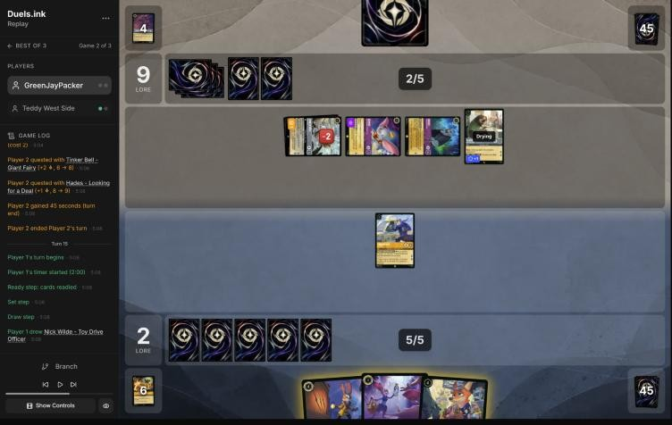
*The board before the decision: [step 72](https://duels.ink/replay/01a2146c-1667-7979-a85d-e7a14a64e686?step=72) in the duels.ink replay viewer.*

**The plan (written before seeing the turn):** on turn 14 Dumbo drew and gained 1, they played Flash – Efficient Clerk
(3/2/2, Resist 1), and the Fairy and Hades quested: lore 2–9. Their board quests for 6 a turn (Fairy 2, Flash 2, Dumbo
1, Hades 1), which reaches 20 on game turn 18 (`tools/odds.py clock`: 2 turns). You drew Nick Wilde – Toy Drive Officer.
Hand: Always Vigilant, Helpful Officer, Toy Drive Officer (uninkable); Fangmeyer dry; 5 ink, 6 with an ink.
- **Fangmeyer's challenges** (brief): the exerted Fairy (3 left) dies to his 4 and he dies to its 4; Hades dies to his
  4 and he survives on 1. Dumbo is Evasive. Flash lands drying, ready.
- **The needs check, and the race:** killing the Fairy, the biggest quester, leaves them 4 a turn: 3 more turns, so 20
  on game turn 20 if they add nothing. You're at 2: at 5 a turn (more than your board makes) you need 4 turns, game turn
  21. Killing Hades instead keeps Fangmeyer but leaves them 5 a turn (game turn 20 too). Nothing in hand or deck
  removes several characters at once; Lead Detective (2 left, about 1 in 20 a draw) is the only card that turns a turn
  into two or three kills. So no line reaches 20 before them under reasonable assumptions: **from here the game is
  unwinnable** ([principle 2](#cite-principle-2)), and the decisions below are graded that way.
- **The best try anyway:** Fangmeyer into the Fairy (their 2 lore and PUNY PIRATE!), then Toy Drive Officer + Helpful
  Officer (4 + 1 = 5 of 5): COMMUNITY OUTREACH draws a card at the end of the turn, Toy Drive is a Supporter for Always
  Vigilant next turn (Shift 2 onto Helpful Officer, after another character), and the ink is kept for next turn's
  plays. Ink Always Vigilant only if the 6th ink buys something; it doesn't here.

**What you did:** Fangmeyer challenged the Fairy (both banished), then Toy Drive Officer and Helpful Officer; COMMUNITY
OUTREACH drew Elisa Maza at the end of the turn. No ink.

**Verdict: unwinnable; the line played was the plan's best try.** It took their biggest quester, drew a card and set
up Always Vigilant's Support line for next turn.

### Turn 17: your turn 9

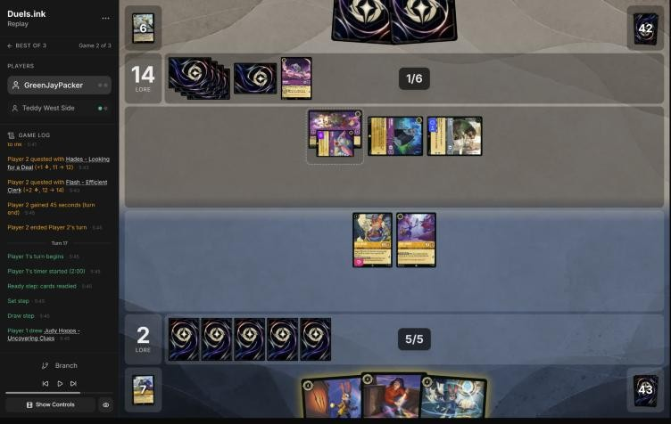
*The board before the decision: [step 84](https://duels.ink/replay/01a2146c-1667-7979-a85d-e7a14a64e686?step=84) in the duels.ink replay viewer.*

**The plan (written before seeing the turn):** on turn 16 Dumbo drew and gained 1, a second Merlin's Shop came down
and Dumbo moved there (a card and 1 lore), and Hades and Flash quested: lore 2–14. Their board makes 4 a turn plus 1
from a Shop move: 20 on game turn 20. You drew Uncovering Clues. Hand: Always Vigilant, Elisa Maza, Uncovering Clues;
Toy Drive Officer and Helpful Officer dry; 6 ink with an ink. Still unwinnable (turn 15); the best try is the most
removal.
- **The Support line** (brief: "in range with your Support"): Toy Drive Officer quests first and adds +2 to Dumbo
  (3 → 5); play Elisa Maza (4; FOLLOW THE TRAIL with another Detective in play: they reveal their hand and discard a
  non-character of your choice); then Always Vigilant Shifts onto the dry Helpful Officer (2), so GOT YOU NOW (another
  character played this turn) banishes Dumbo. Ink sum: 4 + 2 = 6 of 6, inking Uncovering Clues. The Shifted Always
  Vigilant is dry, so she then challenges the exerted Flash (4 − Resist 1 = 3 against 2 willpower: banished; she takes
  3 and survives).
- **What it exposes:** Toy Drive Officer exerted (FREE KILLS listed it: Dumbo and Hades together; with Dumbo gone,
  Hades alone can't kill it), Always Vigilant exerted on 1 willpower left (Hades kills her). Elisa ready.
- **The alternative:** Uncovering Clues instead of Elisa (dig for Lead Detective), same Shift. Elisa's discard is the
  better use while they hold 2 cards and are a turn from 20.

**What you did:** Uncovering Clues (its dig took a second Toy Drive Officer), inked Elisa, quested Toy Drive Officer
with Support +2 on Dumbo, Shifted Always Vigilant onto Helpful Officer and banished Dumbo with GOT YOU NOW, then
challenged Flash with her (banished; she took 3). COMMUNITY OUTREACH drew Higgins.

**Verdict: good play, in a game already lost.** This is the Detectives' signature trick, Support onto their character
to put it in range of the 5-{S} banish (["Detectives as GreenJayPacker plays
it"](#cite-kb-meta-archetypes-amber-sapphire-detectives-as-greenjaypacker-plays-it)), and you found it with the Shift for the second kill as well. Uncovering Clues rather than Elisa as the second
character is a close call: a Detective found against a discard from their two cards.

### Turn 18: their turn

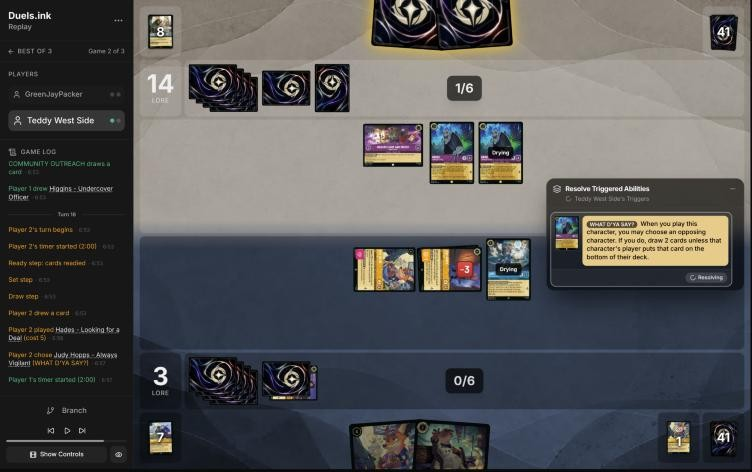
*The board before the decision: [step 98](https://duels.ink/replay/01a2146c-1667-7979-a85d-e7a14a64e686?step=98) in the duels.ink replay viewer.*

**What happened:** a second Hades chose Always Vigilant (3 damage, 1 willpower left, exerted), and **you bottomed her**
(with Helpful Officer under her) rather than let them draw 2. Hades moved to the Shop (a card and 1 lore) and quested:
lore 3–16.

**Verdict on your choice: good.** Exerted on 1 willpower, Always Vigilant was dead to any challenge next turn, while 2
cards to a player 4 lore from 20 could only help them.

### Turn 19: your turn 10

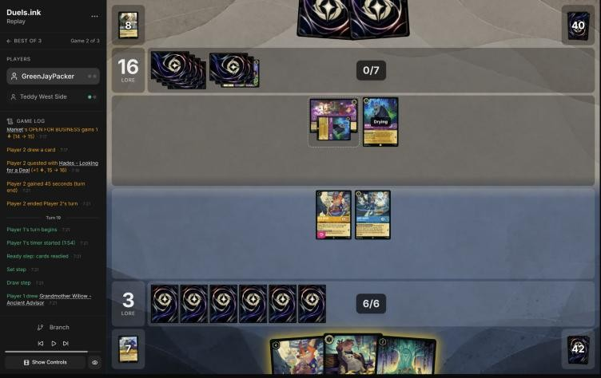
*The board before the decision: [step 104](https://duels.ink/replay/01a2146c-1667-7979-a85d-e7a14a64e686?step=104) in the duels.ink replay viewer.*

**The plan (written before seeing the turn):** lore 3–16; their board is two Hades (one exerted at the Shop) and the
Shop: 2 a turn plus a Shop move, 20 on game turn 22 if they add nothing; their hand holds 2. You drew Grandmother
Willow. Hand: Toy Drive Officer, Higgins, Willow; Toy Drive Officer and Uncovering Clues dry; 7 ink with Higgins inked,
6 without. Unwinnable (turn 15): you're 17 short with a 2-lore board.
- **The most a turn can do:** Toy Drive Officer quests with Support +2 on Uncovering Clues, who challenges the exerted
  Hades (5 against 4: banished; she takes 3 and dies); Willow (2), then the second Toy Drive Officer for 3 with SMOOTH
  THE WAY, then Higgins (1): 6 of 6, three characters, and both Toy Drive Officers draw at the end of the turn. Or Clues
  quests instead (a dig and 1 lore) and the Hades lives.
- **Exposure:** whatever quests or challenges is exerted for their two Hades (FREE KILLS: Toy Drive Officer to both
  together, Uncovering Clues to one).

**What you did:** Willow, Higgins (free with SMOOTH THE WAY), the second Toy Drive Officer; Toy Drive Officer quested
with Support +2 on Uncovering Clues, who traded with the exerted Hades. Both Toy Drive Officers drew at the end of the
turn (Belle, a second Willow).

**Verdict: unwinnable; the plan's line** (the discount on Higgins rather than Toy Drive Officer is the same 6 ink).

### Turn 21: your turn 11

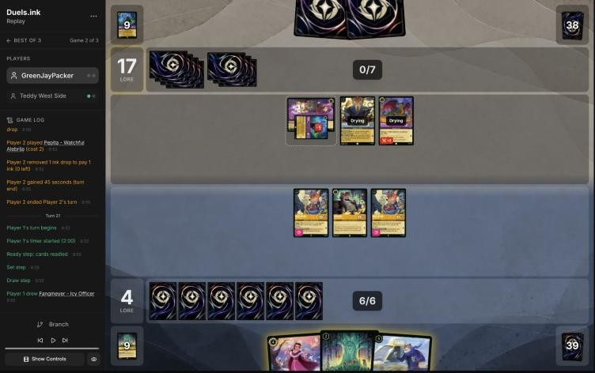
*The board before the decision: [step 119](https://duels.ink/replay/01a2146c-1667-7979-a85d-e7a14a64e686?step=119) in the duels.ink replay viewer.*

**The plan (written before seeing the turn):** on turn 20 Shere Khan's NEW INCENTIVE let Hades challenge the ready
Willow (CORNER THE MARKET gave them an ink drop for it), Hades moved to the Shop (a card and 1 lore), and Pepita came
down: lore 4–17. Their board: Hades (exerted, 3 willpower left), Shere Khan and Pepita (drying), the Shop. Next turn
they quest for 3 and a Shop move adds 1: they need 3. You drew the third Fangmeyer. Hand: Belle, Willow, Fangmeyer; two
Toy Drive Officers and Higgins dry; 7 ink with Belle inked.
- **Can anything stop 20 next turn?** Your two Supporters can make one kill: Support +2 onto a Toy Drive Officer kills
  Hades (4 against 3 left), or +4 onto Higgins destroys the Shop (6 against 6). Either way they keep exactly 3: Shere
  Khan, Pepita and a Shop move, or Hades, Shere Khan and Pepita. Nothing in hand removes a second one, and Fangmeyer
  lands drying. So no line keeps them below 20 (the brief: they reach 20 before your next draw).
- **So:** the game is lost on their next turn whatever you do; conceding is reasonable, and so is making them find
  the 3 (kill Hades, play Fangmeyer).

**What you did:** conceded at 4–17.

**Verdict: unwinnable; conceding was fine.**

## Lessons
1. **A card known in their hand is a certainty to plan around, not a risk to weigh.** On turn 7 Giant Fairy was known,
   its Shift base was dry and their ink was exactly 4: every character you left exerted was a kill, and PUNY PIRATE!
   turns each kill into a second one. Plan the turn from what that card does ([THREAT-3](#cite-threat-3), [RULE-1](#cite-rule-1)).
2. **Stay home only when it saves something.** On turns 3 and 5 their known Shadow (or Rafiki's trade) cost you a
   character whether you quested or not; the quests were free lore. On turn 7 the reverse held: against the known
   Fairy, staying home was what saved Mowgli and Mickey. The test is the same both times: what does waiting protect,
   against what they can actually do next turn.
3. **Ink every turn unless the card you keep is worth more than the ink** ([INK-3](#cite-ink-3)). Turn 11's skipped ink cost more than
   turn 13's: on 11 the alternative used every ink and put Fangmeyer down a turn earlier.
4. **Hold the only answer for the engine.** The Horseman Strikes! is your one answer in hand to an Evasive; Dumbo, known
   in their hand, was the card and lore engine (turn 9; low confidence).
5. **Mowgli early is information for the whole game.** Turn 3's look kept their hand fully known for three turns, and
   the Support line on turn 17 shows the deck's best trick still works from behind.

## Proposed knowledge-base updates (applied after discussion)
- **Strategy:** evidence for [H-12](#cite-h-12) outside Rockstar Aggro, both ways: 01a2146c-1667 turns 3 and 5 (GreenJayPacker's
  Detectives vs Amethyst/Steel Midrange), staying home saved nothing against a known Peter Pan's Shadow and Rafiki;
  turn 7, the limit, against a known Giant Fairy staying home was what kept two characters alive.
- **Meta** (the Amethyst/Steel pair file, below its generated part): "Midrange against GreenJayPacker's
  Detectives: Teddy West Side (01a21461-1eac and 01a2146c-1667, games 1 and 2)". Game 2's cards: Rafiki ×3 (two inked),
  Tinker Bell – Curious Fairy and Giant Fairy (Shifted on game turn 8 with Curious Fairy played on turn 4: ROCK THE
  BOAT, a challenge and PUNY PIRATE! killed three), Peter Pan's Shadow, Pepita ×2, Dumbo (drawing from turn 14), Hades ×2
  (each took one character to the bottom of the deck), Strength of a Raging Fire (sung by Dumbo), Flash, Merlin's Shop
  ×2, Shere Khan (NEW INCENTIVE onto Hades against a ready Willow, turn 20); inked: Angel, Demona – Scourge, Goliath,
  Demona – Imperious. Off-list: Curious Fairy and Goliath (game 1 added Black Heron and Wildcat). They skipped inks on
  turns 12 and 14 and still won at 7 ink. Plus a piloting note for "Detectives as GreenJayPacker plays it": against
  this list, Mowgli on turn 3 saw a hand that stayed fully known through turn 8.
- **Rules** (the rulings file): "A Shifted character keeps the effects on its base": a {S} modifier on the
  character under it carries to the Shifted character ([CR 8.10.5](#cite-cr-8-10-5): it "does keep any effects that apply to that
  character"). Example: Mickey – Expedition Leader's SECRET PATH −2 {S} on Curious Fairy would make a Giant Fairy
  Shifted onto it a 2-{S} challenger that turn (01a2146c-1667 turn 7). Worked out from the CR, not seen in a game.
- **Cards:** a new card note on Tinker Bell – Giant Fairy: Shift 4 onto Curious Fairy (a 1-drop) on their 4th turn;
  dry, so it challenges at once; ROCK THE BOAT, then the challenge, then PUNY PIRATE!'s 2 is three kills against a board
  of 1- to 3-willpower characters if two are exerted; Mickey's −2 carries through the Shift (above).

## Hindsight
Doesn't change the verdicts above.
- The mulligan's four redraws were Higgins, Mickey, Gaston and Lead Detective: two cards of 5 and 6 for a hand that sent
  back two 4s and a 2.
- The Giant Fairy came exactly as the turn-7 plan expected, on game turn 8, and took all three characters.
- Dumbo, left without the Horseman, drew 3 cards and gained 3 lore (two BREAKING RECORDS and a Shop move) before
  Always Vigilant removed him on turn 17.
- They skipped inks too (turns 12 and 14): 7 ink at the end against your 6.

## The coach's errors
Filled in during discussion.

| When | Error | How it was caught | How it won't happen again |
|---|---|---|---|

## Open questions
- **Pre-game:** what were you looking for with the four-card mulligan, sending back Toy Drive Officer, Day Camp
  Instructor, Mickey and an Eilonwy?
- **Turns 3 and 5:** why keep Eilonwy (and on turn 5 Mowgli) home? To make them spend Shadow, or to keep Eilonwy as
  Support for later?
- **Turn 7:** did you expect the Giant Fairy that turn? SECRET PATH went on Shadow twice: were you expecting Dumbo or
  Angel instead?
- **Turn 9:** The Horseman Strikes! on Shadow rather than held for Dumbo: was it Dumbo's MAKING HISTORY partner you
  wanted gone first?
- **Turns 11 and 13:** the skipped inks: was turn 11 about saving Fangmeyer's REQUEST REINFORCEMENTS for a Detective
  they'd kill, and turn 13 about Helpful Officer as the cheap Shift base?

## Citations
Copies of the coach's knowledge base cited above, as they stood when they were cited (the private repository's commit and date are given with each). They don't change when the knowledge base does.

**MULL-1**: strategy principle, `kb/strategy/principles.md` at `5894e68` (2026-11-26), working tree

> - **MULL-1. Keep a plan, not the strongest cards.** *Ask: "Which hand gives me the best chance to execute my game plan in this matchup?"* `[MCL ch.12]` · baseline

**MULL-2**: strategy principle, `kb/strategy/principles.md` at `5894e68` (2026-11-26), working tree

> - **MULL-2. A smooth curve beats a few powerful cards.** Check that you can spend ink well on turns 1–4, have enough inkable cards, and know what turn 4 looks like. `[MCL ch.12]` · baseline
>   - **Ink spent isn't the goal by itself.** Judge a keep by a nice curve (a play each turn), early lore pressure, and
>     interaction that sets the opponent back, as well as by ink, then weigh card quality and the matchup
>     (user, 2026-11-01). `tools/mulligan.py` reports all of these.

**MULL-4**: strategy principle, `kb/strategy/principles.md` at `5894e68` (2026-11-26), working tree

> - **MULL-4. Don't chase a perfect hand.** Flexible hands with several lines beat hands that need one specific draw. `[MCL ch.12]` · baseline

**INK-1**: strategy principle, `kb/strategy/principles.md` at `5894e68` (2026-11-26), working tree

> - **INK-1. Inking is permanent.** Every inked card is one line of play removed for the rest of the game. *Ask: "Will I regret losing access to this card?"* `[MCL ch.4]` · baseline

**INK-2**: strategy principle, `kb/strategy/principles.md` at `5894e68` (2026-11-26), working tree

> - **INK-2. Don't automatically ink the most expensive card.** It may be the late-game win condition or the key answer for this matchup. The answer depends on matchup, hand and board. `[MCL ch.4]` · baseline

**TRADE-1**: strategy principle, `kb/strategy/principles.md` at `5894e68` (2026-11-26), working tree

> - **TRADE-1. Judge a trade by ink invested, tempo, value already generated, and the board afterwards**, not by card count. A 2-cost for a 5-cost is a big win even if it's one-for-one. *Ask: "What does the board look like after this challenge?"* `[MCL ch.7]` · baseline

**QC-3**: strategy principle, `kb/strategy/principles.md` at `5894e68` (2026-11-26), working tree

> - **QC-3. Questing is favoured when:**
>   - you control the board
>   - your exerted characters can't be punished
>   - the race favours you
>   - removing their characters gains little
>
>   **Challenging is favoured when:**
>   - they have an engine or repeated-value piece
>   - the trade is efficient
>   - you need to slow the game
>   - your deck is stronger late
>
>   `[MCL ch.6]` · baseline

**SEQ-1**: strategy principle, `kb/strategy/principles.md` at `5894e68` (2026-11-26), working tree

> - **SEQ-1. Gather information before irreversible decisions.** Draw, look and scry before choosing what to ink. Quest with draw triggers before committing other plays when the order doesn't otherwise matter. `[MCL ch.5]` · baseline

**THREAT-3**: strategy principle, `kb/strategy/principles.md` at `5894e68` (2026-11-26), working tree

> - **THREAT-3. The biggest threat may not be on the board yet.** Consider:
>   - the opponent's ink next turn
>   - shift targets already in play
>   - support pieces that enable their next turn
>
>   `[MCL ch.9]` · baseline

**RULE-1**: strategy principle, `kb/strategy/principles.md` at `5894e68` (2026-11-26), working tree

> - **RULE-1. Only exerted characters can be challenged** `[CR 4.6.4.2]`. Questing, singing, or {E} for an ability exposes the character. Staying ready protects it. Every quest is also a decision about what the opponent can challenge next turn. · baseline
>   - *Card text overrides this* (CR 1.2.1). Shere Khan – Khan Industries CEO's NEW INCENTIVE lets one character
>     challenge ready characters that turn. Alert (e.g. from Judy Hopps – Lead Detective, to every Detective on their
>     turn) ignores Evasive. Against Ducktectives, name both in the setup. 01a14574, turns 16 and 18. `[coach, 2026-10-26]`

**INK-3**: strategy principle, `kb/strategy/principles.md` at `5894e68` (2026-11-26), working tree

> - **INK-3. Usually ink every turn, but not automatically.** Keeping one more playable card can beat one more ink. Missing ink with an expensive hand can leave you permanently behind. `[MCL ch.4]` · baseline

**H-6**: hypothesis, `kb/strategy/hypotheses.md` at `5894e68` (2026-11-26), working tree

> ### H-6. Against an exert-and-challenge deck, a ready board that keeps drawing can outlast it
> - **Claim:** against decks whose removal is challenges set up by exert effects (Amethyst/Ruby tempo-midrange: Peter
>   Pan's Shadow, Isis, Wasabi's TWIN BLADES), keeping a wide board ready and drawing cards can beat questing into
>   their challengers, until a turn with a decisive attack (Judy Hopps – Lead Detective's Alert and Resist) or removal.
>   The risk is an exert-all (Demona – Scourge of the Wyvern Clan), which turns the waiting board into free kills.
> - **Why:** with nothing exerted, their challengers have no targets, so they must quest into your ready challengers or
>   wait too. Each waiting turn is a card for you (Nick Wilde – Toy Drive Officer's COMMUNITY OUTREACH) rather than
>   lore for them.
> - **Evidence for:** 01a19c0c (MK_ifoughtthelore vs VH INK, game 3; 2026-11-02). From turn 14 to turn 20 they mostly
>   didn't quest, and the waiting board found eight extra cards (six from COMMUNITY OUTREACH, one from Uncovering
>   Clues, one returned by Fangmeyer). On turn 22, Lead Detective's
>   Alert removed both Evasive questers and the board scored 8 (1 to 9 against 10). Won.
> - **Evidence against:** 01a19c00 (game 1). A ready board of five small characters waited, correctly at about 15% for
>   Demona that turn, and Demona – Scourge exerted it all on turn 11; every character died. A waiting board of 1- and
>   2-willpower characters loses everything to an exert-all.
> - **Evidence for, from the player:** 01a16039 (stonks 📈 vs roycelikerolls, game 3; relayed by danny, 2026-11-02).
>   Unintentional Icon and Merida stayed ready on turns 9, 11 and 17 at 1–4 and 3–4. The blind review called it a
>   mistake, since every challenger into them would die. The player's reasons: two cheap characters for Icon is a trade
>   they want, Icon's BESPOKE DESIGN is worth another turn, and a ready board forced them to spend Peter Pan's Shadow and
>   Shere Khan to reach it while their own board didn't quest. Revisited to close calls; won 13–4.
> - **Evidence for, from the player, and a limit:** 01a1a1ee-148c (MK_ifoughtthelore vs George, game 1), turn 21;
>   MK_ifoughtthelore's reasons relayed by danny on 2026-11-04. At 4–12 against Emerald/Steel's ready wall, they kept
>   Nick Wilde – Toy Drive Officer home as the card engine. The coach agreed in discussion: Flash's Resist 1 meant two
>   of their characters could kill it for free. The limit: a Lead Detective, whose 6 back kills every challenger, was
>   still worth questing, since killing her cost them two characters while a second copy kept Alert. So keep ready the
>   characters whose damage back can't kill the attackers.
> - **Evidence against, for a board that doesn't draw:** danny's Rockstar Aggro against Amber/Amethyst and
>   Amethyst/Steel challenger decks, 11 Nov 2026 (H-12): Isis, Shadow, Scourge and Cheshire reached the ready characters
>   anyway, so waiting gave up quests without saving them.
> - **Both ways, and a counter:** 01a1ced3-11cc (danny vs HØT CØCØ, game 3), turns 13 and 15. The ready board held their
>   questers back, but Cheshire Cat's boosts killed Mike and Grandmother Willow and damaged Dale without a challenge
>   (`kb/cards/cheshire-cat-inexplicable.md`). A deck with Cheshire can kill a waiting board.
> - **Evidence on the limit, against pings:** 01a1fb8a-260a (GreenJayPacker's Detectives vs James's Retro Device), turn 11;
>   discussed 22 Nov 2026. Against Malicious, Don Karnage – Debonair Pirate and To Wither a Flower, staying ready saved
>   nothing from the sweeps, only from challenges. It was right for a Toy Drive Officer that Don and Ursula could kill
>   for free, and not for a Nick only Don could reach, at the cost of his quest.
> - **Status:** open (three games for, one against). Applied at the user's request, 2026-11-02. 2026-11-17: the claim needs the waiting board to draw (H-12).

**H-12**: hypothesis, `kb/strategy/hypotheses.md` at `5894e68` (2026-11-26), working tree

> ### H-12. A Rockstar board should quest every turn against an exert-and-challenge deck
> - **Claim:** against Midrange decks that remove with exert effects and challengers (Amber/Amethyst and Amethyst/Steel:
>   Isis, Peter Pan's Shadow, Demona – Scourge, Cheshire Cat's moved damage, Rafiki), Rockstar Aggro's small characters
>   should quest each turn rather than wait ready. The limit: a quester that would die for nothing to a single
>   challenger needs a Bodyguard in front of it first (David entering exerted).
> - **Why:** staying ready protects only from their plain challengers (Rafiki, Hamm). Isis and Shadow exert a chosen
>   character, Scourge exerts them all, and Cheshire moves damage without a challenge, so ready characters die anyway
>   and the skipped quests are lore the race can't win back. It's H-6's opposite case: H-6's ready board gained by
>   drawing cards while it waited, and a board of 1-lore Rockstar characters draws nothing.
> - **Evidence for** (blind reviews, not yet discussed with danny, who may have had reasons to hold back):
>   - 01a1cb74-e730 (Toru89, game 2), turns 9 and 11.
>   - 01a1cbbb-ca0c (Duccio, game 1): Isis exerted Lilo for Rafiki on turn 6; two Cheshires killed Dale and Thomas on
>     turn 12; Scourge exerted four characters on turn 14.
>   - 01a1cbca-787d (Duccio, game 3), turn 4 (held back for nothing) and turn 6 (danny's quest beat the coach's wall).
>   - 01a1cbe6-f3a8 (Duccio, rematch game 1), turns 3 and 5: the Lilo kept home died to Isis and Rafiki on turn 6.
>   - 01a1ccd4-187e and 01a1ccde-6845 (EzfelDifel, games 1 and 2): four turns of holding back in each.
> - **Evidence against:** 01a1ced3-11cc (HØT CØCØ, game 3), turns 13 and 15: a ready board did hold their questers back
>   for two turns, though Cheshire's boosts killed some of it (H-6).
> - **Evidence for, outside Rockstar Aggro** (01a1fb8a-260a, GreenJayPacker's Detectives vs Retro Device, turns 5 and 11;
>   discussed 22 Nov 2026): Nick was kept home twice when nothing could punish his quest without slowing their clock.
>   The limit held too: Toy Drive Officer, which two of theirs could kill for free, was rightly kept home (turn 11).
> - **Status:** open (six games against three opponents, from undiscussed blind reviews; one discussed game outside
>   Rockstar Aggro).

**H-2**: hypothesis, `kb/strategy/hypotheses.md` at `5894e68` (2026-11-26), working tree

> ### H-2. Spare ink isn't automatically wasted when later turns will be short of cards
> - **Claim:** Ink grows by one every turn, but cards don't. Once later turns are likely to have more ink than
>   good cards to spend it on, cards are the scarcer resource. Then playing a low-impact card just to use spare
>   ink (giving up a better card to the inkwell instead) is usually worse than leaving the ink unspent.
> - **Applies when:** you're ahead on board (POS-1) and the extra play has little impact (WIN-2). Also when the
>   backup value of the extra card is low, e.g. a second Shift target when the opponent's removal can't hit the first.
> - **Doesn't apply when:** you're behind and need board presence now, or the cheap card has real impact.
> - **The converse, for the opponent:** extra cards are worth less to an opponent who already has a full hand and is
>   short of ink. When an effect offers "they draw 2 or you lose a body" (Hades – Looking for a Deal), keeping
>   the body is more attractive the more cards they already hold. Discard-payoff decks still get some fuel from
>   extra cards. Evidence: 01a139ad, turn 14. The opponent had 5 cards and 7 ink, and the user kept Isis
>   rather than bottoming her. Discussed 2026-10-26 and judged a close call.
> - **Evidence for:** replay 01a14bf9 (vs Goop), turn 5. The user left 1 ink unspent rather than ink Cheshire to
>   play a second Mulan – Injured Soldier. Coach first called it a close call, then agreed after the user's argument.
> - **Evidence against:** none yet.
> - **Status:** open.

**principle 2**: coaching principle, `CLAUDE.md` at `5894e68` (2026-11-26), working tree

> 2. **Some games are unwinnable.** Draws and matchups can make a game lost whatever the player does. Say so
>    when it's true, rather than inventing mistakes to explain a loss.

**CR 8.10.4**: Comprehensive Rules, `kb/rules/cr/08-keywords.md` at `5894e68` (2026-11-26), working tree

> **8.10.4.** If a shifted character is put on top of a dry character, the shifted character enters play dry. If a shifted character is put on top of a drying character, the shifted character enters play drying.

**CR 8.10.5**: Comprehensive Rules, `kb/rules/cr/08-keywords.md` at `5894e68` (2026-11-26), working tree

> **8.10.5.** A player can use a shifted character to perform all turn actions of the character it was put on top of. The shifted character doesn’t gain the text of the character it’s put on top of (e.g., an activated ability), but it does keep any effects that apply to that character when the shifted character enters play. A player can exert a shifted character to sing a song if the character it was put on top of was dry when the shifted character entered play.

**cheshire-cat-inexplicable.md, Timing**: knowledge base, `kb/cards/cheshire-cat-inexplicable.md` at `5894e68` (2026-11-26), working tree

> ## Timing `[coach + user, 01a18275, 2026-11-02]`
> - **Boost costs ink, not an exert,** so it works the turn he's played, while he's drying. Cheshire for 3 plus Boost
>   for 2 is a 5-ink play that moves damage at once.
> - **The source can be your own character:** moving damage off yours heals it and puts it on theirs.
>   - 01a18275 turn 7: Mickey's 2 damage moved onto Violet Parr (2/1), killing her and healing Mickey.
>   - Turn 9: Cheshire moved his own 2 damage onto Tinker Bell – Giant Fairy, then challenged and traded with her.
> - **Against it:** any damage on your board is a resource for their Cheshire too. On turn 14 their Cheshire moved
>   Arthur's 2 damage (from challenging your Merlin) onto your Demona – Imperious Spellcaster and killed her. Evasive
>   doesn't help: moving damage isn't a challenge.
> - **Midrange Amethyst runs 4** (Amethyst/Steel and Amber/Amethyst lists), so count damaged characters on both sides
>   as a threat while one is in play or likely in hand.
> - **Resist doesn't stop it** `[coach, blind review of 01a1cbe6-f3a8 turn 8]`. Moving damage removes counters from one
>   character and puts them on another (CR 1.9.2.4); it isn't damage dealt, which is all Resist reduces (CR 8.8.1). A
>   Lilo & Stitch (Resist 1) took the full 2.
> - **The damage your character deals back is theirs to move.** In 01a1cbe6-f3a8 turn 8 Isis took 3 from challenging
>   Lilo & Stitch, and Cheshire moved 2 of it back onto Lilo & Stitch to finish it. So when you count what can kill a
>   character next turn, add 2 for a castable Cheshire plus Boost (with their cost reducers: Hamm put it at 4 ink).
> - **It kills a waiting board without a challenge** `[coach, blind review of 01a1ced3-11cc turns 13-16]`: against a
>   ready board (H-6), Cheshire's boosts killed Mike Wazowski and Grandmother Willow and damaged Dale. Staying ready
>   doesn't protect a character from it.
> - **Returning him to hand draws the Boosted cards** `[coach, blind review of 01a1fecf-eeef turn 18]`. A return effect
>   takes the cards under him to the hand too (CR 5.1.1.7; `kb/rules/rulings.md`, "A character returned to hand takes
>   the cards under it"). Un Poco Loco, sung for free, returned Cheshire with two cards under him: two cards drawn, his
>   damage gone, and his quest already taken that turn.

**demona-scourge-of-the-wyvern-clan.md, Facing her**: knowledge base, `kb/cards/demona-scourge-of-the-wyvern-clan.md` at `5894e68` (2026-11-26), working tree

> ## Facing her `[coach + user, 2026-11-02; the hand-size point is the user's]`
> - **She makes "stay ready" worthless for a turn.** The exert-all doesn't choose, so Ward doesn't stop it (CR 8.15.2).
>   Their challengers then hit any of your characters. In 01a19c00 turn 11 a waiting board of five small characters
>   was exerted, and Wasabi – Called into Battle (TWIN BLADES), Luisa, Pepita and Cheshire Cat killed all five.
> - **Her refill is yours too.** If you hold 2 or fewer cards when she lands, you draw up to 3. So before their 6-ink
>   turn, getting your hand down is worth something:
>   - **Ink spare cards** rather than play them: the refill replaces them, and a wider board is exactly what her
>     exert-all punishes.
>   - **Only cards no better than a random draw.** The refill gives random cards (H-1's limit), so keep engines,
>     removal and must-play threats.
>   - **Weigh it against how likely she is.** Count her copies in their hand and next draw (`tools/odds.py hold`) and
>     whether their ink reaches 6. The caster can also wait until your hand is full.
>   - In 01a19c00 turn 11 the player held 1 card and drew 2 from her refill.
> - **She's a target for strength removal.** Her 5 {S} puts her in range of Gaston – Superior Archer, Judy Hopps –
>   Always Vigilant and World's Greatest Criminal Mind (`kb/meta/archetypes/amber-sapphire.md`, Removal profile).
>   01a19c00 turn 16: Always Vigilant banished her.
> - **STONE BY DAY after the refill:** they often hold 3 cards right after it, so once she has quested or challenged
>   she may stay exerted, and challengeable, into your next turn.
> - **In the mirror, her refill locks the other side's Demonas too** `[coach, blind review of 01a1a692-eb30]`. Their
>   Scourge exerted MK_TurtleBauer's board and drew them up to 3 cards (turn 15), so Betrayer and Imperious couldn't
>   ready at the next Ready step and spent the turn exerted. On turn 17 his own Scourge's refill did the same to theirs.
>   Before their 6-ink turn, a hand of 0–2 cards with exerted Gargoyles in play becomes 3 on the refill: IMPETUS
>   (a discard) on your turn is the way back under 3 (`kb/cards/demona-imperious-spellcaster.md`).
> - **Your own cards change their hand count around STONE BY DAY** `[coach, blind review of 01a1cbca-787d turns
>   16–19]`. Mowgli – Man Cub's discard can take them below 3 and free their exerted Demonas; Mike Wazowski – Heroic
>   Climber's FIND A FRIEND offers them a character (they may decline it to stay under 3); letting Hades – Looking for a
>   Deal draw them 2 keeps them at 3 or more, so their Demonas stay exerted and challengeable.

**amber-sapphire.md, Detectives as GreenJayPacker plays it**: knowledge base, `kb/meta/archetypes/amber-sapphire.md` at `5894e68` (2026-11-26), working tree

> ### Detectives as GreenJayPacker plays it `[coach, blind reviews of 01a1fb8a-260a (vs James, discussed 22 Nov 2026) and 01a1ffec-372f (vs [AD-S] McWryze, not yet discussed)]`
> The same 60 in both games: Higgins ×4, Eilonwy ×3, Besties ×3, Helpful Officer ×2, Mowgli ×2, Grandmother Willow ×2,
> Hamm ×2, Day Camp Instructor ×4, Nick Wilde – Providing Backup ×4, On the Case ×2, The Horseman Strikes! ×3, Uncovering
> Clues ×4, Belle – Snowfield Strategist ×2, Mickey Mouse – Expedition Leader ×2, Toy Drive Officer ×4, Elisa Maza ×4,
> Always Vigilant ×4, Fangmeyer ×3, Gaston ×3, Lead Detective ×3. Both games won. Piloting points:
> - **Lead Detective is a 4-ink Shift, not a spare 6-drop:** sixteen other Judys to go onto. She was inked early in both
>   games (James turn 1, McWryze turn 5; "new to the deck, ink the high costs"), and against Emerald/Steel's Evasive
>   questers she was the matchup: Shifted onto a dry Day Camp, her Alert killed Vixey and Mushu (McWryze turn 11).
> - **Dig first, then plan:** Uncovering Clues digs on play and on each quest; her finds made turns 9 and 11 against
>   McWryze (an inkable Elisa for a double play, then both Lead Detectives).
> - **Support onto their character** for Always Vigilant: Don Karnage and Fflewddur (James turns 15 and 21).
> - **Play characters in pairs while Toy Drive Officer is out:** it drew a card nearly every turn in both games.
> - **Against pings, keep home only what challenges kill for free** (Toy Drive Officer, James turn 11).

**amethyst-steel.md, Midrange (a variant): danny's Amethyst/Steel list**: knowledge base, `kb/meta/archetypes/amethyst-steel.md` at `5894e68` (2026-11-26), working tree

> ### Midrange (a variant): danny's Amethyst/Steel list `[coach, meta study of danny's 5 Nov 2026 games (tools/scan.py), full games, not blind, 11 games]`
> `01a1ab88-3bdd` to `01a1abdf-f6ab`; danny won 6 of the 11. The classifier calls it Midrange (91%); not in duels.ink's
> list: Christopher Robin, Isis Vanderchill, Owen Burnett and Tigger.
> - **The list (×4 each):** Rafiki – Mystical Fighter, Tinker Bell – Curious Fairy, Christopher Robin – Joining the Fun,
>   Pepita, Toulouse – Rough and Tumble, Junior Woodchuck Guidebook, Owen Burnett – Xanatos's Assistant (returns a card
>   costing 2 or less to its player's hand), Peter Pan's Shadow, Strength of a Raging Fire, Isis Vanderchill (CHILL OUT:
>   exert a chosen opposing character), Shere Khan – Khan Industries CEO, Tigger – Bouncing All the Way, Hades – Looking
>   for a Deal, Demona – Scourge, Tinker Bell – Giant Fairy.
> - **Its big turns:** Tinker Bell – Giant Fairy Shifted onto Curious Fairy (ROCK THE BOAT: 1 damage to each opposing
>   character), then Strength of a Raging Fire and challenges, with PUNY PIRATE! adding 2 damage after a kill: five kills
>   (`01a1abc4-9219` turn 14). Two Isis CHILL OUTs for Hades and Scourge to challenge (`01a1ab8a-61dc` turn 13). Shere
>   Khan's CORNER THE MARKET gave an ink drop for a kill (`01a1abdf-f6ab` turn 11).
> - **What beat it:** its cheap 2- and 3-willpower bodies. Malicious, Mean, and Scary then To Wither a Flower killed three
>   or four on game turn 7, twice (Emerald/Ruby `01a1ab91-0bb5`, Circle of Life `01a1abbd-d461`), and The Leviathan took
>   three (`01a1abae-ba7c` turn 14). Shere Khan's 2 willpower falls to any 2-damage ping: David Xanatos's MINOR
>   INCONVENIENCE (`01a1ab8a-61dc` turn 12), Angel's GOOD AIM (`01a1ab97-d698` turn 17). Mouse House's Duo out-quested
>   it (`01a1abb8-c327`, 7–20).
