# Review: danny vs CironLorcana, 2026-11-26

| | |
|---|---|
| **Status** | draft (blind pass done, not yet discussed) |
| **Replay** | `01a216e7-773c` (`python3 tools/brief.py 01a216e7-773c --turn N`) · [duels.ink viewer](https://duels.ink/replay/01a216e7-7741-7814-9aa2-e5365eb4f09f?step=0) |
| **Format** | Core Constructed, Set 14 era: inks revealed before the coin toss |
| **Decks** | You: Amethyst/Steel (Olaf, Luisa, Rafiki, Violet Parr ×4, Pepita, Merlin's Shop ×3, Cheshire ×3, Angela ×3, Wildcat ×2, Peter Pan's Shadow ×4, Un Poco Loco ×4, Dumbo – The Flying Elephant ×2, Isis ×4, Shere Khan ×4, Hades ×4, Jasmine – Fearless Princess ×3, Demona – Scourge ×4). Them: Amethyst/Steel ([the coach's notes on this pair](#cite-kb-meta-archetypes-amethyst-steel-from-reviewed-games-and-discussion)); closest list as it became clear: Midrange from game turn 4 (Shop, Pepita, Cheshire), with Goliath – Clan Leader, Francine – Eyeing the Evidence, Owen Burnett, Tinker Bell – Curious Fairy, Violet Parr and Dumbo – The Flying Elephant off the list |
| **Play/draw** | You went first |
| **Result** | Lost 6–20 on game turn 28 |
| **Meta data** | snapshot of 25 Nov 2026 (fresh) |
| **Chosen how** | By the user (a game they linked), with no result given |

## Summary
Links go to the turn sections below (`[13](#turn-13)`).
- **Good plays:**
  - removal timed with the exerts: Shadow and Violet on Pepita ([5](#turn-5)), Demona's wipe ([21](#turn-21));
  - two lines better than the coach's plan: Cheshire traded for at [9](#turn-9), Angela's +2 on Shadow to kill Dumbo
    at [15](#turn-15);
  - the Guidebook dig and Demona killing Goliath ([17](#turn-17)), the dig that set up the wipe ([19](#turn-19));
  - keeping Demona through two Hades ([18](#turn-18), [20](#turn-20)), and Olaf returning the dying Demona
    ([24](#turn-24)).
- **Close calls:**
  - the mulligan of three cards ([pre-game](#turn-0));
  - inking Cheshire or Jasmine ([5](#turn-5));
  - Shadow at home ([11](#turn-11), [13](#turn-13));
  - Dumbo into a Hades ([23](#turn-23)).
- **Inaccuracies:**
  - Olaf and Violet kept home ([7](#turn-7));
  - inking Hades once Goliath was dying ([17](#turn-17));
  - Isis's exert spent on a Flash that readied anyway ([23](#turn-23)).
- **Mistake:** the exert-all spent on their Shop rather than their 2-lore questers, at 6–7 against 8 a turn
  ([25](#turn-25)).
- **Unwinnable from:** game turn 27. With both Demonas stuck or dead and nothing dry, no line kept them under 20.

**What decided it:** card volume and STONE BY DAY.
- **Card volume:** their deck drew far more than yours: two Demona refills, Goliath's DUSK TO DAWN, two Shops, and
  four cards off your Hades choices. Each time you cleared their board ([9](#turn-9), [15](#turn-15), [21](#turn-21))
  it was back within two turns.
- **STONE BY DAY:** their refills twice left your hand at 3, keeping your Demonas exerted and challengeable
  ([13](#turn-13), [23](#turn-23)), and they spent their removal killing them there.

## The game, turn by turn
Verdicts judge each decision on what you could know at the time, **including archetype knowledge an experienced
player has**. Hindsight is kept to its own section. Severity scale: good play / close call /
inaccuracy / mistake / blunder. Principle IDs and hypotheses (H-n) link to copies
in the Citations section at the end, as they stood when they were cited.

**What you knew before the game:** they're Amethyst/Steel, the mirror of your inks. Of the common lists the only one
duels.ink names is Midrange, and about half the pair's games are decks it doesn't group, so: most like Midrange;
could be one of the unlisted variants in the notes (the Merlin and Shop list with the Violet Parrs and Alert, the
removal-heavy list with Jousting Match and Ink Explosion paid with ink drops) or something of their own. Going
second, their k-th turn is game turn 2k, with k ink if they ink every turn. The key cards, read in full from the
turn-0 brief:
- **Peter Pan's Shadow** (3): exerts a chosen character of yours on play, for their challengers. From game turn 6.
- **Strength of a Raging Fire** (3, song): damage to a chosen character equal to the number of characters they have
  in play; any cost-3+ character of theirs sings it for free. From game turn 6 (sung from game turn 8 by a 3-drop
  played on turn 6).
- **Angela – Night Warrior** (3): Challenger +2 and Resist +2 to a chosen character until their next turn. From
  game turn 6.
- **Cheshire Cat – Inexplicable** (3, Boost 2): each Boost moves up to 2 damage onto one of your characters, no
  challenge needed, through Resist and Evasive. Cheshire and a Boost together from game turn 10 (5 ink); a Cheshire
  already in play boosts for 2 from game turn 8.
- **Demona – Imperious Spellcaster** (3): a discard gives a Gargoyle Rush and Evasive. From game turn 6.
- **Shere Khan – Khan Industries CEO** (4, 4/2): NEW INCENTIVE lets one character challenge your *ready*
  characters; CORNER THE MARKET gives an ink drop when another of theirs banishes something in a challenge. From
  game turn 8. His 2 willpower dies to any 2-damage effect.
- **Angel – Experiment 624** (4): GOOD AIM, discard a card for 2 damage, once a turn. From game turn 8.
- **Hades – Looking for a Deal** (5): you bottom a chosen character or they draw 2. From game turn 10.
- **Demona – Scourge of the Wyvern Clan** (6): exerts your whole board, then refills both hands to 3. From game turn
  12, earlier with ink drops (Shere Khan's, or Merlin – Profoundly Curious's on play).
- **Tinker Bell – Giant Fairy** (6, Shift 4 onto Curious Fairy): 1 damage to each of your characters on play, then 2
  more after each challenge kill. From game turn 8 through the Shift.

Your own list is a version of Midrange too (the notes on your 5 Nov list say its cheap 2- and 3-willpower bodies are
what sweeps punish, and Shere Khan's 2 willpower falls to any 2-damage ping). Your engines: Merlin's Shop (a card and
a lore per move), Cheshire's Boost, Hades, Demona's refill, and Un Poco Loco to replay the on-play exerts (Shadow,
Isis) and Wildcat's item banish.

### Pre-game

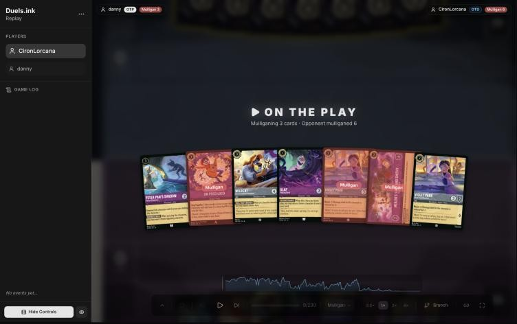
*The board before the decision: [step 0](https://duels.ink/replay/01a216e7-7741-7814-9aa2-e5365eb4f09f?step=0) in the duels.ink replay viewer.*

**What you did:** on the play. You kept Peter Pan's Shadow, Wildcat, Olaf and one Violet Parr, and sent back Un Poco
Loco, Merlin's Shop and the second Violet.

**Verdict: close call.** Keeping all seven gives the same curve and a little more board, and keeps an engine;
`tools/mulligan.py` (1,500 deals each):

| Option | Ink spent T1–4 | Play turns | Lore by T4 | Characters T4 | Interaction |
|---|---|---|---|---|---|
| Keep all 7 | 9.83 | 4.00 | 6.3 | 4.6 | 100% |
| As played (keep 4) | 9.76 | 3.99 | 6.3 | 4.4 | 100% |
| Full mulligan | 9.30 | 3.61 | 4.8 | 3.7 | 92% |

The seven already had a play on each of turns 1–4 (Olaf, Violet, Wildcat or Shadow, Violet with the Shop), six
inkable cards and a 2-ink engine ([MULL-1](#cite-mull-1), [MULL-2](#cite-mull-2)). In the mirror, the Shop's card and lore a turn is what the long
game turns on, and Un Poco Loco replays Shadow's and Wildcat's on-play effects later. Sending them back trades them
for random cards from a deck whose average card (Isis, Shere Khan, Hades, Demona, Cheshire) is about as good, so the
sim's near-tie stands: a small edge for keeping, too small to call a mistake. If you were digging for a specific
answer, an early Cheshire or Shere Khan, say, that's the case for the mulligan (an open question). Confidence:
medium (the sim can't weigh card quality).

### Turn 1: your turn 1

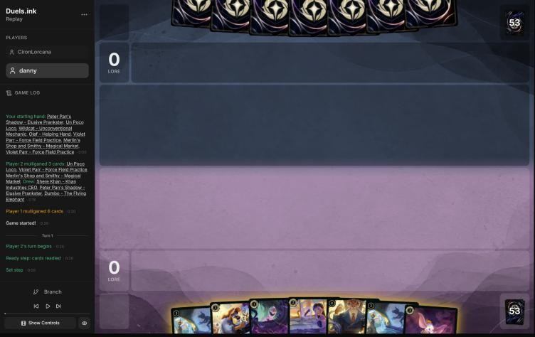
*The board before the decision: [step 3](https://duels.ink/replay/01a216e7-7741-7814-9aa2-e5365eb4f09f?step=3) in the duels.ink replay viewer.*

**The plan (written before seeing the turn):** the redraw brought Shere Khan, a second Shadow and Dumbo – The Flying
Elephant, so the hand holds three uninkables (two Shadows, Shere Khan) and four inkables (Olaf, Violet, Wildcat,
Dumbo). Ink is the constraint: Olaf now and Violet next turn spend two inkables, so turn 3's ink must come from the
draws (44 of the 53 cards left are inkable). Candidates:
- **Ink Dumbo, play Olaf** (1 of 1): keeps Wildcat, the better 3-drop in the mirror (4/3 beats their early bodies),
  and turn 2 is Violet with Wildcat or a draw inked.
- **Ink Wildcat, play Olaf** (1 of 1): keeps Dumbo, whose Evasive their Shadows can still reach; Wildcat's item
  banish has few targets in their lists.
- **Ink Violet:** leaves turn 2 with nothing to play at 2 ink. Worse.

Nothing of theirs can challenge on turn 2 (a 1-drop is drying), so Olaf is safe.

**What you did:** inked Dumbo, played Olaf.

**Verdict: good play**, the line planned: the curve play, keeping Wildcat and both Violet and the Shadows for turns
2–3 ([MULL-2](#cite-mull-2), [INK-2](#cite-ink-2)).

### Turn 3: your turn 2

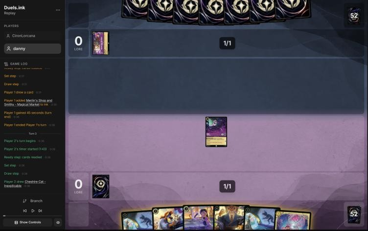
*The board before the decision: [step 8](https://duels.ink/replay/01a216e7-7741-7814-9aa2-e5365eb4f09f?step=8) in the duels.ink replay viewer.*

**The plan:** you drew Cheshire Cat. Their board is empty and they inked a Merlin's Shop (a Shop list, like the
unlisted Merlin and Shop variant, or the Midrange list's three). Nothing of theirs can challenge next turn (anything
they play is drying, and nothing in their lists has Rush at 2), so Olaf quests for free. Ink: Wildcat, Violet and
Cheshire are the inkables, against three uninkables (two Shadows, Shere Khan) still to cast at 3 and 4. Candidates:
- **Quest Olaf, ink Wildcat, play Violet** (2 of 2): keeps Cheshire, whose Boost moves damage and is the better card
  in the mirror. Next turn inks Cheshire or a drawn card and plays a Shadow or Cheshire.
- **The same inking Cheshire:** keeps a 4/3 body for turn 3, gives up the engine ([INK-2](#cite-ink-2)).

**What you did:** inked Wildcat, played Violet, quested with Olaf (1–0).

**Verdict: good play**, the planned line: a free quest and the curve, keeping Cheshire ([INK-2](#cite-ink-2)).

### Turn 5: your turn 3

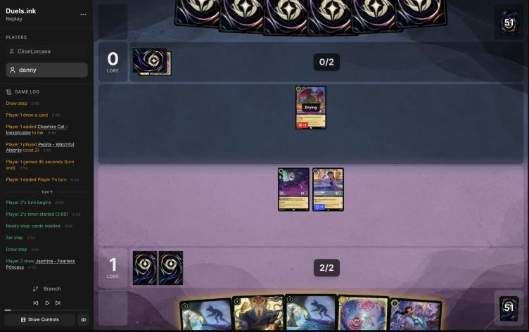
*The board before the decision: [step 15](https://duels.ink/replay/01a216e7-7741-7814-9aa2-e5365eb4f09f?step=15) in the duels.ink replay viewer.*

**The plan:** you drew Jasmine – Fearless Princess (5, 3/7/2; Evasive on your turn, a discard for Challenger +3).
They have Pepita (2/3, Challenger +2), dry next turn, and inked Cheshire Cat: of the common lists, most like
Midrange (Shop, Pepita and Cheshire all fit it); could be a Shop variant or their own build. Lore 1–0.
- **Their next turn (3 ink):** Pepita challenges for 4, a free kill on an exerted Olaf (FREE KILLS) and a trade with an
  exerted Violet. Strength of a Raging Fire deals damage equal to their characters in play; Demona – Imperious with a
  discard challenges at once for 4 (Rush); Shadow exerts one of yours; Angela gives Pepita +2 more.
- **Resources:** 3 ink if you ink Cheshire or Jasmine (the only inkables; two Shadows and Shere Khan are not).
  Olaf and Violet are dry.
- **Candidates:**
  - **A. Shadow exerting Pepita, Violet challenges it, Olaf quests** (Shadow 3 of 3). Violet's 3 kills Pepita (3
    willpower); Pepita hits back for 2, 1 after Resist, so Violet lives on 1 of 2. Their board is empty, lore 2–0.
    Left exposed: Olaf and Violet exerted, to Demona – Imperious's Rush (4) and Strength (1 damage if they play a
    character first: kills Olaf; Violet's Resist takes it to 0). Shadow stays ready.
  - **B. Cheshire, quest both** (3 of 3): 2 lore, but Pepita then kills Olaf for free or trades with Violet, and
    nothing of theirs has been removed ([QC-2](#cite-qc-2), [TEMPO-1](#cite-tempo-1)).
  - **C. Shadow exerting Pepita, quest both:** 1 more lore than A, and Pepita lives to challenge next turn.

  A is clearly best: Shadow's exert is removal now, while Pepita is their only character ([TEMPO-2](#cite-tempo-2)).
- **Ink:** Cheshire or Jasmine. Keeping Cheshire (3) fits a hand with three uninkables better and its Boost works
  with the damage your challenges leave; keeping Jasmine keeps a 2-lore, 7-willpower quester their challengers can't
  easily kill but needs two more inkable draws by turn 9. Close either way ([INK-2](#cite-ink-2)).

**What you did:** inked Cheshire, played Shadow exerting Pepita, challenged it with Violet (Pepita banished, Violet on
1 damage), quested with Olaf (2–0).

**Verdict: good play**, line A: their only character removed for the cost of Shadow's on-play effect, and a quest
([TEMPO-1](#cite-tempo-1), [TEMPO-2](#cite-tempo-2)). Inking Cheshire and keeping Jasmine is the close call above, not a flag.

### Turn 7: your turn 4

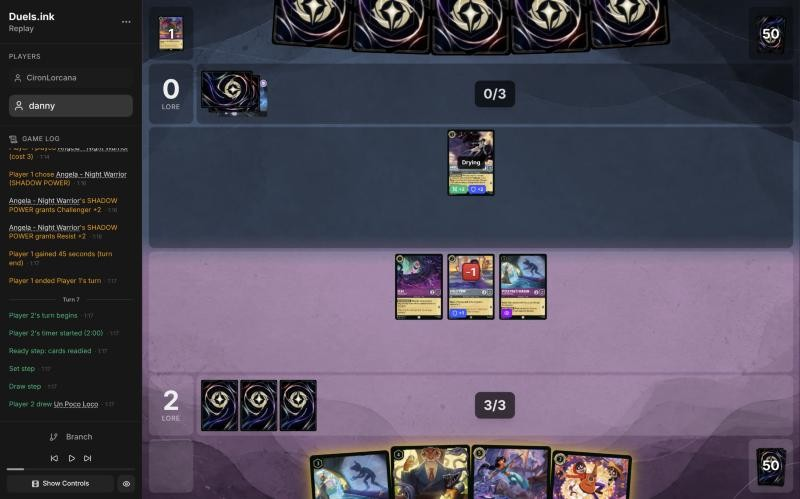
*The board before the decision: [step 27](https://duels.ink/replay/01a216e7-7741-7814-9aa2-e5365eb4f09f?step=27) in the duels.ink replay viewer.*

**The plan:** you drew Un Poco Loco. Lore 2–0. They played Angela – Night Warrior and gave herself Challenger +2 and
Resist +2 until their next turn, and inked Hades: of the common lists, most like Midrange (every card seen fits it).
- **Nothing of theirs can be killed this turn.** Angela is ready, and even exerted (a second Shadow) Resist 2 cuts
  Violet's 3 to 1. Your own Shere Khan would be drying, so his NEW INCENTIVE has no challenger that kills her. Un Poco
  Loco's replay of Shadow (the brief's REPLAY ON-PLAY EFFECTS line) has the same problem: an exert with no kill
  behind it. So this is a develop-and-quest turn.
- **Their next turn (4 ink; Angela is a plain 2/3 again):** FREE KILLS: Angela kills an exerted Olaf for nothing;
  against an exerted Violet (1 willpower left) she trades, since Violet's 3 back kills her. Shadow's Evasive keeps out
  everything but Demona – Imperious with a discard (Rush and Evasive, 4). Their Shere Khan lets Angela challenge a
  ready character. Strength of a Raging Fire (Angela sings it) deals 1 per character of theirs, Angel – Experiment
  624's GOOD AIM 2 for a discard: either kills Olaf, Shadow or a Shere Khan of yours, ready or not.
- **Quests:** all three. Olaf's death costs a 1-drop and gives you SECOND CHANCE (return a character of yours, e.g. a
  Shadow to replay its exert), and it leaves Angela exerted for your next turn; Violet's is a trade you'd take;
  Shadow's is close to free. Staying home protects none of them from Strength or GOOD AIM ([H-12](#cite-h-12)'s reasoning).
- **What to play (4 ink after inking Jasmine or Un Poco Loco):**
  - **A. Shere Khan** (4 of 4): a 4-strength body that can challenge Angela next turn, but his NEW INCENTIVE is spent
    on nothing, and his 2 willpower dies to Strength or GOOD AIM.
  - **B. The second Shadow** (3 of 4): an Evasive quester, its exert also spent on nothing, 1 ink unused.

  Either spends an on-play effect for a body; you still hold the other plus Un Poco Loco to replay it. A gets the
  bigger body out of an ink-tight hand; close.
- **Ink:** Un Poco Loco can be sung for free (Shadow alone, or Olaf with Violet), so it needs no ink to cast;
  Jasmine needs 5. Keeping Un Poco Loco and inking Jasmine suits the short ink; keeping Jasmine keeps the stronger
  quester. Close.

**What you did:** inked Un Poco Loco (keeping Jasmine), played Shere Khan (NEW INCENTIVE on Shadow, with no ready
target worth it), quested with Shadow only (3–0). Olaf and Violet stayed home.

**Verdict:**
- **Shere Khan, inking Un Poco Loco: good play** (line A, and the ink is the close call above).
- **Keeping Olaf and Violet home: inaccuracy.** Keeping them home is suboptimal because it protects them only from
  Angela's plain challenge, while their likeliest removal (Strength of a Raging Fire, GOOD AIM, their own Shere Khan's
  NEW INCENTIVE) reaches them ready or exerted. Questing both is better because:
  - It's 2 more lore (5–0).
  - FREE KILLS: Angela can kill an exerted Olaf for nothing. That costs them Angela's quest, leaves her exerted and on
    1 willpower for your turn, and Olaf's SECOND CHANCE returns a character of yours (a Shadow, to replay its exert).
  - Violet's quest only offers a trade you'd take: her 3 back kills Angela, a 3-drop, for a damaged 2-drop.

  Questing all three leaves Olaf, Violet and Shadow exerted, with Shere Khan ready, and inks the same. Waiting gained
  only that Olaf might live to quest on a later turn, and Angela would threaten him just the same then ([decision method, "Keeping a quester ready for nothing"](#cite-docs-decision-method-keeping-a-quester-ready-for-nothing);
  [QC-3](#cite-qc-3), [RULE-1](#cite-rule-1)). Confidence: medium. If you were keeping Olaf and Violet
  as Sing Together singers for a free Un Poco Loco, that plan went when you inked it, so it doesn't explain this turn
  (an open question).

### Turn 9: your turn 5

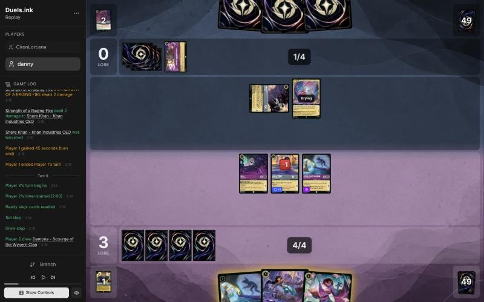
*The board before the decision: [step 37](https://duels.ink/replay/01a216e7-7741-7814-9aa2-e5365eb4f09f?step=37) in the duels.ink replay viewer.*

**The plan:** you drew Demona – Scourge. Lore 3–0. Their Angela sang Strength of a Raging Fire (2 damage, for their
two characters) to kill Shere Khan, so she's exerted; Cheshire Cat is new and drying. They hold 3 cards, with 4 ink
(5 next turn); a second Shop inked.
- **Their next turn:** Cheshire's Boost (2 of their 5 ink) moves up to 2 damage counters from any character, yours
  included, onto one of yours: Violet's own 1 damage moved onto Olaf kills him, ready or not (THEIR CHARACTERS THAT CAN
  DAMAGE YOUR READY ONES). FREE KILLS: Angela on an exerted Olaf, Cheshire on an exerted Violet. Hades (5) would ask
  you to bottom your best character or give them 2 cards. Demona – Scourge needs 6, a turn away.
- **Removal now:** Violet kills the exerted Angela (3 into 3 willpower) and dies to her 2 back (1 after Resist, on
  top of 1 damage). A trade of a damaged 2-drop for their 3-drop, and it removes a free singer of their Strengths and
  the 1 damage Cheshire would move. Cheshire is ready and drying; killing it needs a second Shadow's exert and two of
  your characters, both dying to its 3 back: too dear.
- **Candidates** (both trade Violet for Angela and quest Olaf and Shadow, 5–0):
  - **A. Ink Demona, play Jasmine** (5 of 5): a 2-lore, 7-willpower quester that none of their challengers kills, and
    the full ink used. Demona is gone for good ([INK-1](#cite-ink-1)). Hand: the second Shadow.
  - **B. Ink Jasmine, play the second Shadow** (3 of 5): keeps Demona for next turn, when your hand will be nearly
    empty and her refill draws you 2–3 ([H-1](#cite-h-1)). Needs an inkable draw for the 6th ink (about 4 in 5), and spends 2 ink
    and Shadow's exert on nothing now.

  A uses the turn better; B keeps the stronger card for the turn it fits. Close.
- **Olaf's quest:** Cheshire can kill him for free afterwards, which costs them Cheshire's quest and leaves it exerted
  for your next turn, and SECOND CHANCE returns a character of yours. His quest is worth taking.

**What you did:** inked Jasmine (keeping Demona), played the second Shadow exerting Cheshire, then three challenges:
Violet into Angela (both banished), the first Shadow into Cheshire (2 damage, Shadow banished), Olaf into Cheshire
(Cheshire and Olaf banished). You declined Olaf's SECOND CHANCE. Their board is empty; yours is the new Shadow. Lore
3–0, 2 ink unused.

**Verdict: good play**, better than the plan. The plan called Cheshire "too dear" at two characters; it undervalued
the engine.
- **Cheshire was the card that made your small board die for free.** Each Boost moves 2 damage, through Resist, onto
  any character of yours, ready or not. Olaf (1 willpower) and the first Shadow (2) were exactly what it, and Strength
  sung by a 3-drop, would have picked off over the next turns. Trading them for it is the trade the method says to
  take against an engine: value it by its future turns, not its lore ([decision method, section 4, item 7](#cite-docs-decision-method-4-evaluate-each-line); [H-8](#cite-h-8) is the
  same idea against a ramp engine).
- **Against plan A or B**, you gave up 2 lore (5–0 there) and two bodies. In return their board is empty, their hand
  is 3 cards, and you hold Demona for a refill turn with your hand at 1 ([H-1](#cite-h-1)). Plan B's ink and Demona are kept too.
- **SECOND CHANCE:** returning the only character left (the new Shadow) would have emptied your board for a later
  exert. Keeping it as an Evasive quester is better while they have nothing to exert. Right to decline.

Left exposed: the new Shadow, ready and drying, to Strength (with one character of theirs in play, 1 damage) or
GOOD AIM. Confidence: medium. The plan's error goes in the errors table at discussion.

### Turn 11: your turn 6

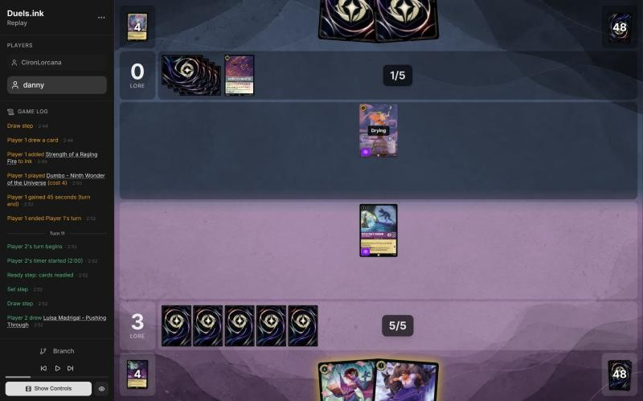
*The board before the decision: [step 49](https://duels.ink/replay/01a216e7-7741-7814-9aa2-e5365eb4f09f?step=49) in the duels.ink replay viewer.*

**The plan:** you drew Luisa Madrigal – Pushing Through (1, 0/3, Challenger +2). Lore 3–0. They rebuilt with Dumbo –
Ninth Wonder of the Universe (4, 3/3 Evasive; {E} and 1 ink: draw a card and gain 1 lore, and the same for their
other Evasive characters): a draw-and-lore engine, which only Evasive characters can challenge. They hold 2 cards,
with 5 ink (6 next turn).
- **Resources:** 5 ink, 6 if you ink Luisa (your only other inkable). Hand: Demona, Luisa. Shadow is dry.
- **Their next turn (6 ink):** Dumbo's BREAKING RECORDS (a card and a lore), or Dumbo challenging an exerted Shadow
  (FREE KILLS: Shadow, by Dumbo alone, which takes 2 back). Their own Demona – Scourge is now castable. Hades, Strength
  (1 damage per character of theirs) and Cheshire with a Boost (5 of their 6) are the rest.
- **Candidates:**
  - **A. Ink Luisa, Demona** (6 of 6): exerts Dumbo, and the refill draws you 3, from an empty hand ([H-1](#cite-h-1)), and them 1
    (2 → 3). Nothing of yours can kill the exerted Dumbo (Shadow's 2 into 3 willpower), so the exert buys nothing
    this turn; the refill and a 2-lore, 6-willpower body are the point.
  - **B. Luisa, hold Demona for next turn** (1 of 5): wastes 4 ink, and next turn's refill would be no bigger. Worse.
- **Shadow's quest:** +1. If Dumbo kills it, Dumbo spends its turn challenging rather than drawing and questing, and
  is left on 1 willpower. If Shadow stays home, Dumbo draws a card and takes a lore. Quest.

**What you did:** inked Luisa and played Demona: Dumbo exerted, and the refill drew you Hades, Merlin's Shop and
Shere Khan (them 1). Shadow stayed home. Lore 3–0.

**Verdict:**
- **Demona: good play** (line A). The refill drew 3 from an empty hand, the most it can ([H-1](#cite-h-1)), and gave them only 1.
- **Shadow at home: close call.** The plan quested for the lore and the bait: Dumbo either spends its turn killing
  Shadow, ending on 1 willpower, or draws and quests as before. Keeping Shadow keeps your only Evasive character, the
  one card that can challenge Dumbo, for a turn when a damage move or a second attacker can finish it. Both are
  defensible.

### Turn 13: your turn 7

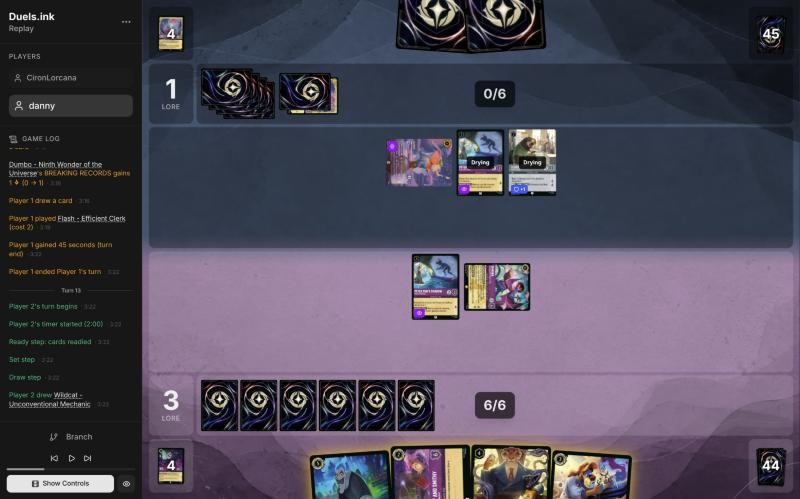
*The board before the decision: [step 59](https://duels.ink/replay/01a216e7-7741-7814-9aa2-e5365eb4f09f?step=59) in the duels.ink replay viewer.*

**The plan:** you drew Wildcat. Lore 3–1. Their Shadow exerted Demona, and with 4 cards in your hand STONE BY DAY
kept her from readying: she can't quest, and she's challengeable. Dumbo drew and took a lore (it's exerted), and
Flash – Efficient Clerk (2, 3/2/2, Resist 1; no character can have Rush) came down. They hold 2 cards, with 6 ink (7
next turn).
- **The race:** their board quests for 4 a turn, plus Dumbo's card and lore, which MAKING HISTORY also gives their
  Evasive Shadow. That's 20 by about game turn 22 as it stands; you're at 3 with one quester. Dumbo is the engine and
  Flash the 2-lore quester ([THREAT-2](#cite-threat-2)).
- **Their next turn (7 ink):** their Shadow and Dumbo sing Strength for 3 (3 characters): it kills Shadow, Wildcat or
  Shere Khan, not Hades. FREE KILLS: an exerted Shadow, by Dumbo or their Shadow. Demona, stuck exerted, dies to Dumbo
  plus Flash, both dying to her 5 back. Their own Demona or Hades (6–7 ink) are possible.
- **STONE BY DAY:** Demona readies next turn only if you hold 2 or fewer cards at your Ready step, so emptying the
  hand matters too.
- **Candidates** (7 ink with an ink):
  - **A. Hades on Dumbo first** (5 of the 6 already there), then ink and play the Shop (2 of 2). They bottom Dumbo,
    which ends both engines, or you draw 2. Hades goes first so his draws come before the ink choice ([SEQ-1](#cite-seq-1)). Hand
    after: Shere Khan (and any draws), so if they bottom Dumbo Demona readies.
  - **B. Shere Khan's NEW INCENTIVE on Shadow**, which challenges their ready Shadow (a trade, 2 into 2 both ways),
    plus the Shop (6 of 7). It kills the second engine piece but leaves Dumbo.
  - **C. Wildcat and Shere Khan** (7 of 7): two bodies that Strength for 3 kills, and the engine untouched.

  A is best: it hits the engine, the brief's dig line says it can draw you 2, and it empties the hand for Demona.
- **Shadow:** quest (+1). FREE KILLS: Dumbo or their Shadow kills it for nothing, but that's their engine's turn spent.

**What you did:** Hades first, choosing Dumbo. They let you draw 2 (a second Hades and Junior Woodchuck Guidebook).
Then you inked Wildcat and played the Shop. Shadow stayed home. Lore 3–1; hand Shere Khan, Hades, Guidebook.

**Verdict: good play**, line A in the planned order.
- **Their choice was the one the knowledge base warns about.** Giving you 2 cards keeps your hand at 3, so STONE BY
  DAY holds Demona exerted for another turn ([the Demona – Scourge note](#cite-kb-cards-demona-scourge-of-the-wyvern-clan-facing-her), "Your own cards change their hand count"). Choosing nobody would have let her ready (hand 1 after the Shop), but it gave up both outcomes:
  Dumbo gone, or two cards. Two cards outweigh one turn of Demona's quest, and Hades #2 and the Guidebook can bring
  the hand under 3 next turn.
- **No ink after the draws gets the hand under 3:** one ink and one 2-cost play from five cards leaves three. So
  inking Wildcat and playing the Shop (2 of 2) was as good as any order.
- **Shadow at home:** the turn-11 close call again.

### Turn 15: your turn 8

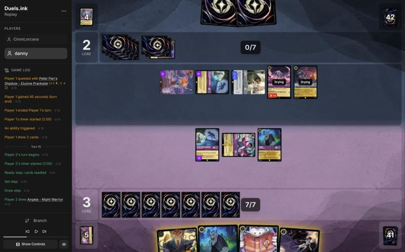
*The board before the decision: [step 72](https://duels.ink/replay/01a216e7-7741-7814-9aa2-e5365eb4f09f?step=72) in the duels.ink replay viewer.*

**The plan:** you drew Angela. Lore 3–2, but their board now quests for 7: Goliath – Clan Leader (6, 6/5/2, off every
listed list; DUSK TO DAWN: at the end of each player's turn that player discards down to 2 cards, or draws up to 2),
Flash 2, Dumbo, their Shadow and Rafiki – Mystical Fighter (1, 0/2, Challenger +3) 1 each. Dumbo and Flash destroyed
your Shop. At that rate they reach 20 on game turn 20. Dumbo, their Shadow and Flash are exerted; Goliath and Rafiki
are drying. Demona is still stuck (4 cards in hand).
- **What must happen:** take quest power off their board now. Their 2-lore pieces are Goliath and Flash; Dumbo and
  their Shadow (through MAKING HISTORY) are the card engine.
- **Goliath changes two of your cards:**
  - DUSK TO DAWN trims you to 2 at the end of each of your turns while he lives. A Hades draw then buys a choice, not
    cards, so they'll always "let you draw" rather than bottom him, and cards you can't play this turn are lost.
  - Killed this turn, DUSK TO DAWN never happens, and Hades #2's question is real again next turn ([SEQ-4](#cite-seq-4)).
- **Challenges on the exerted:** Hades kills Flash (3 −1 Resist = 2) and survives on 1; your Shadow trades with theirs
  (2 into 2 both ways); Dumbo takes only Shadow's 2.
- **Candidates** (8 ink; Shere Khan is uninkable, so ink the Guidebook):
  - **A. Shere Khan, NEW INCENTIVE on Hades; Angela, Challenger +2 and Resist +2 on Hades** (4 + 3 = 7 of 8). Hades
    challenges the ready Goliath: 5 into 5 willpower kills him; 6 back less Resist 2 is 4, so Hades dies too.
    CORNER THE MARKET gives an ink drop for the kill. Shadow trades with their Shadow. They keep Dumbo, Flash and
    Rafiki (4 a turn); you keep Demona (she readies next turn with 1 card in hand), Shere Khan and Angela, with Hades
    #2 in hand.
  - **B. Angela on Hades, who kills Flash (5 −1 = 4, takes 1); Shadow trades; Hades #2 on Goliath** (3 + 5 = 8 of 8).
    They keep Goliath, Dumbo and Rafiki (also 4 a turn) and give you 2 cards that DUSK TO DAWN trims back to 2. More
    bodies for you, but Goliath's 6 strength stays to kill a character a turn (your exerted Hades, or Demona in a
    trade).
  - **C. Hades on Flash, Shadow trade, bodies with the rest:** Goliath and his 6 strength untouched.

  A is best: it removes the one character that wins every combat and makes your card draw worthless, at the cost of a
  Hades ([THREAT-1](#cite-threat-1), [TRADE-3](#cite-trade-3)).
- **What A leaves exposed:** Demona exerted, which takes two of Flash, Rafiki (3 challenging) and Dumbo, each dying to
  her 5 back. Shere Khan and Angela are ready: Strength (3 characters, so 3) kills either. Their Demona or Hades at 8
  ink is possible.

**What you did:** Shere Khan (NEW INCENTIVE on Shadow), then Angela giving Shadow Challenger +2 and Resist +2. Shadow
challenged Dumbo: 4 into 3, Dumbo banished, Shadow took 1. CORNER THE MARKET gave an ink drop. Hades challenged
Flash (banished; Hades on 3 damage). You inked the second Hades and played the Guidebook with the drop. With your
hand empty, DUSK TO DAWN drew you 2 at the end of the turn (Guidebook, Violet). Lore 3–2; their board is Goliath,
their Shadow and Rafiki (4 a turn).

**Verdict: good play**, better than the plan.
- **Angela on Shadow was the line the plan missed.** The plan treated Dumbo as out of reach (Shadow's 2 into 3
  willpower) and never put Angela's +2 on the one character that can challenge an Evasive: with it, Shadow kills Dumbo
  and survives on Resist 2.
- **Two kills for none, against the plan's two for two.** Dumbo (the card engine, which also gave their Shadow its
  draw) and Flash (2 lore) are gone; Shadow and Hades live. The plan's line killed Goliath and their Shadow but lost
  Hades and Shadow. Both leave them questing for 4.
- **Emptying the hand was free.** With Goliath in play, DUSK TO DAWN refills an empty hand to 2 at the end of your
  turn, so inking Hades #2 and playing out the Guidebook cost no cards. It also gets Demona under 3 cards for your
  Ready step.

Left exposed: Goliath is the problem. FREE KILLS: Hades (1 willpower left) to Goliath or Rafiki, and Demona to
Goliath, who dies to her 5 back. Shadow is safe until your next turn behind Evasive and Resist 2. Confidence:
medium-high. The plan's miss goes in the errors table at discussion.

### Turn 17: your turn 9

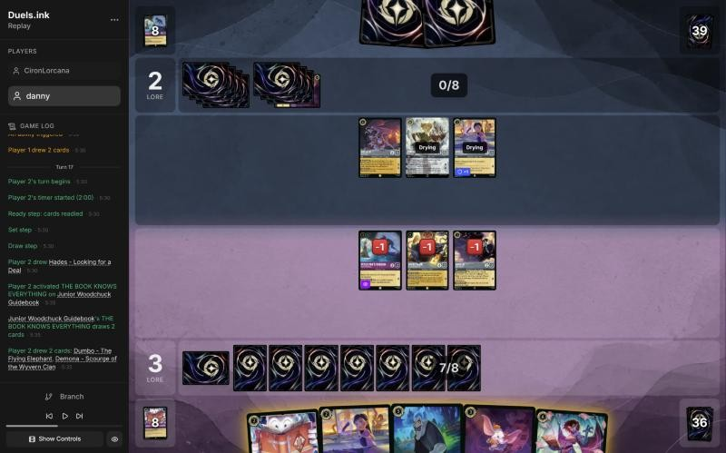
*The board before the decision: [step 89](https://duels.ink/replay/01a216e7-7741-7814-9aa2-e5365eb4f09f?step=89) in the duels.ink replay viewer.*

**The plan:** you drew Hades. Lore 3–2. Their turn swung it:
- Tinker Bell – Giant Fairy, cast for 6, dealt 1 to each of yours and finished Hades.
- Rafiki and their Shadow then challenged the stuck Demona to death, both dying to her 5 back.
- They didn't quest.

They now have Goliath (ready), Tinker Bell and a Violet Parr (both drying), questing for 5 a turn: 20 on game turn 24.
Your board is three damaged characters: Shadow and Shere Khan on 1 willpower, Angela on 2. They hold 2 cards and
have 8 ink (9 next turn).
- **The needs check:** your board quests for 3 a turn and can't win that race. You need their 2-lore characters
  (Goliath, Tinker Bell) gone, and nothing of theirs is exerted to challenge. The pieces that do it are in your deck:
  - Isis (4) or a Shadow exerting one, for Shere Khan and Angela (4 + 2 = 6) to kill a 5-willpower character;
  - Demona's exert-all;
  - Un Poco Loco returning Shadow to replay its exert;
  - Cheshire's damage moves.

  `WHAT'S LEFT IN YOUR DECK` gives about 2 in 3 to see an Isis with this turn's digs (68%), and better than even for
  Demona or Un Poco Loco (57%).
- **DUSK TO DAWN** trims you to 2 cards, or refills you to 2, at the end of your turn. So cards are worth drawing only
  if you can play them this turn, and ending with an empty hand is free.
- **Their next turn (9 ink):** FREE KILLS: Goliath on an exerted Shere Khan, their Violet on an exerted Angela.
  Ready or not, Strength (3, for their three characters) kills any of yours but Hades; a second Tinker Bell or a Violet
  – Super Resilient could be Shifted in to challenge at once.
- **Candidates:**
  - **A. Dig first, then spend what it finds.** Use the Guidebook in play (1 ink, 2 cards), then Hades on Goliath (5).
    They bottom Goliath, or you draw 2 more. Ink after the draws ([SEQ-1](#cite-seq-1)), and spend the last 3 on the find: Shadow's
    exert on Goliath or Tinker Bell, then Shere Khan and Angela kill it (6 into 5, both dying to the 6 or 4 back);
    or Isis for the same with 4.
  - **B. Bodies:** Hades, Violet and the second Guidebook with no dig first. Nothing is removed, so they keep 5 a turn.

  A is the only line that can change the race this turn.
- **Quests:** only after the plays. Questing Shere Khan or Angela gives Goliath or Violet a free kill, but that kill is
  their quest given up (2 or 1 lore). With the race lost on the current boards, a quest is worth the exposure only if
  it adds to a winning line.

**What you did:**
- **The dig:** used the Guidebook first, drawing Dumbo – The Flying Elephant and Demona – Scourge.
- **Ink and plays:** inked the second Hades, played Violet (2), then Demona (6, so 9 of 9). Demona exerted their
  board; the refill drew you the Shop and them 1 card.
- **The kill:** Angela and Shere Khan challenged Goliath, 2 + 4 into 5. Goliath was banished, and both of yours died
  to his 6 back.
- **Lore:** Shadow quested (4–2).

**Verdict:**
- **The dig, Demona and the Goliath kill: good play.** Digging first found the best answer in the deck. Demona's
  exert-all opened their whole board, and the one kill your damaged characters could make went on Goliath, their
  biggest body and the card that made your draws worthless. That beats Tinker Bell, which the same two could also
  kill ([TRADE-3](#cite-trade-3), [THREAT-1](#cite-threat-1)).
- **Inking the second Hades: inaccuracy.** It's suboptimal because:
  - with Goliath dying this turn, DUSK TO DAWN no longer trims your hand, so every card you keep is a card next turn;
  - Hades was the strongest of them, and WHAT D'YA SAY is a real question again once Goliath is gone.

  Inking Dumbo – The Flying Elephant (or the second Guidebook) is better: the turn is the same (Violet 2 + Demona 6 +
  Guidebook 1 = 9 of 9), and you'd keep Hades for next turn's 10 ink. That line exposes the same board as yours ([INK-1](#cite-ink-1),
  [INK-2](#cite-ink-2)). Confidence: medium. If you wanted the cheaper cards for a wider next turn, that's an open question.

### Turn 18: their turn

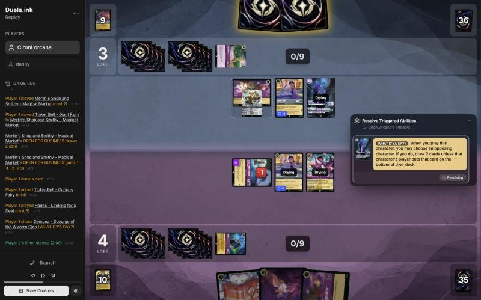
*The board before the decision: [step 101](https://duels.ink/replay/01a216e7-7741-7814-9aa2-e5365eb4f09f?step=101) in the duels.ink replay viewer.*

**What happened:** they played a Shop and moved Tinker Bell there (a card and a lore, 4–3), inked Tinker Bell – Curious
Fairy, and played Hades choosing Demona. You let them draw 2 rather than bottom her. Nothing quested.

**Verdict: good play.** Demona is your board: her 2 lore a turn is most of your clock (4–3, with Shadow on 1 willpower
and a fresh Violet beside her), and her 6 willpower is the one body their Tinker Bell, Violet and Hades can't kill in
one challenge. Bottoming her would leave you racing with two 1-lore characters. Two cards for them, holding 2 with
9 ink, is a real price (the converse in [H-2](#cite-h-2) doesn't apply to a player with ink to spend), but a smaller one.

### Turn 19: your turn 10

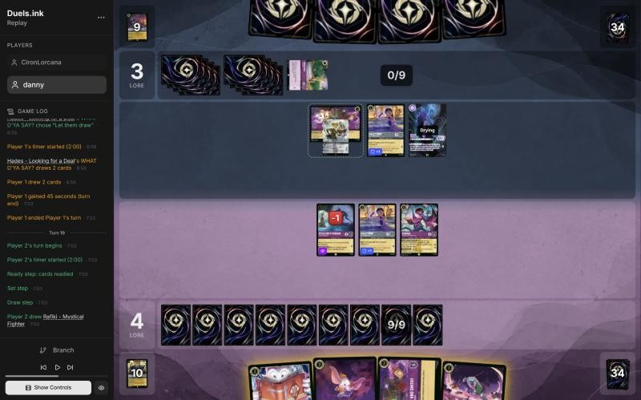
*The board before the decision: [step 103](https://duels.ink/replay/01a216e7-7741-7814-9aa2-e5365eb4f09f?step=103) in the duels.ink replay viewer.*

**The plan:** you drew Rafiki. Lore 4–3. Their board: Tinker Bell (at their Shop), Violet, Hades (drying) and the
Shop; 4 a turn plus a Shop move (a card and a lore). They hold 4 cards, with 9 ink (10 next turn). Yours: Demona
(ready, dry), Violet, Shadow (1 willpower left). Nothing of theirs is exerted.
- **The race is yours if you quest:** Demona 2 + Shadow 1 + Violet 1, a Shop move 1, and Dumbo from next turn: about
  9 this turn, 15 next, 20 by game turn 23. Their pace reaches 18 on turn 24. So quest every turn, and protect the
  2-lore Demona.
- **STONE BY DAY:** once Demona quests she stays exerted (unable to quest, and challengeable) if you hold 3 or more
  cards at your Ready step. End the turn with 2 or fewer.
- **Their next turn (10 ink):** FREE KILLS: an exerted Violet, to Hades. Demona exerted takes Violet and Hades
  together (both die to her 5 back), or Tinker Bell with Angela's +2. Strength (3 for their three characters) kills
  Shadow, Violet, Dumbo or Rafiki, ready or not; their Demona – Scourge, Cheshire's moves and a third Hades are also
  in their list.
- **Candidates** (10 ink with an ink):
  - **A. Ink the Guidebook; play the Shop and move Demona there (2 + 2, a card and a lore); Dumbo – The Flying
    Elephant, AERIAL DUO on Demona (3); Rafiki (1); quest Demona, Shadow and Violet.** That's 8 of 10, and the Shop's
    card can use the rest. Demona's Evasive until your next turn shuts out every challenger they have in play, since
    they have no Evasive character left. Hand at the end: 1 card plus the Shop's draw, so Demona readies.
  - **B. The same with the Guidebook played and used too** (10 of 10): 2 more cards, but a hand of 3 keeps Demona
    exerted next turn.
  - **C. Demona and Violet destroy their Shop** (5 + 3 into 6): 1 lore and a card a turn denied, but 3 lore of quests
    lost now. It wins on about turn 25 against A's 23.

  A is best ([QC-5](#cite-qc-5), [POS-1](#cite-pos-1)).

**What you did:**
- **Dug first:** played and used the Guidebook (Pepita, a second Shop).
- **The Shop:** played it and moved Shadow there, for a card and a lore: the card was a third Demona.
- **Then:** played Pepita, inked the second Shop, played Rafiki (10 of 10), and quested with Shadow (6–3).
- **Kept home:** Demona and Violet. Hand: Dumbo, Demona.

**Verdict: good play**, better than the plan.
- **The dig was right before you knew what it found.** The plan skipped the Guidebook because 2 more cards would leave
  3 in hand and keep Demona exerted under STONE BY DAY. You dug and then played the cheap finds (Pepita, Rafiki),
  ending on 2 cards: the card advantage without the lock.
- **Once Demona #2 was in hand, keeping Demona and Violet ready had a named purpose.** Next turn's exert-all opens
  their whole board to your dry challengers, and Pepita (4 challenging) and Rafiki (3) are exactly the ones that finish
  Hades and their Violet after Demona takes Tinker Bell. A quest now would have exposed both:
  - Demona: to Violet and Hades together, or to Tinker Bell with an Angela;
  - Violet: FREE KILLS, Hades alone.

  Either loss weakens that turn. That's waiting for a better challenge next turn, [the method's exception](#cite-docs-decision-method-keeping-a-quester-ready-for-nothing) to "keeping a quester ready for nothing".
- **The cost is 3 lore against the plan's line** (6 against 9). The plan's line left their board whole and raced into
  their removal; yours sets up a turn that can clear it. Exposed for their turn: Shadow (exerted, Evasive, 1
  willpower); Strength kills Shadow, Rafiki or Pepita; their own Demona would exert your waiting board for their three
  challengers. Confidence: medium.

### Turn 20: their turn

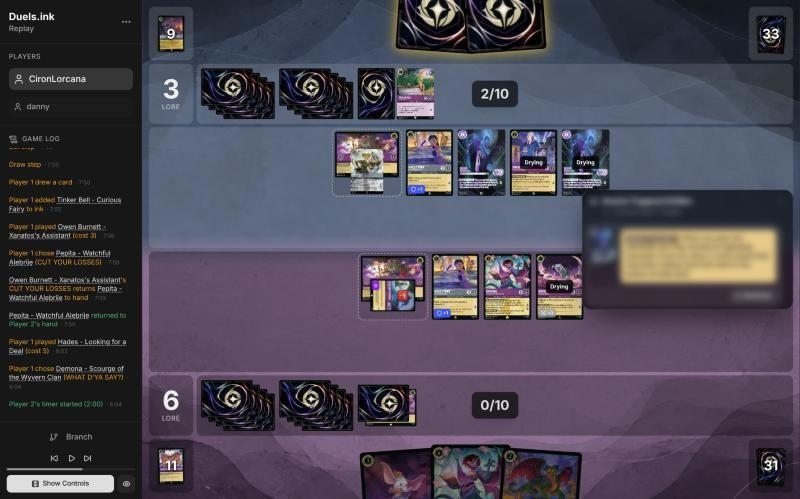
*The board before the decision: [step 118](https://duels.ink/replay/01a216e7-7741-7814-9aa2-e5365eb4f09f?step=118) in the duels.ink replay viewer.*

**What happened:**
- **Owen Burnett** (an unlisted card) returned your Pepita to your hand.
- **A second Hades** chose Demona, and you again let them draw 2.
- **Their board:** they played Pepita, and their Violet and the first Hades destroyed your Shop. Nothing quested
  (6–3).

**Verdict: good play**, for the turn-18 reasons and one more. They already held 4–5 cards with 10 ink, so 2 more add
less than usual, while Demona is your 2-lore quester and one of the challengers for next turn's exert-all.

### Turn 21: your turn 11

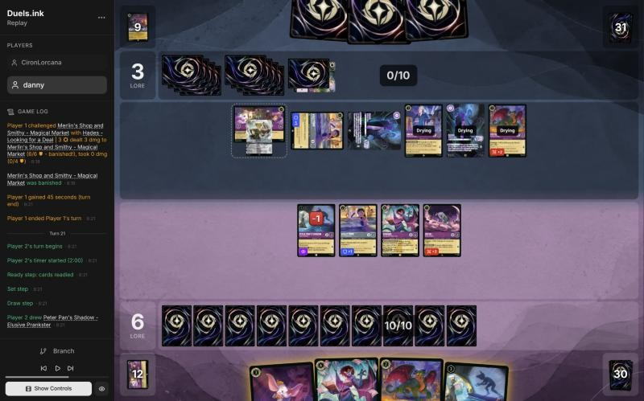
*The board before the decision: [step 123](https://duels.ink/replay/01a216e7-7741-7814-9aa2-e5365eb4f09f?step=123) in the duels.ink replay viewer.*

**The plan:** you drew a third Shadow. Lore 6–3. Their board is six characters questing for 7 a turn:
- Tinker Bell (at their Shop) and Owen Burnett;
- a Pepita;
- their Violet;
- two Hades.

Their Violet and one Hades are exerted, the rest drying. That's 20 by about game turn 24–26. They hold 3 cards, with 10
ink (11 next turn).
- **This is the turn the last one set up.** Demona #2 exerts their whole board, and your four dry characters
  challenge: Demona (5), Violet (3), Rafiki (3 challenging) and Shadow (2, on 1 willpower).
- **The kills available:**
  - Demona into Tinker Bell: 5 into 5, takes 4, lives on 2.
  - Violet into Pepita: 3 into 3, takes 1 after Resist, lives.
  - Rafiki into their Violet: 3 −1 = 2 into 2, dies to the 3 back.
  - Shadow into Owen: 2 into 2, dies.

  That's four of their six gone, leaving two Hades (2 a turn).
- **Order and ink** (10, 11 with an ink):
  - Pepita first (2), so Demona's refill finds your hand at 2 and draws 1.
  - Then Demona (6); ink after her draw ([SEQ-1](#cite-seq-1)).
  - Then Dumbo – The Flying Elephant (3), AERIAL DUO on the damaged Demona, so neither Hades can challenge her next
    turn.

  That's 2 + 6 + 3 = 11 of 11, and the hand ends at 1 (Shadow), so both Demonas can ready next turn.
- **What it leaves exposed:** your exerted Violet (1 damage) to either Hades (FREE KILLS); the first Demona (2
  willpower left) to Strength, which with two characters of theirs deals 2, Evasive or not; Dumbo to the same. The
  alternative of playing the third Shadow instead of Dumbo leaves Demona to a Hades challenge. Worse.
- **No quests:** every dry character has a kill to make, and the kills are worth more than the lore ([QC-2](#cite-qc-2), [TRADE-1](#cite-trade-1)).

**What you did:**
- **Before Demona:** inked one Pepita, then played Dumbo, AERIAL DUO on the first Demona.
- **Demona:** exerted their board, and the refill drew you 2 (Isis and a second Pepita) from a hand of 1. You played
  that Pepita (11 of 11).
- **The four challenges, as planned:** Tinker Bell, Pepita, their Violet and Owen were banished; Rafiki and the first
  Shadow died. Their board is the two Hades and the Shop. Lore 6–3; your hand is Shadow and Isis.

**Verdict: good play**, the planned line in a better order. Playing Dumbo before Demona got the hand down to 1, so the
refill drew 2 rather than the plan's 1, and the new Pepita still came down. Four of their six characters are gone for
two of yours. Their quest rate falls from 7 to 2, and the damaged Demona is Evasive against their Hades ([TRADE-1](#cite-trade-1),
[SEQ-2](#cite-seq-2)).

### Turn 22: their turn

**What happened:** they played Francine – Eyeing the Evidence (3, 4/3, Resist 1), Flash and their own Demona – Scourge.
Your board was exerted; the refill drew them 3 and you 1 (Olaf). Their two Hades killed Pepita and Violet. Your hand
is now 3, so STONE BY DAY keeps both your Demonas exerted at your Ready step. No choice of yours.

### Turn 23: your turn 12

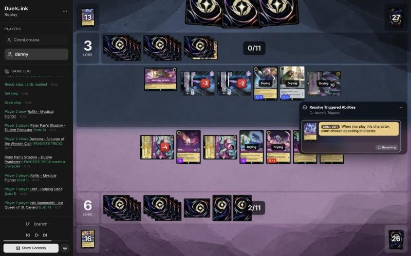
*The board before the decision: [step 145](https://duels.ink/replay/01a216e7-7741-7814-9aa2-e5365eb4f09f?step=145) in the duels.ink replay viewer.*

**The plan:** you drew Rafiki. Lore 6–3, but both your Demonas are stuck exerted (one on 2 willpower), and only Dumbo
is ready. They have:
- their Demona (5/6, drying);
- Francine and Flash (drying);
- two damaged, exerted Hades, on 1 and 2 willpower;
- the Shop.

That's 7 a turn: 20 on about game turn 28. They hold 3 cards, with 11 ink (12 next turn).
- **The needs check:** with both Demonas questing again (hand of 2 or fewer at your next Ready step), your board
  makes about 9 a turn: 7 now, 16, then 25 on game turn 27, a turn ahead of them. So the turn must:
  - empty your hand;
  - keep the Demonas alive;
  - stop as many of their questers as it can.
- **Their STONE BY DAY works for you too:** they hold 3 cards, so their Demona, once exerted, can't ready at their
  Ready step. Isis's CHILL OUT on her now keeps her exerted through their turn: no quest, no challenge, and she's
  there to be killed on your next turn.
- **What can hit your stuck Demonas:** FREE KILLS: only their Demona kills the damaged one for nothing. Everything
  else that challenges either Demona dies to her 5 back. Francine and one more (7) can kill the healthy one, at the
  cost of both. With their Demona held down, every kill costs them a character. Strength sung by any of their five
  deals 5 to a chosen character: the damaged Demona or any of the newcomers.
- **Candidates** (11 ink; Olaf and Rafiki are the only inkables):
  - **A. Isis, CHILL OUT on their Demona (4); Olaf and Rafiki (1 + 1); hold the third Shadow; Dumbo quests.** That's 6
    of 11, and your hand is 1, so both Demonas ready. Shadow's exert is worth more next turn, when your dry characters
    can kill whatever it exerts. Dumbo is Evasive, and they have nothing Evasive, so his quest is safe (7–3).
  - **B. As A, but Dumbo kills the Hades on 1 willpower** and dies to its 3 back: one attacker fewer, a quest lost.
  - **C. Play Shadow now too, exerting Francine or Flash:** they ready at the start of their turn (no STONE BY DAY),
    so the exert does nothing.

  A is best.

**What you did:** played Shadow (FAVORITE TRICK on their Demona), Rafiki, Olaf and Isis (CHILL OUT on Flash). Dumbo
challenged the Hades on 2 willpower; both were banished. Your hand is empty, so both Demonas ready next turn. Lore 6–3;
9 of 11 ink used.

**Verdict:**
- **Their Demona exerted with their hand at 3, and your hand emptied: good play.** That's the core of the plan. She
  can't ready next turn, and every challenge into your stuck Demonas now costs them the attacker.
- **Spending both exerts: inaccuracy.** Isis's CHILL OUT on Flash is suboptimal because Flash readies at the start of
  their turn, so it did nothing; Shadow had already done the one exert that mattered. Isis on their Demona and the
  third Shadow held is better:
  - your hand is 1, so the Demonas still ready;
  - next turn FAVORITE TRICK exerts one of their ready characters for your dry Demonas or Rafiki to kill. That's a
    kill against the 1 lore Shadow would add by being dry a turn sooner.

  Both lines use 6–9 ink and leave the same characters exposed, the newcomers to a Strength for 4–5 ([TEMPO-1](#cite-tempo-1), [SEQ-4](#cite-seq-4)).
  Confidence: medium.
- **Dumbo into the Hades rather than questing: close call.** A 3-cost 1-lore for a damaged 5-cost 1-lore removes one of
  the attackers that could trade into your Demonas.

### Turn 24: their turn

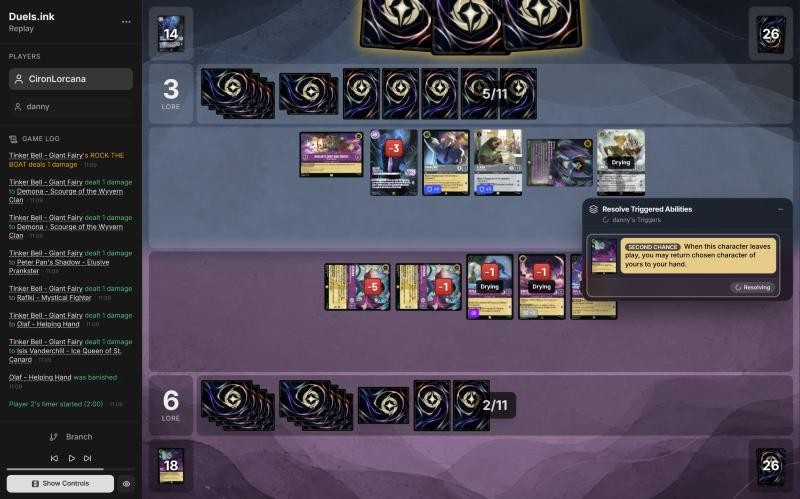
*The board before the decision: [step 151](https://duels.ink/replay/01a216e7-7741-7814-9aa2-e5365eb4f09f?step=151) in the duels.ink replay viewer.*

**What happened:**
- **A second Tinker Bell – Giant Fairy:** ROCK THE BOAT dealt 1 to each of yours and killed Olaf. For SECOND CHANCE
  you chose the damaged Demona (5 damage, 1 willpower left), returning her to your hand.
- **The other Demona died:** Angel – Experiment 624's GOOD AIM (discarding a Shere Khan) put 2 on her, then their last
  Hades challenged her to death, dying to her 5 back.
- **Lore:** Francine and Flash quested, and Francine moved to their Shop (7–6 to them).

**Verdict on SECOND CHANCE: good play.** The damaged Demona had 1 willpower left and was stuck exerted, a free kill
for anything of theirs. Returned, she's healed, and next turn's replay gives another exert-all and refill (the
brief's REPLAY ON-PLAY EFFECTS idea, through Olaf). The other choices returned less: the healthy Demona would only be
replayed, and Isis's CHILL OUT is one exert, not all of them.

### Turn 25: your turn 13

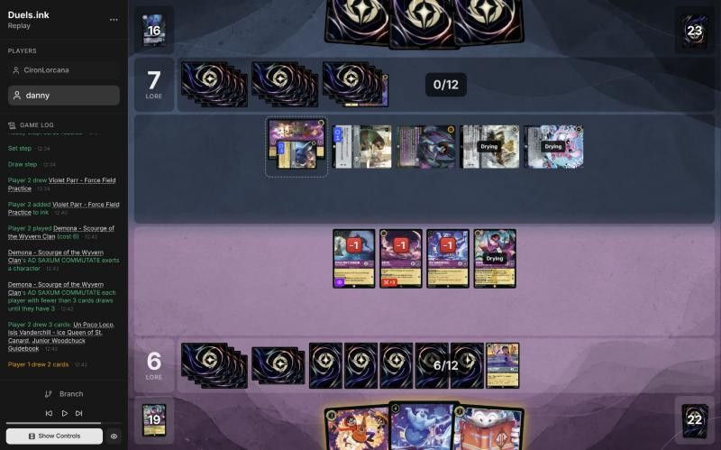
*The board before the decision: [step 164](https://duels.ink/replay/01a216e7-7741-7814-9aa2-e5365eb4f09f?step=164) in the duels.ink replay viewer.*

**The plan:** you drew Violet. Lore 6–7. Your board is Shadow, Rafiki and Isis, each on 1 damage; your hand is the
returned Demona and Violet. Theirs:
- exerted: Francine (at their Shop), Flash, and their Demona;
- drying: Tinker Bell – Giant Fairy and Angel;
- the Shop.

That's 8 a turn plus the Shop's 1: 16 next turn and 25 on game turn 28. They hold 1 card, with 12 ink (13 next turn).
- **The needs check:** your best quest total over your next two turns is about 3 + 6, short of 20 by their turn 28.
  So this turn has to cut their quest rate sharply and keep your board growing. Demona #2 is the only card that does
  it: an exert-all, and a refill that draws you 3 from an empty hand (after Violet) while they draw 2.
- **Order:** Violet first (2), then Demona (6), then plan the challenges and the last 3–4 ink on what the refill brings
  ([SEQ-1](#cite-seq-1)). An Un Poco Loco among the draws could be sung free by Isis before she challenges, to bring Demona back for a
  later replay.
- **The challenges after the exert-all** (Isis 4, Rafiki 3 challenging, Shadow 2, each on 1 damage; Angel loses
  UNTOUCHABLE's Resist once the refill fills their hand):
  - **A. Rafiki into Flash (2 −1 = 2 into 2), Isis and Shadow into Tinker Bell (4 + 2 into 5):** their two 2-lore
    questers. All three of yours die to the damage back. They're left on Francine, Demona and Angel: 4 a turn plus the
    Shop, so 12, 17, then 22 on turn 30.
  - **B. Rafiki into Flash, Isis into Francine, Shadow quests:** keeps Shadow and a lore, but Tinker Bell's 2 a turn
    stays. They'd reach 19 on turn 28, one short.

  A cuts more; whether you then win depends on the refill's three cards and next turn's draw.
- **Exposure:** Demona and Violet drying (ready). Angel's GOOD AIM (2 for a discard) and Strength sung by any of
  theirs reach them anyway.

**What you did:**
- **Demona:** inked Violet and played her. Their board was exerted; the refill drew you Un Poco Loco, Isis and the
  Guidebook, and them 2.
- **The Shop:** Isis and Rafiki destroyed it (4 + 3 into 6, no damage back).
- **Un Poco Loco:** Shadow sang it, returning Rafiki and Isis to your hand, healed.
- **Then:** played and used the Guidebook (Isis, Shere Khan), and replayed Rafiki (10 of 12).

No character of theirs was challenged. Lore 6–7; hand Isis ×3 and Shere Khan.

**Verdict: mistake.** Spending the exert-all on their Shop is suboptimal because it leaves every quester alive: 8 lore
a turn against a player at 7. They reach 15 next turn and need only 5 on game turn 28. You'd then have to strip them
below 5 lore of questers with three challengers, after they've added whatever their 4 cards and 13 ink bring.

Plan A is better: Rafiki into Flash, Isis and Shadow into Tinker Bell, then Isis #2 and the Guidebook with the last 6
ink (6 + 4 + 2 = 12 of 12, inking Violet as you did).
- It takes their two 2-lore questers, so they're left on 4 a turn plus the Shop: 12 next turn, and you still have
  Demona, Isis #2 and a refill's worth of cards to keep cutting.
- What it exposes is what your line exposed: the drying Demona and Isis to GOOD AIM and Strength. It costs your three
  challengers, where your line kept Rafiki and Isis through Un Poco Loco.

Cards in hand help only if they get to be played before they reach 20 ([QC-5](#cite-qc-5), [TEMPO-5](#cite-tempo-5), [WIN-1](#cite-win-1)). Confidence: medium. The
Shop's card and lore a turn, and the material your line kept, make it closer than the lore alone suggests.

**Revisited (after the blind pass, from turn 25's information only):** the plan and verdict counted their next turn
as 8 lore. It's 6: your Demona's refill takes their hand from 1 to 3, so STONE BY DAY keeps their exerted Demona from
readying on their turn. So your line leaves them on about 13 after their turn, not 15; plan A about 10. The gap between
the lines is 3 lore rather than 4–5, and the verdict stays a mistake at lower confidence (low-medium). The fresh reviews
A and B had the count right.

### Turn 26: their turn

**What happened:**
- **Their own Shere Khan:** NEW INCENTIVE let Tinker Bell challenge your ready Rafiki, and PUNY PIRATE! finished
  Shadow.
- **A second Demona:** it exerted your Demona, whom your 4-card hand now keeps stuck, and the refill drew them 3. A
  second Flash and a new Shop came down too.
- **Lore:** three quests took them to 11–6. Their first Demona stayed exerted all turn: STONE BY DAY, with the 3 cards
  your refill gave them.

### Turn 27: your turn 14

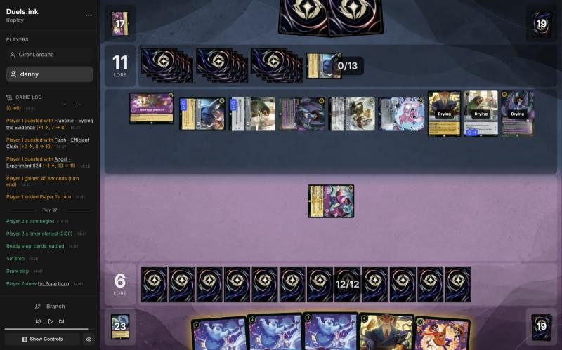
*The board before the decision: [step 185](https://duels.ink/replay/01a216e7-7741-7814-9aa2-e5365eb4f09f?step=185) in the duels.ink replay viewer.*

**The plan:** you drew Un Poco Loco. Lore 6–11. Their board quests for 13 next turn and they need 9. Your only
character is Demona, stuck exerted under STONE BY DAY (5 cards in hand). You have nothing dry and ready, so nothing
can challenge this turn, and Flash stops any Rush.
- **What could stop their quests:** only removal or exerts that last into their turn. Isis's CHILL OUT and Demona's
  exert both wear off at their Ready step (their hand is 2, so not even their Demonas stay down).
- **Un Poco Loco can't bring Demona back:** it returns two of your characters only if one of them costs 3 or less, and
  Demona (6) and any Isis or Shere Khan you play (4) don't qualify.
- **Unwinnable from here** ([principle 2](#cite-principle-2)): no line keeps them under 20 on game turn 28.

**What you did:** three Isis, exerting both of their Demonas and the new Flash; inked Un Poco Loco.

**Verdict: unwinnable.** With their hand at 2, the exerts wear off at their Ready step. Nothing in hand or on board
could keep them under 20.

## Lessons
1. **In the mirror, every Demona – Scourge is also a STONE BY DAY lock.** AD SAXUM exerts your Demonas and its refill
   leaves you at 3 cards, so they can't ready next turn and sit there to be challenged ([23](#turn-23), and Hades'
   "let them draw" at [13](#turn-13)). The knowledge base has the first half ([the Demona – Scourge note](#cite-kb-cards-demona-scourge-of-the-wyvern-clan-facing-her), "In the mirror, her refill locks the other side's Demonas too"). Plan each Demona turn knowing their next Demona
   undoes it, and keep a Dumbo – The Flying Elephant or a ready blocker for the one you can't afford to lose.
2. **Against a player close to 20, kill questers before locations** ([25](#turn-25)). The Shop is a lore and a card a
   turn; two 2-lore questers are four.
3. **The one character that can reach an Evasive engine is worth the buff** ([15](#turn-15)): Angela's +2 on Shadow
   killed Dumbo and kept Shadow.
4. **Goliath's DUSK TO DAWN works for you while it's in play** ([15](#turn-15)): an empty hand refills to 2 at the end
   of your turn, so play out or ink everything, and a Hades "draw 2" only buys a choice.

## Proposed knowledge-base updates (applied after discussion)
- **Meta** (the Amethyst/Steel pair file's notes): CironLorcana's Midrange, 26 Nov 2026
  (01a216e7-773c).
  - **The list:** Shop ×4, Pepita ×4, Cheshire ×3, Flash ×3, Hades ×3, Tinker Bell – Curious Fairy ×2 and Giant
    Fairy ×2 (one hard-cast for 6), Demona – Scourge ×2, Shere Khan ×2, Strength ×2, Francine – Eyeing the
    Evidence ×2, Violet Parr ×2, Angela, Angel, Dumbo – Ninth Wonder, Rafiki, Peter Pan's Shadow, Goliath – Clan
    Leader, Owen Burnett.
  - **Off-list:** Goliath, Francine, Owen, Curious Fairy, Violet, Dumbo – The Flying Elephant.
  - **How it beat you:** it rebuilt after every clear (two Demona refills, Goliath, Shops, four cards from your Hades
    choices), and Shop challenges took both of your Shops.
- **Cards** (the Demona – Scourge note, ["Facing her"](#cite-kb-cards-demona-scourge-of-the-wyvern-clan-facing-her)): their Hades' "let them draw" and their
  Demona's refill both hold your Demonas down. The second can't be dodged, since the refill always leaves 3, so the
  answer is Evasive on the Demona you need, or a turn planned around losing her quest.
- **Cards** (a new Goliath – Clan Leader note, or a line in the Demona note): DUSK TO DAWN from the receiving side.
  An empty hand refills to 2 at the end of your turn; WHAT D'YA SAY's 2 cards become a choice. Cite the Big Ramp
  player's rule ([the Big Ramp player's rule](#cite-kb-meta-archetypes-sapphire-steel-goliath-is-also-the-play)).
- **Tools:** the turn-27 brief's REPLAY ON-PLAY EFFECTS line offered Un Poco Loco on Demona without checking the "one
  of them is cost 3 or less" condition; you had no such character. Proposed: the line names a partner of cost 3 or
  less in play, or says there isn't one.

## Hindsight
Doesn't change the verdicts above.
- **Turn 25's better line probably still lost.** Their turn-26 hand held Shere Khan, a second Flash, a second Demona
  and a Shop. Against plan A they'd have been at about 10 after turn 26 and close to 20 on turn 28, with your lore
  still at 6. The swing came earlier, at turns 22–24: their Demona locked both of yours, then Tinker Bell #2, Angel
  and the last Hades killed one.
- **Your lore never moved after turn 19** (6 from game turn 19 to the end). Every later turn went on removal, which
  their refills outpaced.

## The coach's errors
Filled in during discussion. Found during the blind pass, for the discussion to confirm:

| When | Error | How it was caught | How it won't happen again |
|---|---|---|---|
| Turn 9 plan | Called trading two small characters for their Cheshire "too dear" | The player's line was better | Proposed: when their engine is in reach, the setup weighs it by its future turns (decision method, section 4, item 7) before rejecting the trade |
| Turn 15 plan | Missed Angela's +2 on Shadow, the only character that could challenge the Evasive Dumbo | The player found it | Proposed: the brief's challenge options add each pump in hand to each of your characters, as it does for Support |
| Turn 19 plan | Rejected the Guidebook dig over a STONE BY DAY count that cheap finds could fix | The player's line | Proposed: count what the dig can find and play this turn before rejecting a dig on hand size |
| Turn 25 plan and verdict | Counted their Demona's 2 lore for their next turn, though your Demona's refill had left them on 3 cards, so STONE BY DAY kept her exerted | Two independent reviews of this game by other coach sessions caught it | Proposed: the brief prints, for each player's exerted Gargoyles, whether STONE BY DAY keeps them down at the next Ready step, counting refills in this turn's line |

## Open questions
- **Pre-game:** what were you looking for when you sent back the Shop, Un Poco Loco and a Violet?
- **Turn 7:** why keep Olaf and Violet home?
- **Turn 17:** why ink the second Hades rather than Dumbo or the Guidebook?
- **Turn 25:** was destroying their Shop aimed at the card it gave them each turn, or at keeping Isis and Rafiki for
  next turn?

## Citations
Copies of the coach's knowledge base cited above, as they stood when they were cited (the private repository's commit and date are given with each). They don't change when the knowledge base does.

**MULL-1**: strategy principle, `kb/strategy/principles.md` at `c5b42a3` (2026-11-26), working tree

> - **MULL-1. Keep a plan, not the strongest cards.** *Ask: "Which hand gives me the best chance to execute my game plan in this matchup?"* `[MCL ch.12]` · baseline

**MULL-2**: strategy principle, `kb/strategy/principles.md` at `c5b42a3` (2026-11-26), working tree

> - **MULL-2. A smooth curve beats a few powerful cards.** Check that you can spend ink well on turns 1–4, have enough inkable cards, and know what turn 4 looks like. `[MCL ch.12]` · baseline
>   - **Ink spent isn't the goal by itself.** Judge a keep by a nice curve (a play each turn), early lore pressure, and
>     interaction that sets the opponent back, as well as by ink, then weigh card quality and the matchup
>     (user, 2026-11-01). `tools/mulligan.py` reports all of these.

**INK-2**: strategy principle, `kb/strategy/principles.md` at `c5b42a3` (2026-11-26), working tree

> - **INK-2. Don't automatically ink the most expensive card.** It may be the late-game win condition or the key answer for this matchup. The answer depends on matchup, hand and board. `[MCL ch.4]` · baseline

**QC-2**: strategy principle, `kb/strategy/principles.md` at `c5b42a3` (2026-11-26), working tree

> - **QC-2. Challenge the threat, not the character.** Engines, synergy pieces and big questers are worth fighting over. A 1-lore character doing nothing usually isn't. *Ask: "Does this character actually need to be removed?"* `[MCL ch.6, ch.9]` · baseline

**TEMPO-1**: strategy principle, `kb/strategy/principles.md` at `c5b42a3` (2026-11-26), working tree

> - **TEMPO-1. Tempo is how much freedom you leave the opponent, not how fast you play.** A play that forces the opponent to spend their turn answering it has stolen part of their turn. *Ask: "If I play this, what does my opponent have to do next?"* `[MCL ch.1]` · baseline

**TEMPO-2**: strategy principle, `kb/strategy/principles.md` at `c5b42a3` (2026-11-26), working tree

> - **TEMPO-2. Answering an expensive threat with a cheap card is a tempo swing**, and more so if the answer was sung for no ink. Other examples: playing Shift threats before the opponent can answer them, and ramping into several threats in one turn. `[MCL ch.1, ch.7]` · baseline

**QC-3**: strategy principle, `kb/strategy/principles.md` at `c5b42a3` (2026-11-26), working tree

> - **QC-3. Questing is favoured when:**
>   - you control the board
>   - your exerted characters can't be punished
>   - the race favours you
>   - removing their characters gains little
>
>   **Challenging is favoured when:**
>   - they have an engine or repeated-value piece
>   - the trade is efficient
>   - you need to slow the game
>   - your deck is stronger late
>
>   `[MCL ch.6]` · baseline

**RULE-1**: strategy principle, `kb/strategy/principles.md` at `c5b42a3` (2026-11-26), working tree

> - **RULE-1. Only exerted characters can be challenged** `[CR 4.6.4.2]`. Questing, singing, or {E} for an ability exposes the character. Staying ready protects it. Every quest is also a decision about what the opponent can challenge next turn. · baseline
>   - *Card text overrides this* (CR 1.2.1). Shere Khan – Khan Industries CEO's NEW INCENTIVE lets one character
>     challenge ready characters that turn. Alert (e.g. from Judy Hopps – Lead Detective, to every Detective on their
>     turn) ignores Evasive. Against Ducktectives, name both in the setup. 01a14574, turns 16 and 18. `[coach, 2026-10-26]`

**INK-1**: strategy principle, `kb/strategy/principles.md` at `c5b42a3` (2026-11-26), working tree

> - **INK-1. Inking is permanent.** Every inked card is one line of play removed for the rest of the game. *Ask: "Will I regret losing access to this card?"* `[MCL ch.4]` · baseline

**THREAT-2**: strategy principle, `kb/strategy/principles.md` at `c5b42a3` (2026-11-26), working tree

> - **THREAT-2. Distinguish immediate threats (big lore next turn) from slow engines (card advantage over turns).** Role decides which matters more: the aggressor can often ignore engines, but the defender usually can't. `[MCL ch.9]` · baseline

**SEQ-1**: strategy principle, `kb/strategy/principles.md` at `c5b42a3` (2026-11-26), working tree

> - **SEQ-1. Gather information before irreversible decisions.** Draw, look and scry before choosing what to ink. Quest with draw triggers before committing other plays when the order doesn't otherwise matter. `[MCL ch.5]` · baseline

**SEQ-4**: strategy principle, `kb/strategy/principles.md` at `c5b42a3` (2026-11-26), working tree

> - **SEQ-4. Sequence across turns.** A slightly weaker play now can set up a much stronger next turn: keep a shift target alive, keep a singer ready, hold removal for a bigger threat. `[MCL ch.5]` · baseline

**THREAT-1**: strategy principle, `kb/strategy/principles.md` at `c5b42a3` (2026-11-26), working tree

> - **THREAT-1. Not every threat needs an answer.** *Ask: "What happens if I don't answer this?"* "Very little" means spend resources elsewhere. "I probably lose" means it's the priority. `[MCL ch.9]` · baseline

**TRADE-3**: strategy principle, `kb/strategy/principles.md` at `c5b42a3` (2026-11-26), working tree

> - **TRADE-3. Losing a character can be right** if it removes something more important. Characters are resources. `[MCL ch.7]` · baseline

**QC-5**: strategy principle, `kb/strategy/principles.md` at `c5b42a3` (2026-11-26), working tree

> - **QC-5. The race changes everything.** At 18–12 up, take the last 2 lore. At 8–16 down, stopping their close-out matters more than your quests. `[MCL ch.6]` · baseline

**POS-1**: strategy principle, `kb/strategy/principles.md` at `c5b42a3` (2026-11-26), working tree

> - **POS-1. From ahead, take the safest path to victory.** Don't overextend into sweepers, don't make unnecessary trades, and make the opponent take the risks. Winning by 1 lore counts the same as winning by 10. `[MCL ch.10]` · baseline

**TRADE-1**: strategy principle, `kb/strategy/principles.md` at `c5b42a3` (2026-11-26), working tree

> - **TRADE-1. Judge a trade by ink invested, tempo, value already generated, and the board afterwards**, not by card count. A 2-cost for a 5-cost is a big win even if it's one-for-one. *Ask: "What does the board look like after this challenge?"* `[MCL ch.7]` · baseline

**SEQ-2**: strategy principle, `kb/strategy/principles.md` at `c5b42a3` (2026-11-26), working tree

> - **SEQ-2. Plan the whole turn before the first action.**
>   - Who quests? Who challenges?
>   - What if a challenge fails?
>   - What gets inked? What ink is left?
>   - What does this leave the opponent?
>
>   `[MCL ch.5]` · baseline

**TEMPO-5**: strategy principle, `kb/strategy/principles.md` at `c5b42a3` (2026-11-26), working tree

> - **TEMPO-5. Tempo decides when card advantage matters.** Two extra cards are worthless if the opponent gains 6 lore while you draw them. `[MCL ch.1, ch.2]` · baseline

**WIN-1**: strategy principle, `kb/strategy/principles.md` at `c5b42a3` (2026-11-26), working tree

> - **WIN-1. Know your current win condition and the opponent's.** Plans change with draws and board. The question is "how do I win from here?", not "what was my deck supposed to do?". Preventing the opponent's win condition is often easier than recovering from it. `[MCL ch.11]` · baseline

**H-12**: hypothesis, `kb/strategy/hypotheses.md` at `c5b42a3` (2026-11-26), working tree

> ### H-12. A Rockstar board should quest every turn against an exert-and-challenge deck
> - **Claim:** against Midrange decks that remove with exert effects and challengers (Amber/Amethyst and Amethyst/Steel:
>   Isis, Peter Pan's Shadow, Demona – Scourge, Cheshire Cat's moved damage, Rafiki), Rockstar Aggro's small characters
>   should quest each turn rather than wait ready. The limit: a quester that would die for nothing to a single
>   challenger needs a Bodyguard in front of it first (David entering exerted).
> - **Why:** staying ready protects only from their plain challengers (Rafiki, Hamm). Isis and Shadow exert a chosen
>   character, Scourge exerts them all, and Cheshire moves damage without a challenge, so ready characters die anyway
>   and the skipped quests are lore the race can't win back. It's H-6's opposite case: H-6's ready board gained by
>   drawing cards while it waited, and a board of 1-lore Rockstar characters draws nothing.
> - **Evidence for** (blind reviews, not yet discussed with danny, who may have had reasons to hold back):
>   - 01a1cb74-e730 (Toru89, game 2), turns 9 and 11.
>   - 01a1cbbb-ca0c (Duccio, game 1): Isis exerted Lilo for Rafiki on turn 6; two Cheshires killed Dale and Thomas on
>     turn 12; Scourge exerted four characters on turn 14.
>   - 01a1cbca-787d (Duccio, game 3), turn 4 (held back for nothing) and turn 6 (danny's quest beat the coach's wall).
>   - 01a1cbe6-f3a8 (Duccio, rematch game 1), turns 3 and 5: the Lilo kept home died to Isis and Rafiki on turn 6.
>   - 01a1ccd4-187e and 01a1ccde-6845 (EzfelDifel, games 1 and 2): four turns of holding back in each.
> - **Evidence against:** 01a1ced3-11cc (HØT CØCØ, game 3), turns 13 and 15: a ready board did hold their questers back
>   for two turns, though Cheshire's boosts killed some of it (H-6).
> - **Evidence for, outside Rockstar Aggro** (01a1fb8a-260a, GreenJayPacker's Detectives vs Retro Device, turns 5 and 11;
>   discussed 22 Nov 2026): Nick was kept home twice when nothing could punish his quest without slowing their clock.
>   The limit held too: Toy Drive Officer, which two of theirs could kill for free, was rightly kept home (turn 11).
> - **Status:** open (six games against three opponents, from undiscussed blind reviews; one discussed game outside
>   Rockstar Aggro).

**H-1**: hypothesis, `kb/strategy/hypotheses.md` at `c5b42a3` (2026-11-26), working tree

> ### H-1. Time hand-refill effects for when your hand naturally runs out
> - **Claim:** "Draw until you have N" effects (e.g. Demona – Scourge of the Wyvern Clan, refill to 3) are worth
>   most on the turn your hand empties. Playing one card per turn on the play, a 7-card hand empties around
>   turn 6, which is exactly when a 6-cost refill lands. So an inkable refill card is cheap to keep through a
>   mulligan: if the game goes differently, ink it.
> - **Why:**
>   - **Hand count when playing on curve, going first:** 7 cards; ink 1 and play 1 each turn, drawing from turn 2,
>     leaves 1 card after inking on turn 6.
>   - **Cost of keeping it, by simulation:** keeping Demona costs about 0.1 ink spent over turns 1–4, compared with
>     also mulliganing her.
> - **Caveats:**
>   - "Each player" refills, so the opponent also draws if below N. On the draw they hold one more card. The other
>     side of this, for the player facing her, is in `kb/cards/demona-scourge-of-the-wyvern-clan.md`.
>   - Demona's STONE BY DAY means she can't ready while you hold 3+ cards. After refilling to 3, you must be at ≤2
>     by your next Ready step, or she stays exerted (and challengeable) once she has quested or challenged.
>   - She's drying on the turn she's played, so her own exert-all opens the opponent's board to your *other* dry
>     characters only.
>   - Ink drops (Hyperia City) don't expire, so saved drops can bring the refill earlier than the bare count suggests.
>   - **The cap absorbs earlier card draw.** "Draw until 3" always ends at 3, so cards drawn beforehand (e.g. Junior
>     Woodchuck Guidebook) are borrowed from the refill rather than added to it. Pre-drawing buys timing, not
>     cards:
>     - earlier information
>     - a better ink choice
>     - being sure of an inkable card for the refill turn
>
>     Weigh that against what the same ink would otherwise buy, e.g. an earlier body. (User's correction,
>     2026-10-24: the coach had called this a cost of the draw without counting those gains.)
>   - The opponent's refill depends on *their* hand size when you cast it, not on your earlier choices. Check it
>     when deciding whether to cast now.
>   - **It needs your ink to reach 6 on time.** Hands with uninkable cards are short of ink, not cards, so a held
>     6-drop is rarely castable on turn 6.
>     - **01a139ad, pre-game:** an opening seven with two uninkables. Keeping Demona left her castable on turn 6
>       only ~16% of the time in simulation. Mulliganing her for a random card raised "turn 4 uses all ink" from
>       80% to 91%. In ink-short hands, the refill card is the one to send back.
>     - *This caveat is the coach's, from simulation; not yet discussed with the user.*
>   - **Against Amber/Sapphire**, Demona's 5 {S} makes her a target for Gaston – Superior Archer, Judy Hopps –
>     Always Vigilant and World's Greatest Criminal Mind (`kb/meta/archetypes/amber-sapphire.md`).
> - **Evidence for:**
>   - replay 01a14bf9 (vs Goop), 2026-10-24, pre-game: the user's mulligan reasoning.
>   - same game, turn 5: the user kept Cheshire as the bridge play on the way to Demona instead of playing an
>     extra 1-drop.
>   - same game, turn 9: Guidebook played and used before inking, which locked in an inkable card for Demona
>     on turn 11. The alternative, Cheshire plus Boost, had about a 16% chance (8 uninkables in 49 cards) of an
>     uninkable turn-11 draw blocking her.
>   - same game, turn 11 (agreed with the user): a second Cheshire instead of Boost would have developed the
>     board, used the ink better, and **emptied the hand to just Demona**. Her next-turn refill would then draw 3
>     instead of 1. The user's own summary of the lesson: develop the board and spend resources so the
>     refill draws as many cards as possible.
>   - same game, turn 13: with Demona due next turn, the user inked their spare Cheshire though that ink wasn't
>     needed. **Corollary:** when a refill is imminent, spare cards in hand are effectively free ink. The cap
>     replaces them, so inking them costs no cards and leaves Demona as the only card in hand.
>   - **Limit on that corollary** (same game, turn 15, agreed with the user): it's free in card *count* only. The cap
>     replaces the inked card with a *random* card. So it holds for cards no better than a random draw, but not
>     for engines or must-answer threats. Inking Dumbo – Ninth Wonder of the Universe (a draw-and-lore engine the
>     opponent has to answer, TEMPO-1) to top up Demona's refill from 2 to 3 was probably wrong. Better was to
>     cast Demona without inking, keep Dumbo for next turn, and accept 1 ink and 1 refill card less.
> - **Evidence against:** none yet.
> - **Status:** open.

**H-8**: hypothesis, `kb/strategy/hypotheses.md` at `c5b42a3` (2026-11-26), working tree

> ### H-8. Trade cheap characters for the opponent's ramp engine at the first chance
> - **Claim:** against a ramp-control deck, kill their ramp engine (Cinderella – Unintentional Icon) as soon as it's
>   exposed, even at the cost of several cheap characters: those characters are what their sweepers take anyway, and
>   the engine is their lore and their ink.
> - **Evidence for:** 01a19d83 (danny vs daman, game 2), turns 8 and 10. Marie and two Launchpads could kill an exerted
>   Icon (6 willpower) both turns; left alive, she took them from 4 to 11 and ramped them into Raging Storm on turn 13.
>   danny agreed in discussion (2026-11-02): "I should've banished it while I had the chance."
> - **Evidence for, the step before:** 01a1a67f-5b3b (MK_TurtleBauer vs DiamondSamurai), turn 7. Isis could exert
>   Cinderella – Dream Come True (the Icon's Shift base and their ramp) for Pepita to kill at no loss; the play killed
>   only Aurora, and the Icon was Shifted onto her next turn. Graded a mistake in the blind review, not yet discussed.
> - **Related:** stonks 📈's rule from the other side (H-6, 01a16039): keep your own Icon ready rather than offer that
>   trade.
> - **Status:** open (one game).

**H-2**: hypothesis, `kb/strategy/hypotheses.md` at `c5b42a3` (2026-11-26), working tree

> ### H-2. Spare ink isn't automatically wasted when later turns will be short of cards
> - **Claim:** Ink grows by one every turn, but cards don't. Once later turns are likely to have more ink than
>   good cards to spend it on, cards are the scarcer resource. Then playing a low-impact card just to use spare
>   ink (giving up a better card to the inkwell instead) is usually worse than leaving the ink unspent.
> - **Applies when:** you're ahead on board (POS-1) and the extra play has little impact (WIN-2). Also when the
>   backup value of the extra card is low, e.g. a second Shift target when the opponent's removal can't hit the first.
> - **Doesn't apply when:** you're behind and need board presence now, or the cheap card has real impact.
> - **The converse, for the opponent:** extra cards are worth less to an opponent who already has a full hand and is
>   short of ink. When an effect offers "they draw 2 or you lose a body" (Hades – Looking for a Deal), keeping
>   the body is more attractive the more cards they already hold. Discard-payoff decks still get some fuel from
>   extra cards. Evidence: 01a139ad, turn 14. The opponent had 5 cards and 7 ink, and the user kept Isis
>   rather than bottoming her. Discussed 2026-10-26 and judged a close call.
> - **Evidence for:** replay 01a14bf9 (vs Goop), turn 5. The user left 1 ink unspent rather than ink Cheshire to
>   play a second Mulan – Injured Soldier. Coach first called it a close call, then agreed after the user's argument.
> - **Evidence against:** none yet.
> - **Status:** open.

**principle 2**: coaching principle, `CLAUDE.md` at `c5b42a3` (2026-11-26), working tree

> 2. **Some games are unwinnable.** Draws and matchups can make a game lost whatever the player does. Say so
>    when it's true, rather than inventing mistakes to explain a loss.

**demona-scourge-of-the-wyvern-clan.md, Facing her**: knowledge base, `kb/cards/demona-scourge-of-the-wyvern-clan.md` at `c5b42a3` (2026-11-26), working tree

> ## Facing her `[coach + user, 2026-11-02; the hand-size point is the user's]`
> - **She makes "stay ready" worthless for a turn.** The exert-all doesn't choose, so Ward doesn't stop it (CR 8.15.2).
>   Their challengers then hit any of your characters. In 01a19c00 turn 11 a waiting board of five small characters
>   was exerted, and Wasabi – Called into Battle (TWIN BLADES), Luisa, Pepita and Cheshire Cat killed all five.
> - **Her refill is yours too.** If you hold 2 or fewer cards when she lands, you draw up to 3. So before their 6-ink
>   turn, getting your hand down is worth something:
>   - **Ink spare cards** rather than play them: the refill replaces them, and a wider board is exactly what her
>     exert-all punishes.
>   - **Only cards no better than a random draw.** The refill gives random cards (H-1's limit), so keep engines,
>     removal and must-play threats.
>   - **Weigh it against how likely she is.** Count her copies in their hand and next draw (`tools/odds.py hold`) and
>     whether their ink reaches 6. The caster can also wait until your hand is full.
>   - In 01a19c00 turn 11 the player held 1 card and drew 2 from her refill.
> - **She's a target for strength removal.** Her 5 {S} puts her in range of Gaston – Superior Archer, Judy Hopps –
>   Always Vigilant and World's Greatest Criminal Mind (`kb/meta/archetypes/amber-sapphire.md`, Removal profile).
>   01a19c00 turn 16: Always Vigilant banished her.
> - **STONE BY DAY after the refill:** they often hold 3 cards right after it, so once she has quested or challenged
>   she may stay exerted, and challengeable, into your next turn.
> - **In the mirror, her refill locks the other side's Demonas too** `[coach, blind review of 01a1a692-eb30]`. Their
>   Scourge exerted MK_TurtleBauer's board and drew them up to 3 cards (turn 15), so Betrayer and Imperious couldn't
>   ready at the next Ready step and spent the turn exerted. On turn 17 his own Scourge's refill did the same to theirs.
>   Before their 6-ink turn, a hand of 0–2 cards with exerted Gargoyles in play becomes 3 on the refill: IMPETUS
>   (a discard) on your turn is the way back under 3 (`kb/cards/demona-imperious-spellcaster.md`).
> - **Your own cards change their hand count around STONE BY DAY** `[coach, blind review of 01a1cbca-787d turns
>   16–19]`. Mowgli – Man Cub's discard can take them below 3 and free their exerted Demonas; Mike Wazowski – Heroic
>   Climber's FIND A FRIEND offers them a character (they may decline it to stay under 3); letting Hades – Looking for a
>   Deal draw them 2 keeps them at 3 or more, so their Demonas stay exerted and challengeable.

**sapphire-steel.md, Goliath** is also the play**: knowledge base, `kb/meta/archetypes/sapphire-steel.md` at `c5b42a3` (2026-11-26), working tree

> - **Goliath** is also the play when your hand is empty and you need to dig: DUSK TO DAWN refills you to 2 at the end of
>   your turn (01a15f93 turn 18).

**amethyst-steel.md, From reviewed games and discussion**: knowledge base, `kb/meta/archetypes/amethyst-steel.md` at `c5b42a3` (2026-11-26), working tree

> ## From reviewed games and discussion
> ### Midrange: how it plays `[coach, meta study of the user's 27 Oct 2026 games (tools/scan.py), full games, not blind, 1 game]`
> 01a17dc3.
> - **Merlin – Profoundly Curious:** an ink drop on play, a draw on each quest, 2 lore.
> - **Questers:**
>   - Diablo – Stone Servant (+2 {S} and +1 {L} with a Villain in play; their Villains can't be challenged while he's
>     exerted)
>   - Tinker Bell – Giant Fairy (Shift 4; 1 damage to each opposing character on play; 2 lore)
>   - Maleficent – Exultant Spellcaster
> - **Removal through tricks** (turn 14): Peter Pan's Shadow exerts your character, Cheshire Cat's Boost moves 2 damage onto
>   it, then a challenge finishes it.
>
> ### A removal-heavy variant (unlisted) `[coach, meta study of the user's 27 Oct 2026 games (tools/scan.py), full games, not blind, 1 game]`
> 01a17e37.
> - **Steel actions:**
>   - **Jousting Match** (2 damage, or **5 if they paid with an ink drop**)
>   - **Ink Explosion** (4 damage, and they get an ink drop)
>   - Three Arrows, Windstorm, He Hurled His Thunderbolt, Fire the Cannons!, You Broke My Smolder
> - **Characters:** Merida – Formidable Archer, Pluto – Steel Champion, Demona – Scourge, Dumbo, Dante.
> - **Card flow:** Junior Woodchuck Guidebook ×4.
> - **Big turn (turn 25):** Ink Explosion, then two Jousting Matches paid with ink drops (5 damage each), then challenges.
>   Five of your characters were gone.
> - **Ink drops feed this deck.** Your Mickey – Best in Town gave them one in this game.
>
> ### A Merlin and Shop variant (unlisted) `[coach + user, 01a18275 vs InkModeOn, 2026-10-28, blind review]`
> `output/reviews/2026-10-28_01a18275_vs-inkmodeon-g2.md`. The classifier swung between Midrange and "unlisted" all game:
> Midrange's core plus cards no listed list runs.
> - **Card and lore engines:**
>   - Merlin – Profoundly Curious, three seen: an ink drop on play, a draw on each quest
>   - Merlin's Shop and Smithy ×2 (1 lore and a card each time a character moves there; `kb/cards/merlins-shop-and-smithy-magical-market.md`)
>   - Arthur – Merlin's Assistant (3, 3/3/1): moves to a location for free on play and gets an ink drop
> - **Heroes:** the Violet Parrs (At Wits' End, 1-cost 2/1 with Alert; Force Field Practice, 2-cost 3/2 Resist 1;
>   Super Resilient, 4/4/2 Resist 1, Shift 3), Tinker Bell – Curious Fairy → Giant Fairy (Shift 4).
> - **Others:** Cheshire Cat (moves damage; `kb/cards/cheshire-cat-inexplicable.md`), Dr. Hamsterviel – Evil Observer
>   (3/4/1, Alert), Pepita, Strength of a Raging Fire, Angel – Experiment 624 and Demona – Scourge (both inked).
> - **How it played:** removal by Cheshire's damage moves, Strength and challenges (including your Shop, twice);
>   steady lore from Merlins and Shop moves. Shop moves gave 6 of their 20 lore, including the winning point.
> - **Alert on Violet Parr and Hamsterviel** gets past Evasive, so Dumbo – The Flying Elephant's AERIAL DUO protects
>   less while either is in play.
>
> ### PS Inkbonk against Big Ramp `[coach, study of 01a15f8e (stonks 📈 vs MFork, game 2, 21 Oct 2026), full game, not blind]`
> MFork's list: Demona – Scourge of the Wyvern Clan ×3, Broadway – Sturdy and Strong ×2, Marie – Caught in the Act ×2,
> Pepita – Watchful Alebrije ×2, Lexington – Small in Stature, Merlin – Profoundly Curious, Merlin's Shop and Smithy,
> Cheshire Cat – Inexplicable, Rafiki – Mystical Fighter, Tiana – Restauranteur. A slow game: Big Ramp's three-character
> sweep on turn 15 and a +5 quest turn decided it at 6–4 (conceded).
>
> ### PS Inkbonk against Big Ramp: game 3 `[coach, blind review of 01a15f93 (stonks 📈 vs MFork, game 3, 21 Oct 2026)]`
> - **More of the list:** Shere Khan ×2, Madam Mim – Resourceful Trickster, Merlin ×2, Strength of a Raging Fire ×3,
>   Rafiki ×4, Luisa Madrigal – Pushing Through, Pepita, Black Heron, Lexington, Hades, Demona – Imperious Spellcaster,
>   Tiana – Restauranteur.
> - **How it beat Big Ramp:** Shere Khan on ready characters (turns 7 and 13), Demona's refill finding the song that
>   killed Merida (turn 11), Shere Khan challenging Khan Industries twice, and the song for 5 on Goliath (turn 19). Merlin,
>   the Shop and Madam Mim kept their hand full.
>
> ### Midrange against Big Ramp `[coach, blind reviews of 01a16035 and 01a16039 (stonks 📈 vs roycelikerolls, games 2 and 3, 21 Oct 2026)]`
> - **The list:** Shere Khan ×3, Angela – Night Warrior ×2, Pepita ×2, Tinker Bell – Curious Fairy ×2 and Giant Fairy ×2,
>   Woolter & Jesse ×2, Hades – Looking for a Deal ×2, Demona – Scourge ×2, Peter Pan's Shadow, Cheshire Cat, Diablo –
>   Stone Servant, Maleficent – Exultant Spellcaster, Maleficent & Diablo – Evil Incarnate, David Xanatos, Flash,
>   Toulouse, Dumbo, Merlin, You Broke My Smolder, Strength of a Raging Fire. Not in the listed Midrange: Xanatos,
>   Maleficent & Diablo, Woolter & Jesse and You Broke My Smolder.
> - **Game 2 (they won):** NEW INCENTIVE picked off Drake Mallard (turn 9), Merida (turn 11) and Unintentional Icon (turn
>   15, with Angela's Challenger +2 on Demona); Pepita killed Priscilla as she landed (turn 7).
> - **Game 3 (Big Ramp won):** a tall, ready board kept them from questing; they spent Peter Pan's Shadow and Shere Khan
>   to reach it (turns 12 and 16), and both Shere Khans challenged Khan Industries down (turn 20). Challenging with a
>   NEW INCENTIVE character costs them that character unless it banishes something, so they sometimes pass (turn 18).
>
> ### Midrange: Giannisefoa `[coach, meta study of danny's 28 Oct – 2 Nov 2026 games (tools/scan.py), full games, not blind, 1 game]`
> `01a18daf-c900`, 15 turns, little seen: Shere Khan ×2, Hyperia City Express, Wildcat, Olaf – Helping Hand (off-list),
> Peter Pan's Shadow, Demona – Imperious Spellcaster, He Hurled His Thunderbolt.
>
> ### Midrange (a variant): danny's Amethyst/Steel list `[coach, meta study of danny's 5 Nov 2026 games (tools/scan.py), full games, not blind, 11 games]`
> `01a1ab88-3bdd` to `01a1abdf-f6ab`; danny won 6 of the 11. The classifier calls it Midrange (91%); not in duels.ink's
> list: Christopher Robin, Isis Vanderchill, Owen Burnett and Tigger.
> - **The list (×4 each):** Rafiki – Mystical Fighter, Tinker Bell – Curious Fairy, Christopher Robin – Joining the Fun,
>   Pepita, Toulouse – Rough and Tumble, Junior Woodchuck Guidebook, Owen Burnett – Xanatos's Assistant (returns a card
>   costing 2 or less to its player's hand), Peter Pan's Shadow, Strength of a Raging Fire, Isis Vanderchill (CHILL OUT:
>   exert a chosen opposing character), Shere Khan – Khan Industries CEO, Tigger – Bouncing All the Way, Hades – Looking
>   for a Deal, Demona – Scourge, Tinker Bell – Giant Fairy.
> - **Its big turns:** Tinker Bell – Giant Fairy Shifted onto Curious Fairy (ROCK THE BOAT: 1 damage to each opposing
>   character), then Strength of a Raging Fire and challenges, with PUNY PIRATE! adding 2 damage after a kill: five kills
>   (`01a1abc4-9219` turn 14). Two Isis CHILL OUTs for Hades and Scourge to challenge (`01a1ab8a-61dc` turn 13). Shere
>   Khan's CORNER THE MARKET gave an ink drop for a kill (`01a1abdf-f6ab` turn 11).
> - **What beat it:** its cheap 2- and 3-willpower bodies. Malicious, Mean, and Scary then To Wither a Flower killed three
>   or four on game turn 7, twice (Emerald/Ruby `01a1ab91-0bb5`, Circle of Life `01a1abbd-d461`), and The Leviathan took
>   three (`01a1abae-ba7c` turn 14). Shere Khan's 2 willpower falls to any 2-damage ping: David Xanatos's MINOR
>   INCONVENIENCE (`01a1ab8a-61dc` turn 12), Angel's GOOD AIM (`01a1ab97-d698` turn 17). Mouse House's Duo out-quested
>   it (`01a1abb8-c327`, 7–20).
>
> ### Midrange: Mauix `[coach, meta study of danny's 5 Nov 2026 games (tools/scan.py), full games, not blind, 1 game]`
> `01a1aba0-4f24`, against danny's Amethyst/Steel; conceded at 0–13 on game turn 14. Merlin, Merlin's Shop and Smithy,
> Pepita ×2, Cheshire, Flash, Shere Khan, Rafiki, and two off-list cards: Hyperia City Express ×2 and Sven – Leaping
> Reindeer.
>
> ### Midrange against danny's Rockstar Aggro: LennyO `[coach, meta study of danny's 6–8 Nov 2026 games (tools/scan.py), full games, not blind, 1 game]`
> `01a1b518-a639`: won 21–16 on game turn 17, after trailing 0–11 on turn 8.
> - **GOOD AIM picked off the discounts and Dale:** Angel – Experiment 624 killed Grandmother Willow on turn 8 and Dale on
>   turn 12.
> - **Their race:** Christopher Robin – Joining the Fun, Flash and Owen Burnett quested.
> - **Off-list:** Christopher Robin, Hyperia City Express ×3, Khan Industries and Owen Burnett.
>
> ### Midrange against danny's Rockstar Aggro: Toru89 and EzfelDifel `[coach, blind reviews of 01a1cb74-e730, 01a1ccd4-187e and 01a1ccde-6845, 11 Nov 2026]`
> - **Toru89 (01a1cb74-e730, game 2):** a challenger build: Rafiki (Challenger +3), Pepita (+2), Peter Pan's Shadow,
>   Cheshire Cat ×2, Dumbo – Ninth Wonder, Flash, Strength of a Raging Fire ×3; off-list, Francine ×2, Dumbo – The Flying
>   Elephant and Goliath – Clan Leader. On turn 16 they used every challenger, Cheshire's boost (moving damage onto a
>   drying Mowgli) and Strength sung for 6 to clear five characters.
> - **EzfelDifel, game 1 (01a1ccd4-187e):** Midrange with a Gargoyle package: Rafiki ×2, Pepita, Lexington – Small in
>   Stature ×2 (Alert), Angela – Night Warrior, Demona – Imperious and Scourge (turn 12), Tinker Bell – Curious Fairy ×2
>   with Giant Fairy, Peter Pan's Shadow, Angel – Experiment 624, Flash, Merlin's Shop; off-list, Goliath – Clan
>   Leader, Owen Burnett and Wildcat.
> - **EzfelDifel, game 2 (01a1ccde-6845):** Demona – Betrayer of the Clan (off-list; 4, 4/6, Challenger +2), Cheshire Cat,
>   Shere Khan (turn 10, Demona challenging a ready Dale), Hades ×2, Junior Woodchuck Guidebook ×2, Merlin's Shop ×2,
>   Flash ×2, Angela, Strength of a Raging Fire, Tinker Bell – Giant Fairy Shifted onto Curious Fairy on turn 16. No
>   challenge until turn 10: turns 2–8 were all development.
> - **Against both:** H-12 (quest every turn; holding back didn't keep characters alive).
>
> ### A Shop list with three Hyperia City Expresses against GreenJayPacker's Ruby R.E.D.: Divine Water Dragon `[coach, blind review of 01a1eb0c-446c, 17 Nov 2026]`
> - **The list:** Merlin's Shop and Smithy ×2, Hyperia City Express ×3 (each moves a character to the Shop for free: a
>   card and 1 lore, once a turn), Merlin – Profoundly Curious, Pepita, Smash ×2 (one inked, one cast on Max Goof),
>   Bodyguards (Woolter & Jesse ×2, Inspector Tezuka, The Headless Horseman ×2 inked), Tinker Bell – Snowflake Collector
>   ×2, Luisa Madrigal and Hades (both inked).
> - **How it played (GreenJayPacker won 20–5 on game turn 17):** its cheap bodies fell to The Leviathan's IT'S A MACHINE!
>   (turn 11) and to Malicious with Phillip (turn 15). Three Expresses give the Shop 12 {W}, so The Leviathan's challenge
>   left it standing.

**decision-method.md, 4. Evaluate each line**: knowledge base, `docs/decision-method.md` at `c5b42a3` (2026-11-26), working tree

> ## 4. Evaluate each line
> For each line, work out:
> 1. **Immediate result:** lore gained, characters killed and lost (challenge maths from the brief, plus card text),
>    cards drawn, ink used.
> 2. **Their best reply.** Assume they make their best play with what they're likely to hold. If your line makes
>    them draw (Demona – Scourge's refill, Hades – Looking for a Deal), their hold odds go up: recompute with
>    `odds.py` for their new hand size.
> 3. **When an unknown card would change the answer, branch.** List the scenarios (they have it / they don't), give each a
>    probability from `tools/odds.py`, describe the position after each line in each scenario, then compare.
>    - Use coarse values: lore lead, board, cards, turns to 20 for each side.
>    - The comparison usually turns on a threshold ("better if the chance is under about 1 in 4"). Say so.
>    - **Check what the alternative loses in the same branch.** A "safe" line often loses something too.
>      *Example:* 01a14574 turn 15. The cautious line still lost Ursula to Lead Detective and let two characters quest
>      instead of trading, so the risky line was better than it first looked.
> 4. **The race after the line.** Turns to 20 for both sides (QC-5). From ahead, take the safest path (POS-1). From
>    behind, play to your outs (POS-2): judge each line by the needs check (section 2), the chance it finds and plays
>    what's missing in time.
> 5. **When their next turn is known, plan two turns** (SEQ-4). A known card in hand, a combo already on board, or a
>    near-certain threat. Judge each line by what survives their turn and what answers it on the turn after, not just
>    by this turn's gains. A line that sets up the answer can beat one that gains a card or a lore now.
>    *Example:* 01a13b88 turn 18. Phillip was coming back next turn, and playing Wasabi set up TWIN BLADES (+2 from
>    Martial Arts Master) to kill him on the following turn.
> 6. **Count exposure the same way for every line.** Any character you exert can be challenged and damaged before
>    their sweeper resolves, including a 1-strength poke that sets up a "banish damaged" wipe. Apply that to each
>    character in each line, not just the one you're criticising. **Damage that doesn't kill changes their turn too:** a
>    damaged character of theirs may die if it challenges, so count what your damage deters as well as what it kills
>    (danny, 2026-11-02, on 01a19d89 turn 17: Three Arrows left Hades on 2 willpower, so he couldn't challenge Merida
>    without dying).
> 7. **Value an engine by its future turns, not only its lore.** When a line exposes an engine (Unintentional Icon's
>    BESPOKE DESIGN, Priscilla's FILING SYSTEM), two cheap characters traded for it is a deal the opponent wants, even
>    if both challengers die. Early, with neither side near 20, a few lore matter less than another turn of the engine
>    (stonks 📈, 2026-11-02, on 01a16039 turns 9, 11 and 17).

**decision-method.md, Keeping a quester ready for nothing**: knowledge base, `docs/decision-method.md` at `c5b42a3` (2026-11-26), working tree

> - **Keeping a quester ready for nothing.** Before keeping a character ready, say what waiting gains: a card, a better
>   challenge next turn, or a wipe dodged. If nothing, and it can't quest safely later either, use it now. In 01a1cbca-787d
>   turn 6 the coach's line kept Lilo & Stitch ready as a wall, though Demona – Betrayer meant it could never quest
>   safely; the player's quest into Hamm was better (H-12).
