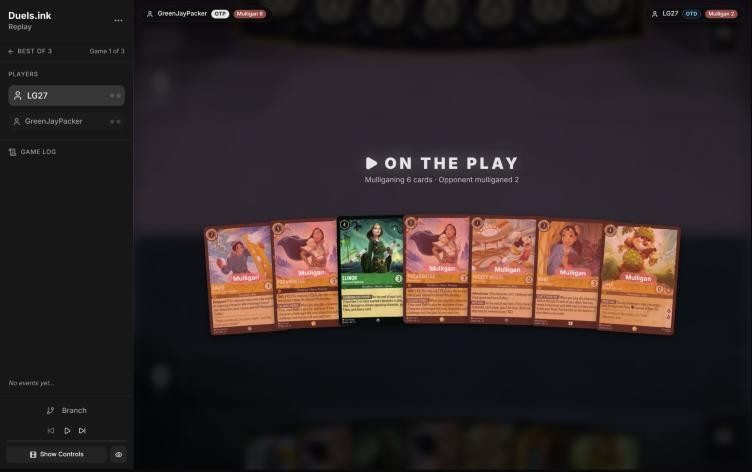
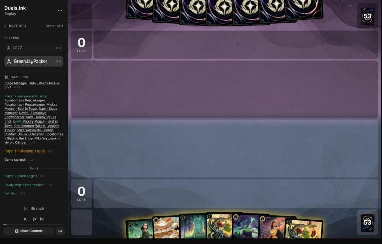
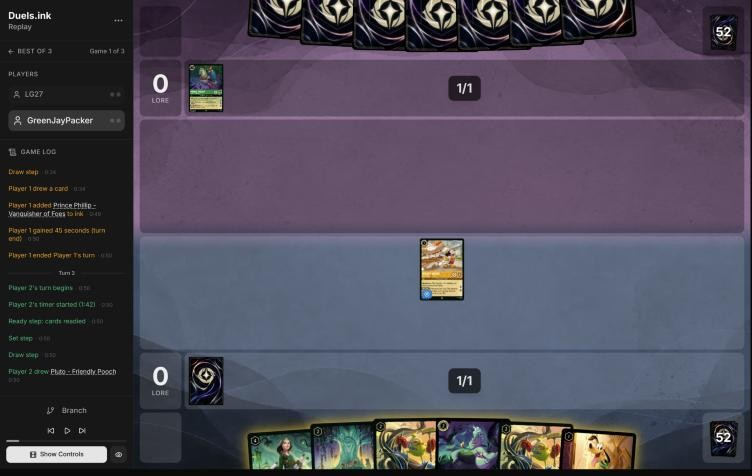
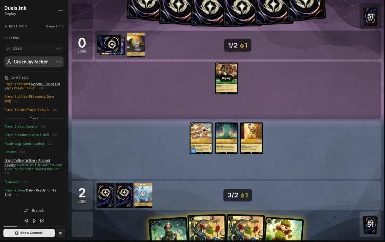
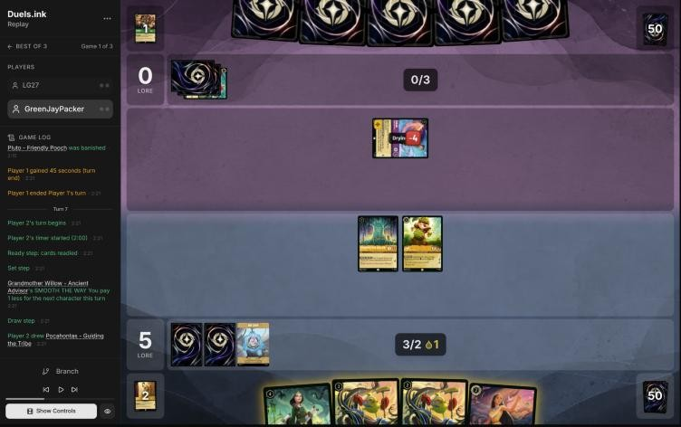
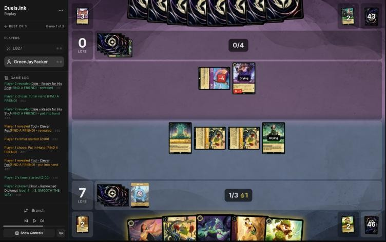
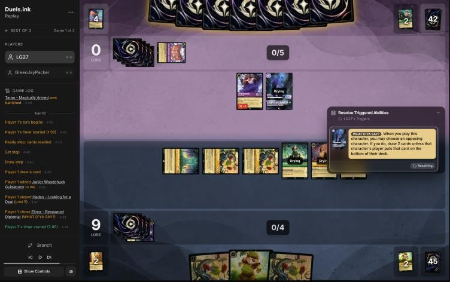
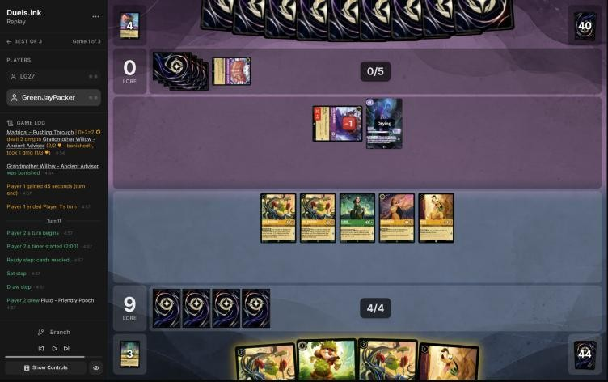

# Review: GreenJayPacker vs LG27, 26 Nov 2026 (game 1)

| | |
|---|---|
| **Status** | draft (blind pass done, not yet discussed) |
| **Replay** | `01a219e6-937c` (`python3 tools/brief.py 01a219e6-937c --turn N`) · [duels.ink viewer](https://duels.ink/replay/01a219e6-938a-7c9f-ada7-b26ff1a12d41?step=0) |
| **Format** | Core Constructed (stated in the replay), CR v2.3.0. Set 14 era: inks revealed before the coin toss |
| **Decks** | You: Amber/Emerald Princess Aggro (Mickey – Best in Town, Pluto, Aurora, Bobby, Willow, David, Guiding the Tribe, Mike, Ursula – Deceiver, Nani, Dale, Elinor, Rapunzel, Peacekeeper, Lionheart; all characters). Them: Amethyst/Emerald ([the coach's notes on this pair](#cite-kb-meta-archetypes-amethyst-emerald-retro-device-a-don-karnage-build)); closest list as it became clear: Retro Device from turn 4 (Phillip inked, Aladdin – Doing His Part, Elsa), with cards of their own off the list: Luisa Madrigal – Pushing Through and Confident Climber, Above the Crowd, Piercing Attack |
| **Play/draw** | You won the toss and went first |
| **Result** | Won: LG27 conceded at 11–0 on game turn 11 (your turn 6) |
| **Meta data** | snapshot of 2026-11-25 (fresh: stale from 2026-12-09) |
| **Chosen how** | By the project's owner: a list of GreenJayPacker's games sent for review, not chosen by result. |

## Summary
Links go to the turn sections below.
- **Good plays:** [9](#turn-9) (Elinor's end-of-turn ping finished Taran for free, after questing the Mikes first),
  [10](#turn-10) (letting Hades draw 2 rather than bottom Elinor), [11](#turn-11) (quests before the ink choice).
- **Close calls:** [3](#turn-3) (Willow + Pluto into a possible Malicious, against Mike), [9](#turn-9) (inking Ursula
  for Guiding the Tribe + Pluto: Ursula's song discard was slightly better), [5](#turn-5) (keeping Willow home).
- **Inaccuracies / mistakes / blunders:**
  - **Mistake, [pre-game](#turn-0):** kept only Elinor (uninkable) from a hand that already curved 1-2-3-4 with
    4-willpower bodies.
  - **Mistake, [5](#turn-5):** Dale without inking, where GOOD DOG + SMOOTH THE WAY made Mike free and left 4 for
    Elinor: a lore, two cards and an ink given up.
  - **Mistake, [7](#turn-7):** left Taran exerted on 1 willpower alive and kept the whole board home, instead of
    trading Willow for him and questing Dale.
- **Unwinnable from:** never; you led from turn 3.

**What decided it:** an early lead (5–0 by turn 5) and a board of 4-willpower questers that LG27's deck never got
on top of. Elinor's engine came online on turn 9, and LG27 conceded at 11–0 holding nine cards with Hades and a
damaged Luisa in play.

## The game, turn by turn
Verdicts judge each decision on what you could know at the time, **including archetype knowledge an experienced
player has**. Hindsight is kept to its own section. Severity scale: good play / close call /
inaccuracy / mistake / blunder. Principle IDs and hypotheses (H-n) link to copies
in the Citations section at the end, as they stood when they were cited.

**What you knew before the game:** they're on Amethyst/Emerald, revealed before the coin toss. Of the common lists,
most like Retro Device (by far the pair's most common list); could be one of the two smaller lists (a Belle / Max Goof
songs list, or an Elinor / Tigger / Owen Burnett questers list) or something of their own. Retro Device is a
draw-and-discard deck with pings and a 9-cost wipe. Your deck is all characters, so their action hate (Lenny – Toy
Binoculars' TAKE A GOOD LOOK, which discards an action) has nothing to hit.

**Your Mickey – Best in Town ramps them too.** HOT DOG! gives *each* player an ink drop at the end of every turn he
ends exerted, and Adventurous makes him quest whenever he can. If he's played on turn 1 and quests from turn 3, they
have their ink plus one drop for each of your turns since then: on their *k*-th turn (game turn 2*k*), up to *k* ink
and *k*−1 drops if they save them. The "earliest" turns below give both figures (without Mickey / with his drops
saved).

The key cards of the Retro Device list (text from the card data):
- **Don Karnage – Khan's Courier** (1, 2/2/1, no abilities): the Shift base for Debonair Pirate. Game turn 2.
- **Malicious, Mean, and Scary** (song 3): 1 damage counter on each of your characters. Kills your 2-willpower
  characters (Pluto, Aurora, Bobby, Willow) and sets up the "damaged" cards below. Game turn 6, or 4 with a drop;
  sung free by any dry character of theirs costing 3+ (Tod, Elsa, Lenny) a turn after it lands.
- **To Wither a Flower** (song 4, uninkable): 2 damage to each of your *damaged* characters. Game turn 8, or 6 with
  drops; sung free by a dry 4+ character.
- **Don Karnage – Debonair Pirate** (6, Shift 4, uninkable): on play, 1 damage to each of your characters (not
  reduced by Resist); while he's exerted your damaged characters get −1 {L}. Shifted onto Khan's Courier on game turn
  8 (6 with drops); hard-cast on game turn 12 (8 with drops).
- **Prince Phillip – Vanquisher of Foes** (9, Shift 6, Evasive 6/6/3): on play, banish all your damaged characters.
  The wipe after Malicious or Don Karnage. Game turn 18 (10 with drops), or earlier through the Device below.
- **Retro Evolution Device** (item 3): {E} and 1 ink, banish one of theirs: play a character costing up to 2 more for
  free. Game turn 6 (4 with a drop); each use needs 1 more ink. It turns Tod or Elsa (3) into Hades (5), and Hades
  into Milo (7).
- **Hades – Looking for a Deal** (5): you put a chosen character on the bottom of your deck, or they draw 2. Game
  turn 10 (6 with drops), or from a 3-cost through the Device.
- **Milo Thatch – Getting His Hands Dirty** (7, 5/5/3, Ward): on play, they discard a card to return your chosen
  character to your hand. Game turn 14 (8 with drops), or from Hades or Aladdin & Genie through the Device.
- **Taran – Magically Armed** (5, Rush 5/5, uninkable): challenges the turn he lands; kills any exerted character of
  yours but Peacekeeper (6 willpower). Game turn 10 (6 with drops).
- **Aladdin – Doing His Part** (2, 3/2/1): banishes an item; you have none, so he's a 3-strength body.
- **Draw cards:** Tod – Clever Fox (3: draw 2, discard 1), Elsa – Exploring the Unknown (3: draw 1), Strike a Good
  Match (song 2: draw 2, discard 1), Junior Woodchuck Guidebook (item 2), Aladdin & Genie (5, Shift 3), Everyone Knows
  Juanita (song 5).

**What it means for your deck:** most of your characters have 4 willpower (Mickey, Thomas, David, Mike, Dale,
Elinor) or 6 (Peacekeeper), so one ping doesn't kill them; Malicious then To Wither a Flower (3 damage) does. Your
2-willpower 1- and 2-drops die to one ping. Their wipe needs damage first, then Phillip at 9 ink. Princess Aggro's
plan ([the coach's archetype table](#cite-kb-meta-index-archetype-game-plans-at-a-glance)) is wide quests and a big lead before that, with Peacekeeper's challenge lock when Shifted.
[The notes on GreenJayPacker's earlier game against Retro Device](#cite-kb-meta-archetypes-amethyst-emerald-retro-device-a-don-karnage-build)
(with Detectives, 01a1fb8a-260a) say staying ready saves nothing from the pings, only from challenges.

### Pre-game

*The board before the decision: [step 0](https://duels.ink/replay/01a219e6-938a-7c9f-ada7-b26ff1a12d41?step=0) in the duels.ink replay viewer.* The seven before the mulligan.

**The plan (written before seeing the mulligan made):** the seven, on the play: Mickey – Best in Town, David,
Nani, Dale, Elinor (uninkable), Pocahontas – Peacekeeper ×2. A curve of 1-2-3-4, with two 4s and two 5s, and no
Pocahontas – Guiding the Tribe to Shift Peacekeeper onto, so a Peacekeeper is a 5-ink 3/6/2 here. Six inkable
cards. Candidates, `mulligan.py` over 1,500 deals:

| Option | Ink T1–4 | Play turns | Lore by T4 | Characters T4 | Interaction |
|---|---|---|---|---|---|
| A. keep all 7 | 9.98 | 4.00 | 9.3 | 4.4 | 100% |
| B. mulligan all 7 | 9.02 | 3.94 | 8.5 | 5.4 | 64% |
| C. send back one Peacekeeper | 9.89 | 4.00 | 9.8 | 4.7 | 100% |
| D. send back both Peacekeepers | 9.64 | 3.99 | 10.3 | 4.9 | 100% |
| F. send back Elinor and one Peacekeeper | 9.76 | 4.00 | 10.3 | 5.4 | 42% |

("Interaction" here is only Elinor, tagged as removal for her ping.) Every option keeps a play on each of turns 1–4.
The hand's bodies suit this matchup: 4 willpower on Mickey, David, Dale and Elinor, 6 on Peacekeeper, so Malicious
or Don Karnage's ping alone kills nothing but Nani. Against a slow sweeper deck, a big lead before their 9-ink wipe
is the plan ([ROLE-1](#cite-role-1): you're the aggressor). The second Peacekeeper is the clunky card: with no base, two 5s are one
too many, and the sim gives the one-card mulligan a little more lore and board for 0.1 ink. One Peacekeeper is
worth keeping: a 6-willpower 2-lore quester is the best body in the hand against pings. Elinor is uninkable but a
strong 4-drop on a wide board (COORDINATED EFFORTS needs three exerted characters).

**Pick: C, send back one Peacekeeper.** A, keeping all seven, is close (the sim's gaps are small). D gives up the
best anti-ping body for half a lore. A full mulligan is clearly worse.

**What you did:** won the coin toss and chose to go first (right for the aggressor against a slow deck, [ROLE-1](#cite-role-1),
[RULE-8](#cite-rule-8)), and kept only Elinor, sending back six: both Peacekeepers, Mickey, Nani, David and Dale. They drew Mickey – Best in Town, Grandmother Willow, Mike
Wazowski ×2, Ursula – Deceiver and Pocahontas – Guiding the Tribe. LG27 mulliganed two.

**Verdict: mistake.** Keeping only Elinor is suboptimal because the seven already had a play on each of turns 1–4
(Mickey, David, Nani, Dale) and the right bodies for this matchup, and the one card kept is the one that can't be
inked. `mulligan.py` puts the mulligan made behind on every measure but board size: ink on turns 1–4 9.03 against
9.89 for sending back one Peacekeeper (9.98 for keeping all seven), lore by turn 4 8.0 against 9.8, play turns 3.90
against 4.00, characters 4.9 against 4.7. Sending back only one Peacekeeper (or keeping all seven) is better
because it keeps the curve and the 4-willpower bodies that Malicious, Mean, and Scary and Don Karnage's ping don't
kill, while the redraw pool is full of 2-willpower 1- and 2-drops (Pluto, Aurora, Bobby, Willow) that one ping does
kill. A deep mulligan for an opening curve ([H-5](#cite-h-5)) fits a hand that has none; this one had it. [MULL-1](#cite-mull-1), [MULL-2](#cite-mull-2), [MULL-4](#cite-mull-4).
Confidence: medium. The sim can't value what GreenJayPacker may have been digging for (Guiding the Tribe as
Peacekeeper's Shift base, Willow and Pluto discounts), and those reasons could narrow the gap; they're an open
question.

### Turn 1: your turn 1

*The board before the decision: [step 3](https://duels.ink/replay/01a219e6-938a-7c9f-ada7-b26ff1a12d41?step=3) in the duels.ink replay viewer.*

**The plan (written before seeing the turn):** the hand after the mulligan has only three inkable cards (Mickey –
Best in Town, Ursula – Deceiver, Pocahontas – Guiding the Tribe) and four uninkable ones (Elinor, Willow, Mike ×2), so
ink is the constraint from now on; 41 of the 53 cards left in the deck are inkable. Nothing of theirs is in play, and
with 1 ink next turn they can add at most a 1-drop (Don Karnage – Khan's Courier), so nothing can reach a character
played now.
- **Mickey or not.** Mickey is 2 lore a turn from turn 3, with 4 willpower that one ping doesn't kill. His HOT DOG!
  gives them a drop each turn too, which brings their Malicious, Don Karnage, Hades and Phillip closer (pre-game
  note). But your hand is short of ink and full of cheap uninkable characters, so the drops matter to you as much
  as to them, and an aggro deck needs the early lore ([ROLE-1](#cite-role-1)). Play him.
- **What to ink: Guiding the Tribe or Ursula.** Ursula's YOU'LL NEVER EVEN MISS IT reveals their hand and discards a
  song of your choice. Retro Device runs about a dozen songs (Malicious, Mean, and Scary, To Wither a Flower, Strike a
  Good Match, Everyone Knows Juanita), and the first two are the pings that kill your board, so Ursula is the hand's
  best card for this matchup, and the look at their hand helps every later turn. Guiding the Tribe's STAY CLOSE (a
  free 1-cost character) has no target in hand now, and she matters most as Peacekeeper's Shift base, with no
  Peacekeeper in hand ([INK-1](#cite-ink-1), [INK-2](#cite-ink-2)).
- **Candidates:** (a) ink Guiding the Tribe, play Mickey (1 of 1): my pick. (b) ink Ursula, play Mickey (1 of 1):
  keeps the free-1-drop and Shift-base card, gives up the song discard. (c) ink Mickey and play nothing: no.

Next turn (2 ink) would then be Ursula, keeping Willow + Mike (2 + 1 = 3) for turn 5, when Mickey's first drop makes
4 ink.

**What you did:** inked Guiding the Tribe and played Mickey – Best in Town.

**Verdict:** the planned line: no flag. Keeping Ursula for her song discard is the right card to keep in this matchup.

### Turn 3: your turn 2

*The board before the decision: [step 8](https://duels.ink/replay/01a219e6-938a-7c9f-ada7-b26ff1a12d41?step=8) in the duels.ink replay viewer.*

**The plan (written before seeing the turn):** LG27 inked Prince Phillip on their turn 2 and played nothing; Phillip
in a 9-cost slot is a Retro Device card, so their list now looks most like Retro Device, with something of their
own still possible. You drew Pluto. The hand is Elinor, Willow, Mike ×2, Pluto (all uninkable) and Ursula, the only
inkable card.
- **Ink:** inking Ursula is the only way to reach 2 ink. Not inking keeps her song discard but leaves you on 1 ink
  (Pluto) now and 3 at most next turn; with five uninkable cards, the ink is worth more ([INK-3](#cite-ink-3)). Ink Ursula. After
  that the hand is all uninkable, so next turn's ink depends on what you draw: a 79% chance of an inkable card from
  one draw, 96% from two (`odds.py hold 52 41`).
- **Their turn 4:** 2 ink plus Mickey's drop from tonight makes 3, enough for Malicious, Mean, and Scary (held about
  45% after their draw, for the Retro Device list). Nothing of theirs is in play, so nothing can challenge, and no
  Rush is castable at 3. So the only risk to what you play is Malicious, which kills 2-willpower characters
  (Willow, Pluto) and only damages 4-willpower ones (Mickey, Mike).
- **Mickey** must quest (Adventurous): 2 lore, and the drop to each player.
- **Candidates** (ink sums of your 2):
  - **(a) Mike (2 of 2).** FIND A FRIEND gives you a card every time (your deck is all characters), which with your
    draw makes an inkable card next turn 96% likely; it gives them one about two times in three, cheap for them with
    seven cards and short ink ([H-13](#cite-h-13)). Mike survives Malicious. Next turn (about 4 ink): Willow, then Mike for 1,
    and Pluto for 1, three more bodies; Elinor the turn after.
  - **(b) Willow + Pluto (2 + 0 = 2 of 2).** Sets up next turn: Pluto's GOOD DOG and Willow's SMOOTH THE WAY make
    Elinor cost 2, with Mike for 2 (4 of about 4), and Mickey, Willow and Pluto exerted trigger COORDINATED EFFORTS
    at once (1 damage, 1 lore, a card). Big if they don't have Malicious; if they do, both die on their turn 4 for
    one card, and next turn is Elinor alone.
  - **(c) Pluto only (1 of 1), no ink, keeping Ursula.** Falls a full ink behind with an uninkable hand: no.

**Pick: (a), Mike.** It risks nothing to the only punish they have at 3 ink, and its card fixes the hand's ink
problem. (b) has the faster Elinor, but on a coin flip against Malicious; a close call between the two.

**What you did:** inked Ursula, played Grandmother Willow, then Pluto for 0 with SMOOTH THE WAY, and quested with
Mickey (2–0). Each player got an ink drop.

**Verdict: close call.** Your line is the plan's (b): it sets up a turn-5 Elinor for 2 with Mike beside her and
COORDINATED EFFORTS on at once, against Mike now and a slower Elinor. It stakes Willow and Pluto on their not having
Malicious, Mean, and Scary at 3 ink (about 45% for the Retro Device list), and a Malicious would cost them their
whole turn for two cards you paid 2 ink for ([TRADE-1](#cite-trade-1)). Mike was the safer line and the better fix for an
all-uninkable hand (96% against 79% for an inkable card next turn); yours has the bigger next turn. Neither is clearly
better. Nothing else of theirs could reach your characters: they had no character in play, and no Rush comes at 3.
Confidence: medium.

### Turn 5: your turn 3

*The board before the decision: [step 17](https://duels.ink/replay/01a219e6-938a-7c9f-ada7-b26ff1a12d41?step=17) in the duels.ink replay viewer.* Willow and Pluto dry, Elinor, Dale and both Mikes in hand.

**The plan (written before seeing the turn):** LG27 inked Elsa – Exploring the Unknown and played Aladdin – Doing His
Part (3/2/1): Retro Device's cards, so that's their likeliest list. No Malicious came, so Willow and Pluto lived. You
lead 2–0 and drew Dale. Ink: 2 plus Mickey's drop = 3, 4 if you ink; Dale is the only inkable card in hand (Elinor
and both Mikes are uninkable). Willow and Pluto are dry, so SMOOTH THE WAY and GOOD DOG each take 1 off the first
character you play.
- **Their next turn (5 ink, counting the drop Mickey gives them):** Malicious, Mean, and Scary (held about 42% after
  their draw) kills Willow and Pluto wherever they stand; no character of theirs can sing it yet, but Aladdin & Genie
  Shifted onto the dry Aladdin (3) could sing it for free. Taran (Rush 5/5, about 23%) kills any one exerted
  character. Hades (about 42%) makes you bottom a character or lets them draw 2. FREE KILLS for Aladdin (3 {S}): Willow
  and Pluto if exerted; Mickey (4 willpower) only to Taran. Malicious + To Wither a Flower (7) is out of reach at 5.
- **The needs check:** you're the aggressor and ahead; their wipe is Phillip at 9 (one copy inked). With your Mickey's
  drops they could reach 9 by game turn 10 if they save every drop, so the lead you build by then matters most.
- **Elinor's COORDINATED EFFORTS** fires at the end of the turn with three exerted characters: Mickey's quest,
  Willow's quest and Pluto's GOOD DOG make three. It pings their chosen character (Aladdin, to 1 willpower, so
  Willow's 1 back would kill him if he challenges her), gains 1 lore and draws a card.
- **Candidates:**
  - **(a) Ink Dale, Elinor for 2 (both discounts), Mike for 2 (2 + 2 = 4 of 4).** Quest Mickey and Willow; Elinor
    fires. 6–0, a card from Mike and one from Elinor. Your hand is then all uninkable again.
  - **(b) The same plays, Mike first: GOOD DOG, then Mike for 0 (2 − 1 − 1), FIND A FRIEND, and only then choose the
    ink:** the card Mike finds (a character every time; inkable about four times in five) or Dale. Then Elinor for 4
    (0 + 4 = 4 of 4). It ends with the same board and lore as (a), and keeps Dale in hand whenever the find is
    inkable ([SEQ-1](#cite-seq-1)). **My pick.**
  - **(c) No ink: Elinor for 2 and 1 spare (2 of 3).** Keeps Dale, but leaves Mike in hand and an ink unused.
- **What (b) exposes:** Mickey, Willow and Pluto exerted. Pluto is Aladdin's free kill (he's worth a GOOD DOG a
  turn); Willow only as a trade once Elinor's ping has hit Aladdin; Mickey only to Taran. Elinor and Mike stay ready.
  Malicious takes Willow and Pluto whichever line you pick, since they're already in play.

**What you did:** didn't ink. Played Dale for 3 (SMOOTH THE WAY; 2 ink and the drop), then quested with Mickey and
Pluto (5–0). Willow stayed ready; Elinor and both Mikes stayed in hand.

**Verdict: mistake.** Playing **Dale without inking** is suboptimal because it spends 3 of the 4 ink you could have
had, with a hand left all uninkable, and leaves Elinor's engine and both Mikes in hand. Playing **GOOD DOG, Mike for 0,
then inking (the card Mike finds if it's inkable, else Dale) and Elinor for 4** is better because:
- it uses the whole turn (Mike 0 + Elinor 4 = 4 of 4, against Dale 3 of 3);
- it ends a lore ahead (6–0 against 5–0, Elinor's COORDINATED EFFORTS adding 1 with Mickey, Willow and Pluto
  exerted);
- it draws two cards (FIND A FRIEND every time, since your deck is all characters, and Elinor's draw);
- it puts a third card in your inkwell, and starts an engine that pings, scores and draws every turn from now on
  ([TEMPO-1](#cite-tempo-1), [CARD-1](#cite-card-1), [INK-3](#cite-ink-3)).

Dale stays in hand for next turn whenever the find is inkable (about four times in five). Mike's find gives them a
card about two times in three, which matters less while they hold six ([H-13](#cite-h-13)).
- **What the suggested line exposes:** Mickey, Willow and Pluto exerted. Aladdin can kill Pluto for free (no Dale
  in play yet), and Willow only as a trade once Elinor's ping has left him on 1 willpower; only Taran (Rush 5/5)
  reaches Mickey. Malicious kills Willow and Pluto in either line. Your line's gain is that Dale's SPIKE SUIT makes
  any Aladdin challenge into Pluto or Mickey a trade a turn earlier, and Dale quests for 2 from next turn. That's worth
  less than a card, a lore and an ink with Aladdin their only character.
- **Willow kept home** is a close call: her quest was worth 1 lore, and under SPIKE SUIT Aladdin would trade with her
  rather than kill her for free, but she's the discount engine, and a ready Willow can't be challenged at all.

Confidence: medium. It depends on the card-for-tempo value of Elinor's engine, which the tools can't measure, and
on whether GreenJayPacker had a reason to hold Elinor (an open question).

### Turn 7: your turn 4

*The board before the decision: [step 27](https://duels.ink/replay/01a219e6-938a-7c9f-ada7-b26ff1a12d41?step=27) in the duels.ink replay viewer.* Taran exerted with 4 damage; Willow and Dale ready.

**The plan (written before seeing the turn):** on their turn 6 LG27 inked Tod and played Taran – Magically Armed
(5, Rush) with the two drops your Mickey had given them. Taran killed Mickey (taking 4 back under SPIKE SUIT) and
Aladdin traded with Pluto. You lead 5–0 with Willow and Dale, both dry; they have Taran on 1 willpower, exerted, and 5
cards. Mickey is gone, so no more drops for either side: their ink next turn is 4. You drew Pocahontas – Guiding the
Tribe, the only inkable card in hand (Elinor and both Mikes are uninkable); ink is 2 plus your last drop = 3, 4 if you
ink. Willow takes 1 off the first character you play.
- **What must happen: Taran must die.** Left alive he's their best card next turn: Retro Evolution Device (3 + 1 =
  4, their ink exactly) turns him into anything up to 7 (Milo Thatch's bounce, Don Karnage – Debonair Pirate's ping,
  Hades), and he's a free singer of Malicious, Mean, and Scary and To Wither a Flower (the brief's FREE SINGERS line).
  Willow challenging him kills him (2 back under SPIKE SUIT, 1 needed) and dies to his 5: a 2-cost for their 5-cost
  ([TRADE-1](#cite-trade-1)). Dale would do the same, but he's worth more. Elinor's ping would kill him for free, but it needs three
  exerted characters at the end of the turn and only Willow and Dale can quest, so it can't fire this turn.
- **Order:** play characters before Willow challenges, so her SMOOTH THE WAY discount isn't lost.
- **Their next turn (4 ink) after Taran dies:** an empty board, so nothing can challenge Dale; the second Taran (5)
  and Hades (5) are out of reach. Malicious (about 38%) puts 1 on each of yours and kills nothing with 3+ willpower;
  with no singer left, Malicious + To Wither a Flower (7) is out of reach. Phillip needs 9: far off without drops, or
  three steps of the Device.
- **Candidates** (ink sums):
  - **(a) Ink Guiding the Tribe, Elinor for 3 (4 − 1), 1 spare (3 of 4).** Willow trades with Taran, Dale quests:
    7–0. Elinor can't fire until three dry characters quest, so not before turn 11.
  - **(b) Mike first for 1 (Willow's discount), then ink: the card he finds if it's inkable, else Guiding the Tribe.
    Then the second Mike for 2 (1 + 2 = 3 of 4), or Guiding the Tribe for 2 with STAY CLOSE if the find is a 1-drop.**
    Willow trades with Taran, Dale quests: 7–0. Two cards from FIND A FRIEND (theirs about 62% each, with 5 in hand and
    4 ink, so cheap for them, [H-13](#cite-h-13)). Next turn Dale and both Mikes quest, which makes three exerted, and Elinor for 4
    fires at once: 1 damage, 1 lore and a card. **My pick** ([SEQ-1](#cite-seq-1), [SEQ-4](#cite-seq-4)).
  - **(c) Leave Taran, quest Willow and Dale, Elinor for 3: 8–0.** A lore more now, but it hands them the Device line
    into Milo or Don Karnage, or a free Malicious, and Taran kills whichever of Willow and Dale he challenges. No.
- **What (b) exposes:** only Dale exerted, and nothing of theirs can reach him at 4 ink. The Mikes stay ready.

**What you did:** inked Guiding the Tribe, then played Mike for 1 (SMOOTH THE WAY) and Mike for 2 (3 of 4). The
first FIND A FRIEND gave you a second Guiding the Tribe and them Luisa Madrigal – Pushing Through (1, Challenger +2);
the second gave you a Mike and them Luisa Madrigal – Confident Climber (5, Shift 3 onto a Luisa, 6/4; I CAN TAKE IT
moves damage from their characters to her, then on to yours once she has 3). Willow and Dale stayed ready: no quest,
no challenge. Still 5–0, with Taran alive on 1 willpower.

**Verdict: mistake.** Leaving **Taran alive and the whole board home** is suboptimal because Taran exerted on 1
willpower was the one target on the board worth a card, and the only turn he could be reached: by their next turn he
can sing Malicious, Mean, and Scary or To Wither a Flower for free, feed a Retro Evolution Device into a 7-cost (Milo
Thatch, Don Karnage) for exactly their 4 ink, or quest, and if he doesn't exert he can't be challenged on your turn.
Keeping Dale ready only stopped Taran trading himself for him. **Willow challenging Taran after the Mikes, and Dale
questing,** is better because it kills a 5-cost with a 2-cost whose discount was already spent this turn ([TRADE-1](#cite-trade-1),
[THREAT-1](#cite-threat-1)), leaves their board empty, and then Dale's quest risks nothing: no Rush they can cast at 4 reaches him. That's
7–0 with Taran gone, against 5–0 with Taran alive and Willow kept. Elinor's ping could kill Taran next turn, but only if
he's still there and they haven't used him first, and only with 4 ink and three dry questers ([QC-2](#cite-qc-2), [ROLE-1](#cite-role-1): the
aggressor can't spend a turn not questing).
- **What the suggested line exposes:** Dale exerted against an empty board; only a Rush character costing 4 or less
  could reach him, and none is in their list. Malicious would put 1 on each of yours and kill none, the same as in
  your line, except for Willow, who'd already be gone.
- **A smaller point, on order:** inking Guiding the Tribe before the first Mike gave up the choice of inking the
  card Mike found instead ([SEQ-1](#cite-seq-1)). It found a second Guiding the Tribe, so it cost nothing this time.

Confidence: medium-high. Their next turn is the test of how much Taran was worth, and it isn't evidence either way.

### Turn 9: your turn 5

*The board before the decision: [step 49](https://duels.ink/replay/01a219e6-938a-7c9f-ada7-b26ff1a12d41?step=49) in the duels.ink replay viewer.* Elinor just played; Ursula and the Pluto Mike found in hand.

**The plan (written before seeing the turn):** on their turn 8 Taran sang Above the Crowd for free (5, song: a
character with 3 {S} or less to the bottom of its deck) and bottomed Dale; they played Luisa – Pushing Through (1,
0/3, Challenger +2), inked Piercing Attack (2 damage to a chosen character) and drew 2 with a Guidebook. Above the
Crowd, Piercing Attack and the two Luisas are off the Retro Device list, so this is most like Retro Device with a
Luisa package of their own. Known in their hand: Luisa – Confident Climber. You lead 5–0 with Willow and two dry
Mikes; Dale's SPIKE SUIT is gone, so the Mikes deal 0 in a challenge. Taran is exerted on 1 willpower after singing.
You drew Ursula – Deceiver. Ink: 3 plus your drop = 4, 5 if you ink Guiding the Tribe or Ursula.
- **What must happen: kill Taran,** their free singer (the brief's FREE SINGERS line: Malicious, To Wither a Flower,
  Above the Crowd again) and their best Device target. **Elinor can do it for free:** Willow and both Mikes quest,
  which makes three exerted at the end of the turn, and COORDINATED EFFORTS deals 1 damage to Taran, gains 1 lore and
  draws a card. Willow challenging him also kills him, but she dies and Elinor then has only two exerted.
- **Ursula now:** YOU'LL NEVER EVEN MISS IT shows their hand (what's coming: Phillip, Hades, Malicious) and discards a
  song of your choice. Ink Guiding the Tribe, not her.
- **Their next turn (5 ink), with Taran dead:** Luisa – Confident Climber (known in hand) Shifted onto Luisa for 3
  challenges at once with 6 {S}: one exerted character of yours dies, Mike, Elinor and Ursula included. If they keep
  Luisa – Pushing Through instead, her Challenger +2 kills Willow for free (the brief's FREE KILLS). Malicious (about
  41%) kills Willow; Piercing Attack-style damage, Hades (about 41%) or a second Above the Crowd (Elinor, Willow,
  Ursula and the Mikes all have 3 {S} or less) need a singer of cost 5+, which they won't have with Taran gone,
  or ink. Phillip needs 9: far off.
- **Candidates** (ink sums):
  - **(a) Quest both Mikes and Willow first (two FIND A FRIENDs, which may find a better card to ink), then ink the
    spare card (Guiding the Tribe unless a find is worse), Ursula for 1 (SMOOTH THE WAY), Elinor for 4 (1 + 4 = 5 of
    5).** End of turn: Elinor kills Taran, +1. 5 + 3 + 1 = 9–0, two finds and Elinor's card. **My pick** ([SEQ-1](#cite-seq-1)).
    Exposes Willow and both Mikes to one Luisa – Confident Climber kill (or Willow to Pushing Through).
  - **(b) Elinor and Ursula, then Willow challenges Taran; the Mikes quest (5 of 5).** Taran dies, but so does Willow,
    and Elinor doesn't fire: 7–0, one card fewer.
  - **(c) Stay home and develop.** Taran lives for another song or a Device: no.
- **The needs check:** 9–0 with a board of five questers (5 a turn, plus Elinor's 1), against a deck whose wipe is
  far off. The race is yours if the board keeps questing; the danger is Malicious + To Wither a Flower or a Don
  Karnage ping on a board of 2- and 3-willpower characters, which is why the 4-willpower Mikes and Elinor are the
  better bodies to rely on.

**What you did:** quested both Mikes first; FIND A FRIEND gave you Pluto and Dale, and gave them Hades – Looking for a
Deal and Tod. Then Elinor for 3 (SMOOTH THE WAY); inked Ursula; Guiding the Tribe for 2 (2 ink and your drop), whose
STAY CLOSE played Pluto free; Willow quested. At the end of the turn Elinor's COORDINATED EFFORTS killed Taran, gained
1 lore and drew a Mike: 9–0.

**Verdict: good play,** with one close call inside it.
- **Elinor's ping on Taran** was the best way to kill him: free, with three quests, a lore and a card on top.
  Questing the Mikes before choosing the ink and the plays ([SEQ-1](#cite-seq-1)) found Pluto, a target for STAY CLOSE.
- **Ursula or Guiding the Tribe + Pluto: close call, leaning to Ursula.** Your line adds two bodies and a lore a turn
  (and Pluto's GOOD DOG next turn). Ursula would have shown their eight-card hand and discarded a song: for the Retro
  Device list, about 85% to hold one and about 61% to hold Malicious or To Wither a Flower, the cards that sweep a board
  like yours (`odds.py hold 51 13 6` and `51 7 6`). With nothing killed, both boards reach 20 on game turn 13 (9 + 7 + 7
  against 9 + 6 + 6), so the extra lore doesn't bring the win closer, while the song discard protects it ([POS-1](#cite-pos-1), [WIN-2](#cite-win-2)).
  Pluto and Guiding the Tribe are also the two characters Malicious kills or nearly kills. But if they kill a quester
  a turn, the extra bodies keep the clock, so it isn't clear-cut. Confidence: low.
- **What it exposes:** Willow and both Mikes are exerted. Luisa – Confident Climber, known in their hand, Shifted onto
  Pushing Through kills one of them; Willow is a free kill for Pushing Through alone. That was the price of Elinor's
  trigger, and it was worth paying to kill Taran.

### Turn 10: their turn

*The board before the decision: [step 59](https://duels.ink/replay/01a219e6-938a-7c9f-ada7-b26ff1a12d41?step=59) in the duels.ink replay viewer.* Bottom Elinor or let them draw 2.

**What happened:** LG27 inked a Guidebook and played Hades – Looking for a Deal (5) on Elinor: you chose to let them
draw 2 rather than put Elinor on the bottom of your deck. Luisa – Pushing Through then challenged Willow (2 with
Challenger +2) and killed her, taking 1.

**Verdict on keeping Elinor: good play.** Bottoming Elinor would have cost your engine (a ping, a lore and a card
every turn you have three questers) to deny two cards to a player who already held seven and had just spent all 5 of
their ink. Extra cards are worth least to a full hand that's short of ink ([H-2](#cite-h-2), its converse for the opponent), and
their hand was already far bigger than their ink could use. Confidence: medium-high.

### Turn 11: your turn 6

*The board before the decision: [step 62](https://duels.ink/replay/01a219e6-938a-7c9f-ada7-b26ff1a12d41?step=62) in the duels.ink replay viewer.*

**The plan (written before seeing the turn):** you lead 9–0. Their board: Luisa – Pushing Through, exerted on 2
willpower (the Shift base for Luisa – Confident Climber, known in their hand), and Hades, ready. They hold nine
cards (Confident Climber and Tod known) and will have 6 ink. Yours: Mike ×2, Elinor, Guiding the Tribe and Pluto, all
dry; in hand Mike ×2, Pluto (drawn) and Dale, the only inkable card. Ink 4, 5 if you ink.
- **What must happen: kill Luisa – Pushing Through.** Guiding the Tribe's 2 kills her and takes nothing back (her
  Challenger works only when she challenges). It denies Confident Climber her Shift, so she can't challenge next turn
  (hard-cast for 5 she's drying), and it takes away two of the brief's FREE KILLS: the Mikes, which only Luisa and
  Hades together could kill, and Pluto. Hades is ready, so he can't be challenged now.
- **Their next turn (6 ink):** Hades is a free singer of Malicious, Mean, and Scary, To Wither a Flower and Above the
  Crowd. Malicious (about 54% after their draw) + To Wither a Flower (about 44%) together put 3 on each of yours,
  killing every character with 3 willpower or less and leaving the 4-willpower ones on 1. Above the Crowd bottoms one
  character with 3 {S} or less (all of yours). Hades alone (3 {S}) can kill an exerted Guiding the Tribe or Pluto,
  not a Mike or Elinor. A second Taran (Rush, about 17%) kills one. Phillip (9) and Milo (7) are out of reach.
- **The needs check:** quests this turn take you to about 14, and next turn needs 6 more. The 4-willpower characters
  (Mikes, Elinor, Dale) are the ones that survive a Malicious + To Wither a Flower turn, so the more of them in play,
  the likelier you reach 20 on game turn 13 through a sweep.
- **Elinor fires** with three or more exerted (easily), pinging Hades to 3 willpower left.
- **Candidates** (ink sums):
  - **(a) Guiding the Tribe challenges Luisa; quest both Mikes first (two FIND A FRIENDs), then ink a spare find if
    one is inkable and keep Dale, else ink Dale. With Dale kept: Dale 4 + Pluto 1 = 5 of 5. With Dale inked: Mike 2 +
    Mike 2 + Pluto 1 = 5 of 5.** Quest Elinor and Pluto: 9 + 4 + 1 = 14. **My pick** ([SEQ-1](#cite-seq-1), [SEQ-3](#cite-seq-3)). Two Mikes
    more mean four 4-willpower questers that survive the sweep: 4 + Elinor's 1 + her trigger 1 = 6, exactly 20 on game
    turn 13. Dale instead gives SPIKE SUIT (a Hades challenge into a Mike or into Guiding the Tribe after the ping
    kills him) and 2 lore.
  - **(b) No ink: Dale for 4 (4 of 4).** The same quests (14), Dale's SPIKE SUIT, the second Pluto and Mikes stay in
    hand. One body fewer than (a).
  - **(c) Elinor challenges Luisa instead of Guiding the Tribe.** Also free, but Elinor's quest is worth more than
    Guiding the Tribe's, and both stay exerted either way. No reason to.
- **What (a) exposes:** every quester exerted. With Luisa dead, Hades alone can kill only Guiding the Tribe or a
  Pluto; Taran (if they have the second) one more. The sweep is the real risk, and no line avoids it at 14 lore:
  the answer is the 4-willpower bodies, not staying home ([POS-1](#cite-pos-1) doesn't mean skipping the quests that win next turn).

**What you did:** quested both Mikes first (10, then 11); FIND A FRIEND gave you Aurora – Holding Court and Bobby
Zimuruski, and gave them Aladdin & Genie and Lenny. You inked Aurora and kept Dale, played the third Mike (finding
Ursula for you and a second Hades for them) and Bobby (1). LG27 conceded at 11–0, before the turn was over.

**Verdict: good play, as far as it went.** Questing before choosing the ink is the plan's order ([SEQ-1](#cite-seq-1)), and it found
an inkable 1-drop to ink in Dale's place, so the turn could still end with Dale or Ursula beside the new bodies (Mike 2
+ Bobby 1 = 3 of 5 spent at the concession, 2 left for Ursula). Guiding the Tribe's free kill on Luisa – Pushing Through
hadn't happened yet; it was the turn's one must-do, and the order (quests and plays first, the challenge after) left
it available.

## Lessons
1. **Keep a curve against a ping deck.** A seven that plays on each of turns 1–4 with 4-willpower bodies is the
   matchup's ideal hand: Malicious, Mean, and Scary and Don Karnage's ping don't kill them. A deep redraw from this
   deck comes back full of 2-willpower 1-drops and uninkable cards ([pre-game](#turn-0); [MULL-2](#cite-mull-2), [MULL-4](#cite-mull-4)).
2. **Look before you ink.** Your deck is all characters, so FIND A FRIEND always finds a card, and SMOOTH THE WAY and
   GOOD DOG together make Mike free. Play or quest Mike first, then choose what to ink: the find often saves your only
   inkable card ([5](#turn-5), [7](#turn-7); done well on [9](#turn-9) and [11](#turn-11); [SEQ-1](#cite-seq-1)).
3. **A big damaged character of theirs, exerted on your turn, is the target.** Next turn it sings, feeds a Retro
   Evolution Device or stays ready where you can't reach it ([7](#turn-7)). Elinor's COORDINATED EFFORTS is the
   cheapest finisher when three of yours quest ([9](#turn-9)).
4. **Use the whole turn's ink.** With 16 uninkable cards in the deck, an ink missed is hard to get back
   ([5](#turn-5); [INK-3](#cite-ink-3)).

## Proposed knowledge-base updates (applied after discussion)
- **Meta** (the Amethyst/Emerald pair file, below its end marker): *Retro Device with a Luisa package against
  GreenJayPacker's Princess Aggro: LG27* (blind review of 01a219e6-937c, game 1). Seen by game turn 11: Prince Phillip
  (inked turn 2), Elsa and Tod (inked), Aladdin – Doing His Part, Taran – Magically Armed (game turn 6, paid with two
  drops from GreenJayPacker's Mickey; Rush killed Mickey), Above the Crowd sung free by Taran (turn 8, bottomed Dale),
  Junior Woodchuck Guidebook ×2, Hades (turn 10), and off the list Luisa Madrigal – Pushing Through and Confident
  Climber and Piercing Attack; Aladdin & Genie, Lenny and a second Hades and Tod came from FIND A FRIEND. Conceded at
  0–11 on game turn 11. **Taran is a free singer of Above the Crowd** (cost 5), as Milo and Hades are.
- **Card note** ([Mickey – Best in Town](#cite-kb-cards-mickey-mouse-best-in-town)): against Retro Device his drops bring their 5-drops early. Taran (Rush 5/5)
  came on game turn 6, their 3rd turn, with 3 ink and two drops, and his first challenge killed Mickey.
- **Meta** (the Amber/Emerald pair file, [Princess Aggro](#cite-kb-meta-archetypes-amber-emerald-princess-aggro-dale-discounts-and-the-peacekeeper-base), notes on piloting it, from GreenJayPacker's list):
  - SMOOTH THE WAY and GOOD DOG stack on one character, so Mike costs 0 with both.
  - FIND A FRIEND always finds a card in an all-character list: use it before choosing the ink.
  - Elinor's COORDINATED EFFORTS finishes a damaged character at the end of your turn (Taran on 1 willpower, turn 9).
  - 16 uninkable cards (Pluto, Willow, Mike and Elinor, four each) make ink the constraint after a deep mulligan.
- **Strategy:**
  - [H-5](#cite-h-5), evidence on its limit (blind review, not yet discussed): a seven with a 1-2-3-4 curve of 4-willpower bodies,
    deep-mulliganed to one uninkable card. `mulligan.py`: ink on turns 1–4 9.03 against 9.89, lore by turn 4 8.0
    against 9.8, for sending back one Peacekeeper.
  - [H-2](#cite-h-2), for its converse (turn 10): Hades on Elinor with LG27 holding seven cards and no ink left. Keeping the engine
    and letting them draw 2 was right.
- **Rules:** none.

## Hindsight
Doesn't change the verdicts above.
- The mulligan's redraw gave Mickey, Willow, Mike ×2, Ursula and Guiding the Tribe: with Elinor, four uninkable
  cards in seven, which is why ink stayed short until turn 9.
- Taran, left alive on turn 7, sang Above the Crowd for free on turn 8 and bottomed Dale, one of the uses the turn-7
  verdict named (the free song).
- Mickey's own drops paid for the Taran that killed him on turn 6.
- LG27 never cast Malicious, Mean, and Scary or To Wither a Flower, and conceded with nine cards in hand, so what
  they held is unknown. Whether the turn-13 finish would have survived their turn 12 can't be told.

## The coach's errors
Filled in during discussion. One found by the coach after the blind pass:

| When | Error | How it was caught | How it won't happen again |
|---|---|---|---|
| Pre-game read; turns 5 and 7 | Above the Crowd ([in the pair file's notes from 01a139ad](#cite-kb-meta-archetypes-amethyst-emerald-cards-seen): Milo and Hades sing it free) was left out of the pre-game read and of what Taran could sing. Taran sang it on turn 8 and bottomed Dale. The turn-7 verdict (kill Taran, a free singer) stands, but its reasons missed this song | The coach, writing Hindsight after the blind pass | Proposed: the brief's FREE SINGERS line also lists songs named in the pair file's hand-written notes for that archetype, not only the average lists' songs, and the pre-game read takes key cards from those notes as well as from THEIR KEY CARDS |

## Open questions
- **Pre-game:** what were you looking for when you kept only Elinor? Guiding the Tribe as Peacekeeper's base, or the
  discounts? Did the two Peacekeepers with no base make the whole hand look slow?
- **Turn 3:** did you weigh Malicious at 3 ink (their 2 plus Mickey's drop) when you played Willow and Pluto?
- **Turn 5:** did you see GOOD DOG + SMOOTH THE WAY making Mike free, then the ink and Elinor? Why Dale rather than
  inking him?
- **Turn 7:** why not Willow into the exerted Taran? To keep her discount, or were you planning on Elinor's ping later?
- **Turn 9:** what decided Guiding the Tribe + Pluto over Ursula's look at their hand and song discard?

## Citations
Copies of the coach's knowledge base cited above, as they stood when they were cited (the private repository's commit and date are given with each). They don't change when the knowledge base does.

**index.md, Archetype game plans at a glance**: knowledge base, `kb/meta/index.md` at `5894e68` (2026-11-26), working tree

> ## Archetype game plans at a glance
> What each archetype is trying to do, and the big turn to plan around. Details and examples are in the pair files' notes.
>
> | Archetype | Plan | The swing turn to watch for |
> |---|---|---|
> | Amber/Sapphire **Detectives** | Wide cheap Detectives, wide quests, removal recycled by Fangmeyer | Support **onto your characters** to reach 5 {S}, then Gaston or a Shifted Judy – Always Vigilant banishes them; +5 to +7 quest turns |
> | Amber/Sapphire **Control** (#1 and #2 from the 12 Nov snapshot; #2 adds Priscilla, Scuttle and a second Spooky Sight) | Card flow and lore, then a full wipe | Quest first, then Raging Storm (8) |
> | Amber/Emerald **Circle of Life** | Discard Prince Phillip, damage your board, replay him | Malicious, Mean, and Scary or Don Karnage – Debonair Pirate, then Circle of Life (Sing Together 8) or a discounted Phillip. Seen from their 5th turn. Little questing before it |
> | Amber/Emerald **Princess Aggro** | Cheap Princesses with discounts, wide quests | Pocahontas – Peacekeeper's challenge lock; 15+ lore by their 5th turn |
> | Amethyst/Emerald **Retro Device** | Draw and discard, cost cheating | Malicious, Mean, and Scary + Prince Phillip from 9 ink |
> | Emerald/Steel **Midrange** | Cheap Evasive and 2-lore questers, locks | Toulouse (no actions on your turn), steady +6 quest turns |
> | Sapphire/Steel **Ducktectives** | Cheap Detectives, Ward pieces, VICTORY POSE | Judy – Lead Detective gives Alert to every Detective: challenges into your Evasives |
> | Sapphire/Steel **Big Ramp** | Ramp into big questers and a lore location | Khan Industries' +2 lore a turn, protected from challenges |
> | Amethyst/Steel | Ink drops plus removal actions | Jousting Match for 5 when paid with an ink drop; several removal actions in one turn |
> | Ruby/Steel **Incredibles** | Wasabi and challengers | Shere Khan lets a character challenge ready characters; TWIN BLADES |
> | Amber/Steel **Rockstar Aggro** | Wide 1- and 2-drops (Lilo, free Pudges, Mickey), Grandmother Willow discounts, locks (Mr. Big, Toulouse, Flash) | +5 to +10 quest turns from five to seven questers; Dale makes their high-willpower bodies kill in challenges |
> | Amber/Ruby **Meilin Lee singers** (unlisted) | Cheap singers and Sing Together, songs that dig and replay | The Headless Horseman banishes a 2-{S}-or-less character each time he's played (Akood makes him 3) |
> | Amber/Amethyst **Remember Merida** | Cheap characters and card flow (Merlin, Shop), Raging Storm to reset, Remember Me to rebuild | Raging Storm (8, often a turn early with Mickey's drops), then Remember Me (Sing Together 6) replaying 4–7 characters; Demona – Scourge exerting your board |
> | Amber/Amethyst **Aggro** (The Prince and Meeko) | 1-cost 2-lore characters, Pocahontas – Following the Wind copying their lore, Dale's SPIKE SUIT | 13 lore by game turn 7; +10 turns with two Following the Winds; Peacekeeper's challenge lock |
> | Emerald/Sapphire **Mouse House** | Cheap Mickeys and Minnies, Adventuring Duo for free, Ward questers | Duo Shift 0 onto a Mickey and a Minnie: a 5-lore quester by game turn 7–8 that goes to their inkwell instead of being banished |
> | Emerald/Ruby **Ruby R.E.D.** (Olaf and Leviathan; "Unnamed #1" before the 12 Nov snapshot) | Mill with Rivera Family Photo and The Torn Corner, free Olafs, Retro Evolution Device | Olaf (free, −2 lore each) banished through Retro Evolution Device into The Leviathan, which banishes up to 10 {S} of your characters, from game turn 8 (their 4th turn, going second: `01a1b1f8-4ed8`) |
> | Amethyst/Ruby **Midrange** (tempo-midrange: "Unnamed #1" before the 12 Nov snapshot, which lists only this one, 66% of the pair) | Challengers and exert effects, Wasabi, card flow (Dumbo, Cheshire) | Demona – Scourge at 6 ink exerts your whole board, then challengers and TWIN BLADES clear it |

**amethyst-emerald.md, Retro Device (a Don Karnage build)**: knowledge base, `kb/meta/archetypes/amethyst-emerald.md` at `5894e68` (2026-11-26), working tree

> ### Retro Device (a Don Karnage build) against GreenJayPacker's Detectives: James (Little Meeples) `[coach, blind review of 01a1fb8a-260a, 21 Nov 2026, discussed 22 Nov]`
> A tournament-style game, inks not revealed. They conceded on game turn 22 at 7–17.
> - **Seen:** Don Karnage – Khan's Courier ×3, Don Karnage – Debonair Pirate ×2, Malicious, Mean, and Scary ×2, To Wither a
>   Flower ×3, Tod – Clever Fox ×2, Strike a Good Match, Milo Thatch (discarded), Ursula – Deceiver, and off-list Everyone
>   Knows Juanita and Fflewddur Fflam – Luckless Bard. Inked: Aladdin & Genie, Luisa Madrigal – Confident Climber, Hook
>   Hand – Unexpectedly Friendly and Prince Phillip. No Retro Evolution Device seen.
> - **How it played:** a ping or song on game turns 6, 8, 10, 12 and 14 killed ten characters. Don Karnage's SO SUAVE made
>   damaged questers worth 0 while he was exerted, and he sang the songs for free. Their own board stayed at two or three
>   characters, and their lore at 7 by turn 22.
> - **What beat it:** Support onto Don, then Always Vigilant (turn 15); a board of 4-willpower characters (Fangmeyer, Elisa,
>   Always Vigilant, Clues) that one ping can't kill; card flow faster than their sweeps (three Toy Drive Officers).
> - **Staying ready against it** saves nothing from the pings, only from challenges: worth it for a character two of
>   theirs can kill for free (Toy Drive Officer against Don and Ursula, turn 11), not otherwise.

**mickey-mouse-best-in-town.md**: knowledge base, `kb/cards/mickey-mouse-best-in-town.md` at `5894e68` (2026-11-26), working tree

> # Mickey Mouse – Best in Town
>
> Amber character, 1 cost, 0/4/2, Adventurous. In the user's Amber/Amethyst list (27 Oct 2026). Text verified with
> `tools/cards.py get "Mickey Mouse - Best in Town"`:
> - **Adventurous:** can't challenge, and you can't end your turn while he's ready and able to quest.
> - **HOT DOG!** At the end of your turn, if this character is exerted, **each player** gets 1 ink drop.
>
> ## What it means in play `[coach, from the 27 Oct 2026 meta study]`
> - **The ramp is symmetric:** every turn he quests, the opponent also gets an ink drop. That's worth more to decks with
>   ink-drop payoffs:
>   - **Jousting Match** (Steel action, 3): 2 damage, or **5 if paid with an ink drop**. Mickey supplied an Amethyst/Steel
>     opponent's drops (01a17e37).
>   - Ink-drop decks also run Ink Explosion, Merlin – Profoundly Curious and Marie – Caught in the Act; Shere Khan –
>     Khan Industries CEO makes drops of his own.
>   - An Emerald/Steel opponent spent four of these drops on turn 6 of 01a17ddb.
> - **Adventurous forces him to quest,** so he ends every turn exerted and can be challenged. 0 strength means he trades
>   for nothing; he's often the first challenge target (01a17e9c turn 14, 01a17ddb turn 6).
> - **Against a Steel opponent,** count the drops you're giving them, and what they could pay for with them, before
>   questing with him.
> - **Drops bring Raging Storm early** `[coach, meta study of Savitar's games, 2 Nov 2026]`: Candle Control (Amber/Ruby)
>   cast it on game turn 9, their 5th turn, with 5 ink and 3 drops from both sides' Mickeys (01a19bdb-d8e4). Against an
>   Amber deck, add your Mickey's drops to their ink when you count down to Storm (8).
> - **Drops bring Circle of Life's big plays early too** `[coach, blind review of 01a1cc04-fe24]`: against Amber/Emerald
>   Circle of Life, count your Mickey's drops toward Don Karnage (6) and Phillip (9), as for Storm.

**amber-emerald.md, Princess Aggro: Dale, discounts and the Peacekeeper base**: knowledge base, `kb/meta/archetypes/amber-emerald.md` at `5894e68` (2026-11-26), working tree

> ### Princess Aggro: Dale, discounts and the Peacekeeper base `[coach + user, one match: 01a19bb9 and 01a19bbd-79c2, 2026-11-02]`
> MK_ifoughtthelore (Amber/Sapphire Detectives) vs xBWx, won 2–0; sent by the user, reviews in
> `output/reviews/2026-11-02_01a19bb9_vs-xbwx-g1.md` and `…01a19bbd_vs-xbwx-g2.md`. Card text verified from the replays.
> - **Dale – Ready for His Shot is the key piece** (4, 0/4/2; `kb/cards/dale-ready-for-his-shot.md`). SPIKE SUIT: in
>   challenges their characters deal damage with their {W}, so Mike Wazowski – Heroic Climber (0/4), Thomas – Wide-Eyed
>   Recruit (0/4) and David – Protective Snowboarder (1/4) deal 4. Before he's in play, a quest that exerts a cheap
>   character can still be exposed: judge it from their next turn. Once he lands, remove him first (01a19bbd-79c2 turn 8:
>   two Supports made him 5 {S} for Gaston – Superior Archer's WATCH THIS).
> - **Discounts bring cards a turn early.** Pluto – Friendly Pooch's GOOD DOG ({E}: next character 1 cheaper) made Dale
>   castable with 3 ink (01a19bbd-79c2 turn 5). They stack: two GOOD DOGs and Aurora – Holding Court's ROYAL WELCOME (next
>   Princess or Queen 1 cheaper) put Elinor – Renowned Diplomat (a Queen) into play for 1 on turn 9.
> - **Pocahontas – Guiding the Tribe** (2, 2/3/1) plays a cost-1 character for free, and **she's the Shift base for
>   Pocahontas – Peacekeeper's challenge lock**. Remove her early (01a19bb9 turn 7). When Peacekeeper is known in
>   their hand and a Guiding the Tribe is in play, fight this turn: the next one may allow no challenges (01a19bbd-79c2
>   turn 14, then their turn 15).
> - **Elinor's COORDINATED EFFORTS** needs 3 exerted characters at the end of their turn; with their wide board it
>   usually has them. Its 1 damage killed a 1-willpower Eilonwy (01a19bbd-79c2 turn 9).
> - **Mike Wazowski – Heroic Climber's FIND A FRIEND is symmetrical** (on play and on each quest, each player reveals
>   their top card and takes it if it's a character). Against a character-heavy deck such as Detectives it feeds you
>   about as often as them (01a19bb9).
> - **Hand attack:** Mowgli – Man Cub (you discard a non-character card of your choice) and Ursula – Deceiver (you
>   discard a song of their choice). Small against an all-character deck.
> - **Removal is light:** Elinor's ping and Rapunzel – Tower Defender (4; they discard a card to return your character
>   to your hand).
> - **Their cards across the match** (most copies seen in one game): David ×4, Mike ×3, Pocahontas – Guiding the
>   Tribe ×3, Bobby Zimuruski ×2, Mowgli ×2, Mushu – Stealthy Dragon ×2, Pluto ×2, and one each of Aurora – Holding
>   Court, Dale, Elinor, Nani – Stage Manager, Pocahontas – Peacekeeper, Rapunzel – Tower Defender, The Queen – Regal
>   Monarch, Thomas and Ursula – Deceiver. Mowgli and Mushu aren't in duels.ink's average list.

**amethyst-emerald.md, Cards seen**: knowledge base, `kb/meta/archetypes/amethyst-emerald.md` at `5894e68` (2026-11-26), working tree

> ### Cards seen
> From replay 01a139ad vs KLinz, 2026-10-14 (review: `output/reviews/2026-10-14_01a139ad_vs-klinz.md`). Up to turn 8:
>
> | Card | Ink, cost | What it does | How seen |
> |---|---|---|---|
> | Lyle Tiberius Rourke – Adventurer for Hire | Emerald 2, 2/2/1 | When played: may draw, then discard. DIRTY TRICKS: at end of their turn, if 2+ cards went to their discard that turn, each opponent loses 1 lore | inked, played |
> | Lenny – Toy Binoculars | Emerald 3, 0/2/1 | When played: you reveal your hand; they choose an **action** for you to discard | discarded |
> | Malicious, Mean, and Scary | Emerald song 3 | **Puts** 1 damage counter on each opposing character. Resist doesn't stop it (CR 8.8.3) | inked then undone; discarded |
> | Tod – Clever Fox | Emerald 3, 1/2/1 | When played: draw 2, then discard 1 | played |
> | Aladdin & Genie – Mischievous Pals | Amethyst/Emerald 5, Shift 3 | When played: put any number of cards from hand on the bottom of their deck, draw that many +1 | inked |
> | Milo Thatch – Getting His Hands Dirty | Emerald 7, 5/5/3, Ward | When played: may discard to return a chosen character to its owner's hand. Draws at end of turn if 2+ cards went to their discard | inked |
> | Hades – Looking for a Deal | Amethyst 5 | Opponent puts a chosen character on the bottom of their deck, or they draw 2 | inked |
> | Sven – Leaping Reindeer | Amethyst 4, uninkable, 2/3/1 | **Rush, Challenger +3, Evasive**. Kills an exerted Evasive character the turn he lands | played turn 8 |
>
> **Turn 10:** a second copy of Malicious, Mean, and Scary was inked and a third **sung by Sven for free**,
> killing a damaged Jebidiah and putting a counter on each of the user's other characters (RULE-9). So this list
> runs **3+ Malicious, Mean, and Scary**. Hades – Looking for a Deal was played on Dumbo; the user let them draw 2.
>
> **Turn 12: a cost-cheating engine.**
> - **Retro Evolution Device** (Emerald item, 3): exert it, pay 1 and banish one of their own characters to play a
>   character costing up to 2 more for free. Repeatable every turn.
> - **They used it on Hades after he'd quested**, playing **Shere Khan – Ruthless Entrepreneur** (Emerald 7,
>   uninkable, 7/4/1) for free. His QUIETLY RELEASED put the user's Dumbo (3 {S}) on the bottom of their deck.
> - **Shere Khan's "3 {S} or less" filter** makes low-{S} engines like Dumbo the natural targets.
>
> Also seen that turn: Demona – Scourge of the Wyvern Clan (inked) and Junior Woodchuck Guidebook (played).
> Sven traded with an exerted Isis.
>
> **Turns 16–18:**
> - **Milo Thatch was played (7, Ward).** He then **sang Above the Crowd for free** (Emerald song 5: "Put chosen opposing
>   character with 3 {S} or less on the bottom of their player's deck"). That bottomed the user's second Dumbo.
> - **A second Sven** traded with an exerted Evasive Jebidiah.
> - **Milo's end-of-turn draw fired** because 2+ cards hit their discard (the song and Sven).
>
> **Their removal suite targets low {S}:** Shere Khan – Ruthless Entrepreneur and Above the Crowd both hit **3 {S} or
> less**, and their big characters (Milo 7, Shere Khan 7, Hades 5) sing Above the Crowd for free. Engines like Dumbo
> (3 {S}) are prime targets. Characters with 4+ {S} (Wasabi, Isis, Demona – Imperious Spellcaster) are immune
> to that removal.
>
> **Turns 20–22:**
> - **Aladdin – Prince Ali** (Emerald 2, 2/2/1, **Ward**).
> - **Aladdin – Doing His Part** (Emerald 2, 3/2/1): when played, may pay 1 {I} to **banish a chosen item**. It killed the
>   user's The Torn Corner.
> - **With Ward on Milo and Prince Ali,** the user's "exert chosen opposing character" effects (Isis's CHILL OUT,
>   Peter Pan's Shadow's FAVORITE TRICK) often have **no legal target**. Effects that don't choose (Demona –
>   Scourge's exert-all) still work.
>
> **Turn 24: a two-card sweeper.**
> 1. Milo sang Malicious, Mean, and Scary for free, putting a counter on every opposing character.
> 2. They hard-cast **Prince Phillip – Vanquisher of Foes** (Emerald 9, 6/6/3, Shift 6, Evasive). SWIFT AND SURE: "When you
>    play this character, banish all opposing damaged characters."
>
> It wiped the user's board of four. "All", not "chosen", so Ward and similar protections don't help.
>
> **Prince Phillip is very common in this archetype, especially once you've seen Malicious, Mean, and Scary**
> (user, 2026-10-26). Treat the pair as the archetype's standard sweeper. From the moment the song appears:
> - **Note when they reach 9 ink**, or 6 with a Phillip in play to Shift onto. They also need a free singer of
>   cost 3+, or 3 more ink.
> - **On the turn before that,** don't deploy characters that can't quest or otherwise pay off before the wipe.
>   Keep a rebuild in hand (POS-1).
> - **The coach missed this in 01a139ad**: it called Phillip unforeseeable, and its turn-23 setup encouraged
>   deploying Wasabi into the wipe.
>
> **Turn 26:**
> - **A second Lyle and a second Milo.** Milo's SCHOLAR'S GAMBIT bounced the user's Wasabi back to hand.
> - **Discarded along the way:**
>   - **Chernabog – Unnatural Force** (Emerald 5): when played, may shuffle a chosen opposing character into its owner's
>     deck; that player may then play a character from their discard for free.
>   - **To Wither a Flower** (Emerald song 4): "Deal 2 damage to each opposing damaged character". Another anti-damage card.
> - **Then three quests for 7 lore**, and Lyle's DIRTY TRICKS drained 1 of the user's lore.
> - **Late game:** their board makes 11 lore a turn, more than they need.

**ROLE-1**: strategy principle, `kb/strategy/principles.md` at `5894e68` (2026-11-26), working tree

> - **ROLE-1. The matchup decides your role, not your deck.** In nearly every game one player wants it short (aggressor) and one wants it long (defender). The same list can play either role. *Ask: "Which deck benefits if this game goes long?"* `[MCL ch.8]` · baseline

**RULE-8**: strategy principle, `kb/strategy/principles.md` at `5894e68` (2026-11-26), working tree

> - **RULE-8. Ink types are open before the game** (competitive play, Set 14 onward; `kb/formats.md`). The play/draw choice and the mulligan should both be made for the likely matchup that the opponent's inks suggest, not for a generic opponent. Judge them that way. · baseline

**MULL-1**: strategy principle, `kb/strategy/principles.md` at `5894e68` (2026-11-26), working tree

> - **MULL-1. Keep a plan, not the strongest cards.** *Ask: "Which hand gives me the best chance to execute my game plan in this matchup?"* `[MCL ch.12]` · baseline

**MULL-2**: strategy principle, `kb/strategy/principles.md` at `5894e68` (2026-11-26), working tree

> - **MULL-2. A smooth curve beats a few powerful cards.** Check that you can spend ink well on turns 1–4, have enough inkable cards, and know what turn 4 looks like. `[MCL ch.12]` · baseline
>   - **Ink spent isn't the goal by itself.** Judge a keep by a nice curve (a play each turn), early lore pressure, and
>     interaction that sets the opponent back, as well as by ink, then weigh card quality and the matchup
>     (user, 2026-11-01). `tools/mulligan.py` reports all of these.

**MULL-4**: strategy principle, `kb/strategy/principles.md` at `5894e68` (2026-11-26), working tree

> - **MULL-4. Don't chase a perfect hand.** Flexible hands with several lines beat hands that need one specific draw. `[MCL ch.12]` · baseline

**INK-1**: strategy principle, `kb/strategy/principles.md` at `5894e68` (2026-11-26), working tree

> - **INK-1. Inking is permanent.** Every inked card is one line of play removed for the rest of the game. *Ask: "Will I regret losing access to this card?"* `[MCL ch.4]` · baseline

**INK-2**: strategy principle, `kb/strategy/principles.md` at `5894e68` (2026-11-26), working tree

> - **INK-2. Don't automatically ink the most expensive card.** It may be the late-game win condition or the key answer for this matchup. The answer depends on matchup, hand and board. `[MCL ch.4]` · baseline

**INK-3**: strategy principle, `kb/strategy/principles.md` at `5894e68` (2026-11-26), working tree

> - **INK-3. Usually ink every turn, but not automatically.** Keeping one more playable card can beat one more ink. Missing ink with an expensive hand can leave you permanently behind. `[MCL ch.4]` · baseline

**TRADE-1**: strategy principle, `kb/strategy/principles.md` at `5894e68` (2026-11-26), working tree

> - **TRADE-1. Judge a trade by ink invested, tempo, value already generated, and the board afterwards**, not by card count. A 2-cost for a 5-cost is a big win even if it's one-for-one. *Ask: "What does the board look like after this challenge?"* `[MCL ch.7]` · baseline

**SEQ-1**: strategy principle, `kb/strategy/principles.md` at `5894e68` (2026-11-26), working tree

> - **SEQ-1. Gather information before irreversible decisions.** Draw, look and scry before choosing what to ink. Quest with draw triggers before committing other plays when the order doesn't otherwise matter. `[MCL ch.5]` · baseline

**TEMPO-1**: strategy principle, `kb/strategy/principles.md` at `5894e68` (2026-11-26), working tree

> - **TEMPO-1. Tempo is how much freedom you leave the opponent, not how fast you play.** A play that forces the opponent to spend their turn answering it has stolen part of their turn. *Ask: "If I play this, what does my opponent have to do next?"* `[MCL ch.1]` · baseline

**CARD-1**: strategy principle, `kb/strategy/principles.md` at `5894e68` (2026-11-26), working tree

> - **CARD-1. Card advantage is having more meaningful options than the opponent.** Ways to get it:
>   - 2-for-1 trades, and removal that hits two targets
>   - characters that survive several challenges
>   - recursion
>   - cards that replace themselves
>   - discard
>
>   *Ask after each exchange: "Who has more useful resources left?"* `[MCL ch.2]` · baseline

**SEQ-4**: strategy principle, `kb/strategy/principles.md` at `5894e68` (2026-11-26), working tree

> - **SEQ-4. Sequence across turns.** A slightly weaker play now can set up a much stronger next turn: keep a shift target alive, keep a singer ready, hold removal for a bigger threat. `[MCL ch.5]` · baseline

**THREAT-1**: strategy principle, `kb/strategy/principles.md` at `5894e68` (2026-11-26), working tree

> - **THREAT-1. Not every threat needs an answer.** *Ask: "What happens if I don't answer this?"* "Very little" means spend resources elsewhere. "I probably lose" means it's the priority. `[MCL ch.9]` · baseline

**QC-2**: strategy principle, `kb/strategy/principles.md` at `5894e68` (2026-11-26), working tree

> - **QC-2. Challenge the threat, not the character.** Engines, synergy pieces and big questers are worth fighting over. A 1-lore character doing nothing usually isn't. *Ask: "Does this character actually need to be removed?"* `[MCL ch.6, ch.9]` · baseline

**POS-1**: strategy principle, `kb/strategy/principles.md` at `5894e68` (2026-11-26), working tree

> - **POS-1. From ahead, take the safest path to victory.** Don't overextend into sweepers, don't make unnecessary trades, and make the opponent take the risks. Winning by 1 lore counts the same as winning by 10. `[MCL ch.10]` · baseline

**WIN-2**: strategy principle, `kb/strategy/principles.md` at `5894e68` (2026-11-26), working tree

> - **WIN-2. Don't chase small advantages that don't move the win condition.** An extra card, an extra lore or a favourable trade can still be the wrong play if it doesn't serve the path to victory. `[MCL ch.11]` · baseline

**SEQ-3**: strategy principle, `kb/strategy/principles.md` at `5894e68` (2026-11-26), working tree

> - **SEQ-3. Order challenges so earlier ones inform later ones.** Lead with the challenge that might make the next unnecessary, or that preserves both characters. `[MCL ch.5]` · baseline

**H-5**: hypothesis, `kb/strategy/hypotheses.md` at `5894e68` (2026-11-26), working tree

> ### H-5. A hand that can't make an opening curve can be worth a deep mulligan, even with a decent core
> - **Claim:** if the opening seven can't spend its ink on turns 1–4 (no early character, or no 1-drop with
>   uninkables and clumped 4-drops), a deep or full mulligan for an opening curve can beat keeping a reasonable core
>   (e.g. two 3-drops and card draw).
> - **Why:** mulligan replacements come from the cards *not* in your hand (CR 2.2.2, draw before shuffling). A seven
>   holding none of your cheap characters leaves all of them in the redraw pool, so the new cards are richer in
>   exactly what the hand lacks. Keeping part of the hand also keeps its cards' share of the next draws away from
>   the cheap ones.
> - **Evidence for:** 01a14574 (vs Shinobana, game 2), pre-game. Seven of Demona – Scourge, Cheshire ×2, Ursula,
>   Mulan – Elite Archer ×2 and Guidebook, on the play against Ducktectives. Simulated over 20,000 deals:
>   - same ink spent on turns 1–4: 9.31 (full mulligan) vs 9.25 (keep Demona, Cheshire ×2, Guidebook)
>   - character by turn 2: 97% vs 79%
>   - characters in play by turn 3: 2.9 vs 2.0
>
>   The user's reasoning: "no characters until turn 3, so I'm doing the full mulligan to try to have an opening curve."
> - **Evidence for:** 01a13b88 (vs Vhalarus, Amber/Emerald Circle of Life), pre-game, on the draw. Seven of Martial
>   Arts Master, Jebidiah, Isis, Luisa – Confident Climber, Dumbo, Shadow and Demona – Imperious Spellcaster: no 1-drop,
>   two uninkables, three 4-drops. The user kept only Jebidiah. Simulated (the five unknown Set 14 cards modelled as
>   1-cost or 3-cost characters):
>   - ink spent on turns 1–4: 9.63 / 9.55 vs 9.24 / 9.15 for keeping 7
>   - characters by turn 4: 4.9 / 4.4 vs 3.8 / 3.6
>
>   The user confirmed the same reasoning (an opening curve), 2026-11-01.
> - **Caveat: the goal isn't maximum ink spend** (user, 2026-11-01). Compare options on curve (a play each turn),
>   early lore pressure, interaction that sets the opponent back, and ink use, then weigh card quality and the
>   matchup. `python3 tools/mulligan.py <replay> --plan --keep "…"` reports the first four for any replay (the original
>   sims were ad hoc scripts, since lost; the tool reproduces their numbers). It can't judge card quality or engines.
>   With the replay card cache (2026-11-01), the user's Set 14 cards have data, so no costs are guessed for these two
>   games:
>   - **01a14574:** the full mulligan led on every measure. Against keeping Demona, Cheshire ×2 and Guidebook: ink
>     9.27 vs 9.18, play turns 3.65 vs 3.37 of 4, lore by turn 4 3.9 vs 2.4, interaction 60% vs 45%.
>   - **01a13b88:** the mulligan made (keep Jebidiah) led on curve and early lore against keeping the engines (Martial
>     Arts Master, Jebidiah, Dumbo, Shadow, Demona – Imperious Spellcaster): play turns 3.70 vs 3.39, lore by turn 4 3.7
>     vs 2.3. The engines option led on interaction (100% vs 90%) and kept Dumbo.
> - **Evidence against:** an independent blind review of 01a13b88 by a fresh coach session (2026-11-01) argued that
>   this hand had a turn-2 play and engines (Dumbo, Martial Arts Master).
>   - **Sending back only Isis and Luisa – Confident Climber** spends 9.29 ink on turns 1–4 (vs 9.51 for the full
>     mulligan, `mulligan.py`) and keeps the engines.
>   - **Against a likely slow sweeper deck** (Circle of Life, 60%), card quality matters more than early bodies
>     (MULL-3), and most of the extra bodies are 0-strength 1-drops.
>   - **So the broadened claim may be too broad.** It fits hands with no early play (01a14574) better than hands with
>     a turn-2 play and engines. The user agreed to grade 01a13b88's mulligan a close call (2026-11-01).
> - **Evidence, a close call:** 01a19bbd-79c2 (MK_ifoughtthelore vs xBWx, game 2, a match the user sent; 2026-11-02),
>   pre-game, on the draw against Princess Aggro. A seven with no 1-drop and three uninkables: Day Camp Instructor,
>   Fangmeyer, Nick Wilde – Toy Drive Officer, Always Vigilant ×2, The Horseman Strikes! ×2. They kept only Day Camp
>   Instructor. `mulligan.py` (1,500 deals) against also keeping Always Vigilant and one Horseman: ink on turns 1–4
>   9.48 vs 9.58, play turns 3.78 vs 3.66 of 4, lore by turn 4 6.0 vs 5.2, characters 4.9 vs 4.3, interaction 80% vs
>   100%. The deep mulligan led on early board and lore, the partial one on interaction: graded a close call.
> - **Evidence, a close call:** 01a19c0c (MK_ifoughtthelore vs VH INK, game 3, a match the user sent; 2026-11-02),
>   pre-game, on the draw against Amethyst/Ruby tempo-midrange. Kept Eilonwy, Helpful Officer and The Horseman
>   Strikes!; sent back Fangmeyer, Elisa Maza, Judy Hopps – Lead Detective and Gaston – Superior Archer.
>   `mulligan.py` (1,500 deals) against also keeping Lead Detective and Gaston (keep 5): lore by turn 4 7.5 vs 6.9,
>   characters 5.2 vs 4.6, ink on turns 1–4 9.67 vs 9.79. The deep mulligan led on early board but sent back the
>   matchup's best answers, which the sim can't weigh: graded a close call.
> - **Evidence for, from the player (stonks 📈, relayed by danny, 2026-11-02):** three deep mulligans on the draw with
>   Big Ramp, which the blind reviews had graded down for sending back a ramp plan (Priscilla, Dream Come True, Khan
>   Industries): 01a15f93 (kept only Terror), 01a16035 (kept one Crime Fighter), 01a16972 (kept Marie). The player's
>   reason: on the draw the hand must interact early, Priscilla dies for free to their 1- to 3-drops before she quests,
>   and Khan Industries and Goliath come later. The sim already favoured the deep mulligan in 01a15f93; in 01a16035 its
>   edge for the keep rested on Priscilla surviving. Revisited to good, close call and close call
>   (`kb/meta/archetypes/sapphire-steel.md`, the player's rules).
> - **Status:** open. Supported for hands with no early character (01a14574), and on the draw when the hand's plan
>   can't survive the opponent's early board (01a15f93, 01a16035). For hands with an early play and engines, test the
>   partial mulligans first; there it's a close call (01a13b88).

**H-13**: hypothesis, `kb/strategy/hypotheses.md` at `5894e68` (2026-11-26), working tree

> ### H-13. Mike – Heroic Climber's gift to the opponent costs most when their hand is short
> - **Claim** (danny and the coach, 2026-11-17): FIND A FRIEND gives each player a character. Theirs costs little when
>   their hand is full and their ink short, as early in the game: then Mike's 4-willpower body and the card you get are
>   worth more, and being wider than them is how Rockstar wins. It costs most when they hold 0–2 cards or have spare
>   ink, so they can play what it finds, and near 20, when any card might be their answer.
> - **Why:** an extra card matters only if they can play it before the game ends, and a Rockstar hand empties faster
>   than theirs.
> - **Evidence for** (what happened to the cards it gave them: outcomes, so pattern evidence only;
>   `kb/cards/mike-wazowski-heroic-climber.md`): early gifts were inked or never played (01a1cedf-0be6; 01a1cee4-b587
>   turn 6), while gifts to short hands late were played (01a1cbca-787d turn 16, a Demona – Scourge to a one-card hand;
>   01a1cec3-3345 turn 18, Lionheart).
> - **Evidence against:** none yet. The blind reviews first proposed "play Mike only when the character he finds you is
>   worth more than what their top card might be", which ignored their hand and ink; danny disagreed, and two verdicts
>   were revisited to close calls (01a1cee4-b587 turn 6, 01a1cbe6-f3a8 turn 11). 01a1cbca-787d turn 16 stood: their
>   hand was down to one card.
> - **Status:** open (danny's argument, with the coach's qualifier on short hands).

**H-2**: hypothesis, `kb/strategy/hypotheses.md` at `5894e68` (2026-11-26), working tree

> ### H-2. Spare ink isn't automatically wasted when later turns will be short of cards
> - **Claim:** Ink grows by one every turn, but cards don't. Once later turns are likely to have more ink than
>   good cards to spend it on, cards are the scarcer resource. Then playing a low-impact card just to use spare
>   ink (giving up a better card to the inkwell instead) is usually worse than leaving the ink unspent.
> - **Applies when:** you're ahead on board (POS-1) and the extra play has little impact (WIN-2). Also when the
>   backup value of the extra card is low, e.g. a second Shift target when the opponent's removal can't hit the first.
> - **Doesn't apply when:** you're behind and need board presence now, or the cheap card has real impact.
> - **The converse, for the opponent:** extra cards are worth less to an opponent who already has a full hand and is
>   short of ink. When an effect offers "they draw 2 or you lose a body" (Hades – Looking for a Deal), keeping
>   the body is more attractive the more cards they already hold. Discard-payoff decks still get some fuel from
>   extra cards. Evidence: 01a139ad, turn 14. The opponent had 5 cards and 7 ink, and the user kept Isis
>   rather than bottoming her. Discussed 2026-10-26 and judged a close call.
> - **Evidence for:** replay 01a14bf9 (vs Goop), turn 5. The user left 1 ink unspent rather than ink Cheshire to
>   play a second Mulan – Injured Soldier. Coach first called it a close call, then agreed after the user's argument.
> - **Evidence against:** none yet.
> - **Status:** open.
