# Review: GreenJayPacker vs LG27, game 2, 26 Nov 2026

| | |
|---|---|
| **Status** | draft (blind pass done, not yet discussed) |
| **Replay** | `01a219ec-316c` (`python3 tools/brief.py 01a219ec-316c --turn N`) · [duels.ink viewer](https://duels.ink/replay/01a219ec-316c-7946-b026-afada3971e2b?step=0) |
| **Format** | Core Constructed (from game 1 of the match), judged by CR v2.3.0. Set 14 era: inks revealed before the coin toss |
| **Decks** | You: Amber/Emerald Princess Aggro, within a card or two of duels.ink's average list (4 Mickey Mouse – Best in Town and 3 Nani where the list has 3 and 4). Them: Amethyst/Emerald ([the coach's notes on this pair](#cite-kb-meta-archetypes-amethyst-emerald-from-reviewed-games-and-discussion)); closest list as it became clear: **Retro Device** from game 1's cards (turn 0), their own version: Piercing Attack ×3, Above the Crowd, Luisa Madrigal – Pushing Through ×2, Creative Inspiration and Everyone Knows Juanita ×2 off the average list, and no Don Karnage or To Wither a Flower seen |
| **Play/draw** | LG27 went first, so you were on the draw (in a best-of-three the loser of the previous game chooses) |
| **Result** | Loss, 12–20 on lore, game turn 21 |
| **Meta data** | snapshot of 2026-11-25 (fresh: stale from 2026-12-09) |
| **Chosen how** | By the project's owner: a list of GreenJayPacker's games sent for review, not chosen by result. |

## Summary
Links go to the turn sections below (`[13](#turn-13)`).
- **Good plays:** the keep ([0](#turn-0)); Willow and a free Bobby with Aurora kept home ([4](#turn-4)); **Mike before
  the ink**, which beat the plan ([6](#turn-6)); bottoming Willow rather than refilling a two-card hand
  ([13](#turn-13)); **Nani → Mike → Bobby, each dig before the choice it informed**, which beat the plan
  ([14](#turn-14)); the Phillip bounce and the Milo kill together, the only line that survived game turn 19
  ([18](#turn-18)).
- **Close calls:** inking Mickey – Best in Town to keep the ink drops from Retro Device ([2](#turn-2)); Dale before
  Elinor ([8](#turn-8)); skipping the ink to keep Dale and Lionheart ([12](#turn-12)); holding Elinor back as the
  rebuild ([16](#turn-16)); bottoming Mike ([17](#turn-17)).
- **Inaccuracies:** Mickey – Expedition Leader entering exerted for a SECRET PATH that couldn't choose the Ward Milo,
  where Dale's SPIKE SUIT would have made Milo's challenges cost him ([10](#turn-10)); declining SO CHEESY with one
  card in hand, a free look for Rapunzel ([16](#turn-16)). No mistakes or blunders.
- **Unwinnable from:** turn [18](#turn-18), under reasonable assumptions: their board quested for 9 a turn from 14 lore,
  and the best line still left them needing 3 on game turn 21 while you couldn't reach 20 by then.

**What decided it:** the wipe on game turn 11 (Milo sang Malicious, then the Device turned him into a free Phillip: about
a one-in-seven draw for them with their dig), and the Device's free upgrades on every one of their turns from game turn
9, which rebuilt their board faster than 1- and 2-drops could race it. Your decisions held up well; the flagged ones cost
little.

## The game, turn by turn
Verdicts judge each decision on what you could know at the time, **including archetype knowledge an experienced
player has**. Hindsight is kept to its own section. Severity scale: good play / close call /
inaccuracy / mistake / blunder. Principle IDs and hypotheses (H-n) link to copies
in the Citations section at the end, as they stood when they were cited.

**What you knew before the game:** LG27 is on Amethyst/Emerald. Game 1 of this match showed 13 of their cards: Above
the Crowd, Aladdin & Genie – Mischievous Pals, Aladdin – Doing His Part, Elsa – Exploring the Unknown, Hades – Looking
for a Deal, Junior Woodchuck Guidebook, Lenny – Toy Binoculars, Luisa Madrigal – Confident Climber, Luisa Madrigal –
Pushing Through, Piercing Attack, Prince Phillip – Vanquisher of Foes, Taran – Magically Armed and Tod – Clever Fox. Of
the common lists that is most like **Retro Device** (nine of the thirteen are in its average list); the two Luisas,
Piercing Attack and Above the Crowd are off that list, so it's their own version of it, and "something else" stays
open. They're on the play: their k-th turn is game turn 2k−1, with k ink if they ink every turn (more with ink drops,
which your own Mickey Mouse – Best in Town gives them).

Their key cards, read in full, and the earliest each can come:
- **Malicious, Mean, and Scary** (Emerald song 3): 1 damage counter on each of your characters (put, so Resist
  doesn't help). Hard-cast from their 3rd turn (game turn 5), or sung free by any ready, dry character of cost 3+
  (Tod, Elsa, Lenny) from their 4th turn (game turn 7). Alone it kills nothing of yours; it's the first half of a sweep.
- **To Wither a Flower** (Emerald song 4, uninkable): 2 damage to each of your **damaged** characters. With Malicious
  or Don Karnage first, that's 3 damage to everything: it kills every 2- and 3-willpower character in your deck
  (Aurora, Bobby, Pluto, Willow, Pocahontas – Guiding the Tribe, Ursula, Nani, Mickey – Expedition Leader, Rapunzel).
  Thomas, Mike Wazowski, David, Dale, Elinor (4) and the Peacekeeper and Lionheart survive it.
- **Don Karnage – Debonair Pirate** (Emerald 6, Shift 4 onto Don Karnage – Khan's Courier, a 1-drop): on play, 1 damage
  to each of your characters (Resist can't reduce it); SO SUAVE: while he's exerted, your damaged characters get −1
  {L}. **Shifted onto a dry Courier on their 4th turn (game turn 7, 4 ink), he's dry himself and can sing To Wither a
  Flower for free the same turn:** 3 damage to your whole board. This is the archetype's early sweep ([the RomanceJessica
  games in the pair file's notes](#cite-kb-meta-archetypes-amethyst-emerald-from-reviewed-games-and-discussion): three
  kills on game turn 7).
- **Prince Phillip – Vanquisher of Foes** (Emerald 9, Shift 6): Evasive 6/6/3; on play, banishes all your damaged
  characters. Hard-cast at 9 ink (game turn 17, earlier with drops), or through Retro Evolution Device from a 7-cost
  (Milo). After a Malicious or Don Karnage it's a full wipe. Seen in game 1.
- **Retro Evolution Device** (Emerald item 3): {E}, 1 ink, banish one of their characters: play one costing up to 2
  more for free. Items can be used the turn they're played, so Device + use is 4 ink: game turn 7 at the earliest (a
  3-drop becomes Hades or Taran). Not seen in game 1.
- **Taran – Magically Armed** (Amethyst 5, uninkable): Rush 5/5; on play, puts up to 2 cards from a discard on the
  bottom of the deck. Kills an exerted character of yours the turn he lands: game turn 9 hard-cast, game turn 7 through
  the Device. Seen in game 1.
- **Hades – Looking for a Deal** (Amethyst 5): you bottom a chosen character of yours or they draw 2. Game turn 9, or 7
  through the Device.
- **Above the Crowd** (Emerald song 5): bottoms a chosen character of yours with 3 {S} or less (all of yours except
  Lionheart). Hard-cast at 5, or sung free by a cost-5+ character (Hades, Taran, Aladdin & Genie, Luisa – Confident
  Climber). Seen in game 1, off the average list.
- **Piercing Attack** (Emerald action 2): 2 damage to a chosen character, through Resist. From game turn 3. It kills any
  2-willpower character, and it sets up To Wither a Flower or Phillip on one target. Seen in game 1, off-list.
- **Luisa Madrigal – Pushing Through** (Amethyst 1, 0/3/1, Challenger +2) and **Confident Climber** (5, Shift 3, 6/4/1;
  I CAN TAKE IT moves damage from her to your character at 3+): a cheap challenger and a 6-strength Shift from game
  turn 5. Off-list.
- **Milo Thatch – Getting His Hands Dirty** (Emerald 7, Ward): on play, discard a card to return a chosen character to
  its owner's hand. Game turn 13 hard-cast, earlier through the Device.
- **Aladdin – Doing His Part** (Emerald 2, 3/2/1; banishes an item: you run none), **Tod – Clever Fox** (3, draw 2
  discard 1), **Elsa – Exploring the Unknown** (3, draw 1), **Junior Woodchuck Guidebook** (2, draw 2), **Strike a Good
  Match** (song 2, draw 2 discard 1), **Aladdin & Genie** (5, Shift 3: cycle cards): their card flow. **Lenny – Toy
  Binoculars** discards an action from your hand: you run none.

Your own deck's notes ([Princess Aggro in the Amber/Emerald file](#cite-kb-meta-archetypes-amber-emerald-princess-aggro-dale-discounts-and-the-peacekeeper-base), the [Dale](#cite-kb-cards-dale-ready-for-his-shot) and [Mike](#cite-kb-cards-mike-wazowski-heroic-climber) card notes): Dale's SPIKE SUIT makes
your 0/4s deal 4 in challenges; Willow, Pluto and Aurora's discounts bring Elinor and Dale a turn early; Pocahontas –
Guiding the Tribe plays a 1-drop free and is the Shift base for the Peacekeeper's challenge lock; Elinor's COORDINATED
EFFORTS needs three exerted characters at the end of your turn. Against this deck your two-willpower characters are
what its pings and songs kill, and your four-willpower ones are what they can't.

### Pre-game

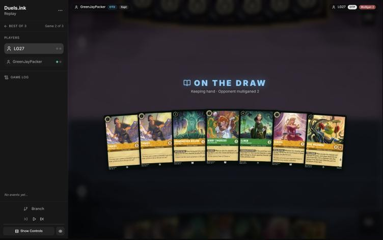
*The board before the decision: [step 0](https://duels.ink/replay/01a219ec-316c-7946-b026-afada3971e2b?step=0) in the duels.ink replay viewer.*

**The plan (written before seeing the mulligan made):** On the draw against Retro Device, with an opening seven of
Thomas ×2, Grandmother Willow, Bobby Zimuruski, Elinor – Renowned Diplomat, Aurora – Holding Court and Mike Wazowski –
Heroic Climber. Four inkable (both Thomas, Bobby, Aurora), three uninkable (Willow, Mike, Elinor). It's an aggro curve
already: a 1-drop on turn 1, Willow and a free 1-drop on turn 2 (SMOOTH THE WAY), Mike and a 1-drop on turn 3, Elinor
on turn 4, cheaper with Willow or Aurora's discount. The weak spot is that the 1-drops are also the inkable cards, so
every one inked is a play lost; on the draw four draws by turn 4 (about three-quarters of the deck is inkable) cover
that. Against a ping deck the four-willpower cards (Thomas, Mike, Elinor) are the ones that survive a Malicious + To
Wither a Flower.

`tools/mulligan.py` (1,500 deals per option, on the draw):

| Option | Ink T1–4 | Play turns | Lore by T4 | Characters T4 | Interaction |
|---|---|---|---|---|---|
| Keep all 7 | 9.06 | 4.00 | 8.7 | 5.8 | 100% |
| Mulligan all 7 | 9.62 | 3.94 | 8.9 | 5.8 | 69% |
| Keep 6 (Elinor back) | 9.35 | 4.00 | 9.0 | 6.5 | 36% |
| Keep 5 (Elinor and Mike back) | 9.24 | 4.00 | 9.4 | 6.6 | 43% |
| Keep 6 (one Thomas back) | 8.95 | 4.00 | 8.6 | 5.7 | 100% |
| Keep 5 (Thomas and Elinor back) | 9.29 | 4.00 | 9.0 | 6.4 | 41% |

Every option has a play on all four turns. Sending Elinor back gains about 0.3 ink and 0.3 lore by turn 4, and loses
the hand's engine: Elinor is the card that turns a wide board into a ping, a lore and a draw each turn, which is how
an aggro deck keeps cards coming against a deck that sweeps it (the sim counts her only as "interaction" and can't see
the draw). Mike's FIND A FRIEND feeds them a card about as often as you (their list is mostly characters), but his 4
willpower survives their pings, and their hand will be full early, when the gift costs least ([H-13](#cite-h-13)). **Pick: keep all
seven.** A close second is sending back only Elinor for a smoother ink curve; nothing here argues for more.

**What you did:** kept all seven (LG27 mulliganed two). Who chose the draw isn't in the replay; the choice belongs to
game 1's loser, so it isn't judged here.

**Verdict:** **Good play** (high confidence). A curve on all four turns, Willow's discounts, and Elinor as the engine
the hand is built towards; the only competitor, sending Elinor back, buys a fraction of an ink and gives up the
strongest card ([MULL-1](#cite-mull-1), [MULL-2](#cite-mull-2), [MULL-3](#cite-mull-3)).

### Turn 2: your turn 1

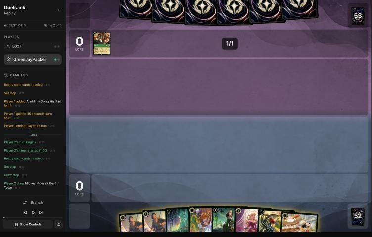
*The board before the decision: [step 5](https://duels.ink/replay/01a219ec-316c-7946-b026-afada3971e2b?step=5) in the duels.ink replay viewer.*

**The plan (written before seeing the turn):** They inked Aladdin – Doing His Part on turn 1 and played nothing (1
ink, 6 cards). You drew Mickey Mouse – Best in Town: hand of Thomas ×2, Willow, Bobby, Elinor, Aurora, Mike, Mickey.
- **Nothing to stop yet.** Their next turn has 2 ink: Aladdin (3/2) or Piercing Attack (2 damage, kills a 2-willpower
  1-drop) are the plays that touch you. A character played now is ready on their turn, so only Piercing can reach it.
- **The curve this hand wants:** 1-drop now; Willow + a free 1-drop next turn (SMOOTH THE WAY); then Aurora's quest and
  Willow make Elinor cost 2 on your turn 3, with ink to spare for another body, and three exerted characters for
  COORDINATED EFFORTS. The 1-drops are also the inkable cards, so ink the least useful one.
- **Ink:** a Thomas. A vanilla 0/4 with a second copy in hand; Bobby (a dig), Aurora (Elinor's discount) and Mickey
  (2 lore) all do more.
- **Candidates:**
  1. **Mickey Mouse – Best in Town.** 2 lore a turn from next turn, 4 willpower (survives Piercing Attack and a
     Malicious + To Wither a Flower). The cost: HOT DOG! gives them an ink drop each turn he ends exerted, so their
     Don Karnage Shift (4), Device lines and Phillip (9) each come a turn sooner per quest (the Mickey card note). You
     get the drops too, and your next turns have more cheap plays than ink.
  2. **Aurora – Holding Court.** 1 lore a turn and Elinor's discount ready for your turn 3; no drops for them. 2
     willpower: Piercing Attack kills her.
  3. **Bobby.** Draw-and-discard now ([SEQ-1](#cite-seq-1): dig before the ink choice); 1 lore, 2 willpower.
- **Pick:** ink Thomas, play Mickey. As the aggressor ([ROLE-1](#cite-role-1)) the 2 lore a turn and a body their pings can't kill are
  worth more than denying them a drop this early, while their hand is full and their ink short; Mickey played next turn
  through Willow's discount is the alternative if you'd rather hold the drops back a turn. Close between Mickey and
  Aurora.

**What you did:** inked Mickey Mouse – Best in Town and played Aurora – Holding Court.

**Verdict:** **Close call** (medium confidence). Aurora was the plan's close second, and inking Mickey instead of a
Thomas is a real choice rather than a slip: against a deck whose payoffs are Don Karnage's Shift (4), Device lines
(4–5), Milo (7) and Phillip (9), Mickey's HOT DOG! would hand them an ink each turn he quests, and every one brings
their swing turn closer, while your own curve is cheap and gains less from extra ink as the game goes on ([H-2](#cite-h-2)). Thomas
also does something Mickey can't: under Dale's SPIKE SUIT he challenges for 4, and Mickey can't challenge at all. What
it gives up is 1 lore a turn over Thomas, and the option of playing Mickey later, when the drops matter less ([INK-1](#cite-ink-1)).
Ink check: the next two turns are the same either way (Willow + a free 1-drop with 2 ink; Elinor for 2 after Aurora's
quest and Willow's discount, plus a 1-drop, with 3).

### Turn 4: your turn 2

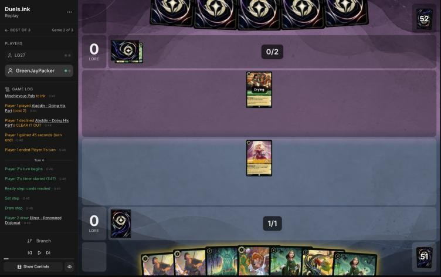
*The board before the decision: [step 12](https://duels.ink/replay/01a219ec-316c-7946-b026-afada3971e2b?step=12) in the duels.ink replay viewer.*

**The plan (written before seeing the turn):** They inked Aladdin & Genie and played a second Aladdin – Doing His Part
(3/2/1), the Shift base for Aladdin & Genie (Shift 3, their ink next turn). You drew a second Elinor: hand of Thomas ×2,
Willow, Bobby, Elinor ×2, Mike. **Four of seven are uninkable**, so ink is the hand's constraint: three inkable cards
(Thomas, Thomas, Bobby) for the next three ink drops, unless draws bring more.
- **Their next turn (3 ink):** Aladdin challenges anything exerted (3 {S}); Aladdin & Genie Shifted onto him is dry and
  challenges the same turn with 3; Piercing Attack kills a 2-willpower character wherever it is; Malicious hard-cast
  puts a counter on everything (no kills). To Wither a Flower and Don Karnage's Shift need 4 ink and aren't on yet.
- **Free kills:** Aurora, if she quests: Aladdin kills her and survives on 1 willpower.
- **Next turn's payoff, if Aurora lives:** Aurora, Willow and Bobby quest (three exerted), Elinor costs 4 − 1 (SMOOTH THE
  WAY) − 1 (ROYAL WELCOME) = 2, and COORDINATED EFFORTS pings, gains 1 lore and draws at the end of the turn. Without
  Aurora, Elinor costs 3 (all your ink) and there are only two dry characters to exert, so no trigger.
- **Needs check:** not on a clock either way (their board quests for 1). What this hand lacks is ink, and Bobby's dig is
  the way to look for it.
- **Candidates:**
  1. **Ink Thomas; Willow (2), then Bobby for 0 through SMOOTH THE WAY** (draw, then discard the worst card, keeping
     inkables); Aurora stays home. Ink 2 + 0 = 2 of 2. Nothing exerted, so only Piercing Attack touches the board.
  2. The same with Aurora questing: +1 lore, but she's a free kill for Aladdin (or Aladdin & Genie), and with her goes
     next turn's cheap Elinor and her trigger.
  3. **Ink Thomas; Mike (2).** One body and FIND A FRIEND (a character for you nearly always, one for them about 63% of
     the time). Narrower, and Willow's discount waits a turn.
- **Pick:** candidate 1. Willow + Bobby is two bodies and a dig for 2 ink; keeping Aurora ready keeps next turn's
  2-ink Elinor and her three-exerted trigger, which is worth more than 1 lore now ([SEQ-4](#cite-seq-4)).

**What you did:** inked Thomas, played Willow, then Bobby for 0; SO CHEESY drew a second Willow, which you discarded.
Aurora stayed home.

**Verdict:** **Good play** (high confidence): the plan's line. Two bodies and a dig for 2 ink, nothing exerted for
Aladdin, and Aurora kept for next turn's 2-ink Elinor ([SEQ-4](#cite-seq-4)). Discarding the drawn Willow, an uninkable second copy, was
right in an ink-short hand that already has three uninkables; it keeps Thomas as the next ink.

### Turn 6: your turn 3

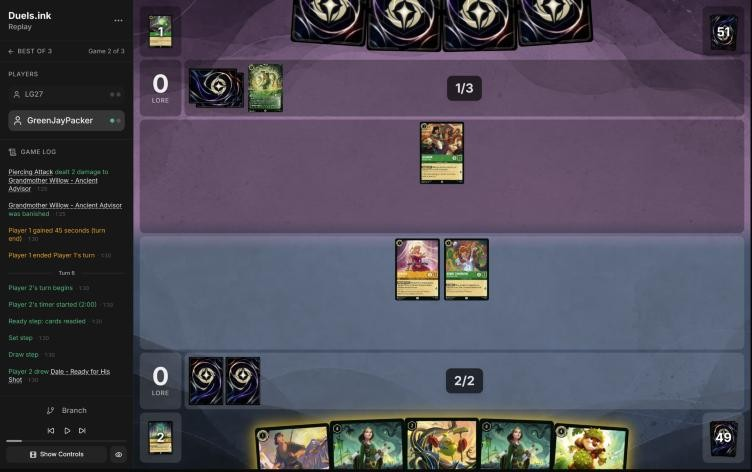
*The board before the decision: [step 22](https://duels.ink/replay/01a219ec-316c-7946-b026-afada3971e2b?step=22) in the duels.ink replay viewer.*

**The plan (written before seeing the turn):** Piercing Attack killed Willow; they inked Milo and didn't quest (0 lore,
3 ink, 4 next turn, hand 4). Their only character is Aladdin – Doing His Part (3/2, ready). You drew Dale: hand of
Thomas, Elinor ×2, Mike, Dale; Aurora and Bobby dry in play. Ink 2, 3 after inking Thomas or Dale (the only inkables).
- **Their next turn (4 ink) can't sweep yet:** Malicious and To Wither a Flower together need 7 ink or singers, and
  Aladdin (cost 2) can sing neither. Aladdin & Genie Shifted onto Aladdin (3) is dry, so it could sing Malicious for
  free (a counter on everything, no kills) or challenge. Don Karnage needs a Courier in play. The full Malicious +
  Wither sweep (3 damage to everything) becomes possible the turn after, at 5 ink. They hold one challenger, Aladdin or
  Aladdin & Genie on top of him, so **at most one challenge** next turn; a second Piercing Attack is the other way to
  kill a 2-willpower character.
- **Free kills:** Aurora and Bobby, if they quest (Aladdin kills either and survives on 1 willpower). One of them at most.
- **Ink:** Thomas. Dale is the deck's best card against their small card-flow characters (SPIKE SUIT: your
  four-willpower characters deal 4) and 2 lore a turn; with three uninkables in hand, the cost is that next turn's ink
  must be Dale or the draw (about three in four is inkable).
- **Candidates (all 3 of 3 ink):**
  1. **Aurora quests (ROYAL WELCOME), Elinor for 4 − 1 = 3; Bobby quests too.** +2 lore, a 3/4 that survives Malicious
     + Wither and is dry next turn, when she, Bobby and whoever is left make three exerted for COORDINATED EFFORTS. They
     can kill one of Aurora and Bobby; a second quester adds 1 lore and costs only the choice of target.
  2. **The same with Bobby home:** +1 lore, Aurora still a free kill.
  3. **Mike (2), nothing exerted, Elinor next turn.** No lore and nothing exposed; next turn Aurora's quest makes Elinor
     3 and Aurora, Bobby and Mike are three exerted at once. A turn slower for the aggressor, and FIND A FRIEND gives
     them a card about 62% of the time.
- **Pick:** candidate 1. As the aggressor against a deck with no lore yet ([ROLE-1](#cite-role-1)), landing Elinor a turn before their
  sweeps come online is worth more than keeping Aurora safe; her discount has done its job once she's paid for Elinor.

**What you did:** played Mike Wazowski **before inking**. FIND A FRIEND gave you Pocahontas – Guiding the Tribe (and
LG27 a third Aladdin – Doing His Part); you inked the Pocahontas and played Thomas. Nothing quested.

**Verdict:** **Good play** (medium-high confidence), and better than the plan. Two things the plan missed:
- **Mike was a dig for ink.** Your deck is all characters, so FIND A FRIEND gives you a card nearly every time, and
  three in four of them are inkable. Played before the ink step ([SEQ-1](#cite-seq-1)), he turned "ink Thomas or Dale" into "ink
  whatever he finds": Pocahontas went in, and Thomas (a body) and Dale (the SPIKE SUIT piece) both stayed out of the
  inkwell. The plan counted his reveal only as a card for them, in an ink-short hand where your own card was the point.
- **Next turn's Elinor trigger.** The plan's line (Elinor now, Aurora and Bobby questing) would have lost one of them to
  Aladdin and left only two characters to exert next turn, so no COORDINATED EFFORTS. Your line leaves four dry
  characters (Aurora, Bobby, Mike, Thomas) for next turn: Aurora's quest makes Elinor 3 and four exerted characters
  trigger her the turn she lands.

What it gave up: 2 lore this turn and Elinor's body a turn earlier. Nothing is exerted, so Aladdin has no target (no
free kills), and their 4 ink can't sweep. The gift to them (an Aladdin to a five-card hand, with their ink at 4) is
the cheap case of [H-13](#cite-h-13). Ink check: without Pocahontas, next turn is Elinor for 3 after Aurora's quest with Dale or the
draw as the ink; the turn after, Dale. Inking Pocahontas rather than Thomas used all 3 ink and put a 4-willpower body
in play; Pocahontas's STAY CLOSE had no 1-drop to play.

### Turn 8: your turn 4

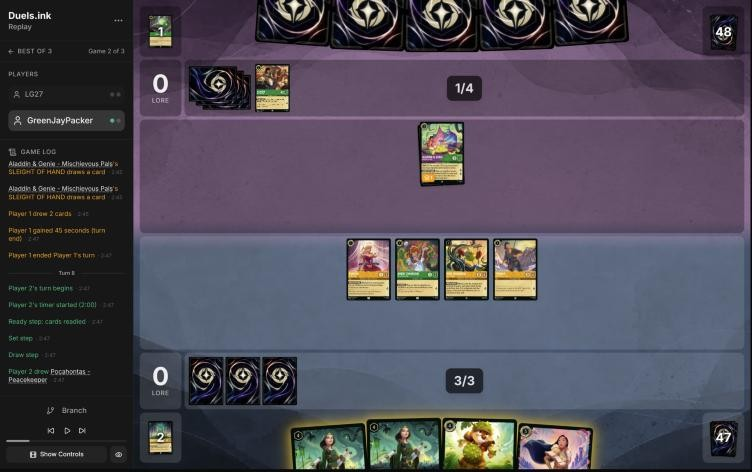
*The board before the decision: [step 33](https://duels.ink/replay/01a219ec-316c-7946-b026-afada3971e2b?step=33) in the duels.ink replay viewer.*

**The plan (written before seeing the turn):** They Shifted Aladdin & Genie onto Aladdin and cycled one card (still 0
lore, 4 ink, 5 next turn, hand 5); 1 ink went unused. You drew Pocahontas – Peacekeeper: hand of Elinor ×2, Dale,
Peacekeeper; Aurora, Bobby, Mike and Thomas all dry. Ink 3, 4 after inking Dale or the Peacekeeper (the only inkables).
- **Their next turn (5 ink), and what it can do:**
  - Aladdin & Genie (3/3, dry) is a free singer of Malicious (3) and To Wither a Flower (4). Malicious sung + Wither
    hard-cast (4 ink), or the other way round, is 3 damage to everything: it kills Aurora and Bobby, and leaves Mike,
    Thomas, Elinor and Dale on 1. Holding both: about 11% (`odds.py both`), a little more with their dig.
  - Taran (Rush 5/5) kills any one exerted character: about 22% for one of the two copies.
  - Hades (bottom one of yours or they draw 2); Retro Evolution Device + 1 ink, banishing Aladdin & Genie (5) into a
    free Milo (7, Ward, bounces one of yours); Above the Crowd hard-cast (5).
  - One challenger in play: Aladdin & Genie can kill an exerted Aurora or Bobby (free kills: it survives on 2) or put 3
    on Mike or Thomas (both live). Don Karnage needs a Courier or 6 ink.
- **Ink: the Peacekeeper.** No Pocahontas is in play to Shift onto (Guiding the Tribe went to the inkwell), so she'd be
  a 5-cost hard-cast; Dale's SPIKE SUIT is what lets your 0- and 1-strength board kill their 3- and 4-willpower
  characters. **But quest Mike before inking** (as on turn 6): if FIND A FRIEND gives you an inkable character, ink
  that and keep both.
- **Needs check:** they're at 0 lore with a 2-lore board; the game is yours to race until their sweeps and Phillip
  arrive (the Device chain Aladdin & Genie → Milo → Phillip is the fast route, from game turn 11 at the earliest with
  the Device, Malicious and Phillip all in hand). What you need is lore now and an engine that keeps cards coming
  after a sweep: Elinor.
- **Candidates:**
  1. **Mike quests (FIND A FRIEND), ink, Aurora quests (ROYAL WELCOME), Elinor for 4 − 1 = 3; Thomas and Bobby quest.**
     Ink: Elinor 3 + a 1-drop if Mike finds one (1) = 4 of 4. Four exerted, so COORDINATED EFFORTS at the end: 1 damage
     to Aladdin & Genie (2 willpower left), +1 lore, a card. 5 lore in all. Exposes Aurora and Bobby (one of them dies
     to Aladdin & Genie, which is then left on 1), Mike and Thomas to 3 non-lethal damage or Taran.
  2. **Dale (4 of 4), everyone quests.** 4 lore. Under SPIKE SUIT, Aladdin & Genie dies challenging Mike or Thomas
     (4 back) and survives on 1 killing Aurora or Bobby (2 back). No Elinor until next turn.
  3. **Ink Dale, Aurora quests, Peacekeeper hard-cast for 5 − 1 = 4.** A 3/6 body; gives up SPIKE SUIT and the
     engine.
- **Pick:** candidate 1. Elinor now is +1 lore, a card and a ping every turn from this one, and she survives a
  Malicious + Wither; the exposure is the same 2-willpower character for either line ([WIN-1](#cite-win-1), [CARD-1](#cite-card-1)).

**What you did:** quested Mike first: FIND A FRIEND gave you Lionheart – Incumbent Mayor and LG27 **Milo Thatch**, now
known in their hand. Inked the Peacekeeper, played Dale (4 of 4), and quested Thomas, Bobby and Aurora: 4 lore. Elinor
stayed in hand, so Aurora's ROYAL WELCOME went unused.

**Verdict:** **Close call** (medium confidence). Mike before the ink was right again ([SEQ-1](#cite-seq-1)), and keeping Lionheart (6,
castable in two turns) over the Peacekeeper, which has no Pocahontas to Shift onto, is fine. Dale first against
Elinor first, over this turn and the next, assuming the other comes down next turn either way:
- **Elinor first** (Elinor 3 + 1 unspent = 3 of 4): 5 lore now, a card, and Aladdin & Genie pinged to 2; next turn
  Elinor quests for 1 while Dale lands. It uses Aurora's discount while Aurora is alive to give it.
- **Dale first** (4 of 4, your line): 4 lore now; next turn Dale quests for 2 while Elinor lands, for 3 if Aurora
  survives to quest again, 4 if not. SPIKE SUIT is on through their turn: Aladdin & Genie dies challenging Mike or
  Thomas (4 back), and Taran survives on 1 doing it.

The lore comes out about even; Elinor first is a card and a ping ahead, and Dale first spends the extra ink and makes
their challenges into your 4-willpower characters cost them. Their one challenger can kill Aurora or Bobby in both
lines (free kills: it survives on 1). Too close to call a mistake; the engine a turn earlier is the slight favourite
([CARD-1](#cite-card-1)).

### Turn 10: your turn 5

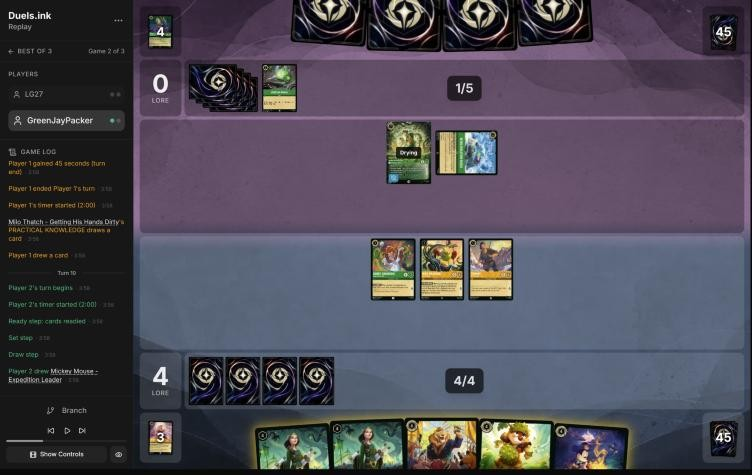
*The board before the decision: [step 52](https://duels.ink/replay/01a219ec-316c-7946-b026-afada3971e2b?step=52) in the duels.ink replay viewer.*

**The plan (written before seeing the turn):** Their turn 9: Aladdin & Genie killed Aurora (taking 2 under SPIKE
SUIT), then Retro Evolution Device banished it for a free **Milo Thatch** (the one Mike gave them), who discarded
Prince Phillip and bounced Dale; PRACTICAL KNOWLEDGE drew. They're at 0 lore with Milo (5/5/3, Ward, dry next turn) and
the Device (ready next turn), 5 ink (6 next turn), hand 4. You: 4 lore; Bobby, Mike and Thomas dry; hand of Elinor ×2,
Lionheart, Dale, Mickey Mouse – Expedition Leader (new). Ink 4, 5 after inking Lionheart, Dale or Mickey.
- **Milo is out of reach this turn.** Ward stops Elinor's ping and Mickey's SECRET PATH choosing him, and he's ready, so
  he can't be challenged. Elinor's trigger still gains the lore and draws with no legal target ([CR 1.7.7](#cite-cr-1-7-7): the parts
  that don't need the choice still happen).
- **Their next turn (6 ink):**
  - **The wipe:** Milo sings Malicious (free; he costs 7), then the Device (1 ink) banishes Milo for a free Phillip (9):
    every damaged character of yours goes. It needs Malicious and a second Phillip (three left) in hand: about 9%
    before their dig, nearer 15% with it (`odds.py both` 49 4 3 5, and `dig`). Malicious + To Wither a Flower (one sung
    by Milo) is 3 damage to everything: Bobby and Mickey die, the 4-willpower characters live on 1. Don Karnage
    hard-cast (6) + Wither sung by Milo does the same.
  - **Milo's challenge** (5 {S}) kills any one exerted character of yours. FREE KILLS: Bobby, Mike, Thomas. **With Dale
    in play** Mike and Thomas deal 4 back, leaving Milo on 1; only Bobby (2 back) is cheap for him.
  - Hades (5), Taran (5, Rush), Above the Crowd sung by Milo (bottoms a 3-{S}-or-less character).
- **Needs check:** 4–0, and your board quests for 3 against Milo's 3. Their outs are the wipe, Milo's lore and the
  Device's next upgrade, so the threat is Milo himself ([THREAT-1](#cite-threat-1)). The only way to kill him is in combat once he's
  exerted, and that needs SPIKE SUIT: with Dale in play two of your 4-willpower characters (4 + 4) kill an unhurt Milo,
  and one does after any damage. Without Dale your 0-strength characters can't hurt him.
- **Ink:** Mickey – Expedition Leader. SECRET PATH can't choose Milo, and its 3 willpower dies to Malicious + Wither.
  Lionheart is next turn's 6-drop (APPROVAL RATING, and 7 back under SPIKE SUIT kills Milo alone). Quest Mike before
  inking (FIND A FRIEND first, [SEQ-1](#cite-seq-1)).
- **Candidates:**
  1. **Dale (4 of 5); Mike, Thomas and Bobby quest.** +3 (7–0). Milo can kill one; Mike or Thomas cost him 4 and leave
     him exerted on 1, and Bobby leaves him exerted on 3, so whatever he challenges, a SPIKE SUIT challenger kills him
     next turn. If he quests instead, he's exerted for two of your challengers.
  2. **Elinor (4 of 5); the same quests.** +4 and a card. But Milo kills Mike or Thomas for nothing (0 back), and next
     turn you still can't hurt him.
  3. **Dale, with Bobby home.** +2; Milo's only targets cost him 4.
- **Pick:** candidate 1. From 4–0 with a 3-a-turn board, lore keeps them having to act, and Dale turns every Milo play
  except staying home into a dead Milo. Elinor and Lionheart stay in hand as the rebuild if the wipe comes ([POS-1](#cite-pos-1)).

**What you did:** played Mickey Mouse – Expedition Leader **exerted** (LONG JOURNEY) with 4 ink, then quested Mike
(FIND A FRIEND: a second Bobby for you; their Piercing Attack went to the bottom), inked the Bobby, and quested Bobby
and Thomas. Each SECRET PATH trigger had no valid target. 7–0, 1 ink unspent; Dale, Lionheart and both Elinors in hand.

**Verdict:** **Inaccuracy** (medium confidence). Playing **Mickey – Expedition Leader exerted** is suboptimal because
SECRET PATH can only choose an opposing character and Milo, their only one, has Ward ([CR 8.15.1](#cite-cr-8-15-1); the pair file's notes on this list's Ward characters: [Cards seen](#cite-kb-meta-archetypes-amethyst-emerald-cards-seen)), so entering exerted
bought nothing and gave Milo one more free kill (Mickey deals 2 back; Milo lives on 3). Playing **Dale** is better
(Dale 4 of 5, Bobby inked as you did) because SPIKE SUIT is on through their turn: Mike and Thomas then deal 4 back, so
Milo's only cheap kill is Bobby, and any challenge or quest by Milo leaves him exerted for one or two of your
4-damage challengers. Dale's line leaves Mike, Thomas and Bobby exerted and Dale ready; it gives Milo a kill on Bobby
(leaving him on 3), and it puts Dale in front of Hades, Above the Crowd sung by Milo, and the wipe, as your line puts
Mickey there. Same 7 lore either way.

The case for your line: Dale works the turn he's played, so holding him until the turn you challenge keeps him away
from their targeted removal for a turn (they bounced him the turn before), and Mickey's SECRET PATH will matter against
their next non-Ward characters (Hades, Taran, Phillip). That argues for Mickey **entering ready** this turn, not for
entering exerted. [QC-2](#cite-qc-2), [RULE-1](#cite-rule-1).

### Turn 11: their turn

**What happened:** Milo sang Malicious, Mean, and Scary (a counter on all four of your characters), then Retro
Evolution Device banished Milo for a free second Prince Phillip, whose SWIFT AND SURE banished Bobby, Mike, Thomas and
Mickey – Expedition Leader. Tod – Clever Fox drew 2 and discarded Taran. The turn-10 plan put this wipe at about 9%
before their dig and 15% with it; it needed Malicious and a Phillip in hand together.

### Turn 12: your turn 6

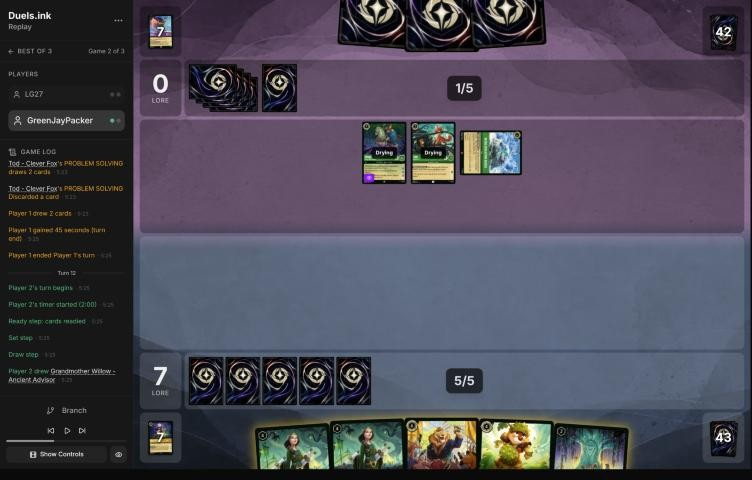
*The board before the decision: [step 68](https://duels.ink/replay/01a219ec-316c-7946-b026-afada3971e2b?step=68) in the duels.ink replay viewer.*

**The plan (written before seeing the turn):** 7–0, but your board is empty. Theirs: Prince Phillip (6/6/3, **Evasive**)
and Tod (1/2/1), both dry next turn, and the Device (ready next turn); 5 ink (they didn't ink last turn), 6 next turn,
hand 3. Their discard holds Phillip, Milo, Taran, Malicious. You drew Willow: hand of Elinor ×2, Lionheart, Dale,
Willow. Ink 5, 6 after inking Lionheart or Dale.
- **Their clock:** Phillip 3 + Tod 1 a turn, so 20 on game turn 21 if nothing changes, sooner once the Device upgrades
  Tod (into Hades, Aladdin & Genie or Taran for 1 ink). **You can't challenge Phillip** (no Evasive in your deck);
  Rapunzel – Tower Defender's bounce (two left) and Elinor's ping are the only things that touch him.
- **Their next turn (6 ink):** nothing of yours played this turn can be challenged (it enters ready), unless Lionheart
  enters exerted (then Phillip + Tod deal 7 and kill him). The sweeps: Tod sings Malicious, Phillip sings To Wither a
  Flower (3 damage to all: Willow dies, 4-willpower characters live on 1), or Tod sings Malicious and a third Phillip is
  Shifted onto Phillip for 6 (the wipe again; both cards about 5% before their dig). Hades through the Device on Tod;
  Above the Crowd sung by Phillip (bottoms one of yours with 3 {S} or less, so everything but Lionheart).
- **Needs check:** you need 13 more, they need 20 at 4 a turn. Characters played now quest on your turns 14, 16, 18 and
  20. Counting it out: Willow and Elinor now; Lionheart next turn entering exerted as the third exerted character for
  COORDINATED EFFORTS, with APPROVAL RATING on Willow and Elinor (2 + 2 + 1 = 5, to 12); then Elinor #2 through Willow.
  That reaches 20 on your turn 18, a turn before their 21, if the board isn't swept again. So what you hold wins on
  time if it survives; the extra cards from Elinor are the rebuild if it doesn't.
- **Ink: Dale.** SPIKE SUIT has little to do now (Phillip can't be challenged, and Tod dies to any 2-strength
  challenger or two pings), while Lionheart is next turn's third exerted character for Elinor and a 7-willpower body
  their pings and Phillip's 6 don't kill.
- **Candidates:**
  1. **Willow (2), then Elinor for 4 − 1 = 3: 5 of 6.** Two questers and the engine; nothing exposed this turn.
  2. **Lionheart (6 of 6), ink Dale, entering ready.** One 2-lore body; Elinor waits, and next turn has no third
     exerted character for her.
  3. **Willow + Dale for 3 (ink Lionheart): 5 of 6.** 3 lore a turn from next turn, but next turn's Elinor has no
     third exerted character.
- **Pick:** candidate 1, keeping Lionheart and the second Elinor as next turn's play and the rebuild ([POS-1](#cite-pos-1)).

**What you did:** Willow, then Elinor for 3 (5 of 5), **without inking**: Dale and Lionheart both stayed in hand.

**Verdict:** **Close call** (medium confidence). The plays are the plan's. Skipping the ink is the difference, and it
has a real case:
- **Plan's line (ink Dale):** 6 ink now (1 spare), 7 next turn for Lionheart + 1, 8 the turn after for Elinor #2 (3)
  and whatever has been drawn.
- **Your line (no ink):** 5 now (all used), 6 next turn if you ink then (Lionheart exactly), 7 the turn after for
  Dale + Elinor #2 through Willow (4 + 3 = 7 of 7).

So by your turn 16 your line has Dale on the board and mine has one more ink. With three cards in hand and Elinor's
draws still to start, cards are the scarce resource, and a 2-lore body is worth more than an ink you may have nothing
to spend on ([H-2](#cite-h-2), [INK-3](#cite-ink-3)). Waiting also lets next turn's draw be the ink if it's inkable ([SEQ-1](#cite-seq-1)). The risk is small:
Lionheart can still be cast next turn by inking Dale then. Nothing was exposed: both new characters entered ready.

### Turn 13: their turn

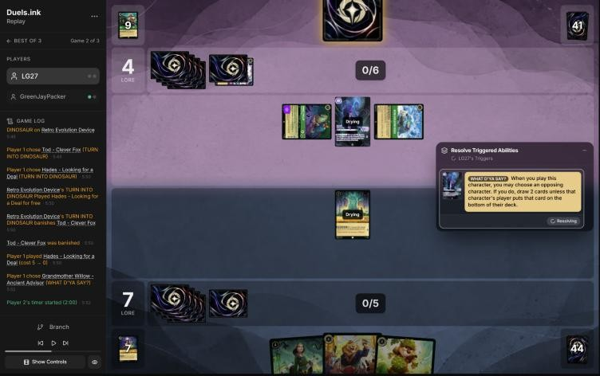
*The board before the decision: [step 83](https://duels.ink/replay/01a219ec-316c-7946-b026-afada3971e2b?step=83) in the duels.ink replay viewer.*

**What happened:** Above the Crowd, hard-cast for 5, put Elinor on the bottom of your deck. Phillip and Tod quested (0
→ 4). They inked Junior Woodchuck Guidebook (after undoing an ink of Hades), then the Device turned Tod into a free
Hades – Looking for a Deal, who chose Willow: **you put Willow on the bottom of your deck** rather than let them draw
2. Their hand was down to 2 cards, with 6 ink next turn and the Device.

**Verdict on your choice:** **Good play** (medium confidence). Two cards to a two-card hand with 6 ink and a Device
are cards they'll play, and the deck they come from holds the answers to your next board (Malicious, Wither, Don
Karnage, a third Phillip, Milo; each pair of draws finds a given 3-of about one time in eight). Willow is a 1-lore
body whose discount saves 1 ink a turn; with your board empty and Lionheart and Dale in hand, she was worth less than
denying them the refill ([H-2](#cite-h-2), the converse case: extra cards matter most to a short hand with spare ink).

### Turn 14: your turn 7

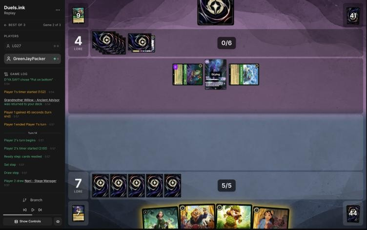
*The board before the decision: [step 85](https://duels.ink/replay/01a219ec-316c-7946-b026-afada3971e2b?step=85) in the duels.ink replay viewer.*

**The plan (written before seeing the turn):** 7–4. Your board is empty; theirs is Prince Phillip (exerted, but
Evasive, so you can't challenge him), Hades (3/4/1, dry next turn) and the Device. They have **one card in hand**, 6 ink
(7 next turn). You drew Nani – Stage Manager: hand of Elinor, Lionheart, Dale, Nani. Ink 5, 6 after inking Lionheart,
Dale or Nani.
- **Their clock:** 4 a turn (Phillip 3, Hades 1): 20 on game turn 21. **Faster with the Device:** Hades (5) into a Milo
  (7, two left) next turn makes it 6 a turn from game turn 17, so 20 on game turn 19.
- **Their next turn:** with one card plus a draw, the sweeps are unlikely (each about 14% after the draw); Phillip and
  Hades are free singers of Malicious, Wither and Above the Crowd if they draw one. Characters you play this turn enter
  ready, so nothing can be challenged.
- **Needs check:** you need 13 more, with quests on your turns 16, 18 and 20 from what you play now. Lionheart alone
  (2 a turn) doesn't get there; a wide board does, with Elinor's trigger and Lionheart's APPROVAL RATING (+1 on two
  questers the turn he lands). Counting the line below: Nani + a cheap find now; Lionheart next turn with APPROVAL on
  both (+4, to 11); Elinor the turn after with three questers exerted (+4 and her +1, to 16); then +6 on turn 20. That
  reaches 20 on your turn 20: in time against their game turn 21, a turn late if Milo arrives.
- **Dig first ([SEQ-1](#cite-seq-1)):** Nani's THAT'S YOUR CUE (top 4, take a character costing 2 or less) can be paid from the 5 ink
  you have, so play her before inking. Then ink (Dale, or the card she finds if it's an inkable 1-drop worth less), and
  play the find with what's left.
- **Ink: Dale over Lionheart.** Lionheart is next turn's play, and APPROVAL RATING needs questers in play, which this
  turn makes; SPIKE SUIT has little to do against an Evasive Phillip and a Hades that Lionheart kills on his own (4
  {S} into 4 willpower).
- **Candidates:**
  1. **Nani (3), ink, the find (1–2): 4–5 of 6.** Two bodies now, both questing on turn 16.
  2. **Lionheart (6 of 6), ink Nani or Dale.** One body, 2 a turn from turn 16, APPROVAL wasted.
  3. **Dale (4 of 6), 2 spare.** One body.
- **Pick:** candidate 1. Width now is what makes Lionheart's +2 and Elinor's trigger pay over the next two turns.

**What you did:** Nani first (THAT'S YOUR CUE took Mike Wazowski; the other three went to the bottom), then Mike with
the last 2 of your 5 ink (FIND A FRIEND: a third Bobby for you; their Junior Woodchuck Guidebook went to the bottom),
then inked Dale and played Bobby (SO CHEESY drew Willow; you discarded **Lionheart**). 6 of 6 ink; Nani, Mike and Bobby
in play; Elinor and Willow in hand.

**Verdict:** **Good play** (medium confidence), better than the plan. Every dig came before the decision it informed
([SEQ-1](#cite-seq-1)): Nani before the ink, Mike before the ink, Bobby with the last ink. That turned the plan's two bodies into three
and a card. Discarding Lionheart rather than Willow or Elinor fits next turn: Lionheart (6) and Elinor (4) can't both
come with 6 or 7 ink, while Willow + Elinor costs 2 + 3 = 5, castable even if next turn's draw isn't inkable, and gives
Elinor three questers to trigger on. The one cost is Mike's gift to a **one-card hand** with 7 ink and a Device next
turn, the expensive case of [H-13](#cite-h-13) (their top card is a character about 61% of the time); his body and a near-certain
character for you were worth it in a race you need width to win. Nothing is exposed: all three entered ready.

### Turn 15: their turn

**What happened:** Tod drew 2 (discarding Luisa – Pushing Through); Hades sang Everyone Knows Juanita (draw 3, with 10+
cards in their discard); the Device turned Hades into a free third Milo, who discarded the second Luisa and **bounced
Bobby**. Phillip quested (7–7). Milo drew at the end of the turn. They didn't ink.

### Turn 16: your turn 8

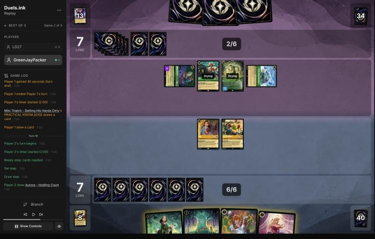
*The board before the decision: [step 106](https://duels.ink/replay/01a219ec-316c-7946-b026-afada3971e2b?step=106) in the duels.ink replay viewer.*

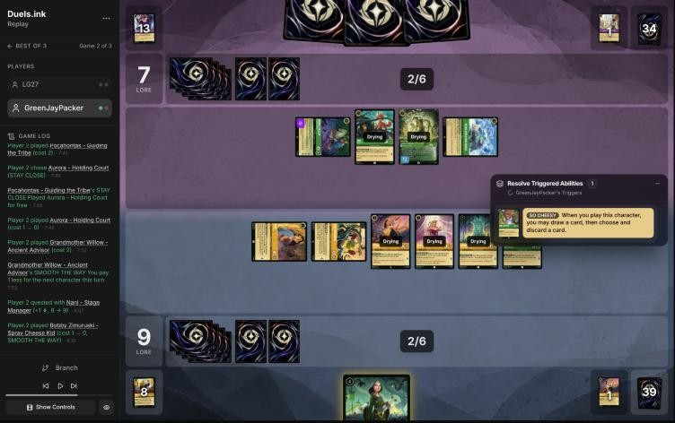
*The board before the decision: [step 114](https://duels.ink/replay/01a219ec-316c-7946-b026-afada3971e2b?step=114) in the duels.ink replay viewer.* The second decision: SO CHEESY.

**The plan (written before seeing the turn):** 7–7. Their board: Phillip (exerted, Evasive), Milo (Ward) and Tod (both
dry next turn), the Device. **They quest for 7 a turn: 14 on game turn 17 and 21 on game turn 19.** Hand 3, 6 ink (7
next turn). Yours: Nani and Mike, dry; hand of Elinor, Willow, Bobby and Aurora (drawn). Ink 6, 7 after inking Bobby or
Aurora (the only inkables).
- **No challenge is possible this turn.** Phillip is the only exerted one, and Evasive; Milo and Tod are ready. Elinor's
  ping can't choose Milo (Ward), and her trigger needs three exerted characters at the end of the turn: only Nani and
  Mike can quest, so it can't fire this turn.
- **Needs check:** you're at 7 and can make 2 now (Nani, Mike) and about 7 next turn with everything questing and Elinor
  triggering: 16 after your turn 18, 20 on turn 20 at the earliest. **They reach 20 on game turn 19 at 7 a turn**
  (`odds.py clock`). So the game turns on cutting their lore by 2 or more before game turn 19: kill Milo when he's
  exerted after questing (on your turn 18: 5 willpower, so Nani + Elinor, or Nani + two 1-strength characters, and each
  challenger takes 5), and Tod with any 2 strength (he deals 1 back). Rapunzel – Tower Defender would bounce Phillip
  (two left; about 15% by next turn with Bobby's dig, `odds.py hold`). A challenge they make on their turn also helps:
  every challenge by Phillip or Milo is 3 lore they don't quest. Even so, the count above has you one turn short unless
  they slow down or a Rapunzel comes; this is close to lost ([principle 2](#cite-principle-2)), and the line that keeps the most chances is
  the widest board with the most digs.
- **Their next turn:** Phillip, Milo and Tod are free singers of Malicious (Tod), To Wither a Flower and Above the Crowd
  (Phillip, Milo); the Device can turn Milo into a 9 (a third Phillip: after Malicious, another wipe) or Tod into a 5.
  The damage cards together: about half after their draw, before their dig. FREE KILLS if you quest: Nani and Mike
  (Phillip or Milo kills either), at the cost of their quest.
- **Sequence (digs first, [SEQ-1](#cite-seq-1)):** quest Mike (FIND A FRIEND; their hand is 3 with spare ink, so the gift costs, [H-13](#cite-h-13),
  but your reveal is a character every time) and Nani; Willow (2), then Bobby for 0 through SMOOTH THE WAY (SO CHEESY:
  draw, discard); **then** ink the least useful inkable (a found card, or Aurora); then Elinor (4) and Aurora (1) if the
  ink reaches. Ink sum: Willow 2 + Bobby 0 + Elinor 4 + Aurora 1 = 7 of 7 if you ink something other than Aurora, 6 of
  7 if you ink her.
- **Candidates:** (1) the above: four bodies, two quests; (2) the same without questing Mike (no gift, 1 lore less);
  (3) holding Elinor back from a possible third Phillip: no, since next turn's kills need her strength and her trigger.
- **Pick:** candidate 1 ([POS-2](#cite-pos-2): from behind, take the line with the most outs: width for next turn's kills, two digs).

**What you did:** quested Mike first (FIND A FRIEND: Pocahontas – Guiding the Tribe for you; their Creative
Inspiration went to the bottom), played Pocahontas (2), whose STAY CLOSE put Aurora in free, then Willow (2) and Bobby
for 0; Nani quested (9–7). You **declined SO CHEESY**, didn't ink, and kept **Elinor in hand**: 4 of 6 ink used.

**Verdict:** two decisions.
- **Holding Elinor: close call** (medium confidence). Your line puts six cheap characters out and keeps Elinor as the
  rebuild; the alternative was Willow → Elinor for 3 + Pocahontas (2) + Aurora free, inking Bobby (7 of 7). Elinor in
  play would add her 3 {S} to next turn's attack on an exerted Milo and Tod, and a quest; but her end-of-turn trigger
  works the turn she's played, so next turn's +1, card and ping happen either way. In hand she survives what their next
  turn may do to a wide 2- and 3-willpower board: Malicious with Wither (both free singers are there), Don Karnage, or a
  third Phillip through the Device on Milo. With the damage cards around half before their dig, the hedge is
  reasonable ([POS-1](#cite-pos-1) against [POS-2](#cite-pos-2) at 9–7 with their clock a turn ahead).
- **Declining SO CHEESY: inaccuracy** (small; high confidence). With Elinor the only card in hand, drawing and then
  discarding the worse of the two costs nothing and digs one card deeper for exactly what the needs check is missing:
  Rapunzel – Tower Defender's bounce on Phillip, or a 2-lore Mickey. Taking it is better because it's a free look at
  one of your outs ([POS-2](#cite-pos-2), [SEQ-1](#cite-seq-1)).

Nothing about the quests changes: Nani and Mike are free kills for Phillip or Milo, and each such challenge is 3 lore
they don't quest, which is what you need.

### Turn 17: their turn

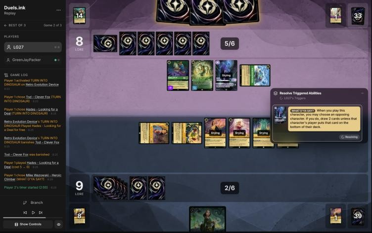
*The board before the decision: [step 122](https://duels.ink/replay/01a219ec-316c-7946-b026-afada3971e2b?step=122) in the duels.ink replay viewer.*

**What happened:** Tod quested; the Device turned him into a free Hades – Looking for a Deal, who chose Mike: **you put
Mike on the bottom of your deck** rather than let them draw 2. Then two more Tods (each drew 2: a second Retro Evolution
Device and Elsa went to their discard), an ink (a Hades), and Phillip and Milo quested: 14–9. Milo drew at the end.

**Verdict on your choice:** **Close call** (low stakes). Their hand was 4 to 5 cards with Tods still to play, so two
more cards changed little; Mike was a 1-lore body that Phillip or Milo could kill whenever he quested. Either answer is
fine.

### Turn 18: your turn 9

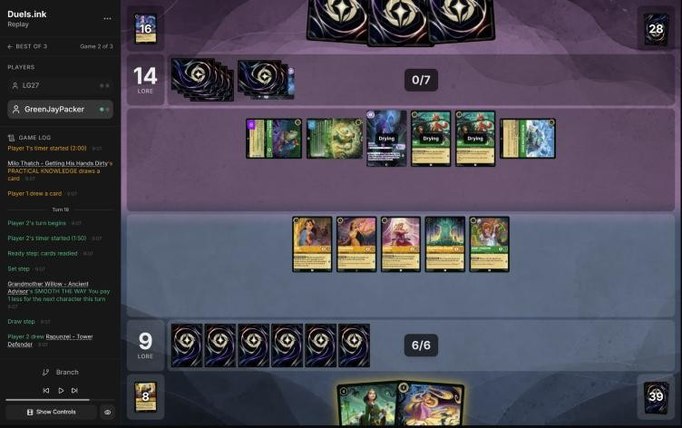
*The board before the decision: [step 131](https://duels.ink/replay/01a219ec-316c-7946-b026-afada3971e2b?step=131) in the duels.ink replay viewer.*

**The plan (written before seeing the turn):** 9–14. Their board: Phillip (exerted, Evasive, 3 lore), **Milo (exerted,
Ward, 3 lore)**, Hades (1) and two Tods (1 each), all three drying, and the Device. **They quest for 9 next turn: 23, so
they win on game turn 19** unless their next quest is held to 5 or less. Your board: Nani (3/3), Pocahontas – Guiding
the Tribe (2/3), Aurora, Willow and Bobby, all dry. You drew **Rapunzel – Tower Defender**: hand of Elinor and Rapunzel.
Ink 6 (Rapunzel is the only inkable card).
- **You can't win this turn:** five quests and Elinor's trigger reach 15 at most.
- **What can cut their next quest:**
  - **Rapunzel's THE FATES' DESIGN** (discard a card: return a chosen character to its player's hand) on **Phillip**:
    −3. It can't choose Milo (Ward). Its discard needs a card in hand, and Elinor is the only other one, so the bounce
    costs Elinor.
  - **Challenging Milo** (exerted, 5 willpower): Nani + Pocahontas deal 3 + 2 = 5 and both die (he deals 5 to each).
    −3.
  - Hades and the Tods are ready (drying), so they can't be challenged, and Elinor's 1-damage ping kills none of them.
- **Each alone loses:** Milo dead, Phillip still there is 14 + 6 = 20; Phillip bounced, Milo alive is 20 too. **Both
  together** leave Hades and the two Tods: 14 + 3 = 17 (18 with an off-list lore boost). Phillip can't come straight
  back: 9 ink against their 8, and the Device needs a 7-cost to banish once Milo is gone.
- **Costs and ink:** Aurora quests first (ROYAL WELCOME: −1 on a Princess), then Rapunzel for 4 − 1 (Willow) − 1
  (Aurora) = 2, discarding Elinor, bouncing Phillip; Nani and Pocahontas challenge Milo; Willow and Bobby quest. 2 of 6
  ink, 12–14 after the turn. Playing Elinor as well isn't possible: once she's in play there's nothing to discard.
- **Needs check after that:** 12 against 17. Your turn 20 has Aurora, Willow, Bobby and Rapunzel to quest (16), short
  of 20; their game turn 21 needs only 3, from Hades, the Tods and whatever they play on game turn 19, which will be
  ready (so unchallengeable) on your turn 20. Unless they slow down (challenging your characters instead of questing,
  or finding nothing to play), the game is lost on game turn 21, and it is lost on game turn 19 with any other line.
  This is the turn the game becomes unwinnable or nearly so ([principle 2](#cite-principle-2)).
- **Exposure:** Aurora, Willow and Bobby exerted: Hades kills any one (FREE KILLS), and Malicious + Wither (Tod and Hades
  sing them) kills all of them and Rapunzel. Nothing in hand to hold back.
- **Pick:** the bounce and the Milo kill together, the only line that isn't lost on game turn 19 ([POS-2](#cite-pos-2)).

**What you did:** you started with Rapunzel, undid it, and challenged Milo with Pocahontas and then Nani (both died,
Milo with them); then Rapunzel for 3 (SMOOTH THE WAY), discarding Elinor, bounced Phillip to their hand. Aurora, Willow
and Bobby **didn't quest**. 9–14.

**Verdict:** **Good play** on the turn's core (high confidence): the bounce on Phillip and the Milo kill together were
the only way to stop the win on game turn 19, and you found both, in the right order (the challenges first, so Rapunzel
could still be redirected if a challenge went wrong). **From here the game is unwinnable under reasonable assumptions**
([principle 2](#cite-principle-2)): they're at 14 and need 6 with Hades and two Tods questing for 3 on game turn 19 and whatever they play
then questing on game turn 21, while no line of yours reaches 20 before then (12 at most after this turn, 16 after your
turn 20). Leaving Aurora, Willow and Bobby home is marked unwinnable rather than graded; for the record, questing them
was worth more: 3 lore against one Hades challenge at most (the FREE KILLS line), which would itself cost them his quest,
and the lore is what a game that somehow reached your turn 22 would need.

### Turn 19: their turn

**What happened:** Hades sang Everyone Knows Juanita (draw 3); two Elsas drew a card each; the Device turned Hades into
a fourth Milo, who bounced Willow (after an undone try on Aurora); both Tods quested: 16–9. Their board for game turn 21:
Milo (3), two Elsas and two Tods (1 each), 7 a turn.

### Turn 20: your turn 10

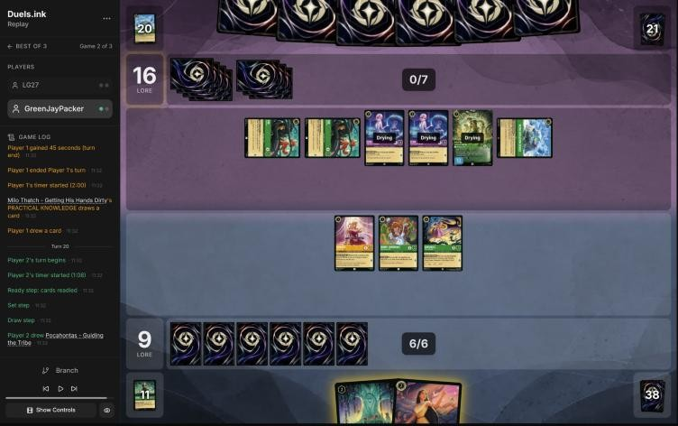
*The board before the decision: [step 159](https://duels.ink/replay/01a219ec-316c-7946-b026-afada3971e2b?step=159) in the duels.ink replay viewer.*

**The plan (written before seeing the turn):** 9–16; their next quest is 7, and they need 4. The two Tods are exerted;
Milo and the Elsas are ready (drying). Your board: Aurora, Bobby, Rapunzel; hand of Willow and Pocahontas – Guiding the
Tribe (drawn). **Unwinnable** ([principle 2](#cite-principle-2)): you can't reach 20 this turn (3 quests and two cheap plays that can't
quest), and the most you can take off their next quest is the two Tods (Rapunzel kills one and survives; Aurora + Bobby
kill the other, each taking 1), which still leaves Milo and the Elsas for 5: 21. No severity from here.

**What you did:** Willow, then Pocahontas for 1; quested Aurora, Bobby and Rapunzel: 12–16.

**Verdict:** **Unwinnable** (no severity). Killing the Tods instead would have left them at 21 next turn rather than 23.

### Turn 21: their turn

**What happened:** both Tods and both Elsas quested: 20–12. LG27 won.

## Lessons
1. **Mike Wazowski – Heroic Climber is a dig, so use him before the ink.** Your deck is all characters, so FIND A
   FRIEND gives you a card nearly every time, and about three in four are inkable. You played or quested him before
   inking on turns [6](#turn-6), [8](#turn-8) and [14](#turn-14), and each time it settled the ink with the card he
   found and kept a better one out of the inkwell. The blind plan missed it on turn 6 because it saw his reveal only as
   a card for them (see "The coach's errors").
2. **Chain the digs.** Turn [14](#turn-14): Nani found Mike, Mike found Bobby, Bobby drew, and the ink was chosen only
   after Mike's reveal: three bodies from 6 ink where the plan had two.
3. **Against a Ward-only board, "chosen opposing character" effects do nothing.** Mickey – Expedition Leader's SECRET
   PATH and Elinor's ping both choose; Milo has Ward (turn [10](#turn-10)). This list's Milos and Device lines mean their
   key character is often the Ward one: count your effects' targets before paying for them.
4. **Retro Device's Phillip comes through the Device, not at 9 ink.** Milo (7) singing Malicious, then the Device (1
   ink) banishing Milo for a free Phillip, wiped four characters on game turn 11 at 5 ink; the Device was used on six of
   their turns. From the turn the Device and a 7-cost are both in play, count Phillip as castable for 1 ink.
5. **When the race is a turn short, find the line that survives the next turn, then keep lore coming.** Turn
   [18](#turn-18): only the Phillip bounce and the Milo kill together stopped a win on game turn 19, and you found both.

## Proposed knowledge-base updates (applied after discussion)
- **Strategy:**
  - **[H-13](#cite-h-13), a caveat (evidence against, from what happened, so pattern evidence only):** against Retro Device, a gift to a
    full hand isn't cheap. On turn [8](#turn-8) FIND A FRIEND gave LG27 Milo Thatch with a five-card hand and 4 ink, the
    case [H-13](#cite-h-13) calls cheap; the Device played him for free the next turn (Aladdin & Genie, 5, into Milo, 7), and he sang
    the Malicious that set up the turn-11 wipe. Proposed wording: "Cost cheats (Retro Evolution Device) make an
    expensive gift playable at once, whatever their ink: count it as the costly case."
  - **[Mike card note](#cite-kb-cards-mike-wazowski-heroic-climber)**, a new bullet: "**Play or quest him before you ink.**
    Your card is a character nearly every time, and in an ink-short hand it's the ink: 01a219ec-316c turns 6, 8 and 14
    (GreenJayPacker's Princess Aggro), where it kept Dale and Thomas out of the inkwell."
- **Meta** (Amethyst/Emerald pair file, below the end marker): "**Retro Device against GreenJayPacker's Princess Aggro:
  LG27** `[coach, blind review of 01a219ec-316c, 26 Nov 2026]`. Seen: Retro Evolution Device ×3, Milo ×4, Tod ×4, Hades
  ×3, Aladdin – Doing His Part ×3, Elsa ×3, Aladdin & Genie ×2, Prince Phillip ×2, Above the Crowd, Malicious,
  Everyone Knows Juanita ×2, Junior Woodchuck Guidebook ×2, Taran (discarded); off-list Piercing Attack ×3 (killed Willow on turn 5),
  Luisa Madrigal – Pushing Through ×2 (discarded) and Creative Inspiration; no Don Karnage or To Wither a Flower. The
  Device was used on game turns 9, 11, 13, 15, 17 and 19: Aladdin & Genie → Milo, Milo → Phillip (after Milo sang
  Malicious: four kills at 5 ink), Tod → Hades twice, Hades → Milo twice. Milo's SCHOLAR'S GAMBIT bounced Dale, Bobby and
  Willow; Hades and Above the Crowd bottomed Willow, Mike and Elinor. Won 20–12 on game turn 21."
- **Rules** (the rulings file): "**A trigger with a choice and other effects still does the rest when nothing can
  be chosen.** Elinor – Renowned Diplomat's COORDINATED EFFORTS (deal 1 damage to chosen opposing character, gain 1
  lore, draw a card) with only Ward characters opposite still gains the lore and draws. Basis: [CR 1.7.7](#cite-cr-1-7-7) (no legal choice:
  that effect does nothing, and the player does as much as they can of the rest), [CR 1.2.3](#cite-cr-1-2-3), [CR 8.15.1](#cite-cr-8-15-1)."
- **Tools:** see "The coach's errors": the brief's dig lines should count Mike's FIND A FRIEND.

## Hindsight
Doesn't change the verdicts above.
- **The wipe on game turn 11 was the unlikely branch** (about 9% before their dig, 15% with it). It needed the Milo that
  Mike's FIND A FRIEND gave them on turn 8. Had Dale been played on turn 10 as the verdict suggests, he'd have been
  wiped with the rest; Mickey – Expedition Leader went instead.
- **The Device never stopped:** six uses in six turns from game turn 9, each a free character two costs up, with Milo's
  draw and two Everyone Knows Juanitas refilling their hand. From the wipe on, your board was rebuilt from 1- and
  2-drops each turn and lost a character to a bounce or a bottom on game turns 13, 15, 17 and 19.
- **SO CHEESY on turn 16 would have drawn Rapunzel** (the next card, drawn on turn 18 instead), a turn early and with a
  second card in hand to discard, so Elinor might not have had to go on turn 18. Judged on what it could find, the
  verdict stands as it is.
- **Turn 20:** killing both Tods (exerted) would have left Milo and two Elsas to quest for 5, still enough for 20.
- **Was the game winnable?** After game turn 11, only if the Device chain stalled: they needed no specific card after
  the wipe, and their Phillip was out of reach of everything in your deck but Rapunzel.

## The coach's errors
Found during the blind pass; the column on prevention is a proposal, not made.

| When | Error | How it was caught | How it won't happen again |
|---|---|---|---|
| Turn 6, the plan | Planned the ink before the dig: weighed Mike's FIND A FRIEND only as a card for them, and missed that your reveal (a character nearly every time, mostly inkable) could be the ink. The player's line beat the plan. The method already lists ["planning before the dig"](#cite-docs-decision-method-9-the-coach-s-recurring-errors); the brief's "Dig you can use this turn" said "none in hand or in play" with Mike in hand (and again on turns 8, 10 and 16 with him in play), so nothing prompted it | Comparing the plan with the player's line | Proposed: `tools/brief.py` counts FIND A FRIEND as a dig for you, from hand (on play) and from play (on quest), in "Dig you can use this turn" and "WHAT THIS TURN'S DIG CAN FIND", with the chance it finds an inkable card when the hand is short of ink |
| Turn 14, the plan | Counted Nani's find as a body but not as a further dig (Mike from Nani, then Bobby from Mike), so the plan had two bodies where the player made three | Comparing the plan with the player's line | The same brief change; plus a line in the brief when a dig can find another dig (Nani's top 4 can hold Mike or Bobby) |

## Open questions
- Turn [2](#turn-2): inking Mickey – Best in Town rather than a Thomas: was the reason to keep the ink drops away from
  Retro Device's big plays, or something else?
- Turn [10](#turn-10): did you expect SECRET PATH to shrink Milo (Ward stops it choosing him), or was Mickey – Expedition
  Leader entering exerted meant for later characters? Was Dale held back to play on the turn you'd challenge with him?
- Turn [12](#turn-12): was skipping the ink a choice (keeping Dale and Lionheart), or a slip?
- Turn [16](#turn-16): was Elinor held back as a rebuild against a sweep, and was declining SO CHEESY deliberate?
- Turn [18](#turn-18): why did Aurora, Willow and Bobby stay home rather than quest?

## Citations
Copies of the coach's knowledge base cited above, as they stood when they were cited (the private repository's commit and date are given with each). They don't change when the knowledge base does.

**amethyst-emerald.md, From reviewed games and discussion**: knowledge base, `kb/meta/archetypes/amethyst-emerald.md` at `6cecbcd` (2026-11-27), working tree

> ## From reviewed games and discussion
> From replay 01a139ad (vs KLinz, 2026-10-14) and discussion with the user. In the duels.ink lists above, this
> opponent played the **Retro Device** archetype. Card text verified from replay data with `tools/replay.py card`.
>
> ### Cards seen
> From replay 01a139ad vs KLinz, 2026-10-14 (review: `output/reviews/2026-10-14_01a139ad_vs-klinz.md`). Up to turn 8:
>
> | Card | Ink, cost | What it does | How seen |
> |---|---|---|---|
> | Lyle Tiberius Rourke – Adventurer for Hire | Emerald 2, 2/2/1 | When played: may draw, then discard. DIRTY TRICKS: at end of their turn, if 2+ cards went to their discard that turn, each opponent loses 1 lore | inked, played |
> | Lenny – Toy Binoculars | Emerald 3, 0/2/1 | When played: you reveal your hand; they choose an **action** for you to discard | discarded |
> | Malicious, Mean, and Scary | Emerald song 3 | **Puts** 1 damage counter on each opposing character. Resist doesn't stop it (CR 8.8.3) | inked then undone; discarded |
> | Tod – Clever Fox | Emerald 3, 1/2/1 | When played: draw 2, then discard 1 | played |
> | Aladdin & Genie – Mischievous Pals | Amethyst/Emerald 5, Shift 3 | When played: put any number of cards from hand on the bottom of their deck, draw that many +1 | inked |
> | Milo Thatch – Getting His Hands Dirty | Emerald 7, 5/5/3, Ward | When played: may discard to return a chosen character to its owner's hand. Draws at end of turn if 2+ cards went to their discard | inked |
> | Hades – Looking for a Deal | Amethyst 5 | Opponent puts a chosen character on the bottom of their deck, or they draw 2 | inked |
> | Sven – Leaping Reindeer | Amethyst 4, uninkable, 2/3/1 | **Rush, Challenger +3, Evasive**. Kills an exerted Evasive character the turn he lands | played turn 8 |
>
> **Turn 10:** a second copy of Malicious, Mean, and Scary was inked and a third **sung by Sven for free**,
> killing a damaged Jebidiah and putting a counter on each of the user's other characters (RULE-9). So this list
> runs **3+ Malicious, Mean, and Scary**. Hades – Looking for a Deal was played on Dumbo; the user let them draw 2.
>
> **Turn 12: a cost-cheating engine.**
> - **Retro Evolution Device** (Emerald item, 3): exert it, pay 1 and banish one of their own characters to play a
>   character costing up to 2 more for free. Repeatable every turn.
> - **They used it on Hades after he'd quested**, playing **Shere Khan – Ruthless Entrepreneur** (Emerald 7,
>   uninkable, 7/4/1) for free. His QUIETLY RELEASED put the user's Dumbo (3 {S}) on the bottom of their deck.
> - **Shere Khan's "3 {S} or less" filter** makes low-{S} engines like Dumbo the natural targets.
>
> Also seen that turn: Demona – Scourge of the Wyvern Clan (inked) and Junior Woodchuck Guidebook (played).
> Sven traded with an exerted Isis.
>
> **Turns 16–18:**
> - **Milo Thatch was played (7, Ward).** He then **sang Above the Crowd for free** (Emerald song 5: "Put chosen opposing
>   character with 3 {S} or less on the bottom of their player's deck"). That bottomed the user's second Dumbo.
> - **A second Sven** traded with an exerted Evasive Jebidiah.
> - **Milo's end-of-turn draw fired** because 2+ cards hit their discard (the song and Sven).
>
> **Their removal suite targets low {S}:** Shere Khan – Ruthless Entrepreneur and Above the Crowd both hit **3 {S} or
> less**, and their big characters (Milo 7, Shere Khan 7, Hades 5) sing Above the Crowd for free. Engines like Dumbo
> (3 {S}) are prime targets. Characters with 4+ {S} (Wasabi, Isis, Demona – Imperious Spellcaster) are immune
> to that removal.
>
> **Turns 20–22:**
> - **Aladdin – Prince Ali** (Emerald 2, 2/2/1, **Ward**).
> - **Aladdin – Doing His Part** (Emerald 2, 3/2/1): when played, may pay 1 {I} to **banish a chosen item**. It killed the
>   user's The Torn Corner.
> - **With Ward on Milo and Prince Ali,** the user's "exert chosen opposing character" effects (Isis's CHILL OUT,
>   Peter Pan's Shadow's FAVORITE TRICK) often have **no legal target**. Effects that don't choose (Demona –
>   Scourge's exert-all) still work.
>
> **Turn 24: a two-card sweeper.**
> 1. Milo sang Malicious, Mean, and Scary for free, putting a counter on every opposing character.
> 2. They hard-cast **Prince Phillip – Vanquisher of Foes** (Emerald 9, 6/6/3, Shift 6, Evasive). SWIFT AND SURE: "When you
>    play this character, banish all opposing damaged characters."
>
> It wiped the user's board of four. "All", not "chosen", so Ward and similar protections don't help.
>
> **Prince Phillip is very common in this archetype, especially once you've seen Malicious, Mean, and Scary**
> (user, 2026-10-26). Treat the pair as the archetype's standard sweeper. From the moment the song appears:
> - **Note when they reach 9 ink**, or 6 with a Phillip in play to Shift onto. They also need a free singer of
>   cost 3+, or 3 more ink.
> - **On the turn before that,** don't deploy characters that can't quest or otherwise pay off before the wipe.
>   Keep a rebuild in hand (POS-1).
> - **The coach missed this in 01a139ad**: it called Phillip unforeseeable, and its turn-23 setup encouraged
>   deploying Wasabi into the wipe.
>
> **Turn 26:**
> - **A second Lyle and a second Milo.** Milo's SCHOLAR'S GAMBIT bounced the user's Wasabi back to hand.
> - **Discarded along the way:**
>   - **Chernabog – Unnatural Force** (Emerald 5): when played, may shuffle a chosen opposing character into its owner's
>     deck; that player may then play a character from their discard for free.
>   - **To Wither a Flower** (Emerald song 4): "Deal 2 damage to each opposing damaged character". Another anti-damage card.
> - **Then three quests for 7 lore**, and Lyle's DIRTY TRICKS drained 1 of the user's lore.
> - **Late game:** their board makes 11 lore a turn, more than they need.
>
> ### Themes so far `[coach, one game]`
> - **Lots of drawing and discarding** (Lyle, Tod, Aladdin & Genie, Milo), plus payoffs for 2+ cards hitting their
>   discard in a turn (Lyle's lore drain, Milo's draw).
> - **Pings:** Malicious, Mean, and Scary kills any of your characters on 1 remaining {W}, and sung by a cost-3+
>   character it's free (RULE-9). Avoid leaving several characters on 1 remaining {W}.
> - **Answers to Evasive:** Sven (Rush, Evasive) punishes exerted Evasive characters immediately.
> - **Lenny hits actions in your hand.** Hold actions loosely against this deck.
>
> ### Retro Device against danny's Remember Merida: RomanceJessica `[coach, meta study of danny's 28 Oct – 2 Nov 2026 games (tools/scan.py), full games, not blind, 3 games]`
> `01a18427-ab12`, `01a18433-41ba`, `01a18442-9f20` (games 1–3).
> - **A sweep on their 4th turn:** Don Karnage – Khan's Courier on turn 2, then Debonair Pirate Shifted onto him for 4
>   (LASTING IMPRESSION: 1 damage to each opposing character, not reduced by Resist) and To Wither a Flower sung by
>   him for 2 more: three kills on game turn 7 in games 1 and 2, four on turn 10 in game 3. Again later with a fresh
>   Don for 6 (turns 21 and 24) or Malicious, Mean, and Scary sung twice (turn 18, game 3: five kills).
> - **Retro Evolution Device** (TURN INTO DINOSAUR: {E}, 1 {I}, banish one of yours to play a character costing up to 2
>   more for free): Tod or Elsa (3) into Hades – Looking for a Deal (5) on turns 9, 11 and 19; Lenny (3) into Aladdin &
>   Genie (5) on 17; Hades (5) into Milo Thatch (7) on 23.
> - **Malicious, Mean, and Scary twice, then Prince Phillip (9)** on game turn 19 (game 2, after Strike a Good Match):
>   four kills, including both Demonas.
> - Off-list: Strike a Good Match ×4.
>
> ### Retro Device against danny's Remember Merida: Thunderfury_ `[coach, meta study of danny's 5 Nov 2026 games (tools/scan.py), full games, not blind, 1 game]`
> `01a1ad69-7051`: danny conceded at 8–16 on game turn 33.
> - **Nearly the whole list:** Milo Thatch ×4, Don Karnage – Khan's Courier ×4 and Debonair Pirate ×3, Junior Woodchuck
>   Guidebook ×4, Retro Evolution Device ×3, Hades ×3, Elsa – Exploring the Unknown ×3, Aladdin & Genie ×3, Aladdin –
>   Doing His Part ×3, Tod ×3, Malicious, Mean, and Scary ×3, To Wither a Flower ×3, Above the Crowd ×2, Lenny ×2, Prince
>   Phillip ×2, Chernabog.
> - **The Device every other turn:** Elsa into Hades (game turns 7 and 25), Hades into Milo (11, 21, 29), Aladdin & Genie
>   into Milo (13), Milo into Phillip after Don Karnage's ping (23: four kills). danny bottomed Merlin to Hades both
>   times; on turn 21 they let Hades draw 2 to keep the Scourge, and Milo's SCHOLAR'S GAMBIT bounced it anyway.
> - **Remember Me's rebuild was swept the next turn:** Don Karnage plus To Wither a Flower sung by Milo killed six
>   (turns 30–31). Lenny had already discarded one Remember Me from danny's hand (turn 29).
>
> ### Retro Device against danny's Rockstar Aggro: Apollo - Team Olympus `[coach, meta study of danny's 5–10 Nov 2026 games not studied before (tools/scan.py), full games, not blind, 1 game, plus a game 2 that timed out after 3 turns]`
> `01a1b1d8-28a8` (game 1): danny won 20–8 on lore, having reached 17 by game turn 9 before the device took over.
> - **Retro Evolution Device every turn from their 4th:** turn 7, Max Goof became Taran – Magically Armed (5) for free and
>   Taran killed Lilo; turn 9, Taran became Don Karnage – Debonair Pirate (1 damage to each opposing character); turn 11,
>   a second Don Karnage Shifted onto Khan's Courier for a second wave: four kills; turn 13, Malicious, then Tod became
>   Taran (WEAKEN THE CAULDRON put two of danny's characters on the bottom of his deck) and Education or Elimination
>   banished Lilo – Rock Star; turn 15, Hades became a second Hades, then To Wither a Flower: two kills.
> - Against 1- and 2-willpower boards, each Don Karnage wave is a sweep.
>
> ### Retro Device (a Don Karnage build) against GreenJayPacker's Detectives: James (Little Meeples) `[coach, blind review of 01a1fb8a-260a, 21 Nov 2026, discussed 22 Nov]`
> A tournament-style game, inks not revealed. They conceded on game turn 22 at 7–17.
> - **Seen:** Don Karnage – Khan's Courier ×3, Don Karnage – Debonair Pirate ×2, Malicious, Mean, and Scary ×2, To Wither a
>   Flower ×3, Tod – Clever Fox ×2, Strike a Good Match, Milo Thatch (discarded), Ursula – Deceiver, and off-list Everyone
>   Knows Juanita and Fflewddur Fflam – Luckless Bard. Inked: Aladdin & Genie, Luisa Madrigal – Confident Climber, Hook
>   Hand – Unexpectedly Friendly and Prince Phillip. No Retro Evolution Device seen.
> - **How it played:** a ping or song on game turns 6, 8, 10, 12 and 14 killed ten characters. Don Karnage's SO SUAVE made
>   damaged questers worth 0 while he was exerted, and he sang the songs for free. Their own board stayed at two or three
>   characters, and their lore at 7 by turn 22.
> - **What beat it:** Support onto Don, then Always Vigilant (turn 15); a board of 4-willpower characters (Fangmeyer, Elisa,
>   Always Vigilant, Clues) that one ping can't kill; card flow faster than their sweeps (three Toy Drive Officers).
> - **Staying ready against it** saves nothing from the pings, only from challenges: worth it for a character two of
>   theirs can kill for free (Toy Drive Officer against Don and Ursula, turn 11), not otherwise.

**amethyst-emerald.md, Cards seen**: knowledge base, `kb/meta/archetypes/amethyst-emerald.md` at `6cecbcd` (2026-11-27), working tree

> ### Cards seen
> From replay 01a139ad vs KLinz, 2026-10-14 (review: `output/reviews/2026-10-14_01a139ad_vs-klinz.md`). Up to turn 8:
>
> | Card | Ink, cost | What it does | How seen |
> |---|---|---|---|
> | Lyle Tiberius Rourke – Adventurer for Hire | Emerald 2, 2/2/1 | When played: may draw, then discard. DIRTY TRICKS: at end of their turn, if 2+ cards went to their discard that turn, each opponent loses 1 lore | inked, played |
> | Lenny – Toy Binoculars | Emerald 3, 0/2/1 | When played: you reveal your hand; they choose an **action** for you to discard | discarded |
> | Malicious, Mean, and Scary | Emerald song 3 | **Puts** 1 damage counter on each opposing character. Resist doesn't stop it (CR 8.8.3) | inked then undone; discarded |
> | Tod – Clever Fox | Emerald 3, 1/2/1 | When played: draw 2, then discard 1 | played |
> | Aladdin & Genie – Mischievous Pals | Amethyst/Emerald 5, Shift 3 | When played: put any number of cards from hand on the bottom of their deck, draw that many +1 | inked |
> | Milo Thatch – Getting His Hands Dirty | Emerald 7, 5/5/3, Ward | When played: may discard to return a chosen character to its owner's hand. Draws at end of turn if 2+ cards went to their discard | inked |
> | Hades – Looking for a Deal | Amethyst 5 | Opponent puts a chosen character on the bottom of their deck, or they draw 2 | inked |
> | Sven – Leaping Reindeer | Amethyst 4, uninkable, 2/3/1 | **Rush, Challenger +3, Evasive**. Kills an exerted Evasive character the turn he lands | played turn 8 |
>
> **Turn 10:** a second copy of Malicious, Mean, and Scary was inked and a third **sung by Sven for free**,
> killing a damaged Jebidiah and putting a counter on each of the user's other characters (RULE-9). So this list
> runs **3+ Malicious, Mean, and Scary**. Hades – Looking for a Deal was played on Dumbo; the user let them draw 2.
>
> **Turn 12: a cost-cheating engine.**
> - **Retro Evolution Device** (Emerald item, 3): exert it, pay 1 and banish one of their own characters to play a
>   character costing up to 2 more for free. Repeatable every turn.
> - **They used it on Hades after he'd quested**, playing **Shere Khan – Ruthless Entrepreneur** (Emerald 7,
>   uninkable, 7/4/1) for free. His QUIETLY RELEASED put the user's Dumbo (3 {S}) on the bottom of their deck.
> - **Shere Khan's "3 {S} or less" filter** makes low-{S} engines like Dumbo the natural targets.
>
> Also seen that turn: Demona – Scourge of the Wyvern Clan (inked) and Junior Woodchuck Guidebook (played).
> Sven traded with an exerted Isis.
>
> **Turns 16–18:**
> - **Milo Thatch was played (7, Ward).** He then **sang Above the Crowd for free** (Emerald song 5: "Put chosen opposing
>   character with 3 {S} or less on the bottom of their player's deck"). That bottomed the user's second Dumbo.
> - **A second Sven** traded with an exerted Evasive Jebidiah.
> - **Milo's end-of-turn draw fired** because 2+ cards hit their discard (the song and Sven).
>
> **Their removal suite targets low {S}:** Shere Khan – Ruthless Entrepreneur and Above the Crowd both hit **3 {S} or
> less**, and their big characters (Milo 7, Shere Khan 7, Hades 5) sing Above the Crowd for free. Engines like Dumbo
> (3 {S}) are prime targets. Characters with 4+ {S} (Wasabi, Isis, Demona – Imperious Spellcaster) are immune
> to that removal.
>
> **Turns 20–22:**
> - **Aladdin – Prince Ali** (Emerald 2, 2/2/1, **Ward**).
> - **Aladdin – Doing His Part** (Emerald 2, 3/2/1): when played, may pay 1 {I} to **banish a chosen item**. It killed the
>   user's The Torn Corner.
> - **With Ward on Milo and Prince Ali,** the user's "exert chosen opposing character" effects (Isis's CHILL OUT,
>   Peter Pan's Shadow's FAVORITE TRICK) often have **no legal target**. Effects that don't choose (Demona –
>   Scourge's exert-all) still work.
>
> **Turn 24: a two-card sweeper.**
> 1. Milo sang Malicious, Mean, and Scary for free, putting a counter on every opposing character.
> 2. They hard-cast **Prince Phillip – Vanquisher of Foes** (Emerald 9, 6/6/3, Shift 6, Evasive). SWIFT AND SURE: "When you
>    play this character, banish all opposing damaged characters."
>
> It wiped the user's board of four. "All", not "chosen", so Ward and similar protections don't help.
>
> **Prince Phillip is very common in this archetype, especially once you've seen Malicious, Mean, and Scary**
> (user, 2026-10-26). Treat the pair as the archetype's standard sweeper. From the moment the song appears:
> - **Note when they reach 9 ink**, or 6 with a Phillip in play to Shift onto. They also need a free singer of
>   cost 3+, or 3 more ink.
> - **On the turn before that,** don't deploy characters that can't quest or otherwise pay off before the wipe.
>   Keep a rebuild in hand (POS-1).
> - **The coach missed this in 01a139ad**: it called Phillip unforeseeable, and its turn-23 setup encouraged
>   deploying Wasabi into the wipe.
>
> **Turn 26:**
> - **A second Lyle and a second Milo.** Milo's SCHOLAR'S GAMBIT bounced the user's Wasabi back to hand.
> - **Discarded along the way:**
>   - **Chernabog – Unnatural Force** (Emerald 5): when played, may shuffle a chosen opposing character into its owner's
>     deck; that player may then play a character from their discard for free.
>   - **To Wither a Flower** (Emerald song 4): "Deal 2 damage to each opposing damaged character". Another anti-damage card.
> - **Then three quests for 7 lore**, and Lyle's DIRTY TRICKS drained 1 of the user's lore.
> - **Late game:** their board makes 11 lore a turn, more than they need.

**amber-emerald.md, Princess Aggro: Dale, discounts and the Peacekeeper base**: knowledge base, `kb/meta/archetypes/amber-emerald.md` at `6cecbcd` (2026-11-27), working tree

> ### Princess Aggro: Dale, discounts and the Peacekeeper base `[coach + user, one match: 01a19bb9 and 01a19bbd-79c2, 2026-11-02]`
> MK_ifoughtthelore (Amber/Sapphire Detectives) vs xBWx, won 2–0; sent by the user, reviews in
> `output/reviews/2026-11-02_01a19bb9_vs-xbwx-g1.md` and `…01a19bbd_vs-xbwx-g2.md`. Card text verified from the replays.
> - **Dale – Ready for His Shot is the key piece** (4, 0/4/2; `kb/cards/dale-ready-for-his-shot.md`). SPIKE SUIT: in
>   challenges their characters deal damage with their {W}, so Mike Wazowski – Heroic Climber (0/4), Thomas – Wide-Eyed
>   Recruit (0/4) and David – Protective Snowboarder (1/4) deal 4. Before he's in play, a quest that exerts a cheap
>   character can still be exposed: judge it from their next turn. Once he lands, remove him first (01a19bbd-79c2 turn 8:
>   two Supports made him 5 {S} for Gaston – Superior Archer's WATCH THIS).
> - **Discounts bring cards a turn early.** Pluto – Friendly Pooch's GOOD DOG ({E}: next character 1 cheaper) made Dale
>   castable with 3 ink (01a19bbd-79c2 turn 5). They stack: two GOOD DOGs and Aurora – Holding Court's ROYAL WELCOME (next
>   Princess or Queen 1 cheaper) put Elinor – Renowned Diplomat (a Queen) into play for 1 on turn 9.
> - **Pocahontas – Guiding the Tribe** (2, 2/3/1) plays a cost-1 character for free, and **she's the Shift base for
>   Pocahontas – Peacekeeper's challenge lock**. Remove her early (01a19bb9 turn 7). When Peacekeeper is known in
>   their hand and a Guiding the Tribe is in play, fight this turn: the next one may allow no challenges (01a19bbd-79c2
>   turn 14, then their turn 15).
> - **Elinor's COORDINATED EFFORTS** needs 3 exerted characters at the end of their turn; with their wide board it
>   usually has them. Its 1 damage killed a 1-willpower Eilonwy (01a19bbd-79c2 turn 9).
> - **Mike Wazowski – Heroic Climber's FIND A FRIEND is symmetrical** (on play and on each quest, each player reveals
>   their top card and takes it if it's a character). Against a character-heavy deck such as Detectives it feeds you
>   about as often as them (01a19bb9).
> - **Hand attack:** Mowgli – Man Cub (you discard a non-character card of your choice) and Ursula – Deceiver (you
>   discard a song of their choice). Small against an all-character deck.
> - **Removal is light:** Elinor's ping and Rapunzel – Tower Defender (4; they discard a card to return your character
>   to your hand).
> - **Their cards across the match** (most copies seen in one game): David ×4, Mike ×3, Pocahontas – Guiding the
>   Tribe ×3, Bobby Zimuruski ×2, Mowgli ×2, Mushu – Stealthy Dragon ×2, Pluto ×2, and one each of Aurora – Holding
>   Court, Dale, Elinor, Nani – Stage Manager, Pocahontas – Peacekeeper, Rapunzel – Tower Defender, The Queen – Regal
>   Monarch, Thomas and Ursula – Deceiver. Mowgli and Mushu aren't in duels.ink's average list.

**mike-wazowski-heroic-climber.md**: knowledge base, `kb/cards/mike-wazowski-heroic-climber.md` at `6cecbcd` (2026-11-27), working tree

> # Mike Wazowski – Heroic Climber
>
> Amber character, 2 cost, uninkable, 0/4/1. Four copies in the Rockstar Aggro list (`kb/meta/archetypes/amber-steel.md`).
> Text verified with `tools/cards.py get "Mike Wazowski - Heroic Climber"`:
> - **FIND A FRIEND:** when you play him and whenever he quests, **each player** reveals their top card. If it's a
>   character, they may put it into their hand; otherwise it goes to the bottom of their deck.
>
> ## What it means in play `[coach + user, the 11–12 Nov 2026 reviews and their discussion, 2026-11-17]`
> - **Each side gets a card.** Yours is a character nearly every time (Rockstar is almost all characters); theirs is one
>   at their deck's character share, most of the time against Detectives or Midrange. It's a hand card, not a free play:
>   they still pay its ink.
> - **What their card is worth depends on their hand and ink** (H-13):
>   - **Little when their hand is full and their ink short,** as it usually is early. danny's view: the deck aims to be
>     wider than the opponent, who can't empty their hand anyway, and without Mike's body and card the game is often
>     lost regardless. In 01a1cedf-0be6 the Darkwing Duck it gave them was inked and Elisa Maza never came down; in
>     01a1cee4-b587 the Lead Detective it gave them on turn 6 was inked on turn 7.
>   - **A lot when their hand is short or their ink spare:** they can play whatever it finds. 01a1cbca-787d turn 16
>     (one card in their hand: a third Demona – Scourge); 01a1cec3-3345 turn 18 (Lionheart, whose +2 lore won the
>     game); 01a1ccd4-187e turn 9 (Tinker Bell – Giant Fairy).
>   - **Near 20, every card they see may be the answer:** keeping Mike in hand at 19 was right in 01a1cc61-9de0 turn 9.
> - **Questing him repeats it.** Each quest is another card for each side, so the same weighing applies every turn, not
>   only when he's played.
> - **Against STONE BY DAY** they may decline the character to stay under 3 cards and ready their Demonas: HØT CØCØ
>   bottomed a Demona – Betrayer in 01a1ced3-11cc turn 10 (`kb/cards/demona-scourge-of-the-wyvern-clan.md`).
> - **His body:** 4 willpower survives what kills Toulouse or Pudge, and under Dale's SPIKE SUIT he deals 4 in a
>   challenge; with Lilo & Stitch's Support (+3 {S}) he's a challenger before Dale lands (`kb/cards/dale-ready-for-his-shot.md`).
> - **Judge the play, not the reveal.** What the reveal found is learned only after he's played: weigh what it could
>   find (their deck's characters, their hand and ink), never what it did find.

**decision-method.md, 9. The coach's recurring errors**: knowledge base, `docs/decision-method.md` at `6cecbcd` (2026-11-27), working tree

> ## 9. The coach's recurring errors
> From `reviews/calibration.md`. Check yourself against these on every turn.
> - **Treating known knowledge as new.** In 01a19bb9 turn 7 the coach missed Support on an opposing character, then
>   called it a new lesson, though the Detectives notes already described it: it had read only the opponent's
>   archetype notes, never searched for the cards in hand, and never searched before writing the lesson. Read both
>   decks' notes, use the brief's knowledge-base notes on the cards in view, and search before calling anything new.
>   Finding it afterwards is a failure to explain and fix (`.claude/skills/analyse-replay/SKILL.md`, after the blind
>   pass).
> - **Missing Support, the coach's most frequent miss** (six reviews by 2026-11-21). Support acts when its character
>   quests, not at the challenge or the removal it enables, it isn't printed on the card doing the damage, and it can
>   choose a character on either side (CR 8.13.1; Ward stops it, CR 8.15.1). So any count from printed {S} alone misses
>   it. It matters four ways, and the brief has a line for each:
>   1. **Yours onto their character, for your strength-threshold removal** (Gaston – Superior Archer, Judy Hopps – Always
>      Vigilant): "STRENGTH REMOVAL IN HAND, AND WHAT YOUR SUPPORT PUTS IN RANGE". Missed in 01a19bb9 turn 7 and
>      01a19c08-7f38 turn 9, where the player found it (user, 2026-11-02: "that cannot continue to be missed"), and in
>      01a1fb8a-260a turn 21 though the brief printed it.
>   2. **Yours onto your challenger:** your options' challenge lines, a Supporter Shifted in this turn included. Missed in
>      01a19c3f-185a turn 5 (Lilo & Stitch's +3 on Mr. Big) and 01a1a1ee-148c.
>   3. **Theirs onto their challenger:** "SUPPORT they can quest first" and "With Support" under "WHAT CAN CHALLENGE YOUR
>      CHARACTERS". Missed in 01a1fecf-eeef turn 12 (Eilonwy's +2 let a Willow kill Giant Fairy).
>   4. **Theirs onto your character, for their removal** (H-9): "THEIR STRENGTH REMOVAL, AND WHAT THEIR SUPPORT PUTS IN
>      RANGE", your characters in hand included. Counted by hand until 2026-11-21.
>
>   **Prevention:** whenever either side has a Supporter in play (or one to play or Shift in), the turn's setup has a
>   **Support line** naming all four, each from its brief line ("none" where it doesn't apply), and every line you
>   compare says which of them it uses or exposes (section 2, item 2 and 3).
> - **Planning before the dig.** In 01a1ffec-372f turns 9 and 11 the coach planned from the hand as it was, while
>   Uncovering Clues' digs (on play and on each quest) came first: they found an inkable Elisa Maza that paid for a
>   double play, then a Lead Detective to Shift onto a dry Day Camp Instructor, whose Alert killed two fliers. The
>   player's line beat the coach's both times. With a dig to use, the setup branches on the brief's "WHAT THIS TURN'S DIG
>   CAN FIND" (section 4, item 3), and the line digs first (SEQ-1).
> - **Missing a return-and-replay line.** Twice in MK_TurtleBauer's games the plan treated Un Poco Loco as dead or left
>   it out: in 01a1fecf-eeef turn 18 it returned Cheshire Cat (two Boosted cards drawn) and Isis, and in 01a20294-b698
>   turn 16 it returned Isis and Peter Pan's Shadow, whose replayed exerts let both singers of a Circle of Life die. The
>   second time the knowledge base already had the first, and the brief printed that note. Prevention: the brief's
>   "REPLAY ON-PLAY EFFECTS" line, which a turn's candidates must use or answer (section 3).
> - **Card text misread or not read.** Go Go Tomago given another card's keywords (01a14bf9). Tramp's "choose one"
>   Rush missed (01a14574 turn 19). Read each card from a single-card source, in full.
> - **Treating the archetype as settled.** In 01a1fe12-6d44 turn 5 the review called Rockstar Aggro "certain" after four
>   cards, and its pre-game read quoted the lists' shares as odds; MK_TurtleBauer's own deck that game was a variant of
>   Big Ramp. Rank the likely lists in words and keep "something else" open (section 1; user, 2026-11-21).
> - **Missing what becomes possible at their next ink.** Lead Detective hard-cast at 6 (01a14574 turn 15).
> - **Judging exposure from their board as it stands.** In 01a19bbd-79c2 turn 4 the coach said Pluto and Mike Wazowski,
>   both 0 strength, "couldn't have hurt" an exerted Eilonwy. Pluto's GOOD DOG made Dale – Ready for His Shot (a
>   Princess Aggro tell, seen in game 1) castable with their 3 ink, and his SPIKE SUIT let Mike kill her. Check their
>   next turn's combat tricks and cost reducers for every character you'd exert (section 2; caught by the user,
>   2026-11-02).
> - **Counting exposure as lore only.** In 01a1fb8a-260a turn 11 the brief said Don Karnage and Ursula could kill an
>   exerted Toy Drive Officer, the draw engine, with both surviving; the verdict counted only the lore the quest gained
>   and what their quests would give up. Prevention: the brief's FREE KILLS line, which a verdict on questing or staying
>   home has to name entry by entry (section 5).
> - **Missing archetype staples and their combos.** Prince Phillip after Malicious, Mean, and Scary (01a139ad turn 23).
> - **Missing synergies on their side.** Darkwing in play makes Launchpad's draw discard-free (01a14574 turn 5).
> - **Overstating a risk** without checking what the alternative loses in the same branch (01a14574 turn 15).
> - **Not counting what the coach's own line exposes.** In 01a19c0c turn 20 the coach suggested Shifting in Lead
>   Detective so Darkwing could kill a 1-lore Shadow. Darkwing's challenge would have left him exerted for Wasabi, and
>   TWIN BLADES could then kill the Lead Detective just played. The player held her for the 3-lore Ursula instead, and
>   won with her two turns later. Prevention: the brief's ready-damage line, and "Say what Y exposes" (section 5).
> - **Anchoring on the coach's own plan.** The user's line was better on the mulligan and turns 11 and 19 of 01a14574.
> - **Not reading the archetype's key cards before the game.** Circle of Life's text was never read, so its wipe combo (Prince Phillip replayed from the discard) was missed (01a13b88 turn 8).
> - **Counting one card of a job, and only their draw.** On 01a13b88 turn 18 the review gave a 17% chance they could
>   damage the whole board: Malicious, Mean, and Scary in their hand and draw. Don Karnage – Debonair Pirate does the
>   same on play, and their dig (Meilin Lee, Tod, Akood, Strike) let them see several more cards: about 43%. Use the
>   brief's combined line and `odds.py dig` (section 2).
> - **Overvaluing a ramp plan, and Khan Industries, on the draw against midrange.** The stonks 📈 reviews called deep
>   mulligans on the draw wrong because the hands held Priscilla, Dream Come True and Khan Industries (01a15f93,
>   01a16035, 01a16972). The player explained that Priscilla dies to their early board on the draw and that Khan
>   Industries is a closing play there (section 7, and the Big Ramp notes). Against sweeper Control the reverse holds:
>   Khan Industries is lore their Storms can't reach (danny, 2026-11-02).
> - **Ignoring a card known to be in their hand.** Meilin Lee revealed Circle of Life into their hand; the next turn's wipe was near-certain (01a13b88 turn 18).
> - **Keeping a quester ready for nothing.** Before keeping a character ready, say what waiting gains: a card, a better
>   challenge next turn, or a wipe dodged. If nothing, and it can't quest safely later either, use it now. In 01a1cbca-787d
>   turn 6 the coach's line kept Lilo & Stitch ready as a wall, though Demona – Betrayer meant it could never quest
>   safely; the player's quest into Hamm was better (H-12).
> - **Leaving a ready combo in hand.** When every piece of a line is there (the Device, a character to banish, the ink),
>   the brief's DEVICE LINES and SHIFT NEXT TURN say so; a reason to hold it (a sweeper that can come before it pays off)
>   has to be named, with the ink at which it comes. In 01a1ea7f-cc42 turn 13 The Leviathan stayed in hand with 3 ink spare
>   while Raging Storm couldn't come before game turn 16.
> - **Writing off a combo piece while its partner can still be drawn.** In 01a1eaf6-93a9 turn 16 the coach's line
>   discarded The Leviathan as dead because no base was in hand; three Olafs, each costing 0, were still in the deck,
>   with the Device in play. The player kept it and dug for Olaf. Before calling a card dead, read the brief's DEVICE
>   LINES ("has no base this turn … Left in your deck") and the needs check's odds of drawing the partner in time.

**dale-ready-for-his-shot.md**: knowledge base, `kb/cards/dale-ready-for-his-shot.md` at `6cecbcd` (2026-11-27), working tree

> # Dale – Ready for His Shot
>
> Amber character, 4 cost, 0/4/2, inkable. Text verified from replays 01a19bb9 and 01a19bbd-79c2:
> - **SPIKE SUIT** During challenges, your characters deal damage with their {W} instead of their {S}.
>
> Four copies in duels.ink's average lists for Amber/Emerald Princess Aggro, Amber/Steel Rockstar Aggro and
> Amber/Amethyst Aggro, and two in Amber/Steel Lilo & Stitch Songs (meta of 26 Oct 2026). A tell of Princess Aggro.
>
> ## What it means in play `[coach + user, one match: 01a19bb9 and 01a19bbd-79c2]`
> - **It turns their weakest-looking characters into killers.** These aggro lists run 0- and 1-strength characters with
>   high willpower: Mike Wazowski – Heroic Climber (0/4), Thomas – Wide-Eyed Recruit (0/4), David – Protective
>   Snowboarder (1/4). With Dale in play, each deals 4 in a challenge, enough to kill most cheap characters.
> - **It works both ways.** "During challenges" covers your challenges too, so challenging their Mike costs your
>   attacker 4 damage. The brief's challenge figures include SPIKE SUIT whenever it's in play.
> - **Their Challenger and strength pumps stop mattering while it's in play,** since damage comes from {W}.
> - **He can come a turn early.** Cost reducers make him castable with 3 ink: Pluto – Friendly Pooch's GOOD DOG ({E}: next
>   character 1 cheaper) in 01a19bbd-79c2 turn 5. The brief's "COST REDUCERS" line shows this.
> - **Judge exposure before he's in play.** From the turn they could cast him, every character you exert with 4 or
>   less willpower is exposed to their 0-strength characters. In 01a19bbd-79c2 turn 4 the coach called a 0-strength board
>   harmless; the user caught it.
> - **Removing him:** he has 0 {S} and 4 {W}, and deals 4 back if challenged. A Detectives deck can push his strength to
>   5 with Support (Support may target an opposing character, `kb/rules/rulings.md`) and banish him with Gaston –
>   Superior Archer's WATCH THIS or Judy Hopps – Always Vigilant's GOT YOU NOW (01a19bbd-79c2 turn 8). Remove him before
>   making other challenges.
> - **A Bodyguard under SPIKE SUIT hits back hard** `[coach, 01a1a59f-4c28 turn 12]`. Pete – Suave Showoff (4, 1/6/2,
>   Bodyguard) exerted must be challenged first, and deals 6 to whatever challenges him. Send a character you'd lose
>   anyway, such as a Demona that STONE BY DAY won't let ready, or Challenger +2 on 6 willpower.
> - **Killing Dale without challenging him:** damage that isn't a challenge's doesn't care about SPIKE SUIT. Wasabi –
>   Called into Battle's TWIN BLADES (01a1a59f-4c28 turn 12: 6 to Dale after a challenge elsewhere) or Mulan – Elite
>   Archer's TRIPLE SHOT. Or exert him (Peter Pan's Shadow, Isis) and challenge with 5+ willpower, so his 4 back doesn't
>   kill (turn 18: Demona – Betrayer, 6 willpower).
> - **Support doesn't help your challenges while he's in play** `[coach, blind review of 01a1cee4-b587 turn 10]`. Lilo &
>   Stitch's Support adds strength, but under SPIKE SUIT your characters deal their {W}, so the boost does nothing. Make
>   a Supported challenge (Mike or Willow with +3 {S}) before you play Dale, not after.

**MULL-1**: strategy principle, `kb/strategy/principles.md` at `6cecbcd` (2026-11-27), working tree

> - **MULL-1. Keep a plan, not the strongest cards.** *Ask: "Which hand gives me the best chance to execute my game plan in this matchup?"* `[MCL ch.12]` · baseline

**MULL-2**: strategy principle, `kb/strategy/principles.md` at `6cecbcd` (2026-11-27), working tree

> - **MULL-2. A smooth curve beats a few powerful cards.** Check that you can spend ink well on turns 1–4, have enough inkable cards, and know what turn 4 looks like. `[MCL ch.12]` · baseline
>   - **Ink spent isn't the goal by itself.** Judge a keep by a nice curve (a play each turn), early lore pressure, and
>     interaction that sets the opponent back, as well as by ink, then weigh card quality and the matchup
>     (user, 2026-11-01). `tools/mulligan.py` reports all of these.

**MULL-3**: strategy principle, `kb/strategy/principles.md` at `6cecbcd` (2026-11-27), working tree

> - **MULL-3. The right keep depends on the matchup.** Early interaction against aggro; pressure, draw and engines against slow decks. The mulligan is the first expression of your role. In the Set 14 era the opponent's inks are known before the mulligan (RULE-8), so this applies from game 1 of a match. `[MCL ch.12]` · baseline

**SEQ-1**: strategy principle, `kb/strategy/principles.md` at `6cecbcd` (2026-11-27), working tree

> - **SEQ-1. Gather information before irreversible decisions.** Draw, look and scry before choosing what to ink. Quest with draw triggers before committing other plays when the order doesn't otherwise matter. `[MCL ch.5]` · baseline

**ROLE-1**: strategy principle, `kb/strategy/principles.md` at `6cecbcd` (2026-11-27), working tree

> - **ROLE-1. The matchup decides your role, not your deck.** In nearly every game one player wants it short (aggressor) and one wants it long (defender). The same list can play either role. *Ask: "Which deck benefits if this game goes long?"* `[MCL ch.8]` · baseline

**INK-1**: strategy principle, `kb/strategy/principles.md` at `6cecbcd` (2026-11-27), working tree

> - **INK-1. Inking is permanent.** Every inked card is one line of play removed for the rest of the game. *Ask: "Will I regret losing access to this card?"* `[MCL ch.4]` · baseline

**SEQ-4**: strategy principle, `kb/strategy/principles.md` at `6cecbcd` (2026-11-27), working tree

> - **SEQ-4. Sequence across turns.** A slightly weaker play now can set up a much stronger next turn: keep a shift target alive, keep a singer ready, hold removal for a bigger threat. `[MCL ch.5]` · baseline

**WIN-1**: strategy principle, `kb/strategy/principles.md` at `6cecbcd` (2026-11-27), working tree

> - **WIN-1. Know your current win condition and the opponent's.** Plans change with draws and board. The question is "how do I win from here?", not "what was my deck supposed to do?". Preventing the opponent's win condition is often easier than recovering from it. `[MCL ch.11]` · baseline

**CARD-1**: strategy principle, `kb/strategy/principles.md` at `6cecbcd` (2026-11-27), working tree

> - **CARD-1. Card advantage is having more meaningful options than the opponent.** Ways to get it:
>   - 2-for-1 trades, and removal that hits two targets
>   - characters that survive several challenges
>   - recursion
>   - cards that replace themselves
>   - discard
>
>   *Ask after each exchange: "Who has more useful resources left?"* `[MCL ch.2]` · baseline

**THREAT-1**: strategy principle, `kb/strategy/principles.md` at `6cecbcd` (2026-11-27), working tree

> - **THREAT-1. Not every threat needs an answer.** *Ask: "What happens if I don't answer this?"* "Very little" means spend resources elsewhere. "I probably lose" means it's the priority. `[MCL ch.9]` · baseline

**POS-1**: strategy principle, `kb/strategy/principles.md` at `6cecbcd` (2026-11-27), working tree

> - **POS-1. From ahead, take the safest path to victory.** Don't overextend into sweepers, don't make unnecessary trades, and make the opponent take the risks. Winning by 1 lore counts the same as winning by 10. `[MCL ch.10]` · baseline

**QC-2**: strategy principle, `kb/strategy/principles.md` at `6cecbcd` (2026-11-27), working tree

> - **QC-2. Challenge the threat, not the character.** Engines, synergy pieces and big questers are worth fighting over. A 1-lore character doing nothing usually isn't. *Ask: "Does this character actually need to be removed?"* `[MCL ch.6, ch.9]` · baseline

**RULE-1**: strategy principle, `kb/strategy/principles.md` at `6cecbcd` (2026-11-27), working tree

> - **RULE-1. Only exerted characters can be challenged** `[CR 4.6.4.2]`. Questing, singing, or {E} for an ability exposes the character. Staying ready protects it. Every quest is also a decision about what the opponent can challenge next turn. · baseline
>   - *Card text overrides this* (CR 1.2.1). Shere Khan – Khan Industries CEO's NEW INCENTIVE lets one character
>     challenge ready characters that turn. Alert (e.g. from Judy Hopps – Lead Detective, to every Detective on their
>     turn) ignores Evasive. Against Ducktectives, name both in the setup. 01a14574, turns 16 and 18. `[coach, 2026-10-26]`

**INK-3**: strategy principle, `kb/strategy/principles.md` at `6cecbcd` (2026-11-27), working tree

> - **INK-3. Usually ink every turn, but not automatically.** Keeping one more playable card can beat one more ink. Missing ink with an expensive hand can leave you permanently behind. `[MCL ch.4]` · baseline

**POS-2**: strategy principle, `kb/strategy/principles.md` at `6cecbcd` (2026-11-27), working tree

> - **POS-2. From behind, play to your outs and accept calculated risk.** Safe efficient play from a losing position loses slowly. A line with a 30% chance beats a line with 0%. *Ask: "What has to happen for me to win, and which play makes it most likely?"* `[MCL ch.10]` · baseline

**H-13**: hypothesis, `kb/strategy/hypotheses.md` at `6cecbcd` (2026-11-27), working tree

> ### H-13. Mike – Heroic Climber's gift to the opponent costs most when their hand is short
> - **Claim** (danny and the coach, 2026-11-17): FIND A FRIEND gives each player a character. Theirs costs little when
>   their hand is full and their ink short, as early in the game: then Mike's 4-willpower body and the card you get are
>   worth more, and being wider than them is how Rockstar wins. It costs most when they hold 0–2 cards or have spare
>   ink, so they can play what it finds, and near 20, when any card might be their answer.
> - **Why:** an extra card matters only if they can play it before the game ends, and a Rockstar hand empties faster
>   than theirs.
> - **Evidence for** (what happened to the cards it gave them: outcomes, so pattern evidence only;
>   `kb/cards/mike-wazowski-heroic-climber.md`): early gifts were inked or never played (01a1cedf-0be6; 01a1cee4-b587
>   turn 6), while gifts to short hands late were played (01a1cbca-787d turn 16, a Demona – Scourge to a one-card hand;
>   01a1cec3-3345 turn 18, Lionheart).
> - **Evidence against:** none yet. The blind reviews first proposed "play Mike only when the character he finds you is
>   worth more than what their top card might be", which ignored their hand and ink; danny disagreed, and two verdicts
>   were revisited to close calls (01a1cee4-b587 turn 6, 01a1cbe6-f3a8 turn 11). 01a1cbca-787d turn 16 stood: their
>   hand was down to one card.
> - **Status:** open (danny's argument, with the coach's qualifier on short hands).

**H-2**: hypothesis, `kb/strategy/hypotheses.md` at `6cecbcd` (2026-11-27), working tree

> ### H-2. Spare ink isn't automatically wasted when later turns will be short of cards
> - **Claim:** Ink grows by one every turn, but cards don't. Once later turns are likely to have more ink than
>   good cards to spend it on, cards are the scarcer resource. Then playing a low-impact card just to use spare
>   ink (giving up a better card to the inkwell instead) is usually worse than leaving the ink unspent.
> - **Applies when:** you're ahead on board (POS-1) and the extra play has little impact (WIN-2). Also when the
>   backup value of the extra card is low, e.g. a second Shift target when the opponent's removal can't hit the first.
> - **Doesn't apply when:** you're behind and need board presence now, or the cheap card has real impact.
> - **The converse, for the opponent:** extra cards are worth less to an opponent who already has a full hand and is
>   short of ink. When an effect offers "they draw 2 or you lose a body" (Hades – Looking for a Deal), keeping
>   the body is more attractive the more cards they already hold. Discard-payoff decks still get some fuel from
>   extra cards. Evidence: 01a139ad, turn 14. The opponent had 5 cards and 7 ink, and the user kept Isis
>   rather than bottoming her. Discussed 2026-10-26 and judged a close call.
> - **Evidence for:** replay 01a14bf9 (vs Goop), turn 5. The user left 1 ink unspent rather than ink Cheshire to
>   play a second Mulan – Injured Soldier. Coach first called it a close call, then agreed after the user's argument.
> - **Evidence against:** none yet.
> - **Status:** open.

**principle 2**: coaching principle, `CLAUDE.md` at `6cecbcd` (2026-11-27), working tree

> 2. **Some games are unwinnable.** Draws and matchups can make a game lost whatever the player does. Say so
>    when it's true, rather than inventing mistakes to explain a loss.

**CR 1.7.7**: Comprehensive Rules, `kb/rules/cr/01-concepts.md` at `6cecbcd` (2026-11-27), working tree

> **1.7.7.** If an illegal choice was made as part of resolving an effect, the player undoes all operations back to the point that they made the original choice, where a new choice can be made. If no legal choices exist, then the effect resolves with no effect. If there are other effects to resolve that don’t involve the choice, then the player does as much as they can in resolving all effects.

**CR 8.15.1**: Comprehensive Rules, `kb/rules/cr/08-keywords.md` at `6cecbcd` (2026-11-27), working tree

> **8.15.1.** The Ward keyword represents a static ability. Ward means “Your opponents can’t choose this card when resolving an effect.”

**CR 1.2.3**: Comprehensive Rules, `kb/rules/cr/01-concepts.md` at `6cecbcd` (2026-11-27), working tree

> **1.2.3.** If an effect tells a player to do something, the player does as much as possible even if some part of that effect can’t be done. This is known as doing as much as you can.
