# Review: GreenJayPacker vs LG27, 26 Nov 2026 (game 3)

| | |
|---|---|
| **Status** | draft (blind pass done, not yet discussed) |
| **Replay** | `01a219f7-40b1` (`python3 tools/brief.py 01a219f7-40b1 --turn N`) · [duels.ink viewer](https://duels.ink/replay/01a219f7-40b2-75c7-ad5f-1344e88a6a95?step=0) |
| **Format** | Core Constructed (from game 1 of the match), CR v2.3.0. Set 14 era: inks revealed before the coin toss |
| **Decks** | You: Amber/Emerald, close to the Princess Aggro list (Dale – Ready for His Shot ×4, Elinor ×4, Pocahontas – Peacekeeper ×4, Mike ×4, Willow ×4, Pluto ×4; Lionheart ×2). Them: Amethyst/Emerald; closest list: Retro Device from game 1's cards, with an off-list package: Luisa Madrigal ×5 (Pushing Through ×3, Confident Climber ×2), Above the Crowd ×2, Creative Inspiration ×2, Everyone Knows Juanita ×3 and Piercing Attack; four Milos and three Phillips, no Don Karnage seen |
| **Play/draw** | You went first |
| **Result** | Loss, 17–21 on lore, on game turn 24 |
| **Meta data** | snapshot of 2026-11-25 (fresh: stale from 2026-12-09) |
| **Chosen how** | By the project's owner: a list of GreenJayPacker's games sent for review, not chosen by result. |

## Summary
Links go to the turn sections below (`[13](#turn-13)`).
- **Good plays:**
  - [1](#turn-1): Mickey discarded to SO CHEESY. His drops would have fed their Device chain.
  - [11](#turn-11): Mike's reveal into Nani, and Nani's dig into a new Shift base for Peacekeeper. Better than my plan.
  - [13](#turn-13): David entering exerted as the third exerted character, so Elinor's COORDINATED EFFORTS fired a
    turn early. Better than my plan.
  - [16](#turn-16): letting a 10-card hand draw 2 to keep Elinor.
- **Close calls:**
  - [pre-game](#turn-0): keeping only Bobby and Elinor.
  - [3](#turn-3): Ursula on turn 2 (her hand look shaped the whole game), taking Above the Crowd over a Malicious.
  - [5](#turn-5): no ink, to keep Peacekeeper's Shift for later.
  - [14](#turn-14): letting Hades draw 2 to keep Elinor.
  - [17](#turn-17): Lionheart exerted for Elinor's trigger instead of Elinor questing.
- **Inaccuracies / mistakes / blunders:**
  - [5](#turn-5), inaccuracy: no quests from Ursula and Bobby when nothing could punish Ursula and Bobby was doomed to
    the known double Malicious.
  - [7](#turn-7), mistake: Mike and Aurora with no quests into the known double Malicious. Peacekeeper's Shift lock
    and four quests scored 5 with nothing exposed.
  - [9](#turn-9), mistake: four characters exerted into the known Rush Taran without CALMING WORDS. The lock line
    scored more and lost nothing.
  - [15](#turn-15), mistake: Luisa left alive when Nani killed her for free, and an ink unused.
- **Unwinnable from:** [19](#turn-19) in practice. Three Milos questing for 9, a 19-card hand with a near-certain sweep
  in it, and 8 lore needed from characters that couldn't quest before it.

**What decided it:** the Retro Evolution Device turned Taran, Hades and Elsa into Milos and Hades, and four Milos
outdrew and outquested the Princess board. Before that, about 8 lore was given up on turns 5, 7 and 9 by not
questing into a sweep that was known from Ursula's look, and by not Shifting Peacekeeper to stop the known Taran. That's
more than the 4 lore the game was lost by, though the opponent would have played differently too (Hindsight).

## The game, turn by turn
Verdicts judge each decision on what you could know at the time, **including archetype knowledge an experienced
player has**. Hindsight is kept to its own section. Severity scale: good play / close call /
inaccuracy / mistake / blunder. Principle IDs and hypotheses (H-n) link to copies
in the Citations section at the end, as they stood when they were cited.

**What you knew before the game:** their inks were Amethyst/Emerald, and games 1 and 2 of the match had shown 18
different cards: Retro Evolution Device, Aladdin – Doing His Part, Aladdin & Genie, Elsa – Exploring the Unknown,
Hades – Looking for a Deal, Milo Thatch, Prince Phillip, Malicious, Mean, and Scary, Tod, Lenny, Junior Woodchuck
Guidebook, Taran – Magically Armed, Everyone Knows Juanita, plus Above the Crowd, Creative Inspiration, Piercing Attack
and both Luisa Madrigals, which the average list doesn't run. Of the common lists, most like **Retro Device**, with an
off-list removal and Luisa package of their own. Their key cards, and the earliest each can come (you're on the play,
so their k-th turn is game turn 2k with k ink if they ink every turn):
- **Retro Evolution Device** (item, 3): {E}, 1 ink, banish one of their characters, play a character costing up to 2
  more for free. From game turn 6; used from game turn 8 (a 3-drop into Hades or Taran for 4 ink in all). It chains:
  Hades (5) into Milo (7), Milo into Prince Phillip (9), one step a turn for 1 ink each.
- **Malicious, Mean, and Scary** (song, 3): 1 damage counter on each of your characters. Game turn 6 with ink, or
  free from any dry character of cost 3+ (Tod, Elsa, Lenny, Hades, Milo…). Alone it kills nothing of yours, but it
  sets up the two below.
- **To Wither a Flower** (song 4, uninkable; on the average list, not seen yet): 2 damage to each damaged character of
  yours. Malicious then Wither kills everything with 3 willpower or less; your 4-willpower bodies (Dale, Elinor, Mike,
  Thomas, Mickey, David) survive on 1.
- **Don Karnage – Debonair Pirate** (6, Shift 4 onto Khan's Courier; on the list, not seen): 1 damage to each of your
  characters, through Resist. From game turn 8 by Shift, 12 hard-cast, or 8 by the Device from a 4-drop.
- **Prince Phillip – Vanquisher of Foes** (9, Shift 6, Evasive): banishes all your damaged characters. Hard-cast from
  game turn 18; by the Device from a Milo in play much earlier (game turn 12 at the soonest, by Tod → Hades → Milo →
  Phillip on turns 8, 10 and 12). Seen in game 1 or 2.
- **Hades – Looking for a Deal** (5): you bottom a chosen character or they draw 2. Game turn 10, or 8 by the Device.
- **Milo Thatch** (7, Ward, 5/5/3): on play, discards to bounce a chosen character; draws at the end of a turn with 2+
  cards to their discard. Game turn 14, or 10 by the Device from Hades.
- **Above the Crowd** (song 5, off-list): a chosen character of yours with 3 {S} or less to the bottom of your deck.
  Every character in your deck has 3 {S} or less. Free from a 5-cost singer (Hades, Aladdin & Genie, Taran, Milo), or
  game turn 10 with ink.
- **Taran – Magically Armed** (5, Rush 5/5): challenges the turn he lands; by the Device from a 3-drop, game turn 8.
- **Piercing Attack** (action, 2, off-list): 2 damage through Resist, from game turn 4. Kills any 2-willpower
  character, and finishes a pinged 4-willpower one.
- **Luisa Madrigal – Pushing Through** (1, 0/3, Challenger +2) and **Confident Climber** (5, Shift 3, 6/4; I CAN TAKE IT
  moves 3+ damage from her to one of yours): Shift from game turn 6.
- **Aladdin – Doing His Part, Lenny**: hit items and actions, and your deck has neither, so they're just bodies here.

Your own deck's notes (Princess Aggro in the Amber/Emerald pair file, and the Dale card note): Dale's SPIKE SUIT makes
your 0- and 1-strength, 4-willpower bodies deal 4 in challenges, both ways; Pluto, Willow and Aurora discount the
curve; Pocahontas – Guiding the Tribe is the Shift base for Peacekeeper's challenge lock; Elinor's COORDINATED EFFORTS
pings, draws and gains a lore each turn you end with 3+ exerted characters. Against this opponent the risk is the
reverse of the usual Retro Device game: a wide board of 2-willpower bodies is what Malicious + Wither and Don Karnage
sweep.

<!-- One section per turn with a decision, in game order: game turn numbers, "your turn k" for yours. Their turns
only when they need a note or you made a choice during them (a ">>" line in the brief). The screenshot and caption
go in after the blind pass (docs/replay-viewer.md); the rest is written during it. -->

### Pre-game

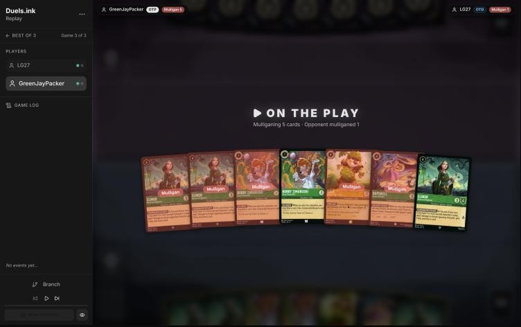
*The board before the decision: [step 0](https://duels.ink/replay/01a219f7-40b2-75c7-ad5f-1344e88a6a95?step=0) in the duels.ink replay viewer.* The opening seven, with the cards sent back marked.

**The plan (written before seeing the mulligan made):** the seven is Elinor ×3 (uninkable 4s), Bobby Zimuruski ×2,
Dale and Rapunzel – Tower Defender: no 2- or 3-drop, three uninkables, four 4-drops. Keeping all seven is out. The
candidates, from `mulligan.py` (1,500 deals each, on the play):

| Keep | Ink T1–4 | Play turns | Lore by T4 | Characters T4 | Interaction |
|---|---|---|---|---|---|
| All 7 | 7.02 | 3.60 | 6.6 | 3.9 | 100% |
| Nothing | 9.11 | 3.92 | 8.6 | 5.5 | 42% |
| Bobby ×2, Dale | 8.74 | 3.98 | 9.0 | 5.8 | 39% |
| **Bobby ×2, Dale, Elinor** | 9.07 | 3.97 | 8.6 | 5.3 | 100% |
| Bobby ×2, Dale, Rapunzel | 8.93 | 3.98 | 8.7 | 5.6 | 100% |
| Bobby ×2 | 8.58 | 3.96 | 9.2 | 5.9 | 40% |
| Bobby, Dale | 9.10 | 3.99 | 8.6 | 5.6 | 42% |

Every partial keep is close on curve and lore. My pick is **Bobby ×2, Dale and one Elinor**: two 1-drops whose SO
CHEESY filters the hand (draw, then discard a spare), and two 4-willpower 4-drops for turns 4 and 5, which is what
survives Malicious and Don Karnage's single pings. Dale is the deck's key piece; one Elinor is the engine, and the
other two are uninkable clutter. Keeping Rapunzel instead of Elinor is about equal (all inkable, slightly more bodies);
the sim can't see that Elinor's ping, card and lore each turn are worth more against a slow drawing deck than
Rapunzel's one bounce, which costs a card. Sending back Dale too (Bobby ×2) gives up the deck's best 4-drop for a
little early lore.

**What you did:** kept Bobby and one Elinor; sent back Dale, the other Bobby, two Elinors and Rapunzel. Drew Mike
Wazowski – Heroic Climber, Mickey Mouse – Best in Town, Ursula – Deceiver, Pocahontas – Guiding the Tribe and a Bobby.
They mulliganed one.

**Verdict:** close call. The deeper keep runs level with mine in the sim (ink 9.16 vs 9.07, play turns 3.97 both,
lore by turn 4 8.4 vs 8.6, interaction 100% both): a second Bobby or a Dale back in the pool is a wash on curve. What
it gives up is a known Dale, the card that makes the deck's 4-willpower bodies deal 4 in challenges; what it gains is
a turn-2 or turn-3 card in place of a second 4-drop. Either is a reasonable plan ([MULL-2](#cite-mull-2), [MULL-4](#cite-mull-4)); the sim can't
separate them. Confidence: medium.

### Turn 1: your turn 1

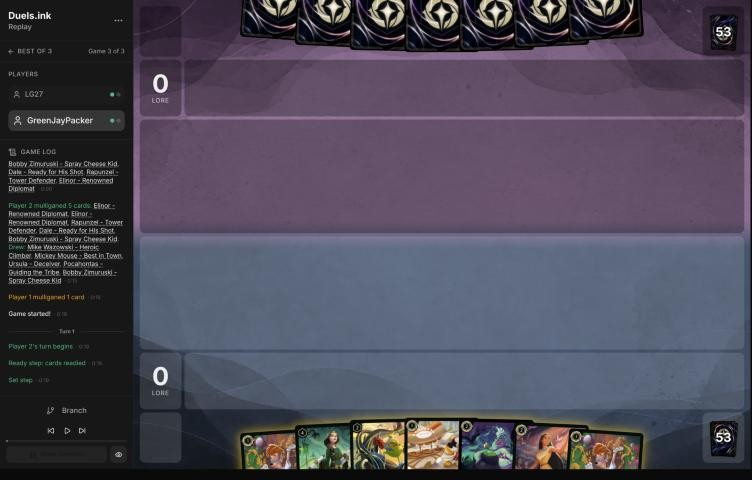
*The board before the decision: [step 2](https://duels.ink/replay/01a219f7-40b2-75c7-ad5f-1344e88a6a95?step=2) in the duels.ink replay viewer.*

**The plan (written before seeing the turn):** hand of Bobby ×2, Mickey – Best in Town, Pocahontas – Guiding the Tribe,
Ursula – Deceiver, Mike (uninkable) and Elinor (uninkable); 1 ink once you ink. Nothing of theirs is in play, and a
character played now is drying and ready, so it's exposed to nothing on their turn. The questions are what to ink and
which 1-drop to play.
- **Keep Ursula** for turn 2 or 3: against a deck of songs (Malicious, To Wither a Flower, Above the Crowd, Strike a
  Good Match, Everyone Knows Juanita) her YOU'LL NEVER EVEN MISS IT shows their hand and takes the best song, often the
  Malicious that sets up their sweeps. **Keep Pocahontas – Guiding the Tribe** for turn 2: 2 ink for her and a free
  1-drop (STAY CLOSE), and she's Peacekeeper's Shift base.
- **Mickey's HOT DOG! is symmetric:** each turn he ends exerted both players get an ink drop. Against a deck whose
  payoffs cost 5 to 9 (Hades, Milo, Phillip) and which turns spare ink into Device activations and draws, his drops
  help them more than they help a curve that tops out at 4–5. His 2 lore a turn on a 4-willpower body is still the
  best rate in the deck, so he's worth playing, with the drops counted toward their Device chain and Don Karnage.
- **Candidates:** (a) ink a Bobby, play the other Bobby (SO CHEESY: draw, then discard the weakest card, a filter),
  keeping Mickey to come free with Pocahontas on turn 2; (b) ink a Bobby, play Mickey now, so he quests from turn 3;
  (c) ink Mickey, play Bobby. I'd pick (a): Bobby's filter digs now ([SEQ-1](#cite-seq-1)), and turn 2's Pocahontas + Mickey puts
  three bodies down by turn 2 for 3 ink in all. (b) gets Mickey's first quest a turn earlier but gives them their first
  drop a turn earlier too.

**What you did:** inked a Bobby, played the other; SO CHEESY drew Aurora – Holding Court, and you discarded Mickey –
Best in Town.

**Verdict:** good play, line (a). The discard is the interesting part: with Aurora drawn, Mickey was no longer needed
as the free 1-drop for Pocahontas, and of the spare cards he's the one whose effect helps them most (an ink drop a turn
toward the Device chain, Hades, Milo and Phillip). Keeping him for 2 lore a turn was the alternative; against this deck
I agree with letting him go. Close to a close call, since 2 lore a turn on 4 willpower is real pressure ([WIN-2](#cite-win-2)).

### Turn 3: your turn 2

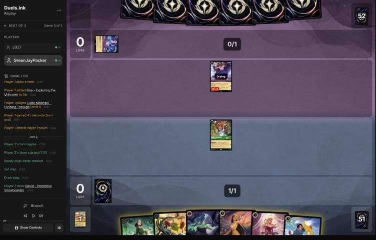
*The board before the decision: [step 10](https://duels.ink/replay/01a219f7-40b2-75c7-ad5f-1344e88a6a95?step=10) in the duels.ink replay viewer.* After the draw.

**The plan (written before seeing the turn):** they inked Elsa and played Luisa Madrigal – Pushing Through (0/3,
Challenger +2), which is off the average list and is also the Shift base for Luisa – Confident Climber (Shift 3, 6/4)
from game turn 6. Hand: Elinor, Mike (both uninkable), Ursula, Pocahontas – Guiding the Tribe, Aurora, David; 2 ink once
you ink. Bobby is dry.
- **Their next turn (2 ink):** Luisa challenges for 2. The brief's FREE KILLS: an exerted Bobby dies to Luisa alone,
  and she survives on 2 willpower. Nothing else of theirs is in play; Piercing Attack (2) could kill a 2-willpower
  character outright, quest or no quest. No sweeper is castable before game turn 6 (Malicious with 3 ink).
- **Development:** Pocahontas + a free Aurora (STAY CLOSE) is 2 ink for two bodies. That sets up next turn: Aurora's
  ROYAL WELCOME on her quest makes Elinor (a Queen) cost 3, so Elinor lands on turn 5 with 3 ink, and if three of yours
  quest that turn her COORDINATED EFFORTS pings, draws and gains 1 lore at once. Ursula's hand look is worth more a turn
  or two later, when Malicious and To Wither a Flower become castable (game turns 6 and 8) and their hand has more in
  it; Mike's FIND A FRIEND is cheap to give now (6 cards in their hand, [H-13](#cite-h-13)) but needs 2 ink of its own.
- **Ink:** David (a 1/4 Bodyguard, the least needed) rather than Ursula (the song answer) or the two cards being played.
- **Bobby's quest:** 1 lore against a free kill by Luisa. If she takes it she ends exerted on 2 willpower and
  Pocahontas kills her for nothing next turn (her Challenger doesn't work when she's challenged), which also removes the
  Climber base. But a dead Bobby leaves only two questers for Elinor's trigger on turn 5. Waiting gains that trigger (a
  card, a lore and a ping); questing gains a lore now and maybe a 1-for-1 trade of 1-drops.
- **Candidates:** (a) ink David, Pocahontas + free Aurora, Bobby stays home; (b) the same with Bobby questing;
  (c) ink David, Ursula (see the hand, strip a song). I'd pick (a), narrowly over (b).

**What you did:** inked David and played Ursula – Deceiver. Their hand was Tod – Clever Fox, Aladdin & Genie, Malicious,
Mean, and Scary ×2, Above the Crowd and Taran – Magically Armed; you took Above the Crowd. Bobby stayed home.

**Verdict:** close call, and your line beat my plan on information. My (a) gets Elinor down a turn sooner (turn 5 for 3
through Aurora's discount); yours delays her to turn 7 but turns their whole hand into known cards on turn 3, which
shapes every turn after: no sweeper before game turn 6, Tod as their only early play, and the 5-drops (Taran with Rush,
Aladdin & Genie) from game turn 10 ([SEQ-1](#cite-seq-1)). The song you took is the other interesting choice:
- **Above the Crowd** was their only answer to a single character with no damage needed, and both their 5-drops in
  hand (Taran, Aladdin & Genie) could sing it for free from game turn 12, or it could be cast at 5 ink.
- **A Malicious** was the alternative. With two in hand, the second sung by Tod (played on game turn 6) and the first
  cast for 3 make **2 damage to every character of yours on game turn 8**, which kills everything with 2 willpower
  (Bobby, Aurora, and Pluto and Willow if drawn). Taking one leaves a single 1-damage ping that kills nothing alone until
  they draw To Wither a Flower or Don Karnage.

Either is defensible. Taking Above the Crowd protects your best single threats (Elinor, Dale, Peacekeeper, each with 3
{S} or less); taking a Malicious protects the wide 2-willpower part of the deck. Since the double Malicious is now a
known card on a known turn, you can build around it with 3- and 4-willpower bodies, which makes Above the Crowd the
slightly better pick. Bobby staying home kept him for Elinor's three-exerted count. Confidence: medium.

### Turn 5: your turn 3

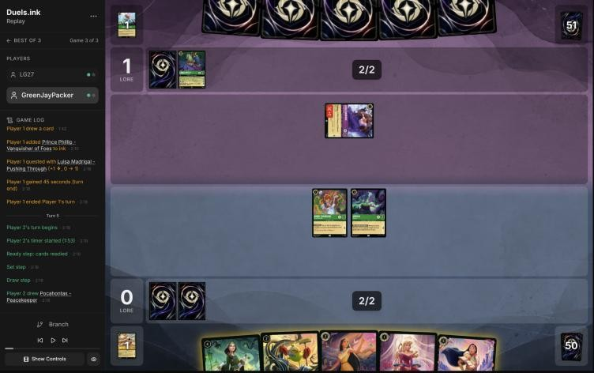
*The board before the decision: [step 17](https://duels.ink/replay/01a219f7-40b2-75c7-ad5f-1344e88a6a95?step=17) in the duels.ink replay viewer.* After the draw, before Guiding the Tribe.

**The plan (written before seeing the turn):** they inked Prince Phillip and quested Luisa (1–0 to them); she's
exerted. You drew Pocahontas – Peacekeeper. Hand: Elinor and Mike (uninkable), Pocahontas – Guiding the Tribe, Aurora,
Peacekeeper; 3 ink if you ink one of the last three. Bobby and Ursula are dry.
- **Their hand is known:** Tod, Aladdin & Genie, Malicious ×2, Taran, plus next turn's draw. At 3 ink (game turn 6)
  they can play Tod or cast one Malicious; at 4 (game turn 8), with Tod dry, **both Malicious: 2 damage to each of your
  characters**, killing every 2-willpower one (Bobby, Aurora) and leaving 3-willpower ones on 1. Taran (Rush, 5/5) and
  Aladdin & Genie come at 5 ink, game turn 10. A Phillip is in their inkwell, so they run it: one drawn by then would
  banish everything damaged.
- **So the 2-willpower bodies are on a clock:** Bobby and Aurora should quest every turn until game turn 8, since
  they're unlikely to live past it. Bobby questing is a FREE KILL for Luisa (2 into 2 willpower, she survives on 2), but
  he's doomed anyway, and if she takes him she doesn't quest. Ursula exerted is safe from everything but a Luisa –
  Confident Climber Shifted in (seen in games 1–2, not in the known hand: it would have to be their one draw).
- **Mike is better than usual here:** your deck is all characters, so FIND A FRIEND gives you a card every time; theirs
  is a character about two times in three, into a known hand that is short of ink ([H-13](#cite-h-13)). His 4 willpower survives the
  double Malicious on 2.
- **Peacekeeper** is the best card against their deck: 6 willpower survives every ping they have, 2 lore, and Shifted
  onto Pocahontas – Guiding the Tribe for 3 she quests at once and CALMING WORDS stops all challenges for a turn
  (Taran's Rush, Luisa).
- **Candidates:**
  - (a) **ink Guiding the Tribe; Aurora (1) + Mike (2) = 3 of 3**; quest Bobby and Ursula. Next turn (4 ink) Aurora's
    quest makes Elinor cost 3, or Peacekeeper (a Princess) cost 4 hard-cast, without the lock.
  - (b) ink Peacekeeper; Aurora + Mike, the same 3 of 3, keeping Guiding the Tribe for a later 2-for-1.
  - (c) don't ink; Guiding the Tribe + a free Aurora = 2 of 2, keeping Peacekeeper to Shift next turn (3 ink then)
    for an immediate 2-lore quest and the lock. It keeps every card but stays an ink behind for the rest of the game.
  - I'd pick (a): every ink used, Mike's card each turn, and Peacekeeper kept. (c) is the strongest next turn but
    gives up an ink for good ([INK-3](#cite-ink-3)); (b) gives up the best card.

**What you did:** line (c): no ink; Pocahontas – Guiding the Tribe, with Aurora free from STAY CLOSE. Bobby and Ursula
didn't quest.

**Verdict:** two decisions.
- **Not inking: close call.** Ink check: under (a) (ink Guiding the Tribe) the next two turns are Aurora + Mike now,
  then Elinor for 3 through Aurora's quest with 1 spare (4 ink), then Peacekeeper hard-cast for 5 without the lock;
  under yours they are Guiding the Tribe + Aurora now, then Peacekeeper Shifted for 3 with an immediate 2-lore quest and
  CALMING WORDS (3 ink), then Elinor for 3 through Aurora with 1 spare (4 ink). Your line keeps every card and gets the
  Shift's tempo; it pays for it with one ink for the rest of the game. About level ([INK-3](#cite-ink-3)).
- **Not questing: inaccuracy.** Questing **Ursula** is suboptimal to skip because nothing in their known hand could
  reach her: the brief's only threat to an exerted Ursula was a Luisa – Confident Climber Shifted in, which would have
  had to be their one unknown draw. That's a lore for almost no risk. Questing **Bobby** was a FREE KILL for Luisa (2
  into his 2 willpower), but he was on borrowed time: the double Malicious known in their hand kills him on game turn 8
  whatever he does. If Luisa takes him, she gives up her quest and ends exerted on 2 willpower for Guiding the Tribe (2
  {S}) to kill next turn; if she doesn't, he's a lore up. Questing both is better because it banks 2 lore from bodies
  their known sweep is about to remove, against a control deck whose 5-drops come from game turn 10 ([QC-3](#cite-qc-3), [QC-5](#cite-qc-5), [ROLE-1](#cite-role-1)).
  It would have left Bobby and Ursula exerted, exposed only to Luisa (Bobby) and a topdecked Climber (either). Confidence:
  medium-high.

### Turn 7: your turn 4

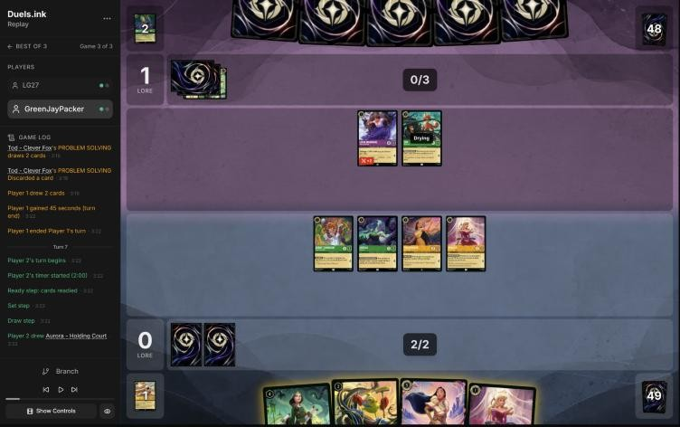
*The board before the decision: [step 25](https://duels.ink/replay/01a219f7-40b2-75c7-ad5f-1344e88a6a95?step=25) in the duels.ink replay viewer.* After the draw; Tod is ready, so he can't be challenged.

**The plan (written before seeing the turn):** they inked Aladdin & Genie and played Tod (discarding a second Phillip;
Luisa stayed ready). 0–1. You drew a second Aurora. Hand: Elinor, Mike (uninkable), Peacekeeper, Aurora; 3 ink if you
ink Peacekeeper or Aurora. Bobby, Ursula, Guiding the Tribe and Aurora are all dry.
- **Their next turn is close to known:** at 4 ink with Tod dry (he's a free singer of Malicious), **Tod sings one
  Malicious and they cast the other for 3: 2 damage to each of your characters.** That kills Bobby and both Auroras
  (2 willpower) wherever they are, leaves Ursula and Guiding the Tribe on 1, Mike and Elinor on 2, Peacekeeper on 4. Tod
  is ready, so he can't be challenged this turn, and Elinor's 1 ping wouldn't kill him (2 willpower). Taran (5) comes a
  turn later. Two Phillips are already seen (one inked, one discarded), so a third would be a fresh draw.
- **Challenges on their turn:** FREE KILLS for an exerted Bobby, Aurora (Luisa alone) and Ursula (Luisa + Tod); with
  the double Malicious first, Luisa can finish any 1-willpower survivor. Peacekeeper's CALMING WORDS (Shifted, no
  challenge of yours this turn) stops every challenge until your next turn.
- **Needs check:** you're the aggressor against a deck that will out-card you; lore now from the bodies their sweep is
  about to remove is free, and what you deploy should be what survives it.
- **Candidates:**
  - (a) **ink the second Aurora; Shift Peacekeeper onto Guiding the Tribe (3 of 3); quest Bobby, Ursula, Aurora and
    Peacekeeper for 5.** CALMING WORDS locks challenges, so nothing is exposed but to the songs: after the double
    Malicious you keep Ursula (1 left) and Peacekeeper (4 left), with Elinor and Mike in hand for the rebuild ([POS-1](#cite-pos-1)).
  - (b) ink Aurora; Aurora's quest makes Elinor 3; quest the other three too (4) and Elinor's COORDINATED EFFORTS adds a
    ping, a lore and a card (5 lore, +1 card). But no lock: after the Malicious, Luisa finishes Ursula or Guiding the
    Tribe, and Elinor sits on 2 damage for any later Phillip.
  - (c) Mike + Aurora (3), quest the four: a card from FIND A FRIEND, but more bodies into the sweep.
  - I'd pick (a): the same 5 lore as (b), one more body kept, and the 6-willpower quester is the card their pings can't
    reach.

**What you did:** you inked Aurora, undid it and played Mike first: FIND A FRIEND gave you a second Peacekeeper and them
a character. Then you inked a Peacekeeper and played the second Aurora (2 + 1 = 3 of 3). Nobody quested.

**Verdict:** mistake. Playing Mike first, before choosing the ink, was right ([SEQ-1](#cite-seq-1)): his reveal could change what to
ink, and did. Judged on what it could find, the gift to them was cheap: a character about two times in three, into a
5-card hand with 3 ink ([H-13](#cite-h-13)). The problem is the rest of the turn:
- **Playing Mike and Aurora and questing nobody is suboptimal because** two Malicious were known in their hand with
  Tod (a free singer) dry next turn, so 2 damage on every character of yours was the expected play. Bobby and both
  Auroras die to it ready or exerted; Ursula and Guiding the Tribe end on 1. Staying ready protects only from
  challenges, and those were Luisa (2) and Tod (1), one of whom would be singing. The four dry characters' quests were
  4 lore given up for at most one 1-willpower survivor.
- **Shifting Peacekeeper onto Guiding the Tribe and questing all four was better because** it banks 5 lore (Bobby,
  Ursula, Aurora 1 each, Peacekeeper 2) and CALMING WORDS stops every challenge until your next turn, so nothing
  exerted can be punished at all. Ink: the second Aurora, which the double Malicious would kill anyway. Shift 3 = 3 of
  your 3. What it exposes: nothing to challenges (the lock); to the double Malicious, the same as your line. After it
  you'd have Ursula (1 left) and Peacekeeper (4 left) in play and Elinor and Mike in hand, at 5–1 or so instead of 0–1.
  Your line keeps one more body (Guiding the Tribe or Mike, damaged) and Mike's card, which doesn't make up 5 lore for
  an aggro deck racing a control deck ([QC-3](#cite-qc-3), [QC-5](#cite-qc-5), [ROLE-1](#cite-role-1), [TEMPO-1](#cite-tempo-1)).
- **FREE KILLS** (the brief's list, for an exerted Bobby, Ursula and Aurora): with the lock none of them applies; without
  it, Bobby and Aurora were dying to the songs anyway, and only Ursula's exposure was a real cost.

Even inside your own deployment (no Shift), questing Bobby and the dry Aurora was 2 free lore. Confidence: medium-high;
it rests on their using both Malicious, which their known hand and Tod made the obvious play. If they hadn't, the lock
still made the quests free.

### Turn 9: your turn 5

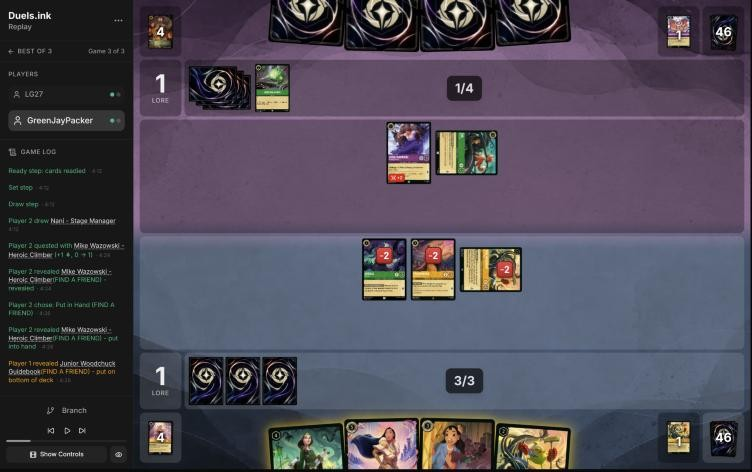
*The board before the decision: [step 39](https://duels.ink/replay/01a219f7-40b2-75c7-ad5f-1344e88a6a95?step=39) in the duels.ink replay viewer.* After the first Mike's quest found the second; Peacekeeper still in hand.

**The plan (written before seeing the turn):** the double Malicious came (Tod sang one, they cast the other) and
killed Bobby and both Auroras; Ursula and Guiding the Tribe are on 1 willpower, Mike on 2. They inked Piercing Attack;
Luisa didn't quest. 0–1. You drew Nani. Hand: Elinor (uninkable), Peacekeeper, Nani; 3 ink, 4 if you ink Nani or
Peacekeeper.
- **Their next turn (5 ink):** Taran – Magically Armed is known in their hand: Rush, 5/5, so he lands and kills any
  exerted character of yours. Prince Phillip is known too, but needs 9 ink or a Phillip in play to Shift onto. Three
  unknown cards plus a draw: another Malicious (8–12% by the list) would now kill Ursula and Guiding the Tribe.
  Luisa (2 challenging) and Tod (1) can also finish anything exerted on 1–2 willpower. FREE KILLS: Ursula, Guiding the
  Tribe and Mike, each by Luisa alone.
- **Tod is exerted** (he sang): Guiding the Tribe's 2 kills him but she dies to his 1 back, and a challenge this turn
  turns off CALMING WORDS. Tod has no Malicious known to sing now, so he's worth less than the lock.
- **The line:** **Shift Peacekeeper onto Guiding the Tribe (3)**, which keeps her dry so she quests at once, and CALMING
  WORDS stops every challenge until your next turn, so Taran's Rush, Luisa and Tod can't touch the questers. She takes
  over the 2 damage (4 left of 6). Quest Peacekeeper (2), Ursula (1) and Mike (1, FIND A FRIEND: a sure card for you,
  a character about two times in three for them) = 4. Quest Mike first and choose the ink after his reveal ([SEQ-1](#cite-seq-1)).
  Ink: Nani, unless Mike's card is a worse one to keep: you're an ink behind them, and Mike's quests are supplying
  cards. Shift 3 of 4, 1 spare.
- **Alternatives:** Elinor for 4 (ink Nani) instead of the Shift: Elinor's trigger needs 3 exerted, so quest all three
  for 3 + her 1, but nothing stops Taran killing an exerted quester and Luisa another. Or Nani (3) to dig: the same
  exposure. The lock line is the only one that quests safely.

**What you did:** quested Mike first (FIND A FRIEND: a second Mike for you; their Junior Woodchuck Guidebook went to the
bottom), played the second Mike (a David for you, a second Luisa – Pushing Through for them), inked Nani, played David
exerted as a Bodyguard, and quested Ursula and Guiding the Tribe: 3–1. Peacekeeper stayed in hand. Mike 2 + David 2 = 4
of 4.

**Verdict:** mistake. Questing Mike before choosing the ink was right, and it found a second Mike.
- **Playing Mike and David and questing Ursula and Guiding the Tribe without the lock is suboptimal because** Taran
  (Rush, 5/5) was known in their hand and exactly castable with their 5 ink. Your board ended with four exerted
  characters, three of them on 1–2 willpower. David's Bodyguard soaks the first challenge: Taran must take him, and kills
  him. After that Luisa (2 challenging) and Tod (1) are free to finish two of Ursula, Guiding the Tribe and the first
  Mike. The brief's FREE KILLS listed all three for Luisa alone. Guiding the Tribe is also Peacekeeper's only base.
- **Shifting Peacekeeper onto Guiding the Tribe and questing Peacekeeper, Ursula and Mike was better because** CALMING
  WORDS would have stopped every challenge until your next turn, Taran's Rush included, so the same quests cost
  nothing. It scores 4 (Peacekeeper 2, Ursula 1, Mike 1) instead of 3 and loses no character to a challenge. Ink: Nani,
  as you did; the second Mike from the reveal stays in hand for next turn. Shift 3 of your 4, 1 spare. What it exposes:
  no challenges at all until your next turn; to a drawn Malicious (8–12% by the list), Ursula (1 left), as in your line.
  You'd go into their turn at 4–1 with Peacekeeper (4 left), Ursula and Mike in play and Elinor and Mike in hand, against
  their ready 5/5 Taran.
- Your line's gains are the second Mike's body and David from his reveal. They're real cards, but they cost David and
  about two damaged characters to Taran, Luisa and Tod, and the reveal also gave them a second Luisa (a Climber base)
  ([TRADE-4](#cite-trade-4), [RULE-1](#cite-rule-1), [TEMPO-1](#cite-tempo-1)).

Confidence: medium-high. It rests on their casting Taran, which was known in hand at exactly their ink.

### Turn 11: your turn 6

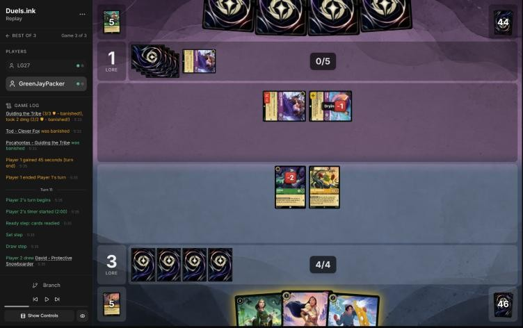
*The board before the decision: [step 57](https://duels.ink/replay/01a219f7-40b2-75c7-ad5f-1344e88a6a95?step=57) in the duels.ink replay viewer.* After the draw, before Mike's quest.

**The plan (written before seeing the turn):** Taran (Rush) killed David, Luisa killed the damaged Mike, and Tod traded
with Guiding the Tribe; WEAKEN THE CAULDRON put your two Auroras on the bottom of your deck. 3–1. You drew David. Hand:
Elinor (uninkable), Peacekeeper, David; 4 ink, 5 if you ink David or Peacekeeper. In play: Ursula (1 willpower left)
and a fresh Mike, both dry. Theirs: Luisa and Taran (1 damage, 4 left), both exerted.
- **No kill is available:** Ursula's 1 and Mike's 0 can't finish Luisa (3) or Taran (4), and Peacekeeper's Shift base is
  gone, so no lock either.
- **Their next turn (6 ink):** Taran (5/5) and Luisa (2 challenging) challenge; Taran is also a free singer of anything
  up to 5 (Malicious, To Wither a Flower, Above the Crowd). Don Karnage – Debonair Pirate (6, 18–24% by the list) becomes
  hard-castable: 1 to everything. Phillip is known in hand but needs 9 ink. FREE KILLS: Ursula (Luisa alone), Mike
  (Taran alone), David if played exerted (Taran).
- **Needs check:** 3–1 with their board questing 2 a turn and their deck drawing more than yours. You need lore while
  your bodies live, and a body Taran can't kill in one challenge. Peacekeeper (6 willpower) survives Taran's 5 and hits
  back for 3. Elinor's trigger needs three exerted characters, and you have only two that can exert this turn.
- **Candidates:**
  - (a) **ink David; Peacekeeper for 5 (5 of 5); quest Ursula and Mike** (+2, and a card from FIND A FRIEND): 5–1.
    Ursula is lost to any ping anyway (1 willpower), and Mike can never quest safely while Taran lives, so waiting buys
    nothing. Each kill costs them that character's quest and leaves the challenger exerted for Peacekeeper.
  - (b) the same, with Mike kept home to keep the card engine alive: 4–1, and Mike still faces Taran next turn.
  - (c) Elinor (4, ink David) instead of Peacekeeper: a 4-willpower body Taran kills, and no trigger this turn.
  - I'd pick (a), narrowly over (b).

**What you did:** quested Mike first (FIND A FRIEND: Nani for you, Luisa – Confident Climber for them), played Nani
(3), whose THAT'S YOUR CUE found a Pocahontas – Guiding the Tribe; inked David and played Guiding the Tribe (2), with no
1-drop for STAY CLOSE. Ursula stayed home. 4–1. Nani 3 + Guiding the Tribe 2 = 5 of 5.

**Verdict:** good play, and better than my plan. My plan treated Mike's quest as a card and a lore and didn't branch on
what his reveal could find. Yours used it as a dig: the Nani it found dug again for a new Shift base, so next turn
Peacekeeper can be Shifted (3), quest at once, and turn on CALMING WORDS against Taran and the Climber. That's the line
that lets the whole board quest safely ([SEQ-1](#cite-seq-1), [SEQ-4](#cite-seq-4)). Compared with my (a), you score 1 less now but keep Ursula out
of reach (she quests under the lock next turn instead of dying to Luisa today) and put two more bodies on the board.
Peacekeeper isn't spent into a turn where nothing protects the questers. What it exposes: Mike, exerted, is a FREE KILL
for Taran, the same as in my line. Nani (3 willpower) and Guiding the Tribe are ready, so only a ping can reach them
(Don Karnage at 6 ink, or a drawn Malicious, leaves both on 2). Judged on what it could find, the gift to them was a
character about two times in three, into a 4-card hand with 6 ink coming. That's not cheap ([H-13](#cite-h-13)), but Mike's quest is
how this deck keeps its hand full.

### Turn 13: your turn 7

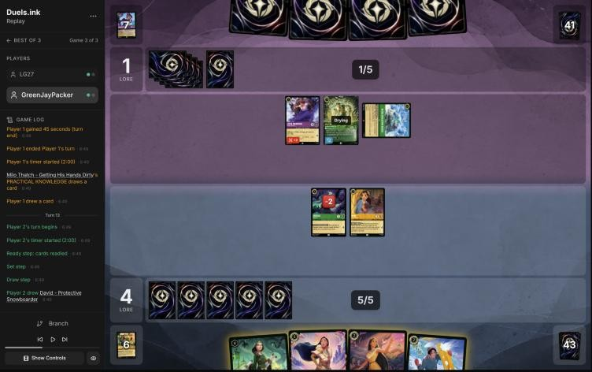
*The board before the decision: [step 76](https://duels.ink/replay/01a219f7-40b2-75c7-ad5f-1344e88a6a95?step=76) in the duels.ink replay viewer.* After the draw; Milo has just arrived through the Device.

**The plan (written before seeing the turn):** Taran killed Mike; then **Retro Evolution Device** turned Taran into Milo
Thatch for free, and Milo's SCHOLAR'S GAMBIT (discarding the Climber) returned Guiding the Tribe to your hand. 4–1.
You drew David. Hand: Elinor (uninkable), Peacekeeper, Guiding the Tribe, David; 5 ink, 6 if you ink one. In play:
Ursula (1 willpower left) and Nani, both dry. Theirs: Luisa (ready), Milo (Ward, 5/5/3, drying), the Device (exerted).
- **Their next turn (6 ink) is the Device chain's next step:** Milo can quest for 3, then the Device (1 ink) banishes
  him for **Prince Phillip, known in their hand**: SWIFT AND SURE banishes every damaged character of yours. Ursula is
  damaged, so she's gone anyway. The rest of your board is safe from Phillip unless something damages it first:
  Malicious sung by Milo (13–18% by the list, plus Milo's end-of-turn draw), or Piercing Attack on one character (2 ink).
  Don Karnage (6) and the Device (1) don't fit in 6 ink together. Phillip is Evasive, so once he's in play nothing of
  yours can challenge him; Rapunzel – Tower Defender's bounce (2 left in your deck) is the only answer in your list.
- **Race:** Milo's quest and Luisa's make 5 by game turn 14; then Phillip and Luisa quest 4 a turn, reaching 20 around
  game turn 22. You're at 4 and need about 3–4 a turn from your next four turns.
- **FREE KILLS:** Ursula (Luisa alone), Nani (Milo alone, and he survives on 2), David if played exerted (Milo). Milo
  challenging costs them his 3-lore quest before the Device takes him, which is a good trade for a 1-lore Nani.
- **Candidates:**
  - (a) **ink David; Guiding the Tribe (2) + Elinor (4) = 6 of 6; quest Ursula and Nani** (5–1 after... 6–1). That sets
    up next turn: Peacekeeper Shifted onto Guiding the Tribe (3) quests at once under CALMING WORDS, and with Peacekeeper,
    Nani and Elinor questing, Elinor's COORDINATED EFFORTS adds a lore, a card and a ping each turn. The two new bodies
    are undamaged, so Phillip doesn't touch them without a ping first.
  - (b) Peacekeeper hard-cast (5) + 1 spare: a 6-willpower quester next turn, but no lock and no base for the other
    copies of Peacekeeper, and Elinor waits.
  - (c) the same as (a) with Nani kept home: saves Nani from Milo, at the cost of a lore and of letting Milo quest free.
  - I'd pick (a).

**What you did:** inked Guiding the Tribe, played David exerted (Bodyguard), quested Ursula and Nani, then played Elinor
(2 + 4 = 6 of 6). At the end of the turn David, Ursula and Nani were exerted, so COORDINATED EFFORTS fired: 1 damage to
Luisa, +1 lore and a card (Grandmother Willow). 7–1.

**Verdict:** good play, and better than my plan this turn. I counted only two characters that could exert, and missed
that **David entering play exerted is a third exerted character for COORDINATED EFFORTS**. Your line gets Elinor's lore,
card and ping a turn earlier than mine. David's Bodyguard also means Milo must take him before Nani if Milo challenges.
What it gives up is Peacekeeper's Shift: with Guiding the Tribe inked she has to be hard-cast (5, or 4 after Willow's
SMOOTH THE WAY) without CALMING WORDS. Against a deck about to turn Milo into Phillip, value now is worth more than
the lock a turn later ([VALUE-3](#cite-value-3)). What it exposes: David (exerted, a FREE KILL for Milo, but then Milo doesn't quest for
3) and Ursula and Nani (exerted; Ursula is damaged, so Phillip takes her either way). Elinor is drying and ready, and
undamaged, so she survives Phillip unless they ping her first (Malicious sung by Milo, 13–18% by the list).

### Turn 14: their turn

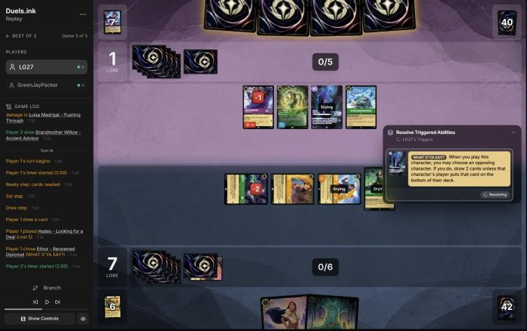
*The board before the decision: [step 86](https://duels.ink/replay/01a219f7-40b2-75c7-ad5f-1344e88a6a95?step=86) in the duels.ink replay viewer.* The step before your choice: bottom her or let them draw 2.

**What happened:** they played Hades – Looking for a Deal (5) choosing Elinor. **You let them draw 2** rather than
put Elinor on the bottom of your deck. They inked a third Malicious, used the Device on Hades for a second Milo, and
its SCHOLAR'S GAMBIT (discarding Creative Inspiration) returned Elinor to your hand anyway. The first Milo killed David,
Luisa killed Ursula, and both Milos' PRACTICAL KNOWLEDGE drew at the end of the turn. 7–1.

**Verdict:** close call. At the choice, what could be known was this. Their Device was ready and they hadn't inked yet,
so Hades could be turned into a 7 (Milo, whose bounce can return Elinor) for 1 ink. So keeping Elinor risked her
coming back to hand anyway, which costs you tempo but not the card. Bottoming her loses the card for good. Their 2 cards
were worth less than usual: they held 5 with their ink already spent on Hades (the converse in [H-2](#cite-h-2)). But this deck
turns extra characters into free 7s and 9s through the Device, so cards are close to ink for them. Elinor is your best
engine (a lore, a card and a ping a turn), and on balance keeping her is slightly better. It's close.

### Turn 15: your turn 8

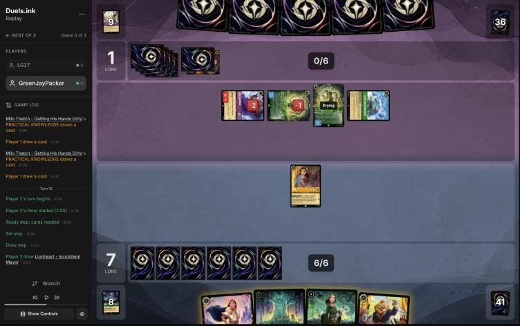
*The board before the decision: [step 98](https://duels.ink/replay/01a219f7-40b2-75c7-ad5f-1344e88a6a95?step=98) in the duels.ink replay viewer.* Luisa exerted on 1 willpower.

**The plan (written before seeing the turn):** 7–1, but their board now quests for 7 a turn (two Milos at 3, Luisa
1): three turns from 1 to 20 (`odds.py clock`), so **they win on game turn 20** if nothing changes. You drew
Lionheart. Hand: Peacekeeper, Willow (uninkable), Elinor (uninkable), Lionheart; 6 ink, 7 if you ink Peacekeeper or
Lionheart. In play: Nani (dry). Theirs: Luisa (exerted, 1 willpower left), the first Milo (exerted, 4 left), the
second Milo (drying), the Device (exerted).
- **Their next turn (7 ink):** both Milos and Luisa quest (7), then the Device (1 ink) turns a Milo into the Phillip
  known in their hand. SWIFT AND SURE banishes your damaged characters, and **Don Karnage – Debonair Pirate (6) + the
  Device (1) is exactly 7**: a ping on everything and then Phillip is a full wipe. Malicious sung by Milo does the same.
  Don ×3 and the last Malicious (by the list) in their 4 unknown cards plus a draw: about 43% (`odds.py hold 40 4 5`),
  before Milo's end-of-turn draws. Milo can also sing Above the Crowd on anything with 3 {S} or less; Lionheart (4 {S})
  is out of its reach. Milo's Ward means Elinor's ping can't choose him.
- **What must happen:** you're 13 short with about three turns, so you can't outrace 7 a turn. Their questers have to
  die. **Luisa is a free kill now** (Nani's 3 into her 1 left, and she hits back 0). A Milo needs 5 damage from
  challengers while he's exerted, which he is after every quest: Lionheart 4 + Nani 3, or Peacekeeper 3 + Elinor 3.
  Phillip, once in play, is Evasive and out of reach.
- **Needs check:** about 43% they wipe next turn, and then the game is lost whatever you hold back. In the other ~57%,
  what wins is enough strength on board to kill both Milos on your next turn, while Elinor's trigger and quests catch up
  ([POS-2](#cite-pos-2): play to that out).
- **Candidates:**
  - (a) **Nani challenges Luisa; Willow (2), then Lionheart for 5 through SMOOTH THE WAY; ink Peacekeeper: 7 of 7.**
    Lionheart enters ready, the biggest Milo-killer you have (4 {S}, 7 {W}, immune to Above the Crowd). Next turn: 8 ink
    for Elinor (3 or 4) and whatever you draw, with Lionheart + Nani on one Milo and Elinor + Willow or a new body on the
    other. It exposes Nani (exerted from the challenge) to a Milo that then doesn't quest.
  - (b) Nani quests (8–1) and Lionheart (6) gives her +1 through APPROVAL RATING (9–1), inking Peacekeeper: 2 lore now,
    but Luisa lives and keeps questing.
  - (c) Nani kills Luisa; Willow + Peacekeeper for 4 (ink Lionheart): a smaller body that Above the Crowd can take.
  - I'd pick (a).

**What you did:** no ink; Willow, then Elinor for 3 through SMOOTH THE WAY (5 of 6). Nani neither challenged nor
quested. Elinor's COORDINATED EFFORTS didn't fire (no exerted characters). 7–1.

**Verdict:** mistake.
- **Leaving Luisa alive is suboptimal because** she was exerted on 1 willpower and Nani's 3 killed her with nothing
  back (her Challenger works only when she challenges). That's a lore a turn off a clock that wins on game turn 20, and
  their last Luisa Shift base gone. The only cost was Nani ending exerted, a FREE KILL for a Milo. But a Milo that
  challenges doesn't quest for 3, and that trade favours you.
- **Not inking is suboptimal because** you had two inkable cards (Peacekeeper, Lionheart) and ended with 1 ink unused.
  With 7 ink, Willow (2) + Lionheart (5) was 7 of 7: the 4-{S}, 7-{W} body that, with Nani, kills an exerted Milo next
  turn and is out of Above the Crowd's reach.
- **Killing Luisa with Nani, then Willow + Lionheart, inking Peacekeeper, was better because** it cuts their clock to 6
  a turn and puts the strongest challenger on board for the turn their Milos come back exerted. What it exposes: Nani
  exerted, to a Milo that then gives up 3 lore; Willow and Lionheart are ready. Against the ~43% ping-then-Phillip wipe
  it loses the same board yours does. Keeping Peacekeeper and Lionheart in hand as a rebuild doesn't help there either:
  after a wipe their Phillip and Milo quest for 6 a turn from 8 lore, and no two-card rebuild catches that. Your line
  plays the uninkable Elinor, which has to come down some time, and Willow. That part is fine.

Confidence: medium-high on Luisa, medium on the ink ([TRADE-1](#cite-trade-1), [QC-2](#cite-qc-2), [QC-5](#cite-qc-5), [POS-2](#cite-pos-2), [INK-3](#cite-ink-3)).

### Turn 16: their turn

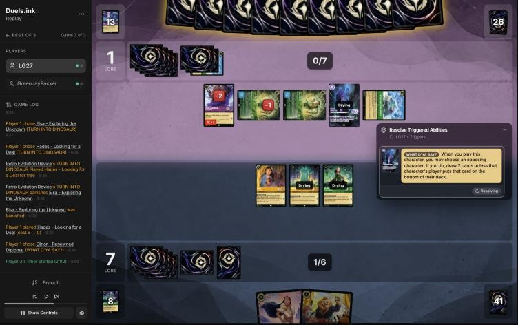
*The board before the decision: [step 115](https://duels.ink/replay/01a219f7-40b2-75c7-ad5f-1344e88a6a95?step=115) in the duels.ink replay viewer.* The step before your choice, with about 10 cards in their hand.

**What happened:** no quests. They drew their way through the turn: Junior Woodchuck Guidebook (2), Everyone Knows
Juanita sung twice by the Milos (3 each, with 10+ cards in their discard), Elsa (1), then the Device turned Elsa into a
second Hades, choosing Elinor again. **You let them draw 2 again.** They also inked a second Retro Evolution Device,
and both Milos drew at the end of the turn. Their hand went from 6 to about 14. 7–1.

**Verdict:** good choice. At the Hades trigger they already held about 10 cards. Two more barely changed what they
could do with 7 ink (the converse in [H-2](#cite-h-2): the bigger their hand, the more the body is worth keeping). Elinor stayed in
play as your engine and a 3-{S} challenger for the exerted Milos.

### Turn 17: your turn 9

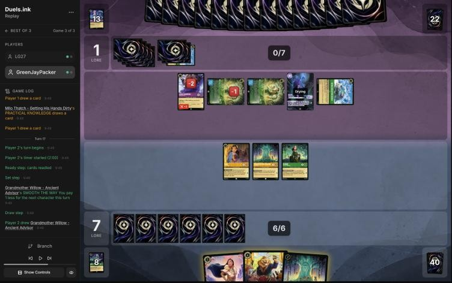
*The board before the decision: [step 118](https://duels.ink/replay/01a219f7-40b2-75c7-ad5f-1344e88a6a95?step=118) in the duels.ink replay viewer.*

**The plan (written before seeing the turn):** 7–1. You drew a second Willow. Hand: Peacekeeper, Lionheart, Willow
(uninkable); 6 ink, 7 if you ink one. In play, all dry: Nani (3/3), Willow (1/2), Elinor (3/4). Theirs: Luisa (ready,
1 willpower left), both Milos (exerted; 4 and 5 left), Hades (drying), the Device; **13 cards in hand**, Phillip among
them.
- **Their next turn (8 ink) is very likely a wipe:** the Device (1) turns a Milo into Phillip, and Don Karnage (6) or a
  Malicious sung by Milo or Hades first puts damage on everything. The brief's "any damage card held" is 82% now, 85%
  with their draw, before their dig. Their board quests 8 a turn: 20 by game turn 22 (`odds.py clock`: three turns).
- **What you can kill:** an exerted Milo, but every challenger dies to his 5 back. Nani + Willow (4) kill the first Milo
  (4 left); nothing kills both. That's two of your bodies for one of theirs, the turn before an expected wipe.
- **What you can score:** Willow #1's SMOOTH THE WAY makes the second Willow cost 1, and hers makes Lionheart 5 (6 of
  your 6, by the cards' text; the brief's discount line counts only the Willow in hand). Play Lionheart **before**
  questing: APPROVAL RATING gives Nani and Elinor +1 lore this turn. Then quest Nani (2), Elinor (2), Willow (1) = 5,
  and with three exerted, COORDINATED EFFORTS adds 1 lore, a card, and 1 damage that **kills Luisa** (Milo's Ward stops it
  choosing him). **7 → 13.**
- **Needs check:** at 13 you need 7 more. If they can't ping (~15%), the board you leave (Nani, Elinor, two Willows,
  Lionheart) quests 6 + Elinor's 1 = 7 next turn: **20 on game turn 19**, before them. If they wipe, no line wins: at
  13 against Phillip, Milo and Hades questing 7 a turn from about 8, a rebuild from an empty board can't make 7 in two
  turns. So the all-in quest is the line with an out ([POS-2](#cite-pos-2)); killing a Milo instead scores 1–2 and wins in neither
  branch.
- **Candidates:** (a) **Willow (1), Lionheart (5, APPROVAL RATING on Nani and Elinor), quest Nani, Elinor and Willow,
  Elinor's ping on Luisa: 13–1.** Ink Peacekeeper or not; the spare ink buys nothing. Exposure: everything exerted
  except the new Willow and Lionheart; FREE KILLS listed for Nani and Willow (Hades) and Elinor (Milo). Against an
  ~85% wipe, being exerted barely matters. (b) Nani + Willow kill a Milo, then Willow + Lionheart and Elinor quests: about
  9–1. I'd pick (a).

**What you did:** Lionheart for 5 (Willow's SMOOTH THE WAY), entering exerted as a Bodyguard; APPROVAL RATING on Willow
and Nani, who then quested for 2 each (11). Elinor stayed ready. With Willow, Nani and Lionheart exerted, COORDINATED
EFFORTS killed Luisa, gained a lore and drew Pluto: 12–1. 1 ink unused; the second Willow and Peacekeeper stayed in hand.

**Verdict:** close call. It's the same plan as mine, with one difference. Lionheart entering exerted supplies the third
exerted character, so Elinor can stay ready instead of questing. That's 1 lore less (12 against 13), but Elinor is out
of a Milo's reach, and Lionheart's Bodyguard makes any challenger take on 7 willpower that hits back for 4. Against the
expected wipe (Phillip after a ping) both boards die the same way. If they have no ping, mine reaches 20 next turn only
if they don't challenge, and yours keeps more bodies if they do. Neither is clearly better. Inking Peacekeeper would have
left 2 ink for the second Willow, one more body for next turn's quests: a small edge given up ([INK-3](#cite-ink-3)).

### Turn 18: their turn

**What happened:** still no quests. Hades sang Everyone Knows Juanita (3 cards), they cast Creative Inspiration (4),
inked Aladdin – Doing His Part, and used the Device on Hades for a **third Milo**, whose SCHOLAR'S GAMBIT returned
Lionheart to your hand. Two Milos then killed Willow and Nani, and all three drew at the end of the turn. 12–1, with
19 cards in their hand and 11 in their deck.

### Turn 19: your turn 10

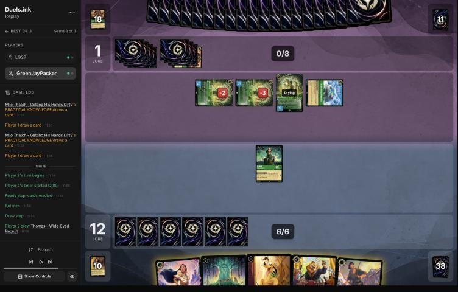
*The board before the decision: [step 143](https://duels.ink/replay/01a219f7-40b2-75c7-ad5f-1344e88a6a95?step=143) in the duels.ink replay viewer.*

**The plan (written before seeing the turn):** 12–1. You drew Thomas. Hand: Peacekeeper, Willow and Pluto (both
uninkable), Lionheart, Thomas; 6 ink, 7 if you ink one. In play: Elinor (ready). Theirs: three Milos, two exerted (3
and 2 willpower left) and one drying, and the Device; 19 cards in hand, Phillip known among them.
- **Their next turn (9 ink):** the brief gives 98% that they hold a card that damages your whole board (Don Karnage or
  Malicious), and the Device (1 ink) turns a Milo into Phillip, whose SWIFT AND SURE then banishes everything damaged.
  Don (6) + the Device (1) fits easily. Anything you play this turn is drying, so it would be swept before it quests.
- **Race:** three Milos quest for 9: 1 → 10 → 19 → 28, so **20 on game turn 22**, or 24 if one Milo dies now
  (`odds.py clock`: 1 to 20 at 6 a turn is four turns). You need 8 more. Only Elinor can quest this turn (13). After the
  expected wipe, nothing you play on game turn 21 quests before 23, and their second sweep (Don again, To Wither a
  Flower, or a Phillip Shifted onto Phillip) can come on 22.
- **Needs check:** no line reaches 20 before them unless they fail to find a ping in 19 cards, or their deck (11 cards,
  with three Milos drawing at each end of turn) runs out first, which they control. **Unwinnable from here in practice**
  ([principle 2](#cite-principle-2)), but the line that keeps the most chances:
  - **Elinor challenges the Milo on 2 willpower** (she dies to his 5 back). That's one of their three 3-lore questers
    gone, pushing their 20 from game turn 22 to 24 and giving the deck-out and no-ping branches two more turns.
  - **Hold most of the hand** rather than feed it to the sweep ([H-4](#cite-h-4)'s caveat: a body swept before it quests isn't a
    plan). Deploy after their wipe, in the biggest bodies first: Lionheart (7 willpower) and Peacekeeper (6) survive Don
    plus To Wither a Flower (3 damage) if no Phillip follows.
  - Alternatives: Elinor quests (13) and you deploy Willow + Lionheart (7), all of it swept at 98%. Or deploy everything
    and keep Elinor home; Phillip takes Elinor too.

**What you did:** Willow (2), then Thomas free through SMOOTH THE WAY. No ink; Elinor stayed home. 12–1.

**Verdict:** unwinnable ([principle 2](#cite-principle-2)), so no severity. Two cheap bodies into an expected sweep cost little, and holding
Lionheart and Peacekeeper for afterwards is the right instinct. The one thing that kept more chances was Elinor's
challenge on the Milo with 2 willpower left: it trades your 4-cost for a 3-lore quester and pushes their 20 back a
turn cycle ([TRADE-1](#cite-trade-1), [QC-5](#cite-qc-5)).

### Turn 20: their turn

**What happened:** a Milo sang Above the Crowd on Elinor (to the bottom of your deck). Luisa – Confident Climber,
hard-cast, used I CAN TAKE IT three times to move a Milo's damage onto herself and then 3 onto Willow, killing her.
They played a Luisa – Pushing Through and quested two Milos: 12–7. Only one card went to their discard, so no Milo drew.

### Turn 21: your turn 11

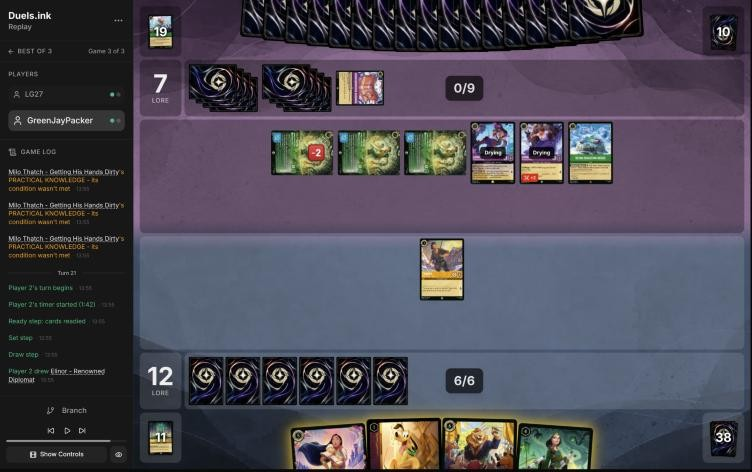
*The board before the decision: [step 167](https://duels.ink/replay/01a219f7-40b2-75c7-ad5f-1344e88a6a95?step=167) in the duels.ink replay viewer.*

**The plan (written before seeing the turn):** 12–7. You drew another Elinor. Hand: Peacekeeper, Pluto, Lionheart,
Elinor; 6 ink, 7 if you ink one. In play: Thomas (dry). Theirs: three Milos (all exerted), Luisa – Confident Climber and
Luisa – Pushing Through (both drying), the Device; 16 cards in hand. Their board quests for 11 a turn: 18 on game turn
22, 20+ on 24. The brief still gives 98% that they hold a whole-board ping, with Phillip known and the Device ready.
- **Needs check:** you need 8, and only Thomas can quest this turn (13). Anything played now quests on game turn 23 at
  the earliest, after the expected sweep on 22. Even with no sweep, the best I can build is about 19 on game turn 23:
  Pluto's GOOD DOG makes Lionheart cost 5, APPROVAL RATING adds 2 lore to two questers, and Elinor adds her 1. That's
  one short, before they win on 24. Nothing on board can challenge a Milo (Thomas has 0 {S}).
- **Unwinnable** ([principle 2](#cite-principle-2)). The line that keeps the slim chances is the most lore and the biggest bodies: quest
  Thomas, play Elinor and Pluto now (they'd set up Elinor's trigger and Pluto's discount for game turn 23), and keep
  Lionheart for APPROVAL RATING on that turn.

**What you did:** Elinor (4) and Pluto (1), Thomas quested: 13–7. No ink.

**Verdict:** unwinnable; the line matches the plan.

### Turn 22: their turn

**What happened:** a fourth Milo, hard-cast for 7, returned Elinor to your hand (SCHOLAR'S GAMBIT, discarding Tod). All
four Milos and both Luisas quested: 13–18.

### Turn 23: your turn 12

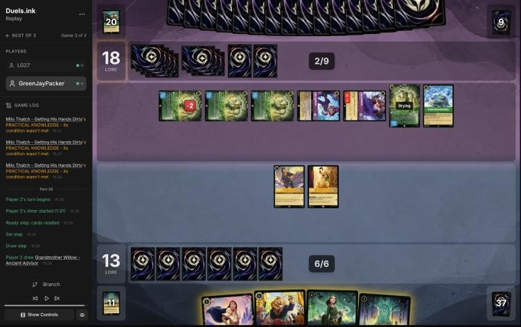
*The board before the decision: [step 185](https://duels.ink/replay/01a219f7-40b2-75c7-ad5f-1344e88a6a95?step=185) in the duels.ink replay viewer.*

**The plan (written before seeing the turn):** 13–18, and their board quests for 14, so they win on game turn 24. You
need 7 this turn. Thomas and Pluto can quest (2). Lionheart's APPROVAL RATING adds 1 to each (Willow makes him 5, or
Pluto's GOOD DOG does at the cost of Pluto's quest), for 4 at most: **17**. Elinor's trigger can't be added in the same
6–7 ink. No line reaches 20, and nothing slows their quests enough. **Unwinnable**: the game ends on their turn.

**What you did:** Lionheart (6), APPROVAL RATING on Thomas and Pluto, both quested: 17–18.

**Verdict:** unwinnable; the most lore available, as planned.

## Lessons
1. **A sweep known in their hand makes the quests of what it will kill free.** Staying ready protects a character only
   from challenges, never from Malicious, Don Karnage or Phillip. Quest the bodies the sweep is going to take
   ([5](#turn-5), [7](#turn-7)). This is the same lesson as GreenJayPacker's Detectives game against James's Retro Device
   ([the pair file's note](#cite-kb-meta-archetypes-amethyst-emerald-retro-device-a-don-karnage-build-against-greenjaypacker-s-detectives)).
2. **Peacekeeper's CALMING WORDS answers a known challenge turn.** With Taran known in hand ([9](#turn-9)), or Luisa
   and Tod ready to finish damaged questers ([7](#turn-7)), Shift her onto Guiding the Tribe first and the whole board
   quests with nothing exposed. Guiding the Tribe is the base, so keep one ([the Princess Aggro notes](#cite-kb-meta-archetypes-amber-emerald-princess-aggro-dale-discounts-and-the-peacekeeper-base)).
3. **Elinor's COORDINATED EFFORTS counts characters that enter play exerted.** A Bodyguard (David, Lionheart) can be
   the third exerted character, so Elinor's lore, card and ping come without exposing another quester
   ([13](#turn-13), [17](#turn-17); the player's find).
4. **Mike's quest is a dig.** Against an all-character deck like this one, FIND A FRIEND is a sure card
   ([Mike's card note](#cite-kb-cards-mike-wazowski-heroic-climber)), so plan the turn
   for what it can find before committing the ink ([11](#turn-11), the player's find; the coach's recurring "planning
   before the dig", [method section 9](#cite-docs-decision-method-9-the-coach-s-recurring-errors)).
5. **Hades – Looking for a Deal: the bigger their hand, the more the body is worth keeping** ([14](#turn-14),
   [16](#turn-16); the converse in [H-2](#cite-h-2)).
6. **Against the Device chain, an exerted Milo on 2–3 willpower is worth a 4-cost** ([19](#turn-19)): each Milo is 3
   lore a turn and a free singer, and the Device keeps making more.

## Proposed knowledge-base updates (applied after discussion)
- **Strategy:**
  - [H-6](#cite-h-6), "Evidence on the limit, against pings": 01a219f7-40b1 turns 5 and 7. With a double Malicious known in their
    hand, staying ready saved Bobby and the Auroras from nothing and gave up 2 and 4 lore. It's the second
    GreenJayPacker game showing it (after 01a1fb8a-260a turn 11).
  - [H-2](#cite-h-2), the converse: 01a219f7-40b1 turns 14 and 16. Hades on Elinor with 5, then about 10, cards in their hand:
    keeping Elinor was a close call at 5 and clearly right at 10.
- **Meta** (Amethyst/Emerald notes, a new entry): "Retro Device with a Luisa package against GreenJayPacker's Princess
  Aggro: LG27" (01a219f7-40b1, game 3; blind review).
  - **Off-list cards:** Luisa Madrigal – Pushing Through ×3 and Confident Climber ×2, Above the Crowd ×2 (sung by Milo),
    Creative Inspiration ×2, Everyone Knows Juanita ×3, Piercing Attack.
  - **The Device chain:** Taran into Milo (game turn 12), Hades into Milo (14 and 18), Elsa into Hades (16); four Milos by
    game turn 22. SCHOLAR'S GAMBIT returned a Shift base (Guiding the Tribe), Elinor twice and Lionheart.
  - **How they won:** almost no questing until game turn 20 (1 lore by then), then 7, 11 and 3 to win on game turn 24.
    Phillip was in hand from game turn 7 and never cast. No Don Karnage was seen.
  - **Milo's draws:** they kept PRACTICAL KNOWLEDGE off on the last turns, so as not to deck (8 cards left at the end).
- **Meta** (Amber/Emerald Princess Aggro notes, how to pilot it): Elinor's COORDINATED EFFORTS counts a Bodyguard that
  enters play exerted (David, Lionheart), seen in this replay on turns 13 and 17. Shift Peacekeeper before exposing
  questers to a known Rush or challenger turn.
- **Rules:** none needed.
- **Tools** (proposals for the owner):
  - The brief's dig line said "none" on turns 9 and 11 with a dry Mike in play. Count his quest's FIND A FRIEND as a
    one-card dig (a sure character against an all-character deck) in "Dig you can use" and "WHAT THIS TURN'S DIG CAN
    FIND".
  - On turn 17 the options priced the second Willow at 2 and Lionheart at 6, though the Willow in play's SMOOTH THE WAY
    made one of them 1 cheaper. The "DISCOUNT FROM HAND" line counts only discounts from hand. Apply in-play discounts
    (Willow's SMOOTH THE WAY, a ready Pluto's GOOD DOG) to the options too.
  - A line for "3 or more exerted" conditions (Elinor) listing who can be exerted by the end of the turn, Bodyguards that
    may enter exerted included.

## Hindsight
Doesn't change the verdicts above.
- The double Malicious came exactly as expected on game turn 8 (Tod sang one, they cast the other) and killed Bobby and
  both Auroras. Taran came on game turn 10 and killed David, and Luisa and Tod then finished Mike and Guiding the
  Tribe. Those were the three deaths the turn-9 lock would have prevented.
- Mike's FIND A FRIEND gave them Prince Phillip (turn 7), a second Luisa – Pushing Through (turn 9) and Luisa – Confident
  Climber (turn 11). That Phillip was never cast.
- The full-board sweep the briefs expected from game turn 16 never came. No Don Karnage turned up, and Phillip stayed in
  hand. Four Milos won it instead.
- **Was it winnable?** GreenJayPacker reached 17 on game turn 23, against their 18. The lore the blind verdicts say was
  given up on turns 5 (2), 7 (about 5) and 9 (1, plus the three characters Taran, Luisa and Tod killed) would have put
  them past 20 sooner on the same draws. But the opponent held 13–20 cards from game turn 17 and would have played
  differently against a bigger board.
- Their deck ended with 8 cards. From game turn 20 they kept Milo's PRACTICAL KNOWLEDGE from firing ("condition wasn't
  met"), so a deck-out was never on.

## The coach's errors
Found in the blind pass, where the player's line beat the plan; discussion may add more.

| When | Error | How it was caught | How it won't happen again |
|---|---|---|---|
| Turn 11 | Planned from the hand without branching on Mike's quest reveal. The player's line (Mike into Nani, Nani into Guiding the Tribe) set up Peacekeeper's Shift. The same family as "planning before the dig" | The player's line, in the blind pass | Proposed: the brief counts FIND A FRIEND on a dry Mike's quest as a dig, so "WHAT THIS TURN'S DIG CAN FIND" lists it and the setup has to branch on it |
| Turn 13 | Counted only questers toward Elinor's three exerted characters, missing David entering exerted | The player's line, in the blind pass | Proposed: a brief line for "3 or more exerted" conditions that lists who can be exerted this turn, Bodyguards that may enter exerted included |
| Turn 18 | Process slip: one saved opponent-turn brief was first read through a line filter before being read whole (no verdict depended on it) | Noticed at once; the brief was then read in full before the note was written | Proposed: the guard hook also refuses a line filter on a saved brief's output file, as it already does for the brief's own output |

## Open questions
<!-- During discussion each answered question is struck through with its answer, under "Answered by <name> on <date>",
and each turn's verdict gets a "Discussion (<date>):" paragraph (.claude/skills/analyse-replay/SKILL.md, section 4). -->
- [Turn 3](#turn-3): Above the Crowd over a Malicious. Was it to protect Elinor, Dale and Peacekeeper from a bottom-deck,
  or did something else in their hand decide it?
- [Turn 5](#turn-5): why no quests from Ursula and Bobby? Was a Luisa – Confident Climber (shown in games 1–2) the worry?
- [Turn 7](#turn-7): what was the plan against the double Malicious known from Ursula's look? Was Peacekeeper's Shift
  considered?
- [Turn 9](#turn-9): was Taran (known in hand since turn 3, and exactly castable with their 5 ink) in mind when four
  characters were left exerted? Was David's Bodyguard meant to soak him?
- [Turn 14](#turn-14): Hades on Elinor with 5 cards in their hand. What decided "let them draw"?
- [Turn 15](#turn-15): was Luisa left alive on purpose (to keep Nani ready against a Milo), and was the ink held to keep
  both Peacekeeper and Lionheart?

## Citations
Copies of the coach's knowledge base cited above, as they stood when they were cited (the private repository's commit and date are given with each). They don't change when the knowledge base does.

**amethyst-emerald.md, Retro Device (a Don Karnage build) against GreenJayPacker's Detectives**: knowledge base, `kb/meta/archetypes/amethyst-emerald.md` at `6cecbcd` (2026-11-27), working tree

> ### Retro Device (a Don Karnage build) against GreenJayPacker's Detectives: James (Little Meeples) `[coach, blind review of 01a1fb8a-260a, 21 Nov 2026, discussed 22 Nov]`
> A tournament-style game, inks not revealed. They conceded on game turn 22 at 7–17.
> - **Seen:** Don Karnage – Khan's Courier ×3, Don Karnage – Debonair Pirate ×2, Malicious, Mean, and Scary ×2, To Wither a
>   Flower ×3, Tod – Clever Fox ×2, Strike a Good Match, Milo Thatch (discarded), Ursula – Deceiver, and off-list Everyone
>   Knows Juanita and Fflewddur Fflam – Luckless Bard. Inked: Aladdin & Genie, Luisa Madrigal – Confident Climber, Hook
>   Hand – Unexpectedly Friendly and Prince Phillip. No Retro Evolution Device seen.
> - **How it played:** a ping or song on game turns 6, 8, 10, 12 and 14 killed ten characters. Don Karnage's SO SUAVE made
>   damaged questers worth 0 while he was exerted, and he sang the songs for free. Their own board stayed at two or three
>   characters, and their lore at 7 by turn 22.
> - **What beat it:** Support onto Don, then Always Vigilant (turn 15); a board of 4-willpower characters (Fangmeyer, Elisa,
>   Always Vigilant, Clues) that one ping can't kill; card flow faster than their sweeps (three Toy Drive Officers).
> - **Staying ready against it** saves nothing from the pings, only from challenges: worth it for a character two of
>   theirs can kill for free (Toy Drive Officer against Don and Ursula, turn 11), not otherwise.

**amber-emerald.md, Princess Aggro: Dale, discounts and the Peacekeeper base**: knowledge base, `kb/meta/archetypes/amber-emerald.md` at `6cecbcd` (2026-11-27), working tree

> ### Princess Aggro: Dale, discounts and the Peacekeeper base `[coach + user, one match: 01a19bb9 and 01a19bbd-79c2, 2026-11-02]`
> MK_ifoughtthelore (Amber/Sapphire Detectives) vs xBWx, won 2–0; sent by the user, reviews in
> `output/reviews/2026-11-02_01a19bb9_vs-xbwx-g1.md` and `…01a19bbd_vs-xbwx-g2.md`. Card text verified from the replays.
> - **Dale – Ready for His Shot is the key piece** (4, 0/4/2; `kb/cards/dale-ready-for-his-shot.md`). SPIKE SUIT: in
>   challenges their characters deal damage with their {W}, so Mike Wazowski – Heroic Climber (0/4), Thomas – Wide-Eyed
>   Recruit (0/4) and David – Protective Snowboarder (1/4) deal 4. Before he's in play, a quest that exerts a cheap
>   character can still be exposed: judge it from their next turn. Once he lands, remove him first (01a19bbd-79c2 turn 8:
>   two Supports made him 5 {S} for Gaston – Superior Archer's WATCH THIS).
> - **Discounts bring cards a turn early.** Pluto – Friendly Pooch's GOOD DOG ({E}: next character 1 cheaper) made Dale
>   castable with 3 ink (01a19bbd-79c2 turn 5). They stack: two GOOD DOGs and Aurora – Holding Court's ROYAL WELCOME (next
>   Princess or Queen 1 cheaper) put Elinor – Renowned Diplomat (a Queen) into play for 1 on turn 9.
> - **Pocahontas – Guiding the Tribe** (2, 2/3/1) plays a cost-1 character for free, and **she's the Shift base for
>   Pocahontas – Peacekeeper's challenge lock**. Remove her early (01a19bb9 turn 7). When Peacekeeper is known in
>   their hand and a Guiding the Tribe is in play, fight this turn: the next one may allow no challenges (01a19bbd-79c2
>   turn 14, then their turn 15).
> - **Elinor's COORDINATED EFFORTS** needs 3 exerted characters at the end of their turn; with their wide board it
>   usually has them. Its 1 damage killed a 1-willpower Eilonwy (01a19bbd-79c2 turn 9).
> - **Mike Wazowski – Heroic Climber's FIND A FRIEND is symmetrical** (on play and on each quest, each player reveals
>   their top card and takes it if it's a character). Against a character-heavy deck such as Detectives it feeds you
>   about as often as them (01a19bb9).
> - **Hand attack:** Mowgli – Man Cub (you discard a non-character card of your choice) and Ursula – Deceiver (you
>   discard a song of their choice). Small against an all-character deck.
> - **Removal is light:** Elinor's ping and Rapunzel – Tower Defender (4; they discard a card to return your character
>   to your hand).
> - **Their cards across the match** (most copies seen in one game): David ×4, Mike ×3, Pocahontas – Guiding the
>   Tribe ×3, Bobby Zimuruski ×2, Mowgli ×2, Mushu – Stealthy Dragon ×2, Pluto ×2, and one each of Aurora – Holding
>   Court, Dale, Elinor, Nani – Stage Manager, Pocahontas – Peacekeeper, Rapunzel – Tower Defender, The Queen – Regal
>   Monarch, Thomas and Ursula – Deceiver. Mowgli and Mushu aren't in duels.ink's average list.

**mike-wazowski-heroic-climber.md**: knowledge base, `kb/cards/mike-wazowski-heroic-climber.md` at `6cecbcd` (2026-11-27), working tree

> # Mike Wazowski – Heroic Climber
>
> Amber character, 2 cost, uninkable, 0/4/1. Four copies in the Rockstar Aggro list (`kb/meta/archetypes/amber-steel.md`).
> Text verified with `tools/cards.py get "Mike Wazowski - Heroic Climber"`:
> - **FIND A FRIEND:** when you play him and whenever he quests, **each player** reveals their top card. If it's a
>   character, they may put it into their hand; otherwise it goes to the bottom of their deck.
>
> ## What it means in play `[coach + user, the 11–12 Nov 2026 reviews and their discussion, 2026-11-17]`
> - **Each side gets a card.** Yours is a character nearly every time (Rockstar is almost all characters); theirs is one
>   at their deck's character share, most of the time against Detectives or Midrange. It's a hand card, not a free play:
>   they still pay its ink.
> - **What their card is worth depends on their hand and ink** (H-13):
>   - **Little when their hand is full and their ink short,** as it usually is early. danny's view: the deck aims to be
>     wider than the opponent, who can't empty their hand anyway, and without Mike's body and card the game is often
>     lost regardless. In 01a1cedf-0be6 the Darkwing Duck it gave them was inked and Elisa Maza never came down; in
>     01a1cee4-b587 the Lead Detective it gave them on turn 6 was inked on turn 7.
>   - **A lot when their hand is short or their ink spare:** they can play whatever it finds. 01a1cbca-787d turn 16
>     (one card in their hand: a third Demona – Scourge); 01a1cec3-3345 turn 18 (Lionheart, whose +2 lore won the
>     game); 01a1ccd4-187e turn 9 (Tinker Bell – Giant Fairy).
>   - **Near 20, every card they see may be the answer:** keeping Mike in hand at 19 was right in 01a1cc61-9de0 turn 9.
> - **Questing him repeats it.** Each quest is another card for each side, so the same weighing applies every turn, not
>   only when he's played.
> - **Against STONE BY DAY** they may decline the character to stay under 3 cards and ready their Demonas: HØT CØCØ
>   bottomed a Demona – Betrayer in 01a1ced3-11cc turn 10 (`kb/cards/demona-scourge-of-the-wyvern-clan.md`).
> - **His body:** 4 willpower survives what kills Toulouse or Pudge, and under Dale's SPIKE SUIT he deals 4 in a
>   challenge; with Lilo & Stitch's Support (+3 {S}) he's a challenger before Dale lands (`kb/cards/dale-ready-for-his-shot.md`).
> - **Judge the play, not the reveal.** What the reveal found is learned only after he's played: weigh what it could
>   find (their deck's characters, their hand and ink), never what it did find.

**decision-method.md, 9. The coach's recurring errors**: knowledge base, `docs/decision-method.md` at `6cecbcd` (2026-11-27), working tree

> ## 9. The coach's recurring errors
> From `reviews/calibration.md`. Check yourself against these on every turn.
> - **Treating known knowledge as new.** In 01a19bb9 turn 7 the coach missed Support on an opposing character, then
>   called it a new lesson, though the Detectives notes already described it: it had read only the opponent's
>   archetype notes, never searched for the cards in hand, and never searched before writing the lesson. Read both
>   decks' notes, use the brief's knowledge-base notes on the cards in view, and search before calling anything new.
>   Finding it afterwards is a failure to explain and fix (`.claude/skills/analyse-replay/SKILL.md`, after the blind
>   pass).
> - **Missing Support, the coach's most frequent miss** (six reviews by 2026-11-21). Support acts when its character
>   quests, not at the challenge or the removal it enables, it isn't printed on the card doing the damage, and it can
>   choose a character on either side (CR 8.13.1; Ward stops it, CR 8.15.1). So any count from printed {S} alone misses
>   it. It matters four ways, and the brief has a line for each:
>   1. **Yours onto their character, for your strength-threshold removal** (Gaston – Superior Archer, Judy Hopps – Always
>      Vigilant): "STRENGTH REMOVAL IN HAND, AND WHAT YOUR SUPPORT PUTS IN RANGE". Missed in 01a19bb9 turn 7 and
>      01a19c08-7f38 turn 9, where the player found it (user, 2026-11-02: "that cannot continue to be missed"), and in
>      01a1fb8a-260a turn 21 though the brief printed it.
>   2. **Yours onto your challenger:** your options' challenge lines, a Supporter Shifted in this turn included. Missed in
>      01a19c3f-185a turn 5 (Lilo & Stitch's +3 on Mr. Big) and 01a1a1ee-148c.
>   3. **Theirs onto their challenger:** "SUPPORT they can quest first" and "With Support" under "WHAT CAN CHALLENGE YOUR
>      CHARACTERS". Missed in 01a1fecf-eeef turn 12 (Eilonwy's +2 let a Willow kill Giant Fairy).
>   4. **Theirs onto your character, for their removal** (H-9): "THEIR STRENGTH REMOVAL, AND WHAT THEIR SUPPORT PUTS IN
>      RANGE", your characters in hand included. Counted by hand until 2026-11-21.
>
>   **Prevention:** whenever either side has a Supporter in play (or one to play or Shift in), the turn's setup has a
>   **Support line** naming all four, each from its brief line ("none" where it doesn't apply), and every line you
>   compare says which of them it uses or exposes (section 2, item 2 and 3).
> - **Planning before the dig.** In 01a1ffec-372f turns 9 and 11 the coach planned from the hand as it was, while
>   Uncovering Clues' digs (on play and on each quest) came first: they found an inkable Elisa Maza that paid for a
>   double play, then a Lead Detective to Shift onto a dry Day Camp Instructor, whose Alert killed two fliers. The
>   player's line beat the coach's both times. With a dig to use, the setup branches on the brief's "WHAT THIS TURN'S DIG
>   CAN FIND" (section 4, item 3), and the line digs first (SEQ-1).
> - **Missing a return-and-replay line.** Twice in MK_TurtleBauer's games the plan treated Un Poco Loco as dead or left
>   it out: in 01a1fecf-eeef turn 18 it returned Cheshire Cat (two Boosted cards drawn) and Isis, and in 01a20294-b698
>   turn 16 it returned Isis and Peter Pan's Shadow, whose replayed exerts let both singers of a Circle of Life die. The
>   second time the knowledge base already had the first, and the brief printed that note. Prevention: the brief's
>   "REPLAY ON-PLAY EFFECTS" line, which a turn's candidates must use or answer (section 3).
> - **Card text misread or not read.** Go Go Tomago given another card's keywords (01a14bf9). Tramp's "choose one"
>   Rush missed (01a14574 turn 19). Read each card from a single-card source, in full.
> - **Treating the archetype as settled.** In 01a1fe12-6d44 turn 5 the review called Rockstar Aggro "certain" after four
>   cards, and its pre-game read quoted the lists' shares as odds; MK_TurtleBauer's own deck that game was a variant of
>   Big Ramp. Rank the likely lists in words and keep "something else" open (section 1; user, 2026-11-21).
> - **Missing what becomes possible at their next ink.** Lead Detective hard-cast at 6 (01a14574 turn 15).
> - **Judging exposure from their board as it stands.** In 01a19bbd-79c2 turn 4 the coach said Pluto and Mike Wazowski,
>   both 0 strength, "couldn't have hurt" an exerted Eilonwy. Pluto's GOOD DOG made Dale – Ready for His Shot (a
>   Princess Aggro tell, seen in game 1) castable with their 3 ink, and his SPIKE SUIT let Mike kill her. Check their
>   next turn's combat tricks and cost reducers for every character you'd exert (section 2; caught by the user,
>   2026-11-02).
> - **Counting exposure as lore only.** In 01a1fb8a-260a turn 11 the brief said Don Karnage and Ursula could kill an
>   exerted Toy Drive Officer, the draw engine, with both surviving; the verdict counted only the lore the quest gained
>   and what their quests would give up. Prevention: the brief's FREE KILLS line, which a verdict on questing or staying
>   home has to name entry by entry (section 5).
> - **Missing archetype staples and their combos.** Prince Phillip after Malicious, Mean, and Scary (01a139ad turn 23).
> - **Missing synergies on their side.** Darkwing in play makes Launchpad's draw discard-free (01a14574 turn 5).
> - **Overstating a risk** without checking what the alternative loses in the same branch (01a14574 turn 15).
> - **Not counting what the coach's own line exposes.** In 01a19c0c turn 20 the coach suggested Shifting in Lead
>   Detective so Darkwing could kill a 1-lore Shadow. Darkwing's challenge would have left him exerted for Wasabi, and
>   TWIN BLADES could then kill the Lead Detective just played. The player held her for the 3-lore Ursula instead, and
>   won with her two turns later. Prevention: the brief's ready-damage line, and "Say what Y exposes" (section 5).
> - **Anchoring on the coach's own plan.** The user's line was better on the mulligan and turns 11 and 19 of 01a14574.
> - **Not reading the archetype's key cards before the game.** Circle of Life's text was never read, so its wipe combo (Prince Phillip replayed from the discard) was missed (01a13b88 turn 8).
> - **Counting one card of a job, and only their draw.** On 01a13b88 turn 18 the review gave a 17% chance they could
>   damage the whole board: Malicious, Mean, and Scary in their hand and draw. Don Karnage – Debonair Pirate does the
>   same on play, and their dig (Meilin Lee, Tod, Akood, Strike) let them see several more cards: about 43%. Use the
>   brief's combined line and `odds.py dig` (section 2).
> - **Overvaluing a ramp plan, and Khan Industries, on the draw against midrange.** The stonks 📈 reviews called deep
>   mulligans on the draw wrong because the hands held Priscilla, Dream Come True and Khan Industries (01a15f93,
>   01a16035, 01a16972). The player explained that Priscilla dies to their early board on the draw and that Khan
>   Industries is a closing play there (section 7, and the Big Ramp notes). Against sweeper Control the reverse holds:
>   Khan Industries is lore their Storms can't reach (danny, 2026-11-02).
> - **Ignoring a card known to be in their hand.** Meilin Lee revealed Circle of Life into their hand; the next turn's wipe was near-certain (01a13b88 turn 18).
> - **Keeping a quester ready for nothing.** Before keeping a character ready, say what waiting gains: a card, a better
>   challenge next turn, or a wipe dodged. If nothing, and it can't quest safely later either, use it now. In 01a1cbca-787d
>   turn 6 the coach's line kept Lilo & Stitch ready as a wall, though Demona – Betrayer meant it could never quest
>   safely; the player's quest into Hamm was better (H-12).
> - **Leaving a ready combo in hand.** When every piece of a line is there (the Device, a character to banish, the ink),
>   the brief's DEVICE LINES and SHIFT NEXT TURN say so; a reason to hold it (a sweeper that can come before it pays off)
>   has to be named, with the ink at which it comes. In 01a1ea7f-cc42 turn 13 The Leviathan stayed in hand with 3 ink spare
>   while Raging Storm couldn't come before game turn 16.
> - **Writing off a combo piece while its partner can still be drawn.** In 01a1eaf6-93a9 turn 16 the coach's line
>   discarded The Leviathan as dead because no base was in hand; three Olafs, each costing 0, were still in the deck,
>   with the Device in play. The player kept it and dug for Olaf. Before calling a card dead, read the brief's DEVICE
>   LINES ("has no base this turn … Left in your deck") and the needs check's odds of drawing the partner in time.

**MULL-2**: strategy principle, `kb/strategy/principles.md` at `6cecbcd` (2026-11-27), working tree

> - **MULL-2. A smooth curve beats a few powerful cards.** Check that you can spend ink well on turns 1–4, have enough inkable cards, and know what turn 4 looks like. `[MCL ch.12]` · baseline
>   - **Ink spent isn't the goal by itself.** Judge a keep by a nice curve (a play each turn), early lore pressure, and
>     interaction that sets the opponent back, as well as by ink, then weigh card quality and the matchup
>     (user, 2026-11-01). `tools/mulligan.py` reports all of these.

**MULL-4**: strategy principle, `kb/strategy/principles.md` at `6cecbcd` (2026-11-27), working tree

> - **MULL-4. Don't chase a perfect hand.** Flexible hands with several lines beat hands that need one specific draw. `[MCL ch.12]` · baseline

**SEQ-1**: strategy principle, `kb/strategy/principles.md` at `6cecbcd` (2026-11-27), working tree

> - **SEQ-1. Gather information before irreversible decisions.** Draw, look and scry before choosing what to ink. Quest with draw triggers before committing other plays when the order doesn't otherwise matter. `[MCL ch.5]` · baseline

**WIN-2**: strategy principle, `kb/strategy/principles.md` at `6cecbcd` (2026-11-27), working tree

> - **WIN-2. Don't chase small advantages that don't move the win condition.** An extra card, an extra lore or a favourable trade can still be the wrong play if it doesn't serve the path to victory. `[MCL ch.11]` · baseline

**INK-3**: strategy principle, `kb/strategy/principles.md` at `6cecbcd` (2026-11-27), working tree

> - **INK-3. Usually ink every turn, but not automatically.** Keeping one more playable card can beat one more ink. Missing ink with an expensive hand can leave you permanently behind. `[MCL ch.4]` · baseline

**QC-3**: strategy principle, `kb/strategy/principles.md` at `6cecbcd` (2026-11-27), working tree

> - **QC-3. Questing is favoured when:**
>   - you control the board
>   - your exerted characters can't be punished
>   - the race favours you
>   - removing their characters gains little
>
>   **Challenging is favoured when:**
>   - they have an engine or repeated-value piece
>   - the trade is efficient
>   - you need to slow the game
>   - your deck is stronger late
>
>   `[MCL ch.6]` · baseline

**QC-5**: strategy principle, `kb/strategy/principles.md` at `6cecbcd` (2026-11-27), working tree

> - **QC-5. The race changes everything.** At 18–12 up, take the last 2 lore. At 8–16 down, stopping their close-out matters more than your quests. `[MCL ch.6]` · baseline

**ROLE-1**: strategy principle, `kb/strategy/principles.md` at `6cecbcd` (2026-11-27), working tree

> - **ROLE-1. The matchup decides your role, not your deck.** In nearly every game one player wants it short (aggressor) and one wants it long (defender). The same list can play either role. *Ask: "Which deck benefits if this game goes long?"* `[MCL ch.8]` · baseline

**POS-1**: strategy principle, `kb/strategy/principles.md` at `6cecbcd` (2026-11-27), working tree

> - **POS-1. From ahead, take the safest path to victory.** Don't overextend into sweepers, don't make unnecessary trades, and make the opponent take the risks. Winning by 1 lore counts the same as winning by 10. `[MCL ch.10]` · baseline

**TEMPO-1**: strategy principle, `kb/strategy/principles.md` at `6cecbcd` (2026-11-27), working tree

> - **TEMPO-1. Tempo is how much freedom you leave the opponent, not how fast you play.** A play that forces the opponent to spend their turn answering it has stolen part of their turn. *Ask: "If I play this, what does my opponent have to do next?"* `[MCL ch.1]` · baseline

**TRADE-4**: strategy principle, `kb/strategy/principles.md` at `6cecbcd` (2026-11-27), working tree

> - **TRADE-4. Every challenge has an opportunity cost.** It's a lost quest, and the challenger may be exposed while exerted. Declining a trade is often as strong as taking it. *Ask: "Would simply questing be stronger?"* `[MCL ch.7]` · baseline

**RULE-1**: strategy principle, `kb/strategy/principles.md` at `6cecbcd` (2026-11-27), working tree

> - **RULE-1. Only exerted characters can be challenged** `[CR 4.6.4.2]`. Questing, singing, or {E} for an ability exposes the character. Staying ready protects it. Every quest is also a decision about what the opponent can challenge next turn. · baseline
>   - *Card text overrides this* (CR 1.2.1). Shere Khan – Khan Industries CEO's NEW INCENTIVE lets one character
>     challenge ready characters that turn. Alert (e.g. from Judy Hopps – Lead Detective, to every Detective on their
>     turn) ignores Evasive. Against Ducktectives, name both in the setup. 01a14574, turns 16 and 18. `[coach, 2026-10-26]`

**SEQ-4**: strategy principle, `kb/strategy/principles.md` at `6cecbcd` (2026-11-27), working tree

> - **SEQ-4. Sequence across turns.** A slightly weaker play now can set up a much stronger next turn: keep a shift target alive, keep a singer ready, hold removal for a bigger threat. `[MCL ch.5]` · baseline

**VALUE-3**: strategy principle, `kb/strategy/principles.md` at `6cecbcd` (2026-11-27), working tree

> - **VALUE-3. Don't be greedy.** Waiting for the perfect removal target or refusing a trade to keep future value often costs more than taking less now. `[MCL ch.3]` · baseline

**POS-2**: strategy principle, `kb/strategy/principles.md` at `6cecbcd` (2026-11-27), working tree

> - **POS-2. From behind, play to your outs and accept calculated risk.** Safe efficient play from a losing position loses slowly. A line with a 30% chance beats a line with 0%. *Ask: "What has to happen for me to win, and which play makes it most likely?"* `[MCL ch.10]` · baseline

**TRADE-1**: strategy principle, `kb/strategy/principles.md` at `6cecbcd` (2026-11-27), working tree

> - **TRADE-1. Judge a trade by ink invested, tempo, value already generated, and the board afterwards**, not by card count. A 2-cost for a 5-cost is a big win even if it's one-for-one. *Ask: "What does the board look like after this challenge?"* `[MCL ch.7]` · baseline

**QC-2**: strategy principle, `kb/strategy/principles.md` at `6cecbcd` (2026-11-27), working tree

> - **QC-2. Challenge the threat, not the character.** Engines, synergy pieces and big questers are worth fighting over. A 1-lore character doing nothing usually isn't. *Ask: "Does this character actually need to be removed?"* `[MCL ch.6, ch.9]` · baseline

**H-13**: hypothesis, `kb/strategy/hypotheses.md` at `6cecbcd` (2026-11-27), working tree

> ### H-13. Mike – Heroic Climber's gift to the opponent costs most when their hand is short
> - **Claim** (danny and the coach, 2026-11-17): FIND A FRIEND gives each player a character. Theirs costs little when
>   their hand is full and their ink short, as early in the game: then Mike's 4-willpower body and the card you get are
>   worth more, and being wider than them is how Rockstar wins. It costs most when they hold 0–2 cards or have spare
>   ink, so they can play what it finds, and near 20, when any card might be their answer.
> - **Why:** an extra card matters only if they can play it before the game ends, and a Rockstar hand empties faster
>   than theirs.
> - **Evidence for** (what happened to the cards it gave them: outcomes, so pattern evidence only;
>   `kb/cards/mike-wazowski-heroic-climber.md`): early gifts were inked or never played (01a1cedf-0be6; 01a1cee4-b587
>   turn 6), while gifts to short hands late were played (01a1cbca-787d turn 16, a Demona – Scourge to a one-card hand;
>   01a1cec3-3345 turn 18, Lionheart).
> - **Evidence against:** none yet. The blind reviews first proposed "play Mike only when the character he finds you is
>   worth more than what their top card might be", which ignored their hand and ink; danny disagreed, and two verdicts
>   were revisited to close calls (01a1cee4-b587 turn 6, 01a1cbe6-f3a8 turn 11). 01a1cbca-787d turn 16 stood: their
>   hand was down to one card.
> - **Status:** open (danny's argument, with the coach's qualifier on short hands).

**H-2**: hypothesis, `kb/strategy/hypotheses.md` at `6cecbcd` (2026-11-27), working tree

> ### H-2. Spare ink isn't automatically wasted when later turns will be short of cards
> - **Claim:** Ink grows by one every turn, but cards don't. Once later turns are likely to have more ink than
>   good cards to spend it on, cards are the scarcer resource. Then playing a low-impact card just to use spare
>   ink (giving up a better card to the inkwell instead) is usually worse than leaving the ink unspent.
> - **Applies when:** you're ahead on board (POS-1) and the extra play has little impact (WIN-2). Also when the
>   backup value of the extra card is low, e.g. a second Shift target when the opponent's removal can't hit the first.
> - **Doesn't apply when:** you're behind and need board presence now, or the cheap card has real impact.
> - **The converse, for the opponent:** extra cards are worth less to an opponent who already has a full hand and is
>   short of ink. When an effect offers "they draw 2 or you lose a body" (Hades – Looking for a Deal), keeping
>   the body is more attractive the more cards they already hold. Discard-payoff decks still get some fuel from
>   extra cards. Evidence: 01a139ad, turn 14. The opponent had 5 cards and 7 ink, and the user kept Isis
>   rather than bottoming her. Discussed 2026-10-26 and judged a close call.
> - **Evidence for:** replay 01a14bf9 (vs Goop), turn 5. The user left 1 ink unspent rather than ink Cheshire to
>   play a second Mulan – Injured Soldier. Coach first called it a close call, then agreed after the user's argument.
> - **Evidence against:** none yet.
> - **Status:** open.

**H-4**: hypothesis, `kb/strategy/hypotheses.md` at `6cecbcd` (2026-11-27), working tree

> ### H-4. Before digging because no option looks good, check the race
> - **Claim:** When none of the plays look appealing, it's tempting to spend the turn on card draw "to find a
>   plan". First run the lore arithmetic (QC-5): count turns to 20 for both sides with each candidate play. A plain
>   quester that wins the race by a turn is already a plan. Digging is right when no line wins or holds the race.
> - **Why:** card draw feels productive, but a turn without board development pushes your clock back a turn.
>   Against a deck that out-draws you, the draw rarely catches up (ROLE-1: you're the aggressor).
> - **Evidence for:**
>   - 01a139ad, turn 19: card draw (Guidebook, The Torn Corner) chosen over Wasabi.
>   - 01a139ad, turn 21: Guidebook plus an Isis whose ability had no target, chosen over Wasabi. Race maths: Wasabi
>     meant winning on turn 27, a turn before them; Isis meant turn 29, a turn after.
>
>   The user's explanation for turn 21: "didn't really like any of the options, so favoured card draw to find a
>   good plan".
> - **Evidence against / caveats:**
>   - That hand was all uninkable, and digging found an ink card (Pepita), which does have value.
>   - Digging is also right when the race is already lost on the current plan.
>   - **When the race is lost on what you have, dig** (danny, 2026-11-17). If no line reaches 20 before them with the
>     cards in hand and play, a line's value is its chance of finding the outs; lore or trades that change no winning
>     line count for nothing. 01a1ea7f-cc42 turn 19 (GreenJayPacker vs Itz_Rj): the blind review preferred 2 Photo lore
>     to a card at 10–9 against a 4-a-turn Shop engine, but no line won before their turn 24 without a Leviathan and a
>     base, and the earliest win was turn 25 with or without those 2 lore. Revisited: the dig was right.
>   - **Count the opponent's sweepers in the race.** A body that will be swept before it quests isn't a plan.
>     Deploy so characters get value before their sweeper turn, or right after it. 01a139ad, turn 23: Wasabi
>     went down the turn before Emerald/Amethyst's 9-ink Malicious, Mean, and Scary + Prince Phillip wipe, and
>     died without questing. The turn-21 Wasabi would still have quested once first. The coach pushed this
>     line without archetype knowledge; the user corrected it.
> - **Status:** open.
>   (The turn-19 example above is one candidate; not yet reviewed with the user as evidence for H-3.)
> - **Status:** open.

**H-6**: hypothesis, `kb/strategy/hypotheses.md` at `6cecbcd` (2026-11-27), working tree

> ### H-6. Against an exert-and-challenge deck, a ready board that keeps drawing can outlast it
> - **Claim:** against decks whose removal is challenges set up by exert effects (Amethyst/Ruby tempo-midrange: Peter
>   Pan's Shadow, Isis, Wasabi's TWIN BLADES), keeping a wide board ready and drawing cards can beat questing into
>   their challengers, until a turn with a decisive attack (Judy Hopps – Lead Detective's Alert and Resist) or removal.
>   The risk is an exert-all (Demona – Scourge of the Wyvern Clan), which turns the waiting board into free kills.
> - **Why:** with nothing exerted, their challengers have no targets, so they must quest into your ready challengers or
>   wait too. Each waiting turn is a card for you (Nick Wilde – Toy Drive Officer's COMMUNITY OUTREACH) rather than
>   lore for them.
> - **Evidence for:** 01a19c0c (MK_ifoughtthelore vs VH INK, game 3; 2026-11-02). From turn 14 to turn 20 they mostly
>   didn't quest, and the waiting board found eight extra cards (six from COMMUNITY OUTREACH, one from Uncovering
>   Clues, one returned by Fangmeyer). On turn 22, Lead Detective's
>   Alert removed both Evasive questers and the board scored 8 (1 to 9 against 10). Won.
> - **Evidence against:** 01a19c00 (game 1). A ready board of five small characters waited, correctly at about 15% for
>   Demona that turn, and Demona – Scourge exerted it all on turn 11; every character died. A waiting board of 1- and
>   2-willpower characters loses everything to an exert-all.
> - **Evidence for, from the player:** 01a16039 (stonks 📈 vs roycelikerolls, game 3; relayed by danny, 2026-11-02).
>   Unintentional Icon and Merida stayed ready on turns 9, 11 and 17 at 1–4 and 3–4. The blind review called it a
>   mistake, since every challenger into them would die. The player's reasons: two cheap characters for Icon is a trade
>   they want, Icon's BESPOKE DESIGN is worth another turn, and a ready board forced them to spend Peter Pan's Shadow and
>   Shere Khan to reach it while their own board didn't quest. Revisited to close calls; won 13–4.
> - **Evidence for, from the player, and a limit:** 01a1a1ee-148c (MK_ifoughtthelore vs George, game 1), turn 21;
>   MK_ifoughtthelore's reasons relayed by danny on 2026-11-04. At 4–12 against Emerald/Steel's ready wall, they kept
>   Nick Wilde – Toy Drive Officer home as the card engine. The coach agreed in discussion: Flash's Resist 1 meant two
>   of their characters could kill it for free. The limit: a Lead Detective, whose 6 back kills every challenger, was
>   still worth questing, since killing her cost them two characters while a second copy kept Alert. So keep ready the
>   characters whose damage back can't kill the attackers.
> - **Evidence against, for a board that doesn't draw:** danny's Rockstar Aggro against Amber/Amethyst and
>   Amethyst/Steel challenger decks, 11 Nov 2026 (H-12): Isis, Shadow, Scourge and Cheshire reached the ready characters
>   anyway, so waiting gave up quests without saving them.
> - **Both ways, and a counter:** 01a1ced3-11cc (danny vs HØT CØCØ, game 3), turns 13 and 15. The ready board held their
>   questers back, but Cheshire Cat's boosts killed Mike and Grandmother Willow and damaged Dale without a challenge
>   (`kb/cards/cheshire-cat-inexplicable.md`). A deck with Cheshire can kill a waiting board.
> - **Evidence on the limit, against pings:** 01a1fb8a-260a (GreenJayPacker's Detectives vs James's Retro Device), turn 11;
>   discussed 22 Nov 2026. Against Malicious, Don Karnage – Debonair Pirate and To Wither a Flower, staying ready saved
>   nothing from the sweeps, only from challenges. It was right for a Toy Drive Officer that Don and Ursula could kill
>   for free, and not for a Nick only Don could reach, at the cost of his quest.
> - **Status:** open (three games for, one against). Applied at the user's request, 2026-11-02. 2026-11-17: the claim needs the waiting board to draw (H-12).

**principle 2**: coaching principle, `CLAUDE.md` at `6cecbcd` (2026-11-27), working tree

> 2. **Some games are unwinnable.** Draws and matchups can make a game lost whatever the player does. Say so
>    when it's true, rather than inventing mistakes to explain a loss.
